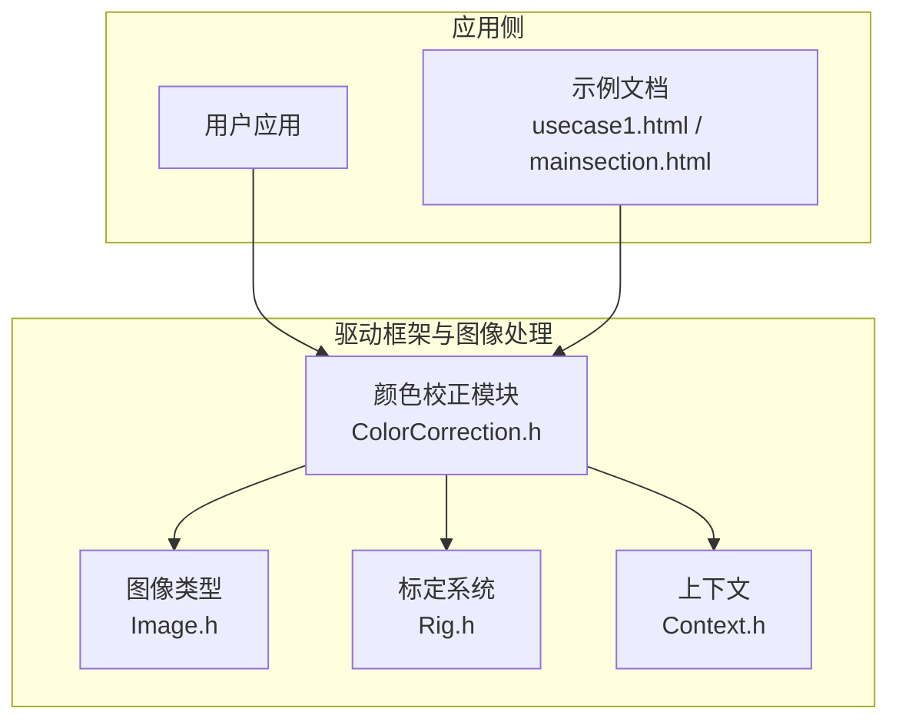
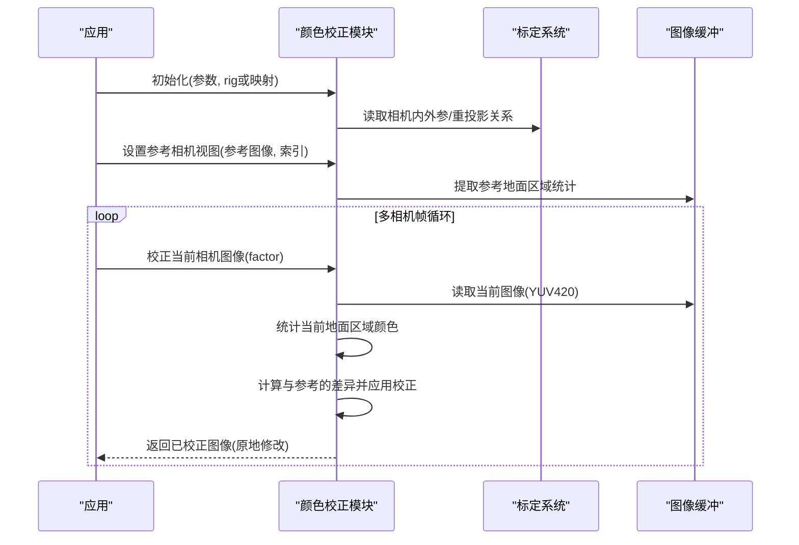
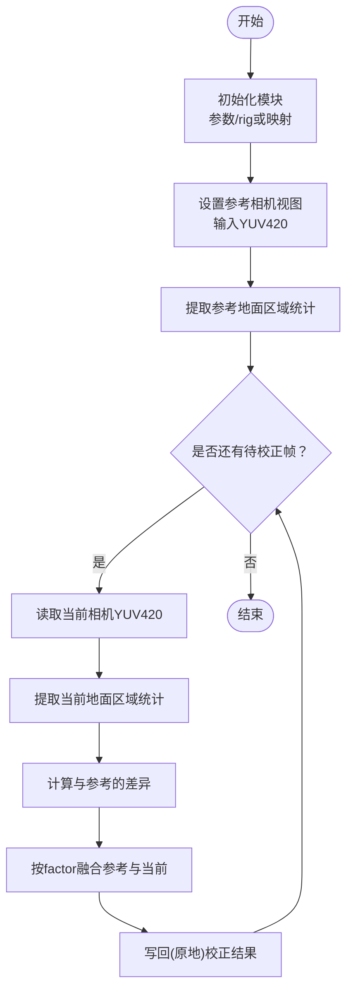
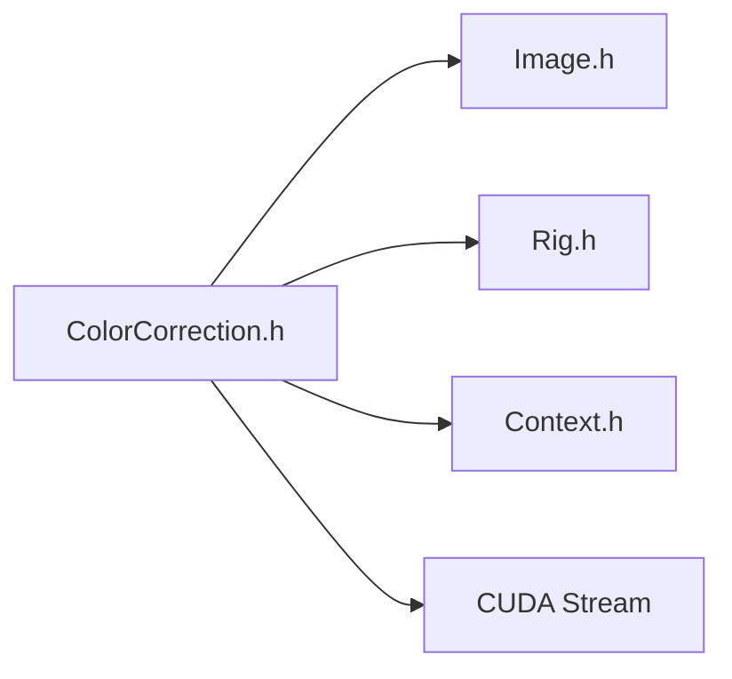

# 颜色校正

<cite>
**本文引用的文件**
- [ColorCorrection.h](file://driverorks-5.10/include/dw/imageprocessing/colorcorrection/ColorCorrection.h)
- [colorcorrection_mainsection.html](file://driverorks-5.10/doc/nvsdk_dw_html/colorcorrection_mainsection.html)
- [colorcorrection_usecase1.html](file://driverorks-5.10/doc/nvsdk_dw_html/colorcorrection_usecase1.html)
- [samples_2imageprocessing_2colorcorrection_2README_8md.html](file://driverorks-5.10/doc/nvsdk_dw_html/samples_2imageprocessing_2colorcorrection_2README_8md.html)
</cite>

## 目录
1. [引言](#引言)
2. [项目结构](#项目结构)
3. [核心组件](#核心组件)
4. [架构总览](#架构总览)
5. [详细组件分析](#详细组件分析)
6. [依赖关系分析](#依赖关系分析)
7. [性能考量](#性能考量)
8. [故障排查指南](#故障排查指南)
9. [结论](#结论)
10. [附录](#附录)

## 引言
本技术文档围绕 DriveWorks SDK 中的颜色校正模块展开，系统阐述其在多相机系统（如车载环视）中的作用：通过统计各相机“地面区域”的颜色分布，将不同相机采集到的图像在颜色上进行协调统一，从而获得一致、自然的视觉效果。文档重点覆盖以下方面：
- 模块接口与数据结构
- 校正流程与工作原理
- 参数配置与调节方法（自动参考与手动因子）
- 数学原理与实现要点（颜色空间、YUV420、重投影与直方图统计）
- 与其他图像处理模块的衔接与影响
- 实际应用场景与效果评估建议

## 项目结构
颜色校正模块位于 SDK 的图像处理子系统中，对外提供 C 接口，核心头文件定义了初始化、设置参考视图、执行校正以及资源管理等能力。配套文档提供了完整的使用流程与示例说明。

图表来源
- [ColorCorrection.h:1-257](file://driverorks-5.10/include/dw/imageprocessing/colorcorrection/ColorCorrection.h#L1-L257)
- [colorcorrection_mainsection.html:116-131](file://driverorks-5.10/doc/nvsdk_dw_html/colorcorrection_mainsection.html#L116-L131)
- [colorcorrection_usecase1.html:116-154](file://driverorks-5.10/doc/nvsdk_dw_html/colorcorrection_usecase1.html#L116-L154)

章节来源
- [ColorCorrection.h:31-257](file://driverorks-5.10/include/dw/imageprocessing/colorcorrection/ColorCorrection.h#L31-L257)
- [colorcorrection_mainsection.html:116-131](file://driverorks-5.10/doc/nvsdk_dw_html/colorcorrection_mainsection.html#L116-L131)
- [colorcorrection_usecase1.html:116-154](file://driverorks-5.10/doc/nvsdk_dw_html/colorcorrection_usecase1.html#L116-L154)

## 核心组件
- 句柄与参数
  - 句柄类型：用于承载颜色校正状态与资源的对象句柄
  - 参数结构：包含输入图像宽高、内部投影图像的宽高等关键配置项
- 初始化方式
  - 基于标定 rig.json 的初始化
  - 基于外部重投影映射的初始化
- 关键操作
  - 设置参考相机视图（作为统计基准）
  - 对当前相机图像进行全局颜色校正（可调节融合权重）

章节来源
- [ColorCorrection.h:60-83](file://driverorks-5.10/include/dw/imageprocessing/colorcorrection/ColorCorrection.h#L60-L83)
- [ColorCorrection.h:86-139](file://driverorks-5.10/include/dw/imageprocessing/colorcorrection/ColorCorrection.h#L86-L139)
- [ColorCorrection.h:196-250](file://driverorks-5.10/include/dw/imageprocessing/colorcorrection/ColorCorrection.h#L196-L250)

## 架构总览
颜色校正模块以“参考视图 + 统计匹配”为核心思想：选择一个参考相机（通常为画面稳定、地面覆盖良好的视角），提取其地面区域的颜色统计信息；随后对其他相机图像进行颜色校正，使其颜色分布向参考视图靠拢。该过程涉及：
- 输入图像格式要求（YUV420）
- 内部重投影与统计（基于地面平面）
- 在线融合（factor 控制参考权重）

图表来源
- [colorcorrection_usecase1.html:116-154](file://driverorks-5.10/doc/nvsdk_dw_html/colorcorrection_usecase1.html#L116-L154)
- [ColorCorrection.h:196-250](file://driverorks-5.10/include/dw/imageprocessing/colorcorrection/ColorCorrection.h#L196-L250)

## 详细组件分析

### 数据结构与接口
- 句柄类型：用于封装颜色校正对象生命周期与内部状态
- 参数结构：cameraWidth/cameraHeight 必须为偶数（与 YUV420 的 UV 平面子采样一致）；projectionWidth/projectionHeight 为内部投影图像尺寸，默认值见接口注释
- 初始化函数族：
  - 基于 rig.json 的初始化
  - 基于外部重投影映射的初始化（适合已有地面重投影矩阵的场景）
- 资源管理：
  - 释放与重置接口，确保句柄安全回收
- CUDA 流控制：
  - 设置/获取 CUDA 流，便于与流水线并行执行

章节来源
- [ColorCorrection.h:60-83](file://driverorks-5.10/include/dw/imageprocessing/colorcorrection/ColorCorrection.h#L60-L83)
- [ColorCorrection.h:86-139](file://driverorks-5.10/include/dw/imageprocessing/colorcorrection/ColorCorrection.h#L86-L139)
- [ColorCorrection.h:141-194](file://driverorks-5.10/include/dw/imageprocessing/colorcorrection/ColorCorrection.h#L141-L194)

### 校正流程与工作原理
- 参考视图建立：将某相机的 YUV420 图像作为参考，提取其地面区域的颜色分布统计
- 当前帧校正：对其他相机图像，同样提取地面区域统计，并与参考统计进行匹配，按 factor 进行加权融合
- 输入输出约定：图像格式为 YUV420，校正在原图缓冲区就地完成

图表来源
- [colorcorrection_usecase1.html:116-154](file://driverorks-5.10/doc/nvsdk_dw_html/colorcorrection_usecase1.html#L116-L154)
- [ColorCorrection.h:196-250](file://driverorks-5.10/include/dw/imageprocessing/colorcorrection/ColorCorrection.h#L196-L250)

章节来源
- [colorcorrection_usecase1.html:116-154](file://driverorks-5.10/doc/nvsdk_dw_html/colorcorrection_usecase1.html#L116-L154)
- [ColorCorrection.h:196-250](file://driverorks-5.10/include/dw/imageprocessing/colorcorrection/ColorCorrection.h#L196-L250)

### 数学原理与实现要点
- 颜色空间与格式
  - 输入图像采用 YUV420（UV 平面子采样），这决定了 cameraWidth/cameraHeight 必须为偶数
- 重投影与地面区域
  - 通过标定或外部映射，将各相机图像重投影到共同的地面平面，从而保证不同视角下的地面区域具有可比性
- 统计匹配
  - 以地面区域为样本，统计颜色分布（例如均值/方差或直方图特征），并据此对当前帧进行颜色调整
- 融合因子
  - factor ∈ [0.f, 1.f]：0.f 表示不进行颜色校正，1.f 表示完全跟随参考颜色分布

章节来源
- [ColorCorrection.h:101-103](file://driverorks-5.10/include/dw/imageprocessing/colorcorrection/ColorCorrection.h#L101-L103)
- [ColorCorrection.h:221-244](file://driverorks-5.10/include/dw/imageprocessing/colorcorrection/ColorCorrection.h#L221-L244)
- [colorcorrection_usecase1.html:149-153](file://driverorks-5.10/doc/nvsdk_dw_html/colorcorrection_usecase1.html#L149-L153)

### 参数设置与调节方法
- 初始化参数
  - cameraWidth/cameraHeight：与输入图像一致，且为偶数
  - projectionWidth/projectionHeight：内部投影图像尺寸，默认值见接口注释
- 参考视图设置
  - 选择画面稳定、地面覆盖良好且光照相对均匀的相机作为参考
- 校正强度控制
  - factor：0.f 不校正，1.f 完全跟随参考；典型场景可从 0.8f 开始微调
- CUDA 流设置
  - 将颜色校正绑定到特定 CUDA 流，便于与前后端算子并行调度

章节来源
- [ColorCorrection.h:67-83](file://driverorks-5.10/include/dw/imageprocessing/colorcorrection/ColorCorrection.h#L67-L83)
- [ColorCorrection.h:196-250](file://driverorks-5.10/include/dw/imageprocessing/colorcorrection/ColorCorrection.h#L196-L250)
- [colorcorrection_usecase1.html:149-153](file://driverorks-5.10/doc/nvsdk_dw_html/colorcorrection_usecase1.html#L149-L153)

### 代码示例路径
以下为官方文档中给出的典型调用序列，可作为实现参考：
- 初始化与设置参考视图
  - [colorcorrection_usecase1.html:125-131](file://driverorks-5.10/doc/nvsdk_dw_html/colorcorrection_usecase1.html#L125-L131)
  - [colorcorrection_usecase1.html:142-143](file://driverorks-5.10/doc/nvsdk_dw_html/colorcorrection_usecase1.html#L142-L143)
- 执行颜色校正
  - [colorcorrection_usecase1.html:147-148](file://driverorks-5.10/doc/nvsdk_dw_html/colorcorrection_usecase1.html#L147-L148)

章节来源
- [colorcorrection_usecase1.html:125-148](file://driverorks-5.10/doc/nvsdk_dw_html/colorcorrection_usecase1.html#L125-L148)

### 与其他图像处理算法的影响
- 与图像金字塔/特征检测/跟踪等模块的衔接
  - 颜色一致性有助于提升后续算法的鲁棒性（如特征点匹配、光流跟踪、语义分割等）
- 与渲染/拼接模块的配合
  - 经过颜色校正的输入图像能减少拼接缝的颜色差异，改善最终全景图质量
- 与传感器同步/标定的一致性
  - 正确的标定与重投影是颜色校正有效性的前提

章节来源
- [colorcorrection_mainsection.html:120-127](file://driverorks-5.10/doc/nvsdk_dw_html/colorcorrection_mainsection.html#L120-L127)

## 依赖关系分析
- 模块内聚与耦合
  - 颜色校正模块主要依赖图像类型与标定系统；与上下文交互用于资源分配与生命周期管理
- 外部依赖
  - CUDA 流用于异步执行
  - YUV420 图像格式要求严格，需确保上游数据准备符合规范
- 可能的循环依赖
  - 无直接循环依赖迹象；模块职责清晰

图表来源
- [ColorCorrection.h:49-54](file://driverorks-5.10/include/dw/imageprocessing/colorcorrection/ColorCorrection.h#L49-L54)
- [ColorCorrection.h:166-194](file://driverorks-5.10/include/dw/imageprocessing/colorcorrection/ColorCorrection.h#L166-L194)

章节来源
- [ColorCorrection.h:49-54](file://driverorks-5.10/include/dw/imageprocessing/colorcorrection/ColorCorrection.h#L49-L54)
- [ColorCorrection.h:166-194](file://driverorks-5.10/include/dw/imageprocessing/colorcorrection/ColorCorrection.h#L166-L194)

## 性能考量
- 并行与流水线
  - 使用 CUDA 流将颜色校正与其它算子并行执行，提高整体吞吐
- 内存与带宽
  - YUV420 的 UV 子采样降低内存占用；注意输入尺寸必须为偶数以避免额外处理开销
- 投影图像尺寸
  - 合理设置内部投影图像尺寸，在精度与性能之间取得平衡
- 融合因子
  - 较高的 factor 会引入更强的颜色约束，但可能导致动态场景出现过度平滑

## 故障排查指南
- 常见错误与定位
  - 句柄无效/空指针：检查初始化返回值与句柄有效性
  - 图像格式不符：确认输入为 YUV420，像素类型为 8bit
  - 尺寸不匹配：输入图像尺寸需与初始化参数一致，且宽高为偶数
  - 未设置参考视图：在执行校正前必须先设置参考视图
- 调试建议
  - 先用单帧验证流程，再逐步接入流水线
  - 从较小的 factor 开始，逐步增大观察效果变化
  - 对比参考视图与当前帧的地面区域直方图，辅助判断统计偏差

章节来源
- [ColorCorrection.h:196-250](file://driverorks-5.10/include/dw/imageprocessing/colorcorrection/ColorCorrection.h#L196-L250)

## 结论
颜色校正模块通过“参考视图 + 地面区域统计 + 加权融合”的策略，有效缓解多相机系统中的颜色不一致问题。正确配置参数、合理设置参考视图与融合因子，并结合 CUDA 流实现并行化，可在保证实时性的前提下显著提升下游算法的稳定性与最终可视化质量。

## 附录
- 示例文档索引
  - [samples_2imageprocessing_2colorcorrection_2README_8md.html](file://driverorks-5.10/doc/nvsdk_dw_html/samples_2imageprocessing_2colorcorrection_2README_8md.html)
  - [colorcorrection_mainsection.html](file://driverorks-5.10/doc/nvsdk_dw_html/colorcorrection_mainsection.html)
  - [colorcorrection_usecase1.html](file://driverorks-5.10/doc/nvsdk_dw_html/colorcorrection_usecase1.html)