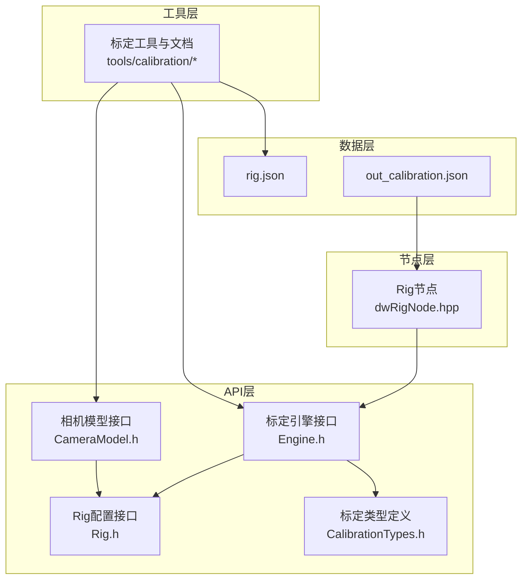
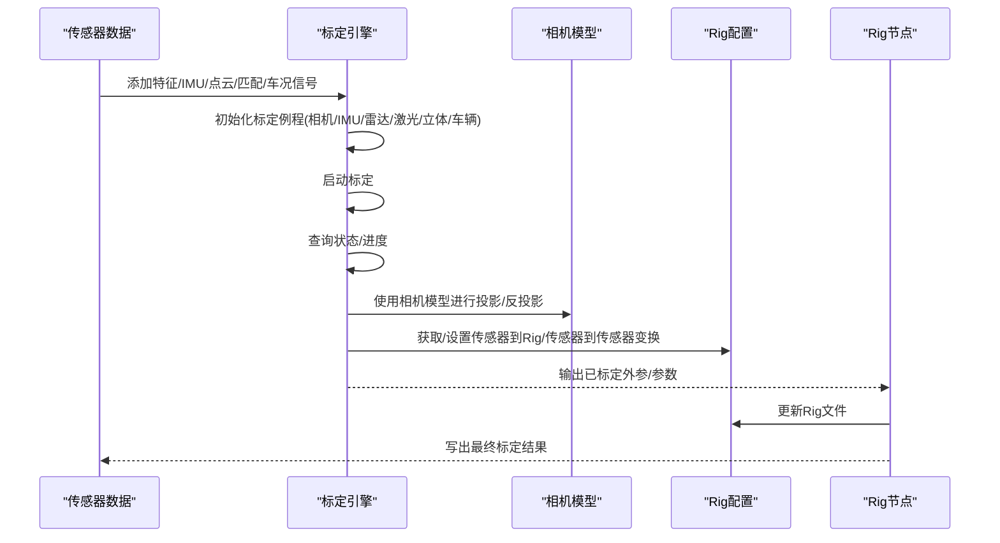
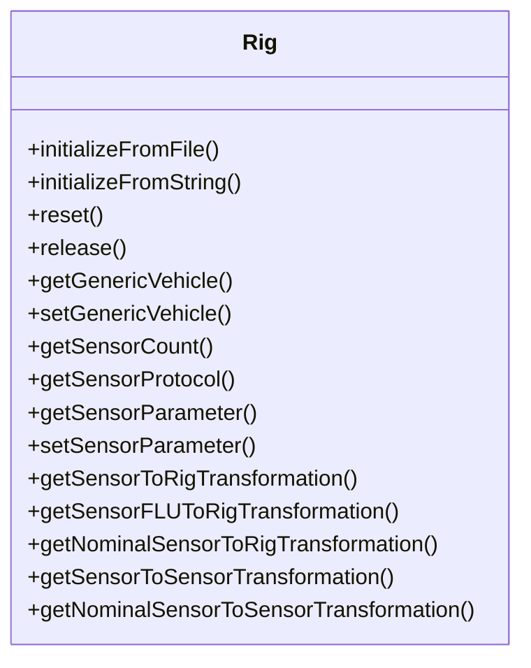
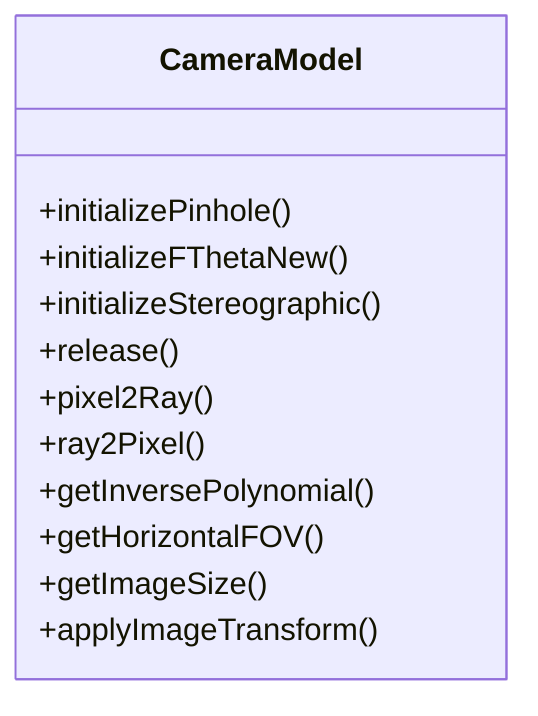
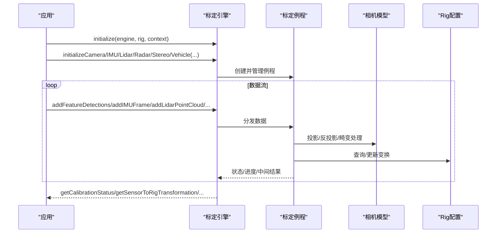
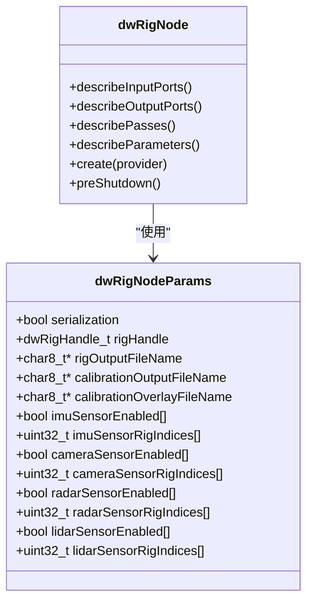
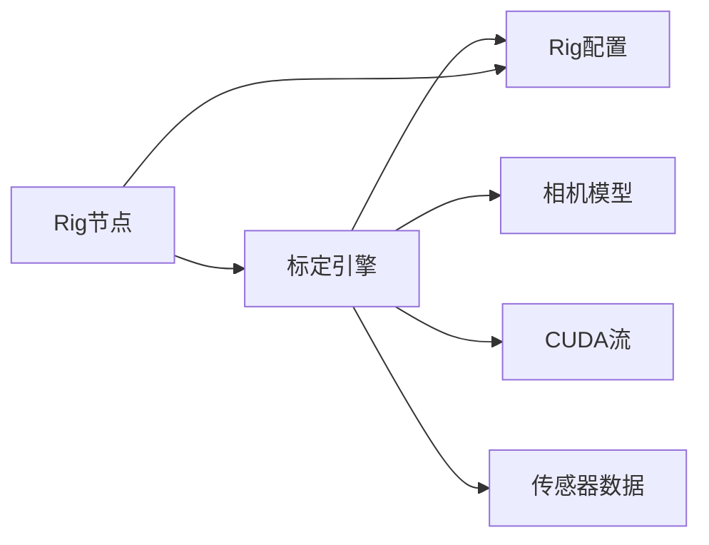

# 标定与坐标系

<cite>
**本文引用的文件**
- [Rig.h](file://driverorks-5.10/include/dw/rig/Rig.h)
- [Engine.h](file://driverorks-5.10/include/dw/calibration/engine/Engine.h)
- [CameraModel.h](file://driverorks-5.10/include/dw/calibration/cameramodel/CameraModel.h)
- [CalibrationTypes.h](file://driverorks-5.10/include/dw/calibration/engine/common/CalibrationTypes.h)
- [dwRigNode.hpp](file://driverorks-5.10/include/dwframework/dwnodes/dwrignode/dwRigNode.hpp)
- [README-calibration-imu.md](file://driverorks-5.10/tools/calibration/README-calibration-imu.md)
- [README-calibration-recorder.md](file://driverorks-5.10/tools/calibration/README-calibration-recorder.md)
- [README-intrinsics-constraints.md](file://driverorks-5.10/tools/calibration/README-intrinsics-constraints.md)
- [README-intrinsics-validator.md](file://driverorks-5.10/tools/calibration/README-intrinsics-validator.md)
- [rig.json](file://driverorks-5.10/data/samples/cgf/trafficlightturning-hyperion8/rig.json)
- [out_calibration.json](file://driverorks-5.10/data/samples/cgf/trafficlightturning-hyperion8/out_calibration.json)
</cite>

## 目录
1. [引言](#引言)
2. [项目结构](#项目结构)
3. [核心组件](#核心组件)
4. [架构总览](#架构总览)
5. [详细组件分析](#详细组件分析)
6. [依赖分析](#依赖分析)
7. [性能考虑](#性能考虑)
8. [故障排查指南](#故障排查指南)
9. [结论](#结论)
10. [附录](#附录)

## 引言
本技术文档围绕标定与坐标系模块，系统阐述多传感器系统标定（Rig）的架构与实现，覆盖相机模型的数学基础与实现、内参与外参标定方法、畸变校正算法、约束条件与优化策略、标定引擎工作流（自动标定、质量评估、结果验证）、工具使用指南与API参考，并提供标定精度分析与误差传播计算方法。文档面向不同层次读者，既提供高层概览也给出代码级细节与可视化图示。

## 项目结构
标定与坐标系功能主要分布在以下层次：
- API层：标定引擎接口、相机模型接口、Rig配置接口
- 节点层：CGF节点用于接收已标定外参并维护Rig文件更新
- 工具层：标定辅助工具与文档说明
- 数据层：rig.json与标定输出文件

**图表来源**
- [Engine.h](file://driverorks-5.10/include/dw/calibration/engine/Engine.h)
- [CameraModel.h](file://driverorks-5.10/include/dw/calibration/cameramodel/CameraModel.h)
- [Rig.h](file://driverorks-5.10/include/dw/rig/Rig.h)
- [CalibrationTypes.h](file://driverorks-5.10/include/dw/calibration/engine/common/CalibrationTypes.h)
- [dwRigNode.hpp](file://driverorks-5.10/include/dwframework/dwnodes/dwrignode/dwRigNode.hpp)
- [rig.json](file://driverorks-5.10/data/samples/cgf/trafficlightturning-hyperion8/rig.json)
- [out_calibration.json](file://driverorks-5.10/data/samples/cgf/trafficlightturning-hyperion8/out_calibration.json)

**章节来源**
- [Engine.h](file://driverorks-5.10/include/dw/calibration/engine/Engine.h)
- [CameraModel.h](file://driverorks-5.10/include/dw/calibration/cameramodel/CameraModel.h)
- [Rig.h](file://driverorks-5.10/include/dw/rig/Rig.h)
- [CalibrationTypes.h](file://driverorks-5.10/include/dw/calibration/engine/common/CalibrationTypes.h)
- [dwRigNode.hpp](file://driverorks-5.10/include/dwframework/dwnodes/dwrignode/dwRigNode.hpp)

## 核心组件
- 标定引擎（Calibration Engine）
  - 提供相机、IMU、激光雷达、毫米波雷达、立体相机、车辆参数等标定初始化与运行接口
  - 支持查询状态、获取变换与参数估计结果（如轮径、速度因子、转向参数）
- 相机模型（Camera Model）
  - 提供针孔、F-Theta、 Stereographic 等模型的前向投影与反投影能力
  - 支持畸变系数、图像尺寸、主点、焦距等参数
- Rig 配置（Rig）
  - 定义车辆与传感器挂载关系、坐标系与外参
  - 提供传感器到Rig、传感器到传感器的变换查询与设置
- CGF 节点（dwRigNode）
  - 接收各传感器的已标定外参，维护Rig文件并在退出时写回

**章节来源**
- [Engine.h](file://driverorks-5.10/include/dw/calibration/engine/Engine.h)
- [CameraModel.h](file://driverorks-5.10/include/dw/calibration/cameramodel/CameraModel.h)
- [Rig.h](file://driverorks-5.10/include/dw/rig/Rig.h)
- [dwRigNode.hpp](file://driverorks-5.10/include/dwframework/dwnodes/dwrignode/dwRigNode.hpp)

## 架构总览
下图展示从数据输入到标定输出的整体流程，以及关键模块间的交互关系。

**图表来源**
- [Engine.h](file://driverorks-5.10/include/dw/calibration/engine/Engine.h)
- [CameraModel.h](file://driverorks-5.10/include/dw/calibration/cameramodel/CameraModel.h)
- [Rig.h](file://driverorks-5.10/include/dw/rig/Rig.h)
- [dwRigNode.hpp](file://driverorks-5.10/include/dwframework/dwnodes/dwrignode/dwRigNode.hpp)

## 详细组件分析

### 组件A：Rig 类与多传感器系统标定
- 功能要点
  - 加载/重置/释放Rig配置
  - 获取/设置车辆属性（通用车辆）
  - 查询传感器数量、协议、参数
  - 获取/设置传感器到Rig、传感器到传感器的变换
  - 支持FLU坐标系与Nominal静态参考变换
- 关键API路径
  - 初始化/重置/释放：[dwRig_initializeFromFile](file://driverorks-5.10/include/dw/rig/Rig.h), [dwRig_reset](file://driverorks-5.10/include/dw/rig/Rig.h), [dwRig_release](file://driverorks-5.10/include/dw/rig/Rig.h)
  - 车辆属性：[dwRig_getGenericVehicle](file://driverorks-5.10/include/dw/rig/Rig.h), [dwRig_setGenericVehicle](file://driverorks-5.10/include/dw/rig/Rig.h)
  - 传感器查询与参数：[dwRig_getSensorCount](file://driverorks-5.10/include/dw/rig/Rig.h), [dwRig_getSensorProtocol](file://driverorks-5.10/include/dw/rig/Rig.h), [dwRig_getSensorParameter](file://driverorks-5.10/include/dw/rig/Rig.h), [dwRig_setSensorParameter](file://driverorks-5.10/include/dw/rig/Rig.h)
  - 变换查询与设置：[dwRig_getSensorToRigTransformation](file://driverorks-5.10/include/dw/rig/Rig.h), [dwRig_getSensorFLUToRigTransformation](file://driverorks-5.10/include/dw/rig/Rig.h), [dwRig_getNominalSensorToRigTransformation](file://driverorks-5.10/include/dw/rig/Rig.h), [dwRig_getSensorToSensorTransformation](file://driverorks-5.10/include/dw/rig/Rig.h), [dwRig_getNominalSensorToSensorTransformation](file://driverorks-5.10/include/dw/rig/Rig.h), [dwRig_getSensorToRigTransformation](file://driverorks-5.10/include/dw/rig/Rig.h)

**图表来源**
- [Rig.h](file://driverorks-5.10/include/dw/rig/Rig.h)

**章节来源**
- [Rig.h](file://driverorks-5.10/include/dw/rig/Rig.h)

### 组件B：相机模型与畸变校正
- 模型支持
  - 针孔模型：支持畸变系数、主点、焦距
  - F-Theta 新模型：支持前向/后向多项式映射、线性像素变换矩阵
  - Stereographic 投影：基于水平视场角
- 关键API路径
  - 初始化：[dwCameraModel_initializePinhole](file://driverorks-5.10/include/dw/calibration/cameramodel/CameraModel.h), [dwCameraModel_initializeFThetaNew](file://driverorks-5.10/include/dw/calibration/cameramodel/CameraModel.h), [dwCameraModel_initializeStereographic](file://driverorks-5.10/include/dw/calibration/cameramodel/CameraModel.h)
  - 投影/反投影：[dwCameraModel_ray2Pixel](file://driverorks-5.10/include/dw/calibration/cameramodel/CameraModel.h), [dwCameraModel_pixel2Ray](file://driverorks-5.10/include/dw/calibration/cameramodel/CameraModel.h)
  - 辅助能力：[dwCameraModel_getInversePolynomial](file://driverorks-5.10/include/dw/calibration/cameramodel/CameraModel.h), [dwCameraModel_getHorizontalFOV](file://driverorks-5.10/include/dw/calibration/cameramodel/CameraModel.h), [dwCameraModel_getImageSize](file://driverorks-5.10/include/dw/calibration/cameramodel/CameraModel.h), [dwCameraModel_applyImageTransform](file://driverorks-5.10/include/dw/calibration/cameramodel/CameraModel.h)

**图表来源**
- [CameraModel.h](file://driverorks-5.10/include/dw/calibration/cameramodel/CameraModel.h)

**章节来源**
- [CameraModel.h](file://driverorks-5.10/include/dw/calibration/cameramodel/CameraModel.h)

### 组件C：标定引擎与自动标定流程
- 标定例程初始化
  - 相机：[dwCalibrationEngine_initializeCamera](file://driverorks-5.10/include/dw/calibration/engine/Engine.h)
  - IMU：[dwCalibrationEngine_initializeIMU](file://driverorks-5.10/include/dw/calibration/engine/Engine.h)
  - 激光雷达：[dwCalibrationEngine_initializeLidar](file://driverorks-5.10/include/dw/calibration/engine/Engine.h)
  - 毫米波雷达：[dwCalibrationEngine_initializeRadar](file://driverorks-5.10/include/dw/calibration/engine/Engine.h)
  - 立体相机：[dwCalibrationEngine_initializeStereo](file://driverorks-5.10/include/dw/calibration/engine/Engine.h)
  - 车辆参数：[dwCalibrationEngine_initializeVehicle](file://driverorks-5.10/include/dw/calibration/engine/Engine.h)
- 运行与查询
  - 启停：[dwCalibrationEngine_startCalibration](file://driverorks-5.10/include/dw/calibration/engine/Engine.h), [dwCalibrationEngine_stopCalibration](file://driverorks-5.10/include/dw/calibration/engine/Engine.h)
  - 状态与信号：[dwCalibrationEngine_getCalibrationStatus](file://driverorks-5.10/include/dw/calibration/engine/Engine.h), [dwCalibrationEngine_getSupportedSignals](file://driverorks-5.10/include/dw/calibration/engine/Engine.h)
  - 结果查询：[dwCalibrationEngine_getSensorToRigTransformation](file://driverorks-5.10/include/dw/calibration/engine/Engine.h), [dwCalibrationEngine_getSensorToSensorTransformation](file://driverorks-5.10/include/dw/calibration/engine/Engine.h), [dwCalibrationEngine_getOdometrySpeedFactor](file://driverorks-5.10/include/dw/calibration/engine/Engine.h), [dwCalibrationEngine_getVehicleWheelRadius](file://driverorks-5.10/include/dw/calibration/engine/Engine.h), [dwCalibrationEngine_getVehicleSteeringProperties](file://driverorks-5.10/include/dw/calibration/engine/Engine.h)
- 数据注入
  - 特征/匹配/IMU/点云/雷达运动/车况信号：[dwCalibrationEngine_addFeatureDetections](file://driverorks-5.10/include/dw/calibration/engine/Engine.h), [dwCalibrationEngine_addMatches](file://driverorks-5.10/include/dw/calibration/engine/Engine.h), [dwCalibrationEngine_addIMUFrame](file://driverorks-5.10/include/dw/calibration/engine/Engine.h), [dwCalibrationEngine_addLidarPointCloud](file://driverorks-5.10/include/dw/calibration/engine/Engine.h), [dwCalibrationEngine_addLidarPose](file://driverorks-5.10/include/dw/calibration/engine/Engine.h), [dwCalibrationEngine_addRadarDopplerMotion](file://driverorks-5.10/include/dw/calibration/engine/Engine.h), [dwCalibrationEngine_addVehicleIONonSafetyState](file://driverorks-5.10/include/dw/calibration/engine/Engine.h), [dwCalibrationEngine_addVehicleIOActuationFeedback](file://driverorks-5.10/include/dw/calibration/engine/Engine.h)

**图表来源**
- [Engine.h](file://driverorks-5.10/include/dw/calibration/engine/Engine.h)
- [CameraModel.h](file://driverorks-5.10/include/dw/calibration/cameramodel/CameraModel.h)
- [Rig.h](file://driverorks-5.10/include/dw/rig/Rig.h)

**章节来源**
- [Engine.h](file://driverorks-5.10/include/dw/calibration/engine/Engine.h)
- [CalibrationTypes.h](file://driverorks-5.10/include/dw/calibration/engine/common/CalibrationTypes.h)

### 组件D：CGF 节点（dwRigNode）与Rig文件维护
- 输入端口
  - IMU外参、相机外参数组、雷达外参数组、激光外参数组
  - 轮径、前轮转向偏置
  - 可选：IMU内参、相机内参、存储开关
- 参数描述
  - 序列化开关、rig句柄、输出文件名、叠加文件名
  - 各传感器启用标志与在Rig中的索引
- 生命周期
  - SETUP/PROCESS/TEARDOWN三阶段
  - 退出前执行预关机动作，写回Rig与标定叠加

**图表来源**
- [dwRigNode.hpp](file://driverorks-5.10/include/dwframework/dwnodes/dwrignode/dwRigNode.hpp)

**章节来源**
- [dwRigNode.hpp](file://driverorks-5.10/include/dwframework/dwnodes/dwrignode/dwRigNode.hpp)

### 组件E：标定工具与使用指南
- IMU标定说明：[README-calibration-imu.md](file://driverorks-5.10/tools/calibration/README-calibration-imu.md)
- 录制器与数据采集：[README-calibration-recorder.md](file://driverorks-5.10/tools/calibration/README-calibration-recorder.md)
- 内参约束与验证：[README-intrinsics-constraints.md](file://driverorks-5.10/tools/calibration/README-intrinsics-constraints.md), [README-intrinsics-validator.md](file://driverorks-5.10/tools/calibration/README-intrinsics-validator.md)
- 示例数据
  - rig.json：[rig.json](file://driverorks-5.10/data/samples/cgf/trafficlightturning-hyperion8/rig.json)
  - out_calibration.json：[out_calibration.json](file://driverorks-5.10/data/samples/cgf/trafficlightturning-hyperion8/out_calibration.json)

**章节来源**
- [README-calibration-imu.md](file://driverorks-5.10/tools/calibration/README-calibration-imu.md)
- [README-calibration-recorder.md](file://driverorks-5.10/tools/calibration/README-calibration-recorder.md)
- [README-intrinsics-constraints.md](file://driverorks-5.10/tools/calibration/README-intrinsics-constraints.md)
- [README-intrinsics-validator.md](file://driverorks-5.10/tools/calibration/README-intrinsics-validator.md)
- [rig.json](file://driverorks-5.10/data/samples/cgf/trafficlightturning-hyperion8/rig.json)
- [out_calibration.json](file://driverorks-5.10/data/samples/cgf/trafficlightturning-hyperion8/out_calibration.json)

## 依赖分析
- 模块耦合
  - 标定引擎依赖Rig与相机模型；相机模型依赖Rig配置中的传感器参数
  - CGF节点依赖标定引擎输出的已标定外参，驱动Rig文件更新
- 外部依赖
  - CUDA流（用于加速计算）
  - 传感器数据（特征、IMU、点云、匹配、雷达多普勒运动、车况信号）

**图表来源**
- [Engine.h](file://driverorks-5.10/include/dw/calibration/engine/Engine.h)
- [CameraModel.h](file://driverorks-5.10/include/dw/calibration/cameramodel/CameraModel.h)
- [Rig.h](file://driverorks-5.10/include/dw/rig/Rig.h)
- [dwRigNode.hpp](file://driverorks-5.10/include/dwframework/dwnodes/dwrignode/dwRigNode.hpp)

**章节来源**
- [Engine.h](file://driverorks-5.10/include/dw/calibration/engine/Engine.h)
- [CameraModel.h](file://driverorks-5.10/include/dw/calibration/cameramodel/CameraModel.h)
- [Rig.h](file://driverorks-5.10/include/dw/rig/Rig.h)
- [dwRigNode.hpp](file://driverorks-5.10/include/dwframework/dwnodes/dwrignode/dwRigNode.hpp)

## 性能考虑
- 并行与流水线
  - 利用CUDA流对相机标定、激光雷达处理等进行并行加速
  - 建议按传感器类型分派独立例程，减少锁竞争
- 数据吞吐
  - 特征检测与匹配应尽量在GPU侧完成，减少主机内存拷贝
  - 合理设置历史容量与时间戳索引，避免过长的历史链导致计算开销增大
- 稳定性
  - 在启动标定前满足运行时依赖（如IMU精度、轮径估计可用），可显著提升收敛速度与稳定性

## 故障排查指南
- 常见错误与定位
  - 句柄无效：检查上下文与Rig句柄有效性
  - 缓冲区满：确认并发标定例程数量不超过最大限制
  - 越界访问：核对传感器索引与Rig中传感器数量
  - 不支持操作：某些例程不支持查询特定参数或变换
- 状态监控
  - 使用标定状态查询接口判断是否接受、失败或无效
  - 结合信号位判断例程支持的估计项（外参、轮径、速度因子、转向偏置、内参尺度等）
- 工具辅助
  - 使用内参约束与验证工具检查相机内参合理性
  - 使用录制器工具确保数据采集质量与完整性

**章节来源**
- [Engine.h](file://driverorks-5.10/include/dw/calibration/engine/Engine.h)
- [CalibrationTypes.h](file://driverorks-5.10/include/dw/calibration/engine/common/CalibrationTypes.h)
- [README-intrinsics-constraints.md](file://driverorks-5.10/tools/calibration/README-intrinsics-constraints.md)
- [README-intrinsics-validator.md](file://driverorks-5.10/tools/calibration/README-intrinsics-validator.md)

## 结论
本模块通过清晰的API分层（引擎、模型、配置、节点）与完善的工具链，实现了从单传感器到多传感器系统的自动化标定与坐标系维护。结合相机模型的数学一致性、Rig配置的强约束与标定引擎的稳健优化策略，能够有效提升标定精度与鲁棒性。建议在实际工程中严格遵循工具使用规范与约束条件，并以状态监控与验证工具作为质量保障。

## 附录
- API参考速查
  - 标定引擎：[Engine.h](file://driverorks-5.10/include/dw/calibration/engine/Engine.h)
  - 相机模型：[CameraModel.h](file://driverorks-5.10/include/dw/calibration/cameramodel/CameraModel.h)
  - Rig配置：[Rig.h](file://driverorks-5.10/include/dw/rig/Rig.h)
  - 标定类型：[CalibrationTypes.h](file://driverorks-5.10/include/dw/calibration/engine/common/CalibrationTypes.h)
  - CGF节点：[dwRigNode.hpp](file://driverorks-5.10/include/dwframework/dwnodes/dwrignode/dwRigNode.hpp)
- 示例数据
  - rig.json：[rig.json](file://driverorks-5.10/data/samples/cgf/trafficlightturning-hyperion8/rig.json)
  - out_calibration.json：[out_calibration.json](file://driverorks-5.10/data/samples/cgf/trafficlightturning-hyperion8/out_calibration.json)