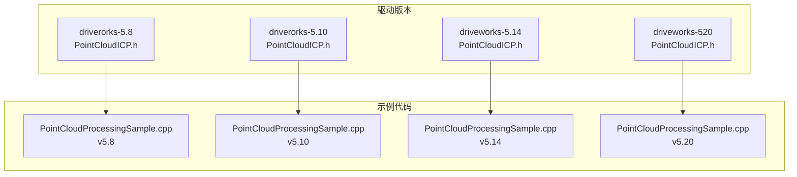
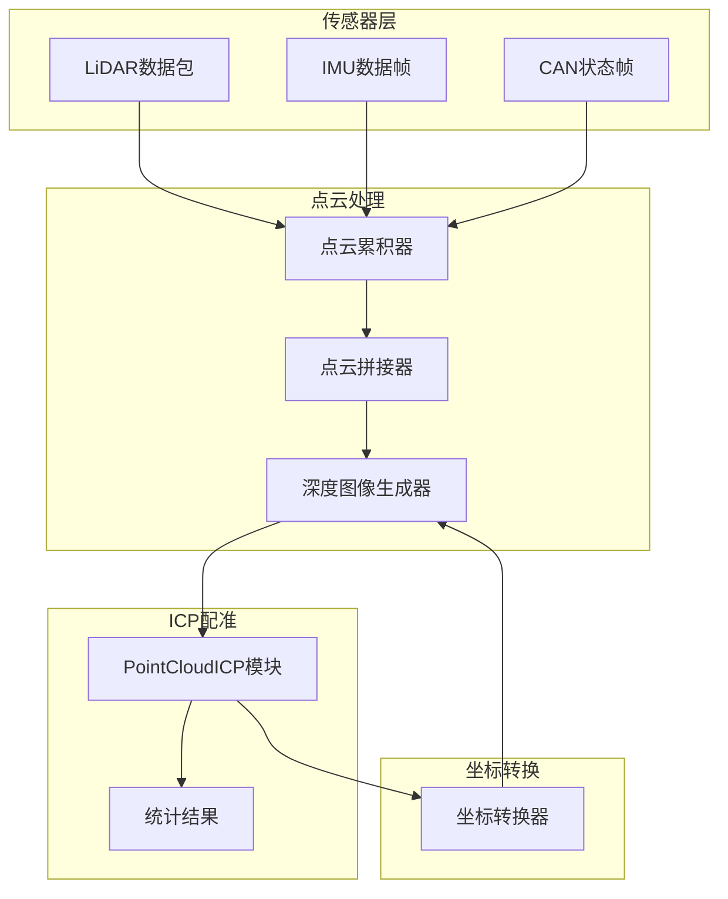
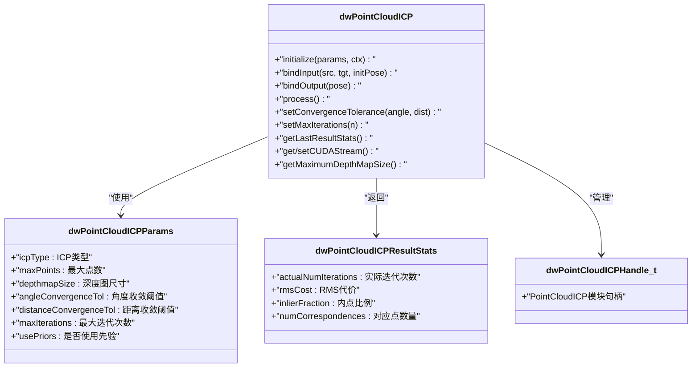
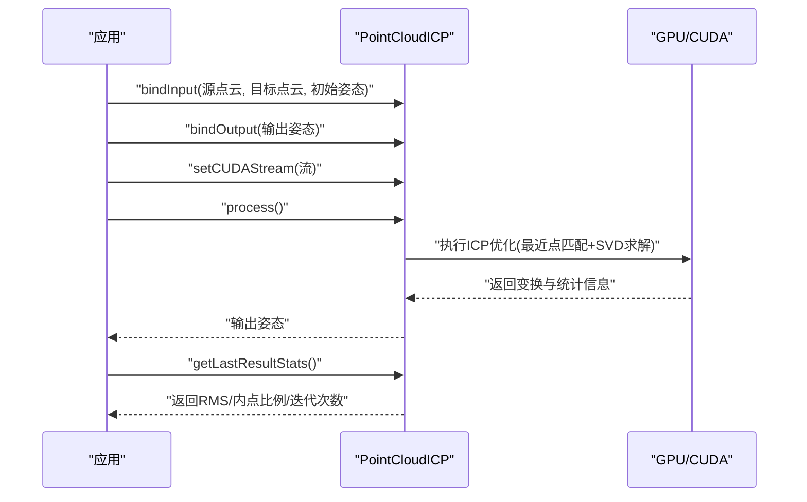
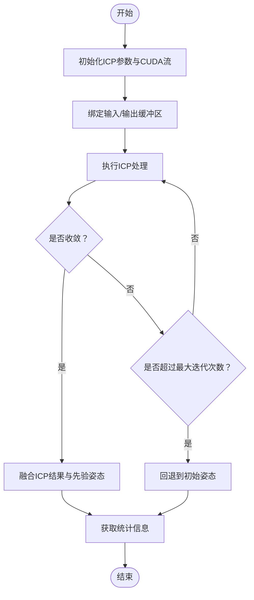
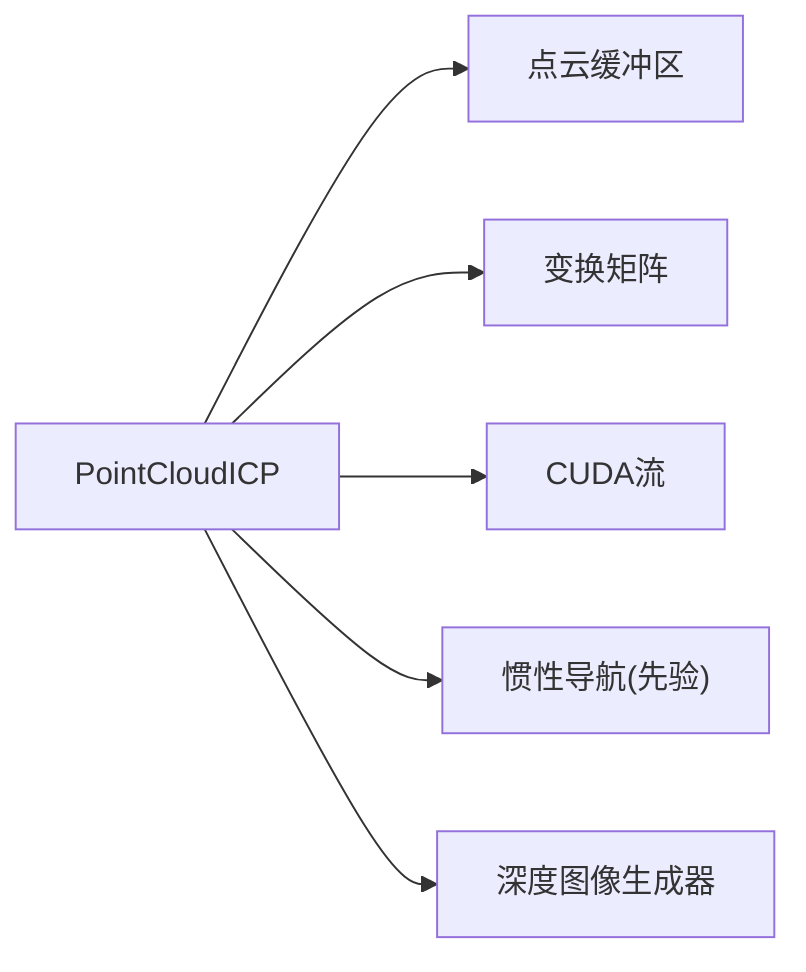

# ICP配准算法

<cite>
**本文档引用的文件**
- [PointCloudICP.h](file://driverorks-5.10/include/dw/pointcloudprocessing/icp/PointCloudICP.h)
- [PointCloudICP.h](file://driveworks-5.14/include/dw/pointcloudprocessing/icp/PointCloudICP.h)
- [PointCloudICP.h](file://driveworks-5.8/include/dw/pointcloudprocessing/icp/PointCloudICP.h)
- [PointCloudICP.h](file://driveworks-520/include/dw/pointcloudprocessing/icp/PointCloudICP.h)
- [PointCloudProcessingSample.cpp](file://driverorks-5.10/samples/src/pointcloudprocessing/PointCloudProcessingSample.cpp)
- [PointCloudProcessingSample.cpp](file://driveworks-5.14/samples/src/pointcloudprocessing/PointCloudProcessingSample.cpp)
- [PointCloudProcessingSample.cpp](file://driveworks-5.8/samples/src/pointcloudprocessing/PointCloudProcessingSample.cpp)
- [PointCloudProcessingSample.cpp](file://driveworks-520/samples/src/pointcloudprocessing/PointCloudProcessingSample.cpp)
</cite>

## 目录
1. [简介](#简介)
2. [项目结构](#项目结构)
3. [核心组件](#核心组件)
4. [架构概览](#架构概览)
5. [详细组件分析](#详细组件分析)
6. [依赖关系分析](#依赖关系分析)
7. [性能考虑](#性能考虑)
8. [故障排除指南](#故障排除指南)
9. [结论](#结论)
10. [附录](#附录)

## 简介

ICP（Iterative Closest Point，迭代最近点）算法是点云配准领域的经典方法，在SLAM（同时定位与地图构建）和机器人定位系统中发挥着关键作用。本技术文档深入解析DriveWorks框架中的PointCloudICP类实现，涵盖以下核心主题：

- 数学原理与收敛条件：基于最近点对应关系建立非线性优化问题，通过旋转和平移参数的迭代更新实现点云对齐。
- 初始姿态估计：结合惯性导航与运动补偿，提供稳健的初值以提升收敛速度与鲁棒性。
- 鲁棒性处理：通过内点比例、最大迭代次数与收敛阈值控制，避免局部最优陷阱。
- 参数配置与匹配策略：深度图表示下的点云组织方式、最大点数限制与CUDA流绑定。
- 性能调优：CUDA图预录制、CUDA流异步执行与内存管理策略。

该实现采用GPU加速，支持在安全平台（如Drive AGX Orin）上通过CUDA Graph进行流水线预录制，减少运行时分配开销，确保实时性能。

## 项目结构

DriveWorks仓库包含多个版本的ICP接口定义与配套示例代码，主要涉及以下目录与文件：

- 头文件路径：`include/dw/pointcloudprocessing/icp/PointCloudICP.h`（多版本）
- 示例代码路径：`samples/src/pointcloudprocessing/PointCloudProcessingSample.cpp`（多版本）

下图展示了与ICP相关的核心文件及其版本分布：

图表来源
- [PointCloudICP.h:1-290](file://driverorks-5.8/include/dw/pointcloudprocessing/icp/PointCloudICP.h#L1-L290)
- [PointCloudICP.h:1-290](file://driverorks-5.10/include/dw/pointcloudprocessing/icp/PointCloudICP.h#L1-L290)
- [PointCloudICP.h:1-290](file://driveworks-5.14/include/dw/pointcloudprocessing/icp/PointCloudICP.h#L1-L290)
- [PointCloudICP.h:1-369](file://driveworks-520/include/dw/pointcloudprocessing/icp/PointCloudICP.h#L1-L369)
- [PointCloudProcessingSample.cpp:1-1066](file://driverorks-5.8/samples/src/pointcloudprocessing/PointCloudProcessingSample.cpp#L1-L1066)
- [PointCloudProcessingSample.cpp:1-1069](file://driverorks-5.10/samples/src/pointcloudprocessing/PointCloudProcessingSample.cpp#L1-L1069)
- [PointCloudProcessingSample.cpp:1-1075](file://driveworks-5.14/samples/src/pointcloudprocessing/PointCloudProcessingSample.cpp#L1-L1075)
- [PointCloudProcessingSample.cpp:1-1096](file://driveworks-520/samples/src/pointcloudprocessing/PointCloudProcessingSample.cpp#L1-L1096)

章节来源
- [PointCloudICP.h:1-290](file://driverorks-5.10/include/dw/pointcloudprocessing/icp/PointCloudICP.h#L1-L290)
- [PointCloudProcessingSample.cpp:1-1069](file://driverorks-5.10/samples/src/pointcloudprocessing/PointCloudProcessingSample.cpp#L1-L1069)

## 核心组件

### PointCloudICP类与模块接口

PointCloudICP模块提供以下核心能力：
- 初始化与释放：创建/销毁ICP句柄，绑定上下文。
- 输入输出绑定：绑定源点云、目标点云与初始变换矩阵；绑定输出位姿。
- 运行流程：设置CUDA流、执行ICP处理、获取统计结果。
- 收敛控制：设置最大迭代次数、角度/距离收敛阈值、自定义收敛回调。
- 深度图约束：限制深度图尺寸，确保GPU内存与计算效率平衡。

关键数据结构与枚举：
- 算法类型：`DW_POINT_CLOUD_ICP_TYPE_DEPTH_MAP`（基于深度图的ICP）
- 参数结构：`dwPointCloudICPParams`（包含ICP类型、最大点数、深度图尺寸、收敛阈值、最大迭代次数、是否使用先验等）
- 统计结构：`dwPointCloudICPResultStats`（实际迭代次数、RMS代价、内点比例、对应点数量）

API要点（以v5.10为例）：
- 初始化：`dwPointCloudICP_initialize(obj, params, ctx)`
- 输入绑定：`dwPointCloudICP_bindInput(sourcePCD, targetPCD, sourceToTarget, obj)`
- 输出绑定：`dwPointCloudICP_bindOutput(pose, obj)`
- 执行：`dwPointCloudICP_process(obj)`
- 收敛设置：`dwPointCloudICP_setConvergenceTolerance(angleTol, distanceTol, obj)`、`dwPointCloudICP_setMaxIterations(maxIterations, obj)`
- 统计查询：`dwPointCloudICP_getLastResultStats(resultStats, obj)`
- CUDA流：`dwPointCloudICP_getCUDAStream(stream, obj)`、`dwPointCloudICP_setCUDAStream(stream, obj)`
- 最大深度图尺寸：`dwPointCloudICP_getMaximumDepthMapSize(maxDepthMapSize)`

章节来源
- [PointCloudICP.h:56-290](file://driverorks-5.10/include/dw/pointcloudprocessing/icp/PointCloudICP.h#L56-L290)
- [PointCloudICP.h:56-290](file://driveworks-5.14/include/dw/pointcloudprocessing/icp/PointCloudICP.h#L56-L290)
- [PointCloudICP.h:56-290](file://driveworks-5.8/include/dw/pointcloudprocessing/icp/PointCloudICP.h#L56-L290)
- [PointCloudICP.h:56-369](file://driveworks-520/include/dw/pointcloudprocessing/icp/PointCloudICP.h#L56-L369)

### 示例应用中的ICP集成

示例代码展示了从原始激光雷达数据到ICP配准的完整流程：
- 数据采集与传感器管理：获取IMU/CAN/LiDAR事件，维护传感器状态。
- 点云累积与拼接：将多传感器点云累积并拼接为统一坐标系。
- 深度图像生成：将拼接后的点云转换为深度图（organized），作为ICP输入。
- 初始姿态估计：使用惯性导航模型计算相邻帧之间的相对变换作为ICP先验。
- ICP执行与融合：根据收敛结果与阈值决定采用ICP精修或直接采用先验。
- 坐标转换与可视化：将当前帧点云转换到世界坐标系，供渲染与轨迹显示。

章节来源
- [PointCloudProcessingSample.cpp:296-317](file://driverorks-5.10/samples/src/pointcloudprocessing/PointCloudProcessingSample.cpp#L296-L317)
- [PointCloudProcessingSample.cpp:733-758](file://driverorks-5.10/samples/src/pointcloudprocessing/PointCloudProcessingSample.cpp#L733-L758)

## 架构概览

下图展示了从传感器数据到ICP配准的整体架构，以及各模块间的交互关系：

图表来源
- [PointCloudProcessingSample.cpp:169-212](file://driverorks-5.10/samples/src/pointcloudprocessing/PointCloudProcessingSample.cpp#L169-L212)
- [PointCloudProcessingSample.cpp:214-282](file://driverorks-5.10/samples/src/pointcloudprocessing/PointCloudProcessingSample.cpp#L214-L282)
- [PointCloudProcessingSample.cpp:296-317](file://driverorks-5.10/samples/src/pointcloudprocessing/PointCloudProcessingSample.cpp#L296-L317)
- [PointCloudProcessingSample.cpp:319-325](file://driverorks-5.10/samples/src/pointcloudprocessing/PointCloudProcessingSample.cpp#L319-L325)

## 详细组件分析

### ICP数学原理与收敛策略

- 最近点对应：对源点云中的每个点，在目标点云中寻找最近点，形成对应关系集合。
- 误差度量：通常采用点到对应点的欧氏距离平方和作为非线性优化的目标函数。
- 优化求解：通过最小二乘法（如SVD分解）求解旋转和平移参数，更新源点云到目标的变换。
- 收敛条件：当连续两次迭代的旋转增量与平移增量均小于设定阈值，且达到最大迭代次数前停止。

在DriveWorks中，收敛控制由以下接口提供：
- 设置角度/距离收敛阈值：`dwPointCloudICP_setConvergenceTolerance(angleTol, distanceTol, obj)`
- 设置最大迭代次数：`dwPointCloudICP_setMaxIterations(maxIterations, obj)`
- 自定义收敛回调：`dwPointCloudICP_setConvergenceCriteriaCallback(callback, userData, obj)`

章节来源
- [PointCloudICP.h:234-260](file://driverorks-5.10/include/dw/pointcloudprocessing/icp/PointCloudICP.h#L234-L260)
- [PointCloudICP.h:234-260](file://driveworks-5.14/include/dw/pointcloudprocessing/icp/PointCloudICP.h#L234-L260)
- [PointCloudICP.h:234-260](file://driveworks-5.8/include/dw/pointcloudprocessing/icp/PointCloudICP.h#L234-L260)
- [PointCloudICP.h:297-330](file://driveworks-520/include/dw/pointcloudprocessing/icp/PointCloudICP.h#L297-L330)

### 初始姿态估计与鲁棒性处理

- 初始姿态估计：使用惯性导航模型（IMU+CAN）计算相邻帧之间的相对变换，作为ICP的先验输入，显著提升收敛速度与稳定性。
- 鲁棒性策略：若ICP未能成功收敛或误差过大，则回退到仅使用先验的姿态；通过内点比例与对应点数量评估配准质量。

示例代码中的关键逻辑：
- 计算初始姿态：`dwEgomotion_computeRelativeTransformation(&m_icpInitialPose, ..., m_egomotion)`
- 判断ICP结果并融合：根据旋转与平移增量阈值决定采用ICP精修还是先验

章节来源
- [PointCloudProcessingSample.cpp:733-758](file://driverorks-5.10/samples/src/pointcloudprocessing/PointCloudProcessingSample.cpp#L733-L758)
- [PointCloudProcessingSample.cpp:733-758](file://driveworks-5.14/samples/src/pointcloudprocessing/PointCloudProcessingSample.cpp#L733-L758)
- [PointCloudProcessingSample.cpp:724-749](file://driveworks-5.8/samples/src/pointcloudprocessing/PointCloudProcessingSample.cpp#L724-L749)
- [PointCloudProcessingSample.cpp:754-780](file://driveworks-520/samples/src/pointcloudprocessing/PointCloudProcessingSample.cpp#L754-L780)

### 参数配置与匹配策略

- 算法类型：`DW_POINT_CLOUD_ICP_TYPE_DEPTH_MAP`（基于深度图的ICP）
- 最大点数：`params.maxPoints`限制参与优化的点数量，平衡精度与性能
- 深度图尺寸：`params.depthmapSize`与`dwPointCloudICP_getMaximumDepthMapSize`共同约束深度图大小
- 收敛阈值：角度与距离阈值需同时满足（AND关系）
- 先验使用：`params.usePriors`控制是否将初始姿态作为优化先验

章节来源
- [PointCloudICP.h:71-93](file://driverorks-5.10/include/dw/pointcloudprocessing/icp/PointCloudICP.h#L71-L93)
- [PointCloudICP.h:71-93](file://driveworks-5.14/include/dw/pointcloudprocessing/icp/PointCloudICP.h#L71-L93)
- [PointCloudICP.h:71-93](file://driveworks-5.8/include/dw/pointcloudprocessing/icp/PointCloudICP.h#L71-L93)
- [PointCloudICP.h:71-93](file://driveworks-520/include/dw/pointcloudprocessing/icp/PointCloudICP.h#L71-L93)

### 性能调优与CUDA集成

- CUDA流绑定：通过`dwPointCloudICP_setCUDAStream`与`dwPointCloudICP_getCUDAStream`将ICP操作绑定到指定CUDA流，实现异步执行与流水线并行。
- CUDA图预录制：在安全平台上，先调用`dwPointCloudICP_dryrunEstimation`进行图录制，避免运行时分配，降低延迟。
- 深度图尺寸上限：通过`dwPointCloudICP_getMaximumDepthMapSize`获取硬件/实现限制，动态调整深度图分辨率。

章节来源
- [PointCloudICP.h:242-262](file://driveworks-520/include/dw/pointcloudprocessing/icp/PointCloudICP.h#L242-L262)
- [PointCloudProcessingSample.cpp:222-227](file://driverorks-5.10/samples/src/pointcloudprocessing/PointCloudProcessingSample.cpp#L222-L227)

### 类关系与接口序列

图表来源
- [PointCloudICP.h:56-115](file://driverorks-5.10/include/dw/pointcloudprocessing/icp/PointCloudICP.h#L56-L115)
- [PointCloudICP.h:125-272](file://driverorks-5.10/include/dw/pointcloudprocessing/icp/PointCloudICP.h#L125-L272)

### ICP执行序列

图表来源
- [PointCloudICP.h:180-218](file://driverorks-5.10/include/dw/pointcloudprocessing/icp/PointCloudICP.h#L180-L218)
- [PointCloudICP.h:261-272](file://driverorks-5.10/include/dw/pointcloudprocessing/icp/PointCloudICP.h#L261-L272)

### 算法流程图（收敛判定）

图表来源
- [PointCloudICP.h:234-272](file://driverorks-5.10/include/dw/pointcloudprocessing/icp/PointCloudICP.h#L234-L272)
- [PointCloudProcessingSample.cpp:733-758](file://driverorks-5.10/samples/src/pointcloudprocessing/PointCloudProcessingSample.cpp#L733-L758)

## 依赖关系分析

- 模块耦合：PointCloudICP依赖于点云缓冲区与变换矩阵，通过输入/输出绑定接口与上层模块解耦。
- 外部依赖：CUDA流、深度图生成器、惯性导航模块（用于初始姿态估计）。
- 版本演进：从v5.8到v5.20，新增了CUDA图预录制接口与更详细的API分组注释。

图表来源
- [PointCloudICP.h:180-218](file://driverorks-5.10/include/dw/pointcloudprocessing/icp/PointCloudICP.h#L180-L218)
- [PointCloudProcessingSample.cpp:214-282](file://driverorks-5.10/samples/src/pointcloudprocessing/PointCloudProcessingSample.cpp#L214-L282)

章节来源
- [PointCloudICP.h:1-290](file://driveworks-5.10/include/dw/pointcloudprocessing/icp/PointCloudICP.h#L1-L290)
- [PointCloudProcessingSample.cpp:1-1069](file://driverorks-5.10/samples/src/pointcloudprocessing/PointCloudProcessingSample.cpp#L1-L1069)

## 性能考虑

- CUDA图预录制：在安全平台上先执行一次dryrun，固定GPU流水线，避免运行时分配，降低启动延迟。
- 异步执行：通过CUDA流绑定，将ICP与其他GPU任务并行化，提高吞吐量。
- 深度图尺寸控制：根据硬件限制动态调整深度图分辨率，平衡内存占用与计算复杂度。
- 最大点数限制：合理设置maxPoints，避免过多点导致优化时间过长。
- 收敛阈值权衡：较小阈值提升精度但增加迭代次数，较大阈值更快但可能牺牲精度。

章节来源
- [PointCloudICP.h:242-262](file://driveworks-520/include/dw/pointcloudprocessing/icp/PointCloudICP.h#L242-L262)
- [PointCloudProcessingSample.cpp:222-227](file://driverorks-5.10/samples/src/pointcloudprocessing/PointCloudProcessingSample.cpp#L222-L227)

## 故障排除指南

常见问题与排查建议：
- 输入/输出未绑定：调用`dwPointCloudICP_process`前必须完成输入输出绑定，否则返回“不允许调用”错误。
- CUDA流无效：确保传入的CUDA流句柄有效，并与ICP模块正确绑定。
- 深度图尺寸超限：使用`dwPointCloudICP_getMaximumDepthMapSize`获取上限，动态调整深度图宽高。
- 收敛失败：检查初始姿态质量（惯性导航状态）、阈值设置与点云质量；必要时放宽阈值或增加最大迭代次数。
- 性能异常：确认已启用CUDA图预录制与异步执行；检查是否存在频繁的主机-设备同步。

章节来源
- [PointCloudICP.h:180-218](file://driverorks-5.10/include/dw/pointcloudprocessing/icp/PointCloudICP.h#L180-L218)
- [PointCloudICP.h:274-283](file://driverorks-5.10/include/dw/pointcloudprocessing/icp/PointCloudICP.h#L274-L283)

## 结论

DriveWorks的PointCloudICP模块提供了面向SLAM与定位系统的高效点云配准解决方案。通过深度图表示、GPU加速与CUDA图预录制，实现了低延迟与高吞吐的实时配准能力。配合惯性导航提供的稳健初始姿态估计，系统在复杂场景下仍能保持良好的收敛性与鲁棒性。合理的参数配置与性能调优策略可进一步提升整体系统表现，为自动驾驶与机器人应用奠定可靠的几何基础。

## 附录

### API参考（摘要）

- 初始化与释放
  - `dwPointCloudICP_initialize(obj, params, ctx)`
  - `dwPointCloudICP_release(obj)`
  - `dwPointCloudICP_reset(obj)`
  - `dwPointCloudICP_getDefaultParams(params)`

- 输入输出绑定
  - `dwPointCloudICP_bindInput(sourcePCD, targetPCD, sourceToTarget, obj)`
  - `dwPointCloudICP_bindOutput(pose, obj)`

- 运行与统计
  - `dwPointCloudICP_process(obj)`
  - `dwPointCloudICP_getLastResultStats(resultStats, obj)`

- 收敛与迭代控制
  - `dwPointCloudICP_setConvergenceTolerance(angleTol, distanceTol, obj)`
  - `dwPointCloudICP_setMaxIterations(maxIterations, obj)`
  - `dwPointCloudICP_setConvergenceCriteriaCallback(callback, userData, obj)`

- CUDA与深度图
  - `dwPointCloudICP_getCUDAStream(stream, obj)`
  - `dwPointCloudICP_setCUDAStream(stream, obj)`
  - `dwPointCloudICP_getMaximumDepthMapSize(maxDepthMapSize)`

- 干运行（v5.20新增）
  - `dwPointCloudICP_dryrunEstimation(obj)`

章节来源
- [PointCloudICP.h:125-283](file://driverorks-5.10/include/dw/pointcloudprocessing/icp/PointCloudICP.h#L125-L283)
- [PointCloudICP.h:129-362](file://driveworks-520/include/dw/pointcloudprocessing/icp/PointCloudICP.h#L129-L362)