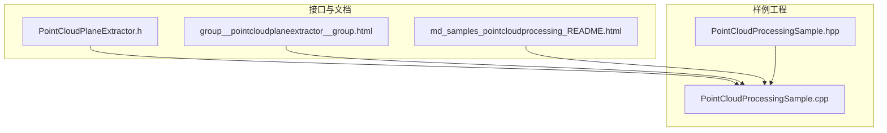
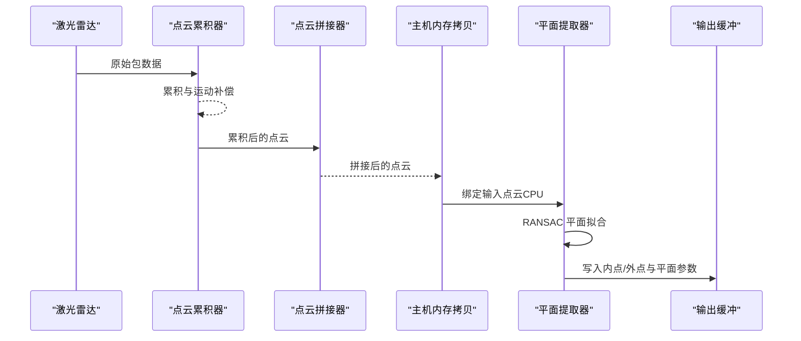
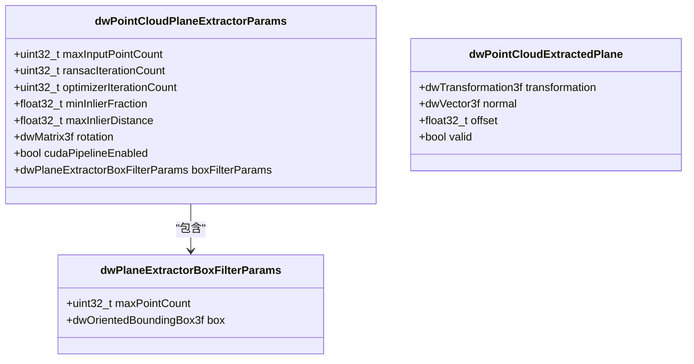
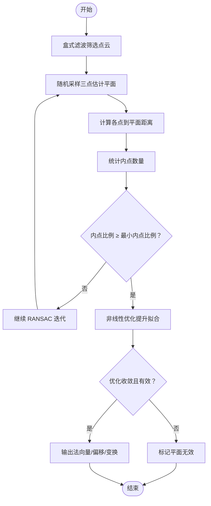
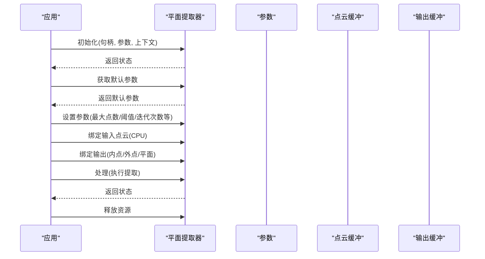
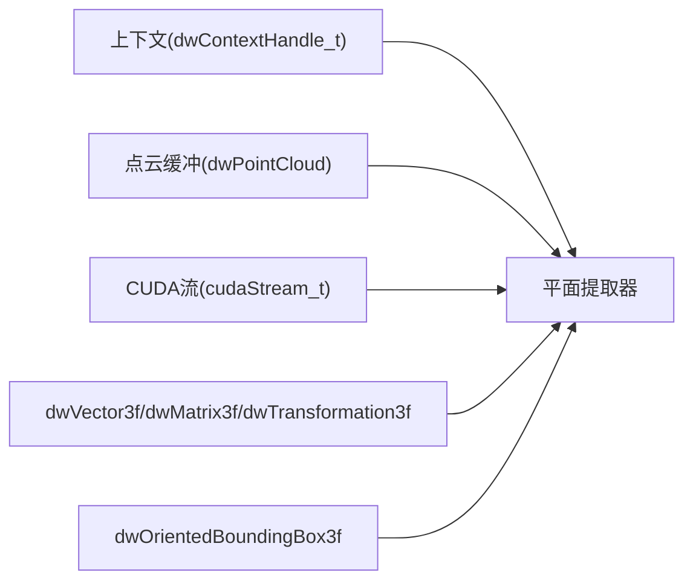

# 平面提取器

<cite>
**本文引用的文件**
- [PointCloudPlaneExtractor.h](file://driverorks-5.10/include/dw/pointcloudprocessing/planeextractor/PointCloudPlaneExtractor.h)
- [group__pointcloudplaneextractor__group.html](file://driverorks-5.10/doc/nvsdk_dw_html/group__pointcloudplaneextractor__group.html)
- [PointCloudProcessingSample.cpp](file://driverorks-5.10/samples/src/pointcloudprocessing/PointCloudProcessingSample.cpp)
- [PointCloudProcessingSample.hpp](file://driverorks-5.10/samples/src/pointcloudprocessing/PointCloudProcessingSample.hpp)
- [README.md](file://driverorks-5.10/doc/nvsdk_dw_html/md_samples_pointcloudprocessing_README.html)
</cite>

## 目录
1. [简介](#简介)
2. [项目结构](#项目结构)
3. [核心组件](#核心组件)
4. [架构总览](#架构总览)
5. [详细组件分析](#详细组件分析)
6. [依赖关系分析](#依赖关系分析)
7. [性能考虑](#性能考虑)
8. [故障排查指南](#故障排查指南)
9. [结论](#结论)
10. [附录：API 参考与示例](#附录api-参考与示例)

## 简介
本技术文档围绕 DriveWorks SDK 中的“点云平面提取器（PointCloudPlaneExtractor）”展开，系统阐述其在地面平面检测中的实现原理与工程实践。文档重点覆盖以下方面：
- 随机抽样一致性（RANSAC）算法流程与参数影响
- 平面拟合数学模型与内点判定机制
- 提取器配置参数、检测策略与后处理优化
- 性能调优方法与常见问题排查
- 完整 API 参考与实际应用示例（结合样例工程）

该模块用于从近传感器区域提取一个 3D 地面平面，输出平面法向量、到原点的距离偏移以及变换矩阵，并可同时分离内点与外点，为后续路径规划与导航系统提供关键的环境约束。

## 项目结构
与平面提取器相关的核心位置如下：
- 头文件定义：PointCloudPlaneExtractor.h
- 接口文档：group__pointcloudplaneextractor__group.html
- 样例工程：PointCloudProcessingSample.cpp/.hpp
- 示例说明：md_samples_pointcloudprocessing_README.html



**图表来源**
- [PointCloudPlaneExtractor.h](file://driverorks-5.10/include/dw/pointcloudprocessing/planeextractor/PointCloudPlaneExtractor.h)
- [group__pointcloudplaneextractor__group.html](file://driverorks-5.10/doc/nvsdk_dw_html/group__pointcloudplaneextractor__group.html)
- [PointCloudProcessingSample.cpp](file://driverorks-5.10/samples/src/pointcloudprocessing/PointCloudProcessingSample.cpp)
- [PointCloudProcessingSample.hpp](file://driverorks-5.10/samples/src/pointcloudprocessing/PointCloudProcessingSample.hpp)
- [README.md](file://driverorks-5.10/doc/nvsdk_dw_html/md_samples_pointcloudprocessing_README.html)

**章节来源**
- [PointCloudPlaneExtractor.h](file://driverorks-5.10/include/dw/pointcloudprocessing/planeextractor/PointCloudPlaneExtractor.h)
- [group__pointcloudplaneextractor__group.html](file://driverorks-5.10/doc/nvsdk_dw_html/group__pointcloudplaneextractor__group.html)
- [PointCloudProcessingSample.cpp](file://driverorks-5.10/samples/src/pointcloudprocessing/PointCloudProcessingSample.cpp)
- [README.md](file://driverorks-5.10/doc/nvsdk_dw_html/md_samples_pointcloudprocessing_README.html)

## 核心组件
- 平面提取器句柄类型：dwPointCloudPlaneExtractorHandle_t
- 参数结构体：dwPointCloudPlaneExtractorParams
  - 包含最大输入点数、RANSAC 迭代次数、优化迭代次数、最小内点比例、最大内点距离、旋转对齐矩阵、CUDA 流启用标志、盒式滤波参数等
- 盒式滤波参数：dwPlaneExtractorBoxFilterParams
  - 指定定向包围盒与最大接受点数，用于预筛选参与拟合的点集
- 输出结构体：dwPointCloudExtractedPlane
  - 法向量、到原点的偏移、变换矩阵、有效性标记

上述结构体字段与默认参数获取函数均在头文件中明确定义，便于用户按需调整。

**章节来源**
- [PointCloudPlaneExtractor.h](file://driverorks-5.10/include/dw/pointcloudprocessing/planeextractor/PointCloudPlaneExtractor.h)
- [group__pointcloudplaneextractor__group.html](file://driverorks-5.10/doc/nvsdk_dw_html/group__pointcloudplaneextractor__group.html)

## 架构总览
下图展示了点云处理流水线中平面提取器的典型集成方式：先进行点云拼接与运动补偿，再将结果拷贝至 CPU 内存，最后通过平面提取器完成地面平面估计与内/外点分离。



**图表来源**
- [PointCloudProcessingSample.cpp](file://driverorks-5.10/samples/src/pointcloudprocessing/PointCloudProcessingSample.cpp)

**章节来源**
- [PointCloudProcessingSample.cpp](file://driverorks-5.10/samples/src/pointcloudprocessing/PointCloudProcessingSample.cpp)

## 详细组件分析

### 类型与数据结构
- 句柄类型：dwPointCloudPlaneExtractorHandle_t
- 参数结构体：dwPointCloudPlaneExtractorParams
  - 最大输入点数、RANSAC 迭代次数、优化迭代次数、最小内点比例、最大内点距离、旋转对齐矩阵、CUDA 流启用标志、盒式滤波参数
- 盒式滤波参数：dwPlaneExtractorBoxFilterParams
  - 定向包围盒与最大接受点数
- 输出结构体：dwPointCloudExtractedPlane
  - 法向量、到原点的偏移、变换矩阵、有效性标记



**图表来源**
- [PointCloudPlaneExtractor.h](file://driverorks-5.10/include/dw/pointcloudprocessing/planeextractor/PointCloudPlaneExtractor.h)

**章节来源**
- [PointCloudPlaneExtractor.h](file://driverorks-5.10/include/dw/pointcloudprocessing/planeextractor/PointCloudPlaneExtractor.h)

### RANSAC 平面拟合与数学模型
- 输入：点云集合与盒式滤波参数
- 步骤：
  1) 使用盒式滤波限制参与拟合的点数量与空间范围
  2) 执行 RANSAC 迭代，每次随机采样三个不共线点以估计平面
  3) 计算每个点到平面的距离，统计内点数量
  4) 当内点比例超过阈值时，进入非线性优化阶段进一步提升拟合精度
  5) 输出平面法向量、偏移与变换矩阵，并标记有效性
- 关键阈值与参数：
  - 最小内点比例（minInlierFraction）
  - 最大内点距离（maxInlierDistance）
  - RANSAC 迭代次数（ransacIterationCount）
  - 优化迭代次数（optimizerIterationCount）



**图表来源**
- [PointCloudPlaneExtractor.h](file://driverorks-5.10/include/dw/pointcloudprocessing/planeextractor/PointCloudPlaneExtractor.h)

**章节来源**
- [PointCloudPlaneExtractor.h](file://driverorks-5.10/include/dw/pointcloudprocessing/planeextractor/PointCloudPlaneExtractor.h)

### API 调用序列（初始化—绑定—处理—释放）


**图表来源**
- [group__pointcloudplaneextractor__group.html](file://driverorks-5.10/doc/nvsdk_dw_html/group__pointcloudplaneextractor__group.html)
- [PointCloudProcessingSample.cpp](file://driverorks-5.10/samples/src/pointcloudprocessing/PointCloudProcessingSample.cpp)

**章节来源**
- [group__pointcloudplaneextractor__group.html](file://driverorks-5.10/doc/nvsdk_dw_html/group__pointcloudplaneextractor__group.html)
- [PointCloudProcessingSample.cpp](file://driverorks-5.10/samples/src/pointcloudprocessing/PointCloudProcessingSample.cpp)

### 配置参数与调优要点
- 最大输入点数（maxInputPointCount）：决定处理规模上限，过大将增加计算开销
- RANSAC 迭代次数（ransacIterationCount）：影响鲁棒性与速度权衡
- 优化迭代次数（optimizerIterationCount）：提升拟合精度，但增加耗时
- 最小内点比例（minInlierFraction）：过低易误检，过高易漏检
- 最大内点距离（maxInlierDistance）：直接影响平面拟合容忍度
- 盒式滤波参数（boxFilterParams）：限定空间范围与采样点数，建议根据传感器视场与车辆尺寸设定
- CUDA 流启用（cudaPipelineEnabled）：若启用需确保输入/输出缓冲内存类型与之匹配

**章节来源**
- [PointCloudPlaneExtractor.h](file://driverorks-5.10/include/dw/pointcloudprocessing/planeextractor/PointCloudPlaneExtractor.h)
- [PointCloudProcessingSample.cpp](file://driverorks-5.10/samples/src/pointcloudprocessing/PointCloudProcessingSample.cpp)

### 后处理与可视化
- 可视化地面网格与法向量箭头，辅助验证提取结果
- 将拼接后的点云从 GPU 拷贝至 CPU，再交由平面提取器处理，兼顾实时性与稳定性

**章节来源**
- [PointCloudProcessingSample.cpp](file://driverorks-5.10/samples/src/pointcloudprocessing/PointCloudProcessingSample.cpp)

## 依赖关系分析
- 依赖上下文（dwContextHandle_t）进行初始化与资源管理
- 依赖点云缓冲（dwPointCloud）作为输入/输出载体
- 依赖 CUDA 流（可选）进行异步处理
- 依赖几何类型（dwVector3f、dwMatrix3f、dwTransformation3f、dwOrientedBoundingBox3f）描述空间关系



**图表来源**
- [PointCloudPlaneExtractor.h](file://driverorks-5.10/include/dw/pointcloudprocessing/planeextractor/PointCloudPlaneExtractor.h)

**章节来源**
- [PointCloudPlaneExtractor.h](file://driverorks-5.10/include/dw/pointcloudprocessing/planeextractor/PointCloudPlaneExtractor.h)

## 性能考虑
- 点云规模控制：通过盒式滤波与最大输入点数限制，避免不必要的大规模计算
- 迭代参数折中：在鲁棒性与延迟之间平衡 RANSAC 与优化迭代次数
- 内存类型匹配：启用 CUDA 流时，确保输入/输出缓冲内存类型一致，避免状态错误
- 数据搬运：样例中采用 GPU→CPU 拷贝后再处理，适合离线或对实时性要求不高的场景；若追求端到端实时，可评估 GPU 管线方案

[本节为通用指导，无需特定文件引用]

## 故障排查指南
- DW_INVALID_ARGUMENT：检查输入/输出缓冲内存类型与 cudaPipelineEnabled 是否匹配
- DW_CALL_NOT_ALLOWED：确认已绑定输入点云与输出平面
- 平面无效（valid=false）：通常由拟合失败或优化不收敛导致，建议提高最小内点比例、放宽最大内点距离或增加迭代次数
- 性能异常：检查盒式滤波范围是否过宽/过窄，迭代次数是否过高

**章节来源**
- [group__pointcloudplaneextractor__group.html](file://driverorks-5.10/doc/nvsdk_dw_html/group__pointcloudplaneextractor__group.html)

## 结论
PointCloudPlaneExtractor 提供了稳定高效的地面平面估计能力，结合 RANSAC 与非线性优化，在复杂场景下具备良好的鲁棒性。通过合理设置阈值与迭代参数、配合盒式滤波与内存管线策略，可在保证精度的同时满足不同应用场景的性能需求。样例工程展示了从点云拼接、运动补偿到平面提取的完整流程，可作为实际部署的参考模板。

[本节为总结性内容，无需特定文件引用]

## 附录：API 参考与示例

### API 参考（函数概览）
- 初始化/重置/释放
  - dwPCPlaneExtractor_initialize
  - dwPCPlaneExtractor_reset
  - dwPCPlaneExtractor_release
- 参数与流管理
  - dwPCPlaneExtractor_getDefaultParameters
  - dwPCPlaneExtractor_getCUDAStream
  - dwPCPlaneExtractor_setCUDAStream
- 输入/输出绑定与处理
  - dwPCPlaneExtractor_bindInput
  - dwPCPlaneExtractor_bindOutput
  - dwPCPlaneExtractor_process

以上函数签名与行为说明详见接口文档与头文件注释。

**章节来源**
- [group__pointcloudplaneextractor__group.html](file://driverorks-5.10/doc/nvsdk_dw_html/group__pointcloudplaneextractor__group.html)
- [PointCloudPlaneExtractor.h](file://driverorks-5.10/include/dw/pointcloudprocessing/planeextractor/PointCloudPlaneExtractor.h)

### 实际应用示例（样例工程）
- 初始化与参数设置：在样例中通过 getDefaultParameters 获取默认值，随后设置最大输入点数、最小内点比例、盒式滤波范围等
- 绑定输入/输出：将拼接后的点云绑定为输入，准备内点/外点与平面输出缓冲
- 处理流程：在每帧循环中，先进行 ICP/坐标转换，再将点云拷贝至 CPU，最后调用 process 执行提取

```mermaid
sequenceDiagram
participant Loop as "主循环"
participant ICP as "ICP/坐标转换"
participant Copy as "GPU→CPU拷贝"
participant PE as "平面提取器"
Loop->>ICP : 计算初始位姿
ICP-->>Loop : 初始位姿
Loop->>Copy : 拷贝点云至CPU
Copy-->>Loop : CPU点云
Loop->>PE : 绑定输入/输出并处理
PE-->>Loop : 内点/外点/平面
```

**图表来源**
- [PointCloudProcessingSample.cpp](file://driverorks-5.10/samples/src/pointcloudprocessing/PointCloudProcessingSample.cpp)

**章节来源**
- [PointCloudProcessingSample.cpp](file://driverorks-5.10/samples/src/pointcloudprocessing/PointCloudProcessingSample.cpp)
- [README.md](file://driverorks-5.10/doc/nvsdk_dw_html/md_samples_pointcloudprocessing_README.html)