# 点云处理

<cite>
**本文引用的文件**
- [PointCloud.h](file://driveworks-5.14/include/dw/pointcloudprocessing/pointcloud/PointCloud.h)
- [LidarPointCloud.h](file://driveworks-5.14/include/dw/pointcloudprocessing/pointcloud/LidarPointCloud.h)
- [PointCloudAssembler.h](file://driveworks-5.14/include/dw/pointcloudprocessing/assembler/PointCloudAssembler.h)
- [PointCloudAccumulator.h](file://driveworks-5.14/include/dw/pointcloudprocessing/accumulator/PointCloudAccumulator.h)
- [MotionCompensator.h](file://driveworks-5.14/include/dw/pointcloudprocessing/motioncompensator/MotionCompensator.h)
- [PointCloudICP.h](file://driveworks-5.14/include/dw/pointcloudprocessing/icp/PointCloudICP.h)
- [PointCloudPlaneExtractor.h](file://driveworks-5.14/include/dw/pointcloudprocessing/planeextractor/PointCloudPlaneExtractor.h)
- [PointCloudBoxFilter.h](file://driveworks-5.14/include/dw/pointcloudprocessing/filter/PointCloudBoxFilter.h)
- [PointCloudStitcher.h](file://driveworks-5.14/include/dw/pointcloudprocessing/stitcher/PointCloudStitcher.h)
- [PointCloudRangeImageCreator.h](file://driveworks-5.14/include/dw/pointcloudprocessing/rangeimagecreator/PointCloudRangeImageCreator.h)
- [PointCloudProcessingSample.cpp](file://driveworks-5.14/samples/src/pointcloudprocessing/PointCloudProcessingSample.cpp)
</cite>

## 目录
1. [简介](#简介)
2. [项目结构](#项目结构)
3. [核心组件](#核心组件)
4. [架构总览](#架构总览)
5. [详细组件分析](#详细组件分析)
6. [依赖关系分析](#依赖关系分析)
7. [性能考虑](#性能考虑)
8. [故障排查指南](#故障排查指南)
9. [结论](#结论)
10. [附录：API 参考与示例路径](#附录api-参考与示例路径)

## 简介
本技术文档系统性地介绍 NVIDIA DriveWorks 点云处理模块，覆盖从原始激光雷达数据到可直接用于感知与导航的数据产品（如组织化点云、范围图像、ICP 对齐姿态）的完整流水线。重点包括：
- 点云数据结构设计：dwPointCloud 与 dwLidarPointCloud 的字段、内存布局与生命周期管理
- 多传感器数据融合：点云装配器将解码后的激光包组装为完整扫描帧
- 时间累积处理：点云累加器按角度/距离窗口与时间边界进行旋转式扫描累积
- 运动补偿：基于惯性/车况状态对点云进行姿态补偿，消除运动畸变
- ICP 配准：以深度图形式进行迭代最近点优化，估计相邻帧间的相对位姿
- 平面提取：RANSAC + 非线性优化提取地面平面，分离地面与非地面点
- 空间与强度过滤：基于定向包围盒的内外/外层过滤
- 多视角拼接：将来自不同激光雷达的点云统一到同一坐标系
- 范围图像创建：球面投影生成距离/强度/2D网格等类型范围图像

## 项目结构
点云处理模块位于驱动库的“pointcloudprocessing”子目录下，包含通用点云数据结构与各处理算法的独立 API 头文件；示例工程展示了端到端的工作流。

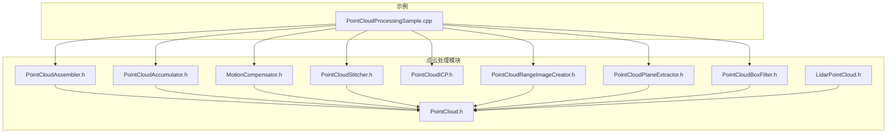

图表来源
- [PointCloud.h:98-120](file://driveworks-5.14/include/dw/pointcloudprocessing/pointcloud/PointCloud.h#L98-L120)
- [LidarPointCloud.h:97-109](file://driveworks-5.14/include/dw/pointcloudprocessing/pointcloud/LidarPointCloud.h#L97-L109)
- [PointCloudAssembler.h:55-100](file://driveworks-5.14/include/dw/pointcloudprocessing/assembler/PointCloudAssembler.h#L55-L100)
- [PointCloudAccumulator.h:58-93](file://driveworks-5.14/include/dw/pointcloudprocessing/accumulator/PointCloudAccumulator.h#L58-L93)
- [MotionCompensator.h:56-86](file://driveworks-5.14/include/dw/pointcloudprocessing/motioncompensator/MotionCompensator.h#L56-L86)
- [PointCloudICP.h:56-93](file://driveworks-5.14/include/dw/pointcloudprocessing/icp/PointCloudICP.h#L56-L93)
- [PointCloudPlaneExtractor.h:58-87](file://driveworks-5.14/include/dw/pointcloudprocessing/planeextractor/PointCloudPlaneExtractor.h#L58-L87)
- [PointCloudBoxFilter.h:58-78](file://driveworks-5.14/include/dw/pointcloudprocessing/filter/PointCloudBoxFilter.h#L58-L78)
- [PointCloudStitcher.h:63-92](file://driveworks-5.14/include/dw/pointcloudprocessing/stitcher/PointCloudStitcher.h#L63-L92)
- [PointCloudRangeImageCreator.h:59-97](file://driveworks-5.14/include/dw/pointcloudprocessing/rangeimagecreator/PointCloudRangeImageCreator.h#L59-L97)

章节来源
- [PointCloud.h:98-120](file://driveworks-5.14/include/dw/pointcloudprocessing/pointcloud/PointCloud.h#L98-L120)
- [PointCloudAssembler.h:55-100](file://driveworks-5.14/include/dw/pointcloudprocessing/assembler/PointCloudAssembler.h#L55-L100)
- [PointCloudAccumulator.h:58-93](file://driveworks-5.14/include/dw/pointcloudprocessing/accumulator/PointCloudAccumulator.h#L58-L93)
- [MotionCompensator.h:56-86](file://driveworks-5.14/include/dw/pointcloudprocessing/motioncompensator/MotionCompensator.h#L56-L86)
- [PointCloudICP.h:56-93](file://driveworks-5.14/include/dw/pointcloudprocessing/icp/PointCloudICP.h#L56-L93)
- [PointCloudPlaneExtractor.h:58-87](file://driveworks-5.14/include/dw/pointcloudprocessing/planeextractor/PointCloudPlaneExtractor.h#L58-L87)
- [PointCloudBoxFilter.h:58-78](file://driveworks-5.14/include/dw/pointcloudprocessing/filter/PointCloudBoxFilter.h#L58-L78)
- [PointCloudStitcher.h:63-92](file://driveworks-5.14/include/dw/pointcloudprocessing/stitcher/PointCloudStitcher.h#L63-L92)
- [PointCloudRangeImageCreator.h:59-97](file://driveworks-5.14/include/dw/pointcloudprocessing/rangeimagecreator/PointCloudRangeImageCreator.h#L59-L97)

## 核心组件
- 点云数据结构
  - dwPointCloud：通用点云容器，支持 CPU/GPU 内存、XYZI/RTHI 格式、分层与辅助通道、时间戳域
  - dwLidarPointCloud：在通用点云基础上增加返回层映射、辅助通道映射、坐标参考框架、运动补偿信息
- 组装器：将解码后的激光包按零交叉/自旋边界组装为完整扫描帧
- 累加器：按角度/距离窗口与时间边界累积旋转式扫描，支持组织化输出与运动补偿
- 运动补偿器：基于惯性/车况状态插值，将点云变换至参考坐标系
- ICP：以深度图形式进行迭代最近点优化，估计相邻帧间的相对位姿
- 平面提取器：RANSAC + 优化提取地面平面，输出内/外点与平面参数
- 过滤器：定向包围盒内外/外层过滤，支持降采样
- 拼接器：将多源点云统一到同一坐标系，支持运动补偿与全局变换
- 范围图像创建器：球面投影生成距离/强度/2D网格等类型范围图像

章节来源
- [PointCloud.h:98-120](file://driveworks-5.14/include/dw/pointcloudprocessing/pointcloud/PointCloud.h#L98-L120)
- [LidarPointCloud.h:97-109](file://driveworks-5.14/include/dw/pointcloudprocessing/pointcloud/LidarPointCloud.h#L97-L109)
- [PointCloudAssembler.h:55-100](file://driveworks-5.14/include/dw/pointcloudprocessing/assembler/PointCloudAssembler.h#L55-L100)
- [PointCloudAccumulator.h:58-93](file://driveworks-5.14/include/dw/pointcloudprocessing/accumulator/PointCloudAccumulator.h#L58-L93)
- [MotionCompensator.h:56-86](file://driveworks-5.14/include/dw/pointcloudprocessing/motioncompensator/MotionCompensator.h#L56-L86)
- [PointCloudICP.h:56-93](file://driveworks-5.14/include/dw/pointcloudprocessing/icp/PointCloudICP.h#L56-L93)
- [PointCloudPlaneExtractor.h:58-87](file://driveworks-5.14/include/dw/pointcloudprocessing/planeextractor/PointCloudPlaneExtractor.h#L58-L87)
- [PointCloudBoxFilter.h:58-78](file://driveworks-5.14/include/dw/pointcloudprocessing/filter/PointCloudBoxFilter.h#L58-L78)
- [PointCloudStitcher.h:63-92](file://driveworks-5.14/include/dw/pointcloudprocessing/stitcher/PointCloudStitcher.h#L63-L92)
- [PointCloudRangeImageCreator.h:59-97](file://driveworks-5.14/include/dw/pointcloudprocessing/rangeimagecreator/PointCloudRangeImageCreator.h#L59-L97)

## 架构总览
下图展示典型激光雷达数据处理流水线：传感器事件采集 → 累积/组织化 → 运动补偿 → 拼接 → 范围图像 → ICP/平面提取 → 渲染/可视化。

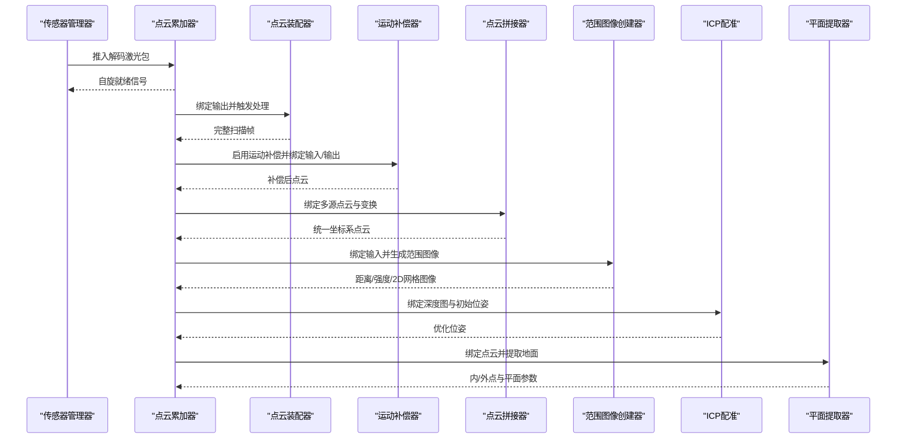

图表来源
- [PointCloudProcessingSample.cpp:591-709](file://driveworks-5.14/samples/src/pointcloudprocessing/PointCloudProcessingSample.cpp#L591-L709)
- [PointCloudAccumulator.h:120-141](file://driveworks-5.14/include/dw/pointcloudprocessing/accumulator/PointCloudAccumulator.h#L120-L141)
- [PointCloudAssembler.h:96-100](file://driveworks-5.14/include/dw/pointcloudprocessing/assembler/PointCloudAssembler.h#L96-L100)
- [MotionCompensator.h:111-114](file://driveworks-5.14/include/dw/pointcloudprocessing/motioncompensator/MotionCompensator.h#L111-L114)
- [PointCloudStitcher.h:73-74](file://driveworks-5.14/include/dw/pointcloudprocessing/stitcher/PointCloudStitcher.h#L73-L74)
- [PointCloudRangeImageCreator.h:111-113](file://driveworks-5.14/include/dw/pointcloudprocessing/rangeimagecreator/PointCloudRangeImageCreator.h#L111-L113)
- [PointCloudICP.h:126-128](file://driveworks-5.14/include/dw/pointcloudprocessing/icp/PointCloudICP.h#L126-L128)
- [PointCloudPlaneExtractor.h:111-113](file://driveworks-5.14/include/dw/pointcloudprocessing/planeextractor/PointCloudPlaneExtractor.h#L111-L113)

## 详细组件分析

### 数据结构：LidarPointCloud 与 PointCloud
- dwPointCloud 字段要点
  - 内存类型、格式（XYZI/RTHI）、是否组织化、时间戳域、容量/大小、每层最大点数、层数与层描述、辅助通道数量与描述
  - 提供创建/销毁缓冲区与完整点云的 API，支持显式分配容量与内存类型
- dwLidarPointCloud 扩展
  - 用户数据区、通用点云封装、返回层与辅助通道映射、坐标参考框架（传感器/车身/自定义）、运动补偿信息

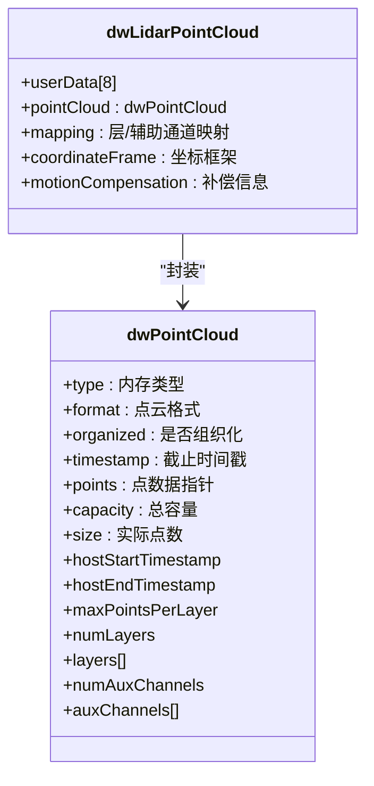

图表来源
- [PointCloud.h:98-120](file://driveworks-5.14/include/dw/pointcloudprocessing/pointcloud/PointCloud.h#L98-L120)
- [LidarPointCloud.h:97-109](file://driveworks-5.14/include/dw/pointcloudprocessing/pointcloud/LidarPointCloud.h#L97-L109)

章节来源
- [PointCloud.h:98-120](file://driveworks-5.14/include/dw/pointcloudprocessing/pointcloud/PointCloud.h#L98-L120)
- [LidarPointCloud.h:97-109](file://driveworks-5.14/include/dw/pointcloudprocessing/pointcloud/LidarPointCloud.h#L97-L109)

### 组件A：点云装配器（PointCloudAssembler）
- 功能：将解码后的激光包按零交叉/自旋边界组装为完整扫描帧，支持绑定通用或激光专用点云输出
- 关键流程：初始化参数（含映射）、绑定输出、推入激光包、查询就绪、执行处理

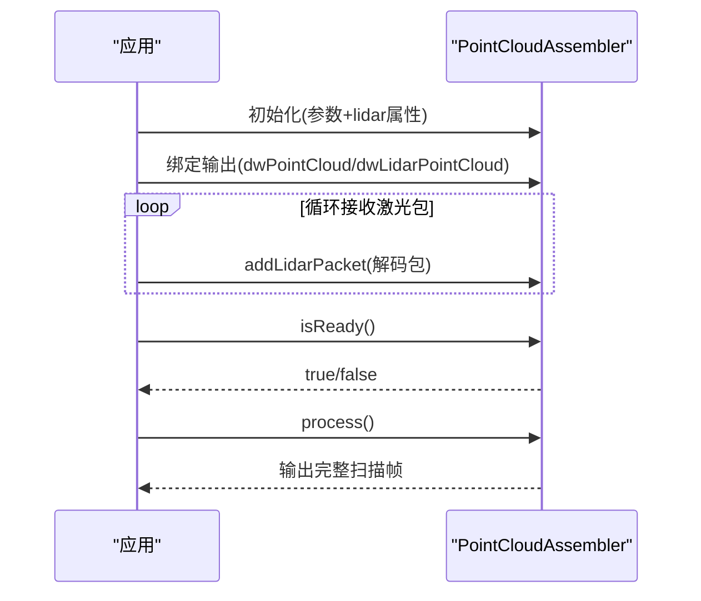

图表来源
- [PointCloudAssembler.h:96-100](file://driveworks-5.14/include/dw/pointcloudprocessing/assembler/PointCloudAssembler.h#L96-L100)
- [PointCloudAssembler.h:163-180](file://driveworks-5.14/include/dw/pointcloudprocessing/assembler/PointCloudAssembler.h#L163-L180)
- [PointCloudAssembler.h:204-231](file://driveworks-5.14/include/dw/pointcloudprocessing/assembler/PointCloudAssembler.h#L204-L231)

章节来源
- [PointCloudAssembler.h:55-100](file://driveworks-5.14/include/dw/pointcloudprocessing/assembler/PointCloudAssembler.h#L55-L100)
- [PointCloudAssembler.h:163-180](file://driveworks-5.14/include/dw/pointcloudprocessing/assembler/PointCloudAssembler.h#L163-L180)
- [PointCloudAssembler.h:204-231](file://driveworks-5.14/include/dw/pointcloudprocessing/assembler/PointCloudAssembler.h#L204-L231)

### 组件B：点云累加器（PointCloudAccumulator）
- 功能：按角度/距离窗口与时间边界累积旋转式扫描，支持组织化输出、运动补偿、零交叉检测、输出坐标系选择
- 关键流程：初始化参数（内存类型、输出格式、滤波窗口、角度/距离范围、运动补偿开关、组织化、零交叉检测、输出坐标系、惯性模块句柄、传感器到车身变换），绑定输出与时间戳输出，推入激光包，查询就绪，执行处理

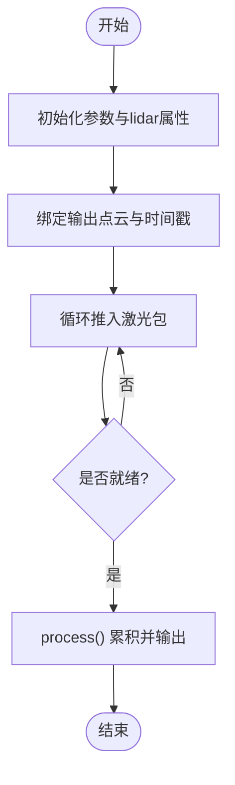

图表来源
- [PointCloudAccumulator.h:120-141](file://driveworks-5.14/include/dw/pointcloudprocessing/accumulator/PointCloudAccumulator.h#L120-L141)
- [PointCloudAccumulator.h:224-225](file://driveworks-5.14/include/dw/pointcloudprocessing/accumulator/PointCloudAccumulator.h#L224-L225)
- [PointCloudAccumulator.h:247-248](file://driveworks-5.14/include/dw/pointcloudprocessing/accumulator/PointCloudAccumulator.h#L247-L248)

章节来源
- [PointCloudAccumulator.h:58-93](file://driveworks-5.14/include/dw/pointcloudprocessing/accumulator/PointCloudAccumulator.h#L58-L93)
- [PointCloudAccumulator.h:120-141](file://driveworks-5.14/include/dw/pointcloudprocessing/accumulator/PointCloudAccumulator.h#L120-L141)
- [PointCloudAccumulator.h:224-225](file://driveworks-5.14/include/dw/pointcloudprocessing/accumulator/PointCloudAccumulator.h#L224-L225)
- [PointCloudAccumulator.h:247-248](file://driveworks-5.14/include/dw/pointcloudprocessing/accumulator/PointCloudAccumulator.h#L247-L248)

### 组件C：运动补偿器（MotionCompensator）
- 功能：基于惯性/车况状态插值，将点云变换到参考坐标系，支持 CUDA 流设置与参考时间戳设定
- 关键流程：获取默认参数（根据 lidar 属性），初始化，绑定惯性状态与变换，绑定输入/输出点云，设置参考时间戳，执行处理

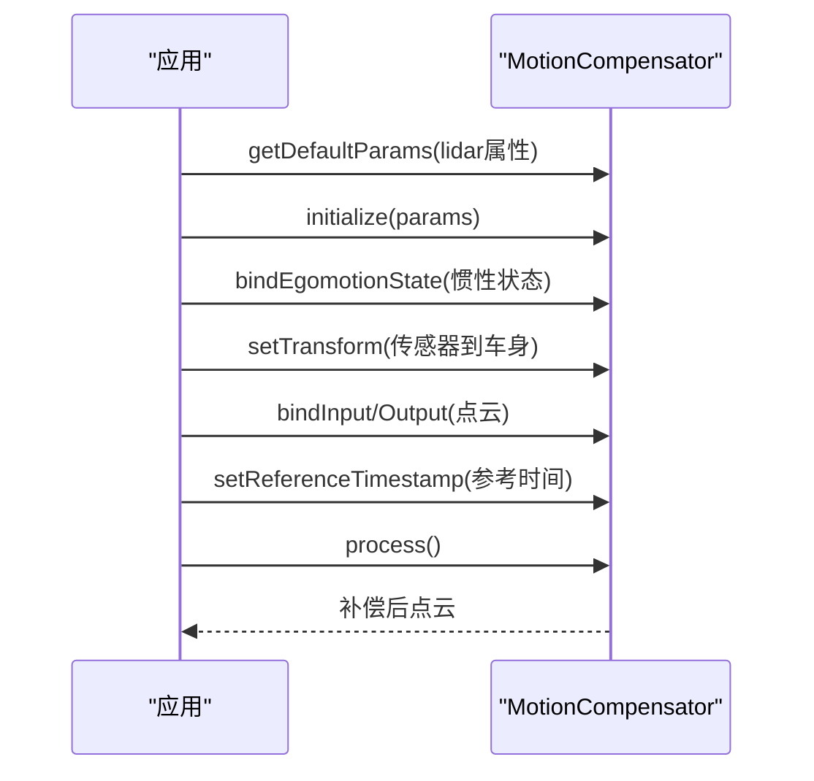

图表来源
- [MotionCompensator.h:97-98](file://driveworks-5.14/include/dw/pointcloudprocessing/motioncompensator/MotionCompensator.h#L97-L98)
- [MotionCompensator.h:111-114](file://driveworks-5.14/include/dw/pointcloudprocessing/motioncompensator/MotionCompensator.h#L111-L114)
- [MotionCompensator.h:173-175](file://driveworks-5.14/include/dw/pointcloudprocessing/motioncompensator/MotionCompensator.h#L173-L175)
- [MotionCompensator.h:212-215](file://driveworks-5.14/include/dw/pointcloudprocessing/motioncompensator/MotionCompensator.h#L212-L215)
- [MotionCompensator.h:253-263](file://driveworks-5.14/include/dw/pointcloudprocessing/motioncompensator/MotionCompensator.h#L253-L263)

章节来源
- [MotionCompensator.h:56-86](file://driveworks-5.14/include/dw/pointcloudprocessing/motioncompensator/MotionCompensator.h#L56-L86)
- [MotionCompensator.h:111-114](file://driveworks-5.14/include/dw/pointcloudprocessing/motioncompensator/MotionCompensator.h#L111-L114)
- [MotionCompensator.h:212-215](file://driveworks-5.14/include/dw/pointcloudprocessing/motioncompensator/MotionCompensator.h#L212-L215)
- [MotionCompensator.h:253-263](file://driveworks-5.14/include/dw/pointcloudprocessing/motioncompensator/MotionCompensator.h#L253-L263)

### 组件D：ICP 配准（PointCloudICP）
- 功能：以深度图形式进行迭代最近点优化，支持收敛容差、最大迭代次数、先验使用、回调自定义
- 关键流程：初始化参数（类型、最大点数、深度图尺寸、收敛容差、最大迭代、是否使用先验），绑定输入源/目标点云与初始位姿，绑定输出位姿，执行处理并获取统计结果

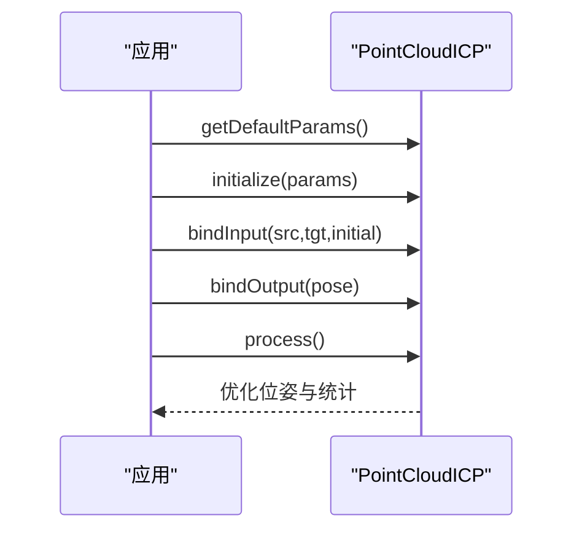

图表来源
- [PointCloudICP.h:126-128](file://driveworks-5.14/include/dw/pointcloudprocessing/icp/PointCloudICP.h#L126-L128)
- [PointCloudICP.h:190-194](file://driveworks-5.14/include/dw/pointcloudprocessing/icp/PointCloudICP.h#L190-L194)
- [PointCloudICP.h:205-207](file://driveworks-5.14/include/dw/pointcloudprocessing/icp/PointCloudICP.h#L205-L207)
- [PointCloudICP.h:217-218](file://driveworks-5.14/include/dw/pointcloudprocessing/icp/PointCloudICP.h#L217-L218)
- [PointCloudICP.h:271-272](file://driveworks-5.14/include/dw/pointcloudprocessing/icp/PointCloudICP.h#L271-L272)

章节来源
- [PointCloudICP.h:56-93](file://driveworks-5.14/include/dw/pointcloudprocessing/icp/PointCloudICP.h#L56-L93)
- [PointCloudICP.h:126-128](file://driveworks-5.14/include/dw/pointcloudprocessing/icp/PointCloudICP.h#L126-L128)
- [PointCloudICP.h:190-194](file://driveworks-5.14/include/dw/pointcloudprocessing/icp/PointCloudICP.h#L190-L194)
- [PointCloudICP.h:205-207](file://driveworks-5.14/include/dw/pointcloudprocessing/icp/PointCloudICP.h#L205-L207)
- [PointCloudICP.h:271-272](file://driveworks-5.14/include/dw/pointcloudprocessing/icp/PointCloudICP.h#L271-L272)

### 组件E：平面提取器（PointCloudPlaneExtractor）
- 功能：RANSAC + 优化提取地面平面，支持定向包围盒过滤、CUDA 管线开关
- 关键流程：初始化参数（最大输入点数、RANSAC/优化迭代、最小内点比例、内点距离阈值、旋转矩阵、CUDA 开关、盒滤参数），绑定输入与输出（内点/外点/平面），执行处理

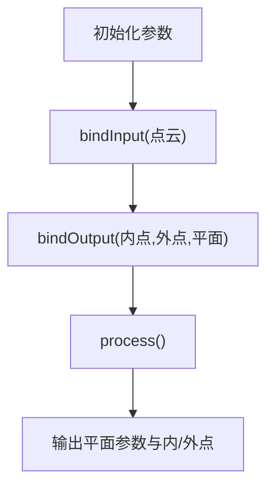

图表来源
- [PointCloudPlaneExtractor.h:111-113](file://driveworks-5.14/include/dw/pointcloudprocessing/planeextractor/PointCloudPlaneExtractor.h#L111-L113)
- [PointCloudPlaneExtractor.h:149-151](file://driveworks-5.14/include/dw/pointcloudprocessing/planeextractor/PointCloudPlaneExtractor.h#L149-L151)
- [PointCloudPlaneExtractor.h:183-187](file://driveworks-5.14/include/dw/pointcloudprocessing/planeextractor/PointCloudPlaneExtractor.h#L183-L187)
- [PointCloudPlaneExtractor.h:197-198](file://driveworks-5.14/include/dw/pointcloudprocessing/planeextractor/PointCloudPlaneExtractor.h#L197-L198)

章节来源
- [PointCloudPlaneExtractor.h:58-87](file://driveworks-5.14/include/dw/pointcloudprocessing/planeextractor/PointCloudPlaneExtractor.h#L58-L87)
- [PointCloudPlaneExtractor.h:111-113](file://driveworks-5.14/include/dw/pointcloudprocessing/planeextractor/PointCloudPlaneExtractor.h#L111-L113)
- [PointCloudPlaneExtractor.h:149-151](file://driveworks-5.14/include/dw/pointcloudprocessing/planeextractor/PointCloudPlaneExtractor.h#L149-L151)
- [PointCloudPlaneExtractor.h:183-187](file://driveworks-5.14/include/dw/pointcloudprocessing/planeextractor/PointCloudPlaneExtractor.h#L183-L187)
- [PointCloudPlaneExtractor.h:197-198](file://driveworks-5.14/include/dw/pointcloudprocessing/planeextractor/PointCloudPlaneExtractor.h#L197-L198)

### 组件F：空间与强度过滤（PointCloudBoxFilter）
- 功能：基于定向包围盒进行内外/外层过滤，支持降采样与 CUDA 流设置
- 关键流程：初始化参数（启用 CUDA、允许降采样、最大输入点数、盒参数、过滤类型），绑定输入/输出，设置盒与类型，执行处理

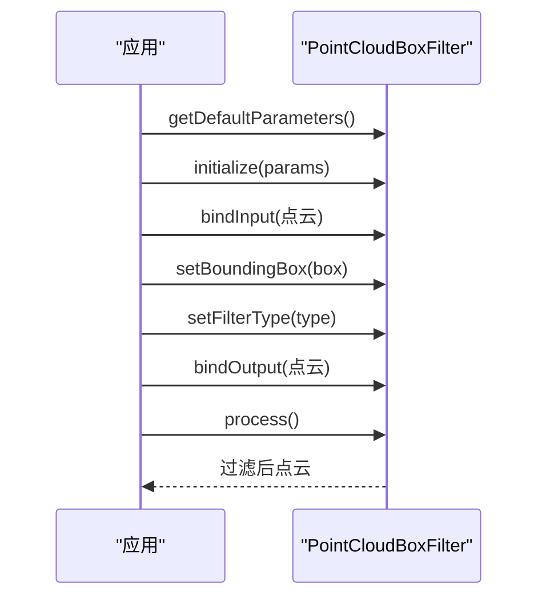

图表来源
- [PointCloudBoxFilter.h:87-88](file://driveworks-5.14/include/dw/pointcloudprocessing/filter/PointCloudBoxFilter.h#L87-L88)
- [PointCloudBoxFilter.h:100-102](file://driveworks-5.14/include/dw/pointcloudprocessing/filter/PointCloudBoxFilter.h#L100-L102)
- [PointCloudBoxFilter.h:137-138](file://driveworks-5.14/include/dw/pointcloudprocessing/filter/PointCloudBoxFilter.h#L137-L138)
- [PointCloudBoxFilter.h:187-189](file://driveworks-5.14/include/dw/pointcloudprocessing/filter/PointCloudBoxFilter.h#L187-L189)
- [PointCloudBoxFilter.h:176-177](file://driveworks-5.14/include/dw/pointcloudprocessing/filter/PointCloudBoxFilter.h#L176-L177)
- [PointCloudBoxFilter.h:219-220](file://driveworks-5.14/include/dw/pointcloudprocessing/filter/PointCloudBoxFilter.h#L219-L220)

章节来源
- [PointCloudBoxFilter.h:58-78](file://driveworks-5.14/include/dw/pointcloudprocessing/filter/PointCloudBoxFilter.h#L58-L78)
- [PointCloudBoxFilter.h:100-102](file://driveworks-5.14/include/dw/pointcloudprocessing/filter/PointCloudBoxFilter.h#L100-L102)
- [PointCloudBoxFilter.h:137-138](file://driveworks-5.14/include/dw/pointcloudprocessing/filter/PointCloudBoxFilter.h#L137-L138)
- [PointCloudBoxFilter.h:176-177](file://driveworks-5.14/include/dw/pointcloudprocessing/filter/PointCloudBoxFilter.h#L176-L177)
- [PointCloudBoxFilter.h:219-220](file://driveworks-5.14/include/dw/pointcloudprocessing/filter/PointCloudBoxFilter.h#L219-L220)

### 组件G：多视角拼接（PointCloudStitcher）
- 功能：将多源点云统一到同一坐标系，支持运动补偿与全局变换
- 关键流程：初始化，绑定多个输入点云（可选传感器到车身变换），绑定输出，启用运动补偿（可选），执行处理

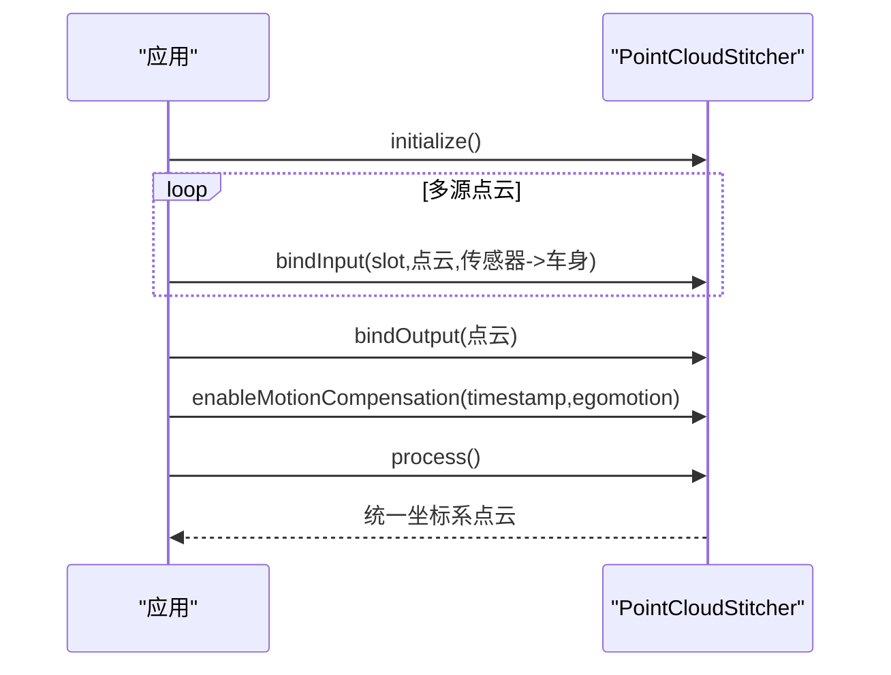

图表来源
- [PointCloudStitcher.h:73-74](file://driveworks-5.14/include/dw/pointcloudprocessing/stitcher/PointCloudStitcher.h#L73-L74)
- [PointCloudStitcher.h:165-169](file://driveworks-5.14/include/dw/pointcloudprocessing/stitcher/PointCloudStitcher.h#L165-L169)
- [PointCloudStitcher.h:197-199](file://driveworks-5.14/include/dw/pointcloudprocessing/stitcher/PointCloudStitcher.h#L197-L199)
- [PointCloudStitcher.h:124-127](file://driveworks-5.14/include/dw/pointcloudprocessing/stitcher/PointCloudStitcher.h#L124-L127)
- [PointCloudStitcher.h:220-221](file://driveworks-5.14/include/dw/pointcloudprocessing/stitcher/PointCloudStitcher.h#L220-L221)

章节来源
- [PointCloudStitcher.h:63-92](file://driveworks-5.14/include/dw/pointcloudprocessing/stitcher/PointCloudStitcher.h#L63-L92)
- [PointCloudStitcher.h:165-169](file://driveworks-5.14/include/dw/pointcloudprocessing/stitcher/PointCloudStitcher.h#L165-L169)
- [PointCloudStitcher.h:197-199](file://driveworks-5.14/include/dw/pointcloudprocessing/stitcher/PointCloudStitcher.h#L197-L199)
- [PointCloudStitcher.h:220-221](file://driveworks-5.14/include/dw/pointcloudprocessing/stitcher/PointCloudStitcher.h#L220-L221)

### 组件H：范围图像创建器（PointCloudRangeImageCreator）
- 功能：球面投影生成距离/强度/2D网格等类型范围图像，支持裁剪参数与输出点云绑定
- 关键流程：初始化参数（内存类型、最大输入点数、宽高、图像类型、变换、裁剪参数），绑定输入点云与输出图像（可选输出点云），执行处理

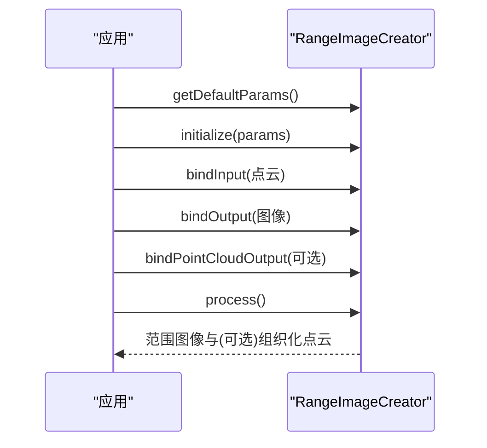

图表来源
- [PointCloudRangeImageCreator.h:111-113](file://driveworks-5.14/include/dw/pointcloudprocessing/rangeimagecreator/PointCloudRangeImageCreator.h#L111-L113)
- [PointCloudRangeImageCreator.h:199-201](file://driveworks-5.14/include/dw/pointcloudprocessing/rangeimagecreator/PointCloudRangeImageCreator.h#L199-L201)
- [PointCloudRangeImageCreator.h:213-215](file://driveworks-5.14/include/dw/pointcloudprocessing/rangeimagecreator/PointCloudRangeImageCreator.h#L213-L215)
- [PointCloudRangeImageCreator.h:230-232](file://driveworks-5.14/include/dw/pointcloudprocessing/rangeimagecreator/PointCloudRangeImageCreator.h#L230-L232)
- [PointCloudRangeImageCreator.h:244-245](file://driveworks-5.14/include/dw/pointcloudprocessing/rangeimagecreator/PointCloudRangeImageCreator.h#L244-L245)

章节来源
- [PointCloudRangeImageCreator.h:59-97](file://driveworks-5.14/include/dw/pointcloudprocessing/rangeimagecreator/PointCloudRangeImageCreator.h#L59-L97)
- [PointCloudRangeImageCreator.h:111-113](file://driveworks-5.14/include/dw/pointcloudprocessing/rangeimagecreator/PointCloudRangeImageCreator.h#L111-L113)
- [PointCloudRangeImageCreator.h:199-201](file://driveworks-5.14/include/dw/pointcloudprocessing/rangeimagecreator/PointCloudRangeImageCreator.h#L199-L201)
- [PointCloudRangeImageCreator.h:213-215](file://driveworks-5.14/include/dw/pointcloudprocessing/rangeimagecreator/PointCloudRangeImageCreator.h#L213-L215)
- [PointCloudRangeImageCreator.h:230-232](file://driveworks-5.14/include/dw/pointcloudprocessing/rangeimagecreator/PointCloudRangeImageCreator.h#L230-L232)
- [PointCloudRangeImageCreator.h:244-245](file://driveworks-5.14/include/dw/pointcloudprocessing/rangeimagecreator/PointCloudRangeImageCreator.h#L244-L245)

## 依赖关系分析
- 组件耦合
  - 累加器/装配器依赖通用点云结构与激光属性
  - 运动补偿器依赖惯性状态与传感器到车身变换
  - 拼接器依赖多源点云与可选运动补偿
  - ICP/平面提取器依赖通用点云
  - 范围图像创建器依赖通用点云与图像资源
- 外部依赖
  - CUDA 流用于异步处理
  - 惯性/车况模块提供运动状态
  - 渲染引擎用于可视化

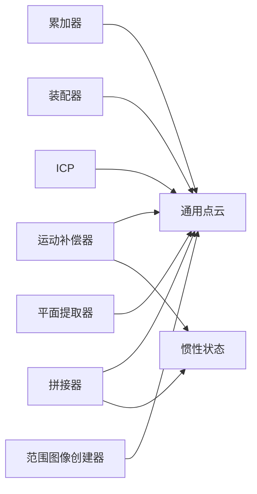

图表来源
- [PointCloudAccumulator.h:120-124](file://driveworks-5.14/include/dw/pointcloudprocessing/accumulator/PointCloudAccumulator.h#L120-L124)
- [MotionCompensator.h:173-175](file://driveworks-5.14/include/dw/pointcloudprocessing/motioncompensator/MotionCompensator.h#L173-L175)
- [PointCloudStitcher.h:124-127](file://driveworks-5.14/include/dw/pointcloudprocessing/stitcher/PointCloudStitcher.h#L124-L127)
- [PointCloudICP.h:126-128](file://driveworks-5.14/include/dw/pointcloudprocessing/icp/PointCloudICP.h#L126-L128)
- [PointCloudPlaneExtractor.h:111-113](file://driveworks-5.14/include/dw/pointcloudprocessing/planeextractor/PointCloudPlaneExtractor.h#L111-L113)
- [PointCloudRangeImageCreator.h:111-113](file://driveworks-5.14/include/dw/pointcloudprocessing/rangeimagecreator/PointCloudRangeImageCreator.h#L111-L113)

章节来源
- [PointCloudAccumulator.h:120-124](file://driveworks-5.14/include/dw/pointcloudprocessing/accumulator/PointCloudAccumulator.h#L120-L124)
- [MotionCompensator.h:173-175](file://driveworks-5.14/include/dw/pointcloudprocessing/motioncompensator/MotionCompensator.h#L173-L175)
- [PointCloudStitcher.h:124-127](file://driveworks-5.14/include/dw/pointcloudprocessing/stitcher/PointCloudStitcher.h#L124-L127)
- [PointCloudICP.h:126-128](file://driveworks-5.14/include/dw/pointcloudprocessing/icp/PointCloudICP.h#L126-L128)
- [PointCloudPlaneExtractor.h:111-113](file://driveworks-5.14/include/dw/pointcloudprocessing/planeextractor/PointCloudPlaneExtractor.h#L111-L113)
- [PointCloudRangeImageCreator.h:111-113](file://driveworks-5.14/include/dw/pointcloudprocessing/rangeimagecreator/PointCloudRangeImageCreator.h#L111-L113)

## 性能考虑
- 内存与带宽
  - 优先使用 CUDA 内存进行大规模点云处理，避免频繁主机/设备拷贝
  - 控制点云容量与组织化输出，减少无效点与空洞
- 并行与流水线
  - 使用 CUDA 流实现多模块并行处理
  - 将预处理（过滤/裁剪）前置，降低后续模块计算量
- 参数调优
  - 累加器滤波窗口与角度/距离范围影响点云密度与噪声
  - ICP 收敛容差与最大迭代次数平衡精度与性能
  - 范围图像尺寸与最大深度图点数需满足实现限制

## 故障排查指南
- 常见错误与定位
  - 绑定输出失败：检查内存类型与初始化参数一致，确保已调用创建缓冲区 API
  - 就绪判断失败：确认已正确推入足够激光包并满足零交叉/自旋边界条件
  - CUDA 流相关错误：确认模块初始化时选择了正确的内存类型，并正确设置了 CUDA 流
  - 运动补偿失败：检查惯性状态可用性、传感器到车身变换有效性、参考时间戳一致性
- 示例参考
  - 端到端流程与错误处理模式可参考示例工程中的初始化、事件循环与释放逻辑

章节来源
- [PointCloudAccumulator.h:224-225](file://driveworks-5.14/include/dw/pointcloudprocessing/accumulator/PointCloudAccumulator.h#L224-L225)
- [PointCloudAssembler.h:163-164](file://driveworks-5.14/include/dw/pointcloudprocessing/assembler/PointCloudAssembler.h#L163-L164)
- [MotionCompensator.h:148-150](file://driveworks-5.14/include/dw/pointcloudprocessing/motioncompensator/MotionCompensator.h#L148-L150)
- [PointCloudProcessingSample.cpp:591-709](file://driveworks-5.14/samples/src/pointcloudprocessing/PointCloudProcessingSample.cpp#L591-L709)

## 结论
本技术文档系统梳理了点云处理模块的核心数据结构与算法组件，给出了端到端工作流与关键接口的使用建议。通过合理配置参数、利用 CUDA 并行与组织化输出，可在保证精度的前提下显著提升处理效率。建议在实际部署中结合具体硬件与任务需求进行参数调优与性能验证。

## 附录：API 参考与示例路径
- 点云数据结构
  - [PointCloud.h:98-120](file://driveworks-5.14/include/dw/pointcloudprocessing/pointcloud/PointCloud.h#L98-L120)
  - [LidarPointCloud.h:97-109](file://driveworks-5.14/include/dw/pointcloudprocessing/pointcloud/LidarPointCloud.h#L97-L109)
- 组装器
  - [PointCloudAssembler.h:96-100](file://driveworks-5.14/include/dw/pointcloudprocessing/assembler/PointCloudAssembler.h#L96-L100)
  - [PointCloudAssembler.h:163-180](file://driveworks-5.14/include/dw/pointcloudprocessing/assembler/PointCloudAssembler.h#L163-L180)
  - [PointCloudAssembler.h:204-231](file://driveworks-5.14/include/dw/pointcloudprocessing/assembler/PointCloudAssembler.h#L204-L231)
- 累加器
  - [PointCloudAccumulator.h:120-141](file://driveworks-5.14/include/dw/pointcloudprocessing/accumulator/PointCloudAccumulator.h#L120-L141)
  - [PointCloudAccumulator.h:224-225](file://driveworks-5.14/include/dw/pointcloudprocessing/accumulator/PointCloudAccumulator.h#L224-L225)
  - [PointCloudAccumulator.h:247-248](file://driveworks-5.14/include/dw/pointcloudprocessing/accumulator/PointCloudAccumulator.h#L247-L248)
- 运动补偿器
  - [MotionCompensator.h:111-114](file://driveworks-5.14/include/dw/pointcloudprocessing/motioncompensator/MotionCompensator.h#L111-L114)
  - [MotionCompensator.h:173-175](file://driveworks-5.14/include/dw/pointcloudprocessing/motioncompensator/MotionCompensator.h#L173-L175)
  - [MotionCompensator.h:212-215](file://driveworks-5.14/include/dw/pointcloudprocessing/motioncompensator/MotionCompensator.h#L212-L215)
  - [MotionCompensator.h:253-263](file://driveworks-5.14/include/dw/pointcloudprocessing/motioncompensator/MotionCompensator.h#L253-L263)
- ICP 配准
  - [PointCloudICP.h:126-128](file://driveworks-5.14/include/dw/pointcloudprocessing/icp/PointCloudICP.h#L126-L128)
  - [PointCloudICP.h:190-194](file://driveworks-5.14/include/dw/pointcloudprocessing/icp/PointCloudICP.h#L190-L194)
  - [PointCloudICP.h:205-207](file://driveworks-5.14/include/dw/pointcloudprocessing/icp/PointCloudICP.h#L205-L207)
  - [PointCloudICP.h:271-272](file://driveworks-5.14/include/dw/pointcloudprocessing/icp/PointCloudICP.h#L271-L272)
- 平面提取器
  - [PointCloudPlaneExtractor.h:111-113](file://driveworks-5.14/include/dw/pointcloudprocessing/planeextractor/PointCloudPlaneExtractor.h#L111-L113)
  - [PointCloudPlaneExtractor.h:149-151](file://driveworks-5.14/include/dw/pointcloudprocessing/planeextractor/PointCloudPlaneExtractor.h#L149-L151)
  - [PointCloudPlaneExtractor.h:183-187](file://driveworks-5.14/include/dw/pointcloudprocessing/planeextractor/PointCloudPlaneExtractor.h#L183-L187)
  - [PointCloudPlaneExtractor.h:197-198](file://driveworks-5.14/include/dw/pointcloudprocessing/planeextractor/PointCloudPlaneExtractor.h#L197-L198)
- 过滤器
  - [PointCloudBoxFilter.h:100-102](file://driveworks-5.14/include/dw/pointcloudprocessing/filter/PointCloudBoxFilter.h#L100-L102)
  - [PointCloudBoxFilter.h:137-138](file://driveworks-5.14/include/dw/pointcloudprocessing/filter/PointCloudBoxFilter.h#L137-L138)
  - [PointCloudBoxFilter.h:176-177](file://driveworks-5.14/include/dw/pointcloudprocessing/filter/PointCloudBoxFilter.h#L176-L177)
  - [PointCloudBoxFilter.h:219-220](file://driveworks-5.14/include/dw/pointcloudprocessing/filter/PointCloudBoxFilter.h#L219-L220)
- 拼接器
  - [PointCloudStitcher.h:73-74](file://driveworks-5.14/include/dw/pointcloudprocessing/stitcher/PointCloudStitcher.h#L73-L74)
  - [PointCloudStitcher.h:165-169](file://driveworks-5.14/include/dw/pointcloudprocessing/stitcher/PointCloudStitcher.h#L165-L169)
  - [PointCloudStitcher.h:197-199](file://driveworks-5.14/include/dw/pointcloudprocessing/stitcher/PointCloudStitcher.h#L197-L199)
  - [PointCloudStitcher.h:220-221](file://driveworks-5.14/include/dw/pointcloudprocessing/stitcher/PointCloudStitcher.h#L220-L221)
- 范围图像创建器
  - [PointCloudRangeImageCreator.h:111-113](file://driveworks-5.14/include/dw/pointcloudprocessing/rangeimagecreator/PointCloudRangeImageCreator.h#L111-L113)
  - [PointCloudRangeImageCreator.h:199-201](file://driveworks-5.14/include/dw/pointcloudprocessing/rangeimagecreator/PointCloudRangeImageCreator.h#L199-L201)
  - [PointCloudRangeImageCreator.h:213-215](file://driveworks-5.14/include/dw/pointcloudprocessing/rangeimagecreator/PointCloudRangeImageCreator.h#L213-L215)
  - [PointCloudRangeImageCreator.h:230-232](file://driveworks-5.14/include/dw/pointcloudprocessing/rangeimagecreator/PointCloudRangeImageCreator.h#L230-L232)
  - [PointCloudRangeImageCreator.h:244-245](file://driveworks-5.14/include/dw/pointcloudprocessing/rangeimagecreator/PointCloudRangeImageCreator.h#L244-L245)
- 示例工程
  - [PointCloudProcessingSample.cpp:591-709](file://driveworks-5.14/samples/src/pointcloudprocessing/PointCloudProcessingSample.cpp#L591-L709)
  - [PointCloudProcessingSample.cpp:733-775](file://driveworks-5.14/samples/src/pointcloudprocessing/PointCloudProcessingSample.cpp#L733-L775)