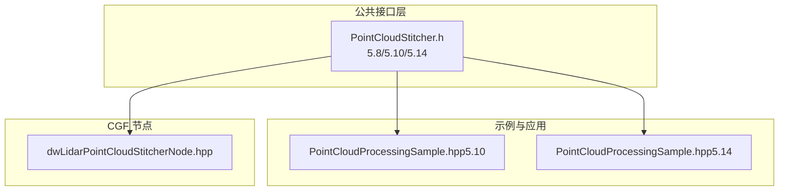
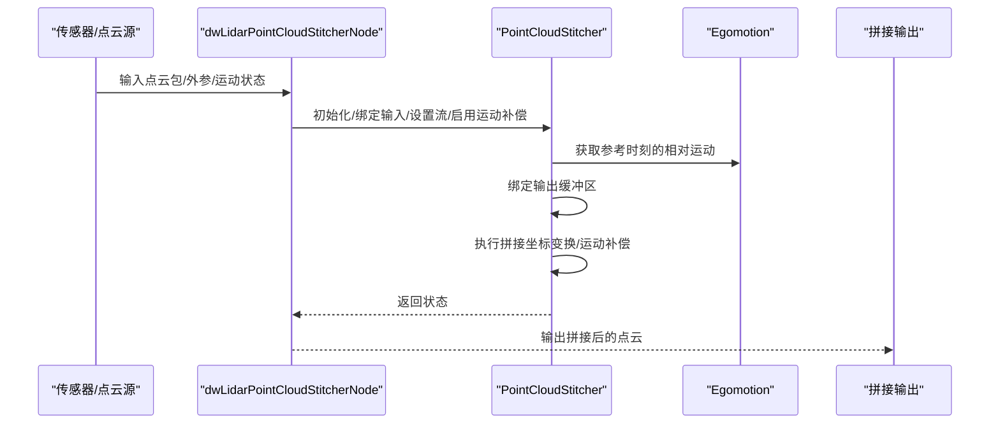
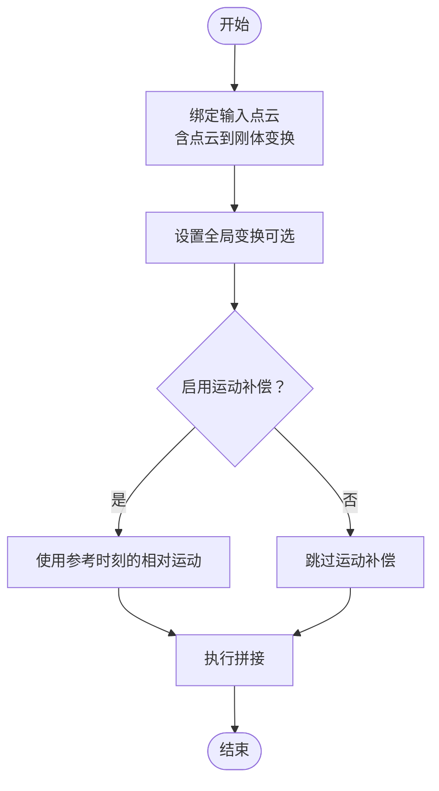
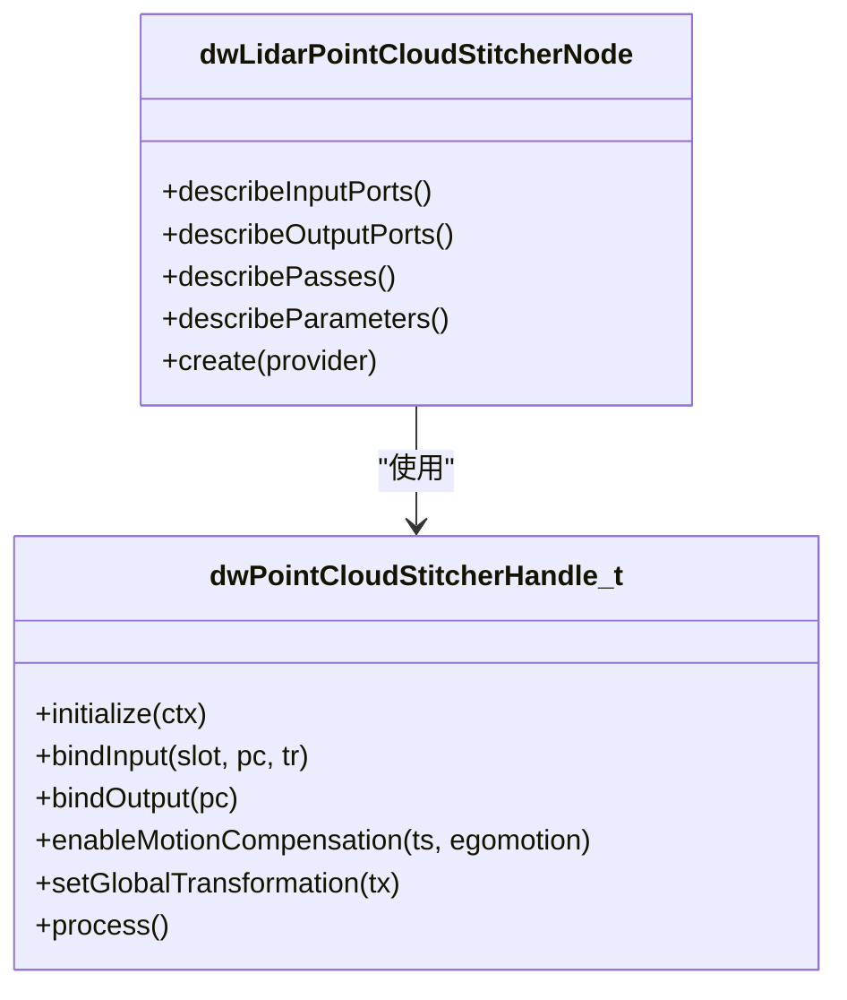
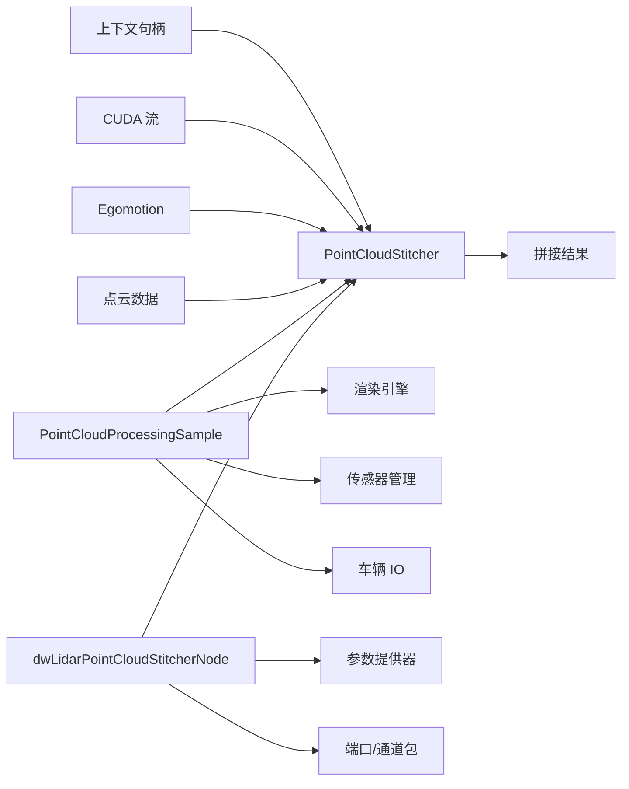

# 点云拼接器

<cite>
**本文引用的文件**
- [PointCloudStitcher.h（5.10）](file://driverorks-5.10/include/dw/pointcloudprocessing/stitcher/PointCloudStitcher.h)
- [PointCloudStitcher.h（5.14）](file://driveworks-5.14/include/dw/pointcloudprocessing/stitcher/PointCloudStitcher.h)
- [PointCloudStitcher.h（5.8）](file://driveworks-5.8/include/dw/pointcloudprocessing/stitcher/PointCloudStitcher.h)
- [PointCloudProcessingSample.hpp（5.10）](file://driverorks-5.10/samples/src/pointcloudprocessing/PointCloudProcessingSample.hpp)
- [PointCloudProcessingSample.hpp（5.14）](file://driveworks-5.14/samples/src/pointcloudprocessing/PointCloudProcessingSample.hpp)
- [dwLidarPointCloudStitcherNode.hpp](file://driverorks-5.10/include/dwframework/dwnodes/dwlidarpointcloudstitchernode/dwLidarPointCloudStitcherNode.hpp)
</cite>

## 目录
1. [引言](#引言)
2. [项目结构](#项目结构)
3. [核心组件](#核心组件)
4. [架构总览](#架构总览)
5. [详细组件分析](#详细组件分析)
6. [依赖关系分析](#依赖关系分析)
7. [性能考量](#性能考量)
8. [故障排查指南](#故障排查指南)
9. [结论](#结论)
10. [附录：API 参考与使用示例](#附录api-参考与使用示例)

## 引言
本技术文档围绕 NVIDIA DriveWorks 中的“点云拼接器”模块展开，系统阐述多视角点云数据的拼接算法与实现原理，覆盖视角对齐策略、重叠区域检测思路、拼接精度控制与边界处理机制，并给出配置参数、拼接策略选择、质量评估方法与性能优化建议。文档同时提供完整的 API 参考与实际应用示例路径，帮助开发者将来自不同视角的点云数据进行有效拼接，构建完整的环境三维模型。

## 项目结构
- 点云拼接器对外暴露一组 C 接口，位于公共头文件中，版本在 5.8、5.10、5.14 均有对应实现。
- 示例程序展示了如何在真实管线中初始化、绑定输入输出、启用运动补偿并执行拼接。
- CGF 节点封装了拼接器，定义了输入/输出端口、参数描述与处理阶段，便于在框架中集成。

**图示来源**
- [PointCloudStitcher.h（5.10）:47-230](file://driverorks-5.10/include/dw/pointcloudprocessing/stitcher/PointCloudStitcher.h#L47-L230)
- [PointCloudStitcher.h（5.14）:47-228](file://driveworks-5.14/include/dw/pointcloudprocessing/stitcher/PointCloudStitcher.h#L47-L228)
- [PointCloudStitcher.h（5.8）:47-194](file://driveworks-5.8/include/dw/pointcloudprocessing/stitcher/PointCloudStitcher.h#L47-L194)
- [PointCloudProcessingSample.hpp（5.10）:63-257](file://driverorks-5.10/samples/src/pointcloudprocessing/PointCloudProcessingSample.hpp#L63-L257)
- [PointCloudProcessingSample.hpp（5.14）:63-257](file://driveworks-5.14/samples/src/pointcloudprocessing/PointCloudProcessingSample.hpp#L63-L257)
- [dwLidarPointCloudStitcherNode.hpp:88-158](file://driverorks-5.10/include/dwframework/dwnodes/dwlidarpointcloudstitchernode/dwLidarPointCloudStitcherNode.hpp#L88-L158)

**章节来源**
- [PointCloudStitcher.h（5.10）:47-230](file://driverorks-5.10/include/dw/pointcloudprocessing/stitcher/PointCloudStitcher.h#L47-L230)
- [PointCloudStitcher.h（5.14）:47-228](file://driveworks-5.14/include/dw/pointcloudprocessing/stitcher/PointCloudStitcher.h#L47-L228)
- [PointCloudStitcher.h（5.8）:47-194](file://driveworks-5.8/include/dw/pointcloudprocessing/stitcher/PointCloudStitcher.h#L47-L194)
- [PointCloudProcessingSample.hpp（5.10）:63-257](file://driverorks-5.10/samples/src/pointcloudprocessing/PointCloudProcessingSample.hpp#L63-L257)
- [PointCloudProcessingSample.hpp（5.14）:63-257](file://driveworks-5.14/samples/src/pointcloudprocessing/PointCloudProcessingSample.hpp#L63-L257)
- [dwLidarPointCloudStitcherNode.hpp:88-158](file://driverorks-5.10/include/dwframework/dwnodes/dwlidarpointcloudstitchernode/dwLidarPointCloudStitcherNode.hpp#L88-L158)

## 核心组件
- 点云拼接器（PointCloudStitcher）
  - 提供初始化、重置、释放、设置 CUDA 流、启用/禁用运动补偿、设置全局变换、绑定输入/输出、执行拼接等能力。
  - 支持通用点云与激光雷达专用点云的绑定接口。
  - 支持最大绑定槽位数量限制，避免内存越界。
- CGF 节点（dwLidarPointCloudStitcherNode）
  - 定义输入端口（多路点云包、传感器外参、相对运动状态）、输出端口（拼接结果、目标时间戳）。
  - 描述参数集合（每路激光是否启用、激光属性、默认激光到车体外参、内存类型、输出格式、CUDA 流索引）。
  - 划分 CPU/GPU 处理阶段，便于在框架中流水线化执行。

**章节来源**
- [PointCloudStitcher.h（5.10）:63-230](file://driverorks-5.10/include/dw/pointcloudprocessing/stitcher/PointCloudStitcher.h#L63-L230)
- [PointCloudStitcher.h（5.14）:63-228](file://driveworks-5.14/include/dw/pointcloudprocessing/stitcher/PointCloudStitcher.h#L63-L228)
- [PointCloudStitcher.h（5.8）:63-194](file://driveworks-5.8/include/dw/pointcloudprocessing/stitcher/PointCloudStitcher.h#L63-L194)
- [dwLidarPointCloudStitcherNode.hpp:51-158](file://driverorks-5.10/include/dwframework/dwnodes/dwlidarpointcloudstitchernode/dwLidarPointCloudStitcherNode.hpp#L51-L158)

## 架构总览
下图展示了从传感器输入到最终拼接输出的整体流程，以及运动补偿与全局变换在其中的位置。

**图示来源**
- [dwLidarPointCloudStitcherNode.hpp:93-117](file://driverorks-5.10/include/dwframework/dwnodes/dwlidarpointcloudstitchernode/dwLidarPointCloudStitcherNode.hpp#L93-L117)
- [PointCloudStitcher.h（5.10）:117-223](file://driverorks-5.10/include/dw/pointcloudprocessing/stitcher/PointCloudStitcher.h#L117-L223)
- [PointCloudStitcher.h（5.14）:117-221](file://driveworks-5.14/include/dw/pointcloudprocessing/stitcher/PointCloudStitcher.h#L117-L221)

## 详细组件分析

### 视角对齐策略
- 每个输入点云可通过“点云到车体（或刚性结构）”的变换进行对齐，该变换在绑定时被复制并保存，后续若外部更新需重新调用绑定接口以刷新。
- 全局变换可一次性将拼接后的点云映射到统一坐标系，便于与其他传感器或地图对齐。

**图示来源**
- [PointCloudStitcher.h（5.10）:155-223](file://driverorks-5.10/include/dw/pointcloudprocessing/stitcher/PointCloudStitcher.h#L155-L223)
- [PointCloudStitcher.h（5.14）:155-221](file://driveworks-5.14/include/dw/pointcloudprocessing/stitcher/PointCloudStitcher.h#L155-L221)

**章节来源**
- [PointCloudStitcher.h（5.10）:155-223](file://driverorks-5.10/include/dw/pointcloudprocessing/stitcher/PointCloudStitcher.h#L155-L223)
- [PointCloudStitcher.h（5.14）:155-221](file://driveworks-5.14/include/dw/pointcloudprocessing/stitcher/PointCloudStitcher.h#L155-L221)

### 重叠区域检测与拼接顺序
- 模块本身不直接提供“自动重叠区域检测”的算法接口；典型做法是在上层通过几何约束（如相邻激光的 FOV 重叠、运动轨迹接近）来组织输入顺序与绑定槽位。
- 在示例中，多个激光通道按固定顺序绑定，随后统一拼接，形成连续的环境建模。

**章节来源**
- [PointCloudProcessingSample.hpp（5.10）:104-151](file://driverorks-5.10/samples/src/pointcloudprocessing/PointCloudProcessingSample.hpp#L104-L151)
- [PointCloudProcessingSample.hpp（5.14）:104-151](file://driveworks-5.14/samples/src/pointcloudprocessing/PointCloudProcessingSample.hpp#L104-L151)

### 拼接精度控制
- 运动补偿精度取决于参考时刻与相对运动模型的质量；启用运动补偿后，模块会根据参考时间戳与提供的相对运动进行补偿。
- 全局变换应尽量采用高精度标定（如激光到车体外参）以减少系统误差。

**章节来源**
- [PointCloudStitcher.h（5.10）:117-136](file://driverorks-5.10/include/dw/pointcloudprocessing/stitcher/PointCloudStitcher.h#L117-L136)
- [PointCloudStitcher.h（5.14）:117-136](file://driveworks-5.14/include/dw/pointcloudprocessing/stitcher/PointCloudStitcher.h#L117-L136)

### 边界处理机制
- 输出缓冲区容量不足时，拼接过程会返回超出范围错误；应确保输出缓冲区能容纳所有输入点云合并后的总量。
- 内存类型必须匹配（例如均在 GPU/CPU/Pinned），否则会触发无效参数错误。

**章节来源**
- [PointCloudStitcher.h（5.10）:214-223](file://driverorks-5.10/include/dw/pointcloudprocessing/stitcher/PointCloudStitcher.h#L214-L223)
- [PointCloudStitcher.h（5.14）:213-221](file://driveworks-5.14/include/dw/pointcloudprocessing/stitcher/PointCloudStitcher.h#L213-L221)

### CGF 节点与管线集成
- 输入端口包含多路点云包、传感器外参与相对运动状态；输出端口包含拼接结果与目标时间戳。
- 参数描述涵盖每路激光启用状态、激光属性、默认激光到车体外参、内存类型、输出格式与 CUDA 流索引。
- 处理阶段分为 SETUP、PROCESS_GPU、PROCESS_CPU、TEARDOWN，便于在框架中调度。

**图示来源**
- [dwLidarPointCloudStitcherNode.hpp:88-158](file://driverorks-5.10/include/dwframework/dwnodes/dwlidarpointcloudstitchernode/dwLidarPointCloudStitcherNode.hpp#L88-L158)
- [PointCloudStitcher.h（5.10）:72-223](file://driverorks-5.10/include/dw/pointcloudprocessing/stitcher/PointCloudStitcher.h#L72-L223)

**章节来源**
- [dwLidarPointCloudStitcherNode.hpp:88-158](file://driverorks-5.10/include/dwframework/dwnodes/dwlidarpointcloudstitchernode/dwLidarPointCloudStitcherNode.hpp#L88-L158)

## 依赖关系分析
- 点云拼接器依赖上下文句柄、CUDA 流、相对运动模型与点云数据结构。
- 示例程序依赖渲染引擎、传感器管理、车辆 IO、ICP、平面提取、累积器等模块，形成完整的点云处理管线。
- CGF 节点依赖参数提供器、端口描述、通道包类型与节点基类。

**图示来源**
- [PointCloudStitcher.h（5.10）:72-223](file://driverorks-5.10/include/dw/pointcloudprocessing/stitcher/PointCloudStitcher.h#L72-L223)
- [PointCloudProcessingSample.hpp（5.10）:31-53](file://driverorks-5.10/samples/src/pointcloudprocessing/PointCloudProcessingSample.hpp#L31-L53)
- [dwLidarPointCloudStitcherNode.hpp:34-44](file://driverorks-5.10/include/dwframework/dwnodes/dwlidarpointcloudstitchernode/dwLidarPointCloudStitcherNode.hpp#L34-L44)

**章节来源**
- [PointCloudProcessingSample.hpp（5.10）:31-53](file://driverorks-5.10/samples/src/pointcloudprocessing/PointCloudProcessingSample.hpp#L31-L53)
- [PointCloudProcessingSample.hpp（5.14）:31-53](file://driveworks-5.14/samples/src/pointcloudprocessing/PointCloudProcessingSample.hpp#L31-L53)
- [dwLidarPointCloudStitcherNode.hpp:34-44](file://driverorks-5.10/include/dwframework/dwnodes/dwlidarpointcloudstitchernode/dwLidarPointCloudStitcherNode.hpp#L34-L44)

## 性能考量
- 使用合适的内存类型（GPU/CPU/Pinned）与 CUDA 流，减少主机与设备之间的拷贝与同步开销。
- 合理设置输出缓冲区大小，避免运行时扩容导致的性能抖动。
- 在 CGF 节点中利用多阶段处理（GPU/CPU 分离）提升吞吐。
- 尽量在上层完成必要的预处理（如降采样、裁剪）以降低拼接器负担。

## 故障排查指南
- “输入列表未绑定”：在调用拼接前，确保已为每个输入槽位绑定点云与变换。
- “内存类型不匹配”：输入与输出的内存类型必须一致。
- “超出范围”：输出缓冲区容量不足以容纳合并后的点数。
- “无效句柄/参数”：传入空指针或非法参数（如槽位越界）。
- “未启用运动补偿但期望补偿效果”：确认已设置参考时间戳与相对运动句柄。

**章节来源**
- [PointCloudStitcher.h（5.10）:214-223](file://driverorks-5.10/include/dw/pointcloudprocessing/stitcher/PointCloudStitcher.h#L214-L223)
- [PointCloudStitcher.h（5.14）:213-221](file://driveworks-5.14/include/dw/pointcloudprocessing/stitcher/PointCloudStitcher.h#L213-L221)

## 结论
点云拼接器提供了稳定、可扩展的多视角点云融合能力，结合运动补偿与全局变换，能够满足车载场景下的高精度建模需求。通过 CGF 节点与示例程序，开发者可以快速将其集成到完整管线中，并依据具体硬件与任务特性进行参数与性能优化。

## 附录：API 参考与使用示例

### API 参考（概要）
- 初始化/释放
  - 初始化：[PointCloudStitcher.h（5.10）:72-74](file://driverorks-5.10/include/dw/pointcloudprocessing/stitcher/PointCloudStitcher.h#L72-L74)、[PointCloudStitcher.h（5.14）:72-74](file://driveworks-5.14/include/dw/pointcloudprocessing/stitcher/PointCloudStitcher.h#L72-L74)
  - 重置：[PointCloudStitcher.h（5.10）:82-83](file://driverorks-5.10/include/dw/pointcloudprocessing/stitcher/PointCloudStitcher.h#L82-L83)、[PointCloudStitcher.h（5.14）:82-83](file://driveworks-5.14/include/dw/pointcloudprocessing/stitcher/PointCloudStitcher.h#L82-L83)
  - 释放：[PointCloudStitcher.h（5.10）:86-92](file://driverorks-5.10/include/dw/pointcloudprocessing/stitcher/PointCloudStitcher.h#L86-L92)、[PointCloudStitcher.h（5.14）:86-92](file://driveworks-5.14/include/dw/pointcloudprocessing/stitcher/PointCloudStitcher.h#L86-L92)
- CUDA 流
  - 获取/设置：[PointCloudStitcher.h（5.10）:101-114](file://driverorks-5.10/include/dw/pointcloudprocessing/stitcher/PointCloudStitcher.h#L101-L114)、[PointCloudStitcher.h（5.14）:101-114](file://driveworks-5.14/include/dw/pointcloudprocessing/stitcher/PointCloudStitcher.h#L101-L114)
- 运动补偿
  - 启用/禁用：[PointCloudStitcher.h（5.10）:124-136](file://driverorks-5.10/include/dw/pointcloudprocessing/stitcher/PointCloudStitcher.h#L124-L136)、[PointCloudStitcher.h（5.14）:124-136](file://driveworks-5.14/include/dw/pointcloudprocessing/stitcher/PointCloudStitcher.h#L124-L136)
- 全局变换
  - 设置：[PointCloudStitcher.h（5.10）:150-152](file://driverorks-5.10/include/dw/pointcloudprocessing/stitcher/PointCloudStitcher.h#L150-L152)、[PointCloudStitcher.h（5.14）:150-152](file://driveworks-5.14/include/dw/pointcloudprocessing/stitcher/PointCloudStitcher.h#L150-L152)
- 输入/输出绑定
  - 通用点云绑定：[PointCloudStitcher.h（5.10）:166-171](file://driverorks-5.10/include/dw/pointcloudprocessing/stitcher/PointCloudStitcher.h#L166-L171)、[PointCloudStitcher.h（5.14）:166-189](file://driveworks-5.14/include/dw/pointcloudprocessing/stitcher/PointCloudStitcher.h#L166-L189)
  - 激光点云绑定：[PointCloudStitcher.h（5.10）:186-190](file://driverorks-5.10/include/dw/pointcloudprocessing/stitcher/PointCloudStitcher.h#L186-L190)、[PointCloudStitcher.h（5.14）:184-209](file://driveworks-5.14/include/dw/pointcloudprocessing/stitcher/PointCloudStitcher.h#L184-L209)
  - 输出绑定：[PointCloudStitcher.h（5.10）:198-201](file://driverorks-5.10/include/dw/pointcloudprocessing/stitcher/PointCloudStitcher.h#L198-L201)、[PointCloudStitcher.h（5.14）:208-210](file://driveworks-5.14/include/dw/pointcloudprocessing/stitcher/PointCloudStitcher.h#L208-L210)
- 执行拼接
  - 过程：[PointCloudStitcher.h（5.10）:221-223](file://driverorks-5.10/include/dw/pointcloudprocessing/stitcher/PointCloudStitcher.h#L221-L223)、[PointCloudStitcher.h（5.14）:219-221](file://driveworks-5.14/include/dw/pointcloudprocessing/stitcher/PointCloudStitcher.h#L219-L221)

### 配置参数与策略
- CGF 节点参数
  - 每路激光启用标志、激光属性、默认激光到车体外参、内存类型、输出格式、CUDA 流索引：[dwLidarPointCloudStitcherNode.hpp:51-60](file://driverorks-5.10/include/dwframework/dwnodes/dwlidarpointcloudstitchernode/dwLidarPointCloudStitcherNode.hpp#L51-L60)
- 策略选择
  - 是否启用运动补偿、输出格式（如 XYZI 或 RTHI）、内存类型（CUDA/CPU/Pinned）：[dwLidarPointCloudStitcherNode.hpp:121-154](file://driverorks-5.10/include/dwframework/dwnodes/dwlidarpointcloudstitchernode/dwLidarPointCloudStitcherNode.hpp#L121-L154)

### 实际应用示例
- 示例程序中的关键步骤
  - 初始化上下文与渲染器：[PointCloudProcessingSample.hpp（5.10）:231-236](file://driverorks-5.10/samples/src/pointcloudprocessing/PointCloudProcessingSample.hpp#L231-L236)、[PointCloudProcessingSample.hpp（5.14）:231-236](file://driveworks-5.14/samples/src/pointcloudprocessing/PointCloudProcessingSample.hpp#L231-L236)
  - 初始化拼接器与缓冲区：[PointCloudProcessingSample.hpp（5.10）:175-176](file://driverorks-5.10/samples/src/pointcloudprocessing/PointCloudProcessingSample.hpp#L175-L176)、[PointCloudProcessingSample.hpp（5.14）:175-176](file://driveworks-5.14/samples/src/pointcloudprocessing/PointCloudProcessingSample.hpp#L175-L176)
  - 绑定输入点云与输出缓冲：[PointCloudProcessingSample.hpp（5.10）:144-151](file://driverorks-5.10/samples/src/pointcloudprocessing/PointCloudProcessingSample.hpp#L144-L151)、[PointCloudProcessingSample.hpp（5.14）:144-151](file://driveworks-5.14/samples/src/pointcloudprocessing/PointCloudProcessingSample.hpp#L144-L151)
  - 启用运动补偿与执行拼接：[PointCloudProcessingSample.hpp（5.10）:135-136](file://driverorks-5.10/samples/src/pointcloudprocessing/PointCloudProcessingSample.hpp#L135-L136)、[PointCloudProcessingSample.hpp（5.14）:135-136](file://driveworks-5.14/samples/src/pointcloudprocessing/PointCloudProcessingSample.hpp#L135-L136)