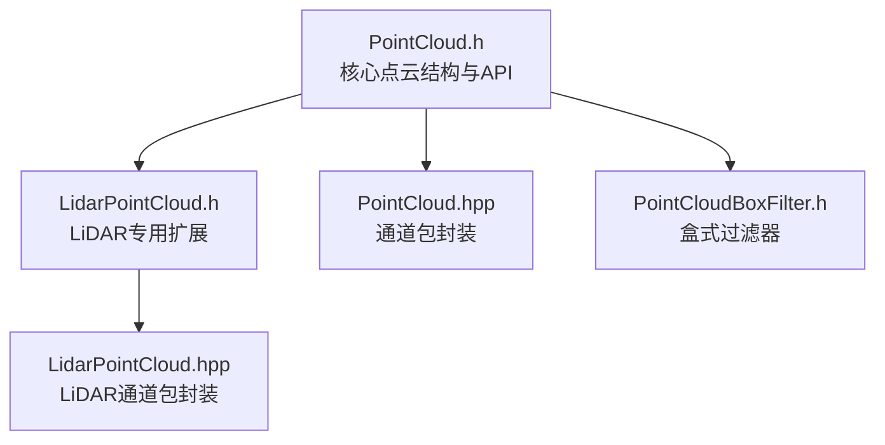
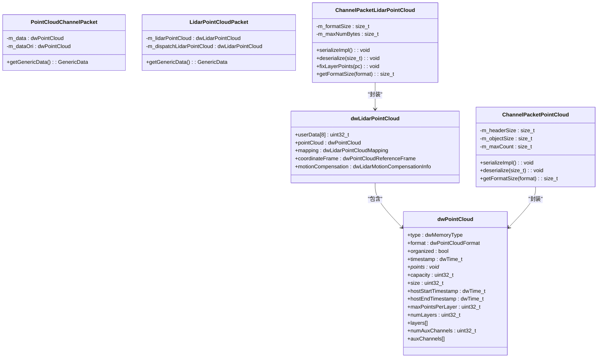
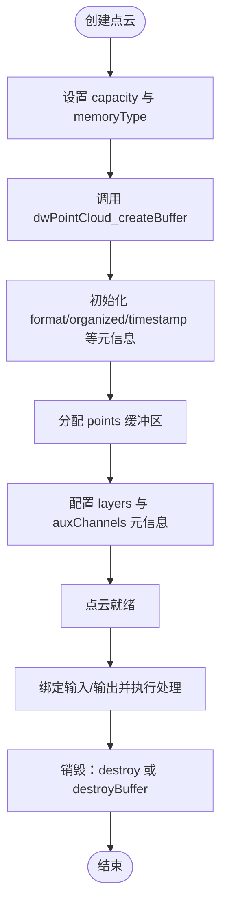
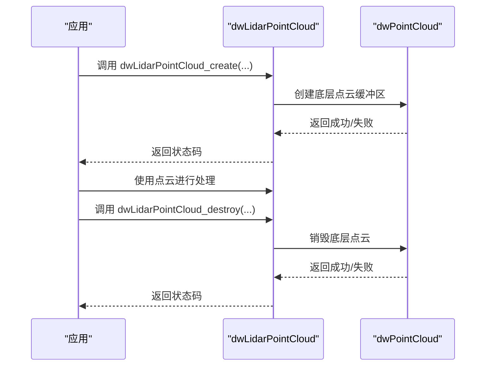
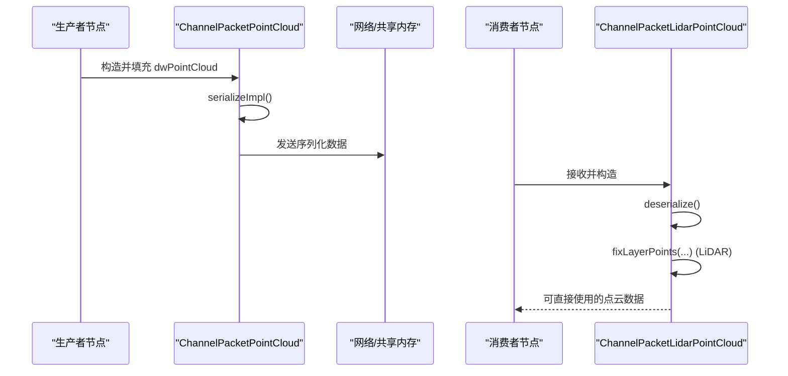
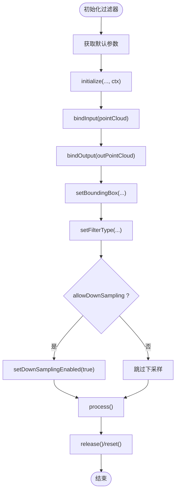
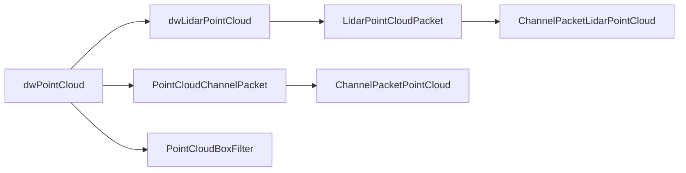

# 点云核心数据结构

<cite>
**本文引用的文件**
- [PointCloud.h](file://driveworks-5.14/include/dw/pointcloudprocessing/pointcloud/PointCloud.h)
- [LidarPointCloud.h](file://driveworks-5.14/include/dw/pointcloudprocessing/pointcloud/LidarPointCloud.h)
- [PointCloud.hpp](file://driveworks-5.14/include/dwframework/dwnodes/common/channelpackets/PointCloud.hpp)
- [LidarPointCloud.hpp](file://driveworks-5.14/include/dwframework/dwnodes/common/channelpackets/LidarPointCloud.hpp)
- [PointCloudBoxFilter.h](file://driveworks-5.14/include/dw/pointcloudprocessing/filter/PointCloudBoxFilter.h)
</cite>

## 目录
1. [引言](#引言)
2. [项目结构](#项目结构)
3. [核心组件](#核心组件)
4. [架构总览](#架构总览)
5. [详细组件分析](#详细组件分析)
6. [依赖关系分析](#依赖关系分析)
7. [性能考虑](#性能考虑)
8. [故障排查指南](#故障排查指南)
9. [结论](#结论)
10. [附录：API 参考与使用示例](#附录api-参考与使用示例)

## 引言
本技术文档聚焦于 NVIDIA DriveWorks 中的点云核心数据结构，系统性阐述 dwPointCloud 与 dwLidarPointCloud 的设计理念、内存布局、坐标系统、点属性定义、数据访问接口与生命周期管理，并补充点云变换、过滤、采样等常用处理能力。文档同时给出面向自动驾驶场景的典型用法与最佳实践，帮助开发者高效、安全地使用点云数据。

## 项目结构
围绕点云数据结构与通道传输，相关文件主要分布在以下路径：
- 核心数据结构与处理接口：driveworks-5.14/include/dw/pointcloudprocessing/pointcloud
- 通道包（Channel Packet）封装：driveworks-5.14/include/dwframework/dwnodes/common/channelpackets
- 常用处理模块（如盒式过滤）：driveworks-5.14/include/dw/pointcloudprocessing/filter

**图示来源**
- [PointCloud.h:98-120](file://driveworks-5.14/include/dw/pointcloudprocessing/pointcloud/PointCloud.h#L98-L120)
- [LidarPointCloud.h:97-109](file://driveworks-5.14/include/dw/pointcloudprocessing/pointcloud/LidarPointCloud.h#L97-L109)
- [PointCloud.hpp:49-68](file://driveworks-5.14/include/dwframework/dwnodes/common/channelpackets/PointCloud.hpp#L49-L68)
- [LidarPointCloud.hpp:48-58](file://driveworks-5.14/include/dwframework/dwnodes/common/channelpackets/LidarPointCloud.hpp#L48-L58)
- [PointCloudBoxFilter.h:58-78](file://driveworks-5.14/include/dw/pointcloudprocessing/filter/PointCloudBoxFilter.h#L58-L78)

**章节来源**
- [PointCloud.h:38-44](file://driveworks-5.14/include/dw/pointcloudprocessing/pointcloud/PointCloud.h#L38-L44)
- [LidarPointCloud.h:38-44](file://driveworks-5.14/include/dw/pointcloudprocessing/pointcloud/LidarPointCloud.h#L38-L44)
- [PointCloud.hpp:31-42](file://driveworks-5.14/include/dwframework/dwnodes/common/channelpackets/PointCloud.hpp#L31-L42)
- [LidarPointCloud.hpp:31-41](file://driveworks-5.14/include/dwframework/dwnodes/common/channelpackets/LidarPointCloud.hpp#L31-L41)
- [PointCloudBoxFilter.h:38-45](file://driveworks-5.14/include/dw/pointcloudprocessing/filter/PointCloudBoxFilter.h#L38-L45)

## 核心组件
- dwPointCloud：通用点云数据结构，描述点云格式、内存类型、组织方式、时间戳、层与辅助通道等元信息，以及指向点数据缓冲区的指针与容量。
- dwLidarPointCloud：在 dwPointCloud 基础上增加 LiDAR 特定字段，如坐标参考系、运动补偿信息、返回类型与辅助通道映射、用户自定义数据等。
- 通道包封装：PointCloudChannelPacket 与 ChannelPacketPointCloud 将 dwPointCloud 打包为可跨进程/跨节点传输的数据包；LidarPointCloudPacket 与 ChannelPacketLidarPointCloud 提供 LiDAR 专用序列化/反序列化与缓冲区修复逻辑。
- 处理模块：PointCloudBoxFilter 提供基于定向包围盒的点云过滤能力，支持 CPU/GPU 实现与下采样控制。

**章节来源**
- [PointCloud.h:59-120](file://driveworks-5.14/include/dw/pointcloudprocessing/pointcloud/PointCloud.h#L59-L120)
- [LidarPointCloud.h:55-109](file://driveworks-5.14/include/dw/pointcloudprocessing/pointcloud/LidarPointCloud.h#L55-L109)
- [PointCloud.hpp:49-93](file://driveworks-5.14/include/dwframework/dwnodes/common/channelpackets/PointCloud.hpp#L49-L93)
- [LidarPointCloud.hpp:48-78](file://driveworks-5.14/include/dwframework/dwnodes/common/channelpackets/LidarPointCloud.hpp#L48-L78)
- [PointCloudBoxFilter.h:58-78](file://driveworks-5.14/include/dw/pointcloudprocessing/filter/PointCloudBoxFilter.h#L58-L78)

## 架构总览
下图展示点云数据从结构体到通道包的封装关系，以及与处理模块的交互：

**图示来源**
- [PointCloud.h:98-120](file://driveworks-5.14/include/dw/pointcloudprocessing/pointcloud/PointCloud.h#L98-L120)
- [LidarPointCloud.h:97-109](file://driveworks-5.14/include/dw/pointcloudprocessing/pointcloud/LidarPointCloud.h#L97-L109)
- [PointCloud.hpp:49-93](file://driveworks-5.14/include/dwframework/dwnodes/common/channelpackets/PointCloud.hpp#L49-L93)
- [LidarPointCloud.hpp:48-78](file://driveworks-5.14/include/dwframework/dwnodes/common/channelpackets/LidarPointCloud.hpp#L48-L78)

## 详细组件分析

### dwPointCloud 数据结构与内存布局
- 点格式：支持笛卡尔 XYZI 与极坐标 RTHI 两种格式，用于描述点的空间位置与强度。
- 内存类型：CPU、CUDA 或 PINNED，决定数据存放与访问位置。
- 组织方式：标记点云是否按 3D 网格有序排列，影响后续处理策略。
- 时间戳：包含捕获完成时间与主机起止时间，便于同步与回放。
- 容量与大小：capacity 表示每层最大点数乘层数；size 表示当前有效点总数。
- 层信息：最多 16 层，每层有索引、点数与数据指针；点并非紧凑存储，部分条目可能为无效点。
- 辅助通道：最多 16 个辅助通道，每个通道记录元素大小、索引、长度与数据指针，按点索引访问。
- 生命周期：通过 createBuffer/destroyBuffer 或 create/destroy 进行分配与释放；默认 organized=false，size 初始化为 0。

**图示来源**
- [PointCloud.h:122-186](file://driveworks-5.14/include/dw/pointcloudprocessing/pointcloud/PointCloud.h#L122-L186)

**章节来源**
- [PointCloud.h:59-120](file://driveworks-5.14/include/dw/pointcloudprocessing/pointcloud/PointCloud.h#L59-L120)
- [PointCloud.h:122-186](file://driveworks-5.14/include/dw/pointcloudprocessing/pointcloud/PointCloud.h#L122-L186)

### dwLidarPointCloud 扩展与坐标系统
- 用户数据：8 个 uint32_t 用户自定义字段，可用于业务上下文或调试信息。
- 映射：将 SAL 返回类型映射到具体层，将 SAL 辅助数据类型映射到点云辅助通道，便于多回波与多传感器融合。
- 坐标参考系：支持传感器坐标系、车体坐标系（RIG）与自定义坐标系，满足不同阶段的坐标统一需求。
- 运动补偿：记录是否已进行运动补偿及参考时间戳，为轨迹对齐与建图提供基础。
- 生命周期：通过 dwLidarPointCloud_create/destroy 创建与销毁，内部委托底层 dwPointCloud 的创建与销毁。

**图示来源**
- [LidarPointCloud.h:112-141](file://driveworks-5.14/include/dw/pointcloudprocessing/pointcloud/LidarPointCloud.h#L112-L141)
- [PointCloud.h:166-186](file://driveworks-5.14/include/dw/pointcloudprocessing/pointcloud/PointCloud.h#L166-L186)

**章节来源**
- [LidarPointCloud.h:55-109](file://driveworks-5.14/include/dw/pointcloudprocessing/pointcloud/LidarPointCloud.h#L55-L109)
- [LidarPointCloud.h:112-141](file://driveworks-5.14/include/dw/pointcloudprocessing/pointcloud/LidarPointCloud.h#L112-L141)

### 通道包封装与序列化
- dwPointCloud 通道包：PointCloudChannelPacket 暴露 getGenericData 接口；ChannelPacketPointCloud 在序列化时计算格式大小、对象大小与最大数量，反序列化时恢复数据。
- dwLidarPointCloud 通道包：LidarPointCloudPacket 同样暴露 getGenericData；ChannelPacketLidarPointCloud 在序列化/反序列化过程中处理不同内存类型（CUDA/非 CUDA），并在反序列化后修复层内点指针，确保数据一致性。

**图示来源**
- [PointCloud.hpp:71-93](file://driveworks-5.14/include/dwframework/dwnodes/common/channelpackets/PointCloud.hpp#L71-L93)
- [LidarPointCloud.hpp:60-78](file://driveworks-5.14/include/dwframework/dwnodes/common/channelpackets/LidarPointCloud.hpp#L60-L78)

**章节来源**
- [PointCloud.hpp:49-93](file://driveworks-5.14/include/dwframework/dwnodes/common/channelpackets/PointCloud.hpp#L49-L93)
- [LidarPointCloud.hpp:48-78](file://driveworks-5.14/include/dwframework/dwnodes/common/channelpackets/LidarPointCloud.hpp#L48-L78)

### 点云处理：盒式过滤
- 参数：包含 CUDA 开关、允许下采样、最大输入点数、定向包围盒、过滤类型（内/外）。
- 生命周期：getDefaultParameters → initialize → bindInput/bindOutput → process → release/reset。
- 流程：根据 enableCuda 决定内存类型约束；设置包围盒与过滤类型；绑定输入输出缓冲区；执行处理；可选设置 CUDA 流。

**图示来源**
- [PointCloudBoxFilter.h:80-220](file://driveworks-5.14/include/dw/pointcloudprocessing/filter/PointCloudBoxFilter.h#L80-L220)

**章节来源**
- [PointCloudBoxFilter.h:58-78](file://driveworks-5.14/include/dw/pointcloudprocessing/filter/PointCloudBoxFilter.h#L58-L78)
- [PointCloudBoxFilter.h:80-220](file://driveworks-5.14/include/dw/pointcloudprocessing/filter/PointCloudBoxFilter.h#L80-L220)

## 依赖关系分析
- 结构体依赖：dwLidarPointCloud 包含 dwPointCloud，扩展了映射、坐标系与运动补偿信息。
- 通道包依赖：PointCloudChannelPacket/ChannelPacketPointCloud 依赖 dwPointCloud；LidarPointCloudPacket/ChannelPacketLidarPointCloud 依赖 dwLidarPointCloud，并在序列化/反序列化中处理内存类型差异与层指针修复。
- 处理模块依赖：PointCloudBoxFilter 依赖 dwPointCloud 与上下文句柄，支持 CPU/GPU 两种实现路径。

**图示来源**
- [PointCloud.h:98-120](file://driveworks-5.14/include/dw/pointcloudprocessing/pointcloud/PointCloud.h#L98-L120)
- [LidarPointCloud.h:97-109](file://driveworks-5.14/include/dw/pointcloudprocessing/pointcloud/LidarPointCloud.h#L97-L109)
- [PointCloud.hpp:49-93](file://driveworks-5.14/include/dwframework/dwnodes/common/channelpackets/PointCloud.hpp#L49-L93)
- [LidarPointCloud.hpp:48-78](file://driveworks-5.14/include/dwframework/dwnodes/common/channelpackets/LidarPointCloud.hpp#L48-L78)
- [PointCloudBoxFilter.h:58-78](file://driveworks-5.14/include/dw/pointcloudprocessing/filter/PointCloudBoxFilter.h#L58-L78)

**章节来源**
- [PointCloud.h:49-50](file://driveworks-5.14/include/dw/pointcloudprocessing/pointcloud/PointCloud.h#L49-L50)
- [LidarPointCloud.h](file://driveworks-5.14/include/dw/pointcloudprocessing/pointcloud/LidarPointCloud.h#L49)
- [PointCloud.hpp:34-39](file://driveworks-5.14/include/dwframework/dwnodes/common/channelpackets/PointCloud.hpp#L34-L39)
- [LidarPointCloud.hpp:34-39](file://driveworks-5.14/include/dwframework/dwnodes/common/channelpackets/LidarPointCloud.hpp#L34-L39)
- [PointCloudBoxFilter.h:50-52](file://driveworks-5.14/include/dw/pointcloudprocessing/filter/PointCloudBoxFilter.h#L50-L52)

## 性能考虑
- 内存对齐：建议每层点数为 16 字节对齐的偶数倍，以提升内存访问效率。
- 组织方式：若点云为有序网格，可利用组织特性减少遍历开销。
- CUDA 优先：GPU 上的盒式过滤需使用 CUDA 内存；合理设置流可提升并发。
- 下采样：启用 allowDownSampling 可自动适配输出容量，降低后续处理成本。
- 序列化开销：通道包序列化/反序列化涉及拷贝与修复，应尽量减少不必要的传输与转换。

[本节为通用指导，无需“章节来源”]

## 故障排查指南
- 空指针与句柄错误：创建/销毁/绑定接口均可能返回 DW_INVALID_ARGUMENT 或 DW_INVALID_HANDLE，需检查传入指针与上下文有效性。
- 内存类型不匹配：GPU 实现要求输入点云为 CUDA 内存；否则返回 DW_NOT_SUPPORTED 或运行失败。
- 容量与格式不符：输入/输出点云的格式、容量与初始化参数不一致会导致绑定失败。
- 运动补偿缺失：LiDAR 点云若未进行运动补偿，坐标系选择需谨慎，避免轨迹漂移。

**章节来源**
- [PointCloudBoxFilter.h:122-134](file://driveworks-5.14/include/dw/pointcloudprocessing/filter/PointCloudBoxFilter.h#L122-L134)
- [PointCloudBoxFilter.h:163-174](file://driveworks-5.14/include/dw/pointcloudprocessing/filter/PointCloudBoxFilter.h#L163-L174)

## 结论
dwPointCloud 与 dwLidarPointCloud 提供了自动驾驶系统所需的高内聚、低耦合的点云数据抽象，配合通道包封装与处理模块，能够高效完成点云的创建、传输、变换与过滤等任务。通过合理的内存布局、坐标系统与辅助通道机制，开发者可在多传感器融合与实时处理场景中获得稳定且高性能的体验。

[本节为总结，无需“章节来源”]

## 附录：API 参考与使用示例
- 点云创建与销毁
  - dwPointCloud_createBuffer：分配基础缓冲区，初始化 size=0，organized=false。
  - dwPointCloud_create/dwPointCloud_destroy：创建带层与辅助通道信息的完整点云。
  - dwLidarPointCloud_create/dwLidarPointCloud_destroy：创建 LiDAR 专用点云，内部委托底层点云。
- 通道包使用
  - PointCloudChannelPacket/ChannelPacketPointCloud：序列化/反序列化通用点云。
  - LidarPointCloudPacket/ChannelPacketLidarPointCloud：序列化/反序列化 LiDAR 点云，修复层内指针。
- 盒式过滤
  - getDefaultParameters → initialize → bindInput/bindOutput → setBoundingBox/setFilterType → process → release/reset。
  - 支持 CPU/GPU 实现，可开启下采样以适配输出容量。

**章节来源**
- [PointCloud.h:122-186](file://driveworks-5.14/include/dw/pointcloudprocessing/pointcloud/PointCloud.h#L122-L186)
- [LidarPointCloud.h:112-141](file://driveworks-5.14/include/dw/pointcloudprocessing/pointcloud/LidarPointCloud.h#L112-L141)
- [PointCloud.hpp:49-93](file://driveworks-5.14/include/dwframework/dwnodes/common/channelpackets/PointCloud.hpp#L49-L93)
- [LidarPointCloud.hpp:48-78](file://driveworks-5.14/include/dwframework/dwnodes/common/channelpackets/LidarPointCloud.hpp#L48-L78)
- [PointCloudBoxFilter.h:80-220](file://driveworks-5.14/include/dw/pointcloudprocessing/filter/PointCloudBoxFilter.h#L80-L220)