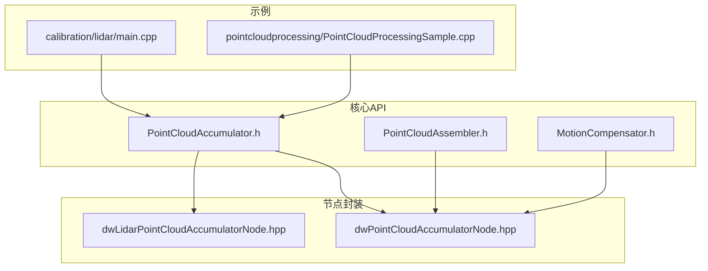
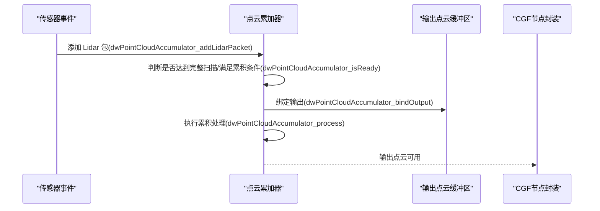
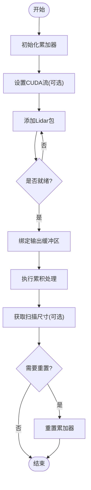
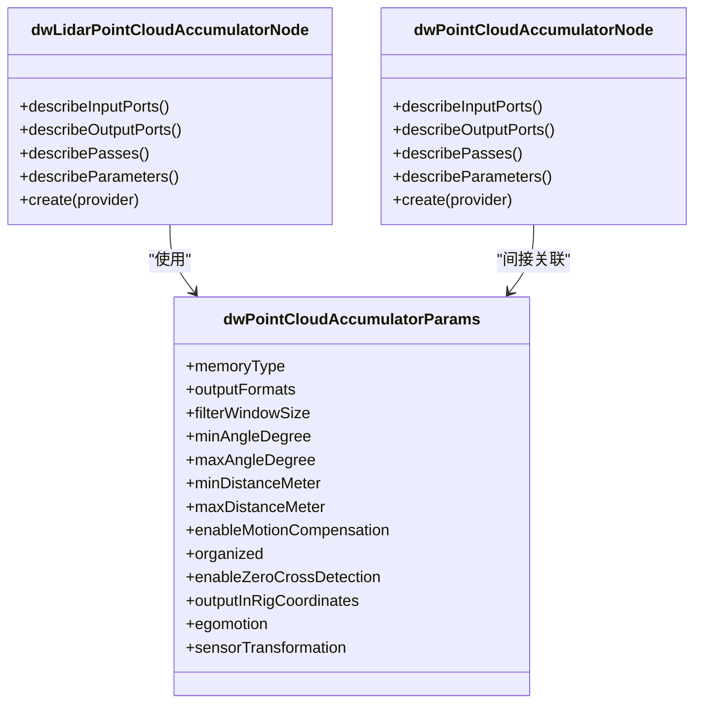
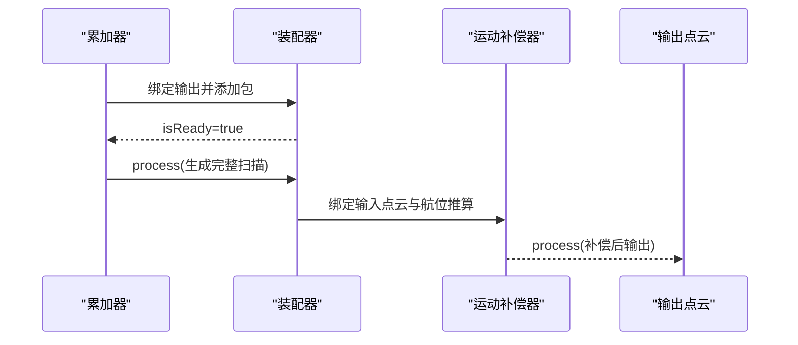
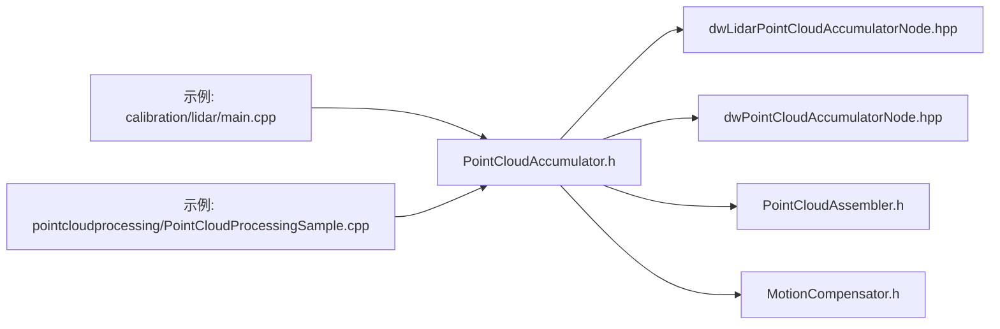

# 点云累加器

<cite>
**本文引用的文件**
- [PointCloudAccumulator.h](file://driverorks-5.10/include/dw/pointcloudprocessing/accumulator/PointCloudAccumulator.h)
- [dwLidarPointCloudAccumulatorNode.hpp](file://driverorks-5.10/include/dwframework/dwnodes/dwlidarpointcloudaccumulatornode/dwLidarPointCloudAccumulatorNode.hpp)
- [dwPointCloudAccumulatorNode.hpp](file://driverorks-5.10/include/dwframework/dwnodes/pointcloudprocessing/dwaccumulatornode/dwPointCloudAccumulatorNode.hpp)
- [PointCloudAssembler.h](file://driverorks-5.10/include/dw/pointcloudprocessing/assembler/PointCloudAssembler.h)
- [MotionCompensator.h](file://driverorks-5.10/include/dw/pointcloudprocessing/motioncompensator/MotionCompensator.h)
- [main.cpp（lidar校准示例）](file://driverorks-5.10/samples/src/calibration/lidar/main.cpp)
- [PointCloudProcessingSample.cpp](file://driverorks-5.10/samples/src/pointcloudprocessing/PointCloudProcessingSample.cpp)
</cite>

## 目录
1. [简介](#简介)
2. [项目结构](#项目结构)
3. [核心组件](#核心组件)
4. [架构总览](#架构总览)
5. [详细组件分析](#详细组件分析)
6. [依赖关系分析](#依赖关系分析)
7. [性能考虑](#性能考虑)
8. [故障排查指南](#故障排查指南)
9. [结论](#结论)
10. [附录：API 参考与使用示例](#附录api-参考与使用示例)

## 简介
本技术文档围绕 NVIDIA DriveWorks 中的点云累加器模块展开，系统阐述 PointCloudAccumulator 的设计思想、实现要点与使用方式。重点覆盖以下方面：
- 时间维度上的点云数据累积算法与滑动窗口机制
- 累积统计与输出格式控制
- 内存类型与 CUDA 流集成
- 时间窗口配置、累积模式选择、数据重置机制
- 性能调优方法与最佳实践
- 完整 API 参考与典型使用示例（通过示例工程路径定位）

## 项目结构
与点云累加器直接相关的代码分布在如下位置：
- 核心 API 头文件：PointCloudAccumulator.h
- 节点封装（CGF 框架）：dwLidarPointCloudAccumulatorNode.hpp、dwPointCloudAccumulatorNode.hpp
- 组装与运动补偿（可选链路）：PointCloudAssembler.h、MotionCompensator.h
- 示例工程：calibration/lidar/main.cpp、pointcloudprocessing/PointCloudProcessingSample.cpp

**图表来源**
- [PointCloudAccumulator.h:111-261](file://driverorks-5.10/include/dw/pointcloudprocessing/accumulator/PointCloudAccumulator.h#L111-L261)
- [dwLidarPointCloudAccumulatorNode.hpp:64-172](file://driverorks-5.10/include/dwframework/dwnodes/dwlidarpointcloudaccumulatornode/dwLidarPointCloudAccumulatorNode.hpp#L64-L172)
- [dwPointCloudAccumulatorNode.hpp:67-152](file://driverorks-5.10/include/dwframework/dwnodes/pointcloudprocessing/dwaccumulatornode/dwPointCloudAccumulatorNode.hpp#L67-L152)
- [PointCloudAssembler.h:85-231](file://driverorks-5.10/include/dw/pointcloudprocessing/assembler/PointCloudAssembler.h#L85-L231)
- [MotionCompensator.h:111-263](file://driverorks-5.10/include/dw/pointcloudprocessing/motioncompensator/MotionCompensator.h#L111-L263)
- [main.cpp（lidar校准示例）:789-881](file://driverorks-5.10/samples/src/calibration/lidar/main.cpp#L789-L881)
- [PointCloudProcessingSample.cpp:170-186](file://driverorks-5.10/samples/src/pointcloudprocessing/PointCloudProcessingSample.cpp#L170-L186)

**章节来源**
- [PointCloudAccumulator.h:111-261](file://driverorks-5.10/include/dw/pointcloudprocessing/accumulator/PointCloudAccumulator.h#L111-L261)
- [dwLidarPointCloudAccumulatorNode.hpp:64-172](file://driverorks-5.10/include/dwframework/dwnodes/dwlidarpointcloudaccumulatornode/dwLidarPointCloudAccumulatorNode.hpp#L64-L172)
- [dwPointCloudAccumulatorNode.hpp:67-152](file://driverorks-5.10/include/dwframework/dwnodes/pointcloudprocessing/dwaccumulatornode/dwPointCloudAccumulatorNode.hpp#L67-L152)
- [PointCloudAssembler.h:85-231](file://driverorks-5.10/include/dw/pointcloudprocessing/assembler/PointCloudAssembler.h#L85-L231)
- [MotionCompensator.h:111-263](file://driverorks-5.10/include/dw/pointcloudprocessing/motioncompensator/MotionCompensator.h#L111-L263)
- [main.cpp（lidar校准示例）:789-881](file://driverorks-5.10/samples/src/calibration/lidar/main.cpp#L789-L881)
- [PointCloudProcessingSample.cpp:170-186](file://driverorks-5.10/samples/src/pointcloudprocessing/PointCloudProcessingSample.cpp#L170-L186)

## 核心组件
- 点云累加器核心 API：提供初始化、参数设置、输入包添加、就绪状态判断、输出绑定、处理执行、重置与释放等能力；支持内存类型（CPU/GPU）、输出格式、角度/距离裁剪、零交叉检测、组织化输出、运动补偿等配置。
- 节点封装（CGF）：将累加器封装为 CGF 节点，暴露参数描述、端口定义与多阶段处理流程，便于在系统图中组合使用。
- 组装与运动补偿（可选链路）：PointCloudAssembler 提供按帧/按旋转变换的组装能力；MotionCompensator 提供基于航位推算的运动补偿能力，二者可与累加器配合形成更完整的点云管线。

**章节来源**
- [PointCloudAccumulator.h:69-93](file://driverorks-5.10/include/dw/pointcloudprocessing/accumulator/PointCloudAccumulator.h#L69-L93)
- [PointCloudAccumulator.h:121-141](file://driverorks-5.10/include/dw/pointcloudprocessing/accumulator/PointCloudAccumulator.h#L121-L141)
- [PointCloudAccumulator.h:195-211](file://driverorks-5.10/include/dw/pointcloudprocessing/accumulator/PointCloudAccumulator.h#L195-L211)
- [PointCloudAccumulator.h:224-248](file://driverorks-5.10/include/dw/pointcloudprocessing/accumulator/PointCloudAccumulator.h#L224-L248)
- [dwLidarPointCloudAccumulatorNode.hpp:51-59](file://driverorks-5.10/include/dwframework/dwnodes/dwlidarpointcloudaccumulatornode/dwLidarPointCloudAccumulatorNode.hpp#L51-L59)
- [dwLidarPointCloudAccumulatorNode.hpp:93-166](file://driverorks-5.10/include/dwframework/dwnodes/dwlidarpointcloudaccumulatornode/dwLidarPointCloudAccumulatorNode.hpp#L93-L166)
- [PointCloudAssembler.h:58-70](file://driverorks-5.10/include/dw/pointcloudprocessing/assembler/PointCloudAssembler.h#L58-L70)
- [PointCloudAssembler.h:191-205](file://driverorks-5.10/include/dw/pointcloudprocessing/assembler/PointCloudAssembler.h#L191-L205)
- [MotionCompensator.h:69-86](file://driverorks-5.10/include/dw/pointcloudprocessing/motioncompensator/MotionCompensator.h#L69-L86)

## 架构总览
下图展示了从传感器事件到最终点云输出的关键流程，以及与节点封装、可选模块的关系。

**图表来源**
- [PointCloudAccumulator.h:195-211](file://driverorks-5.10/include/dw/pointcloudprocessing/accumulator/PointCloudAccumulator.h#L195-L211)
- [PointCloudAccumulator.h:224-248](file://driverorks-5.10/include/dw/pointcloudprocessing/accumulator/PointCloudAccumulator.h#L224-L248)
- [main.cpp（lidar校准示例）:789-881](file://driverorks-5.10/samples/src/calibration/lidar/main.cpp#L789-L881)

## 详细组件分析

### 点云累加器（PointCloudAccumulator）
- 设计思想
  - 面向旋转式激光雷达，以“完整扫描”或“满足条件”的包集合为单位进行累积，支持按角度/距离裁剪与水平平滑滤波窗口。
  - 支持零交叉检测策略（基于角度或包数），用于判定一次完整扫描的结束。
  - 支持组织化输出（对齐到三维网格）与非组织化输出，便于后续处理。
  - 支持运动补偿（启用时对点云进行畸变修正），并可选择输出至平台坐标系。
- 关键参数
  - 内存类型：CPU 或 CUDA
  - 输出格式：dwPointCloudFormat 组合
  - 水平平滑窗口大小：filterWindowSize（建议为 2 的幂，范围通常为 0~4）
  - 角度/距离裁剪：minAngleDegree/maxAngleDegree、minDistanceMeter/maxDistanceMeter
  - 运动补偿：enableMotionCompensation
  - 组织化输出：organized
  - 零交叉检测：enableZeroCrossDetection
  - 输出坐标系：outputInRigCoordinates
  - 航位推算句柄与传感器到平台变换：egomotion、sensorTransformation
- 生命周期
  - 初始化：dwPointCloudAccumulator_initialize
  - 设置 CUDA 流：dwPointCloudAccumulator_setCUDAStream
  - 输入包添加：dwPointCloudAccumulator_addLidarPacket
  - 就绪判断：dwPointCloudAccumulator_isReady
  - 绑定输出：dwPointCloudAccumulator_bindOutput
  - 处理执行：dwPointCloudAccumulator_process
  - 获取扫描尺寸：dwPointCloudAccumulator_getSweepSize
  - 重置：dwPointCloudAccumulator_reset
  - 释放：dwPointCloudAccumulator_release

**图表来源**
- [PointCloudAccumulator.h:121-141](file://driverorks-5.10/include/dw/pointcloudprocessing/accumulator/PointCloudAccumulator.h#L121-L141)
- [PointCloudAccumulator.h:171-183](file://driverorks-5.10/include/dw/pointcloudprocessing/accumulator/PointCloudAccumulator.h#L171-L183)
- [PointCloudAccumulator.h:195-211](file://driverorks-5.10/include/dw/pointcloudprocessing/accumulator/PointCloudAccumulator.h#L195-L211)
- [PointCloudAccumulator.h:224-261](file://driverorks-5.10/include/dw/pointcloudprocessing/accumulator/PointCloudAccumulator.h#L224-L261)

**章节来源**
- [PointCloudAccumulator.h:69-93](file://driverorks-5.10/include/dw/pointcloudprocessing/accumulator/PointCloudAccumulator.h#L69-L93)
- [PointCloudAccumulator.h:121-141](file://driverorks-5.10/include/dw/pointcloudprocessing/accumulator/PointCloudAccumulator.h#L121-L141)
- [PointCloudAccumulator.h:171-183](file://driverorks-5.10/include/dw/pointcloudprocessing/accumulator/PointCloudAccumulator.h#L171-L183)
- [PointCloudAccumulator.h:195-211](file://driverorks-5.10/include/dw/pointcloudprocessing/accumulator/PointCloudAccumulator.h#L195-L211)
- [PointCloudAccumulator.h:224-261](file://driverorks-5.10/include/dw/pointcloudprocessing/accumulator/PointCloudAccumulator.h#L224-L261)

### 节点封装（CGF）
- dwLidarPointCloudAccumulatorNode
  - 输入端口：LIDAR_PACKETS_ARRAY、EGOMOTION_STATE、LIDAR_EXTRINSICS
  - 输出端口：POINT_CLOUD、POINT_CLOUD_AVAILABLE、LIDAR_ACCUMULATOR_SWEEP_SIZE
  - 参数描述：涵盖内存类型、输出格式、滤波窗口、角度/距离裁剪、运动补偿、组织化输出、零交叉检测、坐标系选择、传感器变换、航位推算开关、激光雷达属性、节流策略、CUDA 流索引等
  - 处理阶段：SETUP、PROCESS_GPU_ASYNC、PROCESS_CPU_SYNC、TEARDOWN
- dwPointCloudAccumulatorNode（通用版）
  - 结合了装配与运动补偿的完整管线，参数包含装配器与运动补偿器的配置，并提供双通道处理阶段（装配 GPU/CPU 与补偿 GPU/CPU）

**图表来源**
- [dwLidarPointCloudAccumulatorNode.hpp:69-91](file://driverorks-5.10/include/dwframework/dwnodes/dwlidarpointcloudaccumulatornode/dwLidarPointCloudAccumulatorNode.hpp#L69-L91)
- [dwLidarPointCloudAccumulatorNode.hpp:93-166](file://driverorks-5.10/include/dwframework/dwnodes/dwlidarpointcloudaccumulatornode/dwLidarPointCloudAccumulatorNode.hpp#L93-L166)
- [dwPointCloudAccumulatorNode.hpp:72-95](file://driverorks-5.10/include/dwframework/dwnodes/pointcloudprocessing/dwaccumulatornode/dwPointCloudAccumulatorNode.hpp#L72-L95)
- [dwPointCloudAccumulatorNode.hpp:97-146](file://driverorks-5.10/include/dwframework/dwnodes/pointcloudprocessing/dwaccumulatornode/dwPointCloudAccumulatorNode.hpp#L97-L146)

**章节来源**
- [dwLidarPointCloudAccumulatorNode.hpp:64-172](file://driverorks-5.10/include/dwframework/dwnodes/dwlidarpointcloudaccumulatornode/dwLidarPointCloudAccumulatorNode.hpp#L64-L172)
- [dwPointCloudAccumulatorNode.hpp:67-152](file://driverorks-5.10/include/dwframework/dwnodes/pointcloudprocessing/dwaccumulatornode/dwPointCloudAccumulatorNode.hpp#L67-L152)

### 组装与运动补偿（可选链路）
- PointCloudAssembler
  - 作用：将到达的包按帧/旋转变换为完整扫描，支持 CUDA/GPU 输出与映射结构绑定
  - 关键接口：addLidarPacket、isReady、bindOutput/bindLidarPointCloud、process
- MotionCompensator
  - 作用：基于航位推算状态对点云进行运动补偿，支持插值策略、最大点数、模型分辨率、输出坐标系与变换
  - 关键接口：bindEgomotionState、setTransform、setReferenceTimestamp、bindInput/bindOutput、process

**图表来源**
- [PointCloudAssembler.h:191-205](file://driverorks-5.10/include/dw/pointcloudprocessing/assembler/PointCloudAssembler.h#L191-L205)
- [PointCloudAssembler.h:230-231](file://driverorks-5.10/include/dw/pointcloudprocessing/assembler/PointCloudAssembler.h#L230-L231)
- [MotionCompensator.h:174-201](file://driverorks-5.10/include/dw/pointcloudprocessing/motioncompensator/MotionCompensator.h#L174-L201)
- [MotionCompensator.h:262-263](file://driverorks-5.10/include/dw/pointcloudprocessing/motioncompensator/MotionCompensator.h#L262-L263)

**章节来源**
- [PointCloudAssembler.h:85-231](file://driverorks-5.10/include/dw/pointcloudprocessing/assembler/PointCloudAssembler.h#L85-L231)
- [MotionCompensator.h:111-263](file://driverorks-5.10/include/dw/pointcloudprocessing/motioncompensator/MotionCompensator.h#L111-L263)

## 依赖关系分析
- 累加器核心依赖于传感器属性（Lidar 属性）、上下文（Context）、可选的航位推算模块与 CUDA 流。
- CGF 节点封装将参数与端口抽象为可配置项，便于在系统图中灵活组合。
- 可选链路（装配器/运动补偿器）与累加器并行存在，形成“先累加/组装，再运动补偿”的处理序列。

**图表来源**
- [PointCloudAccumulator.h:121-141](file://driverorks-5.10/include/dw/pointcloudprocessing/accumulator/PointCloudAccumulator.h#L121-L141)
- [dwLidarPointCloudAccumulatorNode.hpp:64-172](file://driverorks-5.10/include/dwframework/dwnodes/dwlidarpointcloudaccumulatornode/dwLidarPointCloudAccumulatorNode.hpp#L64-L172)
- [dwPointCloudAccumulatorNode.hpp:67-152](file://driverorks-5.10/include/dwframework/dwnodes/pointcloudprocessing/dwaccumulatornode/dwPointCloudAccumulatorNode.hpp#L67-L152)
- [PointCloudAssembler.h:85-231](file://driverorks-5.10/include/dw/pointcloudprocessing/assembler/PointCloudAssembler.h#L85-L231)
- [MotionCompensator.h:111-263](file://driverorks-5.10/include/dw/pointcloudprocessing/motioncompensator/MotionCompensator.h#L111-L263)
- [main.cpp（lidar校准示例）:789-881](file://driverorks-5.10/samples/src/calibration/lidar/main.cpp#L789-L881)
- [PointCloudProcessingSample.cpp:170-186](file://driverorks-5.10/samples/src/pointcloudprocessing/PointCloudProcessingSample.cpp#L170-L186)

**章节来源**
- [PointCloudAccumulator.h:121-141](file://driverorks-5.10/include/dw/pointcloudprocessing/accumulator/PointCloudAccumulator.h#L121-L141)
- [dwLidarPointCloudAccumulatorNode.hpp:93-166](file://driverorks-5.10/include/dwframework/dwnodes/dwlidarpointcloudaccumulatornode/dwLidarPointCloudAccumulatorNode.hpp#L93-L166)
- [dwPointCloudAccumulatorNode.hpp:97-146](file://driverorks-5.10/include/dwframework/dwnodes/pointcloudprocessing/dwaccumulatornode/dwPointCloudAccumulatorNode.hpp#L97-L146)

## 性能考虑
- 内存类型与 CUDA 流
  - 在 GPU 上运行可显著提升吞吐，需确保输出缓冲区与参数 memoryType 一致，并正确设置 CUDA 流。
  - 示例中通过 setCUDAStream 将累加器绑定到指定流，以与渲染/后处理流水线协同。
- 滤波窗口大小
  - 增大 filterWindowSize 可降低水平方向的激光束抖动，但会增加计算与内存占用；建议根据场景噪声与实时性需求折中选择。
- 角度/距离裁剪
  - 合理裁剪可减少无效点数量，降低后续处理负担；需结合传感器视场与任务需求设定。
- 组织化输出
  - 组织化输出便于深度图/范围图像构建，但可能引入额外的内存布局开销；按需开启。
- 零交叉检测
  - 基于角度的检测在传感器标定不准确时可能误判；可根据数据质量选择基于包数的检测策略。
- 运动补偿
  - 启用运动补偿可显著提升移动平台上的点云质量，但会引入插值与额外计算；需平衡精度与延迟。

**章节来源**
- [PointCloudAccumulator.h:77-91](file://driverorks-5.10/include/dw/pointcloudprocessing/accumulator/PointCloudAccumulator.h#L77-L91)
- [PointCloudProcessingSample.cpp:170-186](file://driverorks-5.10/samples/src/pointcloudprocessing/PointCloudProcessingSample.cpp#L170-L186)
- [PointCloudAssembler.h:191-205](file://driverorks-5.10/include/dw/pointcloudprocessing/assembler/PointCloudAssembler.h#L191-L205)
- [MotionCompensator.h:174-201](file://driverorks-5.10/include/dw/pointcloudprocessing/motioncompensator/MotionCompensator.h#L174-L201)

## 故障排查指南
- 常见错误与定位
  - 无效句柄/参数：检查初始化是否成功、参数是否符合要求、内存类型与输出缓冲区一致。
  - 未绑定输出：在调用 process 前必须先 bindOutput，否则返回无效参数或不可处理状态。
  - CUDA 流相关：若累加器被配置为 CPU 处理，设置/获取 CUDA 流会返回不允许调用；需确认 memoryType。
  - 数据不完整：isReady 返回 false 表示尚未收集到完整扫描，需继续添加包或调整零交叉检测策略。
- 示例中的错误检查模式
  - 示例工程广泛使用 CHECK_DW_ERROR 与 CHECK_DW_ERROR_MSG 对关键 API 调用进行错误检查，建议在生产环境中采用相同模式。

**章节来源**
- [PointCloudAccumulator.h:131-141](file://driverorks-5.10/include/dw/pointcloudprocessing/accumulator/PointCloudAccumulator.h#L131-L141)
- [PointCloudAccumulator.h:171-183](file://driverorks-5.10/include/dw/pointcloudprocessing/accumulator/PointCloudAccumulator.h#L171-L183)
- [PointCloudAccumulator.h:224-248](file://driverorks-5.10/include/dw/pointcloudprocessing/accumulator/PointCloudAccumulator.h#L224-L248)
- [main.cpp（lidar校准示例）:789-881](file://driverorks-5.10/samples/src/calibration/lidar/main.cpp#L789-L881)

## 结论
PointCloudAccumulator 提供了面向旋转式激光雷达的高效、可配置的点云累积能力，结合 CGF 节点封装与可选的装配/运动补偿模块，可在真实车载场景中实现高质量、低噪声的环境建模。通过合理配置时间窗口、滤波窗口、裁剪范围与坐标系，可在精度与性能之间取得良好平衡。

## 附录：API 参考与使用示例

### API 参考（核心函数）
- 初始化与生命周期
  - dwPointCloudAccumulator_initialize：初始化累加器，传入参数、激光雷达属性与上下文
  - dwPointCloudAccumulator_reset：重置内部状态
  - dwPointCloudAccumulator_release：释放资源
- 参数与流
  - dwPointCloudAccumulator_getDefaultParams：获取默认参数
  - dwPointCloudAccumulator_setLidarToRigTransformation：设置传感器到平台变换
  - dwPointCloudAccumulator_setCUDAStream / getCUDAStream：设置/获取 CUDA 流
- 输入与输出
  - dwPointCloudAccumulator_addLidarPacket：添加解码后的激光雷达包
  - dwPointCloudAccumulator_isReady：判断是否已收集到完整扫描
  - dwPointCloudAccumulator_bindOutput：绑定输出点云缓冲区
  - dwPointCloudAccumulator_bindOutputTimestamps：绑定输出时间戳范围
  - dwPointCloudAccumulator_process：执行累积处理
  - dwPointCloudAccumulator_getSweepSize：获取扫描尺寸

**章节来源**
- [PointCloudAccumulator.h:121-141](file://driverorks-5.10/include/dw/pointcloudprocessing/accumulator/PointCloudAccumulator.h#L121-L141)
- [PointCloudAccumulator.h:149-160](file://driverorks-5.10/include/dw/pointcloudprocessing/accumulator/PointCloudAccumulator.h#L149-L160)
- [PointCloudAccumulator.h:171-183](file://driverorks-5.10/include/dw/pointcloudprocessing/accumulator/PointCloudAccumulator.h#L171-L183)
- [PointCloudAccumulator.h:195-211](file://driverorks-5.10/include/dw/pointcloudprocessing/accumulator/PointCloudAccumulator.h#L195-L211)
- [PointCloudAccumulator.h:224-261](file://driverorks-5.10/include/dw/pointcloudprocessing/accumulator/PointCloudAccumulator.h#L224-L261)

### 使用示例（示例工程路径）
- 基本流程（GPU 累加与处理）
  - 初始化累加器与参数，设置 CUDA 流，绑定输出缓冲区
  - 循环接收传感器事件，添加 Lidar 包，判断 isReady，绑定输出并执行 process
  - 示例路径：
    - [main.cpp（lidar校准示例）- 添加包与处理:789-881](file://driverorks-5.10/samples/src/calibration/lidar/main.cpp#L789-L881)
- 初始化与绑定（多激光雷达）
  - 为每个激光雷达获取默认参数，设置 egomotion、传感器变换、内存类型与 CUDA 流，初始化并绑定输出
  - 示例路径：
    - [PointCloudProcessingSample.cpp - 初始化与绑定:170-186](file://driverorks-5.10/samples/src/pointcloudprocessing/PointCloudProcessingSample.cpp#L170-L186)

**章节来源**
- [main.cpp（lidar校准示例）:789-881](file://driverorks-5.10/samples/src/calibration/lidar/main.cpp#L789-L881)
- [PointCloudProcessingSample.cpp:170-186](file://driverorks-5.10/samples/src/pointcloudprocessing/PointCloudProcessingSample.cpp#L170-L186)