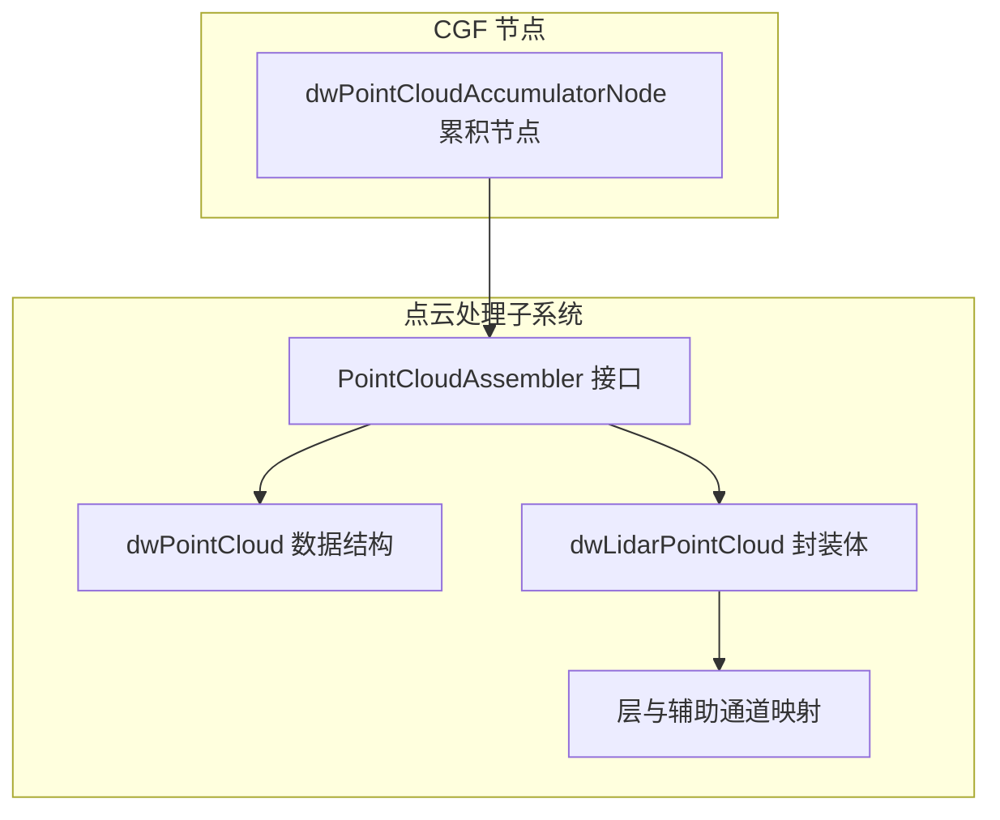
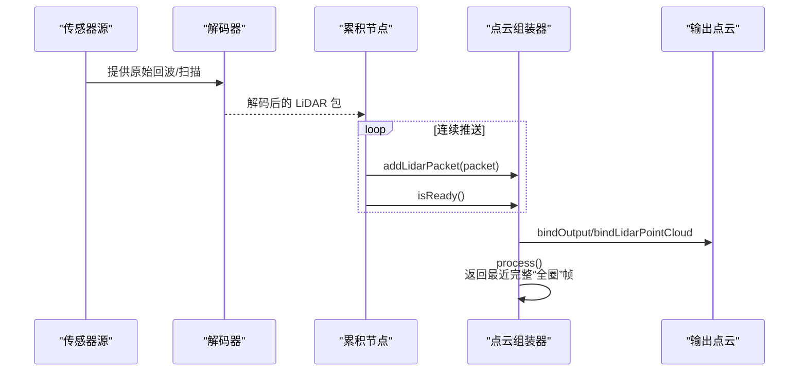
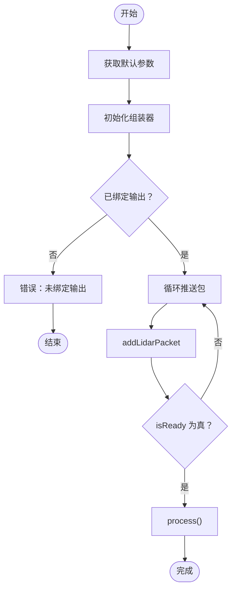
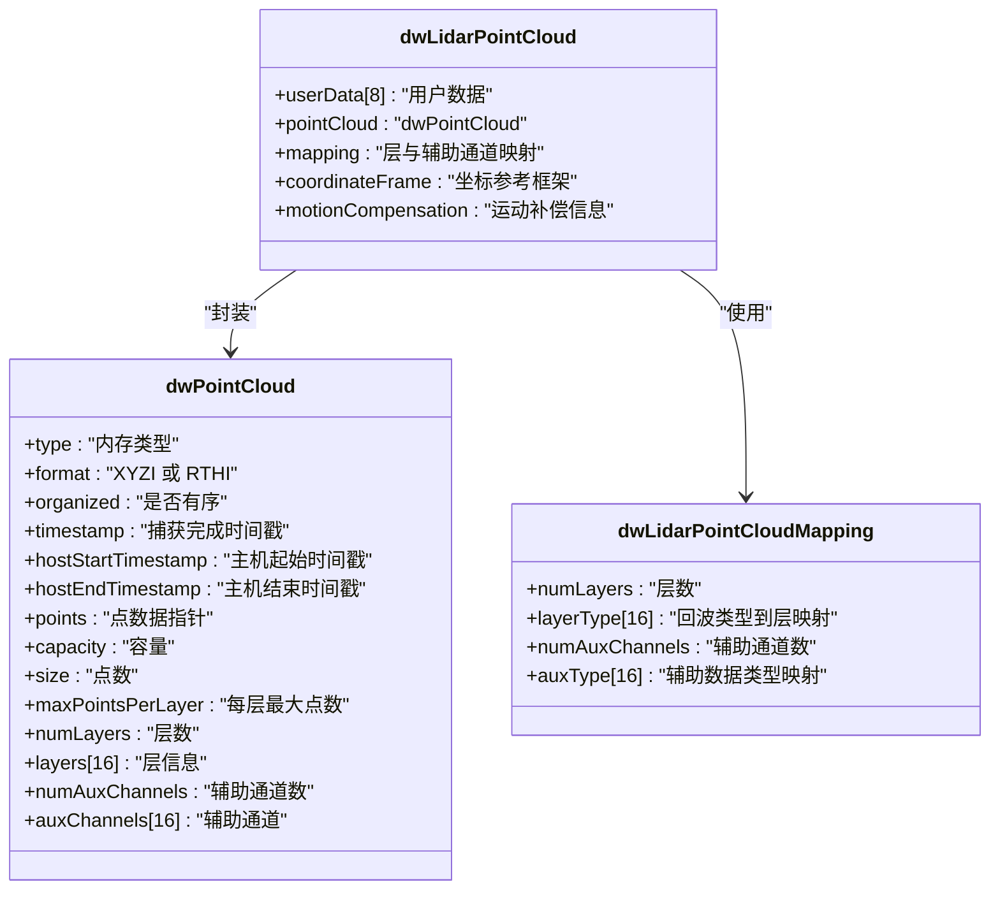
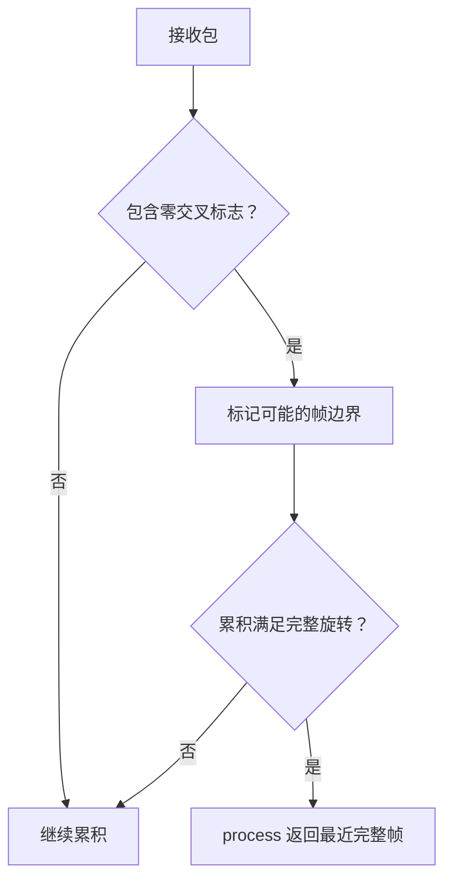
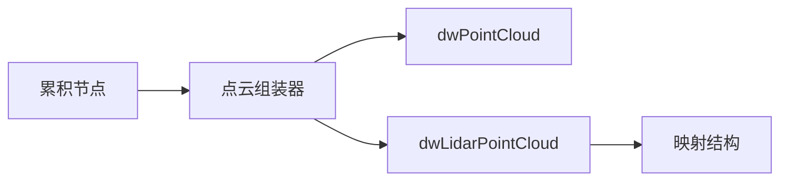

# 点云组装器

<cite>
**本文引用的文件**
- [PointCloudAssembler.h（5.8）](file://driveworks-5.8/include/dw/pointcloudprocessing/assembler/PointCloudAssembler.h)
- [PointCloudAssembler.h（5.10）](file://driverorks-5.10/include/dw/pointcloudprocessing/assembler/PointCloudAssembler.h)
- [PointCloudAssembler.h（5.14）](file://driveworks-5.14/include/dw/pointcloudprocessing/assembler/PointCloudAssembler.h)
- [PointCloudAssembler.h（5.20）](file://driveworks-5.20/include/dw/pointcloudprocessing/assembler/PointCloudAssembler.h)
- [LidarPointCloud.h（5.10）](file://driverorks-5.10/include/dw/pointcloudprocessing/pointcloud/LidarPointCloud.h)
- [PointCloud.h（5.10）](file://driverorks-5.10/include/dw/pointcloudprocessing/pointcloud/PointCloud.h)
- [dwPointCloudAccumulatorNode.hpp（5.10）](file://driverorks-5.10/include/dwframework/dwnodes/pointcloudprocessing/dwaccumulatornode/dwPointCloudAccumulatorNode.hpp)
- [dwPointCloudAccumulatorNode.hpp（5.14）](file://driveworks-5.14/include/dwframework/dwnodes/pointcloudprocessing/dwaccumulatornode/dwPointCloudAccumulatorNode.hpp)
- [dwPointCloudAccumulatorNode.hpp（5.20）](file://driveworks-5.20/include/dwframework/dwnodes/pointcloudprocessing/dwaccumulatornode/dwPointCloudAccumulatorNode.hpp)
</cite>

## 目录
1. [简介](#简介)
2. [项目结构](#项目结构)
3. [核心组件](#核心组件)
4. [架构总览](#架构总览)
5. [详细组件分析](#详细组件分析)
6. [依赖关系分析](#依赖关系分析)
7. [性能考虑](#性能考虑)
8. [故障排查指南](#故障排查指南)
9. [结论](#结论)
10. [附录：API 参考与使用示例](#附录api-参考与使用示例)

## 简介
本文件系统性地介绍 NVIDIA DriveWorks 中的点云组装器（PointCloudAssembler）模块，面向多传感器点云融合场景，覆盖以下主题：
- 组装器功能特性与工作流程
- 多传感器点云融合算法要点（层映射、辅助通道、零交叉帧边界）
- 坐标系与参考框架（传感器/车身/自定义）
- 时间戳与时间同步机制（主机起止时间戳、补偿时间戳）
- 数据对齐策略（层与辅助通道映射、GPU/CPU 内存模式）
- 配置参数与初始化流程
- 输入输出格式与内存模型
- 性能优化建议与错误处理机制
- 完整 API 参考与实际应用示例路径

## 项目结构
PointCloudAssembler 位于点云处理子系统中，通常与点云缓冲区、LiDAR 点云封装体以及累积节点配合使用：
- 组装器接口：PointCloudAssembler.h
- 点云数据结构：PointCloud.h、LidarPointCloud.h
- 累积节点：dwPointCloudAccumulatorNode.hpp（用于在 CGF 图中连接传感器解码包到组装器）

图表来源
- [PointCloudAssembler.h（5.10）:46-237](file://driverorks-5.10/include/dw/pointcloudprocessing/assembler/PointCloudAssembler.h#L46-L237)
- [PointCloud.h（5.10）:98-120](file://driverorks-5.10/include/dw/pointcloudprocessing/pointcloud/PointCloud.h#L98-L120)
- [LidarPointCloud.h（5.10）:97-109](file://driverorks-5.10/include/dw/pointcloudprocessing/pointcloud/LidarPointCloud.h#L97-L109)
- [dwPointCloudAccumulatorNode.hpp（5.10）:34-56](file://driverorks-5.10/include/dwframework/dwnodes/pointcloudprocessing/dwaccumulatornode/dwPointCloudAccumulatorNode.hpp#L34-L56)

章节来源
- [PointCloudAssembler.h（5.10）:46-237](file://driverorks-5.10/include/dw/pointcloudprocessing/assembler/PointCloudAssembler.h#L46-L237)
- [PointCloud.h（5.10）:98-120](file://driverorks-5.10/include/dw/pointcloudprocessing/pointcloud/PointCloud.h#L98-L120)
- [LidarPointCloud.h（5.10）:97-109](file://driverorks-5.10/include/dw/pointcloudprocessing/pointcloud/LidarPointCloud.h#L97-L109)
- [dwPointCloudAccumulatorNode.hpp（5.10）:34-56](file://driverorks-5.10/include/dwframework/dwnodes/pointcloudprocessing/dwaccumulatornode/dwPointCloudAccumulatorNode.hpp#L34-L56)

## 核心组件
- 点云组装器句柄与参数
  - 句柄类型：dwPointCloudAssemblerHandle_t、dwPointCloudAssemblerConstHandle_t
  - 初始化参数：enableCuda（是否启用 CUDA）、mapping（层与辅助通道映射）
- 点云数据结构
  - dwPointCloud：通用点云缓冲区（含层、辅助通道、组织性、时间戳等）
  - dwLidarPointCloud：LiDAR 特定封装体（扩展映射、坐标参考框架、运动补偿信息）
- 累积节点
  - 作为 CGF 流程中的桥接节点，接收解码后的 LiDAR 包并推送至组装器

章节来源
- [PointCloudAssembler.h（5.10）:55-70](file://driverorks-5.10/include/dw/pointcloudprocessing/assembler/PointCloudAssembler.h#L55-L70)
- [PointCloud.h（5.10）:98-120](file://driverorks-5.10/include/dw/pointcloudprocessing/pointcloud/PointCloud.h#L98-L120)
- [LidarPointCloud.h（5.10）:97-109](file://driverorks-5.10/include/dw/pointcloudprocessing/pointcloud/LidarPointCloud.h#L97-L109)
- [dwPointCloudAccumulatorNode.hpp（5.10）:34-56](file://driverorks-5.10/include/dwframework/dwnodes/pointcloudprocessing/dwaccumulatornode/dwPointCloudAccumulatorNode.hpp#L34-L56)

## 架构总览
下图展示了从传感器解码包到最终输出统一点云的端到端流程，强调时间同步与帧边界判定：

图表来源
- [PointCloudAssembler.h（5.10）:182-231](file://driverorks-5.10/include/dw/pointcloudprocessing/assembler/PointCloudAssembler.h#L182-L231)
- [dwPointCloudAccumulatorNode.hpp（5.10）:34-56](file://driverorks-5.10/include/dwframework/dwnodes/pointcloudprocessing/dwaccumulatornode/dwPointCloudAccumulatorNode.hpp#L34-L56)

## 详细组件分析

### 组件一：点云组装器接口与生命周期
- 初始化与默认参数
  - 获取默认参数：根据 LiDAR 属性推导合理的映射与内存模式
  - 初始化：绑定上下文、属性与参数，建立内部状态
- 运行期操作
  - 绑定输出：bindOutput 或 bindLidarPointCloud（后者要求映射兼容）
  - 推送包：addLidarPacket（逐包推进）
  - 帧就绪：isReady（以“零交叉”标志判断完整帧边界）
  - 处理：process（仅当 isReady 为真且已绑定输出时）
- 上下文与流
  - CUDA 流设置/查询（仅在 enableCuda 为真时允许）
  - reset/release 支持重置与释放资源

图表来源
- [PointCloudAssembler.h（5.10）:82-231](file://driverorks-5.10/include/dw/pointcloudprocessing/assembler/PointCloudAssembler.h#L82-L231)

章节来源
- [PointCloudAssembler.h（5.10）:82-231](file://driverorks-5.10/include/dw/pointcloudprocessing/assembler/PointCloudAssembler.h#L82-L231)

### 组件二：点云数据结构与映射
- dwPointCloud
  - 通用缓冲区：包含层数组、辅助通道数组、容量/大小、组织性标记、主机起止时间戳、格式（XYZI/RTHI）
  - 用于承载组装后的统一点云
- dwLidarPointCloud
  - 在通用点云基础上增加：用户数据块、映射结构、坐标参考框架（传感器/车身/自定义）、运动补偿信息
  - 通过映射决定“层”与“辅助通道”的布局，便于后续算法复用
- 映射结构（dwLidarPointCloudMapping）
  - 层映射：将不同回波类型映射到具体层
  - 辅助通道映射：将 SAL 辅助数据映射到点云辅助通道

图表来源
- [PointCloud.h（5.10）:98-120](file://driverorks-5.10/include/dw/pointcloudprocessing/pointcloud/PointCloud.h#L98-L120)
- [LidarPointCloud.h（5.10）:97-109](file://driverorks-5.10/include/dw/pointcloudprocessing/pointcloud/LidarPointCloud.h#L97-L109)

章节来源
- [PointCloud.h（5.10）:98-120](file://driverorks-5.10/include/dw/pointcloudprocessing/pointcloud/PointCloud.h#L98-L120)
- [LidarPointCloud.h（5.10）:97-109](file://driverorks-5.10/include/dw/pointcloudprocessing/pointcloud/LidarPointCloud.h#L97-L109)

### 组件三：时间同步与帧边界判定
- 主机时间戳
  - hostStartTimestamp/hostEndTimestamp 记录采集窗口的主机侧起止时刻
- 补偿时间戳
  - motionCompensation.compensationTimestamp 指示运动补偿的参考时刻
- 零交叉帧边界
  - process 的注释明确：返回“最近一次完整全圈”，并以“零交叉”标志作为帧边界信号
  - 这意味着组装器会等待至少一个“零交叉”标记的包，确保完整旋转周期后再输出

图表来源
- [PointCloudAssembler.h（5.10）:208-231](file://driverorks-5.10/include/dw/pointcloudprocessing/assembler/PointCloudAssembler.h#L208-L231)

章节来源
- [PointCloudAssembler.h（5.10）:208-231](file://driverorks-5.10/include/dw/pointcloudprocessing/assembler/PointCloudAssembler.h#L208-L231)

### 组件四：坐标系与参考框架
- 坐标参考框架枚举
  - 传感器坐标系（原点在传感器）
  - 车身坐标系（原点在车辆）
  - 自定义坐标系（可由外部提供）
- 运动补偿
  - motionCompensation 字段记录是否已补偿及参考时间戳，便于后续算法（如运动补偿）使用

章节来源
- [LidarPointCloud.h（5.10）:58-71](file://driverorks-5.10/include/dw/pointcloudprocessing/pointcloud/LidarPointCloud.h#L58-L71)
- [LidarPointCloud.h（5.10）:105-108](file://driverorks-5.10/include/dw/pointcloudprocessing/pointcloud/LidarPointCloud.h#L105-L108)

### 组件五：多传感器融合策略
- 层映射与辅助通道映射
  - 通过 mapping 将不同传感器的回波类型与辅助数据映射到统一的层/通道，保证后续算法一致性
- 输出点云格式
  - XYZI 或 RTHI，由绑定的点云格式决定
- GPU/CPU 模式
  - enableCuda 控制是否在设备上进行组装；若启用 CUDA，则可设置/查询 CUDA 流

章节来源
- [PointCloudAssembler.h（5.10）:62-70](file://driverorks-5.10/include/dw/pointcloudprocessing/assembler/PointCloudAssembler.h#L62-L70)
- [PointCloud.h（5.10）:60-63](file://driverorks-5.10/include/dw/pointcloudprocessing/pointcloud/PointCloud.h#L60-L63)
- [LidarPointCloud.h（5.10）:77-87](file://driverorks-5.10/include/dw/pointcloudprocessing/pointcloud/LidarPointCloud.h#L77-L87)

## 依赖关系分析
- 组装器依赖
  - 点云缓冲区：dwPointCloud（通用）
  - LiDAR 封装体：dwLidarPointCloud（扩展）
  - 映射结构：dwLidarPointCloudMapping（层/辅助通道）
- CGF 集成
  - 累积节点负责将解码后的 LiDAR 包推送到组装器，并调用 isReady/process

图表来源
- [dwPointCloudAccumulatorNode.hpp（5.10）:34-56](file://driverorks-5.10/include/dwframework/dwnodes/pointcloudprocessing/dwaccumulatornode/dwPointCloudAccumulatorNode.hpp#L34-L56)
- [PointCloudAssembler.h（5.10）:97-100](file://driverorks-5.10/include/dw/pointcloudprocessing/assembler/PointCloudAssembler.h#L97-L100)
- [LidarPointCloud.h（5.10）:97-109](file://driverorks-5.10/include/dw/pointcloudprocessing/pointcloud/LidarPointCloud.h#L97-L109)

章节来源
- [dwPointCloudAccumulatorNode.hpp（5.10）:34-56](file://driverorks-5.10/include/dwframework/dwnodes/pointcloudprocessing/dwaccumulatornode/dwPointCloudAccumulatorNode.hpp#L34-L56)
- [PointCloudAssembler.h（5.10）:97-100](file://driverorks-5.10/include/dw/pointcloudprocessing/assembler/PointCloudAssembler.h#L97-L100)
- [LidarPointCloud.h（5.10）:97-109](file://driverorks-5.10/include/dw/pointcloudprocessing/pointcloud/LidarPointCloud.h#L97-L109)

## 性能考虑
- 内存对齐与容量规划
  - 建议每层点数为偶数，以获得更优的内存访问对齐（尤其当每个点为 16 字节时）
- CUDA 流集成
  - 启用 CUDA 时，通过 setCUDAStream/getCUDAStream 将组装器与用户流绑定，避免同步阻塞
- 输出绑定时机
  - 必须在 process 前完成 bindOutput/bindLidarPointCloud，否则 process 返回“未绑定输出”
- 帧边界策略
  - 利用“零交叉”标志作为帧边界，减少跨帧拼接带来的额外开销

章节来源
- [PointCloud.h（5.10）:113-114](file://driverorks-5.10/include/dw/pointcloudprocessing/pointcloud/PointCloud.h#L113-L114)
- [PointCloudAssembler.h（5.10）:134-148](file://driverorks-5.10/include/dw/pointcloudprocessing/assembler/PointCloudAssembler.h#L134-L148)
- [PointCloudAssembler.h（5.10）:208-231](file://driverorks-5.10/include/dw/pointcloudprocessing/assembler/PointCloudAssembler.h#L208-L231)

## 故障排查指南
- 常见错误与定位
  - 无效句柄：initialize/reset/release/isReady/process 等均需有效句柄
  - 未绑定输出：process 前必须 bindOutput/bindLidarPointCloud
  - CUDA 流限制：未启用 CUDA 时设置/获取 CUDA 流会返回“不允许”
  - 参数不匹配：addLidarPacket 的包与 LiDAR 属性不一致将返回无效参数
- 建议排查步骤
  - 确认已调用 getDefaultParams 并正确传入 LiDAR 属性
  - 确保输出点云格式与映射与初始化参数一致
  - 使用 isReady 判断帧完整性，再调用 process
  - 若启用 CUDA，检查流句柄有效性

章节来源
- [PointCloudAssembler.h（5.10）:97-100](file://driverorks-5.10/include/dw/pointcloudprocessing/assembler/PointCloudAssembler.h#L97-L100)
- [PointCloudAssembler.h（5.10）:134-148](file://driverorks-5.10/include/dw/pointcloudprocessing/assembler/PointCloudAssembler.h#L134-L148)
- [PointCloudAssembler.h（5.10）:191-192](file://driverorks-5.10/include/dw/pointcloudprocessing/assembler/PointCloudAssembler.h#L191-L192)
- [PointCloudAssembler.h（5.10）:208-231](file://driverorks-5.10/include/dw/pointcloudprocessing/assembler/PointCloudAssembler.h#L208-L231)

## 结论
PointCloudAssembler 提供了面向多传感器点云融合的统一接口：通过层与辅助通道映射实现异源数据对齐，借助“零交叉”帧边界与主机时间戳实现时间同步，结合 GPU/CPU 模式与 CUDA 流提升吞吐。配合累积节点与 LiDAR 封装体，可在 CGF 流程中高效构建统一的环境感知点云数据。

## 附录：API 参考与使用示例

### API 参考（按版本）
- 5.8 版本
  - 默认参数：[dwPointCloudAssembler_getDefaultParams:82-83](file://driveworks-5.8/include/dw/pointcloudprocessing/assembler/PointCloudAssembler.h#L82-L83)
  - 初始化：[dwPointCloudAssembler_initialize:97-100](file://driveworks-5.8/include/dw/pointcloudprocessing/assembler/PointCloudAssembler.h#L97-L100)
  - 重置/释放：[dwPointCloudAssembler_reset](file://driveworks-5.8/include/dw/pointcloudprocessing/assembler/PointCloudAssembler.h#L110), [dwPointCloudAssembler_release](file://driveworks-5.8/include/dw/pointcloudprocessing/assembler/PointCloudAssembler.h#L121)
  - CUDA 流：[setCUDAStream](file://driveworks-5.8/include/dw/pointcloudprocessing/assembler/PointCloudAssembler.h#L134), [getCUDAStream](file://driveworks-5.8/include/dw/pointcloudprocessing/assembler/PointCloudAssembler.h#L147)
  - 绑定输出：[bindOutput](file://driveworks-5.8/include/dw/pointcloudprocessing/assembler/PointCloudAssembler.h#L163), [bindLidarPointCloud](file://driveworks-5.8/include/dw/pointcloudprocessing/assembler/PointCloudAssembler.h#L179)
  - 推送包/就绪/处理：[addLidarPacket](file://driveworks-5.8/include/dw/pointcloudprocessing/assembler/PointCloudAssembler.h#L191), [isReady](file://driveworks-5.8/include/dw/pointcloudprocessing/assembler/PointCloudAssembler.h#L205), [process](file://driveworks-5.8/include/dw/pointcloudprocessing/assembler/PointCloudAssembler.h#L231)
- 5.10/5.14/5.20 版本
  - 接口与行为与 5.8 基本一致，详见对应文件路径
  - 5.20 版本在部分注释中补充了 API 分组标注（Init/Runtime/De-Init），便于理解生命周期

章节来源
- [PointCloudAssembler.h（5.8）:82-231](file://driveworks-5.8/include/dw/pointcloudprocessing/assembler/PointCloudAssembler.h#L82-L231)
- [PointCloudAssembler.h（5.10）:82-231](file://driverorks-5.10/include/dw/pointcloudprocessing/assembler/PointCloudAssembler.h#L82-L231)
- [PointCloudAssembler.h（5.14）:82-231](file://driveworks-5.14/include/dw/pointcloudprocessing/assembler/PointCloudAssembler.h#L82-L231)
- [PointCloudAssembler.h（5.20）:86-275](file://driveworks-5.20/include/dw/pointcloudprocessing/assembler/PointCloudAssembler.h#L86-L275)

### 使用示例（路径指引）
- 在 CGF 中使用累积节点与组装器
  - 累积节点头文件包含与参数声明：[dwPointCloudAccumulatorNode.hpp（5.10）:34-56](file://driverorks-5.10/include/dwframework/dwnodes/pointcloudprocessing/dwaccumulatornode/dwPointCloudAccumulatorNode.hpp#L34-L56)
  - 对应 5.14/5.20 版本的同名文件路径如下：
    - [dwPointCloudAccumulatorNode.hpp（5.14）:34-56](file://driveworks-5.14/include/dwframework/dwnodes/pointcloudprocessing/dwaccumulatornode/dwPointCloudAccumulatorNode.hpp#L34-L56)
    - [dwPointCloudAccumulatorNode.hpp（5.20）:34-56](file://driveworks-5.20/include/dwframework/dwnodes/pointcloudprocessing/dwaccumulatornode/dwPointCloudAccumulatorNode.hpp#L34-L56)
- 实际调用流程（以 5.10 为例）
  - 获取默认参数 → 初始化 → 绑定输出 → 循环推送包并查询就绪 → 处理 → 重复
  - 关键函数路径：
    - [getDefaultParams:82-83](file://driverorks-5.10/include/dw/pointcloudprocessing/assembler/PointCloudAssembler.h#L82-L83)
    - [initialize:97-100](file://driverorks-5.10/include/dw/pointcloudprocessing/assembler/PointCloudAssembler.h#L97-L100)
    - [bindOutput:163-164](file://driverorks-5.10/include/dw/pointcloudprocessing/assembler/PointCloudAssembler.h#L163-L164)
    - [addLidarPacket:191-192](file://driverorks-5.10/include/dw/pointcloudprocessing/assembler/PointCloudAssembler.h#L191-L192)
    - [isReady](file://driverorks-5.10/include/dw/pointcloudprocessing/assembler/PointCloudAssembler.h#L205)
    - [process](file://driverorks-5.10/include/dw/pointcloudprocessing/assembler/PointCloudAssembler.h#L231)

章节来源
- [dwPointCloudAccumulatorNode.hpp（5.10）:34-56](file://driverorks-5.10/include/dwframework/dwnodes/pointcloudprocessing/dwaccumulatornode/dwPointCloudAccumulatorNode.hpp#L34-L56)
- [PointCloudAssembler.h（5.10）:82-231](file://driverorks-5.10/include/dw/pointcloudprocessing/assembler/PointCloudAssembler.h#L82-L231)