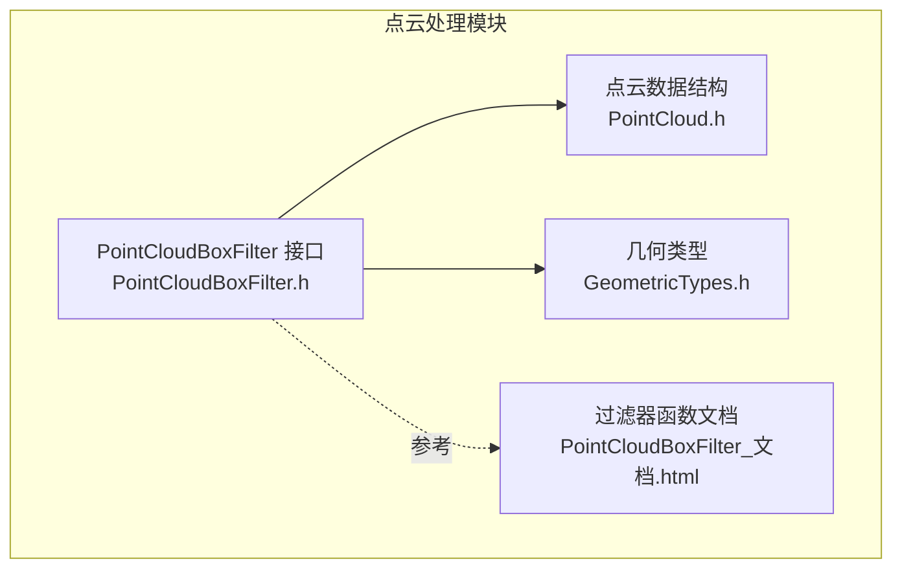
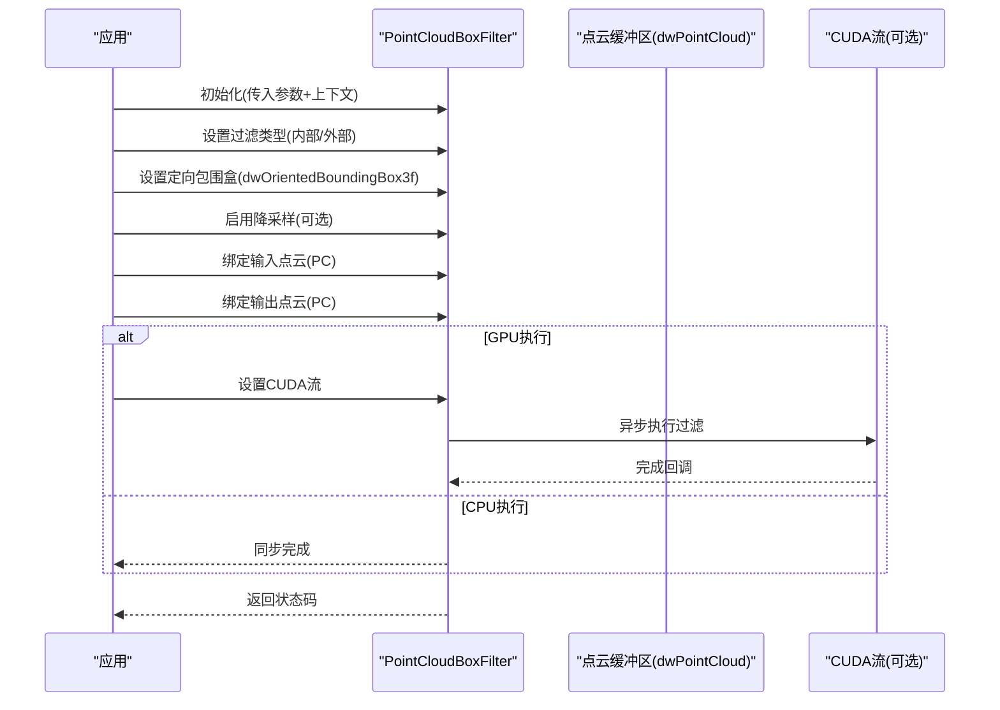
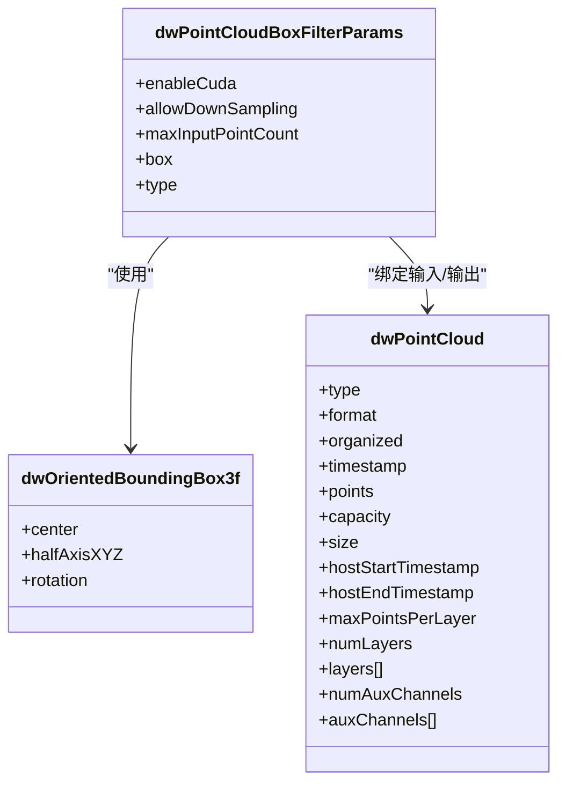
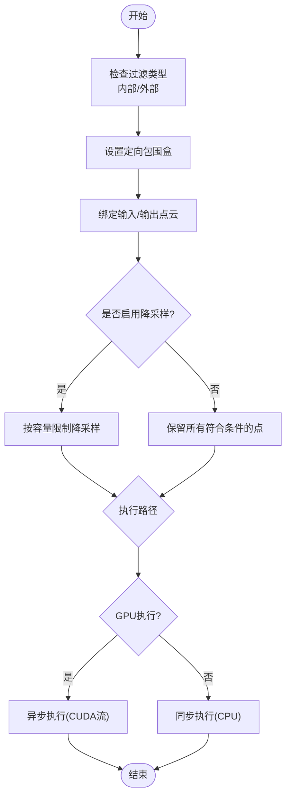
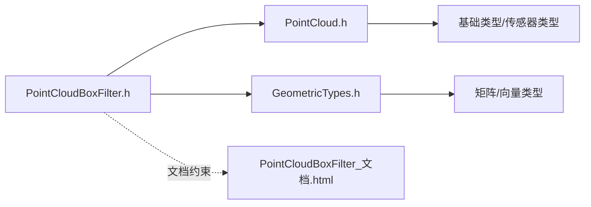

# 点云过滤器

<cite>
**本文引用的文件**
- [PointCloudBoxFilter.h](file://driverorks-5.10/include/dw/pointcloudprocessing/filter/PointCloudBoxFilter.h)
- [PointCloud.h](file://driverorks-5.10/include/dw/pointcloudprocessing/pointcloud/PointCloud.h)
- [GeometricTypes.h](file://driverorks-5.10/include/dw/core/base/GeometricTypes.h)
- [PointCloudBoxFilter_文档.html](file://driverorks-5.10/doc/nvsdk_dw_html/group__pointcloudfilter__group.html)
</cite>

## 目录
1. [简介](#简介)
2. [项目结构](#项目结构)
3. [核心组件](#核心组件)
4. [架构总览](#架构总览)
5. [详细组件分析](#详细组件分析)
6. [依赖关系分析](#依赖关系分析)
7. [性能考虑](#性能考虑)
8. [故障排查指南](#故障排查指南)
9. [结论](#结论)
10. [附录：API 参考与使用示例](#附录api-参考与使用示例)

## 简介
本技术文档围绕 DriveWorks 点云处理模块中的立方体空间过滤器（PointCloudBoxFilter）展开，系统阐述其算法原理、实现细节与工程实践。重点覆盖以下方面：
- 立方体过滤区域定义（定向包围盒）
- 点云裁剪操作流程
- 过滤精度控制与降采样策略
- 性能优化（CPU/GPU 执行路径、CUDA 流集成）
- 配置参数、过滤条件设置、多维过滤策略与批量处理机制
- 完整 API 参考与使用示例路径指引

该过滤器支持两种模式：保留盒内点（内部过滤）与剔除盒内点（外部过滤），并可选择在 CPU 或 GPU 上执行，同时支持通过 CUDA 流进行异步执行。

## 项目结构
与点云过滤器相关的关键文件位于以下路径：
- 过滤器接口与参数定义：driverorks-5.10/include/dw/pointcloudprocessing/filter/PointCloudBoxFilter.h
- 点云数据结构定义：driverorks-5.10/include/dw/pointcloudprocessing/pointcloud/PointCloud.h
- 几何类型（定向包围盒等）：driverorks-5.10/include/dw/core/base/GeometricTypes.h
- 过滤器函数文档与枚举说明：driverorks-5.10/doc/nvsdk_dw_html/group__pointcloudfilter__group.html

**图表来源**
- [PointCloudBoxFilter.h:1-227](file://driverorks-5.10/include/dw/pointcloudprocessing/filter/PointCloudBoxFilter.h#L1-L227)
- [PointCloud.h:1-193](file://driverorks-5.10/include/dw/pointcloudprocessing/pointcloud/PointCloud.h#L1-L193)
- [GeometricTypes.h:144-170](file://driverorks-5.10/include/dw/core/base/GeometricTypes.h#L144-L170)
- [PointCloudBoxFilter_文档.html:125-735](file://driverorks-5.10/doc/nvsdk_dw_html/group__pointcloudfilter__group.html#L125-L735)

**章节来源**
- [PointCloudBoxFilter.h:1-227](file://driverorks-5.10/include/dw/pointcloudprocessing/filter/PointCloudBoxFilter.h#L1-L227)
- [PointCloud.h:1-193](file://driverorks-5.10/include/dw/pointcloudprocessing/pointcloud/PointCloud.h#L1-L193)
- [GeometricTypes.h:144-170](file://driverorks-5.10/include/dw/core/base/GeometricTypes.h#L144-L170)
- [PointCloudBoxFilter_文档.html:125-735](file://driverorks-5.10/doc/nvsdk_dw_html/group__pointcloudfilter__group.html#L125-L735)

## 核心组件
- 点云数据结构（dwPointCloud）
  - 支持 CPU/GPU 内存类型、XYZI/RTHI 点格式、层（layers）与辅助通道（aux channels）等。
  - 提供创建/销毁缓冲区与完整点云的 API。
- 定向包围盒（dwOrientedBoundingBox3f）
  - 由中心点、半轴长度与旋转矩阵定义，用于描述任意方向的立方体过滤区域。
- 点云立方体过滤器（PointCloudBoxFilter）
  - 提供初始化、绑定输入输出、设置过滤类型与包围盒、启用降采样、获取/设置 CUDA 流、执行与释放等接口。
  - 支持内部过滤（保留盒内点）与外部过滤（剔除盒内点）两种模式。

**章节来源**
- [PointCloud.h:60-120](file://driverorks-5.10/include/dw/pointcloudprocessing/pointcloud/PointCloud.h#L60-L120)
- [GeometricTypes.h:144-156](file://driverorks-5.10/include/dw/core/base/GeometricTypes.h#L144-L156)
- [PointCloudBoxFilter.h:63-78](file://driverorks-5.10/include/dw/pointcloudprocessing/filter/PointCloudBoxFilter.h#L63-L78)
- [PointCloudBoxFilter_文档.html:126-188](file://driverorks-5.10/doc/nvsdk_dw_html/group__pointcloudfilter__group.html#L126-L188)

## 架构总览
PointCloudBoxFilter 的调用流程遵循“初始化 → 设置参数 → 绑定输入/输出 → 执行”的标准模式；GPU 模式下可与 CUDA 流集成以提升并发与吞吐。

**图表来源**
- [PointCloudBoxFilter.h:99-220](file://driverorks-5.10/include/dw/pointcloudprocessing/filter/PointCloudBoxFilter.h#L99-L220)
- [PointCloudBoxFilter_文档.html:151-188](file://driverorks-5.10/doc/nvsdk_dw_html/group__pointcloudfilter__group.html#L151-L188)

**章节来源**
- [PointCloudBoxFilter.h:99-220](file://driverorks-5.10/include/dw/pointcloudprocessing/filter/PointCloudBoxFilter.h#L99-L220)
- [PointCloudBoxFilter_文档.html:151-188](file://driverorks-5.10/doc/nvsdk_dw_html/group__pointcloudfilter__group.html#L151-L188)

## 详细组件分析

### 类型与数据结构
- 点云数据结构（dwPointCloud）
  - 关键字段：内存类型、点格式、是否有序、时间戳、点数组指针与容量、层数与每层最大点数、辅助通道数量与数据指针等。
  - 用途：作为过滤器的输入/输出载体，承载点云数据与元信息。
- 定向包围盒（dwOrientedBoundingBox3f）
  - 关键字段：中心点、半轴长度、旋转矩阵。
  - 用途：定义立方体过滤区域，支持任意方向的空间裁剪。

**图表来源**
- [PointCloud.h:98-120](file://driverorks-5.10/include/dw/pointcloudprocessing/pointcloud/PointCloud.h#L98-L120)
- [GeometricTypes.h:144-156](file://driverorks-5.10/include/dw/core/base/GeometricTypes.h#L144-L156)
- [PointCloudBoxFilter.h:71-78](file://driverorks-5.10/include/dw/pointcloudprocessing/filter/PointCloudBoxFilter.h#L71-L78)

**章节来源**
- [PointCloud.h:98-120](file://driverorks-5.10/include/dw/pointcloudprocessing/pointcloud/PointCloud.h#L98-L120)
- [GeometricTypes.h:144-156](file://driverorks-5.10/include/dw/core/base/GeometricTypes.h#L144-L156)
- [PointCloudBoxFilter.h:71-78](file://driverorks-5.10/include/dw/pointcloudprocessing/filter/PointCloudBoxFilter.h#L71-L78)

### 算法与处理逻辑
- 立方体过滤区域定义
  - 使用定向包围盒描述过滤区域，支持任意方向与尺寸的立方体。
  - 过滤类型决定是保留盒内点还是剔除盒内点。
- 点云裁剪操作
  - 输入点云逐点判断是否落入定向包围盒。
  - 根据过滤类型将满足条件的点写入输出点云缓冲区。
  - 若启用降采样，则根据允许的最大输出容量自动控制输出点数。
- 多维过滤策略
  - 支持 CPU/GPU 两种执行路径，GPU 路径可通过 CUDA 流实现异步执行。
  - 支持设置最大输入点数（仅 GPU 版本相关），用于约束内存占用与执行规模。
- 批量处理机制
  - 通过绑定输入/输出缓冲区的方式，一次初始化后可多次复用，适合流水线化处理。

**图表来源**
- [PointCloudBoxFilter.h:136-220](file://driverorks-5.10/include/dw/pointcloudprocessing/filter/PointCloudBoxFilter.h#L136-L220)
- [PointCloudBoxFilter_文档.html:151-188](file://driverorks-5.10/doc/nvsdk_dw_html/group__pointcloudfilter__group.html#L151-L188)

**章节来源**
- [PointCloudBoxFilter.h:136-220](file://driverorks-5.10/include/dw/pointcloudprocessing/filter/PointCloudBoxFilter.h#L136-L220)
- [PointCloudBoxFilter_文档.html:151-188](file://driverorks-5.10/doc/nvsdk_dw_html/group__pointcloudfilter__group.html#L151-L188)

### API 与参数详解
- 参数结构（dwPointCloudBoxFilterParams）
  - enableCuda：是否启用 GPU 执行
  - allowDownSampling：是否允许按输出容量自动降采样
  - maxInputPointCount：最大输入点数（仅 GPU 版本相关）
  - box：指向定向包围盒的指针
  - type：过滤类型（内部/外部）
- 关键函数
  - getDefaultParameters：获取默认参数
  - initialize/reset/release：生命周期管理
  - bindInput/bindOutput：绑定输入/输出点云
  - setBoundingBox/setFilterType/setDownSamplingEnabled：动态设置过滤参数
  - setCUDAStream/getCUDAStream：CUDA 流集成
  - process：执行过滤

**章节来源**
- [PointCloudBoxFilter.h:63-78](file://driverorks-5.10/include/dw/pointcloudprocessing/filter/PointCloudBoxFilter.h#L63-L78)
- [PointCloudBoxFilter.h:87-220](file://driverorks-5.10/include/dw/pointcloudprocessing/filter/PointCloudBoxFilter.h#L87-L220)
- [PointCloudBoxFilter_文档.html:151-188](file://driverorks-5.10/doc/nvsdk_dw_html/group__pointcloudfilter__group.html#L151-L188)

## 依赖关系分析
- 点云数据结构依赖于基础类型与传感器类型，确保跨平台与跨模块兼容性。
- 过滤器依赖于几何类型（定向包围盒）来表达空间区域。
- 文档中明确指出过滤器仅支持 XYZI 格式的点云，并对内存类型有严格要求（GPU 必须为 CUDA，CPU 必须为 CPU/PINNED）。

**图表来源**
- [PointCloudBoxFilter.h:50-56](file://driverorks-5.10/include/dw/pointcloudprocessing/filter/PointCloudBoxFilter.h#L50-L56)
- [PointCloud.h:49-50](file://driverorks-5.10/include/dw/pointcloudprocessing/pointcloud/PointCloud.h#L49-L50)
- [GeometricTypes.h:40-41](file://driverorks-5.10/include/dw/core/base/GeometricTypes.h#L40-L41)
- [PointCloudBoxFilter_文档.html:314-318](file://driverorks-5.10/doc/nvsdk_dw_html/group__pointcloudfilter__group.html#L314-L318)

**章节来源**
- [PointCloudBoxFilter.h:50-56](file://driverorks-5.10/include/dw/pointcloudprocessing/filter/PointCloudBoxFilter.h#L50-L56)
- [PointCloud.h:49-50](file://driverorks-5.10/include/dw/pointcloudprocessing/pointcloud/PointCloud.h#L49-L50)
- [GeometricTypes.h:40-41](file://driverorks-5.10/include/dw/core/base/GeometricTypes.h#L40-L41)
- [PointCloudBoxFilter_文档.html:314-318](file://driverorks-5.10/doc/nvsdk_dw_html/group__pointcloudfilter__group.html#L314-L318)

## 性能考虑
- 执行路径选择
  - GPU 执行：适用于大规模点云，可利用并行加速；需注意内存类型匹配与 CUDA 流调度。
  - CPU 执行：适用于小规模点云或受限环境，延迟更低但吞吐有限。
- 降采样策略
  - 启用 allowDownSampling 可避免输出超容，但会牺牲部分点密度；建议在保证下游算法精度的前提下适度开启。
- 内存与带宽
  - 输入/输出点云应与过滤器参数一致，避免重复拷贝与类型转换。
  - GPU 模式下合理设置 maxInputPointCount，防止内存不足导致失败。
- 并发与流水线
  - 通过 setCUDAStream 将过滤器与上层任务串接至同一 CUDA 流，减少同步开销并提升整体吞吐。

[本节为通用性能指导，不直接分析具体文件，故无“章节来源”]

## 故障排查指南
- 常见错误与定位
  - DW_INVALID_ARGUMENT：参数为空、内存类型不匹配、点云格式不支持（非 XYZI）。
  - DW_NOT_SUPPORTED：当前版本不支持的点云格式。
  - DW_INVALID_HANDLE：过滤器句柄为空。
  - DW_CALL_NOT_ALLOWED：未绑定输入/输出缓冲区即调用 process。
- 排查步骤
  - 确认点云格式为 XYZI，且内存类型与 enableCuda 匹配。
  - 在调用 process 前，确保已成功 bindInput 与 bindOutput。
  - 检查定向包围盒参数是否有效（中心、半轴、旋转矩阵）。
  - 如使用 GPU，确认 CUDA 流已正确设置且未被提前销毁。

**章节来源**
- [PointCloudBoxFilter_文档.html:314-318](file://driverorks-5.10/doc/nvsdk_dw_html/group__pointcloudfilter__group.html#L314-L318)
- [PointCloudBoxFilter_文档.html:356-361](file://driverorks-5.10/doc/nvsdk_dw_html/group__pointcloudfilter__group.html#L356-L361)
- [PointCloudBoxFilter_文档.html:497-505](file://driverorks-5.10/doc/nvsdk_dw_html/group__pointcloudfilter__group.html#L497-L505)

## 结论
PointCloudBoxFilter 提供了高效、灵活的点云空间裁剪能力，支持 CPU/GPU 双路径与异步执行，结合降采样与定向包围盒，能够显著提升后续处理算法的效率与稳定性。通过规范的参数设置与严格的输入约束，可在保证精度的同时获得最佳性能表现。

[本节为总结性内容，不直接分析具体文件，故无“章节来源”]

## 附录：API 参考与使用示例
- API 参考（函数与参数）
  - 默认参数：[getDefaultParameters:87-88](file://driverorks-5.10/include/dw/pointcloudprocessing/filter/PointCloudBoxFilter.h#L87-L88)
  - 生命周期：[initialize:99-102](file://driverorks-5.10/include/dw/pointcloudprocessing/filter/PointCloudBoxFilter.h#L99-L102)、[reset:110-111](file://driverorks-5.10/include/dw/pointcloudprocessing/filter/PointCloudBoxFilter.h#L110-L111)、[release:119-120](file://driverorks-5.10/include/dw/pointcloudprocessing/filter/PointCloudBoxFilter.h#L119-L120)
  - 绑定与执行：[bindInput:137-138](file://driverorks-5.10/include/dw/pointcloudprocessing/filter/PointCloudBoxFilter.h#L137-L138)、[bindOutput:176-177](file://driverorks-5.10/include/dw/pointcloudprocessing/filter/PointCloudBoxFilter.h#L176-L177)、[process:219-220](file://driverorks-5.10/include/dw/pointcloudprocessing/filter/PointCloudBoxFilter.h#L219-L220)
  - 参数设置：[setBoundingBox:188-189](file://driverorks-5.10/include/dw/pointcloudprocessing/filter/PointCloudBoxFilter.h#L188-L189)、[setFilterType:199-200](file://driverorks-5.10/include/dw/pointcloudprocessing/filter/PointCloudBoxFilter.h#L199-L200)、[setDownSamplingEnabled:210-210](file://driverorks-5.10/include/dw/pointcloudprocessing/filter/PointCloudBoxFilter.h#L210-L210)
  - CUDA 流：[getCUDAStream:149-150](file://driverorks-5.10/include/dw/pointcloudprocessing/filter/PointCloudBoxFilter.h#L149-L150)、[setCUDAStream:160-161](file://driverorks-5.10/include/dw/pointcloudprocessing/filter/PointCloudBoxFilter.h#L160-L161)
- 使用示例路径
  - 示例与用法可参考官方文档页面中的函数说明与注释，包含参数约束与返回值含义：
    - [函数文档总览:151-188](file://driverorks-5.10/doc/nvsdk_dw_html/group__pointcloudfilter__group.html#L151-L188)
    - [输入/输出绑定与格式约束:306-361](file://driverorks-5.10/doc/nvsdk_dw_html/group__pointcloudfilter__group.html#L306-L361)
    - [执行前检查与返回值:497-505](file://driverorks-5.10/doc/nvsdk_dw_html/group__pointcloudfilter__group.html#L497-L505)

**章节来源**
- [PointCloudBoxFilter.h:87-220](file://driverorks-5.10/include/dw/pointcloudprocessing/filter/PointCloudBoxFilter.h#L87-L220)
- [PointCloudBoxFilter_文档.html:151-188](file://driverorks-5.10/doc/nvsdk_dw_html/group__pointcloudfilter__group.html#L151-L188)
- [PointCloudBoxFilter_文档.html:306-361](file://driverorks-5.10/doc/nvsdk_dw_html/group__pointcloudfilter__group.html#L306-L361)
- [PointCloudBoxFilter_文档.html:497-505](file://driverorks-5.10/doc/nvsdk_dw_html/group__pointcloudfilter__group.html#L497-L505)