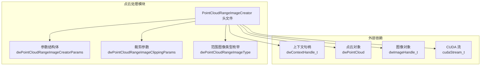
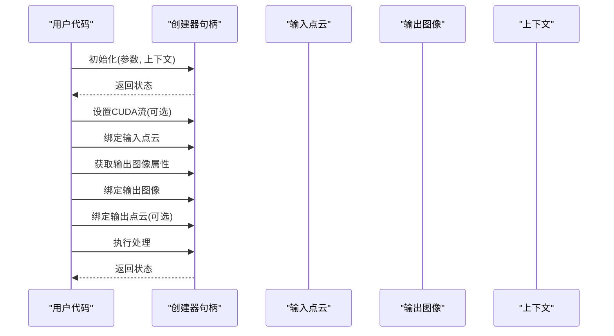
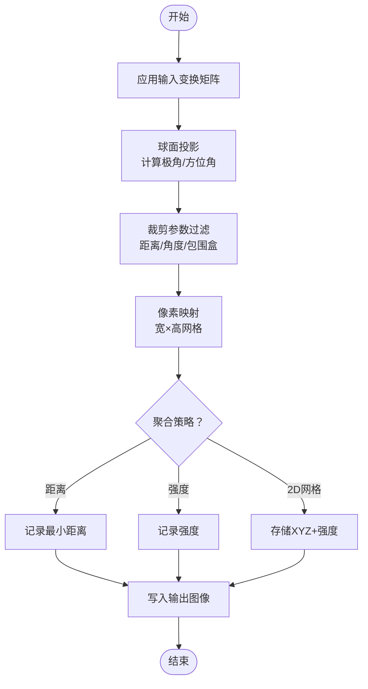
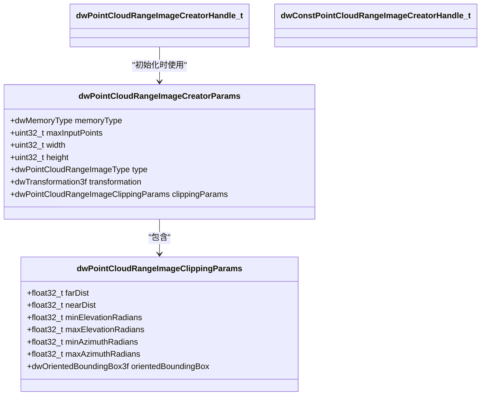
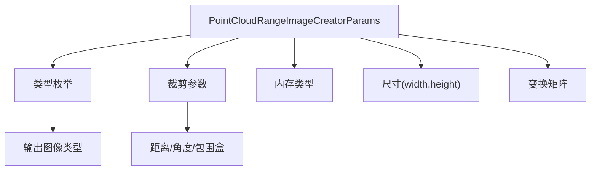

# 范围图像创建器

<cite>
**本文引用的文件**
- [PointCloudRangeImageCreator.h（5.10）](file://driverorks-5.10/include/dw/pointcloudprocessing/rangeimagecreator/PointCloudRangeImageCreator.h)
- [PointCloudRangeImageCreator.h（5.14）](file://driveworks-5.14/include/dw/pointcloudprocessing/rangeimagecreator/PointCloudRangeImageCreator.h)
- [PointCloudRangeImageCreator.h（5.8）](file://driveworks-5.8/include/dw/pointcloudprocessing/rangeimagecreator/PointCloudRangeImageCreator.h)
- [PointCloudRangeImageCreator_8h.html（5.10 文档）](file://driverorks-5.10/doc/nvsdk_dw_html/PointCloudRangeImageCreator_8h.html)
- [PointCloudRangeImageCreator_8h_source.html（5.10 文档源码）](file://driverorks-5.10/doc/nvsdk_dw_html/PointCloudRangeImageCreator_8h_source.html)
</cite>

## 目录
1. [简介](#简介)
2. [项目结构](#项目结构)
3. [核心组件](#核心组件)
4. [架构总览](#架构总览)
5. [详细组件分析](#详细组件分析)
6. [依赖关系分析](#依赖关系分析)
7. [性能考虑](#性能考虑)
8. [故障排查指南](#故障排查指南)
9. [结论](#结论)
10. [附录：API 参考与使用示例](#附录api-参考与使用示例)

## 简介
本文件面向 NVIDIA DriveWorks 的“范围图像创建器”模块，系统化阐述 PointCloudRangeImageCreator 类的 2D 投影转换算法与实现细节，涵盖极坐标变换、像素映射策略、深度值聚合与图像质量控制；并完整梳理配置参数、投影模式选择、分辨率设置与数据压缩策略，提供 API 参考与端到端使用示例，帮助开发者将 3D 点云数据高效转换为 2D 范围图像，服务于后续基于图像的算法与可视化。

## 项目结构
范围图像创建器位于 DriveWorks 的点云处理子系统中，对外暴露一组 C 风格的 API，用于初始化、绑定输入输出、设置 CUDA 流、查询图像属性以及执行投影转换流程。

图表来源
- [PointCloudRangeImageCreator.h（5.10）:50-57](file://driverorks-5.10/include/dw/pointcloudprocessing/rangeimagecreator/PointCloudRangeImageCreator.h#L50-L57)
- [PointCloudRangeImageCreator.h（5.10）:88-97](file://driverorks-5.10/include/dw/pointcloudprocessing/rangeimagecreator/PointCloudRangeImageCreator.h#L88-L97)

章节来源
- [PointCloudRangeImageCreator.h（5.10）:50-57](file://driverorks-5.10/include/dw/pointcloudprocessing/rangeimagecreator/PointCloudRangeImageCreator.h#L50-L57)
- [PointCloudRangeImageCreator.h（5.10）:88-97](file://driverorks-5.10/include/dw/pointcloudprocessing/rangeimagecreator/PointCloudRangeImageCreator.h#L88-L97)

## 核心组件
- 创建器句柄与生命周期管理
  - 初始化、重置、释放接口，支持设置/获取 CUDA 流，便于与异步流水线集成。
- 输入输出绑定
  - 绑定输入点云、输出图像或可选的输出点云，支持内存类型一致性检查。
- 参数与配置
  - 参数结构体包含内存类型、最大输入点数、输出图像宽高、范围图像类型、输入点变换矩阵、裁剪参数等。
- 图像属性查询
  - 查询输出图像属性，确保绑定时的尺寸与格式匹配。
- 处理流程
  - 将输入点云组织为有序网格后进行球面投影，生成 2D 范围图像；若输入已有序则直接拷贝。

章节来源
- [PointCloudRangeImageCreator.h（5.10）:110-146](file://driverorks-5.10/include/dw/pointcloudprocessing/rangeimagecreator/PointCloudRangeImageCreator.h#L110-L146)
- [PointCloudRangeImageCreator.h（5.10）:175-245](file://driverorks-5.10/include/dw/pointcloudprocessing/rangeimagecreator/PointCloudRangeImageCreator.h#L175-L245)

## 架构总览
范围图像创建器的调用序列如下：

图表来源
- [PointCloudRangeImageCreator.h（5.10）:110-146](file://driverorks-5.10/include/dw/pointcloudprocessing/rangeimagecreator/PointCloudRangeImageCreator.h#L110-L146)
- [PointCloudRangeImageCreator.h（5.10）:175-245](file://driverorks-5.10/include/dw/pointcloudprocessing/rangeimagecreator/PointCloudRangeImageCreator.h#L175-L245)

## 详细组件分析

### 2D 投影转换算法与实现要点
- 极坐标变换
  - 输入点云经可选的 3D 变换矩阵对齐至目标坐标系后，按球面投影规则计算极角与方位角，并映射到输出图像的像素坐标。
- 像素映射策略
  - 使用输出图像的宽高作为像素网格，将每个点映射到最近像素或采用某种采样策略（如最近邻或双线性），具体取决于内部实现与图像类型。
- 深度值聚合
  - 对于同一像素可能覆盖多个点的情况，按范围图像类型进行聚合：
    - 距离图：记录每个像素的最小/有效距离。
    - 强度图：记录强度或统计量。
    - 2D 网格图：同时存储三维坐标与强度，便于后续几何分析。
- 图像质量控制
  - 通过裁剪参数限制有效范围（近远距离、俯仰角/方位角范围、或定向包围盒），剔除无效或噪声点，提升图像质量与鲁棒性。

图表来源
- [PointCloudRangeImageCreator.h（5.10）:62-83](file://driverorks-5.10/include/dw/pointcloudprocessing/rangeimagecreator/PointCloudRangeImageCreator.h#L62-L83)
- [PointCloudRangeImageCreator.h（5.10）:88-97](file://driverorks-5.10/include/dw/pointcloudprocessing/rangeimagecreator/PointCloudRangeImageCreator.h#L88-L97)

章节来源
- [PointCloudRangeImageCreator.h（5.10）:62-83](file://driverorks-5.10/include/dw/pointcloudprocessing/rangeimagecreator/PointCloudRangeImageCreator.h#L62-L83)
- [PointCloudRangeImageCreator.h（5.10）:88-97](file://driverorks-5.10/include/dw/pointcloudprocessing/rangeimagecreator/PointCloudRangeImageCreator.h#L88-L97)

### 配置参数详解
- 内存类型（memoryType）
  - 支持 CUDA 或 CPU，决定内部缓冲区与处理管线的内存分配位置。
- 最大输入点数（maxInputPoints）
  - 限定输入点云的最大容量，避免运行时内存不足。
- 输出图像分辨率（width × height）
  - 控制投影后图像的像素维度，影响空间分辨率与计算复杂度。
- 范围图像类型（type）
  - 三类输出：
    - 距离图：单通道浮点，表示每个像素的 3D 距离。
    - 强度图：单通道浮点，表示激光强度。
    - 2D 网格图：四通道浮点，包含三维坐标与强度。
- 输入变换（transformation）
  - 对输入点进行刚体变换，常用于将点云从传感器坐标系对齐到目标坐标系。
- 裁剪参数（clippingParams）
  - 近/远距离、俯仰/方位角范围、定向包围盒，用于剔除无效区域。

章节来源
- [PointCloudRangeImageCreator.h（5.10）:88-97](file://driverorks-5.10/include/dw/pointcloudprocessing/rangeimagecreator/PointCloudRangeImageCreator.h#L88-L97)
- [PointCloudRangeImageCreator.h（5.10）:69-83](file://driverorks-5.10/include/dw/pointcloudprocessing/rangeimagecreator/PointCloudRangeImageCreator.h#L69-L83)

### 投影模式与分辨率设置
- 投影模式
  - 采用球面投影（极坐标到像素平面）进行二维映射，支持不同范围图像类型的聚合策略。
- 分辨率设置
  - 通过 width/height 控制输出图像分辨率；更高的分辨率带来更精细的空间信息但增加计算与内存开销。
- 数据压缩策略
  - 通过裁剪参数与聚合策略在保证关键信息的前提下减少冗余与噪声，提升后续算法效率。

章节来源
- [PointCloudRangeImageCreator.h（5.10）:62-67](file://driverorks-5.10/include/dw/pointcloudprocessing/rangeimagecreator/PointCloudRangeImageCreator.h#L62-L67)
- [PointCloudRangeImageCreator.h（5.10）:88-97](file://driverorks-5.10/include/dw/pointcloudprocessing/rangeimagecreator/PointCloudRangeImageCreator.h#L88-L97)

### API 类关系图

图表来源
- [PointCloudRangeImageCreator.h（5.10）:88-97](file://driverorks-5.10/include/dw/pointcloudprocessing/rangeimagecreator/PointCloudRangeImageCreator.h#L88-L97)
- [PointCloudRangeImageCreator.h（5.10）:69-83](file://driverorks-5.10/include/dw/pointcloudprocessing/rangeimagecreator/PointCloudRangeImageCreator.h#L69-L83)

## 依赖关系分析
- 内部依赖
  - 点云处理与图像模块：创建器依赖点云对象与图像对象以完成输入输出。
  - 上下文：初始化阶段需要上下文句柄以进行资源分配与初始化。
- 外部依赖
  - CUDA 流：可选设置，用于与 GPU 异步任务协同。
- 错误与约束
  - 内存类型一致性：输入/输出的内存类型必须一致。
  - 绑定完整性：处理前必须完成输入点云与输出图像的绑定。
  - 参数有效性：参数结构体中的字段需满足范围与格式要求。

图表来源
- [PointCloudRangeImageCreator.h（5.10）:88-97](file://driverorks-5.10/include/dw/pointcloudprocessing/rangeimagecreator/PointCloudRangeImageCreator.h#L88-L97)
- [PointCloudRangeImageCreator.h（5.10）:62-83](file://driverorks-5.10/include/dw/pointcloudprocessing/rangeimagecreator/PointCloudRangeImageCreator.h#L62-L83)

章节来源
- [PointCloudRangeImageCreator.h（5.10）:175-245](file://driverorks-5.10/include/dw/pointcloudprocessing/rangeimagecreator/PointCloudRangeImageCreator.h#L175-L245)

## 性能考虑
- 计算复杂度
  - 投影与聚合过程与输入点数量成正比，maxInputPoints 是关键上限参数。
- 内存占用
  - 输出图像大小由 width × height 决定；内存类型选择（CUDA/CPU）直接影响带宽与延迟。
- 并行与异步
  - 通过设置 CUDA 流与多流并行，可与其它 GPU 任务协同，减少等待时间。
- 裁剪优化
  - 合理设置裁剪参数可显著减少无效点数量，降低投影与聚合成本。

## 故障排查指南
- 常见错误与定位
  - 无效句柄/参数：检查初始化返回状态与句柄有效性。
  - 绑定失败：确认图像属性与内存类型与输入一致；检查点云是否为空。
  - 处理未绑定：确保已绑定输入点云与输出图像。
- 建议排查步骤
  - 先查询默认参数并校验；再设置 CUDA 流；最后执行处理。
  - 若输出异常，逐步缩小裁剪范围，验证投影结果。

章节来源
- [PointCloudRangeImageCreator.h（5.10）:175-245](file://driverorks-5.10/include/dw/pointcloudprocessing/rangeimagecreator/PointCloudRangeImageCreator.h#L175-L245)

## 结论
范围图像创建器提供了从 3D 点云到 2D 范围图像的高效通道，具备灵活的投影模式、可配置的分辨率与裁剪策略，以及完善的内存与流管理能力。通过合理设置参数与遵循绑定与处理流程，可在保证图像质量的同时获得良好的性能表现。

## 附录：API 参考与使用示例

### API 参考（概要）
- 初始化/重置/释放
  - 初始化：设置参数与上下文，返回状态。
  - 重置：清理内部状态，便于复用。
  - 释放：销毁资源。
- CUDA 流管理
  - 获取/设置 CUDA 流，支持异步执行。
- 图像属性查询
  - 查询输出图像属性，用于正确绑定。
- 输入输出绑定
  - 绑定输入点云、输出图像、可选输出点云。
- 处理执行
  - 执行投影与聚合，生成范围图像。

章节来源
- [PointCloudRangeImageCreator.h（5.10）:110-146](file://driverorks-5.10/include/dw/pointcloudprocessing/rangeimagecreator/PointCloudRangeImageCreator.h#L110-L146)
- [PointCloudRangeImageCreator.h（5.10）:175-245](file://driverorks-5.10/include/dw/pointcloudprocessing/rangeimagecreator/PointCloudRangeImageCreator.h#L175-L245)

### 使用示例（流程说明）
- 步骤一：获取默认参数并调整
  - 调用获取默认参数函数，根据需求修改分辨率、类型、裁剪参数与内存类型。
- 步骤二：初始化创建器
  - 提供上下文与参数，完成初始化。
- 步骤三：设置 CUDA 流（可选）
  - 将创建器绑定到指定 CUDA 流，与其它 GPU 任务并行。
- 步骤四：绑定输入与输出
  - 绑定输入点云；查询并绑定输出图像；如需，绑定输出点云。
- 步骤五：执行处理
  - 调用处理函数，生成范围图像。
- 步骤六：清理
  - 处理完成后可重置或释放创建器，以便重复使用。

章节来源
- [PointCloudRangeImageCreator.h（5.10）:110-146](file://driverorks-5.10/include/dw/pointcloudprocessing/rangeimagecreator/PointCloudRangeImageCreator.h#L110-L146)
- [PointCloudRangeImageCreator.h（5.10）:175-245](file://driverorks-5.10/include/dw/pointcloudprocessing/rangeimagecreator/PointCloudRangeImageCreator.h#L175-L245)