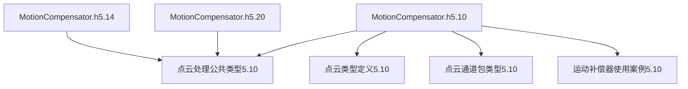
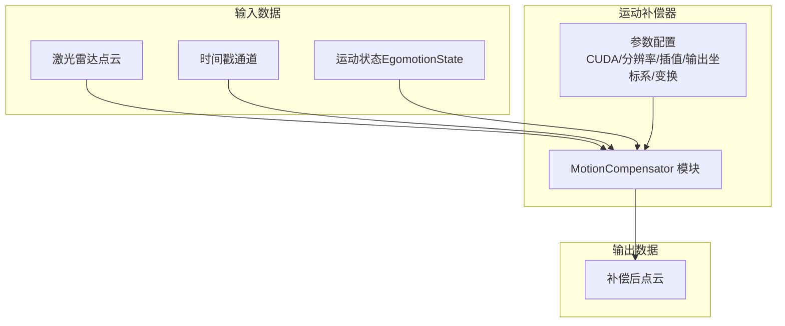
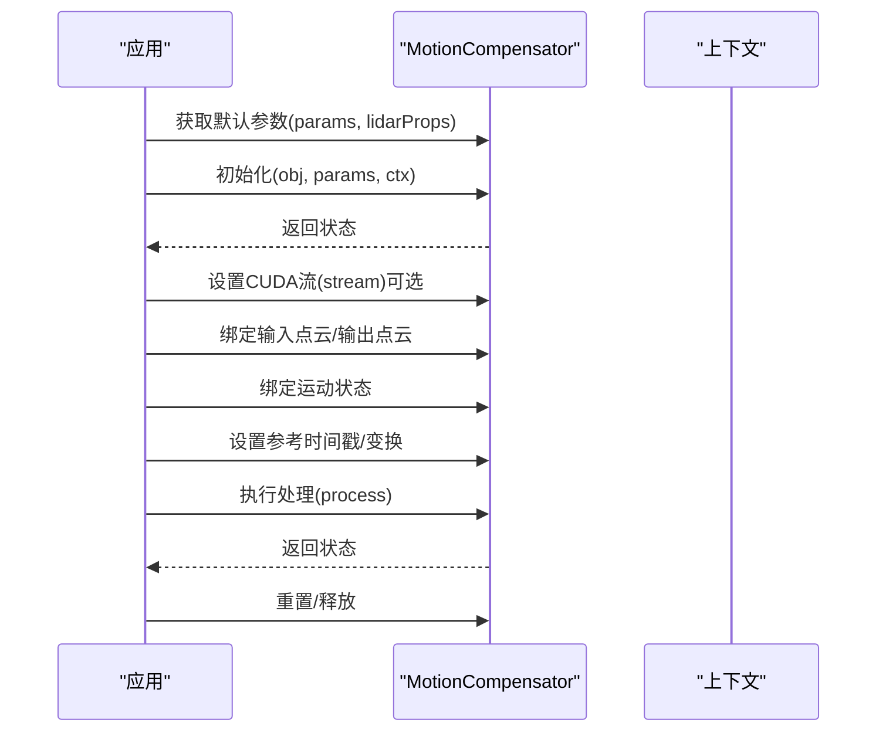
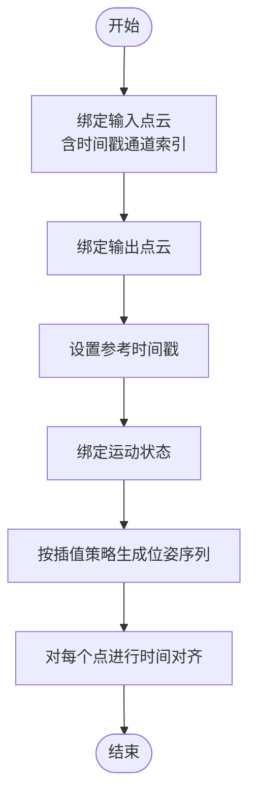
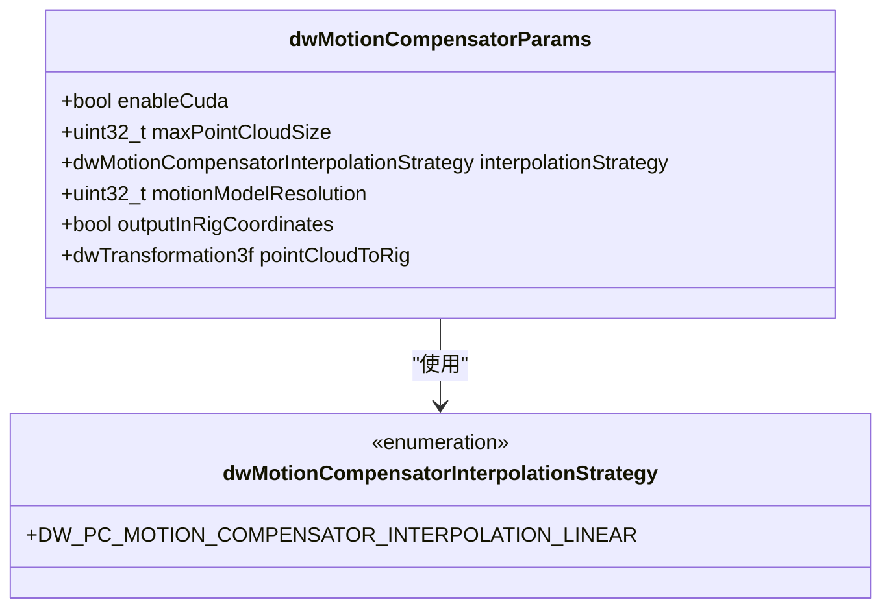
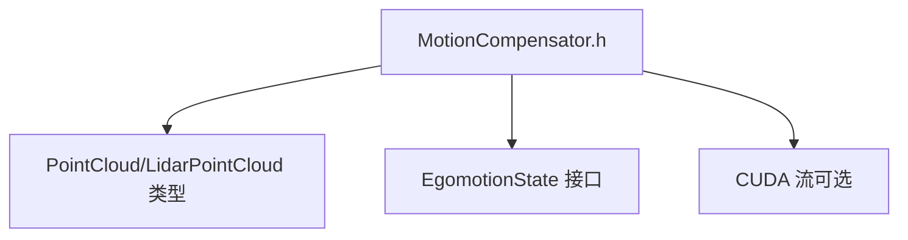

# 运动补偿器

<cite>
**本文引用的文件**
- [MotionCompensator.h（5.10 版本）](file://driverorks-5.10/include/dw/pointcloudprocessing/motioncompensator/MotionCompensator.h)
- [MotionCompensator.h（5.14 版本）](file://driveworks-5.14/include/dw/pointcloudprocessing/motioncompensator/MotionCompensator.h)
- [MotionCompensator.h（5.20 版本）](file://driveworks-520/include/dw/pointcloudprocessing/motioncompensator/MotionCompensator.h)
- [点云处理公共类型（5.10 版本）](file://driverorks-5.10/doc/nvcgf_html/PointCloudProcessingCommonTypes_8hpp.html)
- [点云类型定义（5.10 版本）](file://driverorks-5.10/doc/nvcgf_html/PointCloud_8hpp.html)
- [点云通道包类型（5.10 版本）](file://driverorks-5.10/doc/nvcgf_html/classdw_1_1framework_1_1PointCloudChannelPacket.html)
- [运动补偿器使用案例（5.10 版本）](file://driverorks-5.10/doc/nvsdk_dw_html/md_src_dw_pointcloudprocessing_motioncompensator_doc_public_usecase9.html)
</cite>

## 目录
1. [简介](#简介)
2. [项目结构](#项目结构)
3. [核心组件](#核心组件)
4. [架构总览](#架构总览)
5. [详细组件分析](#详细组件分析)
6. [依赖关系分析](#依赖关系分析)
7. [性能考虑](#性能考虑)
8. [故障排查指南](#故障排查指南)
9. [结论](#结论)
10. [附录：API 参考](#附录api-参考)

## 简介
本技术文档围绕 NVIDIA DriveWorks 的运动补偿器（MotionCompensator）展开，系统阐述其在激光雷达点云处理中的作用与实现要点。运动补偿器用于消除车辆行驶过程中由于自身运动导致的点云畸变，将不同时刻采集的点云对齐到统一坐标系，从而提升定位与建图的精度与鲁棒性。

该模块提供参数化配置、运动状态绑定、时间对齐与插值策略、输出坐标系选择以及 CUDA 流集成等能力，并通过统一的 C 接口暴露初始化、绑定、处理与释放流程。

## 项目结构
与运动补偿器直接相关的关键文件位于以下路径：
- 头文件：各版本的 MotionCompensator.h 定义了 API、参数结构体与枚举
- 文档：点云处理公共类型、点云类型与通道包类型文档，辅助理解数据结构
- 使用案例：运动补偿器使用案例文档，描述典型应用场景

**图表来源**
- [MotionCompensator.h（5.10 版本）:46-269](file://driverorks-5.10/include/dw/pointcloudprocessing/motioncompensator/MotionCompensator.h#L46-L269)
- [MotionCompensator.h（5.14 版本）:46-269](file://driveworks-5.14/include/dw/pointcloudprocessing/motioncompensator/MotionCompensator.h#L46-L269)
- [MotionCompensator.h（5.20 版本）:46-326](file://driveworks-520/include/dw/pointcloudprocessing/motioncompensator/MotionCompensator.h#L46-L326)
- [点云处理公共类型（5.10 版本）](file://driverorks-5.10/doc/nvcgf_html/PointCloudProcessingCommonTypes_8hpp.html)
- [点云类型定义（5.10 版本）](file://driverorks-5.10/doc/nvcgf_html/PointCloud_8hpp.html)
- [点云通道包类型（5.10 版本）](file://driverorks-5.10/doc/nvcgf_html/classdw_1_1framework_1_1PointCloudChannelPacket.html)
- [运动补偿器使用案例（5.10 版本）:1-136](file://driverorks-5.10/doc/nvsdk_dw_html/md_src_dw_pointcloudprocessing_motioncompensator_doc_public_usecase9.html#L1-L136)

**章节来源**
- [MotionCompensator.h（5.10 版本）:46-269](file://driverorks-5.10/include/dw/pointcloudprocessing/motioncompensator/MotionCompensator.h#L46-L269)
- [MotionCompensator.h（5.14 版本）:46-269](file://driveworks-5.14/include/dw/pointcloudprocessing/motioncompensator/MotionCompensator.h#L46-L269)
- [MotionCompensator.h（5.20 版本）:46-326](file://driveworks-520/include/dw/pointcloudprocessing/motioncompensator/MotionCompensator.h#L46-L326)

## 核心组件
- 运动补偿器句柄与参数
  - 句柄类型：用于标识一个已初始化的补偿器实例
  - 参数结构体：包含 CUDA 启用标志、最大点数、插值策略、运动模型分辨率、输出坐标系选择、传感器到平台变换等关键配置
- 插值策略
  - 当前版本仅支持线性插值策略，用于在点云采集时间段内对位姿进行插值
- 数据绑定与处理
  - 绑定输入点云（含时间戳辅助通道索引）、绑定输出点云
  - 绑定激光雷达专用点云接口
  - 设置参考时间戳与传感器到平台变换
  - 执行补偿处理

上述组件在三个版本中保持一致的 API 结构，仅在头文件包含与少量注释差异上略有不同。

**章节来源**
- [MotionCompensator.h（5.10 版本）:56-86](file://driverorks-5.10/include/dw/pointcloudprocessing/motioncompensator/MotionCompensator.h#L56-L86)
- [MotionCompensator.h（5.14 版本）:56-86](file://driveworks-5.14/include/dw/pointcloudprocessing/motioncompensator/MotionCompensator.h#L56-L86)
- [MotionCompensator.h（5.20 版本）:56-86](file://driveworks-520/include/dw/pointcloudprocessing/motioncompensator/MotionCompensator.h#L56-L86)

## 架构总览
运动补偿器在整体数据流中的位置如下：

**图表来源**
- [MotionCompensator.h（5.10 版本）:101-114](file://driverorks-5.10/include/dw/pointcloudprocessing/motioncompensator/MotionCompensator.h#L101-L114)
- [MotionCompensator.h（5.14 版本）:101-114](file://driveworks-5.14/include/dw/pointcloudprocessing/motioncompensator/MotionCompensator.h#L101-L114)
- [MotionCompensator.h（5.20 版本）:105-122](file://driveworks-520/include/dw/pointcloudprocessing/motioncompensator/MotionCompensator.h#L105-L122)

## 详细组件分析

### 组件一：参数与初始化
- 默认参数获取：根据激光雷达属性填充合理的默认参数，便于快速启动
- 初始化：传入参数与上下文句柄，创建补偿器实例
- 重置与释放：在需要时重置内部状态或释放资源
- CUDA 流设置：可选绑定 CUDA 流以异步执行（需启用 CUDA）

**图表来源**
- [MotionCompensator.h（5.10 版本）:97-114](file://driverorks-5.10/include/dw/pointcloudprocessing/motioncompensator/MotionCompensator.h#L97-L114)
- [MotionCompensator.h（5.14 版本）:97-114](file://driveworks-5.14/include/dw/pointcloudprocessing/motioncompensator/MotionCompensator.h#L97-L114)
- [MotionCompensator.h（5.20 版本）:101-122](file://driveworks-520/include/dw/pointcloudprocessing/motioncompensator/MotionCompensator.h#L101-L122)

**章节来源**
- [MotionCompensator.h（5.10 版本）:97-136](file://driverorks-5.10/include/dw/pointcloudprocessing/motioncompensator/MotionCompensator.h#L97-L136)
- [MotionCompensator.h（5.14 版本）:97-136](file://driveworks-5.14/include/dw/pointcloudprocessing/motioncompensator/MotionCompensator.h#L97-L136)
- [MotionCompensator.h（5.20 版本）:101-152](file://driveworks-520/include/dw/pointcloudprocessing/motioncompensator/MotionCompensator.h#L101-L152)

### 组件二：输入/输出绑定与时间对齐
- 输入绑定
  - 绑定通用点云并指定时间戳辅助通道索引
  - 绑定激光雷达专用点云
- 输出绑定
  - 绑定通用点云或激光雷达专用点云作为输出
- 时间对齐
  - 设置参考时间戳，默认使用点云结束时间
  - 通过运动状态与插值策略计算每个点在参考时刻的位姿，完成时间对齐

**图表来源**
- [MotionCompensator.h（5.10 版本）:203-215](file://driverorks-5.10/include/dw/pointcloudprocessing/motioncompensator/MotionCompensator.h#L203-L215)
- [MotionCompensator.h（5.14 版本）:203-215](file://driveworks-5.14/include/dw/pointcloudprocessing/motioncompensator/MotionCompensator.h#L203-L215)
- [MotionCompensator.h（5.20 版本）:240-255](file://driveworks-520/include/dw/pointcloudprocessing/motioncompensator/MotionCompensator.h#L240-L255)

**章节来源**
- [MotionCompensator.h（5.10 版本）:199-215](file://driverorks-5.10/include/dw/pointcloudprocessing/motioncompensator/MotionCompensator.h#L199-L215)
- [MotionCompensator.h（5.14 版本）:199-215](file://driveworks-5.14/include/dw/pointcloudprocessing/motioncompensator/MotionCompensator.h#L199-L215)
- [MotionCompensator.h（5.20 版本）:235-255](file://driveworks-520/include/dw/pointcloudprocessing/motioncompensator/MotionCompensator.h#L235-L255)

### 组件三：运动模型与补偿精度控制
- 运动模型分辨率
  - 在一次扫描的时间跨度内，按等时间间隔计算若干变换，提升补偿精度
- 插值策略
  - 当前版本采用线性插值策略，适用于大多数连续运动场景
- 输出坐标系
  - 可选择输出至平台/机架坐标系，便于与后续定位/建图模块对接

**图表来源**
- [MotionCompensator.h（5.10 版本）:69-86](file://driverorks-5.10/include/dw/pointcloudprocessing/motioncompensator/MotionCompensator.h#L69-L86)
- [MotionCompensator.h（5.14 版本）:69-86](file://driveworks-5.14/include/dw/pointcloudprocessing/motioncompensator/MotionCompensator.h#L69-L86)
- [MotionCompensator.h（5.20 版本）:68-86](file://driveworks-520/include/dw/pointcloudprocessing/motioncompensator/MotionCompensator.h#L68-L86)

**章节来源**
- [MotionCompensator.h（5.10 版本）:78-84](file://driverorks-5.10/include/dw/pointcloudprocessing/motioncompensator/MotionCompensator.h#L78-L84)
- [MotionCompensator.h（5.14 版本）:78-84](file://driveworks-5.14/include/dw/pointcloudprocessing/motioncompensator/MotionCompensator.h#L78-L84)
- [MotionCompensator.h（5.20 版本）:78-84](file://driveworks-520/include/dw/pointcloudprocessing/motioncompensator/MotionCompensator.h#L78-L84)

### 组件四：数据结构与类型支撑
- 点云处理公共类型与点云类型定义，为运动补偿器提供数据结构基础
- 点云通道包类型，描述点云在框架中的传输与封装方式

**图表来源**
- [点云通道包类型（5.10 版本）](file://driverorks-5.10/doc/nvcgf_html/classdw_1_1framework_1_1PointCloudChannelPacket.html)
- [点云类型定义（5.10 版本）](file://driverorks-5.10/doc/nvcgf_html/PointCloud_8hpp.html)
- [点云处理公共类型（5.10 版本）](file://driverorks-5.10/doc/nvcgf_html/PointCloudProcessingCommonTypes_8hpp.html)

**章节来源**
- [点云通道包类型（5.10 版本）](file://driverorks-5.10/doc/nvcgf_html/classdw_1_1framework_1_1PointCloudChannelPacket.html)
- [点云类型定义（5.10 版本）](file://driverorks-5.10/doc/nvcgf_html/PointCloud_8hpp.html)
- [点云处理公共类型（5.10 版本）](file://driverorks-5.10/doc/nvcgf_html/PointCloudProcessingCommonTypes_8hpp.html)

## 依赖关系分析
- 外部依赖
  - 点云处理模块：依赖点云与激光雷达点云类型
  - 运动状态模块：依赖 egomotion 状态接口
- 内部耦合
  - 参数结构体与 API 调用强耦合，初始化阶段决定运行期行为
  - CUDA 流绑定与 enableCuda 配置存在条件约束

**图表来源**
- [MotionCompensator.h（5.10 版本）:49-50](file://driverorks-5.10/include/dw/pointcloudprocessing/motioncompensator/MotionCompensator.h#L49-L50)
- [MotionCompensator.h（5.14 版本）:49-50](file://driveworks-5.14/include/dw/pointcloudprocessing/motioncompensator/MotionCompensator.h#L49-L50)
- [MotionCompensator.h（5.20 版本）:49-50](file://driveworks-520/include/dw/pointcloudprocessing/motioncompensator/MotionCompensator.h#L49-L50)

**章节来源**
- [MotionCompensator.h（5.10 版本）:49-50](file://driverorks-5.10/include/dw/pointcloudprocessing/motioncompensator/MotionCompensator.h#L49-L50)
- [MotionCompensator.h（5.14 版本）:49-50](file://driveworks-5.14/include/dw/pointcloudprocessing/motioncompensator/MotionCompensator.h#L49-L50)
- [MotionCompensator.h（5.20 版本）:49-50](file://driveworks-520/include/dw/pointcloudprocessing/motioncompensator/MotionCompensator.h#L49-L50)

## 性能考虑
- CUDA 启用与流绑定
  - 在支持 CUDA 的环境中启用 enableCuda，并绑定合适的 CUDA 流，可显著提升大规模点云的处理速度
- 最大点数限制
  - 通过 maxPointCloudSize 控制内存占用与处理开销，避免超限导致的失败或性能退化
- 运动模型分辨率
  - 提高分辨率可提升补偿精度，但会增加插值与计算成本；应结合场景动态权衡
- 插值策略
  - 线性插值在多数场景下已足够高效且稳定，若运动剧烈可考虑更高阶插值（如未来版本扩展）

[本节为通用性能建议，不直接分析具体文件]

## 故障排查指南
- 常见错误与处理
  - 句柄无效：检查初始化是否成功、对象是否已被释放
  - 绑定失败：确认输入/输出点云已正确绑定，且内存类型匹配
  - CUDA 流相关：若启用 CUDA，确保已设置流；否则调用相应查询接口会返回“不允许”的状态码
- 建议排查步骤
  - 先验证参数与初始化流程
  - 再检查绑定顺序与时间戳通道索引
  - 最后核对 CUDA 流配置与设备环境

**章节来源**
- [MotionCompensator.h（5.10 版本）:148-150](file://driverorks-5.10/include/dw/pointcloudprocessing/motioncompensator/MotionCompensator.h#L148-L150)
- [MotionCompensator.h（5.14 版本）:148-150](file://driveworks-5.14/include/dw/pointcloudprocessing/motioncompensator/MotionCompensator.h#L148-L150)
- [MotionCompensator.h（5.20 版本）:168-170](file://driveworks-520/include/dw/pointcloudprocessing/motioncompensator/MotionCompensator.h#L168-L170)

## 结论
运动补偿器通过参数化配置、运动状态绑定与时间对齐，有效消除了车辆运动引起的点云畸变，为后续定位与建图提供了高质量输入。合理设置 CUDA、分辨率与输出坐标系，可在精度与性能之间取得良好平衡。建议在实际部署中结合硬件能力与任务需求，逐步调优参数以获得最佳效果。

[本节为总结性内容，不直接分析具体文件]

## 附录：API 参考

- 参数与初始化
  - 获取默认参数：用于根据激光雷达属性快速填充合理参数
  - 初始化：创建补偿器实例
  - 重置/释放：清理或复用实例
  - CUDA 流设置/获取：在启用 CUDA 时进行异步处理
- 运动状态与变换
  - 绑定运动状态：接入实时运动信息
  - 设置变换：将点云坐标系对齐到平台/机架坐标系
  - 设置参考时间戳：确定对齐基准时刻
- 输入/输出绑定
  - 绑定输入点云（含时间戳通道索引）
  - 绑定输入/输出激光雷达点云
- 处理与状态
  - 执行补偿处理
  - 错误码与状态返回

以上 API 在三个版本中保持一致的命名与语义，便于跨版本迁移与维护。

**章节来源**
- [MotionCompensator.h（5.10 版本）:97-263](file://driverorks-5.10/include/dw/pointcloudprocessing/motioncompensator/MotionCompensator.h#L97-L263)
- [MotionCompensator.h（5.14 版本）:97-263](file://driveworks-5.14/include/dw/pointcloudprocessing/motioncompensator/MotionCompensator.h#L97-L263)
- [MotionCompensator.h（5.20 版本）:101-319](file://driveworks-520/include/dw/pointcloudprocessing/motioncompensator/MotionCompensator.h#L101-L319)