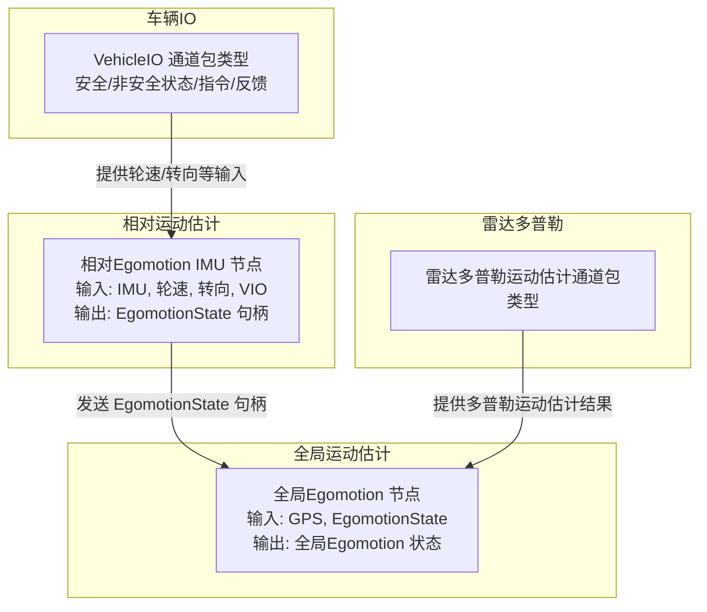
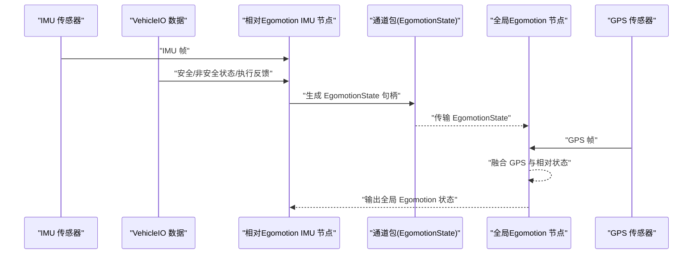
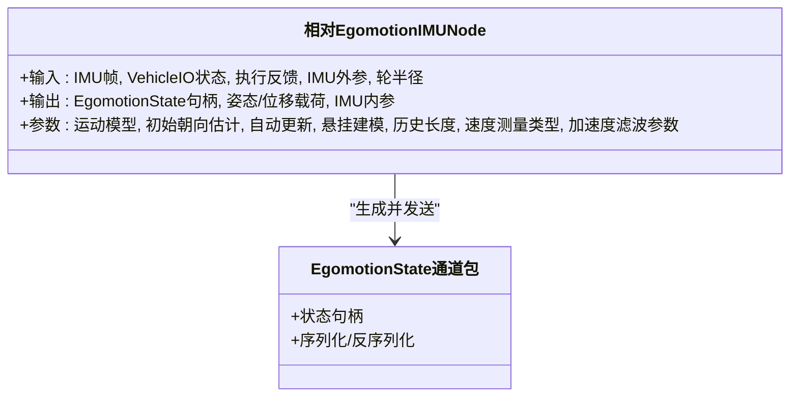
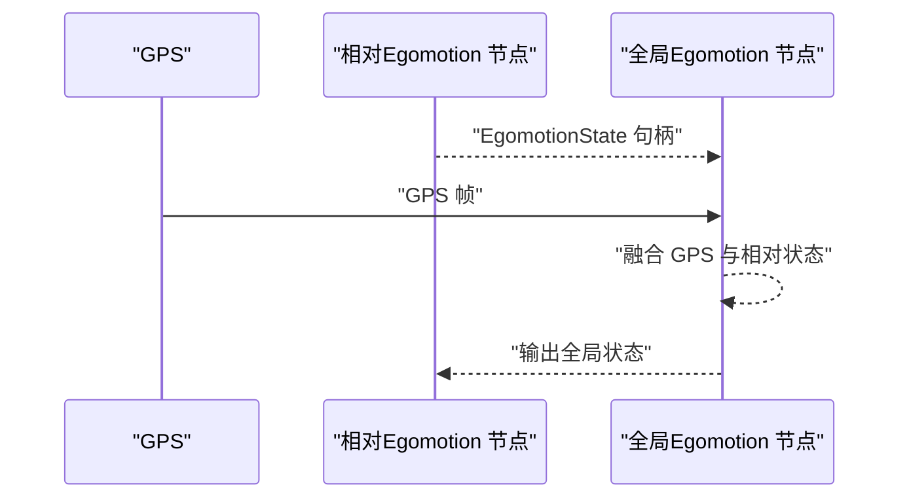
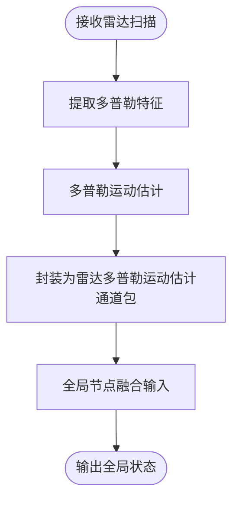
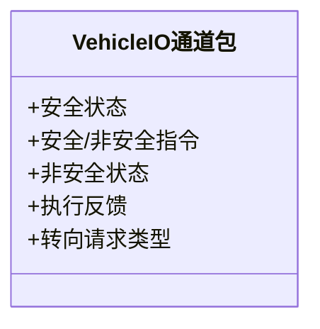
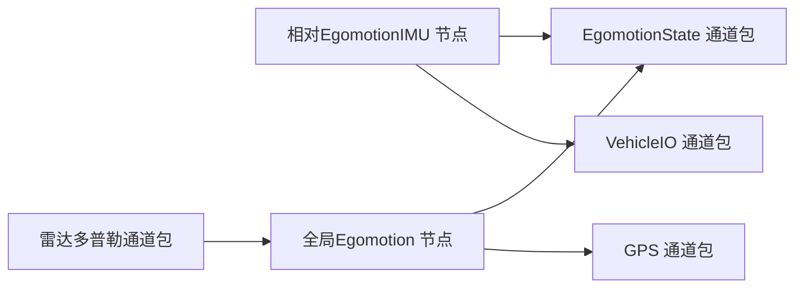

# 运动估计

<cite>
**本文引用的文件**   
- [driverorks-5.10/include/dwframework/dwnodes/common/channelpackets/EgomotionState.hpp](file://driverorks-5.10/include/dwframework/dwnodes/common/channelpackets/EgomotionState.hpp)
- [driverorks-5.10/include/dwframework/dwnodes/egomotion/dwglobalegomotionnode/dwGlobalEgomotionNode.hpp](file://driverorks-5.10/include/dwframework/dwnodes/egomotion/dwglobalegomotionnode/dwGlobalEgomotionNode.hpp)
- [driverorks-5.10/include/dwframework/dwnodes/egomotion/dwrelativeegomotionimunode/dwRelativeEgomotionIMUNode.hpp](file://driverorks-5.10/include/dwframework/dwnodes/egomotion/dwrelativeegomotionimunode/dwRelativeEgomotionIMUNode.hpp)
- [driverorks-5.10/include/dwframework/dwnodes/common/channelpackets/DopplerMotionEstimator.hpp](file://driverorks-5.10/include/dwframework/dwnodes/common/channelpackets/DopplerMotionEstimator.hpp)
- [driverorks-5.10/include/dwframework/dwnodes/common/channelpackets/VehicleIOValStructures.hpp](file://driverorks-5.10/include/dwframework/dwnodes/common/channelpackets/VehicleIOValStructures.hpp)
- [driveworks-5.14/include/dwframework/dwnodes/common/channelpackets/EgomotionState.hpp](file://driveworks-5.14/include/dwframework/dwnodes/common/channelpackets/EgomotionState.hpp)
- [driveworks-5.14/include/dwframework/dwnodes/egomotion/dwglobalegomotionnode/dwGlobalEgomotionNode.hpp](file://driveworks-5.14/include/dwframework/dwnodes/egomotion/dwglobalegomotionnode/dwGlobalEgomotionNode.hpp)
- [driveworks-5.14/include/dwframework/dwnodes/egomotion/dwrelativeegomotionimunode/dwRelativeEgomotionIMUNode.hpp](file://driveworks-5.14/include/dwframework/dwnodes/egomotion/dwrelativeegomotionimunode/dwRelativeEgomotionIMUNode.hpp)
- [driveworks-5.14/include/dwframework/dwnodes/common/channelpackets/DopplerMotionEstimator.hpp](file://driveworks-5.14/include/dwframework/dwnodes/common/channelpackets/DopplerMotionEstimator.hpp)
- [driveworks-5.14/include/dwframework/dwnodes/common/channelpackets/VehicleIOValStructures.hpp](file://driveworks-5.14/include/dwframework/dwnodes/common/channelpackets/VehicleIOValStructures.hpp)
</cite>

## 目录
1. [简介](#简介)
2. [项目结构](#项目结构)
3. [核心组件](#核心组件)
4. [架构总览](#架构总览)
5. [详细组件分析](#详细组件分析)
6. [依赖关系分析](#依赖关系分析)
7. [性能考量](#性能考量)
8. [故障排查指南](#故障排查指南)
9. [结论](#结论)
10. [附录](#附录)

## 简介
本技术文档围绕运动估计模块展开，系统性介绍自运动估计（相对运动）与全局运动估计的理论基础与实现方法；阐述多传感器融合策略（IMU、轮速、转向、GPS）；详解雷达多普勒运动估计的特殊处理；说明运动状态表示与时间同步机制；并给出 Egomotion 类的设计与使用要点、VehicleIO 接口在车辆控制数据处理中的角色（CAN 总线数据解析与车辆状态监控）。文档同时提供 API 参考与端到端应用示例路径，并给出算法精度评估与误差分析方法。

## 项目结构
运动估计相关代码主要分布在驱动框架节点层（dwframework dwnodes），涉及以下子模块：
- 相对运动估计（IMU 融合）：相对 Egomotion IMU 节点
- 全局运动估计：基于 GPS 与相对 Egomotion 的全局节点
- 雷达多普勒运动估计：雷达专用通道包类型定义
- 车辆 IO（VehicleIO）：车辆控制数据的通道包类型定义
- 运动状态通道包：用于在节点间传递运动状态句柄与序列化数据

**图示来源**
- [driverorks-5.10/include/dwframework/dwnodes/egomotion/dwrelativeegomotionimunode/dwRelativeEgomotionIMUNode.hpp:120-153](file://driverorks-5.10/include/dwframework/dwnodes/egomotion/dwrelativeegomotionimunode/dwRelativeEgomotionIMUNode.hpp#L120-L153)
- [driverorks-5.10/include/dwframework/dwnodes/egomotion/dwglobalegomotionnode/dwGlobalEgomotionNode.hpp:75-98](file://driverorks-5.10/include/dwframework/dwnodes/egomotion/dwglobalegomotionnode/dwGlobalEgomotionNode.hpp#L75-L98)
- [driverorks-5.10/include/dwframework/dwnodes/common/channelpackets/DopplerMotionEstimator.hpp:34-37](file://driverorks-5.10/include/dwframework/dwnodes/common/channelpackets/DopplerMotionEstimator.hpp#L34-L37)
- [driverorks-5.10/include/dwframework/dwnodes/common/channelpackets/VehicleIOValStructures.hpp:37-42](file://driverorks-5.10/include/dwframework/dwnodes/common/channelpackets/VehicleIOValStructures.hpp#L37-L42)

**章节来源**
- [driverorks-5.10/include/dwframework/dwnodes/egomotion/dwrelativeegomotionimunode/dwRelativeEgomotionIMUNode.hpp:120-153](file://driverorks-5.10/include/dwframework/dwnodes/egomotion/dwrelativeegomotionimunode/dwRelativeEgomotionIMUNode.hpp#L120-L153)
- [driverorks-5.10/include/dwframework/dwnodes/egomotion/dwglobalegomotionnode/dwGlobalEgomotionNode.hpp:75-98](file://driverorks-5.10/include/dwframework/dwnodes/egomotion/dwglobalegomotionnode/dwGlobalEgomotionNode.hpp#L75-L98)
- [driverorks-5.10/include/dwframework/dwnodes/common/channelpackets/DopplerMotionEstimator.hpp:34-37](file://driverorks-5.10/include/dwframework/dwnodes/common/channelpackets/DopplerMotionEstimator.hpp#L34-L37)
- [driverorks-5.10/include/dwframework/dwnodes/common/channelpackets/VehicleIOValStructures.hpp:37-42](file://driverorks-5.10/include/dwframework/dwnodes/common/channelpackets/VehicleIOValStructures.hpp#L37-L42)

## 核心组件
- 相对运动估计（IMU 节点）
  - 输入：IMU 帧、车辆 IO 安全/非安全状态、执行反馈、IMU 外参、标定轮半径
  - 输出：EgomotionState 句柄、姿态/位移载荷、IMU 内参更新
  - 关键参数：运动模型（纯里程计或 IMU+里程计）、初始朝向估计开关、自动更新、悬挂建模、历史长度、速度测量类型、加速度滤波参数
- 全局运动估计（全局节点）
  - 输入：GPS 帧、来自相对节点的 EgomotionState
  - 输出：全局 Egomotion 状态与结果载荷
  - 关键参数：传感器挂载刚体句柄、GPS 传感器名、历史长度
- 雷达多普勒运动估计
  - 通道包类型：雷达多普勒运动估计结果
- 车辆 IO（VehicleIO）
  - 通道包类型：安全状态、安全/非安全指令、执行反馈、转向请求类型等

**章节来源**
- [driveworks-5.14/include/dwframework/dwnodes/egomotion/dwrelativeegomotionimunode/dwRelativeEgomotionIMUNode.hpp:120-158](file://driveworks-5.14/include/dwframework/dwnodes/egomotion/dwrelativeegomotionimunode/dwRelativeEgomotionIMUNode.hpp#L120-L158)
- [driveworks-5.14/include/dwframework/dwnodes/egomotion/dwglobalegomotionnode/dwGlobalEgomotionNode.hpp:75-95](file://driveworks-5.14/include/dwframework/dwnodes/egomotion/dwglobalegomotionnode/dwGlobalEgomotionNode.hpp#L75-L95)
- [driveworks-5.14/include/dwframework/dwnodes/common/channelpackets/DopplerMotionEstimator.hpp:34-37](file://driveworks-5.14/include/dwframework/dwnodes/common/channelpackets/DopplerMotionEstimator.hpp#L34-L37)
- [driveworks-5.14/include/dwframework/dwnodes/common/channelpackets/VehicleIOValStructures.hpp:37-44](file://driveworks-5.14/include/dwframework/dwnodes/common/channelpackets/VehicleIOValStructures.hpp#L37-L44)

## 架构总览
运动估计采用分层架构：底层通过传感器输入（IMU、轮速、转向、GPS、雷达）构建相对运动与全局运动状态；中间层以通道包形式在节点间传递状态句柄与载荷；上层应用可订阅全局状态进行轨迹重建与可视化。

**图示来源**
- [driveworks-5.14/include/dwframework/dwnodes/egomotion/dwrelativeegomotionimunode/dwRelativeEgomotionIMUNode.hpp:120-158](file://driveworks-5.14/include/dwframework/dwnodes/egomotion/dwrelativeegomotionimunode/dwRelativeEgomotionIMUNode.hpp#L120-L158)
- [driveworks-5.14/include/dwframework/dwnodes/egomotion/dwglobalegomotionnode/dwGlobalEgomotionNode.hpp:75-95](file://driveworks-5.14/include/dwframework/dwnodes/egomotion/dwglobalegomotionnode/dwGlobalEgomotionNode.hpp#L75-L95)

## 详细组件分析

### 相对运动估计（IMU 节点）
- 设计要点
  - 支持两种运动模型：纯里程计模型与 IMU+里程计模型
  - 可配置初始朝向估计、自动更新、悬挂建模与历史长度
  - 速度测量类型支持前轮、后轮、后轮速等
  - 加速度滤波模式与噪声参数可调
- 输入/输出与通道包
  - 输入端口：IMU 帧、VehicleIO 安全/非安全状态、执行反馈、IMU 外参、标定轮半径
  - 输出端口：EgomotionState 句柄、姿态/位移载荷、IMU 内参更新
- 时间同步与历史管理
  - 通过历史长度参数控制状态回溯窗口
  - 通道包类型提供状态句柄与序列化能力，便于跨进程/跨设备传输

**图示来源**
- [driveworks-5.14/include/dwframework/dwnodes/egomotion/dwrelativeegomotionimunode/dwRelativeEgomotionIMUNode.hpp:120-158](file://driveworks-5.14/include/dwframework/dwnodes/egomotion/dwrelativeegomotionimunode/dwRelativeEgomotionIMUNode.hpp#L120-L158)
- [driveworks-5.14/include/dwframework/dwnodes/common/channelpackets/EgomotionState.hpp:50-99](file://driveworks-5.14/include/dwframework/dwnodes/common/channelpackets/EgomotionState.hpp#L50-L99)

**章节来源**
- [driveworks-5.14/include/dwframework/dwnodes/egomotion/dwrelativeegomotionimunode/dwRelativeEgomotionIMUNode.hpp:120-158](file://driveworks-5.14/include/dwframework/dwnodes/egomotion/dwrelativeegomotionimunode/dwRelativeEgomotionIMUNode.hpp#L120-L158)
- [driveworks-5.14/include/dwframework/dwnodes/common/channelpackets/EgomotionState.hpp:50-99](file://driveworks-5.14/include/dwframework/dwnodes/common/channelpackets/EgomotionState.hpp#L50-L99)

### 全局运动估计（全局节点）
- 设计要点
  - 融合 GPS 与相对 Egomotion 状态，输出全局运动状态
  - 提供全局结果载荷与状态输出端口
  - 支持异步重置与预关机动作
- 输入/输出与通道包
  - 输入端口：GPS 帧、EgomotionState 句柄
  - 输出端口：全局 Egomotion 状态、结果载荷

**图示来源**
- [driveworks-5.14/include/dwframework/dwnodes/egomotion/dwglobalegomotionnode/dwGlobalEgomotionNode.hpp:75-95](file://driveworks-5.14/include/dwframework/dwnodes/egomotion/dwglobalegomotionnode/dwGlobalEgomotionNode.hpp#L75-L95)

**章节来源**
- [driveworks-5.14/include/dwframework/dwnodes/egomotion/dwglobalegomotionnode/dwGlobalEgomotionNode.hpp:75-95](file://driveworks-5.14/include/dwframework/dwnodes/egomotion/dwglobalegomotionnode/dwGlobalEgomotionNode.hpp#L75-L95)

### 雷达多普勒运动估计
- 特殊处理
  - 雷达多普勒运动估计结果通过专用通道包类型传输
  - 可作为全局运动估计的补充输入，提升低能见度场景下的鲁棒性
- 通道包类型
  - 雷达多普勒运动估计结果类型声明

**图示来源**
- [driveworks-5.14/include/dwframework/dwnodes/common/channelpackets/DopplerMotionEstimator.hpp:34-37](file://driveworks-5.14/include/dwframework/dwnodes/common/channelpackets/DopplerMotionEstimator.hpp#L34-L37)

**章节来源**
- [driveworks-5.14/include/dwframework/dwnodes/common/channelpackets/DopplerMotionEstimator.hpp:34-37](file://driveworks-5.14/include/dwframework/dwnodes/common/channelpackets/DopplerMotionEstimator.hpp#L34-L37)

### 车辆 IO（VehicleIO）接口
- 功能概述
  - 提供车辆控制数据的通道包类型，覆盖安全/非安全状态、指令与执行反馈
  - 支持 CAN 总线数据解析与车辆状态监控
- 通道包类型
  - 安全状态、安全/非安全指令、非安全状态、执行反馈、转向请求类型等

**图示来源**
- [driveworks-5.14/include/dwframework/dwnodes/common/channelpackets/VehicleIOValStructures.hpp:37-44](file://driveworks-5.14/include/dwframework/dwnodes/common/channelpackets/VehicleIOValStructures.hpp#L37-L44)

**章节来源**
- [driveworks-5.14/include/dwframework/dwnodes/common/channelpackets/VehicleIOValStructures.hpp:37-44](file://driveworks-5.14/include/dwframework/dwnodes/common/channelpackets/VehicleIOValStructures.hpp#L37-L44)

## 依赖关系分析
- 节点与通道包
  - 相对 Egomotion IMU 节点依赖 EgomotionState 通道包进行状态句柄传输
  - 全局 Egomotion 节点依赖 GPS 与 EgomotionState 通道包进行融合
  - 雷达多普勒运动估计通道包为全局节点提供额外输入
- 参数与枚举
  - 运动模型、速度测量类型、加速度滤波模式等通过枚举描述，便于参数化配置

**图示来源**
- [driveworks-5.14/include/dwframework/dwnodes/egomotion/dwrelativeegomotionimunode/dwRelativeEgomotionIMUNode.hpp:120-158](file://driveworks-5.14/include/dwframework/dwnodes/egomotion/dwrelativeegomotionimunode/dwRelativeEgomotionIMUNode.hpp#L120-L158)
- [driveworks-5.14/include/dwframework/dwnodes/egomotion/dwglobalegomotionnode/dwGlobalEgomotionNode.hpp:75-95](file://driveworks-5.14/include/dwframework/dwnodes/egomotion/dwglobalegomotionnode/dwGlobalEgomotionNode.hpp#L75-L95)
- [driveworks-5.14/include/dwframework/dwnodes/common/channelpackets/DopplerMotionEstimator.hpp:34-37](file://driveworks-5.14/include/dwframework/dwnodes/common/channelpackets/DopplerMotionEstimator.hpp#L34-L37)
- [driveworks-5.14/include/dwframework/dwnodes/common/channelpackets/VehicleIOValStructures.hpp:37-44](file://driveworks-5.14/include/dwframework/dwnodes/common/channelpackets/VehicleIOValStructures.hpp#L37-L44)

**章节来源**
- [driveworks-5.14/include/dwframework/dwnodes/egomotion/dwrelativeegomotionimunode/dwRelativeEgomotionIMUNode.hpp:120-158](file://driveworks-5.14/include/dwframework/dwnodes/egomotion/dwrelativeegomotionimunode/dwRelativeEgomotionIMUNode.hpp#L120-L158)
- [driveworks-5.14/include/dwframework/dwnodes/egomotion/dwglobalegomotionnode/dwGlobalEgomotionNode.hpp:75-95](file://driveworks-5.14/include/dwframework/dwnodes/egomotion/dwglobalegomotionnode/dwGlobalEgomotionNode.hpp#L75-L95)
- [driveworks-5.14/include/dwframework/dwnodes/common/channelpackets/DopplerMotionEstimator.hpp:34-37](file://driveworks-5.14/include/dwframework/dwnodes/common/channelpackets/DopplerMotionEstimator.hpp#L34-L37)
- [driveworks-5.14/include/dwframework/dwnodes/common/channelpackets/VehicleIOValStructures.hpp:37-44](file://driveworks-5.14/include/dwframework/dwnodes/common/channelpackets/VehicleIOValStructures.hpp#L37-L44)

## 性能考量
- 计算负载
  - IMU 预积分与滤波、轮速里程计积分、GPS 更新均在 CPU Pass 中执行，建议合理设置历史长度与滤波参数以平衡精度与延迟
- 通信与同步
  - 使用通道包进行跨模块传输，确保时间戳一致与序列化开销可控
- 实时性
  - 合理划分 Pass（SETUP/ADD_* /SEND_STATE/TEARDOWN），避免长链路阻塞

## 故障排查指南
- 异步重置与预关机
  - 相对与全局节点均实现异步重置与预关机接口，可在运行时重置内部状态或执行清理动作
- 常见问题定位
  - 若全局状态不更新：检查 GPS 是否连通、EgomotionState 是否正确下发
  - 若 IMU 融合异常：检查 IMU 外参、轮半径标定、滤波参数是否合理
  - 若雷达多普勒输入无效：确认雷达通道包类型与全局节点输入端口匹配

**章节来源**
- [driveworks-5.14/include/dwframework/dwnodes/egomotion/dwrelativeegomotionimunode/dwRelativeEgomotionIMUNode.hpp:157-191](file://driveworks-5.14/include/dwframework/dwnodes/egomotion/dwrelativeegomotionimunode/dwRelativeEgomotionIMUNode.hpp#L157-L191)
- [driveworks-5.14/include/dwframework/dwnodes/egomotion/dwglobalegomotionnode/dwGlobalEgomotionNode.hpp:106-160](file://driveworks-5.14/include/dwframework/dwnodes/egomotion/dwglobalegomotionnode/dwGlobalEgomotionNode.hpp#L106-L160)

## 结论
运动估计模块通过相对与全局两层节点实现从多源传感器到全局轨迹的稳健估计。相对节点以 IMU 与轮速/转向融合构建局部状态，全局节点结合 GPS 与相对状态实现全局一致性。雷达多普勒与 VehicleIO 的引入进一步增强了在复杂环境与高阶控制场景下的鲁棒性与可维护性。通过合理的参数配置与通道包设计，系统在精度、实时性与可扩展性之间取得良好平衡。

## 附录
- API 参考（端口与参数）
  - 相对 Egomotion IMU 节点
    - 输入端口：IMU 帧、VehicleIO 安全/非安全状态、执行反馈、IMU 外参、标定轮半径
    - 输出端口：EgomotionState 句柄、姿态/位移载荷、IMU 内参
    - 关键参数：运动模型、初始朝向估计、自动更新、悬挂建模、历史长度、速度测量类型、加速度滤波参数
  - 全局 Egomotion 节点
    - 输入端口：GPS 帧、EgomotionState 句柄
    - 输出端口：全局 Egomotion 状态、结果载荷
    - 关键参数：刚体句柄、GPS 名称、历史长度
  - 雷达多普勒运动估计
    - 通道包类型：雷达多普勒运动估计结果
  - VehicleIO
    - 通道包类型：安全状态、安全/非安全指令、非安全状态、执行反馈、转向请求类型
- 应用示例（流程路径）
  - 传感器数据采集 → IMU/轮速/转向/VIO 输入相对节点 → 生成 EgomotionState 句柄 → 全局节点融合 GPS 与相对状态 → 输出全局状态
  - 雷达多普勒输入 → 封装通道包 → 全局节点融合 → 输出全局状态
- 精度评估与误差分析
  - 评估指标：位置 RMSE、航向偏差、速度误差、漂移累积
  - 分析方法：与高精度参考（如 RTK-GPS）对比，统计滑动窗口内的误差分布；针对 IMU/轮速/雷达分别进行单源与融合误差分解