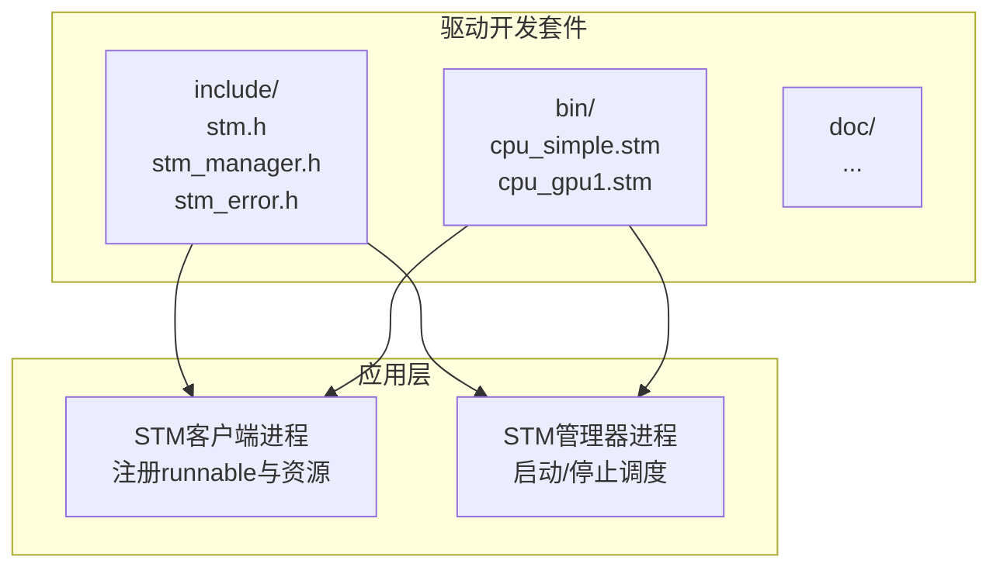
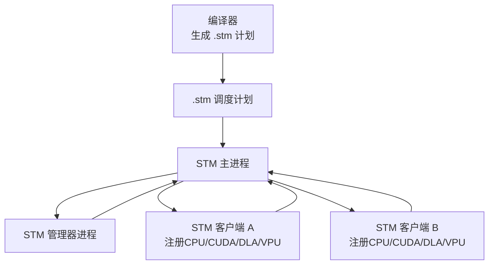
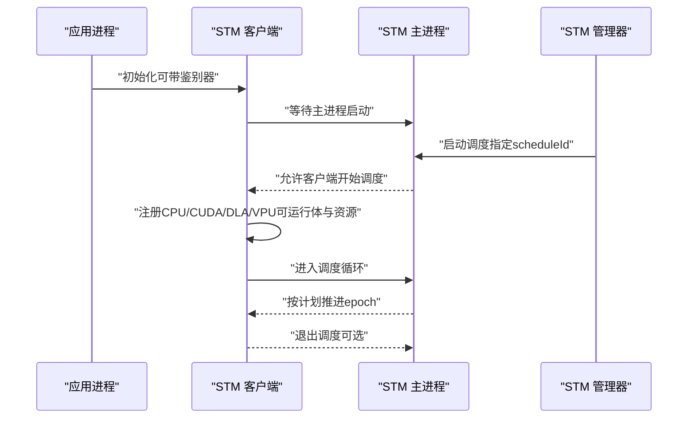
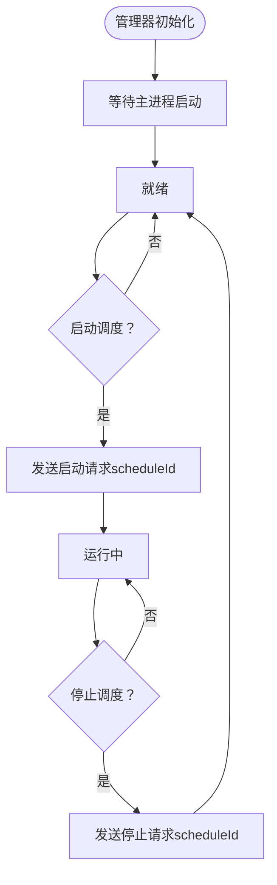
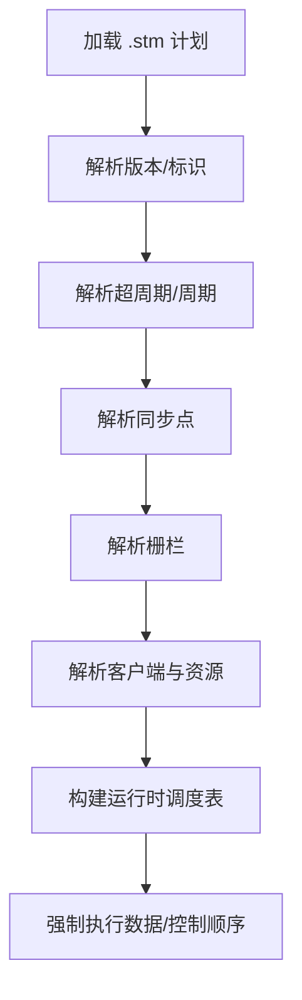
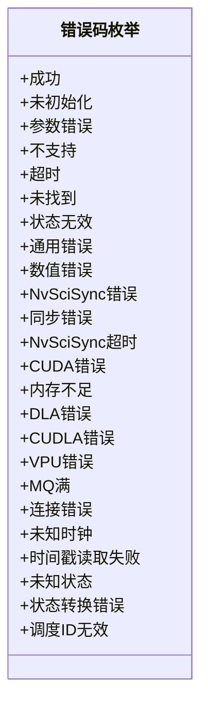
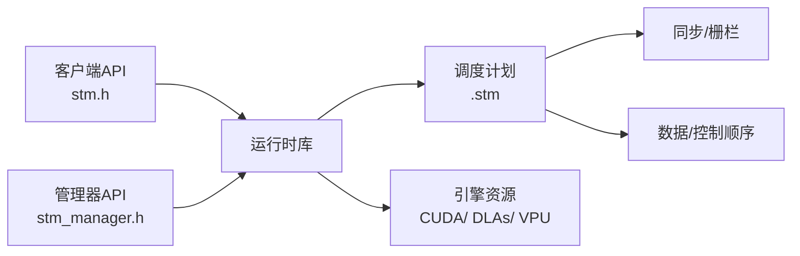

# STM架构概述

<cite>
**本文档引用的文件**
- [driverorks-5.10/include/stm.h](file://driverorks-5.10/include/stm.h)
- [driverorks-5.10/include/stm_manager.h](file://driverorks-5.10/include/stm_manager.h)
- [driverorks-5.10/include/stm_error.h](file://driverorks-5.10/include/stm_error.h)
- [driverorks-5.10/bin/cpu_simple.stm](file://driverorks-5.10/bin/cpu_simple.stm)
- [driverorks-5.10/bin/cpu_gpu1.stm](file://driverorks-5.10/bin/cpu_gpu1.stm)
</cite>

## 目录
1. [引言](#引言)
2. [项目结构](#项目结构)
3. [核心组件](#核心组件)
4. [架构总览](#架构总览)
5. [详细组件分析](#详细组件分析)
6. [依赖关系分析](#依赖关系分析)
7. [性能考虑](#性能考虑)
8. [故障排除指南](#故障排除指南)
9. [结论](#结论)

## 引言
本文件面向STM（Scheduling Middleware，调度中间件）的架构与实现，聚焦于其作为协作式、非抢占式、静态调度框架的设计理念与实时性保障机制。STM通过离线编译生成的调度计划，在Tegra SoC多引擎（CPU/GPU/VPU/DLA等）之间强制执行数据依赖顺序与控制流顺序，确保确定性的实时行为。本文将系统阐述STM运行时库如何执行调度计划、STM客户端与STM主进程/管理器的协同关系、以及与其他中间件组件的集成边界与约束。

## 项目结构
围绕STM的关键文件主要分布在以下位置：
- 运行时头文件：提供STM客户端与管理器的API定义与错误码
- 调度计划文件：以.stm格式存储离线编译生成的调度描述
- 示例与工具：用于演示不同SoC引擎组合下的调度场景

**图表来源**
- [driverorks-5.10/include/stm.h:31-48](file://driverorks-5.10/include/stm.h#L31-L48)
- [driverorks-5.10/include/stm_manager.h:12-29](file://driverorks-5.10/include/stm_manager.h#L12-L29)
- [driverorks-5.10/bin/cpu_simple.stm:1-155](file://driverorks-5.10/bin/cpu_simple.stm#L1-L155)
- [driverorks-5.10/bin/cpu_gpu1.stm:1-269](file://driverorks-5.10/bin/cpu_gpu1.stm#L1-L269)

**章节来源**
- [driverorks-5.10/include/stm.h:31-48](file://driverorks-5.10/include/stm.h#L31-L48)
- [driverorks-5.10/include/stm_manager.h:12-29](file://driverorks-5.10/include/stm_manager.h#L12-L29)
- [driverorks-5.10/bin/cpu_simple.stm:1-155](file://driverorks-5.10/bin/cpu_simple.stm#L1-L155)
- [driverorks-5.10/bin/cpu_gpu1.stm:1-269](file://driverorks-5.10/bin/cpu_gpu1.stm#L1-L269)

## 核心组件
- STM客户端（Client）
  - 每个STM客户端对应一个OS进程，负责注册CPU/CUDA/DLA/VPU等可运行体（runnable），并注册相应的硬件资源（如CUDA流、DLA句柄等）。客户端在调用初始化后会阻塞等待STM主进程/管理器启动，随后进入调度循环。
- STM管理器（Manager）
  - 系统中通常仅有一个管理器进程，负责与STM主进程建立连接并进行调度生命周期管理（启动/停止指定调度ID）。
- STM主进程（Master）
  - 执行离线编译生成的.stm调度计划，协调多个客户端按数据依赖与控制流顺序推进执行。
- 错误码体系（Error Codes）
  - 统一的错误码枚举，覆盖初始化、参数、同步、CUDA、DLA、VPU、内存不足、连接失败等场景，便于定位问题。

**章节来源**
- [driverorks-5.10/include/stm.h:103-118](file://driverorks-5.10/include/stm.h#L103-L118)
- [driverorks-5.10/include/stm_manager.h:45-73](file://driverorks-5.10/include/stm_manager.h#L45-L73)
- [driverorks-5.10/include/stm_error.h:47-97](file://driverorks-5.10/include/stm_error.h#L47-L97)

## 架构总览
STM采用“离线编译+在线执行”的模式：编译器根据CGF（Compute Graph Framework）图生成.stm文件，描述每个超周期（hyperepoch）、周期（epoch）、同步（sync）、栅栏（fence）、客户端（client）及其资源与可运行体（runnable）的时序；运行时库加载该计划，严格遵循数据与控制依赖，跨引擎强制执行。

**图表来源**
- [driverorks-5.10/include/stm.h:36-48](file://driverorks-5.10/include/stm.h#L36-L48)
- [driverorks-5.10/include/stm_manager.h:17-29](file://driverorks-5.10/include/stm_manager.h#L17-L29)
- [driverorks-5.10/bin/cpu_gpu1.stm:1-269](file://driverorks-5.10/bin/cpu_gpu1.stm#L1-L269)

## 详细组件分析

### 组件A：STM客户端API与生命周期
- 初始化与鉴别器
  - 支持普通初始化与带鉴别器的初始化，客户端在初始化后会阻塞等待主进程/管理器启动，确保所有客户端在任一客户端开始调度可运行体前均已启动。
- 注册接口
  - 注册CPU可运行体、CUDA提交者（submitter）、CUDA流资源；在VIBRANTE平台下还支持DLA/CUDLA/VPU提交者与资源注册。
- 调度入口与退出
  - 进入调度循环后，按计划周期推进，直到达到设定的周期数或显式退出。
- 运行时信息查询
  - 在CPU可运行体内查询当前epoch迭代次数与调度ID，辅助调试与统计。

**图表来源**
- [driverorks-5.10/include/stm.h:103-118](file://driverorks-5.10/include/stm.h#L103-L118)
- [driverorks-5.10/include/stm.h:120-154](file://driverorks-5.10/include/stm.h#L120-L154)
- [driverorks-5.10/include/stm.h:286-330](file://driverorks-5.10/include/stm.h#L286-L330)
- [driverorks-5.10/include/stm_manager.h:45-106](file://driverorks-5.10/include/stm_manager.h#L45-L106)

**章节来源**
- [driverorks-5.10/include/stm.h:103-118](file://driverorks-5.10/include/stm.h#L103-L118)
- [driverorks-5.10/include/stm.h:120-154](file://driverorks-5.10/include/stm.h#L120-L154)
- [driverorks-5.10/include/stm.h:286-330](file://driverorks-5.10/include/stm.h#L286-L330)
- [driverorks-5.10/include/stm_manager.h:45-106](file://driverorks-5.10/include/stm_manager.h#L45-L106)

### 组件B：STM管理器API与调度控制
- 管理器初始化
  - 支持普通初始化与带鉴别器的初始化，阻塞等待主进程启动，随后清理上下文。
- 启动/停止调度
  - 在READY状态下启动指定scheduleId的调度；在RUNNING状态下停止调度，均通过状态机与消息交互完成。

**图表来源**
- [driverorks-5.10/include/stm_manager.h:45-106](file://driverorks-5.10/include/stm_manager.h#L45-L106)

**章节来源**
- [driverorks-5.10/include/stm_manager.h:45-106](file://driverorks-5.10/include/stm_manager.h#L45-L106)

### 组件C：静态调度计划（.stm）解析要点
- 版本与标识
  - 文件包含版本号与调度标识（schedule identifier），用于运行时匹配正确的计划。
- 超周期与周期
  - 描述执行的超周期与周期划分，决定计划长度与重复节奏。
- 同步与栅栏
  - 定义跨客户端/引擎的同步点与栅栏，确保数据依赖与控制流顺序。
- 客户端与资源
  - 声明各客户端的资源（如CUDA流、DLA句柄、VPU流）与可运行体类型（CPU、CUDA提交者、CUDA提交者等）。
- 元数据
  - 包含编译后的元数据，映射资源类型、可运行体的起止时间、优先级、依赖关系等。

**图表来源**
- [driverorks-5.10/bin/cpu_simple.stm:1-155](file://driverorks-5.10/bin/cpu_simple.stm#L1-L155)
- [driverorks-5.10/bin/cpu_gpu1.stm:1-269](file://driverorks-5.10/bin/cpu_gpu1.stm#L1-L269)

**章节来源**
- [driverorks-5.10/bin/cpu_simple.stm:1-155](file://driverorks-5.10/bin/cpu_simple.stm#L1-L155)
- [driverorks-5.10/bin/cpu_gpu1.stm:1-269](file://driverorks-5.10/bin/cpu_gpu1.stm#L1-L269)

### 组件D：错误码与异常处理
- 错误码分类
  - 初始化/参数/不支持/超时/查找失败/无效状态/通用错误/数值错误/同步/CUDA/DLA/VPU/内存不足/消息队列满/连接错误/未知时钟/时间戳读取失败/未知状态/状态转换错误/调度ID无效等。
- 使用建议
  - 在客户端初始化、资源注册、进入调度、管理器操作等关键路径检查返回码，结合日志定位具体模块与阶段。

**图表来源**
- [driverorks-5.10/include/stm_error.h:47-97](file://driverorks-5.10/include/stm_error.h#L47-L97)

**章节来源**
- [driverorks-5.10/include/stm_error.h:47-97](file://driverorks-5.10/include/stm_error.h#L47-L97)

## 依赖关系分析
- 组件耦合
  - 客户端与主进程/管理器之间存在强耦合：客户端初始化时阻塞等待，确保全局一致性；管理器负责单一系统的调度启停。
- 外部依赖
  - CUDA运行时、VIBRANTE平台扩展（DLA/CUDLA/VPU）在特定PDK版本启用。
- 数据与控制流
  - .stm计划通过同步与栅栏强制跨引擎的数据依赖顺序；通过周期与超周期控制执行节奏。

**图表来源**
- [driverorks-5.10/include/stm.h:57-118](file://driverorks-5.10/include/stm.h#L57-L118)
- [driverorks-5.10/include/stm_manager.h:38-73](file://driverorks-5.10/include/stm_manager.h#L38-L73)
- [driverorks-5.10/bin/cpu_gpu1.stm:9-25](file://driverorks-5.10/bin/cpu_gpu1.stm#L9-L25)

**章节来源**
- [driverorks-5.10/include/stm.h:57-118](file://driverorks-5.10/include/stm.h#L57-L118)
- [driverorks-5.10/include/stm_manager.h:38-73](file://driverorks-5.10/include/stm_manager.h#L38-L73)
- [driverorks-5.10/bin/cpu_gpu1.stm:9-25](file://driverorks-5.10/bin/cpu_gpu1.stm#L9-L25)

## 性能考虑
- 协作式与非抢占式
  - 可运行体不应调用阻塞API或内部创建线程，避免破坏协作式调度的确定性。
- CUDA流使用
  - 提交者必须使用显式CUDA流，禁止使用默认流，以避免隐式同步导致的延迟抖动。
- 资源复用与隔离
  - 合理规划客户端与资源映射，减少跨引擎同步开销；在多客户端场景下避免资源争用。
- 调度周期与关键路径
  - 依据计划中的起止时间与优先级，优化可运行体的CPU/CUDA工作分配，确保关键路径满足周期要求。

## 故障排除指南
- 常见错误与排查
  - 未初始化：确认已先调用初始化API再进行其他操作。
  - 参数错误：检查可运行体名称长度、资源名称与数量限制、CUDA流有效性等。
  - 内存不足：检查系统可用内存与计划复杂度。
  - 连接错误：确认主进程/管理器已启动且网络/IPC通道正常。
  - 同步/超时：核查同步点与栅栏配置是否正确，避免死锁或长时间等待。
- 日志与诊断
  - 结合错误码字符串化输出与调试日志，定位具体阶段与模块。

**章节来源**
- [driverorks-5.10/include/stm_error.h:107-110](file://driverorks-5.10/include/stm_error.h#L107-L110)
- [driverorks-5.10/include/stm.h:294-298](file://driverorks-5.10/include/stm.h#L294-L298)
- [driverorks-5.10/include/stm_manager.h:88-105](file://driverorks-5.10/include/stm_manager.h#L88-L105)

## 结论
STM通过“离线编译+在线执行”的静态调度模型，在Tegra SoC多引擎上实现了严格的时序约束与实时性保障。其协作式、非抢占式的特性要求可运行体遵循明确的编程规范；而统一的错误码体系与管理器API则为系统集成与运维提供了清晰的边界与可控性。配合.stm计划对数据依赖与控制流的强制约束，STM能够稳定地支撑复杂感知与AI流水线在车载环境中的确定性执行。