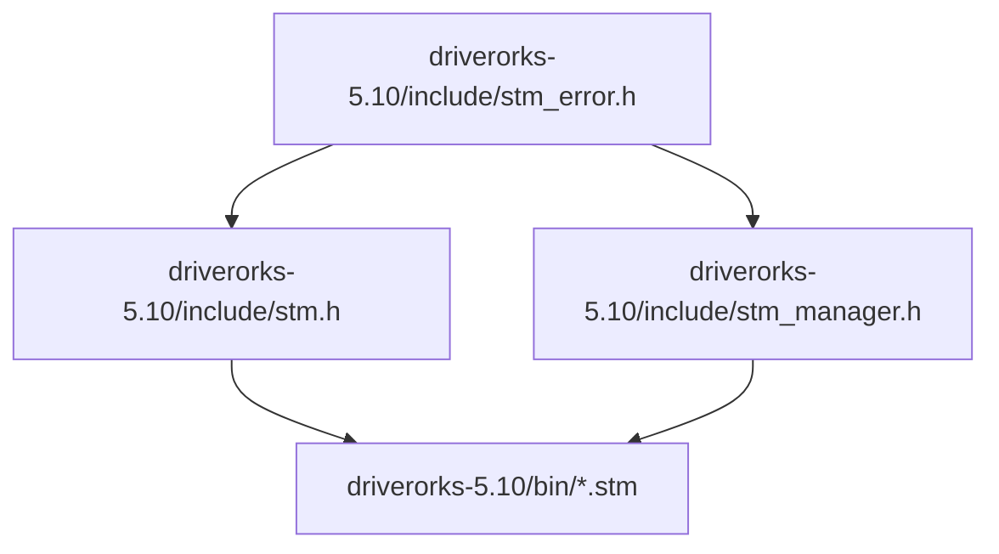
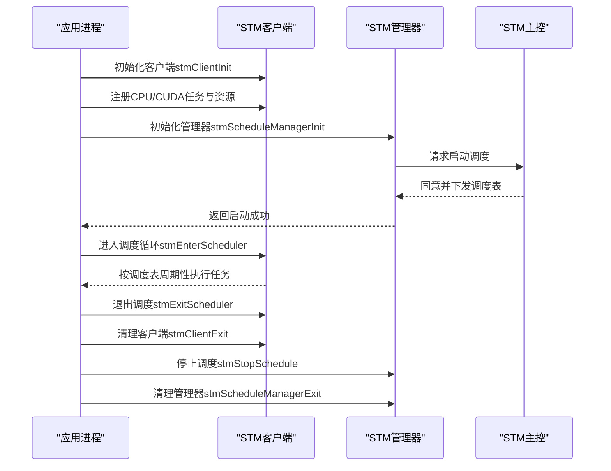
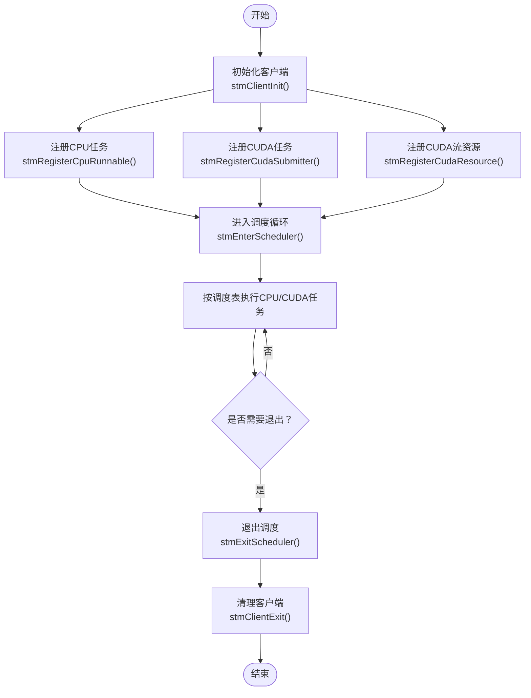
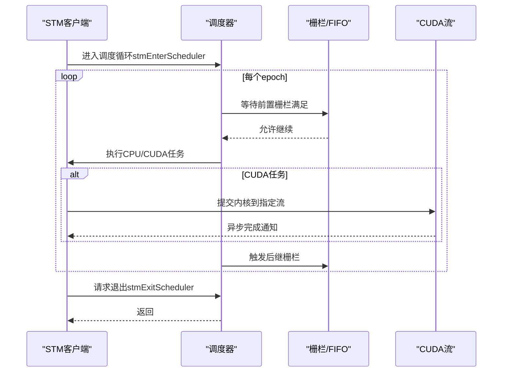
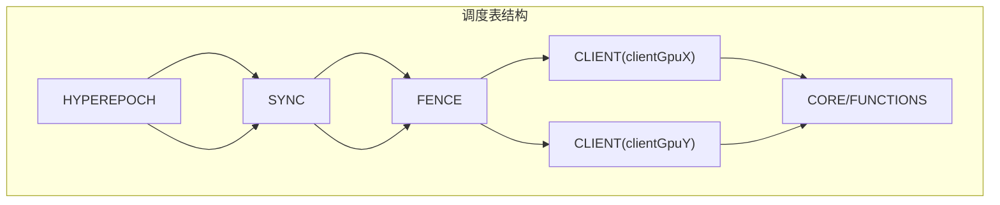
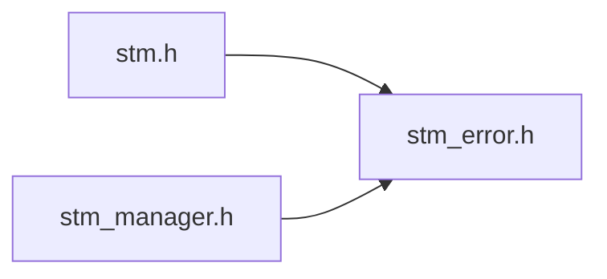

# STM调度中间件

<cite>
**本文引用的文件**
- [stm.h](file://driverorks-5.10/include/stm.h)
- [stm_manager.h](file://driverorks-5.10/include/stm_manager.h)
- [stm_error.h](file://driverorks-5.10/include/stm_error.h)
- [cpu_simple.stm](file://driverorks-5.10/bin/cpu_simple.stm)
- [cpu_gpu1.stm](file://driverorks-5.10/bin/cpu_gpu1.stm)
- [cpu_gpu2.stm](file://driverorks-5.10/bin/cpu_gpu2.stm)
- [gpu_multistream_multiprocess.stm](file://driverorks-5.10/bin/gpu_multistream_multiprocess.stm)
- [vpu_simple.stm](file://driverorks-5.10/bin/vpu_simple.stm)
</cite>

## 目录
1. [简介](#简介)
2. [项目结构](#项目结构)
3. [核心组件](#核心组件)
4. [架构总览](#架构总览)
5. [详细组件分析](#详细组件分析)
6. [依赖关系分析](#依赖关系分析)
7. [性能考虑](#性能考虑)
8. [故障排除指南](#故障排除指南)
9. [结论](#结论)
10. [附录](#附录)

## 简介
本文件系统化梳理STM（Scheduling Middleware）调度中间件在DriveWorks平台中的设计与实现，重点覆盖以下方面：
- 静态调度的设计理念与实时性保障机制
- 任务注册与管理流程：CPU任务与CUDA任务的提交方式
- 调度器实现原理：调度循环控制、任务切换机制与性能监控
- 资源管理策略：CUDA流管理、硬件资源分配与内存池管理
- 多种STM配置文件示例：展示不同场景下的调度策略
- 性能调优指南与故障排除方法
- 与其他中间件组件的集成方式

STM是一个协作式、非抢占式的静态调度框架，通过离线编译生成的调度表，在Tegra SoC上强制执行数据依赖与控制流顺序，确保实时性。

## 项目结构
本仓库中与STM直接相关的头文件位于driverorks-5.10/include，调度配置文件位于driverorks-5.10/bin。下图给出与STM相关的文件组织关系：

图表来源
- [stm.h](file://driverorks-5.10/include/stm.h)
- [stm_manager.h](file://driverorks-5.10/include/stm_manager.h)
- [stm_error.h](file://driverorks-5.10/include/stm_error.h)
- [cpu_simple.stm](file://driverorks-5.10/bin/cpu_simple.stm)

章节来源
- [stm.h:1-337](file://driverorks-5.10/include/stm.h#L1-L337)
- [stm_manager.h:1-113](file://driverorks-5.10/include/stm_manager.h#L1-L113)
- [stm_error.h:1-117](file://driverorks-5.10/include/stm_error.h#L1-L117)
- [cpu_simple.stm:1-155](file://driverorks-5.10/bin/cpu_simple.stm#L1-L155)

## 核心组件
- 运行时接口（客户端侧）
  - 客户端初始化与清理：stmClientInit、stmClientInitWithDiscriminator、stmClientExit
  - 任务注册：CPU任务stmRegisterCpuRunnable；CUDA任务stmRegisterCudaSubmitter
  - 资源注册：CUDA流stmRegisterCudaResource；DLA/VPU等可选资源注册API
  - 调度入口与退出：stmEnterScheduler、stmExitScheduler
  - 运行时信息查询：stmGetRuntimeInfo
- 调度管理接口（管理器侧）
  - 管理器初始化与清理：stmScheduleManagerInit、stmScheduleManagerInitWithDiscriminator、stmScheduleManagerExit
  - 调度启停：stmStartSchedule、stmStopSchedule
- 错误码与状态
  - 统一错误码枚举与字符串转换：stmErrorCode_t、stmErrorCodeToString

章节来源
- [stm.h:103-330](file://driverorks-5.10/include/stm.h#L103-L330)
- [stm_manager.h:45-106](file://driverorks-5.10/include/stm_manager.h#L45-L106)
- [stm_error.h:47-110](file://driverorks-5.10/include/stm_error.h#L47-L110)

## 架构总览
STM运行时由“客户端（Client）+ 管理器（Manager）+ 主控（Master）”协同组成。客户端负责注册任务与资源，并在进入调度循环后按调度表执行；管理器负责启动/停止调度；主控负责生成并下发调度表。下图展示典型交互序列：

图表来源
- [stm.h:103-330](file://driverorks-5.10/include/stm.h#L103-L330)
- [stm_manager.h:45-106](file://driverorks-5.10/include/stm_manager.h#L45-L106)

## 详细组件分析

### 任务注册与管理流程
- CPU任务注册
  - 使用stmRegisterCpuRunnable注册CPU runnable函数，绑定用户数据指针，名称需在编译期调度表中声明一致。
- CUDA任务注册
  - 使用stmRegisterCudaSubmitter注册CUDA提交器函数，该函数应包含少量CPU工作与异步CUDA内核提交，且必须使用显式CUDA流（禁止使用默认流），不得进行阻塞操作或调用同步API。
- 资源注册
  - CUDA流通过stmRegisterCudaResource注册，名称需与调度表中资源名一致；同一流不可重复注册。
- 运行时信息
  - 在CPU runnable内部可通过stmGetRuntimeInfo查询当前epoch迭代次数与调度ID，用于动态行为控制。

图表来源
- [stm.h:103-330](file://driverorks-5.10/include/stm.h#L103-L330)

章节来源
- [stm.h:120-154](file://driverorks-5.10/include/stm.h#L120-L154)
- [stm.h:131-140](file://driverorks-5.10/include/stm.h#L131-L140)
- [stm.h:142-154](file://driverorks-5.10/include/stm.h#L142-L154)
- [stm.h:301-323](file://driverorks-5.10/include/stm.h#L301-L323)

### 调度器实现原理
- 调度循环控制
  - 客户端在所有进程启动后才开始调度；每个epoch周期内按调度表顺序执行任务，直至达到管理器设定的终止条件或手动调用退出。
- 任务切换机制
  - 采用协作式调度，任务通过显式同步原语（如信号/等待/唤醒）协调执行，避免抢占；同步原语与栅栏（fence）在调度表中定义，确保跨引擎的数据与控制顺序。
- 性能监控
  - 可通过运行时信息查询当前epoch与调度ID，结合外部计时工具对关键路径进行观测；调度表元数据包含WCET、优先级等信息，便于静态分析与验证。

图表来源
- [stm.h:286-299](file://driverorks-5.10/include/stm.h#L286-L299)
- [cpu_gpu1.stm:18-25](file://driverorks-5.10/bin/cpu_gpu1.stm#L18-L25)
- [cpu_gpu1.stm:35-35](file://driverorks-5.10/bin/cpu_gpu1.stm#L35-L35)

章节来源
- [stm.h:286-323](file://driverorks-5.10/include/stm.h#L286-L323)

### 资源管理策略
- CUDA流管理
  - 每个CUDA提交器任务绑定一个显式流；提交器负责在该流上提交内核，提交器自身不应阻塞；提交器与提交目标之间通过栅栏建立时序约束。
- 硬件资源分配
  - 调度表中声明CPU/GPU/VPU/DLA等资源类型与映射关系；运行时根据资源占用情况在多核/多引擎间分配。
- 内存池管理
  - 通过CUDA流与内核执行模型配合，避免频繁的主机-设备同步；建议在应用层维护缓冲区池，减少分配开销。

章节来源
- [cpu_gpu1.stm:28-30](file://driverorks-5.10/bin/cpu_gpu1.stm#L28-L30)
- [cpu_gpu1.stm:162-162](file://driverorks-5.10/bin/cpu_gpu1.stm#L162-L162)
- [vpu_simple.stm:26-28](file://driverorks-5.10/bin/vpu_simple.stm#L26-L28)

### 多场景STM配置文件示例
- 单CPU简单调度（cpu_simple.stm）
  - 展示基本的HYPEREPOCH、SYNC、FENCE与CLIENT/CORE/CALL组合，适合演示静态调度的基本要素。
- CPU+GPU单进程（cpu_gpu1.stm）
  - 展示跨引擎同步（CPU↔CUDA）、栅栏触发与CUDA提交器/提交目标的配对，以及资源映射。
- CPU+GPU双进程（cpu_gpu2.stm）
  - 将任务分配到不同CPU核，体现多核调度与资源隔离。
- GPU多流多进程（gpu_multistream_multiprocess.stm）
  - 展示多CUDA流并行提交与跨进程同步，强调流隔离与并发度提升。
- VPU简单调度（vpu_simple.stm）
  - 展示VPU提交器/提交目标与确认任务的协作，体现异构引擎的时序控制。

图表来源
- [cpu_gpu1.stm:5-25](file://driverorks-5.10/bin/cpu_gpu1.stm#L5-L25)
- [cpu_gpu1.stm:41-51](file://driverorks-5.10/bin/cpu_gpu1.stm#L41-L51)
- [cpu_gpu1.stm:27-40](file://driverorks-5.10/bin/cpu_gpu1.stm#L27-L40)

章节来源
- [cpu_simple.stm:1-155](file://driverorks-5.10/bin/cpu_simple.stm#L1-L155)
- [cpu_gpu1.stm:1-269](file://driverorks-5.10/bin/cpu_gpu1.stm#L1-L269)
- [cpu_gpu2.stm:1-269](file://driverorks-5.10/bin/cpu_gpu2.stm#L1-L269)
- [gpu_multistream_multiprocess.stm:1-269](file://driverorks-5.10/bin/gpu_multistream_multiprocess.stm#L1-L269)
- [vpu_simple.stm:1-273](file://driverorks-5.10/bin/vpu_simple.stm#L1-L273)

## 依赖关系分析
- 头文件依赖
  - stm.h依赖stm_error.h提供统一错误码；同时依赖CUDA运行时头文件以支持CUDA流注册与提交。
  - stm_manager.h同样依赖stm_error.h，用于管理器侧的状态转换与错误处理。
- 配置文件依赖
  - 各*.stm文件定义了资源、同步、栅栏与任务的静态关系，客户端在运行时严格遵循这些约束。

图表来源
- [stm.h:57-59](file://driverorks-5.10/include/stm.h#L57-L59)
- [stm_manager.h:38-39](file://driverorks-5.10/include/stm_manager.h#L38-L39)
- [stm_error.h:32-33](file://driverorks-5.10/include/stm_error.h#L32-L33)

章节来源
- [stm.h:57-60](file://driverorks-5.10/include/stm.h#L57-L60)
- [stm_manager.h:38-40](file://driverorks-5.10/include/stm_manager.h#L38-L40)
- [stm_error.h:32-33](file://driverorks-5.10/include/stm_error.h#L32-L33)

## 性能考虑
- 避免阻塞与同步
  - CUDA提交器不得调用阻塞API或同步拷贝；使用显式CUDA流避免隐式同步。
- 流隔离与并发
  - 为不同任务或阶段分配独立CUDA流，提升并发度；在多进程场景下合理划分流，降低串扰。
- WCET与优先级
  - 利用调度表中的WCET与优先级信息进行静态分析，确保关键路径满足实时性要求。
- 计时与观测
  - 结合运行时信息查询与外部计时工具，定位瓶颈；关注栅栏/同步点的延迟。

## 故障排除指南
- 常见错误码与含义
  - 未初始化：调用API前未完成客户端/管理器初始化
  - 参数错误：任务名超长、资源名超长、流非法、重复注册等
  - 同步/超时：栅栏等待超时或底层同步失败
  - CUDA/DLA/VPU错误：对应引擎操作失败
- 排查步骤
  - 确认所有客户端均已完成初始化并进入调度循环
  - 检查任务注册名称与调度表一致
  - 核对CUDA流注册与提交器使用的流一致
  - 关注管理器启停状态与调度ID一致性
  - 查看错误码字符串以快速定位问题来源

章节来源
- [stm_error.h:47-96](file://driverorks-5.10/include/stm_error.h#L47-L96)
- [stm.h:120-154](file://driverorks-5.10/include/stm.h#L120-L154)
- [stm.h:142-154](file://driverorks-5.10/include/stm.h#L142-L154)
- [stm_manager.h:45-106](file://driverorks-5.10/include/stm_manager.h#L45-L106)

## 结论
STM通过静态调度与严格的协作式执行模型，在Tegra SoC上提供了确定性的实时执行能力。借助明确的任务注册与资源管理接口、完善的错误码体系与丰富的调度配置示例，开发者可以构建高可靠、可预测的异构计算流水线。建议在实际工程中结合WCET分析与性能观测，持续优化任务划分与资源分配，以获得最佳的实时性与吞吐表现。

## 附录
- 术语
  - 任务（Runnable）：可被调度执行的工作单元，分为CPU任务与CUDA提交器/提交目标
  - 同步（SYNC）：定义跨引擎/跨进程的事件交换
  - 栅栏（FENCE）：用于强制执行顺序的同步点
  - 提交器（Submitter）：负责在指定流上提交内核的CPU任务
  - 提交目标（Submittee）：在指定引擎上执行的内核任务
- 最佳实践
  - 保持提交器轻量，仅做必要的CPU准备与流提交
  - 为不同阶段/任务分配独立CUDA流，避免串扰
  - 使用调度表元数据进行静态验证与容量规划
  - 在多进程场景下，合理划分客户端与资源，避免竞争