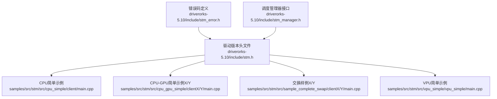
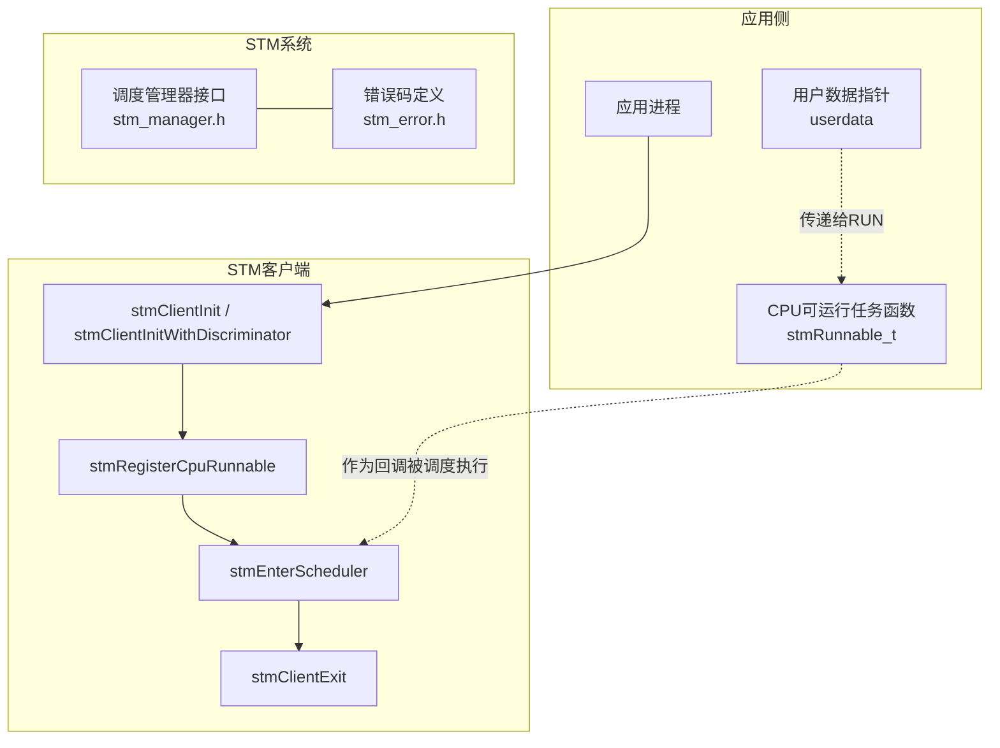
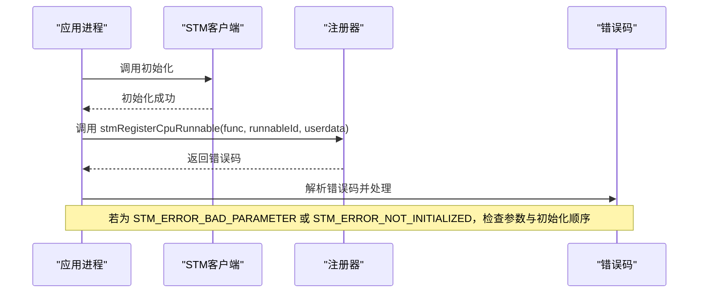
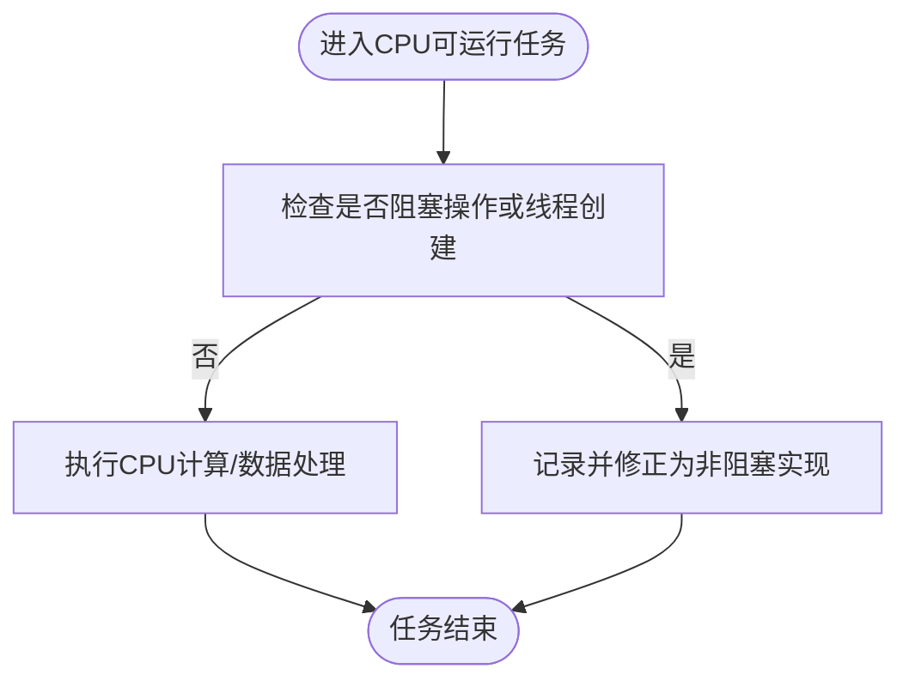
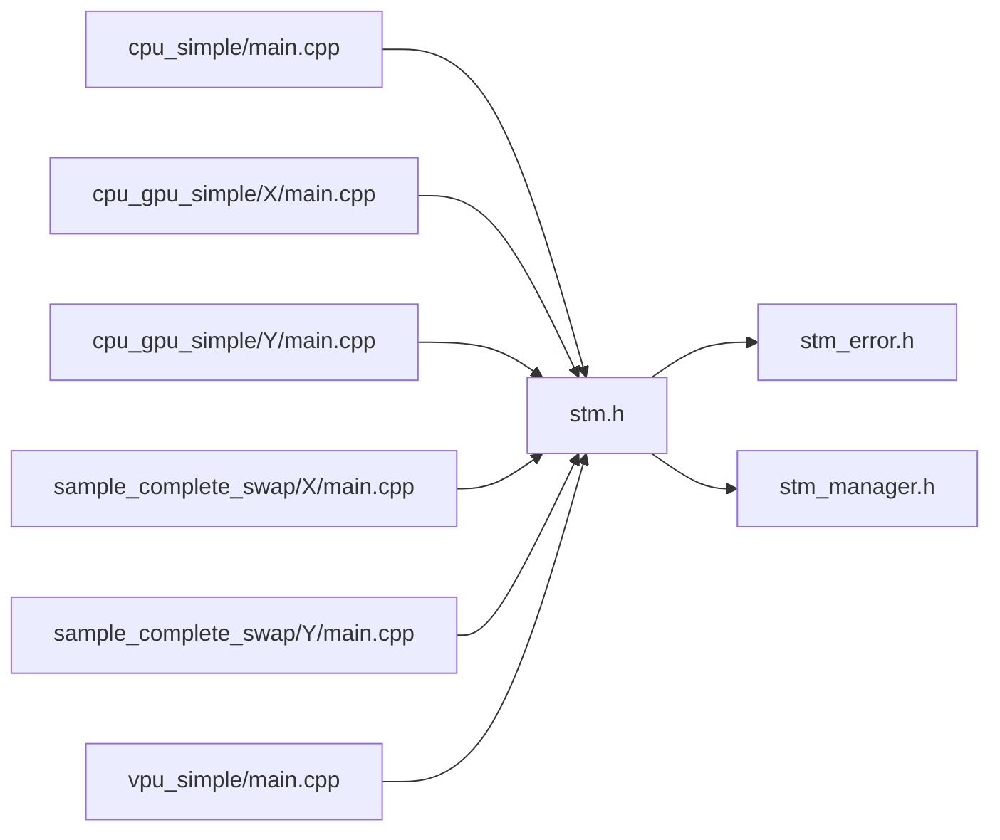

# CPU任务注册

<cite>
**本文引用的文件**
- [driverorks-5.10/include/stm.h](file://driverorks-5.10/include/stm.h)
- [driverorks-5.10/include/stm_error.h](file://driverorks-5.10/include/stm_error.h)
- [driverorks-5.10/include/stm_manager.h](file://driverorks-5.10/include/stm_manager.h)
- [driverorks-5.10/samples/src/stm/src/cpu_simple/client/main.cpp](file://driverorks-5.10/samples/src/stm/src/cpu_simple/client/main.cpp)
- [driverorks-5.10/samples/src/stm/src/cpu_gpu_simple/clientX/main.cpp](file://driverorks-5.10/samples/src/stm/src/cpu_gpu_simple/clientX/main.cpp)
- [driverorks-5.10/samples/src/stm/src/cpu_gpu_simple/clientY/main.cpp](file://driverorks-5.10/samples/src/stm/src/cpu_gpu_simple/clientY/main.cpp)
- [driverorks-5.10/samples/src/stm/src/sample_complete_swap/clientX/main.cpp](file://driverorks-5.10/samples/src/stm/src/sample_complete_swap/clientX/main.cpp)
- [driverorks-5.10/samples/src/stm/src/sample_complete_swap/clientY/main.cpp](file://driverorks-5.10/samples/src/stm/src/sample_complete_swap/clientY/main.cpp)
- [driverorks-5.10/samples/src/stm/src/vpu_simple/vpu_simple/main.cpp](file://driverorks-5.10/samples/src/stm/src/vpu_simple/vpu_simple/main.cpp)
</cite>

## 目录
1. [简介](#简介)
2. [项目结构](#项目结构)
3. [核心组件](#核心组件)
4. [架构总览](#架构总览)
5. [详细组件分析](#详细组件分析)
6. [依赖关系分析](#依赖关系分析)
7. [性能考量](#性能考量)
8. [故障排查指南](#故障排查指南)
9. [结论](#结论)
10. [附录](#附录)

## 简介
本文件聚焦于STM（静态时分多路）框架中的CPU任务注册机制，系统性阐述stmRegisterCpuRunnable函数的使用方法与注意事项，包括函数指针、runnableId与userdata参数的配置；解释stmRunnable_t函数签名的设计考量；明确CPU工作应遵循的限制（不得调用阻塞API或内部启动线程）；提供完整CPU任务注册示例与最佳实践，并总结性能优化技巧与常见陷阱。

## 项目结构
围绕CPU任务注册的相关源码主要分布在以下位置：
- 头文件：驱动版本包含的STM公共接口与错误码定义
- 示例：多套样例展示了CPU任务注册与调度执行的完整流程

**图表来源**
- [driverorks-5.10/include/stm.h:120-129](file://driverorks-5.10/include/stm.h#L120-L129)
- [driverorks-5.10/samples/src/stm/src/cpu_simple/client/main.cpp:60-65](file://driverorks-5.10/samples/src/stm/src/cpu_simple/client/main.cpp#L60-L65)
- [driverorks-5.10/samples/src/stm/src/cpu_gpu_simple/clientX/main.cpp:80-85](file://driverorks-5.10/samples/src/stm/src/cpu_gpu_simple/clientX/main.cpp#L80-L85)
- [driverorks-5.10/samples/src/stm/src/cpu_gpu_simple/clientY/main.cpp:80-85](file://driverorks-5.10/samples/src/stm/src/cpu_gpu_simple/clientY/main.cpp#L80-L85)
- [driverorks-5.10/samples/src/stm/src/sample_complete_swap/clientX/main.cpp:78-83](file://driverorks-5.10/samples/src/stm/src/sample_complete_swap/clientX/main.cpp#L78-L83)
- [driverorks-5.10/samples/src/stm/src/sample_complete_swap/clientY/main.cpp:78-83](file://driverorks-5.10/samples/src/stm/src/sample_complete_swap/clientY/main.cpp#L78-L83)
- [driverorks-5.10/samples/src/stm/src/vpu_simple/vpu_simple/main.cpp:45-52](file://driverorks-5.10/samples/src/stm/src/vpu_simple/vpu_simple/main.cpp#L45-L52)

**章节来源**
- [driverorks-5.10/include/stm.h:120-129](file://driverorks-5.10/include/stm.h#L120-L129)
- [driverorks-5.10/samples/src/stm/src/cpu_simple/client/main.cpp:60-65](file://driverorks-5.10/samples/src/stm/src/cpu_simple/client/main.cpp#L60-L65)
- [driverorks-5.10/samples/src/stm/src/cpu_gpu_simple/clientX/main.cpp:80-85](file://driverorks-5.10/samples/src/stm/src/cpu_gpu_simple/clientX/main.cpp#L80-L85)
- [driverorks-5.10/samples/src/stm/src/cpu_gpu_simple/clientY/main.cpp:80-85](file://driverorks-5.10/samples/src/stm/src/cpu_gpu_simple/clientY/main.cpp#L80-L85)
- [driverorks-5.10/samples/src/stm/src/sample_complete_swap/clientX/main.cpp:78-83](file://driverorks-5.10/samples/src/stm/src/sample_complete_swap/clientX/main.cpp#L78-L83)
- [driverorks-5.10/samples/src/stm/src/sample_complete_swap/clientY/main.cpp:78-83](file://driverorks-5.10/samples/src/stm/src/sample_complete_swap/clientY/main.cpp#L78-L83)
- [driverorks-5.10/samples/src/stm/src/vpu_simple/vpu_simple/main.cpp:45-52](file://driverorks-5.10/samples/src/stm/src/vpu_simple/vpu_simple/main.cpp#L45-L52)

## 核心组件
- 函数声明与用途
  - stmRegisterCpuRunnable：用于向STM编译器注册CPU可运行任务，参数包括函数指针、runnableId与userdata
- 函数签名与约束
  - stmRunnable_t：CPU可运行任务函数类型，仅包含CPU工作，禁止阻塞API与内部线程创建
- 错误码
  - 包含初始化状态、参数合法性、通用错误等，便于定位注册失败原因

**章节来源**
- [driverorks-5.10/include/stm.h:86-91](file://driverorks-5.10/include/stm.h#L86-L91)
- [driverorks-5.10/include/stm.h:120-129](file://driverorks-5.10/include/stm.h#L120-L129)
- [driverorks-5.10/include/stm_error.h:47-97](file://driverorks-5.10/include/stm_error.h#L47-L97)

## 架构总览
下图展示了CPU任务注册在STM系统中的位置与交互关系：

**图表来源**
- [driverorks-5.10/include/stm.h:103-129](file://driverorks-5.10/include/stm.h#L103-L129)
- [driverorks-5.10/include/stm_manager.h:45-106](file://driverorks-5.10/include/stm_manager.h#L45-L106)
- [driverorks-5.10/include/stm_error.h:47-97](file://driverorks-5.10/include/stm_error.h#L47-L97)

## 详细组件分析

### 函数：stmRegisterCpuRunnable
- 参数说明
  - func：指向CPU可运行任务的函数指针，符合stmRunnable_t签名
  - runnableId：字符串标识符，需满足长度限制（见“命名规则与长度限制”）
  - userdata：任意用户数据指针，将在任务执行时传入func
- 返回值与错误处理
  - 成功返回STM_SUCCESS
  - 常见错误：STM_ERROR_NOT_INITIALIZED（未调用初始化）、STM_ERROR_BAD_PARAMETER（runnableId超长）
- 使用要点
  - 必须在调用任何其他STM API前完成初始化
  - 注册的所有CPU任务与资源需在进入调度前完成

**图表来源**
- [driverorks-5.10/include/stm.h:120-129](file://driverorks-5.10/include/stm.h#L120-L129)
- [driverorks-5.10/include/stm_error.h:47-97](file://driverorks-5.10/include/stm_error.h#L47-L97)

**章节来源**
- [driverorks-5.10/include/stm.h:120-129](file://driverorks-5.10/include/stm.h#L120-L129)
- [driverorks-5.10/include/stm_error.h:47-97](file://driverorks-5.10/include/stm_error.h#L47-L97)

### 函数签名：stmRunnable_t 的设计考量
- 仅包含CPU工作，避免阻塞与并发
- 不允许内部启动线程或调用阻塞API
- 通过userdata传递上下文，简化任务间共享状态

**图表来源**
- [driverorks-5.10/include/stm.h:86-91](file://driverorks-5.10/include/stm.h#L86-L91)

**章节来源**
- [driverorks-5.10/include/stm.h:86-91](file://driverorks-5.10/include/stm.h#L86-L91)

### runnableId 命名规则与长度限制
- runnableId必须为合法字符串，且长度不得超过STM_FUNC_NAME_MAX（由头文件中注释说明）
- 超长将导致STM_ERROR_BAD_PARAMETER
- 建议使用清晰、稳定的名称，便于编译期计划与运行期调试

**章节来源**
- [driverorks-5.10/include/stm.h:125-126](file://driverorks-5.10/include/stm.h#L125-L126)

### 错误处理机制
- 初始化相关
  - 未调用初始化即注册：STM_ERROR_NOT_INITIALIZED
- 参数相关
  - runnableId超长：STM_ERROR_BAD_PARAMETER
- 其他
  - 通用错误：STM_ERROR_GENERIC
  - 可结合错误码字符串化工具进行诊断

**章节来源**
- [driverorks-5.10/include/stm.h:125-128](file://driverorks-5.10/include/stm.h#L125-L128)
- [driverorks-5.10/include/stm_error.h:47-97](file://driverorks-5.10/include/stm_error.h#L47-L97)

### 完整CPU任务注册示例（步骤说明）
以下示例展示在多个样例中常见的注册流程（以路径代替具体代码）：
- 步骤1：初始化STM客户端
  - 参考：[driverorks-5.10/include/stm.h:103-118](file://driverorks-5.10/include/stm.h#L103-L118)
- 步骤2：定义CPU可运行任务（符合stmRunnable_t签名）
  - 参考：[driverorks-5.10/include/stm.h:86-91](file://driverorks-5.10/include/stm.h#L86-L91)
- 步骤3：注册CPU任务
  - 参考：
    - [driverorks-5.10/samples/src/stm/src/cpu_simple/client/main.cpp:60-65](file://driverorks-5.10/samples/src/stm/src/cpu_simple/client/main.cpp#L60-L65)
    - [driverorks-5.10/samples/src/stm/src/cpu_gpu_simple/clientX/main.cpp:80-85](file://driverorks-5.10/samples/src/stm/src/cpu_gpu_simple/clientX/main.cpp#L80-L85)
    - [driverorks-5.10/samples/src/stm/src/cpu_gpu_simple/clientY/main.cpp:80-85](file://driverorks-5.10/samples/src/stm/src/cpu_gpu_simple/clientY/main.cpp#L80-L85)
    - [driverorks-5.10/samples/src/stm/src/sample_complete_swap/clientX/main.cpp:78-83](file://driverorks-5.10/samples/src/stm/src/sample_complete_swap/clientX/main.cpp#L78-L83)
    - [driverorks-5.10/samples/src/stm/src/sample_complete_swap/clientY/main.cpp:78-83](file://driverorks-5.10/samples/src/stm/src/sample_complete_swap/clientY/main.cpp#L78-L83)
    - [driverorks-5.10/samples/src/stm/src/vpu_simple/vpu_simple/main.cpp:45-52](file://driverorks-5.10/samples/src/stm/src/vpu_simple/vpu_simple/main.cpp#L45-L52)
- 步骤4：进入调度循环
  - 参考：[driverorks-5.10/include/stm.h:286-299](file://driverorks-5.10/include/stm.h#L286-L299)
- 步骤5：退出与清理
  - 参考：[driverorks-5.10/include/stm.h:315-330](file://driverorks-5.10/include/stm.h#L315-L330)

**章节来源**
- [driverorks-5.10/include/stm.h:103-118](file://driverorks-5.10/include/stm.h#L103-L118)
- [driverorks-5.10/include/stm.h:120-129](file://driverorks-5.10/include/stm.h#L120-L129)
- [driverorks-5.10/include/stm.h:286-299](file://driverorks-5.10/include/stm.h#L286-L299)
- [driverorks-5.10/include/stm.h:315-330](file://driverorks-5.10/include/stm.h#L315-L330)

## 依赖关系分析
- 头文件依赖
  - stm.h 依赖 stm_error.h 提供统一错误码
  - stm_manager.h 与 stm.h 协同，分别负责客户端与调度管理器接口
- 示例依赖
  - 各样例均通过调用初始化、注册、进入调度与退出的序列完成端到端演示

**图表来源**
- [driverorks-5.10/include/stm.h:57-59](file://driverorks-5.10/include/stm.h#L57-L59)
- [driverorks-5.10/include/stm_error.h:32-33](file://driverorks-5.10/include/stm_error.h#L32-L33)
- [driverorks-5.10/include/stm_manager.h:38-39](file://driverorks-5.10/include/stm_manager.h#L38-L39)
- [driverorks-5.10/samples/src/stm/src/cpu_simple/client/main.cpp:60-65](file://driverorks-5.10/samples/src/stm/src/cpu_simple/client/main.cpp#L60-L65)
- [driverorks-5.10/samples/src/stm/src/cpu_gpu_simple/clientX/main.cpp:80-85](file://driverorks-5.10/samples/src/stm/src/cpu_gpu_simple/clientX/main.cpp#L80-L85)
- [driverorks-5.10/samples/src/stm/src/cpu_gpu_simple/clientY/main.cpp:80-85](file://driverorks-5.10/samples/src/stm/src/cpu_gpu_simple/clientY/main.cpp#L80-L85)
- [driverorks-5.10/samples/src/stm/src/sample_complete_swap/clientX/main.cpp:78-83](file://driverorks-5.10/samples/src/stm/src/sample_complete_swap/clientX/main.cpp#L78-L83)
- [driverorks-5.10/samples/src/stm/src/sample_complete_swap/clientY/main.cpp:78-83](file://driverorks-5.10/samples/src/stm/src/sample_complete_swap/clientY/main.cpp#L78-L83)
- [driverorks-5.10/samples/src/stm/src/vpu_simple/vpu_simple/main.cpp:45-52](file://driverorks-5.10/samples/src/stm/src/vpu_simple/vpu_simple/main.cpp#L45-L52)

**章节来源**
- [driverorks-5.10/include/stm.h:57-59](file://driverorks-5.10/include/stm.h#L57-L59)
- [driverorks-5.10/include/stm_error.h:32-33](file://driverorks-5.10/include/stm_error.h#L32-L33)
- [driverorks-5.10/include/stm_manager.h:38-39](file://driverorks-5.10/include/stm_manager.h#L38-L39)

## 性能考量
- 遵循CPU工作限制
  - 避免阻塞API与内部线程创建，确保可协作式调度
- 数据局部性与缓存友好
  - 将频繁访问的数据组织在一起，减少跨缓存行访问
- 减少分支预测失败
  - 在热点路径上保持分支简单与可预测
- 合理使用userdata
  - 将任务所需上下文集中传递，避免额外查找开销
- 与调度器配合
  - 在进入调度前完成所有注册，避免运行期动态变更带来的额外成本

[本节为通用指导，无需特定文件引用]

## 故障排查指南
- 常见错误与处理
  - STM_ERROR_NOT_INITIALIZED：确认已先调用初始化API
  - STM_ERROR_BAD_PARAMETER：检查runnableId长度与格式
  - STM_ERROR_GENERIC：检查任务实现是否违反CPU工作限制
- 建议排查步骤
  - 打印并核对错误码字符串
  - 回溯注册顺序与参数合法性
  - 检查任务实现是否包含阻塞或线程创建

**章节来源**
- [driverorks-5.10/include/stm_error.h:47-97](file://driverorks-5.10/include/stm_error.h#L47-L97)
- [driverorks-5.10/include/stm.h:125-128](file://driverorks-5.10/include/stm.h#L125-L128)

## 结论
- stmRegisterCpuRunnable是STM CPU任务注册的核心入口，要求严格的参数与生命周期约束
- 通过清晰的命名与合理的userdata设计，可提升可维护性与可调试性
- 遵守CPU工作限制与提前完成注册，是获得稳定性能与可预测行为的关键

[本节为总结性内容，无需特定文件引用]

## 附录
- 相关接口速览
  - 初始化：[driverorks-5.10/include/stm.h:103-118](file://driverorks-5.10/include/stm.h#L103-L118)
  - 注册CPU任务：[driverorks-5.10/include/stm.h:120-129](file://driverorks-5.10/include/stm.h#L120-L129)
  - 进入调度：[driverorks-5.10/include/stm.h:286-299](file://driverorks-5.10/include/stm.h#L286-L299)
  - 退出与清理：[driverorks-5.10/include/stm.h:315-330](file://driverorks-5.10/include/stm.h#L315-L330)
- 示例参考
  - CPU简单示例：[driverorks-5.10/samples/src/stm/src/cpu_simple/client/main.cpp:60-65](file://driverorks-5.10/samples/src/stm/src/cpu_simple/client/main.cpp#L60-L65)
  - CPU-GPU简单示例X/Y：[driverorks-5.10/samples/src/stm/src/cpu_gpu_simple/clientX/main.cpp:80-85](file://driverorks-5.10/samples/src/stm/src/cpu_gpu_simple/clientX/main.cpp#L80-L85)、[driverorks-5.10/samples/src/stm/src/cpu_gpu_simple/clientY/main.cpp:80-85](file://driverorks-5.10/samples/src/stm/src/cpu_gpu_simple/clientY/main.cpp#L80-L85)
  - 交换样例X/Y：[driverorks-5.10/samples/src/stm/src/sample_complete_swap/clientX/main.cpp:78-83](file://driverorks-5.10/samples/src/stm/src/sample_complete_swap/clientX/main.cpp#L78-L83)、[driverorks-5.10/samples/src/stm/src/sample_complete_swap/clientY/main.cpp:78-83](file://driverorks-5.10/samples/src/stm/src/sample_complete_swap/clientY/main.cpp#L78-L83)
  - VPU简单示例：[driverorks-5.10/samples/src/stm/src/vpu_simple/vpu_simple/main.cpp:45-52](file://driverorks-5.10/samples/src/stm/src/vpu_simple/vpu_simple/main.cpp#L45-L52)