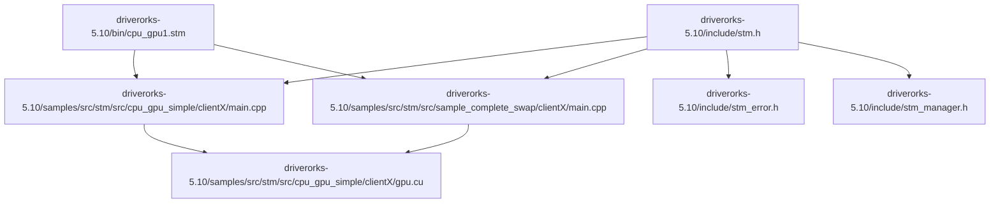
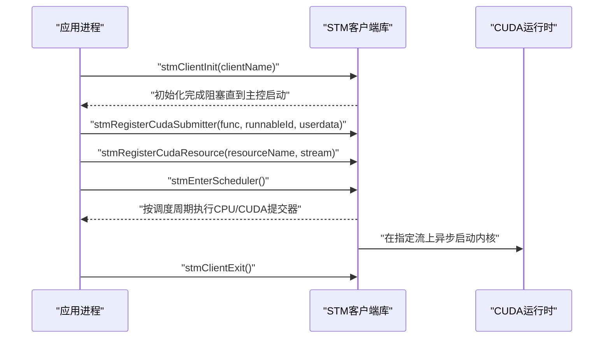
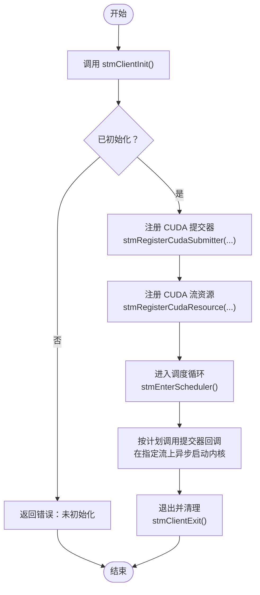
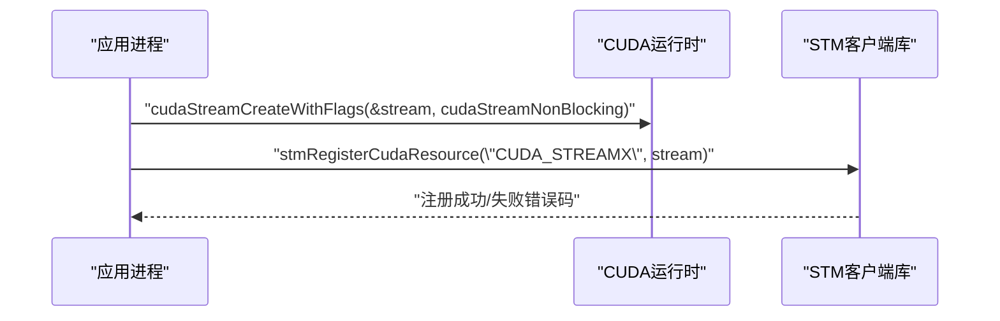
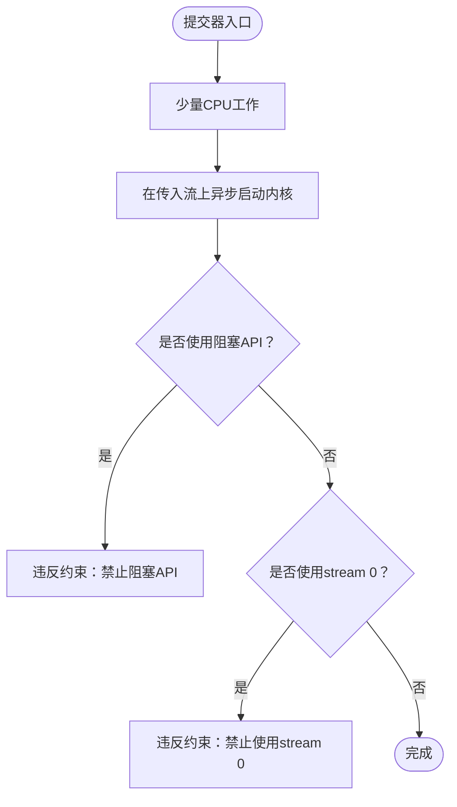
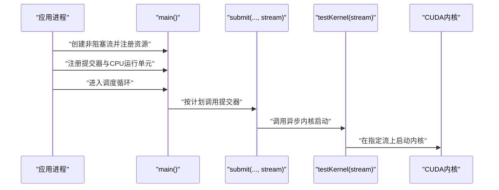
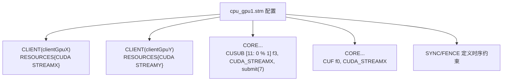
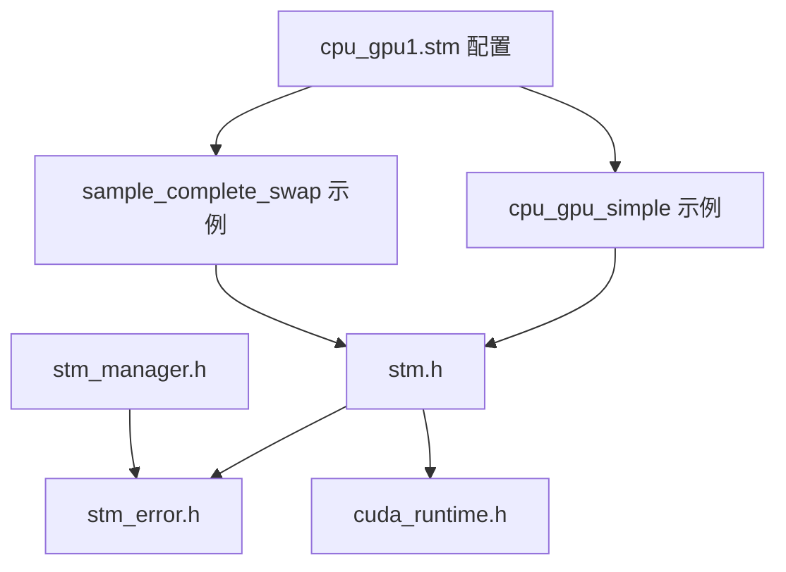

# CUDA任务注册

<cite>
**本文引用的文件**
- [stm.h](file://driverorks-5.10/include/stm.h)
- [stm_error.h](file://driverorks-5.10/include/stm_error.h)
- [stm_manager.h](file://driverorks-5.10/include/stm_manager.h)
- [cpu_gpu_simple 示例：clientX/main.cpp](file://driverorks-5.10/samples/src/stm/src/cpu_gpu_simple/clientX/main.cpp)
- [cpu_gpu_simple 示例：gpu.cu](file://driverorks-5.10/samples/src/stm/src/cpu_gpu_simple/clientX/gpu.cu)
- [sample_complete_swap 示例：clientX/main.cpp](file://driverorks-5.10/samples/src/stm/src/sample_complete_swap/clientX/main.cpp)
- [cpu_gpu1.stm 配置](file://driverorks-5.10/bin/cpu_gpu1.stm)
- [cpu_simple.stm 配置](file://driverorks-5.10/bin/cpu_simple.stm)
</cite>

## 目录
1. [简介](#简介)
2. [项目结构](#项目结构)
3. [核心组件](#核心组件)
4. [架构总览](#架构总览)
5. [详细组件分析](#详细组件分析)
6. [依赖关系分析](#依赖关系分析)
7. [性能考量](#性能考量)
8. [故障排查指南](#故障排查指南)
9. [结论](#结论)
10. [附录](#附录)

## 简介
本文件面向在实时系统中通过STM框架进行CUDA任务注册与调度的开发者，围绕stmRegisterCudaSubmitter函数的使用方法展开，重点说明：
- stmCudaSubmitter_t函数签名与参数约定
- CUDA流参数配置与资源注册
- CUDA异步内核启动要求及禁止使用stream 0（空流）的原因
- CUDA内存操作限制（如不能调用cudaMemcpy、cudaMemset、cudaFree等阻塞API）
- 完整的CUDA任务注册示例：CPU工作与异步CUDA内核启动的组合实现
- CUDA流管理与资源注册的最佳实践、错误处理与调试技巧

## 项目结构
本仓库包含多个版本的驱动与示例，其中与STM CUDA任务注册直接相关的核心文件位于driverorks-5.10/include与samples目录中。下图展示了与CUDA任务注册相关的文件组织与关系。

图表来源
- [stm.h](file://driverorks-5.10/include/stm.h)
- [cpu_gpu_simple 示例：clientX/main.cpp](file://driverorks-5.10/samples/src/stm/src/cpu_gpu_simple/clientX/main.cpp)
- [sample_complete_swap 示例：clientX/main.cpp](file://driverorks-5.10/samples/src/stm/src/sample_complete_swap/clientX/main.cpp)
- [cpu_gpu_simple 示例：gpu.cu](file://driverorks-5.10/samples/src/stm/src/cpu_gpu_simple/clientX/gpu.cu)
- [cpu_gpu1.stm 配置](file://driverorks-5.10/bin/cpu_gpu1.stm)

章节来源
- [stm.h](file://driverorks-5.10/include/stm.h)
- [cpu_gpu_simple 示例：clientX/main.cpp](file://driverorks-5.10/samples/src/stm/src/cpu_gpu_simple/clientX/main.cpp)
- [sample_complete_swap 示例：clientX/main.cpp](file://driverorks-5.10/samples/src/stm/src/sample_complete_swap/clientX/main.cpp)
- [cpu_gpu_simple 示例：gpu.cu](file://driverorks-5.10/samples/src/stm/src/cpu_gpu_simple/clientX/gpu.cu)
- [cpu_gpu1.stm 配置](file://driverorks-5.10/bin/cpu_gpu1.stm)

## 核心组件
- 函数签名与职责
  - stmCudaSubmitter_t：用于注册为CUDA提交器的回调函数，其签名包含用户数据指针与CUDA流参数。该函数应包含少量CPU工作与若干异步CUDA内核启动，并且必须在指定的CUDA流上执行内核。
  - stmRegisterCudaSubmitter：将stmCudaSubmitter_t函数注册到STM编译器生成的调度中，供调度器在指定时间窗口内调用。
  - stmRegisterCudaResource：将CUDA流作为资源注册到STM，使调度器能够将其与具体的运行单元绑定。
- 错误码
  - 所有STM API返回统一的错误码类型，便于定位初始化失败、参数非法、CUDA错误等问题。

章节来源
- [stm.h:94-101](file://driverorks-5.10/include/stm.h#L94-L101)
- [stm.h:131-140](file://driverorks-5.10/include/stm.h#L131-L140)
- [stm.h:142-154](file://driverorks-5.10/include/stm.h#L142-L154)
- [stm_error.h:47-97](file://driverorks-5.10/include/stm_error.h#L47-L97)

## 架构总览
下图展示了从应用侧发起CUDA任务注册到调度执行的整体流程，包括客户端初始化、资源注册、提交器注册与调度器进入。

图表来源
- [stm.h:103-118](file://driverorks-5.10/include/stm.h#L103-L118)
- [stm.h:120-129](file://driverorks-5.10/include/stm.h#L120-L129)
- [stm.h:131-140](file://driverorks-5.10/include/stm.h#L131-L140)
- [stm.h:142-154](file://driverorks-5.10/include/stm.h#L142-L154)
- [stm.h:286-299](file://driverorks-5.10/include/stm.h#L286-L299)

## 详细组件分析

### 组件A：stmRegisterCudaSubmitter与stmCudaSubmitter_t
- 函数签名与约束
  - 回调函数签名包含用户数据指针与CUDA流参数；函数体应仅包含CPU工作与异步内核启动，不得调用阻塞API或内部创建线程。
  - 禁止使用stream 0（空流），因为其具有隐式同步语义，会破坏STM的非抢占、静态调度模型。
- 注册流程
  - 必须先调用stmClientInit完成客户端上下文初始化，再进行提交器与资源注册。
  - 提交器注册后，需将CUDA流作为资源注册，名称需与STM编译器描述一致。
- 调度行为
  - 调度器在每个epoch内按编译期计划调用提交器，提交器在指定流上异步启动内核，确保数据依赖与控制流顺序得到保证。

图表来源
- [stm.h:103-118](file://driverorks-5.10/include/stm.h#L103-L118)
- [stm.h:131-140](file://driverorks-5.10/include/stm.h#L131-L140)
- [stm.h:142-154](file://driverorks-5.10/include/stm.h#L142-L154)
- [stm.h:286-299](file://driverorks-5.10/include/stm.h#L286-L299)

章节来源
- [stm.h:94-101](file://driverorks-5.10/include/stm.h#L94-L101)
- [stm.h:131-140](file://driverorks-5.10/include/stm.h#L131-L140)
- [stm.h:142-154](file://driverorks-5.10/include/stm.h#L142-L154)

### 组件B：CUDA流参数与资源注册
- 流创建与标志
  - 应使用非阻塞标志创建CUDA流，避免阻塞调用导致与STM调度冲突。
- 资源命名与匹配
  - 注册时使用的资源名需与STM配置文件中的资源声明一致，以便调度器正确绑定。
- 多流策略
  - 可为不同提交器或不同阶段创建独立流，提升并发度；但需确保资源名与配置一致。

图表来源
- [cpu_gpu_simple 示例：clientX/main.cpp:78-85](file://driverorks-5.10/samples/src/stm/src/cpu_gpu_simple/clientX/main.cpp#L78-L85)
- [stm.h:142-154](file://driverorks-5.10/include/stm.h#L142-L154)

章节来源
- [cpu_gpu_simple 示例：clientX/main.cpp:78-85](file://driverorks-5.10/samples/src/stm/src/cpu_gpu_simple/clientX/main.cpp#L78-L85)
- [stm.h:142-154](file://driverorks-5.10/include/stm.h#L142-L154)

### 组件C：CUDA异步内核启动与禁止使用stream 0
- 异步启动要求
  - 提交器回调中所有内核必须在传入的CUDA流上异步启动，不得使用阻塞API（如cudaMemcpy、cudaMemset、cudaFree等）。
- 禁止使用stream 0的原因
  - stream 0具有隐式同步语义，任何在该流上的操作都会与其他流同步，破坏STM的非抢占与静态调度模型，可能导致时序抖动与死锁风险。

图表来源
- [stm.h:96-101](file://driverorks-5.10/include/stm.h#L96-L101)
- [cpu_gpu_simple 示例：gpu.cu:40-43](file://driverorks-5.10/samples/src/stm/src/cpu_gpu_simple/clientX/gpu.cu#L40-L43)

章节来源
- [stm.h:96-101](file://driverorks-5.10/include/stm.h#L96-L101)
- [cpu_gpu_simple 示例：gpu.cu:40-43](file://driverorks-5.10/samples/src/stm/src/cpu_gpu_simple/clientX/gpu.cu#L40-L43)

### 组件D：完整CUDA任务注册示例（CPU工作+异步内核）
- 示例要点
  - 创建非阻塞CUDA流并注册为资源
  - 注册提交器回调，在回调中调用异步内核启动
  - 同时可注册CPU运行单元，形成CPU+GPU混合工作负载
  - 进入调度循环，由调度器按计划执行
- 关键路径参考
  - 客户端初始化与注册：[cpu_gpu_simple 示例：clientX/main.cpp:78-85](file://driverorks-5.10/samples/src/stm/src/cpu_gpu_simple/clientX/main.cpp#L78-L85)
  - 提交器回调与内核启动：[cpu_gpu_simple 示例：clientX/main.cpp:51-57](file://driverorks-5.10/samples/src/stm/src/cpu_gpu_simple/clientX/main.cpp#L51-L57)、[cpu_gpu_simple 示例：gpu.cu:40-43](file://driverorks-5.10/samples/src/stm/src/cpu_gpu_simple/clientX/gpu.cu#L40-L43)
  - 混合CPU+CUDA示例（含CPU运行单元注册）：[sample_complete_swap 示例：clientX/main.cpp:79-82](file://driverorks-5.10/samples/src/stm/src/sample_complete_swap/clientX/main.cpp#L79-L82)

图表来源
- [cpu_gpu_simple 示例：clientX/main.cpp:78-85](file://driverorks-5.10/samples/src/stm/src/cpu_gpu_simple/clientX/main.cpp#L78-L85)
- [cpu_gpu_simple 示例：clientX/main.cpp:51-57](file://driverorks-5.10/samples/src/stm/src/cpu_gpu_simple/clientX/main.cpp#L51-L57)
- [cpu_gpu_simple 示例：gpu.cu:40-43](file://driverorks-5.10/samples/src/stm/src/cpu_gpu_simple/clientX/gpu.cu#L40-L43)
- [sample_complete_swap 示例：clientX/main.cpp:79-82](file://driverorks-5.10/samples/src/stm/src/sample_complete_swap/clientX/main.cpp#L79-L82)

章节来源
- [cpu_gpu_simple 示例：clientX/main.cpp:51-57](file://driverorks-5.10/samples/src/stm/src/cpu_gpu_simple/clientX/main.cpp#L51-L57)
- [cpu_gpu_simple 示例：clientX/main.cpp:78-85](file://driverorks-5.10/samples/src/stm/src/cpu_gpu_simple/clientX/main.cpp#L78-L85)
- [cpu_gpu_simple 示例：gpu.cu:40-43](file://driverorks-5.10/samples/src/stm/src/cpu_gpu_simple/clientX/gpu.cu#L40-L43)
- [sample_complete_swap 示例：clientX/main.cpp:79-82](file://driverorks-5.10/samples/src/stm/src/sample_complete_swap/clientX/main.cpp#L79-L82)

### 组件E：调度配置与资源绑定
- 配置文件作用
  - STM配置文件定义了客户端、资源、同步与栅栏等信息，确保提交器与CUDA流在调度期内正确绑定与执行。
- 关键字段
  - CLIENT段声明资源（如CUDA_STREAMX/STREAMY）
  - CORE段通过CUSUB指令将提交器与资源绑定
  - SYNC/FENCE定义时序约束与同步点

图表来源
- [cpu_gpu1.stm 配置:41-51](file://driverorks-5.10/bin/cpu_gpu1.stm#L41-L51)
- [cpu_gpu1.stm 配置:27-40](file://driverorks-5.10/bin/cpu_gpu1.stm#L27-L40)

章节来源
- [cpu_gpu1.stm 配置:27-40](file://driverorks-5.10/bin/cpu_gpu1.stm#L27-L40)
- [cpu_gpu1.stm 配置:41-51](file://driverorks-5.10/bin/cpu_gpu1.stm#L41-L51)

## 依赖关系分析
- 头文件依赖
  - stm.h依赖CUDA运行时头文件与错误码定义，提供CUDA提交器注册与资源注册接口。
  - stm_error.h提供统一错误码枚举与字符串化工具。
  - stm_manager.h提供调度管理器接口（与客户端配合使用）。
- 示例与配置耦合
  - 示例程序通过stmRegisterCudaResource将CUDA流与配置文件中的资源名绑定，确保调度器正确调度。

图表来源
- [stm.h](file://driverorks-5.10/include/stm.h)
- [stm_error.h](file://driverorks-5.10/include/stm_error.h)
- [stm_manager.h](file://driverorks-5.10/include/stm_manager.h)
- [cpu_gpu_simple 示例：clientX/main.cpp](file://driverorks-5.10/samples/src/stm/src/cpu_gpu_simple/clientX/main.cpp)
- [sample_complete_swap 示例：clientX/main.cpp](file://driverorks-5.10/samples/src/stm/src/sample_complete_swap/clientX/main.cpp)
- [cpu_gpu1.stm 配置](file://driverorks-5.10/bin/cpu_gpu1.stm)

章节来源
- [stm.h](file://driverorks-5.10/include/stm.h)
- [stm_error.h](file://driverorks-5.10/include/stm_error.h)
- [stm_manager.h](file://driverorks-5.10/include/stm_manager.h)
- [cpu_gpu_simple 示例：clientX/main.cpp](file://driverorks-5.10/samples/src/stm/src/cpu_gpu_simple/clientX/main.cpp)
- [sample_complete_swap 示例：clientX/main.cpp](file://driverorks-5.10/samples/src/stm/src/sample_complete_swap/clientX/main.cpp)
- [cpu_gpu1.stm 配置](file://driverorks-5.10/bin/cpu_gpu1.stm)

## 性能考量
- 使用非阻塞CUDA流：避免阻塞调用导致与STM调度冲突，提升整体吞吐。
- 合理划分流：将不同阶段或不同提交器映射到不同流，减少串行等待，但需保持资源名与配置一致。
- 控制CPU工作量：提交器中的CPU工作应尽量轻量，避免占用过多时间片影响内核执行。
- 调度周期与栅栏：遵循配置文件定义的同步与栅栏，确保数据依赖满足实时性要求。

## 故障排查指南
- 常见错误与定位
  - 未初始化：在调用任何注册或调度API前必须先调用stmClientInit。
  - 参数非法：资源名超长、重复注册同一流、使用空流等均会导致参数错误。
  - CUDA错误：内核启动失败或流状态异常，需检查流创建标志与内核参数。
  - 调度错误：超时、状态不合法、同步失败等，需结合错误码与日志定位。
- 调试建议
  - 在提交器回调前后添加日志，确认执行顺序与时间窗口。
  - 使用CUDA事件记录内核启动与完成时间，验证异步执行效果。
  - 对比配置文件与资源注册名，确保完全一致。

章节来源
- [stm_error.h:47-97](file://driverorks-5.10/include/stm_error.h#L47-L97)
- [stm.h:142-154](file://driverorks-5.10/include/stm.h#L142-L154)

## 结论
通过stmRegisterCudaSubmitter与stmRegisterCudaResource，STM为CUDA任务提供了严格的非抢占、静态调度保障。开发者需严格遵守以下关键约束：
- 提交器回调仅做CPU工作与异步内核启动，禁止阻塞API与线程创建
- 禁止使用stream 0，必须使用非阻塞CUDA流
- 资源名需与配置文件一致，确保调度器正确绑定
- 示例程序展示了CPU与CUDA混合工作负载的典型实现路径

遵循上述原则与最佳实践，可在实时系统中稳定地集成CUDA加速任务。

## 附录
- 相关API与配置参考路径
  - [stm.h:94-101](file://driverorks-5.10/include/stm.h#L94-L101)
  - [stm.h:131-140](file://driverorks-5.10/include/stm.h#L131-L140)
  - [stm.h:142-154](file://driverorks-5.10/include/stm.h#L142-L154)
  - [cpu_gpu_simple 示例：clientX/main.cpp:78-85](file://driverorks-5.10/samples/src/stm/src/cpu_gpu_simple/clientX/main.cpp#L78-L85)
  - [cpu_gpu_simple 示例：gpu.cu:40-43](file://driverorks-5.10/samples/src/stm/src/cpu_gpu_simple/clientX/gpu.cu#L40-L43)
  - [sample_complete_swap 示例：clientX/main.cpp:79-82](file://driverorks-5.10/samples/src/stm/src/sample_complete_swap/clientX/main.cpp#L79-L82)
  - [cpu_gpu1.stm 配置:41-51](file://driverorks-5.10/bin/cpu_gpu1.stm#L41-L51)