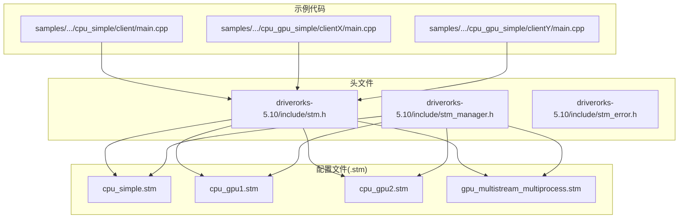
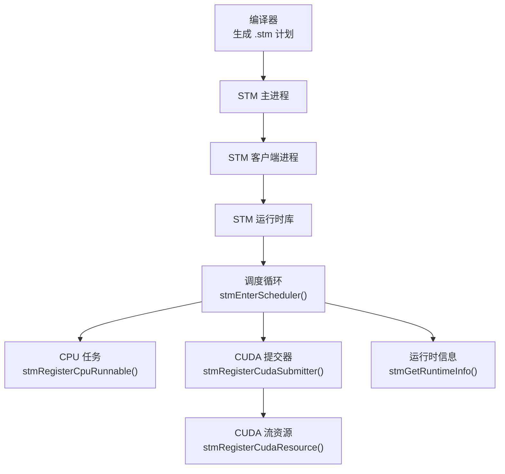
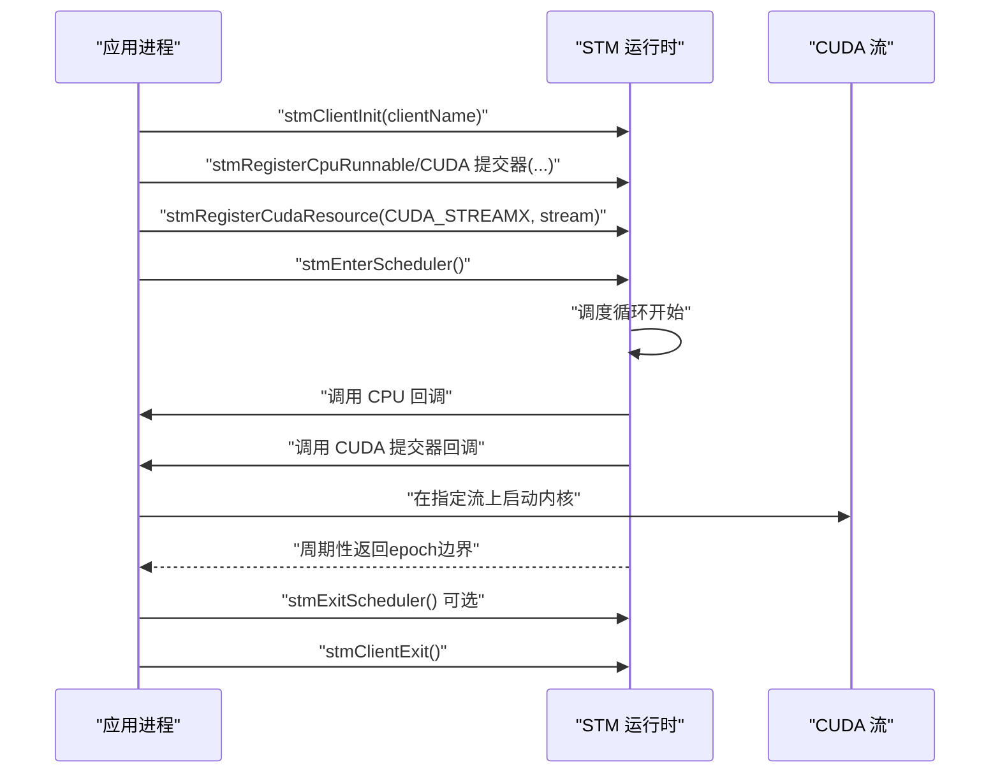
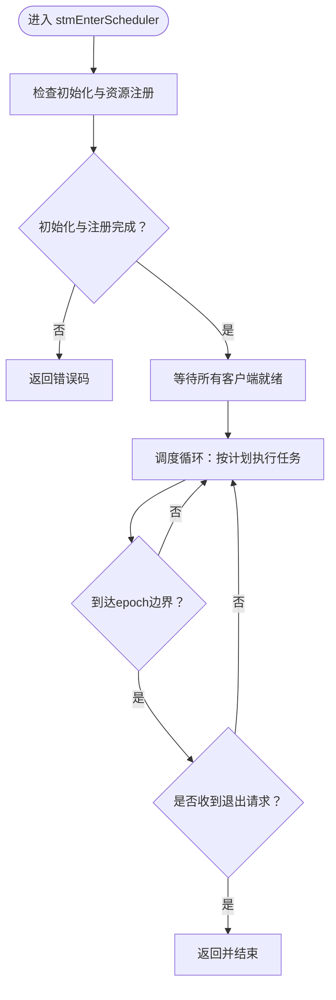
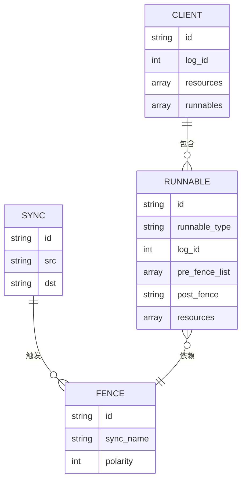
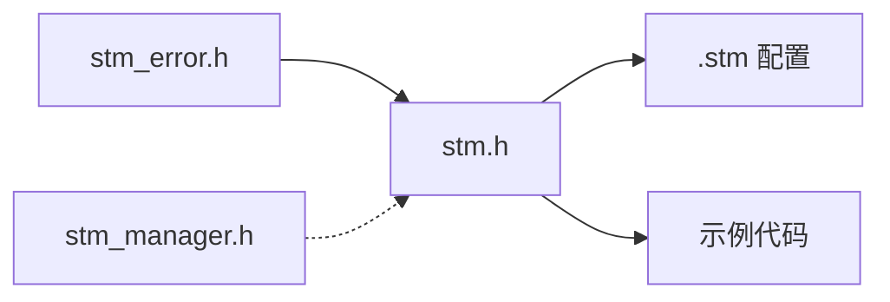

# 任务调度

<cite>
**本文引用的文件**
- [stm.h](file://driverorks-5.10/include/stm.h)
- [stm_manager.h](file://driverorks-5.10/include/stm_manager.h)
- [stm_error.h](file://driverorks-5.10/include/stm_error.h)
- [cpu_simple.stm](file://driverorks-5.10/bin/cpu_simple.stm)
- [cpu_gpu1.stm](file://driverorks-5.10/bin/cpu_gpu1.stm)
- [cpu_gpu2.stm](file://driverorks-5.10/bin/cpu_gpu2.stm)
- [gpu_multistream_multiprocess.stm](file://driverorks-5.10/bin/gpu_multistream_multiprocess.stm)
- [client/main.cpp](file://driverorks-5.10/samples/src/stm/src/cpu_simple/client/main.cpp)
- [clientX/main.cpp](file://driverorks-5.10/samples/src/stm/src/cpu_gpu_simple/clientX/main.cpp)
- [clientY/main.cpp](file://driverorks-5.10/samples/src/stm/src/cpu_gpu_simple/clientY/main.cpp)
</cite>

## 目录
1. [简介](#简介)
2. [项目结构](#项目结构)
3. [核心组件](#核心组件)
4. [架构总览](#架构总览)
5. [详细组件分析](#详细组件分析)
6. [依赖关系分析](#依赖关系分析)
7. [性能考量](#性能考量)
8. [故障排除指南](#故障排除指南)
9. [结论](#结论)
10. [附录](#附录)

## 简介
本文件面向STM（静态时序多引擎）任务调度系统，提供从API到配置文件的完整技术文档。内容涵盖：
- 任务注册与管理：CPU任务与CUDA任务的提交方式
- 关键API详解：stmRegisterCpuRunnable、stmRegisterCudaSubmitter、stmEnterScheduler等
- 调度器实现原理：调度循环、任务切换与性能监控
- 函数签名设计考虑：CPU工作与异步CUDA内核启动最佳实践
- 多种STM配置文件示例：不同场景下的调度策略与任务分配
- 错误处理与故障排除

## 项目结构
本仓库中与STM相关的核心文件分布如下：
- 头文件：提供运行时API、错误码与管理接口
- 配置文件：以.stm描述离线编译生成的调度计划
- 示例代码：演示如何在客户端中注册任务并进入调度循环

**图表来源**
- [stm.h:103-140](file://driverorks-5.10/include/stm.h#L103-L140)
- [stm_manager.h:45-94](file://driverorks-5.10/include/stm_manager.h#L45-L94)
- [cpu_simple.stm:1-155](file://driverorks-5.10/bin/cpu_simple.stm#L1-L155)
- [cpu_gpu1.stm:1-269](file://driverorks-5.10/bin/cpu_gpu1.stm#L1-L269)
- [cpu_gpu2.stm:1-269](file://driverorks-5.10/bin/cpu_gpu2.stm#L1-L269)
- [gpu_multistream_multiprocess.stm:1-269](file://driverorks-5.10/bin/gpu_multistream_multiprocess.stm#L1-L269)
- [client/main.cpp:61-66](file://driverorks-5.10/samples/src/stm/src/cpu_simple/client/main.cpp#L61-L66)
- [clientX/main.cpp:80-85](file://driverorks-5.10/samples/src/stm/src/cpu_gpu_simple/clientX/main.cpp#L80-L85)
- [clientY/main.cpp:81-87](file://driverorks-5.10/samples/src/stm/src/cpu_gpu_simple/clientY/main.cpp#L81-L87)

**章节来源**
- [stm.h:103-140](file://driverorks-5.10/include/stm.h#L103-L140)
- [stm_manager.h:45-94](file://driverorks-5.10/include/stm_manager.h#L45-L94)
- [cpu_simple.stm:1-155](file://driverorks-5.10/bin/cpu_simple.stm#L1-L155)
- [cpu_gpu1.stm:1-269](file://driverorks-5.10/bin/cpu_gpu1.stm#L1-L269)
- [cpu_gpu2.stm:1-269](file://driverorks-5.10/bin/cpu_gpu2.stm#L1-L269)
- [gpu_multistream_multiprocess.stm:1-269](file://driverorks-5.10/bin/gpu_multistream_multiprocess.stm#L1-L269)
- [client/main.cpp:61-66](file://driverorks-5.10/samples/src/stm/src/cpu_simple/client/main.cpp#L61-L66)
- [clientX/main.cpp:80-85](file://driverorks-5.10/samples/src/stm/src/cpu_gpu_simple/clientX/main.cpp#L80-L85)
- [clientY/main.cpp:81-87](file://driverorks-5.10/samples/src/stm/src/cpu_gpu_simple/clientY/main.cpp#L81-L87)

## 核心组件
- 运行时API（stm.h）
  - 客户端初始化与退出：stmClientInit、stmClientExit
  - 任务注册：stmRegisterCpuRunnable、stmRegisterCudaSubmitter
  - 资源注册：stmRegisterCudaResource（CUDA流）、stmRegisterDlaResource、stmRegisterCuDlaResource、stmRegisterVpuResource（平台相关）
  - 调度控制：stmEnterScheduler、stmExitScheduler、stmGetRuntimeInfo
- 调度管理API（stm_manager.h）
  - 管理器初始化与退出：stmScheduleManagerInit、stmScheduleManagerExit
  - 启动/停止调度：stmStartSchedule、stmStopSchedule
- 错误码（stm_error.h）
  - 统一错误枚举与字符串化工具

关键API与职责概览：
- 任务注册
  - CPU任务：通过stmRegisterCpuRunnable注册，执行纯CPU工作，不可阻塞或内部派生线程
  - CUDA提交器：通过stmRegisterCudaSubmitter注册，先做少量CPU工作，再在指定CUDA流上异步启动多个内核；禁止使用默认流（流0）
- 调度入口
  - stmEnterScheduler开始调度循环，直到所有epoch完成或调用stmExitScheduler退出
- 资源绑定
  - CUDA流需通过stmRegisterCudaResource显式注册，名称需与.stm中声明一致

**章节来源**
- [stm.h:103-140](file://driverorks-5.10/include/stm.h#L103-L140)
- [stm.h:286-330](file://driverorks-5.10/include/stm.h#L286-L330)
- [stm_manager.h:45-106](file://driverorks-5.10/include/stm_manager.h#L45-L106)
- [stm_error.h:47-97](file://driverorks-5.10/include/stm_error.h#L47-L97)

## 架构总览
STM采用“离线编译、在线执行”的模式：编译器将调度计划写入.stm文件，运行时库按计划强制数据与控制依赖顺序，跨引擎（CPU/GPU/DLA/VPU等）进行有序执行。

**图表来源**
- [stm.h:103-140](file://driverorks-5.10/include/stm.h#L103-L140)
- [stm.h:286-330](file://driverorks-5.10/include/stm.h#L286-L330)
- [cpu_gpu1.stm:27-63](file://driverorks-5.10/bin/cpu_gpu1.stm#L27-L63)

## 详细组件分析

### 任务注册与管理流程
- CPU任务注册
  - 使用stmRegisterCpuRunnable(func, runnableId, userdata)
  - runnableId需与.stm中声明一致
  - userdata用于向回调传递上下文
- CUDA任务注册
  - 使用stmRegisterCudaSubmitter(func, runnableId, userdata)
  - func签名要求：第一个参数为userdata，第二个为cudaStream_t
  - 在func中仅做必要CPU工作，随后在给定流上异步启动多个内核
  - 不得使用默认流（流0），避免隐式同步
- 资源注册
  - CUDA流：stmRegisterCudaResource(resourceName, stream)
  - DLA/CUDLA/VPU：平台相关API（见stm.h条件编译段）

**图表来源**
- [stm.h:103-140](file://driverorks-5.10/include/stm.h#L103-L140)
- [stm.h:286-330](file://driverorks-5.10/include/stm.h#L286-L330)
- [clientX/main.cpp:80-85](file://driverorks-5.10/samples/src/stm/src/cpu_gpu_simple/clientX/main.cpp#L80-L85)
- [clientY/main.cpp:81-87](file://driverorks-5.10/samples/src/stm/src/cpu_gpu_simple/clientY/main.cpp#L81-L87)

**章节来源**
- [stm.h:120-140](file://driverorks-5.10/include/stm.h#L120-L140)
- [client/main.cpp:61-66](file://driverorks-5.10/samples/src/stm/src/cpu_simple/client/main.cpp#L61-L66)
- [clientX/main.cpp:80-85](file://driverorks-5.10/samples/src/stm/src/cpu_gpu_simple/clientX/main.cpp#L80-L85)
- [clientY/main.cpp:81-87](file://driverorks-5.10/samples/src/stm/src/cpu_gpu_simple/clientY/main.cpp#L81-L87)

### 调度器实现原理与控制流
- 初始化与约束
  - 必须先调用stmClientInit，再注册任务与资源
  - 仅能调用一次stmEnterScheduler，否则行为未定义
- 调度循环
  - stmEnterScheduler阻塞直至所有客户端启动并开始执行
  - 按.stm计划推进，严格遵循同步、栅栏与依赖关系
  - 支持在运行时查询epoch与scheduleId（stmGetRuntimeInfo）
- 退出机制
  - 单个客户端可调用stmExitScheduler请求所有客户端在下一个epoch边界退出
  - 最终调用stmClientExit清理上下文

**图表来源**
- [stm.h:286-330](file://driverorks-5.10/include/stm.h#L286-L330)

**章节来源**
- [stm.h:286-330](file://driverorks-5.10/include/stm.h#L286-L330)

### 函数签名设计考虑与最佳实践
- CPU回调（stmRunnable_t）
  - 设计为纯CPU工作，不调用阻塞API或内部派生线程
  - 适合轻量计算、数据准备、状态更新等
- CUDA提交器（stmCudaSubmitter_t）
  - 先做必要CPU工作（如参数准备、事件记录），再在指定流上异步启动多个内核
  - 严禁使用默认流（流0），避免隐式同步导致吞吐下降
  - 不直接调用内存拷贝/设置/释放等阻塞操作
- 资源命名一致性
  - .stm中声明的资源名必须与stmRegisterCudaResource的name完全一致

**章节来源**
- [stm.h:85-101](file://driverorks-5.10/include/stm.h#L85-L101)
- [stm.h:142-154](file://driverorks-5.10/include/stm.h#L142-L154)

### 多种STM配置文件示例与调度策略
- cpu_simple.stm
  - 单客户端、单CPU任务、简单同步与栅栏
  - 适合验证基本注册与调度流程
- cpu_gpu1.stm / cpu_gpu2.stm
  - 双客户端、跨CPU与CUDA提交器、多条同步与栅栏
  - 展示多客户端协作与CUDA流资源绑定
- gpu_multistream_multiprocess.stm
  - 多CUDA流、多客户端、iGPU资源参与
  - 体现多流并发与跨进程调度

**图表来源**
- [cpu_simple.stm:19-39](file://driverorks-5.10/bin/cpu_simple.stm#L19-L39)
- [cpu_gpu1.stm:27-63](file://driverorks-5.10/bin/cpu_gpu1.stm#L27-L63)
- [cpu_gpu2.stm:27-63](file://driverorks-5.10/bin/cpu_gpu2.stm#L27-L63)
- [gpu_multistream_multiprocess.stm:27-63](file://driverorks-5.10/bin/gpu_multistream_multiprocess.stm#L27-L63)

**章节来源**
- [cpu_simple.stm:1-155](file://driverorks-5.10/bin/cpu_simple.stm#L1-L155)
- [cpu_gpu1.stm:1-269](file://driverorks-5.10/bin/cpu_gpu1.stm#L1-L269)
- [cpu_gpu2.stm:1-269](file://driverorks-5.10/bin/cpu_gpu2.stm#L1-L269)
- [gpu_multistream_multiprocess.stm:1-269](file://driverorks-5.10/bin/gpu_multistream_multiprocess.stm#L1-L269)

### 示例代码路径与关键调用点
- CPU简单示例
  - 注册两个CPU任务并进入调度循环
  - 路径参考：[client/main.cpp:61-66](file://driverorks-5.10/samples/src/stm/src/cpu_simple/client/main.cpp#L61-L66)
- CUDA提交器示例（X/Y客户端）
  - 创建非阻塞CUDA流
  - 注册CUDA提交器与CUDA流资源
  - 进入调度循环
  - 路径参考：
    - [clientX/main.cpp:78-85](file://driverorks-5.10/samples/src/stm/src/cpu_gpu_simple/clientX/main.cpp#L78-L85)
    - [clientY/main.cpp:79-87](file://driverorks-5.10/samples/src/stm/src/cpu_gpu_simple/clientY/main.cpp#L79-L87)

**章节来源**
- [client/main.cpp:61-66](file://driverorks-5.10/samples/src/stm/src/cpu_simple/client/main.cpp#L61-L66)
- [clientX/main.cpp:78-85](file://driverorks-5.10/samples/src/stm/src/cpu_gpu_simple/clientX/main.cpp#L78-L85)
- [clientY/main.cpp:79-87](file://driverorks-5.10/samples/src/stm/src/cpu_gpu_simple/clientY/main.cpp#L79-L87)

## 依赖关系分析
- 头文件间依赖
  - stm.h依赖stm_error.h（错误码）
  - stm_manager.h独立于stm_error.h（管理接口）
- 运行时与配置
  - .stm文件定义了客户端、资源、同步、栅栏与可运行体
  - 运行时库根据.stm强制执行顺序与资源占用
- 示例与API
  - 示例代码通过API注册任务与资源，并调用调度入口

**图表来源**
- [stm.h:57-59](file://driverorks-5.10/include/stm.h#L57-L59)
- [stm_error.h:32-33](file://driverorks-5.10/include/stm_error.h#L32-L33)
- [cpu_gpu1.stm:27-63](file://driverorks-5.10/bin/cpu_gpu1.stm#L27-L63)
- [clientX/main.cpp:80-85](file://driverorks-5.10/samples/src/stm/src/cpu_gpu_simple/clientX/main.cpp#L80-L85)

**章节来源**
- [stm.h:57-59](file://driverorks-5.10/include/stm.h#L57-L59)
- [stm_error.h:32-33](file://driverorks-5.10/include/stm_error.h#L32-L33)
- [cpu_gpu1.stm:27-63](file://driverorks-5.10/bin/cpu_gpu1.stm#L27-L63)
- [clientX/main.cpp:80-85](file://driverorks-5.10/samples/src/stm/src/cpu_gpu_simple/clientX/main.cpp#L80-L85)

## 性能考量
- CUDA流使用
  - 避免使用默认流（流0），防止隐式同步
  - 将CPU准备与内核启动解耦，提升并发
- 任务粒度
  - CPU回调应保持轻量，避免长时间阻塞
  - 提交器中尽量减少CPU侧开销，最大化GPU利用率
- 资源绑定
  - 确保.stm中的资源名与注册名一致，避免运行时查找失败
- 监控
  - 使用stmGetRuntimeInfo获取epoch与scheduleId，辅助性能观测与调试

[本节为通用指导，无需特定文件引用]

## 故障排除指南
常见错误与定位建议：
- 未初始化
  - 现象：注册或调度返回“未初始化”
  - 排查：确认已先调用stmClientInit
- 参数非法
  - 现象：注册返回“参数非法”或“资源数量/名称超限”
  - 排查：检查runnableId/resourceName长度、资源数上限、流句柄有效性
- 超时/同步失败
  - 现象：调度返回“超时”或“同步错误”
  - 排查：检查.stm中的同步/栅栏配置与客户端启动顺序
- CUDA错误
  - 现象：CUDA相关操作返回错误
  - 排查：确认流创建成功且未重复注册相同流；避免在提交器中使用阻塞API
- 状态转换错误
  - 现象：管理接口返回“状态转换无效”
  - 排查：确保按“初始化→启动→停止→退出”的顺序调用

**章节来源**
- [stm_error.h:47-97](file://driverorks-5.10/include/stm_error.h#L47-L97)
- [stm.h:142-154](file://driverorks-5.10/include/stm.h#L142-L154)
- [stm_manager.h:84-106](file://driverorks-5.10/include/stm_manager.h#L84-L106)

## 结论
STM通过严格的离线编译与在线执行模型，在多引擎平台上实现了确定性的任务调度与资源管理。开发者只需在客户端中正确注册CPU/CUDA任务与资源，并遵循CUDA流使用规范，即可获得稳定、可预测的实时性能。配合丰富的.stm示例与统一的错误码体系，STM为复杂感知/推理流水线提供了可靠的执行框架。

[本节为总结性内容，无需特定文件引用]

## 附录
- API速查
  - 客户端生命周期：stmClientInit → 任务/资源注册 → stmEnterScheduler → 可选stmExitScheduler → stmClientExit
  - 任务注册：CPU回调（stmRegisterCpuRunnable）、CUDA提交器（stmRegisterCudaSubmitter）
  - 资源注册：CUDA流（stmRegisterCudaResource）
  - 调度控制：stmEnterScheduler、stmExitScheduler、stmGetRuntimeInfo
- 配置文件要点
  - 客户端、资源、同步、栅栏与可运行体的声明与映射
  - 资源类型与名称需与运行时注册一致

[本节为概览性内容，无需特定文件引用]