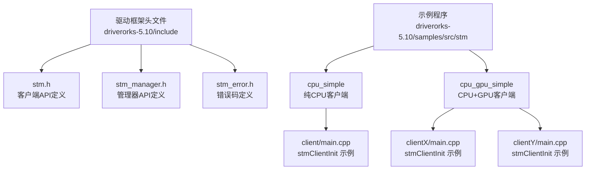
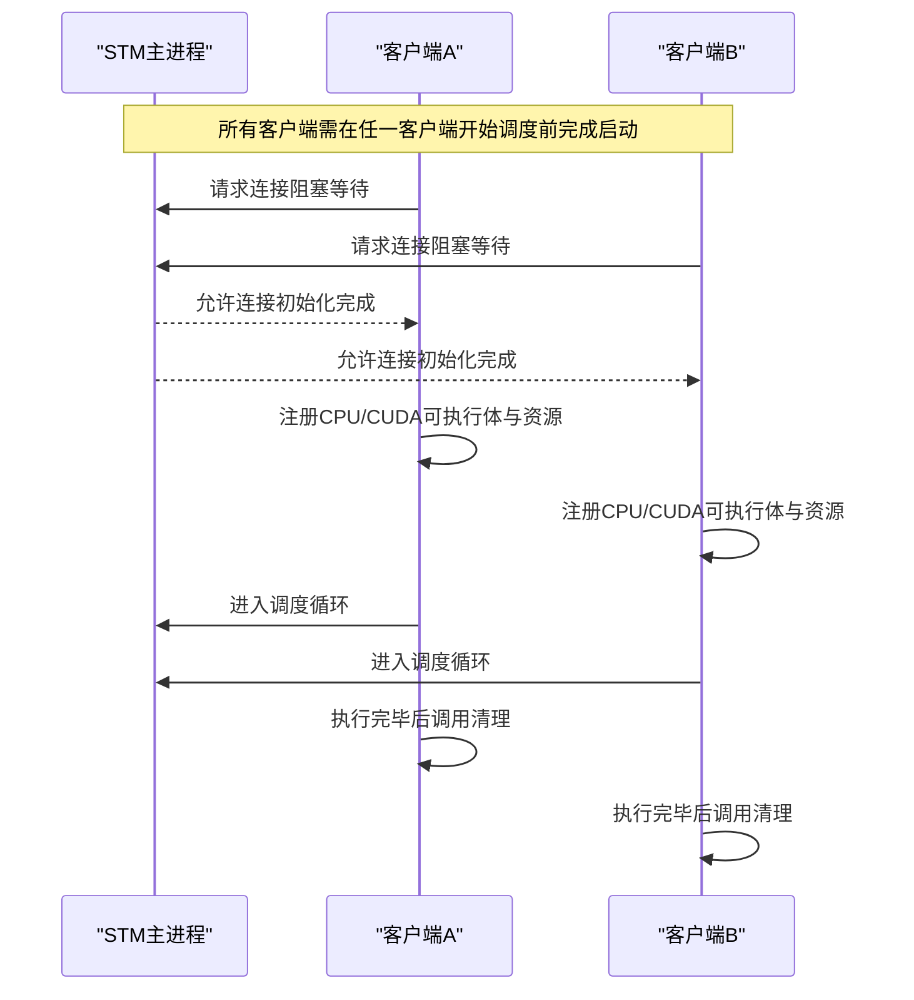
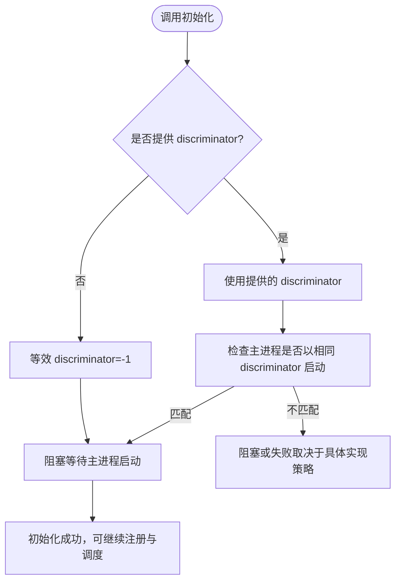
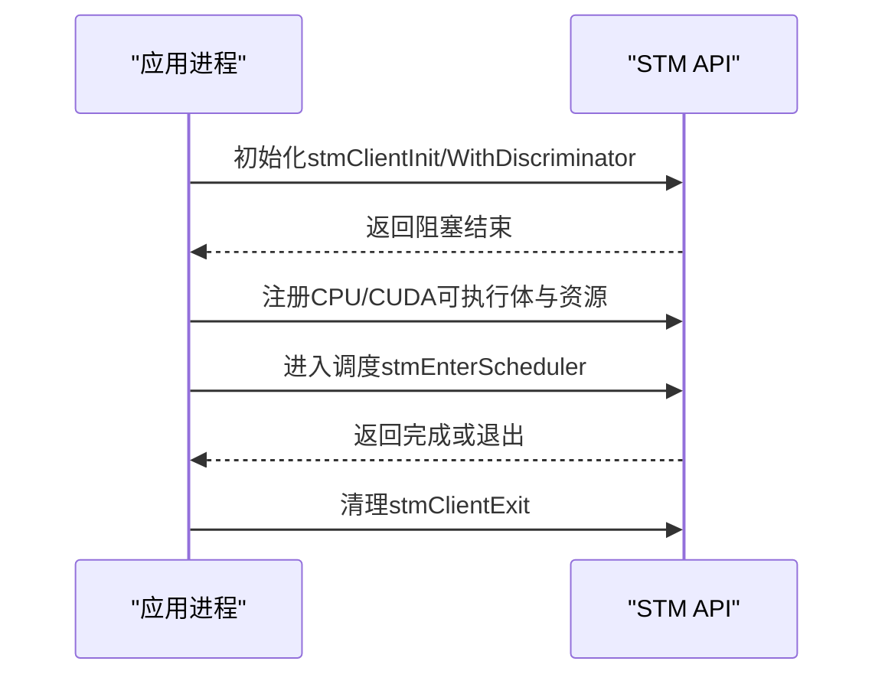
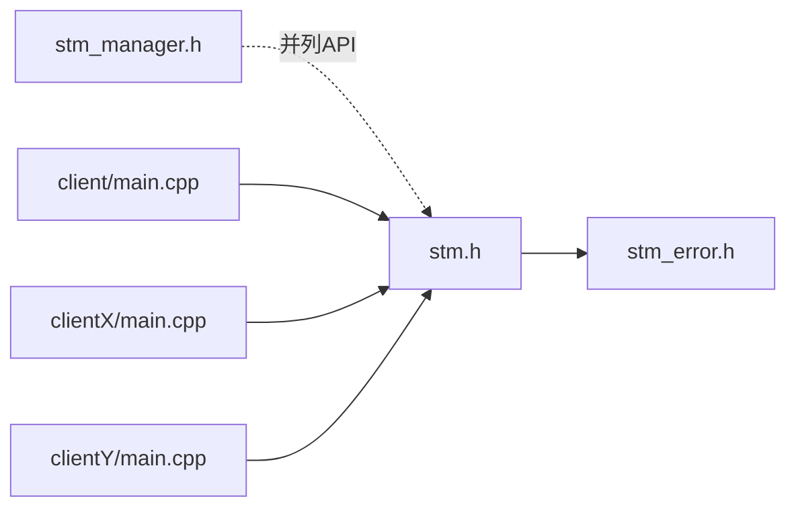

# 客户端初始化

<cite>
**本文引用的文件**
- [stm.h](file://driverorks-5.10/include/stm.h)
- [stm_manager.h](file://driverorks-5.10/include/stm_manager.h)
- [stm_error.h](file://driverorks-5.10/include/stm_error.h)
- [client/main.cpp](file://driverorks-5.10/samples/src/stm/src/cpu_simple/client/main.cpp)
- [clientX/main.cpp](file://driverorks-5.10/samples/src/stm/src/cpu_gpu_simple/clientX/main.cpp)
- [clientY/main.cpp](file://driverorks-5.10/samples/src/stm/src/cpu_gpu_simple/clientY/main.cpp)
</cite>

## 目录
1. [引言](#引言)
2. [项目结构](#项目结构)
3. [核心组件](#核心组件)
4. [架构总览](#架构总览)
5. [详细组件分析](#详细组件分析)
6. [依赖关系分析](#依赖关系分析)
7. [性能考量](#性能考量)
8. [故障排除指南](#故障排除指南)
9. [结论](#结论)
10. [附录：完整初始化示例](#附录完整初始化示例)

## 引言
本文件聚焦于STM（静态时序图）客户端初始化流程，系统性阐述以下主题：
- stmClientInit 与 stmClientInitWithDiscriminator 的区别、使用场景与行为差异
- 初始化的阻塞特性与“所有客户端必须在任何客户端开始调度前完成启动”的必要性
- discriminator 参数的作用机制与多实例调度的实现方式
- 完整的初始化与清理示例，覆盖纯CPU、CPU+GPU两类典型场景
- 常见错误与故障排除方法

## 项目结构
与客户端初始化直接相关的头文件位于 driverorks-5.10/include，示例位于 driverorks-5.10/samples/src/stm。

**图表来源**
- [stm.h:103-118](file://driverorks-5.10/include/stm.h#L103-L118)
- [stm_manager.h:45-73](file://driverorks-5.10/include/stm_manager.h#L45-L73)
- [client/main.cpp:60-68](file://driverorks-5.10/samples/src/stm/src/cpu_simple/client/main.cpp#L60-L68)
- [clientX/main.cpp:80-88](file://driverorks-5.10/samples/src/stm/src/cpu_gpu_simple/clientX/main.cpp#L80-L88)
- [clientY/main.cpp:80-90](file://driverorks-5.10/samples/src/stm/src/cpu_gpu_simple/clientY/main.cpp#L80-L90)

**章节来源**
- [stm.h:103-118](file://driverorks-5.10/include/stm.h#L103-L118)
- [client/main.cpp:60-68](file://driverorks-5.10/samples/src/stm/src/cpu_simple/client/main.cpp#L60-L68)
- [clientX/main.cpp:80-88](file://driverorks-5.10/samples/src/stm/src/cpu_gpu_simple/clientX/main.cpp#L80-L88)
- [clientY/main.cpp:80-90](file://driverorks-5.10/samples/src/stm/src/cpu_gpu_simple/clientY/main.cpp#L80-L90)

## 核心组件
- 客户端初始化API
  - stmClientInit：基础客户端初始化，阻塞等待STM主进程启动后方可返回
  - stmClientInitWithDiscriminator：带区分符的客户端初始化，仅在匹配相同 discriminator 的主进程启动后才返回
- 调度与资源注册
  - 注册CPU可执行体、CUDA提交器、CUDA流等资源
  - 进入调度循环，直到完成或显式退出
- 清理
  - stmClientExit：清理上下文，释放内部数据结构，此后不得再调用其他STM API

上述能力在头文件中均有明确注释与约束，例如：
- 初始化必须先于其他STM API调用
- 初始化会阻塞，直至主进程启动
- 同一进程中只能调用一次初始化API
- 必须在STM完成后调用清理API

**章节来源**
- [stm.h:103-118](file://driverorks-5.10/include/stm.h#L103-L118)
- [stm.h:120-154](file://driverorks-5.10/include/stm.h#L120-L154)
- [stm.h:286-330](file://driverorks-5.10/include/stm.h#L286-L330)

## 架构总览
STM客户端初始化遵循“先全局、后局部”的启动顺序：所有客户端必须在任意客户端进入调度前完成启动；当使用 discriminator 时，只有与主进程匹配的同组客户端才会被允许进入调度。

**图表来源**
- [stm.h:42-48](file://driverorks-5.10/include/stm.h#L42-L48)
- [stm.h:103-118](file://driverorks-5.10/include/stm.h#L103-L118)
- [stm.h:286-330](file://driverorks-5.10/include/stm.h#L286-L330)

## 详细组件分析

### 函数对比：stmClientInit vs stmClientInitWithDiscriminator
- 共同点
  - 都是客户端初始化入口，必须在其他STM API之前调用
  - 都会阻塞，直到主进程启动
  - 同一进程中只能调用二者之一一次
- 差异点
  - 不带 discriminator：等效于传入 discriminator=-1 的情形
  - 带 discriminator：仅当主进程以相同 discriminator 启动时才放行；负值等效为不带 discriminator 的行为
- 使用建议
  - 单实例场景：使用 stmClientInit
  - 多实例/多组并存场景：使用 stmClientInitWithDiscriminator，并为每组分配唯一非负 discriminator

**图表来源**
- [stm.h:103-118](file://driverorks-5.10/include/stm.h#L103-L118)

**章节来源**
- [stm.h:103-118](file://driverorks-5.10/include/stm.h#L103-L118)

### 初始化阻塞行为与“必须先启动所有客户端”的原因
- 初始化阶段阻塞，确保所有客户端都已就绪，避免部分客户端提前进入调度导致的死锁或时序错配
- 主进程负责协调全局调度，只有在所有客户端均完成初始化后，主进程才能安全地开始调度
- 若某客户端未完成初始化，其他客户端可能因等待同步而卡死

**章节来源**
- [stm.h:42-48](file://driverorks-5.10/include/stm.h#L42-L48)
- [stm.h:103-118](file://driverorks-5.10/include/stm.h#L103-L118)

### discriminator 参数的作用机制与多实例调度
- 作用机制
  - 每个主进程绑定一个 discriminator
  - 客户端在初始化时声明自己的 discriminator
  - 只有当主进程与客户端的 discriminator 匹配时，客户端才被允许进入调度
- 多实例调度
  - 通过为不同组客户端设置不同的 discriminator，实现多组独立调度
  - 每组客户端彼此隔离，互不影响
- 等效行为
  - 传入负值的 discriminator 等效于不带 discriminator 的初始化

**章节来源**
- [stm.h:111-118](file://driverorks-5.10/include/stm.h#L111-L118)

### 客户端初始化与清理的生命周期
- 初始化阶段
  - 调用 stmClientInit 或 stmClientInitWithDiscriminator
  - 注册 CPU/CUDA 可执行体与资源
  - 调用 stmEnterScheduler 开始调度
- 清理阶段
  - 调用 stmClientExit 释放上下文
  - 此后不得再调用任何 STM API

**图表来源**
- [stm.h:103-118](file://driverorks-5.10/include/stm.h#L103-L118)
- [stm.h:120-154](file://driverorks-5.10/include/stm.h#L120-L154)
- [stm.h:286-330](file://driverorks-5.10/include/stm.h#L286-L330)

**章节来源**
- [stm.h:103-118](file://driverorks-5.10/include/stm.h#L103-L118)
- [stm.h:120-154](file://driverorks-5.10/include/stm.h#L120-L154)
- [stm.h:286-330](file://driverorks-5.10/include/stm.h#L286-L330)

### 示例：纯CPU客户端
- 关键步骤
  - 调用 stmClientInit
  - 注册 CPU 可执行体
  - 进入调度
  - 清理

**章节来源**
- [client/main.cpp:60-68](file://driverorks-5.10/samples/src/stm/src/cpu_simple/client/main.cpp#L60-L68)

### 示例：CPU+GPU客户端（两组）
- 组别A（clientX）
  - 创建 CUDA 流
  - 调用 stmClientInit
  - 注册 CUDA 提交器与 CUDA 资源
  - 进入调度
  - 清理
- 组别B（clientY）
  - 创建 CUDA 流
  - 调用 stmClientInit
  - 注册 CUDA 提交器与 CPU 可执行体，以及 CUDA 资源
  - 进入调度
  - 清理

注意：以上示例展示了同一进程内多组客户端的典型写法，实际部署时应结合主进程的 discriminator 策略选择合适的初始化方式。

**章节来源**
- [clientX/main.cpp:80-88](file://driverorks-5.10/samples/src/stm/src/cpu_gpu_simple/clientX/main.cpp#L80-L88)
- [clientY/main.cpp:80-90](file://driverorks-5.10/samples/src/stm/src/cpu_gpu_simple/clientY/main.cpp#L80-L90)

## 依赖关系分析
- 头文件依赖
  - stm.h 依赖错误码头文件（用于统一错误处理）
  - 管理器头文件 stm_manager.h 与客户端头文件 stm.h 并列，分别面向管理器与客户端
- 示例依赖
  - 示例程序直接包含 stm.h，并按顺序调用初始化、注册、调度、清理

**图表来源**
- [stm.h:58-59](file://driverorks-5.10/include/stm.h#L58-L59)
- [stm_manager.h:38-39](file://driverorks-5.10/include/stm_manager.h#L38-L39)
- [client/main.cpp](file://driverorks-5.10/samples/src/stm/src/cpu_simple/client/main.cpp#L31)
- [clientX/main.cpp](file://driverorks-5.10/samples/src/stm/src/cpu_gpu_simple/clientX/main.cpp#L31)
- [clientY/main.cpp](file://driverorks-5.10/samples/src/stm/src/cpu_gpu_simple/clientY/main.cpp#L31)

**章节来源**
- [stm.h:58-59](file://driverorks-5.10/include/stm.h#L58-L59)
- [stm_manager.h:38-39](file://driverorks-5.10/include/stm_manager.h#L38-L39)
- [client/main.cpp](file://driverorks-5.10/samples/src/stm/src/cpu_simple/client/main.cpp#L31)
- [clientX/main.cpp](file://driverorks-5.10/samples/src/stm/src/cpu_gpu_simple/clientX/main.cpp#L31)
- [clientY/main.cpp](file://driverorks-5.10/samples/src/stm/src/cpu_gpu_simple/clientY/main.cpp#L31)

## 性能考量
- 初始化阻塞时间
  - 由主进程启动与客户端连接建立决定，尽量缩短主进程准备时间有助于降低整体启动延迟
- 注册开销
  - 在初始化完成后尽早完成注册，避免在调度过程中动态变更
- 调度粒度
  - 合理划分 CPU/CUDA 可执行体，避免单个可执行体过长阻塞调度器推进

## 故障排除指南
- 常见错误码
  - 未初始化：调用其他STM API前未完成初始化
  - 参数错误：函数参数超出限制或格式不正确
  - 通用错误：底层通信或资源问题
  - 内存不足：资源分配失败
- 排查步骤
  - 确认所有客户端均已完成初始化后再进入调度
  - 若使用 discriminator，确认主进程与客户端的 discriminator 设置一致
  - 检查资源注册（如 CUDA 流）是否有效且未重复注册
  - 在发生错误时，优先检查日志与错误码映射

**章节来源**
- [stm_error.h:47-97](file://driverorks-5.10/include/stm_error.h#L47-L97)
- [stm.h:120-154](file://driverorks-5.10/include/stm.h#L120-L154)
- [stm.h:286-330](file://driverorks-5.10/include/stm.h#L286-L330)

## 结论
- stmClientInit 与 stmClientInitWithDiscriminator 的核心差异在于对 discriminator 的支持
- 初始化阻塞是保障全局一致性的重要机制，必须在任何客户端开始调度前完成所有客户端的启动
- discriminator 可实现多实例/多组调度的隔离与并存
- 初始化完成后应尽快注册可执行体与资源，最后调用清理API释放上下文

## 附录：完整初始化示例

### 场景一：纯CPU客户端
- 步骤
  - 初始化：调用 stmClientInit
  - 注册：注册 CPU 可执行体
  - 调度：调用 stmEnterScheduler
  - 清理：调用 stmClientExit

参考路径
- [client/main.cpp:60-68](file://driverorks-5.10/samples/src/stm/src/cpu_simple/client/main.cpp#L60-L68)

### 场景二：CPU+GPU客户端（两组）
- 组别A（clientX）
  - 初始化：调用 stmClientInit
  - 注册：CUDA 提交器与 CUDA 资源
  - 调度：调用 stmEnterScheduler
  - 清理：调用 stmClientExit
- 组别B（clientY）
  - 初始化：调用 stmClientInit
  - 注册：CUDA 提交器、CPU 可执行体与 CUDA 资源
  - 调度：调用 stmEnterScheduler
  - 清理：调用 stmClientExit

参考路径
- [clientX/main.cpp:80-88](file://driverorks-5.10/samples/src/stm/src/cpu_gpu_simple/clientX/main.cpp#L80-L88)
- [clientY/main.cpp:80-90](file://driverorks-5.10/samples/src/stm/src/cpu_gpu_simple/clientY/main.cpp#L80-L90)