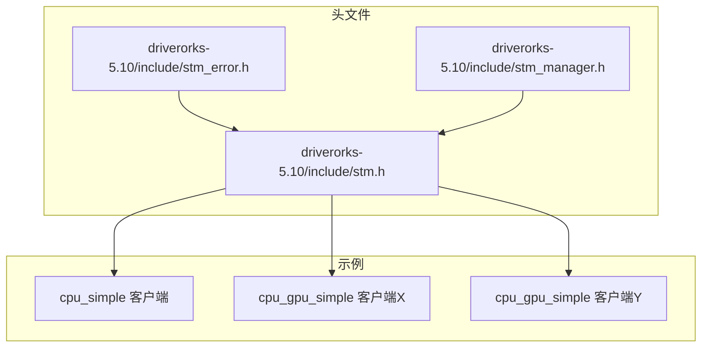
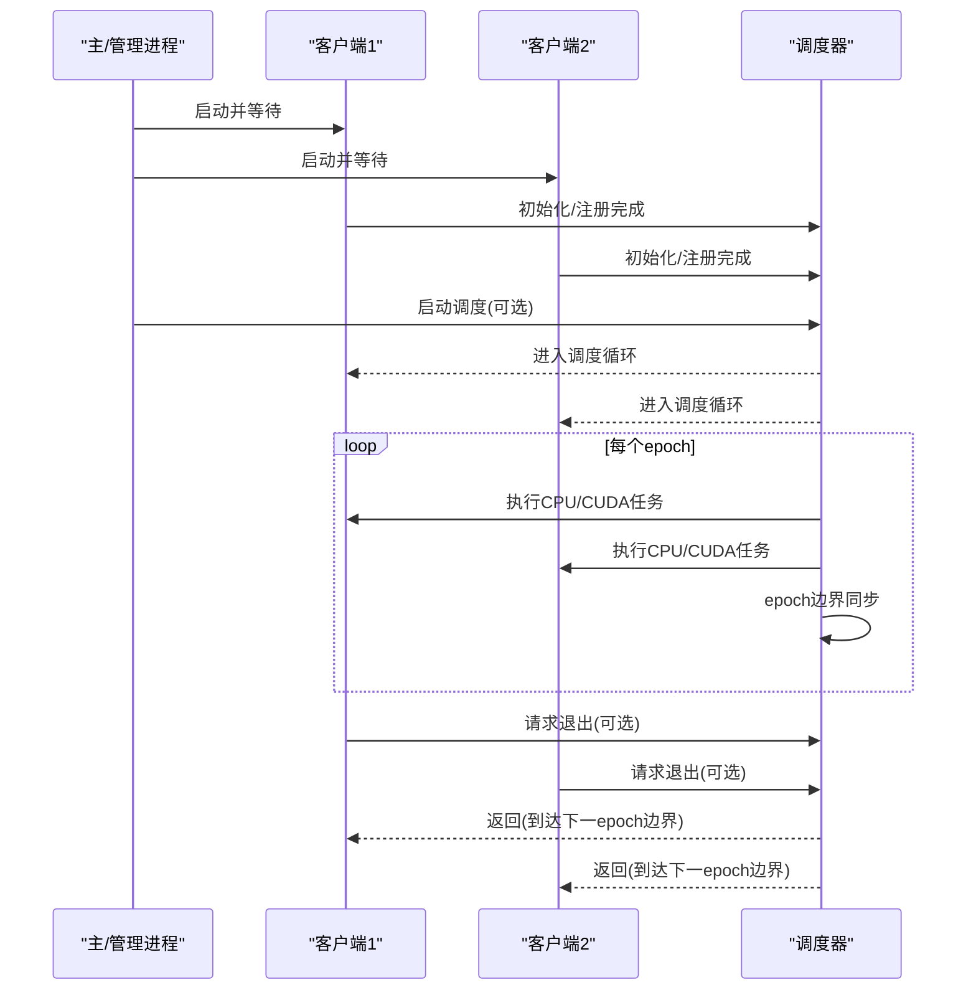
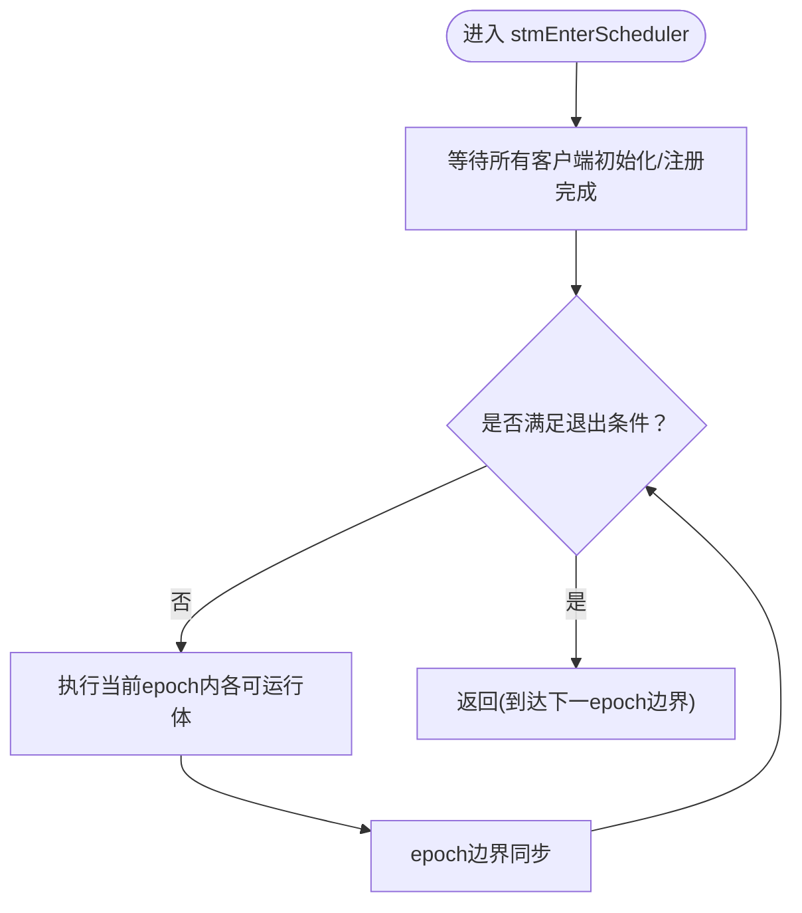
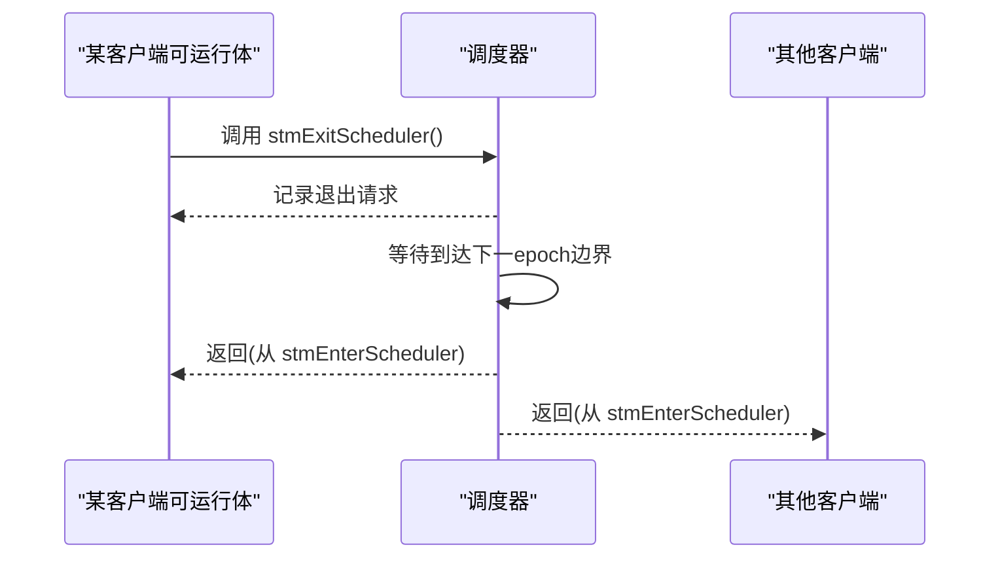
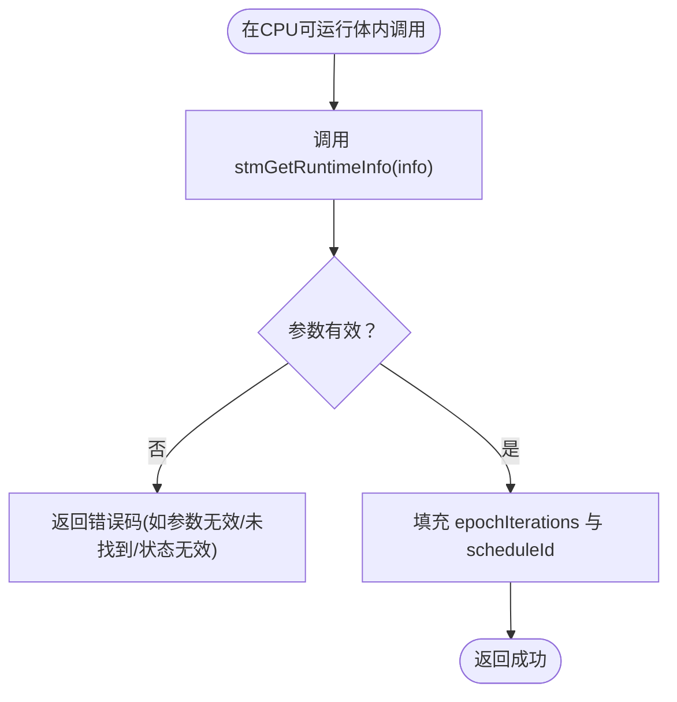
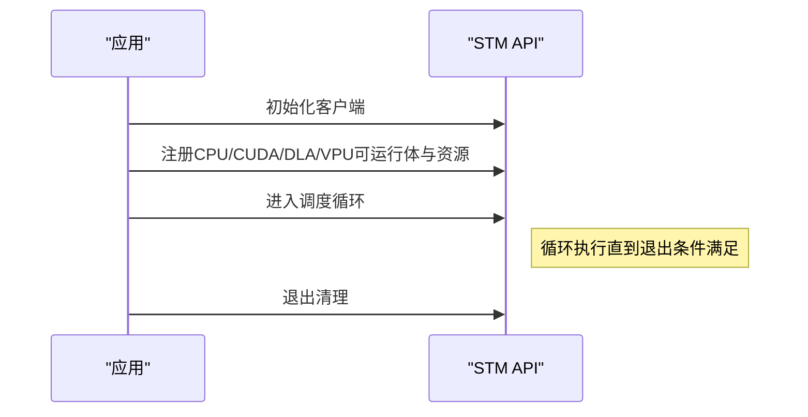
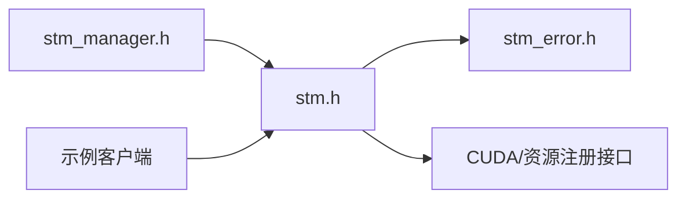

# 调度器执行

<cite>
**本文引用的文件**
- [driverorks-5.10/include/stm.h](file://driverorks-5.10/include/stm.h)
- [driverorks-5.10/include/stm_error.h](file://driverorks-5.10/include/stm_error.h)
- [driverorks-5.10/include/stm_manager.h](file://driverorks-5.10/include/stm_manager.h)
- [driverorks-5.10/samples/src/stm/src/cpu_simple/client/main.cpp](file://driverorks-5.10/samples/src/stm/src/cpu_simple/client/main.cpp)
- [driverorks-5.10/samples/src/stm/src/cpu_gpu_simple/clientX/main.cpp](file://driverorks-5.10/samples/src/stm/src/cpu_gpu_simple/clientX/main.cpp)
- [driverorks-5.10/samples/src/stm/src/cpu_gpu_simple/clientY/main.cpp](file://driverorks-5.10/samples/src/stm/src/cpu_gpu_simple/clientY/main.cpp)
</cite>

## 目录
1. [简介](#简介)
2. [项目结构](#项目结构)
3. [核心组件](#核心组件)
4. [架构总览](#架构总览)
5. [详细组件分析](#详细组件分析)
6. [依赖关系分析](#依赖关系分析)
7. [性能考量](#性能考量)
8. [故障排查指南](#故障排查指南)
9. [结论](#结论)
10. [附录](#附录)

## 简介
本文件围绕STM调度器的执行进行系统化技术说明，重点覆盖以下方面：
- stmEnterScheduler调度循环控制机制：任务调度、epoch边界处理与性能监控要点
- 协作式非抢占式设计原理：如何在Tegra SoC上强制数据依赖顺序与控制流顺序
- stmExitScheduler的优雅退出机制：如何在下一个epoch边界安全返回
- 完整使用示例：从初始化到执行再到清理的全流程
- 运行时信息查询：stmGetRuntimeInfo的用法
- 错误处理机制：超时与通用错误的策略

## 项目结构
本仓库中与STM调度器直接相关的核心API位于driverorks-5.10版本的头文件中，配套示例位于samples目录下。关键文件如下：
- 头文件：stm.h（调度器API）、stm_error.h（错误码枚举）、stm_manager.h（调度管理API）
- 示例程序：cpu_simple、cpu_gpu_simple等客户端示例

**图表来源**
- [driverorks-5.10/include/stm.h:31-337](file://driverorks-5.10/include/stm.h#L31-L337)
- [driverorks-5.10/include/stm_error.h:12-117](file://driverorks-5.10/include/stm_error.h#L12-L117)
- [driverorks-5.10/include/stm_manager.h:12-113](file://driverorks-5.10/include/stm_manager.h#L12-L113)

**章节来源**
- [driverorks-5.10/include/stm.h:31-337](file://driverorks-5.10/include/stm.h#L31-L337)
- [driverorks-5.10/include/stm_error.h:12-117](file://driverorks-5.10/include/stm_error.h#L12-L117)
- [driverorks-5.10/include/stm_manager.h:12-113](file://driverorks-5.10/include/stm_manager.h#L12-L113)

## 核心组件
- 客户端API族
  - 初始化与清理：stmClientInit、stmClientExit
  - 注册接口：stmRegisterCpuRunnable、stmRegisterCudaSubmitter、stmRegisterCudaResource（以及DLA/CUDLA/VPU相关注册接口）
  - 调度控制：stmEnterScheduler、stmExitScheduler
  - 运行时查询：stmGetRuntimeInfo
- 错误码体系：stmErrorCode_t，涵盖初始化、参数、超时、同步、CUDA、DLA、CUDLA、PVA、MQ满、连接、时钟与状态异常等
- 调度管理API族（管理进程侧）：stmScheduleManagerInit/WithDiscriminator、stmStartSchedule、stmStopSchedule、stmScheduleManagerExit

上述API在头文件中均有明确的用途说明与返回值语义，为后续调度循环与错误处理提供了基础。

**章节来源**
- [driverorks-5.10/include/stm.h:103-330](file://driverorks-5.10/include/stm.h#L103-L330)
- [driverorks-5.10/include/stm_error.h:47-97](file://driverorks-5.10/include/stm_error.h#L47-L97)
- [driverorks-5.10/include/stm_manager.h:45-106](file://driverorks-5.10/include/stm_manager.h#L45-L106)

## 架构总览
STM调度器采用“协作式、非抢占式、静态调度”的设计，强调在Tegra SoC上通过编译期生成的schedule保证数据依赖与控制流顺序。其典型交互如下：
- 多个STM客户端进程各自初始化并注册可运行体与资源
- 主进程（或管理进程）启动后，客户端阻塞等待，直到所有客户端就绪
- 调度循环由stmEnterScheduler驱动，按epoch推进，直至满足退出条件（调用stmExitScheduler或达到指定epoch数）

**图表来源**
- [driverorks-5.10/include/stm.h:286-323](file://driverorks-5.10/include/stm.h#L286-L323)
- [driverorks-5.10/include/stm_manager.h:84-106](file://driverorks-5.10/include/stm_manager.h#L84-L106)

## 详细组件分析

### 组件A：调度循环与epoch边界（stmEnterScheduler）
- 控制流与职责
  - 在所有客户端完成初始化与注册后，调用stmEnterScheduler进入调度循环
  - 循环持续执行已注册的CPU/CUDA/DLA/VPU等可运行体，并在每个epoch结束处进行同步
  - 该函数不会返回，除非满足退出条件：任一客户端调用stmExitScheduler，或达到主进程设定的epoch数量
- epoch边界处理
  - 每个epoch结束时，调度器会进行跨引擎的数据依赖与控制流同步，确保Tegra SoC上的执行顺序符合编译期约束
  - 退出请求仅在下一个epoch边界生效，以避免破坏时序一致性
- 性能监控
  - 可通过stmGetRuntimeInfo查询当前epoch迭代次数与schedule标识，用于运行时观测与统计

**图表来源**
- [driverorks-5.10/include/stm.h:286-299](file://driverorks-5.10/include/stm.h#L286-L299)

**章节来源**
- [driverorks-5.10/include/stm.h:286-299](file://driverorks-5.10/include/stm.h#L286-L299)

### 组件B：协作式非抢占式设计与Tegra SoC顺序保障
- 设计原则
  - 协作式：可运行体必须显式让出控制权（例如在合适位置调用退出API或等待同步），调度器不进行强制抢占
  - 非抢占式：一旦某个可运行体开始执行，不会被其他可运行体打断
- 顺序保障
  - 数据依赖顺序：编译期schedule定义了严格的依赖关系，调度器在执行时严格遵循这些关系
  - 控制流顺序：在Tegra SoC上，调度器通过epoch边界与同步机制，确保跨引擎（CPU/GPU/DLA/VPU等）的控制流顺序
- 实践建议
  - CUDA提交器应使用非空流（禁止使用默认流），避免隐式同步导致的性能退化
  - 可运行体不应调用阻塞API或内部创建线程，以维持协作式模型的有效性

**章节来源**
- [driverorks-5.10/include/stm.h:36-48](file://driverorks-5.10/include/stm.h#L36-L48)
- [driverorks-5.10/include/stm.h:94-101](file://driverorks-5.10/include/stm.h#L94-L101)

### 组件C：优雅退出（stmExitScheduler）
- 触发与生效时机
  - 任一客户端内的可运行体调用stmExitScheduler，仅在下一个epoch边界使所有客户端从stmEnterScheduler返回
  - 该API只需在一个客户端调用即可，后续调用会被忽略
- 退出条件
  - 达到主进程设定的epoch数量
  - 或任一客户端显式请求退出
- 清理
  - 退出后，客户端应调用stmClientExit销毁上下文，释放相关资源

**图表来源**
- [driverorks-5.10/include/stm.h:315-323](file://driverorks-5.10/include/stm.h#L315-L323)

**章节来源**
- [driverorks-5.10/include/stm.h:315-323](file://driverorks-5.10/include/stm.h#L315-L323)

### 组件D：运行时信息查询（stmGetRuntimeInfo）
- 查询内容
  - epochIterations：当前已执行的epoch迭代次数
  - scheduleId：当前执行的schedule标识
- 使用场景
  - 在CPU可运行体内调用，用于性能观测、统计或调试
  - 与调度循环配合，可在epoch边界输出运行时指标
- 错误处理
  - 若info为空指针、当前线程未找到或无法获取必要信息，将返回相应错误码

**图表来源**
- [driverorks-5.10/include/stm.h:301-313](file://driverorks-5.10/include/stm.h#L301-L313)

**章节来源**
- [driverorks-5.10/include/stm.h:76-83](file://driverorks-5.10/include/stm.h#L76-L83)
- [driverorks-5.10/include/stm.h:301-313](file://driverorks-5.10/include/stm.h#L301-L313)

### 组件E：调度器使用示例（从初始化到执行再到清理）
- 基础CPU示例（单客户端）
  - 步骤：初始化客户端 → 注册CPU可运行体 → 进入调度循环 → 退出清理
  - 参考路径：[driverorks-5.10/samples/src/stm/src/cpu_simple/client/main.cpp:61-68](file://driverorks-5.10/samples/src/stm/src/cpu_simple/client/main.cpp#L61-L68)
- GPU/CPU混合示例（多客户端）
  - 客户端X：注册CUDA提交器与CUDA资源 → 进入调度循环 → 退出清理
    - 参考路径：[driverorks-5.10/samples/src/stm/src/cpu_gpu_simple/clientX/main.cpp:80-87](file://driverorks-5.10/samples/src/stm/src/cpu_gpu_simple/clientX/main.cpp#L80-L87)
  - 客户端Y：注册CUDA提交器/CPU可运行体与CUDA资源 → 进入调度循环 → 退出清理
    - 参考路径：[driverorks-5.10/samples/src/stm/src/cpu_gpu_simple/clientY/main.cpp:81-87](file://driverorks-5.10/samples/src/stm/src/cpu_gpu_simple/clientY/main.cpp#L81-L87)

**图表来源**
- [driverorks-5.10/samples/src/stm/src/cpu_simple/client/main.cpp:61-68](file://driverorks-5.10/samples/src/stm/src/cpu_simple/client/main.cpp#L61-L68)
- [driverorks-5.10/samples/src/stm/src/cpu_gpu_simple/clientX/main.cpp:80-87](file://driverorks-5.10/samples/src/stm/src/cpu_gpu_simple/clientX/main.cpp#L80-L87)
- [driverorks-5.10/samples/src/stm/src/cpu_gpu_simple/clientY/main.cpp:81-87](file://driverorks-5.10/samples/src/stm/src/cpu_gpu_simple/clientY/main.cpp#L81-L87)

**章节来源**
- [driverorks-5.10/samples/src/stm/src/cpu_simple/client/main.cpp:61-68](file://driverorks-5.10/samples/src/stm/src/cpu_simple/client/main.cpp#L61-L68)
- [driverorks-5.10/samples/src/stm/src/cpu_gpu_simple/clientX/main.cpp:80-87](file://driverorks-5.10/samples/src/stm/src/cpu_gpu_simple/clientX/main.cpp#L80-L87)
- [driverorks-5.10/samples/src/stm/src/cpu_gpu_simple/clientY/main.cpp:81-87](file://driverorks-5.10/samples/src/stm/src/cpu_gpu_simple/clientY/main.cpp#L81-L87)

## 依赖关系分析
- API依赖
  - 客户端API依赖错误码体系（stmErrorCode_t）进行统一错误报告
  - 调度管理API与客户端API协同工作，管理进程负责启动/停止调度
- 资源依赖
  - CUDA提交器需注册CUDA流；DLA/CUDLA/PVA提交器需注册对应硬件资源句柄
- 时序依赖
  - 退出请求仅在epoch边界生效，确保跨引擎同步的一致性

**图表来源**
- [driverorks-5.10/include/stm.h:57-59](file://driverorks-5.10/include/stm.h#L57-L59)
- [driverorks-5.10/include/stm_error.h:32-33](file://driverorks-5.10/include/stm_error.h#L32-L33)
- [driverorks-5.10/include/stm_manager.h:39](file://driverorks-5.10/include/stm_manager.h#L39)

**章节来源**
- [driverorks-5.10/include/stm.h:57-59](file://driverorks-5.10/include/stm.h#L57-L59)
- [driverorks-5.10/include/stm_error.h:32-33](file://driverorks-5.10/include/stm_error.h#L32-L33)
- [driverorks-5.10/include/stm_manager.h:39](file://driverorks-5.10/include/stm_manager.h#L39)

## 性能考量
- 避免隐式同步：CUDA提交器不得使用默认流，防止因隐式同步造成性能瓶颈
- 减少阻塞：可运行体不应调用阻塞API或内部创建线程，保持协作式模型的高效性
- epoch观测：通过stmGetRuntimeInfo记录epochIterations，结合外部计时器进行性能统计
- 资源复用：合理复用CUDA/DLA/CUDLA/PVA资源，减少注册/注销开销

## 故障排查指南
- 常见错误与处理
  - 初始化错误：若未先调用初始化API或初始化失败，后续API调用可能返回“未初始化”类错误
  - 参数错误：名称长度越界、重复注册同一资源、非法discriminator等将触发“参数无效”
  - 超时错误：底层同步或Fence超时将返回“超时”类错误，需检查资源可用性与系统负载
  - 通用错误：未知异常或客户端异常退出将返回“通用错误”，需检查日志与资源状态
- 排查步骤
  - 确认所有客户端均已完成初始化与注册
  - 检查CUDA/DLA/CUDLA/PVA资源注册是否正确且唯一
  - 使用stmGetRuntimeInfo观察epoch进度，定位卡顿或停滞点
  - 关注错误码字符串表示，结合日志定位具体问题

**章节来源**
- [driverorks-5.10/include/stm_error.h:47-97](file://driverorks-5.10/include/stm_error.h#L47-L97)
- [driverorks-5.10/include/stm.h:294-297](file://driverorks-5.10/include/stm.h#L294-L297)

## 结论
STM调度器通过协作式非抢占式设计，在Tegra SoC上实现了严格的时序与依赖保障。开发者可通过清晰的API序列（初始化→注册→进入调度→清理）构建稳定可靠的实时任务执行框架；借助epoch边界与运行时信息查询，可实现对执行过程的可观测与优化。同时，完善的错误码体系与退出机制为系统的健壮性提供了坚实基础。

## 附录
- API速查
  - 客户端生命周期：初始化/注册/进入调度/退出清理
  - 调度控制：进入调度循环、在下一epoch边界优雅退出
  - 运行时观测：查询epoch迭代次数与schedule标识
  - 管理侧：启动/停止调度、管理上下文初始化/退出