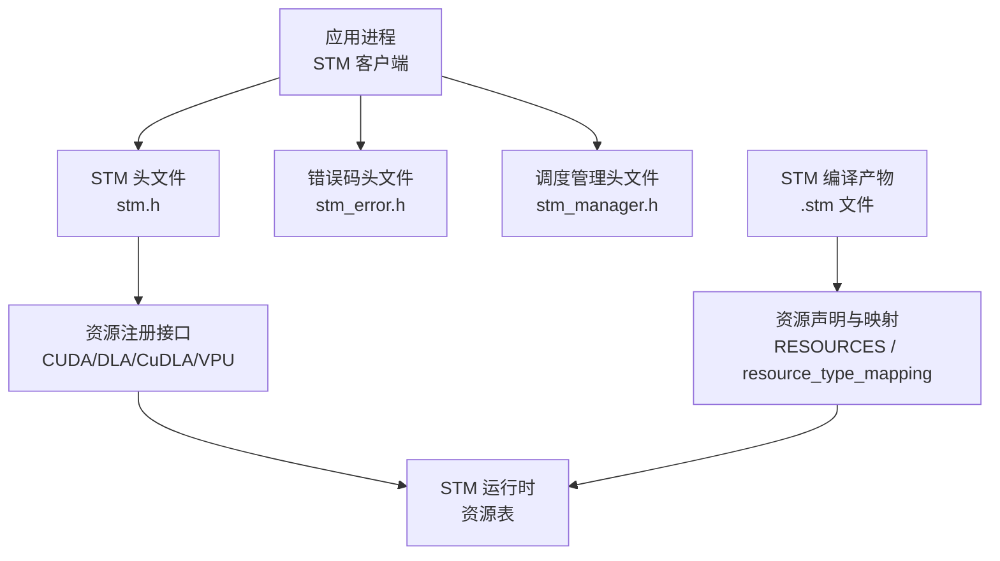
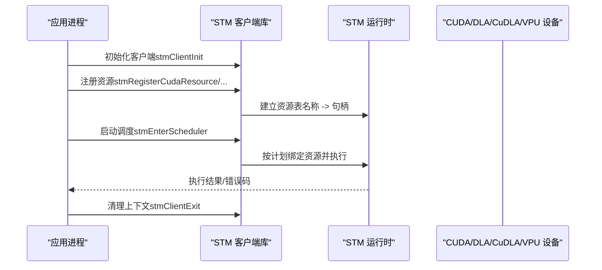
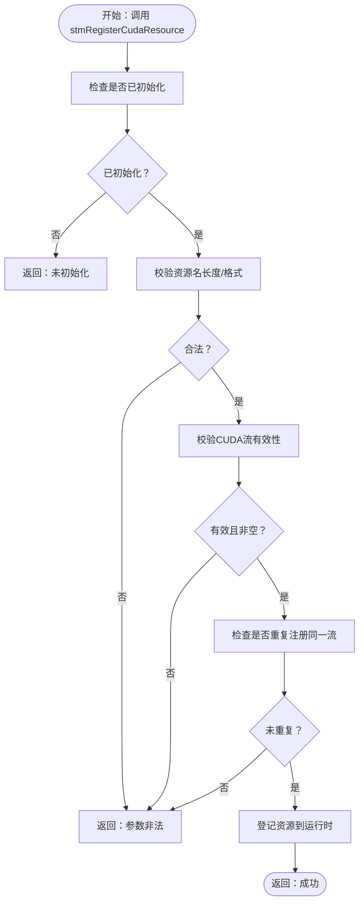
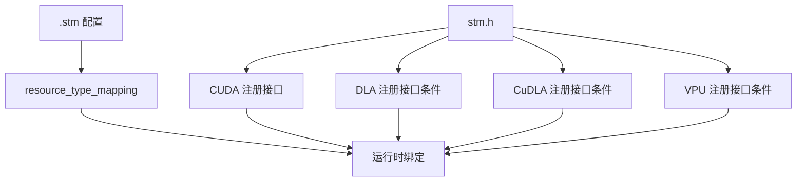

# 资源管理

<cite>
**本文引用的文件**
- [stm.h](file://driverorks-5.10/include/stm.h)
- [stm_error.h](file://driverorks-5.10/include/stm_error.h)
- [stm_manager.h](file://driverorks-5.10/include/stm_manager.h)
- [cpu_gpu1.stm](file://driverorks-5.10/bin/cpu_gpu1.stm)
- [gpu_multistream_multiprocess.stm](file://driverorks-5.10/bin/gpu_multistream_multiprocess.stm)
</cite>

## 目录
1. [简介](#简介)
2. [项目结构](#项目结构)
3. [核心组件](#核心组件)
4. [架构总览](#架构总览)
5. [详细组件分析](#详细组件分析)
6. [依赖关系分析](#依赖关系分析)
7. [性能考量](#性能考量)
8. [故障排查指南](#故障排查指南)
9. [结论](#结论)
10. [附录](#附录)

## 简介
本文件聚焦于STM（静态时分调度）框架中的“资源管理”能力，系统讲解如何在STM客户端进程中注册各类硬件/引擎资源，并确保资源名称与STM编译产物一致，从而让调度器按计划执行跨引擎的数据与控制依赖。重点覆盖以下资源注册接口：
- CUDA资源：stmRegisterCudaResource
- DLA资源：stmRegisterDlaResource（平台条件支持）
- CuDLA资源：stmRegisterCuDlaResource（平台条件支持）
- VPU资源：stmRegisterVpuResource（平台条件支持）

同时，文档将阐明各资源类型的特定要求与限制、资源名称匹配机制、资源生命周期管理与错误处理策略，并给出可复用的最佳实践。

## 项目结构
与资源管理直接相关的核心文件位于驱动库的公共头文件中，以及示例调度脚本（.stm）用于展示资源声明与映射关系。下图展示了与资源管理相关的文件与角色关系：

图表来源
- [stm.h:142-240](file://driverorks-5.10/include/stm.h#L142-L240)
- [cpu_gpu1.stm:28-30](file://driverorks-5.10/bin/cpu_gpu1.stm#L28-L30)
- [gpu_multistream_multiprocess.stm:28-30](file://driverorks-5.10/bin/gpu_multistream_multiprocess.stm#L28-L30)

章节来源
- [stm.h:142-240](file://driverorks-5.10/include/stm.h#L142-L240)
- [cpu_gpu1.stm:28-30](file://driverorks-5.10/bin/cpu_gpu1.stm#L28-L30)
- [gpu_multistream_multiprocess.stm:28-30](file://driverorks-5.10/bin/gpu_multistream_multiprocess.stm#L28-L30)

## 核心组件
- 资源注册接口族
  - CUDA：stmRegisterCudaResource(resourceName, cudaStream_t)
  - DLA（条件支持）：stmRegisterDlaResource(resourceName, NvMediaDla*)
  - CuDLA（条件支持）：stmRegisterCuDlaResource(resourceName, cudaStream_t)
  - VPU（条件支持）：stmRegisterVpuResource(resourceName, cupvaStream_t)
- 错误码体系：统一返回值枚举，便于定位参数、初始化状态、设备操作失败等问题
- 调度管理接口（可选）：stmScheduleManagerInit/Exit、stmStartSchedule/stmStopSchedule，用于集中管理调度生命周期

章节来源
- [stm.h:142-240](file://driverorks-5.10/include/stm.h#L142-L240)
- [stm_error.h:47-97](file://driverorks-5.10/include/stm_error.h#L47-L97)
- [stm_manager.h:45-106](file://driverorks-5.10/include/stm_manager.h#L45-L106)

## 架构总览
STM资源管理的总体流程如下：
- 应用在启动阶段调用stmClientInit并完成资源注册
- 在STM编译产物（.stm）中声明资源，并通过resource_type_mapping将运行时资源名映射到编译期资源类型
- 调度器根据映射关系绑定具体资源，确保跨引擎提交顺序与同步约束得到满足
- 调度结束后，调用stmClientExit清理上下文

图表来源
- [stm.h:103-118](file://driverorks-5.10/include/stm.h#L103-L118)
- [stm.h:142-240](file://driverorks-5.10/include/stm.h#L142-L240)
- [stm.h:286-299](file://driverorks-5.10/include/stm.h#L286-L299)

## 详细组件分析

### CUDA资源注册：stmRegisterCudaResource
- 功能：将一个已创建的CUDA流注册为STM资源，供调度器在指定Fence/Submit阶段使用
- 资源名称匹配：注册时提供的resourceName必须与STM编译产物中RESOURCES块声明的名称一致
- 参数校验要点
  - 资源名长度限制与最大资源数限制
  - 流必须是通过cudaStreamCreate创建的有效句柄
  - 不允许注册空流或默认流（null stream），以避免隐式同步导致的调度问题
  - 同一流对象不可重复注册（即使名称不同也会被拒绝）
- 返回值：遵循统一错误码体系，常见错误包括参数非法、未初始化、CUDA错误等

图表来源
- [stm.h:142-154](file://driverorks-5.10/include/stm.h#L142-L154)

章节来源
- [stm.h:142-154](file://driverorks-5.10/include/stm.h#L142-L154)

### DLA资源注册：stmRegisterDlaResource（平台条件支持）
- 功能：将NvMediaDla句柄注册为STM资源
- 平台条件：仅在特定PDK版本范围内可用（低于某版本）
- 资源名称匹配：与RESOURCES声明一致
- 参数校验要点
  - 资源名长度与数量限制
  - DLA句柄必须由对应API创建且非空
  - 同一DLA句柄不可重复注册

章节来源
- [stm.h:194-208](file://driverorks-5.10/include/stm.h#L194-L208)

### CuDLA资源注册：stmRegisterCuDlaResource（平台条件支持）
- 功能：将用于CuDLA任务提交的CUDA流注册为STM资源
- 平台条件：仅在特定PDK版本及以上启用
- 资源名称匹配：与RESOURCES声明一致
- 参数校验要点
  - 资源名长度与数量限制
  - CUDA流必须通过cudaStreamCreate创建且非空
  - 同一流不可重复注册

章节来源
- [stm.h:210-226](file://driverorks-5.10/include/stm.h#L210-L226)

### VPU资源注册：stmRegisterVpuResource（平台条件支持）
- 功能：将CUPVA流注册为STM资源
- 平台条件：仅在特定PDK版本及以上启用
- 资源名称匹配：与RESOURCES声明一致
- 参数校验要点
  - 资源名长度与数量限制
  - CUPVA流必须通过对应API创建且非空
  - 同一流不可重复注册

章节来源
- [stm.h:228-240](file://driverorks-5.10/include/stm.h#L228-L240)

### 资源名称匹配机制
- 编译期声明：在STM编译产物的RESOURCES块中声明资源名称与类型
- 类型映射：resource_type_mapping将运行时资源名映射到编译期资源类型
- 运行时绑定：STM运行时依据该映射将注册的资源句柄绑定到对应计划步骤

图表来源
- [cpu_gpu1.stm:28-30](file://driverorks-5.10/bin/cpu_gpu1.stm#L28-L30)
- [cpu_gpu1.stm:265-267](file://driverorks-5.10/bin/cpu_gpu1.stm#L265-L267)
- [gpu_multistream_multiprocess.stm:28-30](file://driverorks-5.10/bin/gpu_multistream_multiprocess.stm#L28-L30)
- [gpu_multistream_multiprocess.stm:265-267](file://driverorks-5.10/bin/gpu_multistream_multiprocess.stm#L265-L267)

章节来源
- [cpu_gpu1.stm:28-30](file://driverorks-5.10/bin/cpu_gpu1.stm#L28-L30)
- [cpu_gpu1.stm:265-267](file://driverorks-5.10/bin/cpu_gpu1.stm#L265-L267)
- [gpu_multistream_multiprocess.stm:28-30](file://driverorks-5.10/bin/gpu_multistream_multiprocess.stm#L28-L30)
- [gpu_multistream_multiprocess.stm:265-267](file://driverorks-5.10/bin/gpu_multistream_multiprocess.stm#L265-L267)

### 资源生命周期管理与错误处理策略
- 生命周期
  - 初始化：在所有资源注册前调用stmClientInit
  - 注册：在进入调度前完成所有资源注册
  - 执行：调用stmEnterScheduler后由调度器统一管理
  - 清理：调度完成后调用stmClientExit释放上下文
- 错误处理
  - 统一错误码：参考stmErrorCode_t枚举，涵盖未初始化、参数非法、CUDA/DLA/VPU错误、内存不足等
  - 建议策略：对每个注册调用检查返回值；若失败，结合错误码定位原因（如未初始化、流无效、重复注册等）

章节来源
- [stm.h:103-118](file://driverorks-5.10/include/stm.h#L103-L118)
- [stm.h:286-299](file://driverorks-5.10/include/stm.h#L286-L299)
- [stm_error.h:47-97](file://driverorks-5.10/include/stm_error.h#L47-L97)

## 依赖关系分析
- 接口依赖
  - 资源注册接口依赖于STM客户端初始化状态
  - CUDA/DLA/CuDLA/VPU注册接口分别依赖对应的CUDA/NvMediaDla/CUPVA运行时
- 配置依赖
  - .stm文件中的RESOURCES与resource_type_mapping决定运行时资源名与类型映射
- 平台条件
  - DLA/CuDLA/VPU接口受PDK版本条件编译控制

图表来源
- [stm.h:142-240](file://driverorks-5.10/include/stm.h#L142-L240)
- [cpu_gpu1.stm:265-267](file://driverorks-5.10/bin/cpu_gpu1.stm#L265-L267)
- [gpu_multistream_multiprocess.stm:265-267](file://driverorks-5.10/bin/gpu_multistream_multiprocess.stm#L265-L267)

章节来源
- [stm.h:142-240](file://driverorks-5.10/include/stm.h#L142-L240)
- [cpu_gpu1.stm:265-267](file://driverorks-5.10/bin/cpu_gpu1.stm#L265-L267)
- [gpu_multistream_multiprocess.stm:265-267](file://driverorks-5.10/bin/gpu_multistream_multiprocess.stm#L265-L267)

## 性能考量
- 避免使用默认流（null stream）：注册接口明确禁止，以防止隐式同步导致的调度抖动
- 控制资源数量：注意最大资源数限制，避免过度注册造成运行时开销
- 合理划分资源域：将不同引擎/任务的流隔离，减少跨流同步与竞争
- 严格遵守名称匹配：确保编译期与运行时资源名完全一致，避免运行时查找失败或绑定错误

## 故障排查指南
- 常见错误与定位
  - 未初始化：在调用任何注册接口前必须先调用stmClientInit
  - 参数非法：资源名过长、超出最大资源数、传入空流/句柄、重复注册
  - CUDA/DLA/VPU错误：底层设备API失败，需检查设备状态与驱动版本
  - 内存不足：运行时分配失败，需检查系统资源
- 建议排查步骤
  - 核对.init/.exit调用顺序与次数
  - 对比.STM中RESOURCES与resource_type_mapping与运行时注册名
  - 使用错误码转换工具输出可读字符串，辅助定位
  - 在多进程场景下确认各客户端均已完成资源注册后再进入调度

章节来源
- [stm_error.h:47-97](file://driverorks-5.10/include/stm_error.h#L47-L97)
- [stm.h:142-154](file://driverorks-5.10/include/stm.h#L142-L154)
- [stm.h:210-226](file://driverorks-5.10/include/stm.h#L210-L226)
- [stm.h:228-240](file://driverorks-5.10/include/stm.h#L228-L240)

## 结论
STM资源管理的关键在于“严格的资源名称匹配”与“正确的参数校验”。通过在编译期声明资源并在运行时按约定注册，可确保调度器在跨引擎提交与同步方面准确无误。建议在工程实践中固化资源注册流程、完善错误处理与日志记录，并遵循性能最佳实践以获得稳定高效的实时调度效果。

## 附录
- 示例与参考
  - CUDA资源示例：在RESOURCES中声明CUDA_STREAMX/Y，在运行时以相同名称注册对应CUDA流
  - 多客户端示例：参考多个.stm文件中CLIENT段下的RESOURCES与resource_type_mapping

章节来源
- [cpu_gpu1.stm:28-30](file://driverorks-5.10/bin/cpu_gpu1.stm#L28-L30)
- [cpu_gpu1.stm:265-267](file://driverorks-5.10/bin/cpu_gpu1.stm#L265-L267)
- [gpu_multistream_multiprocess.stm:28-30](file://driverorks-5.10/bin/gpu_multistream_multiprocess.stm#L28-L30)
- [gpu_multistream_multiprocess.stm:265-267](file://driverorks-5.10/bin/gpu_multistream_multiprocess.stm#L265-L267)