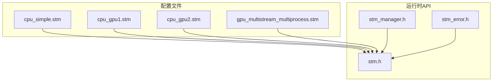
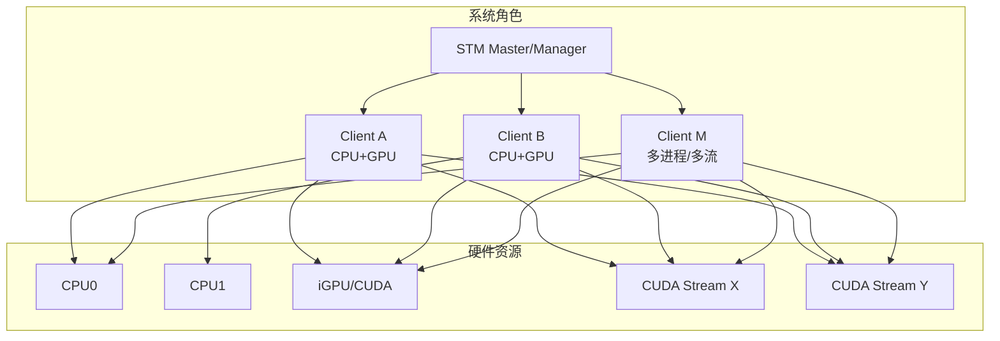
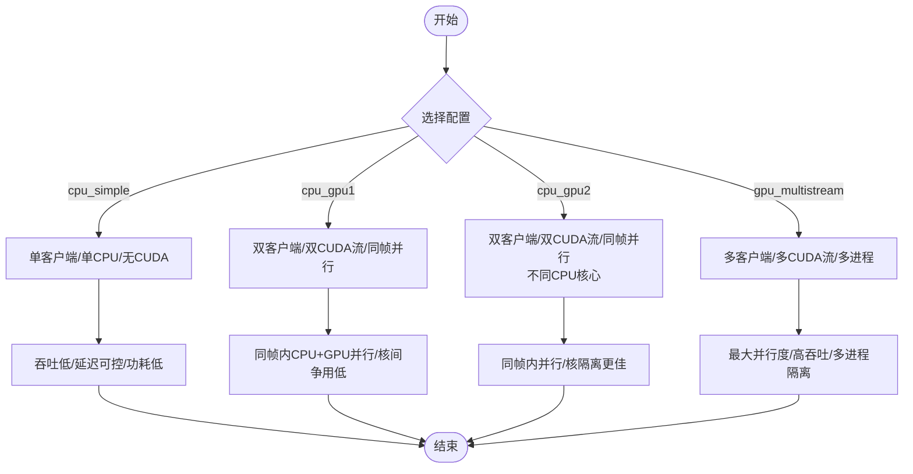
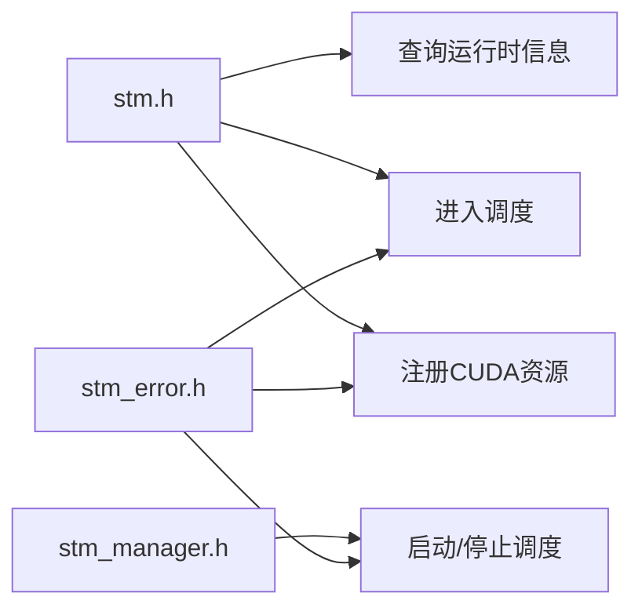

# 性能优化

<cite>
**本文引用的文件**
- [cpu_simple.stm（5.8）](file://driveworks-5.8/bin/cpu_simple.stm)
- [cpu_gpu1.stm（5.8）](file://driveworks-5.8/bin/cpu_gpu1.stm)
- [cpu_gpu2.stm（5.8）](file://driveworks-5.8/bin/cpu_gpu2.stm)
- [gpu_multistream_multiprocess.stm（5.8）](file://driveworks-5.8/bin/gpu_multistream_multiprocess.stm)
- [cpu_simple.stm（5.10）](file://driverorks-5.10/bin/cpu_simple.stm)
- [cpu_gpu1.stm（5.10）](file://driverorks-5.10/bin/cpu_gpu1.stm)
- [cpu_gpu2.stm（5.10）](file://driverorks-5.10/bin/cpu_gpu2.stm)
- [gpu_multistream_multiprocess.stm（5.10）](file://driverorks-5.10/bin/gpu_multistream_multiprocess.stm)
- [stm.h](file://driverorks-5.10/include/stm.h)
- [stm_manager.h](file://driverorks-5.10/include/stm_manager.h)
- [stm_error.h](file://driverorks-5.10/include/stm_error.h)
- [README.md](file://README.md)
</cite>

## 目录
1. [简介](#简介)
2. [项目结构](#项目结构)
3. [核心组件](#核心组件)
4. [架构总览](#架构总览)
5. [详细组件分析](#详细组件分析)
6. [依赖分析](#依赖分析)
7. [性能考量](#性能考量)
8. [故障排查指南](#故障排查指南)
9. [结论](#结论)
10. [附录](#附录)

## 简介
本指南聚焦于NVIDIA Driveworks 5.x调度中间件STM（Scheduling Middleware）的性能优化实践，系统对比并解析多套典型STM配置文件（cpu_simple.stm、cpu_gpu1.stm、cpu_gpu2.stm、gpu_multistream_multiprocess.stm），阐明多流多进程调度的性能优势与实现原理，总结CUDA流重叠、流水线优化、任务粒度与负载均衡、内存带宽与缓存利用、并行度调优以及实时性约束下的性能权衡策略，并给出性能监控与分析工具的使用建议。

## 项目结构
- 配置文件位于各版本目录的bin下，包含四类典型配置：
  - cpu_simple.stm：纯CPU单核简单调度，适合低复杂度、低并发场景。
  - cpu_gpu1.stm / cpu_gpu2.stm：单帧内CPU+GPU协同，区分不同CPU核心绑定，体现资源隔离与负载均衡。
  - gpu_multistream_multiprocess.stm：多流多进程（多客户端）并行执行，最大化硬件并行度。
- 运行时API头文件位于include目录，涵盖客户端初始化、CUDA资源注册、调度入口、管理器接口与错误码定义。

**图表来源**
- [cpu_simple.stm（5.10）](file://driverorks-5.10/bin/cpu_simple.stm)
- [cpu_gpu1.stm（5.10）](file://driverorks-5.10/bin/cpu_gpu1.stm)
- [cpu_gpu2.stm（5.10）](file://driverorks-5.10/bin/cpu_gpu2.stm)
- [gpu_multistream_multiprocess.stm（5.10）](file://driverorks-5.10/bin/gpu_multistream_multiprocess.stm)
- [stm.h](file://driverorks-5.10/include/stm.h)
- [stm_manager.h](file://driverorks-5.10/include/stm_manager.h)
- [stm_error.h](file://driverorks-5.10/include/stm_error.h)

**章节来源**
- [README.md: Driveworks 5.x与STM定位:22-37](file://README.md#L22-L37)
- [cpu_simple.stm（5.10）: 简单CPU调度:1-155](file://driverorks-5.10/bin/cpu_simple.stm#L1-L155)
- [cpu_gpu1.stm（5.10）: 单帧CPU+GPU协同:1-269](file://driverorks-5.10/bin/cpu_gpu1.stm#L1-L269)
- [cpu_gpu2.stm（5.10）: 单帧CPU+GPU协同（另一CPU核心）:1-269](file://driverorks-5.10/bin/cpu_gpu2.stm#L1-L269)
- [gpu_multistream_multiprocess.stm（5.10）: 多流多进程:1-269](file://driverorks-5.10/bin/gpu_multistream_multiprocess.stm#L1-L269)

## 核心组件
- STM运行时API
  - 客户端侧：初始化、注册CPU/CUDA/DLA/VPU可执行体、注册CUDA流、进入调度、查询运行时信息、退出。
  - 管理器侧：初始化、启动/停止指定调度、清理。
  - 错误码：统一返回值体系，覆盖初始化、参数、超时、CUDA、同步、连接等错误类型。
- 配置文件（.stm）
  - 描述超周期、同步、栅栏、客户端、核心、可运行体（CPU/CUDA提交器/CUDA提交体）、元数据等。
  - 典型元素：SYNC（跨引擎同步）、FENCE（栅栏/信号/等待）、CLIENT/CORE/RUNNABLE（任务编排）、RESOURCE（CUDA流）。

**章节来源**
- [stm.h: 客户端API与函数签名:103-330](file://driverorks-5.10/include/stm.h#L103-L330)
- [stm_manager.h: 管理器API:45-106](file://driverorks-5.10/include/stm_manager.h#L45-L106)
- [stm_error.h: 错误码枚举:47-97](file://driverorks-5.10/include/stm_error.h#L47-L97)
- [cpu_gpu1.stm（5.10）: SYNC/FENCE/CLIENT/CORE/RUNNABLE/RESOURCE:9-63](file://driverorks-5.10/bin/cpu_gpu1.stm#L9-L63)

## 架构总览
STM采用“静态离线编译+运行时严格执行”的协作式非抢占调度模型。Master/Manager负责调度启动与状态控制；多个Client对应OS进程，每个Client承载若干RUNNABLE；CUDA提交器在指定CUDA流上异步提交内核，避免阻塞主调度路径。

**图表来源**
- [stm.h: 客户端/资源/调度说明:36-48](file://driverorks-5.10/include/stm.h#L36-L48)
- [cpu_gpu1.stm（5.10）: 客户端与CUDA流资源:27-44](file://driverorks-5.10/bin/cpu_gpu1.stm#L27-L44)
- [gpu_multistream_multiprocess.stm（5.10）: 多客户端/多流:27-44](file://driverorks-5.10/bin/gpu_multistream_multiprocess.stm#L27-L44)

## 详细组件分析

### 配置文件对比与适用场景
- cpu_simple.stm
  - 特点：单客户端、单CPU核心、无CUDA；通过WOF/SIG/FENCE实现简单流水线。
  - 适用：极简任务、低功耗、低延迟要求不高的场景。
  - 性能特征：串行度高、并行度低，吞吐受限。
- cpu_gpu1.stm / cpu_gpu2.stm
  - 特点：同一帧内双客户端（clientGpuX/clientGpuY），各自持有独立CUDA流；通过SYNC/FENCE协调CPU与CUDA。
  - 差异：绑定不同CPU核心（CPU0 vs CPU1），实现物理核隔离，降低竞争。
  - 适用：单帧内CPU+GPU协同，需避免核间争用的场景。
  - 性能特征：同帧内并行度提升，核隔离减少抖动。
- gpu_multistream_multiprocess.stm
  - 特点：多客户端（多进程）+多CUDA流，最大化并行度；提交器在各自流上提交内核。
  - 适用：高吞吐、强并行需求、多任务分发场景。
  - 性能特征：多流重叠、多进程隔离，显著提升整体吞吐与稳定性。

**图表来源**
- [cpu_simple.stm（5.10）: 客户端与RUNNABLE:19-39](file://driverorks-5.10/bin/cpu_simple.stm#L19-L39)
- [cpu_gpu1.stm（5.10）: 双客户端/双CUDA流:27-51](file://driverorks-5.10/bin/cpu_gpu1.stm#L27-L51)
- [cpu_gpu2.stm（5.10）: 不同CPU核心绑定:27-51](file://driverorks-5.10/bin/cpu_gpu2.stm#L27-L51)
- [gpu_multistream_multiprocess.stm（5.10）: 多客户端/多流:27-51](file://driverorks-5.10/bin/gpu_multistream_multiprocess.stm#L27-L51)

**章节来源**
- [cpu_simple.stm（5.8）: 结构与元数据:1-152](file://driveworks-5.8/bin/cpu_simple.stm#L1-L152)
- [cpu_gpu1.stm（5.8）: 同步/栅栏/客户端:9-63](file://driveworks-5.8/bin/cpu_gpu1.stm#L9-L63)
- [cpu_gpu2.stm（5.8）: 核心绑定差异:27-51](file://driveworks-5.8/bin/cpu_gpu2.stm#L27-L51)
- [gpu_multistream_multiprocess.stm（5.8）: 多客户端/多流:27-51](file://driveworks-5.8/bin/gpu_multistream_multiprocess.stm#L27-L51)
- [cpu_simple.stm（5.10）: 结构与元数据:1-155](file://driverorks-5.10/bin/cpu_simple.stm#L1-L155)
- [cpu_gpu1.stm（5.10）: 同步/栅栏/客户端:9-63](file://driverorks-5.10/bin/cpu_gpu1.stm#L9-L63)
- [cpu_gpu2.stm（5.10）: 核心绑定差异:27-51](file://driverorks-5.10/bin/cpu_gpu2.stm#L27-L51)
- [gpu_multistream_multiprocess.stm（5.10）: 多客户端/多流:27-51](file://driverorks-5.10/bin/gpu_multistream_multiprocess.stm#L27-L51)

### 多流多进程调度的性能优势与实现原理
- 多流重叠（CUDA Streams Overlap）
  - 提交器在各自CUDA流上提交内核，避免流0隐式同步，允许计算与传输重叠。
  - 通过SYNC/FENCE协调CPU与CUDA，确保数据依赖正确。
- 多进程隔离（Multi-Process Isolation）
  - 每个客户端为独立OS进程，天然隔离，降低相互影响。
  - 适合多任务分发与容错恢复。
- 实现要点
  - 客户端侧注册CUDA流资源，提交器函数仅做CPU准备+异步内核提交。
  - 管理器侧按调度ID启动/停止，客户端侧在stmEnterScheduler后严格遵循时间窗。

```mermaid
sequenceDiagram
participant M as "Manager/Master"
participant A as "Client A"
participant B as "Client B"
participant Sx as "CUDA Stream X"
participant Sy as "CUDA Stream Y"
M->>A : 启动调度(按scheduleId)
M->>B : 启动调度(按scheduleId)
A->>A : 注册CUDA流X
B->>B : 注册CUDA流Y
A->>Sx : CUSUB f3(提交kernel)
B->>Sy : CUSUB f0(提交kernel)
A->>A : SIG f1/FENCE同步
B->>B : SIG f5/FENCE同步
A-->>M : 完成一帧(epoch边界)
B-->>M : 完成一帧(epoch边界)
```

**图表来源**
- [stm_manager.h: 启动/停止调度:84-106](file://driverorks-5.10/include/stm_manager.h#L84-L106)
- [cpu_gpu1.stm（5.10）: CUSUB/CUF/SIG/FENCE:35-49](file://driverorks-5.10/bin/cpu_gpu1.stm#L35-L49)
- [gpu_multistream_multiprocess.stm（5.10）: 多客户端/多流:27-51](file://driverorks-5.10/bin/gpu_multistream_multiprocess.stm#L27-L51)

**章节来源**
- [stm.h: CUDA提交器签名与禁止使用流0:94-101](file://driverorks-5.10/include/stm.h#L94-L101)
- [stm.h: 注册CUDA资源:142-154](file://driverorks-5.10/include/stm.h#L142-L154)
- [cpu_gpu1.stm（5.10）: CUSUB/CUF/FENCE/SYNC:9-63](file://driverorks-5.10/bin/cpu_gpu1.stm#L9-L63)

### CUDA流重叠与流水线优化策略
- 流重叠
  - 使用独立CUDA流提交不同阶段的任务，避免阻塞。
  - 将CPU准备与CUDA提交分离，缩短CPU等待时间。
- 流水线
  - 利用FENCE/WOF/WUP等原语构建严格的时序边界，保证下一帧/下一阶段在正确时机开始。
  - 通过LOG/SIG实现日志与信号，便于观测与调试。
- 最佳实践
  - 避免使用流0（null stream）进行异步提交。
  - 控制内核粒度，使GPU时间片充分利用但不过载。
  - 合理拆分数据传输与计算，减少同步点。

**章节来源**
- [cpu_gpu1.stm（5.10）: CUF/CUSUB/FENCE:33-49](file://driverorks-5.10/bin/cpu_gpu1.stm#L33-L49)
- [cpu_gpu2.stm（5.10）: 同帧内并行与核隔离:31-49](file://driverorks-5.10/bin/cpu_gpu2.stm#L31-L49)
- [gpu_multistream_multiprocess.stm（5.10）: 多流重叠:33-49](file://driverorks-5.10/bin/gpu_multistream_multiprocess.stm#L33-L49)

### 任务粒度优化与负载均衡
- 任务粒度
  - 将大任务拆分为多个小任务，提高并行度与流水线效率。
  - 避免过细粒度导致调度开销增大。
- 负载均衡
  - 在多客户端/多流场景下，将不同类型任务分配到不同客户端或流，避免热点。
  - 利用不同CPU核心绑定（如CPU0/CPU1）降低核间争用。
- 实践建议
  - 以RUNNABLE的起止时间窗为基准，评估关键路径与瓶颈。
  - 通过元数据（如critical_path、b_level、t_level）识别关键路径任务。

**章节来源**
- [cpu_gpu1.stm（5.10）: RUNNABLE元数据字段:76-101](file://driverorks-5.10/bin/cpu_gpu1.stm#L76-L101)
- [cpu_gpu2.stm（5.10）: RUNNABLE元数据字段:76-101](file://driverorks-5.10/bin/cpu_gpu2.stm#L76-L101)
- [cpu_simple.stm（5.10）: RUNNABLE元数据字段:52-103](file://driverorks-5.10/bin/cpu_simple.stm#L52-L103)

### 内存带宽优化、缓存利用与并行度调优
- 内存带宽
  - 减少频繁的主机/设备间传输，尽量在设备内部完成数据复用。
  - 合理安排数据生命周期，避免重复拷贝。
- 缓存利用
  - 利用流重叠与流水线，让CPU/GPU工作互补，减少空闲。
  - 对热点数据进行预取与驻留，降低缓存未命中。
- 并行度调优
  - 依据硬件资源（CPU核数、iGPU、CUDA流数）调整客户端/流数量。
  - 通过多进程/多流实现最大并行度，同时保持稳定的epoch长度。

**章节来源**
- [cpu_gpu1.stm（5.10）: 资源声明与映射:28-29](file://driverorks-5.10/bin/cpu_gpu1.stm#L28-L29)
- [gpu_multistream_multiprocess.stm（5.10）: 多流/多客户端:28-44](file://driverorks-5.10/bin/gpu_multistream_multiprocess.stm#L28-L44)

### 实时性约束下的性能权衡
- 严格的时间窗与epoch长度决定系统的实时性。
- 通过FENCE/WOF/WUP精确控制开始/结束边界，避免超时。
- 在满足实时性的前提下，优先保证关键路径的稳定与可预测。

**章节来源**
- [cpu_simple.stm（5.10）: WOF/WUP/FENCE:23-38](file://driverorks-5.10/bin/cpu_simple.stm#L23-L38)
- [cpu_gpu1.stm（5.10）: FENCE/SYNC:18-25](file://driverorks-5.10/bin/cpu_gpu1.stm#L18-L25)

## 依赖分析
- 组件耦合
  - 客户端与CUDA流强耦合：提交器必须在已注册的CUDA流上提交内核。
  - 管理器与Master：管理器负责启动/停止调度，客户端在进入调度前需等待Master就绪。
- 外部依赖
  - CUDA运行时、NvSci同步（通过错误码与API可见）。
- 潜在风险
  - 资源名不匹配、流未注册、流0被使用、超时或状态转换错误。

**图表来源**
- [stm.h: API与错误关联:142-154](file://driverorks-5.10/include/stm.h#L142-L154)
- [stm_manager.h: 启停调度:84-106](file://driverorks-5.10/include/stm_manager.h#L84-L106)
- [stm_error.h: 错误码:47-97](file://driverorks-5.10/include/stm_error.h#L47-L97)

**章节来源**
- [stm.h: 客户端API与限制:94-101](file://driverorks-5.10/include/stm.h#L94-L101)
- [stm_manager.h: 管理器API:45-106](file://driverorks-5.10/include/stm_manager.h#L45-L106)
- [stm_error.h: 错误码枚举:47-97](file://driverorks-5.10/include/stm_error.h#L47-L97)

## 性能考量
- 选择合适的配置
  - 低复杂度：优先cpu_simple.stm。
  - 单帧内CPU+GPU协同：优先cpu_gpu1.stm或cpu_gpu2.stm（根据核绑定需求）。
  - 高吞吐/强并行：优先gpu_multistream_multiprocess.stm。
- 优化策略
  - 流重叠与流水线：最大化计算与传输并行。
  - 任务粒度：适中粒度，避免过度拆分。
  - 负载均衡：多客户端/多流/多核组合。
  - 实时性：严格遵守epoch与FENCE边界，避免超时。
- 监控与分析
  - 使用LOG/SIG/WUP等原语记录关键事件与时间戳。
  - 通过元数据（critical_path、b_level、t_level）定位瓶颈。
  - 关注错误码，特别是CUDA、同步、超时类错误。

**章节来源**
- [cpu_simple.stm（5.10）: LOG/SIG/WUP:33-38](file://driverorks-5.10/bin/cpu_simple.stm#L33-L38)
- [cpu_gpu1.stm（5.10）: 元数据字段:76-101](file://driverorks-5.10/bin/cpu_gpu1.stm#L76-L101)
- [stm_error.h: 错误码分类:47-97](file://driverorks-5.10/include/stm_error.h#L47-L97)

## 故障排查指南
- 常见错误与处理
  - 初始化失败：检查是否先启动Master/Manager再启动Client。
  - 参数错误：确认资源名与注册名一致、CUDA流已创建且非流0。
  - 超时：检查FENCE是否按时触发、epoch长度是否合理。
  - CUDA错误：检查内核参数、内存访问合法性。
  - 同步错误：检查SYNC/FENCE配对与时序。
- 排查步骤
  - 启用LOG/SIG输出，定位卡顿点。
  - 分析元数据关键路径，优先优化瓶颈RUNNABLE。
  - 逐步减少并行度，验证稳定性，再逐步增加。
  - 使用管理器API控制启动/停止，快速复现问题。

**章节来源**
- [stm_error.h: 错误码含义:47-97](file://driverorks-5.10/include/stm_error.h#L47-L97)
- [stm.h: 初始化/注册/进入调度:103-154](file://driverorks-5.10/include/stm.h#L103-L154)
- [stm_manager.h: 启停调度:84-106](file://driverorks-5.10/include/stm_manager.h#L84-L106)

## 结论
STM通过静态编排与严格执行，为自动驾驶应用提供了确定性的实时调度框架。针对不同场景，应选择合适的配置文件：简单场景用cpu_simple.stm，单帧CPU+GPU协同用cpu_gpu1/2.stm，高吞吐强并行用gpu_multistream_multiprocess.stm。结合CUDA流重叠、流水线优化、任务粒度与负载均衡、内存带宽与缓存利用、并行度调优以及实时性约束，可获得稳定且高性能的执行效果。配合LOG/SIG/WUP与元数据分析，可有效定位瓶颈并持续优化。

## 附录
- 版本差异提示
  - 5.8与5.10在版本号、部分字段名称与资源映射上存在差异，迁移时需对照配置文件与API说明。
- 参考文档
  - Driveworks 5.x STM用户指南与性能导向调度文档。

**章节来源**
- [README.md: Driveworks 5.x与STM定位:22-37](file://README.md#L22-L37)
- [cpu_simple.stm（5.8）: 版本号与结构:1-3](file://driveworks-5.8/bin/cpu_simple.stm#L1-L3)
- [cpu_gpu1.stm（5.10）: 版本号与结构:1-3](file://driverorks-5.10/bin/cpu_gpu1.stm#L1-L3)