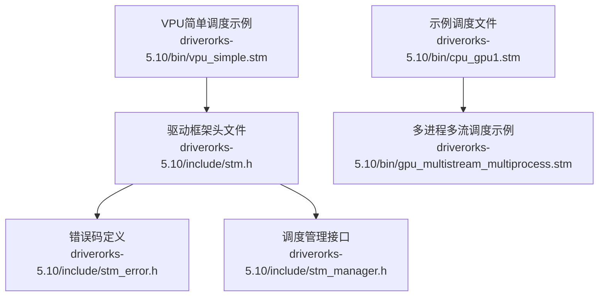
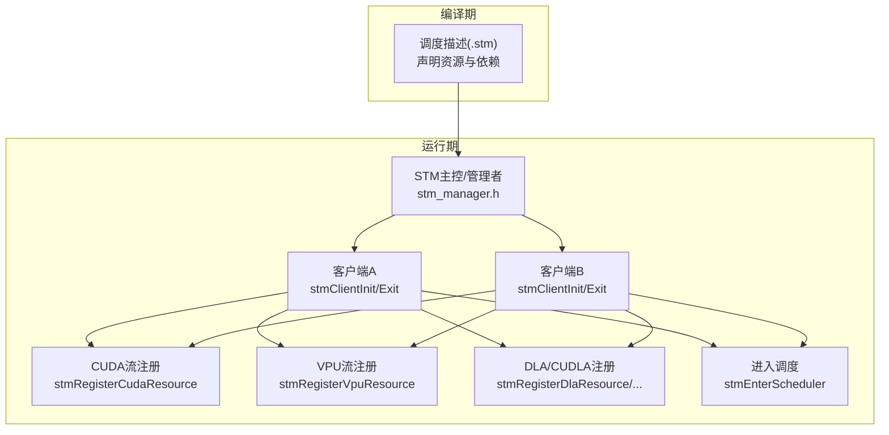
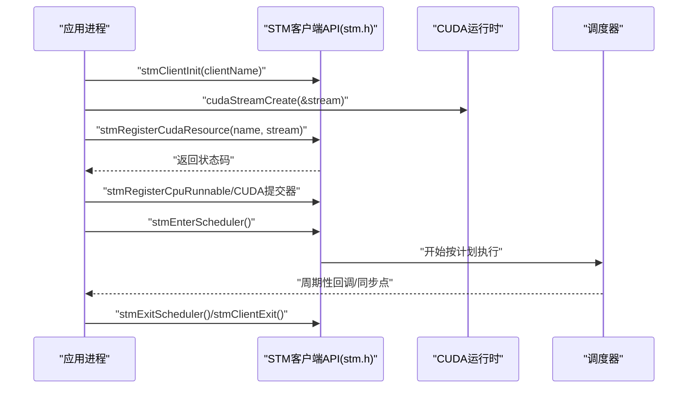
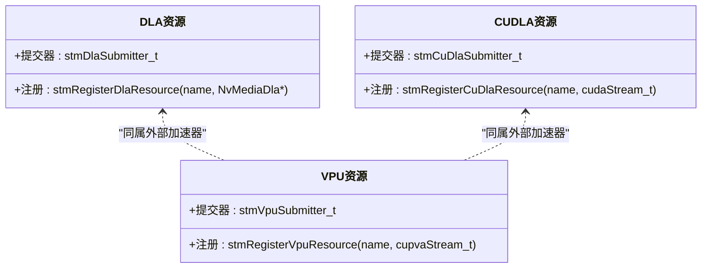
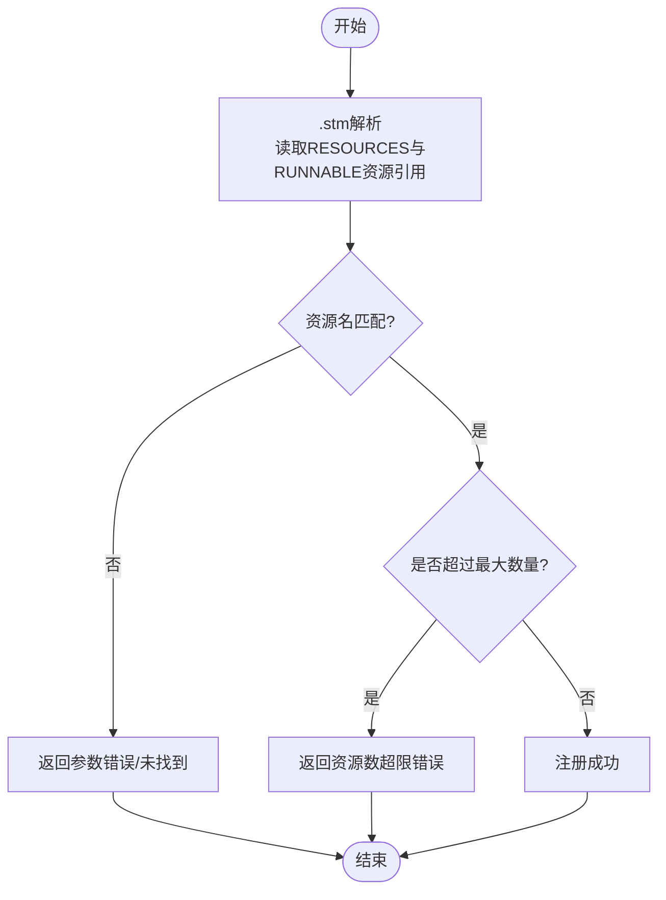
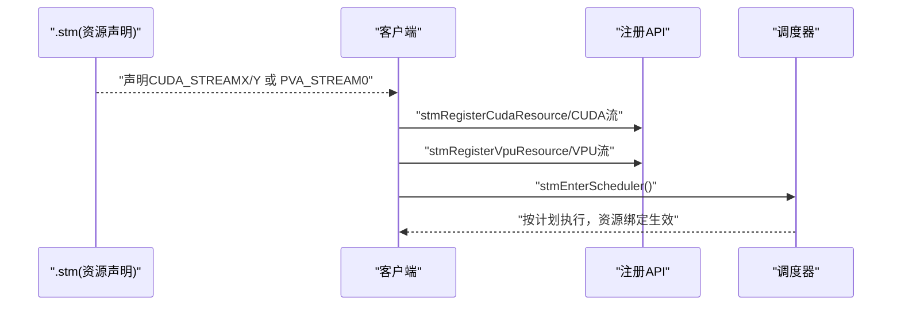
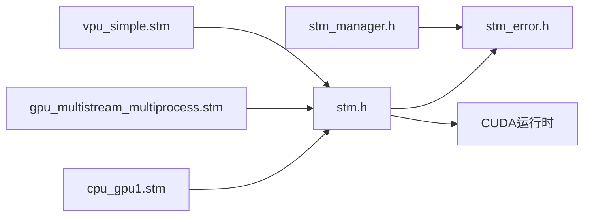

# 资源管理

<cite>
**本文引用的文件**
- [stm.h](file://driverorks-5.10/include/stm.h)
- [stm_manager.h](file://driverorks-5.10/include/stm_manager.h)
- [stm_error.h](file://driverorks-5.10/include/stm_error.h)
- [cpu_gpu1.stm](file://driverorks-5.10/bin/cpu_gpu1.stm)
- [gpu_multistream_multiprocess.stm](file://driverorks-5.10/bin/gpu_multistream_multiprocess.stm)
- [vpu_simple.stm](file://driverorks-5.10/bin/vpu_simple.stm)
</cite>

## 目录
1. [简介](#简介)
2. [项目结构](#项目结构)
3. [核心组件](#核心组件)
4. [架构总览](#架构总览)
5. [详细组件分析](#详细组件分析)
6. [依赖关系分析](#依赖关系分析)
7. [性能考量](#性能考量)
8. [故障排除指南](#故障排除指南)
9. [结论](#结论)
10. [附录](#附录)

## 简介
本文件面向STM（静态时分）资源管理系统，聚焦以下主题：
- CUDA流管理与注册：解释stmRegisterCudaResource的用法、注册策略与限制
- 硬件资源分配与管理：涵盖DLA、CUDLA、VPU等加速器资源的注册与使用
- 资源名称匹配与数量限制：说明资源名一致性要求与上限约束
- CUDA流0的禁用与隐式同步语义：阐述为何禁止使用默认流
- 最佳实践与性能优化：结合调度文件与API行为给出建议
- 泄漏检测与故障排除：基于错误码与常见问题定位

## 项目结构
本仓库中与STM资源管理直接相关的关键头文件位于driverorks-5.10/include目录，调度描述文件位于driverorks-5.10/bin目录。下图展示与资源管理相关的文件与职责映射。

**图表来源**
- [stm.h](file://driverorks-5.10/include/stm.h)
- [stm_manager.h](file://driverorks-5.10/include/stm_manager.h)
- [stm_error.h](file://driverorks-5.10/include/stm_error.h)
- [cpu_gpu1.stm](file://driverorks-5.10/bin/cpu_gpu1.stm)
- [gpu_multistream_multiprocess.stm](file://driverorks-5.10/bin/gpu_multistream_multiprocess.stm)
- [vpu_simple.stm](file://driverorks-5.10/bin/vpu_simple.stm)

**章节来源**
- [stm.h:103-154](file://driverorks-5.10/include/stm.h#L103-L154)
- [cpu_gpu1.stm:27-63](file://driverorks-5.10/bin/cpu_gpu1.stm#L27-L63)
- [gpu_multistream_multiprocess.stm:27-63](file://driverorks-5.10/bin/gpu_multistream_multiprocess.stm#L27-L63)
- [vpu_simple.stm:25-52](file://driverorks-5.10/bin/vpu_simple.stm#L25-L52)

## 核心组件
- 客户端API（stm.h）
  - 初始化与退出：stmClientInit、stmClientExit
  - 运行体注册：stmRegisterCpuRunnable、stmRegisterCudaSubmitter
  - 资源注册：stmRegisterCudaResource、stmRegisterDlaResource、stmRegisterCuDlaResource、stmRegisterVpuResource
  - 调度控制：stmEnterScheduler、stmExitScheduler、stmGetRuntimeInfo
- 错误码（stm_error.h）
  - 统一返回码枚举，覆盖初始化、参数、CUDA、DLA、CUDLA、VPU、内存不足、超时等场景
- 调度管理（stm_manager.h）
  - 管理者进程初始化、启动/停止调度，用于集中控制多客户端执行

**章节来源**
- [stm.h:103-330](file://driverorks-5.10/include/stm.h#L103-L330)
- [stm_error.h:47-97](file://driverorks-5.10/include/stm_error.h#L47-L97)
- [stm_manager.h:45-106](file://driverorks-5.10/include/stm_manager.h#L45-L106)

## 架构总览
STM通过“编译期生成调度+运行期严格时序”实现跨引擎（CPU/GPU/VPU等）的确定性执行。资源注册是连接编译期资源声明与运行期提交的关键环节。

**图表来源**
- [cpu_gpu1.stm:27-63](file://driverorks-5.10/bin/cpu_gpu1.stm#L27-L63)
- [vpu_simple.stm:25-52](file://driverorks-5.10/bin/vpu_simple.stm#L25-L52)
- [stm.h:103-154](file://driverorks-5.10/include/stm.h#L103-L154)
- [stm_manager.h:45-106](file://driverorks-5.10/include/stm_manager.h#L45-L106)

## 详细组件分析

### CUDA流管理与stmRegisterCudaResource
- 注册流程
  - 应用在调用任何其他STM API前完成stmClientInit
  - 使用cudaStreamCreate创建CUDA流
  - 调用stmRegisterCudaResource(resourceName, stream)，其中resourceName需与编译期.stm中声明一致
  - 在CPU/CUDA提交器中通过资源名引用该流进行提交
- 参数与限制
  - 不允许注册NULL流或未通过cudaStreamCreate创建的流
  - 同一流对象不可重复注册（即使资源名不同也会被拒绝）
  - 资源名长度与总数受限（见错误码与API注释）
- 禁止使用CUDA流0的原因
  - 流0为默认流，使用它会触发隐式同步，破坏调度并发性与实时性
  - 提交器签名明确禁止在CUDA提交器中使用流0
- 典型调度映射
  - .stm中CLIENT段的RESOURCES声明对应RUNNABLE中对CUDA_STREAMX/Y的引用
  - 调度器据此保证数据依赖与时序约束

**图表来源**
- [stm.h:103-154](file://driverorks-5.10/include/stm.h#L103-L154)
- [cpu_gpu1.stm:27-63](file://driverorks-5.10/bin/cpu_gpu1.stm#L27-L63)
- [gpu_multistream_multiprocess.stm:27-63](file://driverorks-5.10/bin/gpu_multistream_multiprocess.stm#L27-L63)

**章节来源**
- [stm.h:142-154](file://driverorks-5.10/include/stm.h#L142-L154)
- [stm.h:94-101](file://driverorks-5.10/include/stm.h#L94-L101)
- [cpu_gpu1.stm:27-63](file://driverorks-5.10/bin/cpu_gpu1.stm#L27-L63)
- [gpu_multistream_multiprocess.stm:27-63](file://driverorks-5.10/bin/gpu_multistream_multiprocess.stm#L27-L63)

### 硬件加速器资源管理（DLA/CUDLA/VPU）
- DLA/CUDLA
  - DLA：在较早PDK版本支持，通过stmRegisterDlaResource注册NvMediaDla句柄
  - CUDLA：在特定PDK版本后支持，通过stmRegisterCuDlaResource注册CUDA流，用于承载CUDLA任务
  - 提交器类型：stmDlaSubmitter_t、stmCuDlaSubmitter_t
- VPU（CUPVA）
  - 通过stmRegisterVpuResource注册cupvaStream_t，配合stmVpuSubmitter_t进行提交
  - 调度文件中以VPU(PVA_STREAM0)等形式声明资源
- 资源注册一致性
  - .stm中声明的资源名必须与stmRegisterXxxResource的name完全一致
  - 同一句柄/流不可重复注册

**图表来源**
- [stm.h:156-284](file://driverorks-5.10/include/stm.h#L156-L284)
- [vpu_simple.stm:25-52](file://driverorks-5.10/bin/vpu_simple.stm#L25-L52)

**章节来源**
- [stm.h:156-284](file://driverorks-5.10/include/stm.h#L156-L284)
- [vpu_simple.stm:25-52](file://driverorks-5.10/bin/vpu_simple.stm#L25-L52)

### 资源名称匹配机制与数量限制
- 名称匹配
  - .stm文件中CLIENT.RESOURCES段声明的资源名需与stmRegisterXxxResource的name一致
  - RUNNABLE中对资源的引用（如CUDA_STREAMX/Y、PVA_STREAM0）必须与声明一致
- 数量限制
  - 注册资源总数不得超过最大限制（由API参数校验与错误码体现）
  - 超限将返回错误码，需减少资源或合并复用
- 调度元数据
  - .stm文件包含resource_type_mapping，用于将具体实例映射到资源类型，便于编译器与运行时解析

**图表来源**
- [cpu_gpu1.stm:27-63](file://driverorks-5.10/bin/cpu_gpu1.stm#L27-L63)
- [vpu_simple.stm:25-52](file://driverorks-5.10/bin/vpu_simple.stm#L25-L52)
- [stm.h:142-154](file://driverorks-5.10/include/stm.h#L142-L154)

**章节来源**
- [cpu_gpu1.stm:27-63](file://driverorks-5.10/bin/cpu_gpu1.stm#L27-L63)
- [vpu_simple.stm:25-52](file://driverorks-5.10/bin/vpu_simple.stm#L25-L52)
- [stm.h:142-154](file://driverorks-5.10/include/stm.h#L142-L154)

### CUDA流0的禁用与隐式同步语义
- 禁用原因
  - 默认流0在CUDA中存在隐式同步，会阻塞所有其他流，破坏并发与实时性
  - 提交器签名明确禁止使用流0
- 行为影响
  - 若在流0上提交内核，可能导致调度器无法并行推进其他资源
  - 违反此规则将导致性能退化与潜在的时序违规

**章节来源**
- [stm.h:94-101](file://driverorks-5.10/include/stm.h#L94-L101)

### 调度与资源绑定示例
- 多客户端多流示例
  - .stm中为两个客户端分别声明CUDA_STREAMX/Y，并在RUNNABLE中引用
  - 客户端各自注册对应流，确保跨客户端无资源冲突
- VPU简单示例
  - .stm中声明PVA_STREAM0，客户端注册cupvaStream_t并在RUNNABLE中使用

**图表来源**
- [cpu_gpu1.stm:27-63](file://driverorks-5.10/bin/cpu_gpu1.stm#L27-L63)
- [gpu_multistream_multiprocess.stm:27-63](file://driverorks-5.10/bin/gpu_multistream_multiprocess.stm#L27-L63)
- [vpu_simple.stm:25-52](file://driverorks-5.10/bin/vpu_simple.stm#L25-L52)

**章节来源**
- [cpu_gpu1.stm:27-63](file://driverorks-5.10/bin/cpu_gpu1.stm#L27-L63)
- [gpu_multistream_multiprocess.stm:27-63](file://driverorks-5.10/bin/gpu_multistream_multiprocess.stm#L27-L63)
- [vpu_simple.stm:25-52](file://driverorks-5.10/bin/vpu_simple.stm#L25-L52)

## 依赖关系分析
- 头文件依赖
  - stm.h依赖stm_error.h（错误码）、CUDA运行时（cudaStream_t）
  - stm_manager.h依赖stm_error.h（错误码），用于管理端控制
- 调度文件依赖
  - .stm文件声明资源类型与数量，运行时通过注册API绑定具体句柄/流
- 错误码依赖
  - 所有注册与调度API返回统一错误码，便于定位初始化、参数、CUDA/DLA/VPU、内存不足等问题

**图表来源**
- [stm.h:57-60](file://driverorks-5.10/include/stm.h#L57-L60)
- [stm_manager.h:38-40](file://driverorks-5.10/include/stm_manager.h#L38-L40)
- [cpu_gpu1.stm:27-63](file://driverorks-5.10/bin/cpu_gpu1.stm#L27-L63)
- [gpu_multistream_multiprocess.stm:27-63](file://driverorks-5.10/bin/gpu_multistream_multiprocess.stm#L27-L63)
- [vpu_simple.stm:25-52](file://driverorks-5.10/bin/vpu_simple.stm#L25-L52)

**章节来源**
- [stm.h:57-60](file://driverorks-5.10/include/stm.h#L57-L60)
- [stm_manager.h:38-40](file://driverorks-5.10/include/stm_manager.h#L38-L40)
- [cpu_gpu1.stm:27-63](file://driverorks-5.10/bin/cpu_gpu1.stm#L27-L63)
- [gpu_multistream_multiprocess.stm:27-63](file://driverorks-5.10/bin/gpu_multistream_multiprocess.stm#L27-L63)
- [vpu_simple.stm:25-52](file://driverorks-5.10/bin/vpu_simple.stm#L25-L52)

## 性能考量
- 并发与流水线
  - 避免使用流0，确保各资源流独立，最大化并发
  - 将CPU/CUDA/VPU等不同类型资源分离到不同流，降低相互阻塞
- 资源复用与合并
  - 在满足时序约束前提下，尽量复用流，减少资源总数
  - 对于VPU/CUDLA等外部加速器，合理规划提交器与提交目标，避免过度串行
- 调度粒度
  - .stm中RUNNABLE的时隙安排应与实际计算负载匹配，避免空转或拥塞
- 内存与同步
  - 避免在CUDA提交器中使用阻塞API（如拷贝/设置/释放），防止隐式同步

[本节为通用指导，不直接分析具体文件]

## 故障排除指南
- 常见错误与定位
  - 未初始化：调用其他API前未完成stmClientInit
  - 参数错误：资源名过长、资源名不匹配、重复注册同一流、传入NULL或未创建的流
  - CUDA/DLA/VPU错误：底层硬件/驱动异常，检查设备可用性与权限
  - 内存不足：系统/驱动内存紧张，适当减少资源或降低并发
  - 超时：同步/等待超时，检查调度时序与资源争用
- 排查步骤
  - 检查所有stmRegisterXxxResource调用是否与.stm声明一致
  - 确认未向流0提交内核
  - 使用错误码转换函数输出可读信息，结合日志定位失败点
  - 验证每个客户端仅注册一次对应流
- 相关错误码参考
  - 初始化/参数/内存/超时/CUDA/DLA/CUDLA/VPU/同步等

**章节来源**
- [stm_error.h:47-97](file://driverorks-5.10/include/stm_error.h#L47-L97)
- [stm.h:142-154](file://driverorks-5.10/include/stm.h#L142-L154)

## 结论
STM资源管理通过严格的资源注册与调度约束，确保多引擎协同的确定性与时序正确性。CUDA流0的禁用、资源名一致性与数量限制是保障性能与稳定的三大关键点。结合DLA/CUDLA/VPU等异构资源的注册与使用，可在复杂系统中实现高并发、低延迟的实时处理。

[本节为总结性内容，不直接分析具体文件]

## 附录
- 关键API速览
  - 客户端生命周期：stmClientInit、stmClientExit、stmEnterScheduler、stmExitScheduler、stmGetRuntimeInfo
  - 资源注册：stmRegisterCudaResource、stmRegisterDlaResource、stmRegisterCuDlaResource、stmRegisterVpuResource
  - 管理端：stmScheduleManagerInit、stmStartSchedule、stmStopSchedule、stmScheduleManagerExit
- 示例参考
  - 多客户端多CUDA流：cpu_gpu1.stm、gpu_multistream_multiprocess.stm
  - VPU简单示例：vpu_simple.stm

**章节来源**
- [stm.h:103-330](file://driverorks-5.10/include/stm.h#L103-L330)
- [stm_manager.h:45-106](file://driverorks-5.10/include/stm_manager.h#L45-L106)
- [cpu_gpu1.stm:27-63](file://driverorks-5.10/bin/cpu_gpu1.stm#L27-L63)
- [gpu_multistream_multiprocess.stm:27-63](file://driverorks-5.10/bin/gpu_multistream_multiprocess.stm#L27-L63)
- [vpu_simple.stm:25-52](file://driverorks-5.10/bin/vpu_simple.stm#L25-L52)