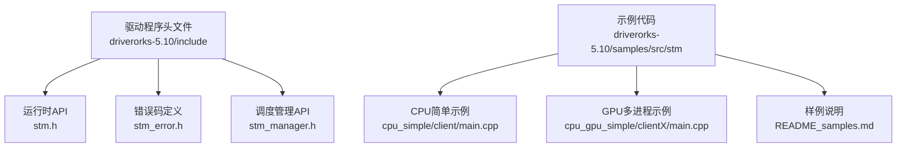
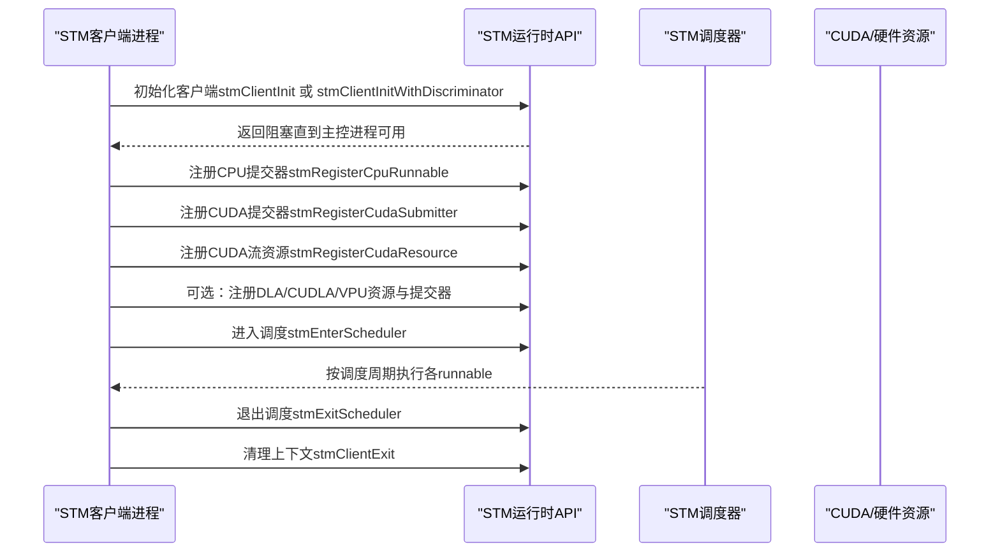
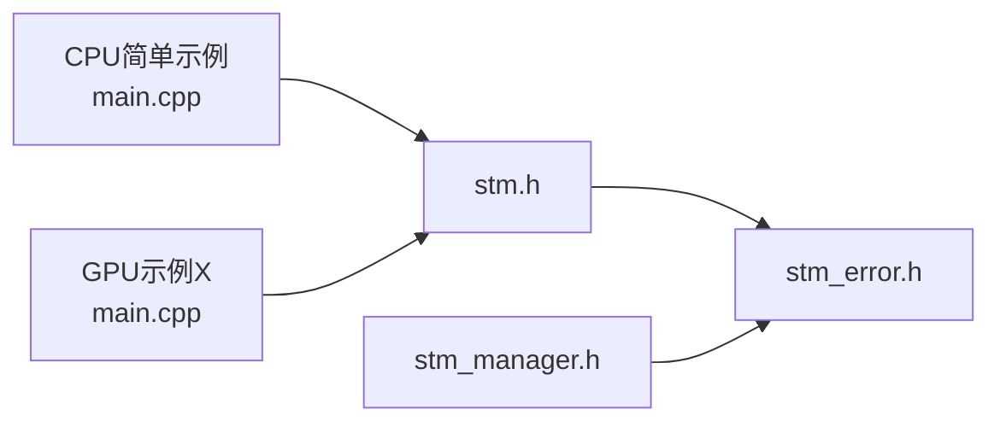

# 运行时API

<cite>
**本文引用的文件**
- [stm.h](file://driverorks-5.10/include/stm.h)
- [stm_error.h](file://driverorks-5.10/include/stm_error.h)
- [stm_manager.h](file://driverorks-5.10/include/stm_manager.h)
- [README_en.md](file://README_en.md)
- [README.md](file://README.md)
- [README_samples.md](file://driverorks-5.10/samples/src/stm/README_samples.md)
- [main.cpp（CPU简单示例）](file://driverorks-5.10/samples/src/stm/src/cpu_simple/client/main.cpp)
- [main.cpp（GPU多进程示例客户端X）](file://driverorks-5.10/samples/src/stm/src/cpu_gpu_simple/clientX/main.cpp)
</cite>

## 目录
1. [简介](#简介)
2. [项目结构](#项目结构)
3. [核心组件](#核心组件)
4. [架构总览](#架构总览)
5. [详细组件分析](#详细组件分析)
6. [依赖分析](#依赖分析)
7. [性能考虑](#性能考虑)
8. [故障排查指南](#故障排查指南)
9. [结论](#结论)
10. [附录](#附录)

## 简介
本文件为STM（静态调度中间件）运行时API的权威参考，覆盖以下内容：
- 全部公共API的函数签名、参数说明、返回值与错误码
- 错误码体系与错误处理策略
- 运行时信息查询（stmGetRuntimeInfo）
- 调度生命周期管理（stmEnterScheduler、stmExitScheduler、stmClientExit）
- 各类资源注册（CUDA、DLA、CUDLA、VPU）与CPU/CUDA提交器注册
- 使用示例与最佳实践
- 版本兼容性与迁移建议

STM是一个协作式、非抢占式的静态调度框架，用于在Tegra SoC上按离线编译生成的调度表执行任务，保证数据依赖与控制流顺序。

**章节来源**
- [README_en.md: 1-92:1-92](file://README_en.md#L1-L92)
- [README.md: 1-115:1-115](file://README.md#L1-L115)

## 项目结构
- 头文件位于 driverorks-5.10/include，包含运行时API、错误码与调度管理API
- 示例位于 driverorks-5.10/samples/src/stm，展示CPU/GPU/DLA/VPU等场景下的典型用法
- README_samples.md 提供运行样例、编译与环境准备说明

**图表来源**
- [stm.h:1-337](file://driverorks-5.10/include/stm.h#L1-L337)
- [stm_error.h:1-117](file://driverorks-5.10/include/stm_error.h#L1-L117)
- [stm_manager.h:1-113](file://driverorks-5.10/include/stm_manager.h#L1-L113)
- [README_samples.md:1-266](file://driverorks-5.10/samples/src/stm/README_samples.md#L1-L266)
- [main.cpp（CPU简单示例）:1-70](file://driverorks-5.10/samples/src/stm/src/cpu_simple/client/main.cpp#L1-L70)
- [main.cpp（GPU多进程示例客户端X）:1-91](file://driverorks-5.10/samples/src/stm/src/cpu_gpu_simple/clientX/main.cpp#L1-L91)

**章节来源**
- [README_samples.md: 152-266:152-266](file://driverorks-5.10/samples/src/stm/README_samples.md#L152-L266)

## 核心组件
- 运行时API（stm.h）：提供客户端初始化、CPU/CUDA/DLA/VPU提交器注册、CUDA/（可选）DLA/CUDLA/VPU资源注册、进入/退出调度、获取运行时信息等
- 错误码体系（stm_error.h）：统一的错误枚举与字符串化工具
- 调度管理API（stm_manager.h）：仅在存在“调度管理器”进程时使用，用于启动/停止指定scheduleId的执行

**章节来源**
- [stm.h: 103-330:103-330](file://driverorks-5.10/include/stm.h#L103-L330)
- [stm_error.h: 47-97:47-97](file://driverorks-5.10/include/stm_error.h#L47-L97)
- [stm_manager.h: 45-106:45-106](file://driverorks-5.10/include/stm_manager.h#L45-L106)

## 架构总览
下图展示了典型的STM运行时调用序列：客户端进程在启动后先初始化，注册CPU/CUDA/DLA/VPU提交器与资源，然后进入调度循环；调度完成后进行清理。

**图表来源**
- [stm.h: 103-330:103-330](file://driverorks-5.10/include/stm.h#L103-L330)

## 详细组件分析

### 1) 客户端初始化与生命周期
- 函数：stmClientInit、stmClientInitWithDiscriminator
  - 功能：初始化当前OS进程的STM客户端上下文；若使用判别符，则阻塞等待对应判别符的主控进程启动
  - 注意事项：必须在调用其他STM API之前调用；二者只能调用其一
  - 返回：无（无错误码）
- 函数：stmClientExit
  - 功能：清理客户端上下文；此后不得再调用任何STM API
  - 注意事项：每个初始化仅能调用一次

最佳实践：
- 在进程入口尽早调用初始化
- 若使用多实例或多判别符场景，确保主控进程先启动
- 退出前确保已调用stmExitScheduler（如适用）

**章节来源**
- [stm.h: 103-118:103-118](file://driverorks-5.10/include/stm.h#L103-L118)
- [stm.h: 325-330:325-330](file://driverorks-5.10/include/stm.h#L325-L330)

### 2) CPU提交器注册
- 函数：stmRegisterCpuRunnable
  - 参数：
    - func：CPU可执行函数指针（类型为stmRunnable_t），不应包含阻塞或内部线程
    - runnableId：字符串标识，需与编译期描述一致
    - userdata：用户数据指针
  - 返回：错误码（STM_ERROR_BAD_PARAMETER、STM_ERROR_NOT_INITIALIZED等）
  - 注意：runnableId长度受限

最佳实践：
- 将CPU工作尽量保持轻量，避免阻塞
- 严格遵守“不可调用阻塞API、不可内部创建线程”的约束

**章节来源**
- [stm.h: 120-129:120-129](file://driverorks-5.10/include/stm.h#L120-L129)

### 3) CUDA提交器与资源注册
- 函数：stmRegisterCudaSubmitter
  - 参数：func（类型为stmCudaSubmitter_t）、runnableId、userdata
  - 返回：错误码
  - 约束：func内应包含CPU工作与异步CUDA核启动；核必须在传入的cudaStream_t上提交；禁止使用默认流（null stream）
- 函数：stmRegisterCudaResource
  - 参数：resourceName（需与编译期一致）、cudaStream_t
  - 返回：错误码
  - 约束：资源名长度限制、资源数量上限、流必须有效且非默认流、同一流不可重复注册

最佳实践：
- 使用非阻塞流；避免同步API（如cudaMemcpy/cudaMemset/cudaFree）
- 一个提交器内仅对指定流进行提交
- 资源命名与编译期描述一致

**章节来源**
- [stm.h: 94-101:94-101](file://driverorks-5.10/include/stm.h#L94-L101)
- [stm.h: 131-140:131-140](file://driverorks-5.10/include/stm.h#L131-L140)
- [stm.h: 142-154:142-154](file://driverorks-5.10/include/stm.h#L142-L154)

### 4) DLA/CUDLA/VPU（可选）支持
- 类型与提交器（条件编译）：
  - DLA：stmDlaSubmitter_t（PDK < 6.0.4.0）
  - CUDLA：stmCuDlaSubmitter_t（PDK ≥ 6.0.2.0）
  - VPU：stmVpuSubmitter_t（PDK ≥ 6.0.0.0）
- 对应资源注册API：
  - DLA：stmRegisterDlaResource
  - CUDLA：stmRegisterCuDlaResource
  - VPU：stmRegisterVpuResource
- 返回：错误码（含对应子系统的错误类型）

注意：仅在满足PDK版本要求时启用，否则链接失败。

**章节来源**
- [stm.h: 156-284:156-284](file://driverorks-5.10/include/stm.h#L156-L284)

### 5) 调度控制与退出
- 函数：stmEnterScheduler
  - 功能：开始按调度周期执行已注册的runnable；在所有客户端完成启动后才开始
  - 行为：在达到设定epoch次数或任一客户端调用退出后返回
  - 返回：错误码（含超时、通用错误等）
- 函数：stmExitScheduler
  - 功能：请求在下一个epoch边界让所有客户端同时退出
  - 注意：只需在一个客户端调用即可；后续调用会被忽略
- 函数：stmClientExit
  - 功能：清理客户端上下文；此后不得再调用任何STM API

最佳实践：
- 在所有注册完成后调用进入调度
- 退出时确保不会破坏数据一致性（例如在退出前完成必要的收尾）

**章节来源**
- [stm.h: 286-330:286-330](file://driverorks-5.10/include/stm.h#L286-L330)

### 6) 运行时信息查询
- 函数：stmGetRuntimeInfo
  - 参数：info（输出结构体指针）
  - 输出字段：
    - epochIterations：当前epoch内的迭代计数
    - scheduleId：当前执行的调度ID
  - 返回：错误码（参数无效、未找到线程、状态无效等）

使用场景：在CPU提交器内查询当前执行状态，辅助统计与调试。

**章节来源**
- [stm.h: 76-83:76-83](file://driverorks-5.10/include/stm.h#L76-L83)
- [stm.h: 301-313:301-313](file://driverorks-5.10/include/stm.h#L301-L313)

### 7) 调度管理API（仅限存在调度管理器进程）
- 函数：stmScheduleManagerInit、stmScheduleManagerInitWithDiscriminator
  - 功能：初始化调度管理器上下文；阻塞等待主控进程启动
  - 返回：错误码（内存不足、判别符不支持、连接未启用等）
- 函数：stmStartSchedule、stmStopSchedule
  - 功能：启动/停止指定scheduleId的执行
  - 返回：错误码（未初始化、状态转换非法、消息收发失败等）
- 函数：stmScheduleManagerExit
  - 功能：清理管理器上下文

注意：仅当系统中存在“调度管理器”进程时使用；否则请直接使用客户端侧API。

**章节来源**
- [stm_manager.h: 45-106:45-106](file://driverorks-5.10/include/stm_manager.h#L45-L106)

## 依赖分析
- 头文件依赖
  - stm.h 依赖 stm_error.h（错误码枚举）
  - stm_manager.h 依赖 stm_error.h（错误码枚举）
- 示例依赖
  - CPU简单示例：调用stmClientInit、stmRegisterCpuRunnable、stmEnterScheduler、stmClientExit
  - GPU多进程示例：调用stmRegisterCudaSubmitter、stmRegisterCudaResource、stmEnterScheduler、stmClientExit

**图表来源**
- [stm.h:57-60](file://driverorks-5.10/include/stm.h#L57-L60)
- [stm_manager.h:38-40](file://driverorks-5.10/include/stm_manager.h#L38-L40)
- [main.cpp（CPU简单示例）:31-70](file://driverorks-5.10/samples/src/stm/src/cpu_simple/client/main.cpp#L31-L70)
- [main.cpp（GPU多进程示例客户端X）:31-91](file://driverorks-5.10/samples/src/stm/src/cpu_gpu_simple/clientX/main.cpp#L31-L91)

**章节来源**
- [stm.h: 57-60:57-60](file://driverorks-5.10/include/stm.h#L57-L60)
- [stm_manager.h: 38-40:38-40](file://driverorks-5.10/include/stm_manager.h#L38-L40)
- [main.cpp（CPU简单示例）: 61-69:61-69](file://driverorks-5.10/samples/src/stm/src/cpu_simple/client/main.cpp#L61-L69)
- [main.cpp（GPU多进程示例客户端X）: 80-89:80-89](file://driverorks-5.10/samples/src/stm/src/cpu_gpu_simple/clientX/main.cpp#L80-L89)

## 性能考虑
- 避免在CPU提交器中执行阻塞操作或创建线程
- CUDA提交器仅在指定流上异步提交核，避免默认流同步
- 合理设置epoch次数与调度周期，平衡实时性与吞吐
- 使用样例工具链（编译器、可视化、分析工具）进行性能验证与优化

[本节为通用指导，无需特定文件引用]

## 故障排查指南
常见错误与处理建议：
- STM_ERROR_NOT_INITIALIZED：未在调用其他API前调用初始化
- STM_ERROR_BAD_PARAMETER：参数非法（如名称过长、资源重复注册、流无效）
- STM_ERROR_NOT_SUPPORTED：当前PDK版本不支持某功能（如DLA/CUDLA/VPU）
- STM_ERROR_TIMEOUT：同步/等待超时
- STM_ERROR_INVALID_STATE：无法获取所需运行时信息
- STM_ERROR_CUDA/NVSCISYNC/SYNC/PVA等：底层子系统错误

建议排查步骤：
- 确认初始化与退出调用顺序正确
- 检查资源命名与编译期描述一致
- 核对PDK版本是否满足可选功能要求
- 使用样例工具链生成日志并分析

**章节来源**
- [stm_error.h: 47-97:47-97](file://driverorks-5.10/include/stm_error.h#L47-L97)
- [stm.h: 125-154:125-154](file://driverorks-5.10/include/stm.h#L125-L154)
- [stm.h: 294-297:294-297](file://driverorks-5.10/include/stm.h#L294-L297)
- [stm.h: 307-311:307-311](file://driverorks-5.10/include/stm.h#L307-L311)

## 结论
STM运行时API提供了从初始化、注册、调度到退出的完整生命周期管理。遵循本文的参数约束、错误处理策略与最佳实践，可在Tegra平台上构建稳定可靠的静态调度系统。对于需要动态切换调度的任务，可结合调度管理API实现多schedule协同。

[本节为总结，无需特定文件引用]

## 附录

### A. API清单与要点速览
- 客户端初始化
  - stmClientInit、stmClientInitWithDiscriminator
  - 必须最先调用；二者择一
- 提交器与资源
  - CPU：stmRegisterCpuRunnable
  - CUDA：stmRegisterCudaSubmitter、stmRegisterCudaResource
  - 可选：DLA/CUDLA/VPU（条件编译）
- 调度控制
  - stmEnterScheduler、stmExitScheduler、stmClientExit
- 运行时信息
  - stmGetRuntimeInfo（epochIterations、scheduleId）
- 调度管理（可选）
  - stmScheduleManagerInit/WithDiscriminator、stmStartSchedule、stmStopSchedule、stmScheduleManagerExit

**章节来源**
- [stm.h: 103-330:103-330](file://driverorks-5.10/include/stm.h#L103-L330)
- [stm_manager.h: 45-106:45-106](file://driverorks-5.10/include/stm_manager.h#L45-L106)

### B. 使用示例与参考路径
- CPU简单示例
  - 初始化、注册CPU提交器、进入调度、退出
  - 参考：[main.cpp（CPU简单示例）:61-69](file://driverorks-5.10/samples/src/stm/src/cpu_simple/client/main.cpp#L61-L69)
- GPU多进程示例（客户端X）
  - 创建非阻塞CUDA流、注册CUDA提交器与资源、进入调度、退出
  - 参考：[main.cpp（GPU多进程示例客户端X）:78-89](file://driverorks-5.10/samples/src/stm/src/cpu_gpu_simple/clientX/main.cpp#L78-L89)

**章节来源**
- [main.cpp（CPU简单示例）: 61-69:61-69](file://driverorks-5.10/samples/src/stm/src/cpu_simple/client/main.cpp#L61-L69)
- [main.cpp（GPU多进程示例客户端X）: 78-89:78-89](file://driverorks-5.10/samples/src/stm/src/cpu_gpu_simple/clientX/main.cpp#L78-L89)

### C. 版本兼容性与迁移指南
- PDK版本要求
  - DLA支持：PDK < 6.0.4.0
  - CUDLA支持：PDK ≥ 6.0.2.0
  - VPU支持：PDK ≥ 6.0.0.0
- 迁移建议
  - 仅在满足版本要求时启用对应API；否则请使用CUDA或CPU路径
  - 从CGF框架迁移到直接使用DW API时，保留STM调度不变，调整数据通道与节点封装

**章节来源**
- [stm.h: 156-284:156-284](file://driverorks-5.10/include/stm.h#L156-L284)
- [README.md: 51-62:51-62](file://README.md#L51-L62)