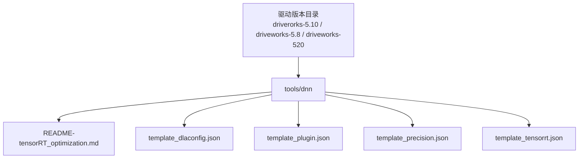
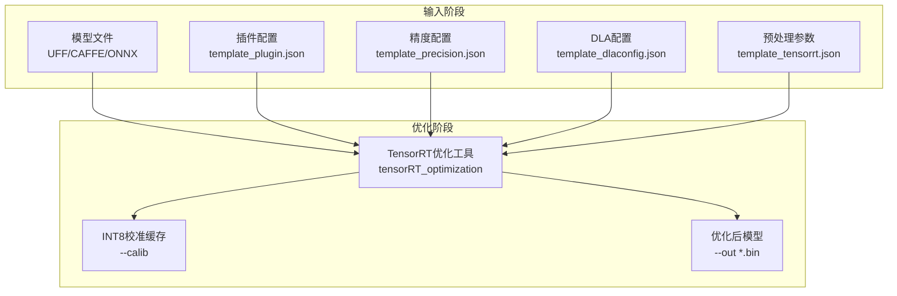
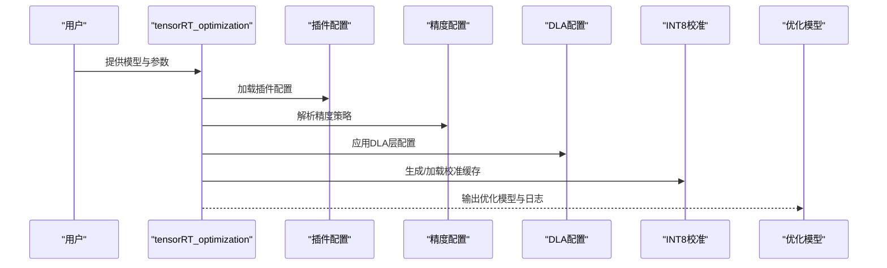
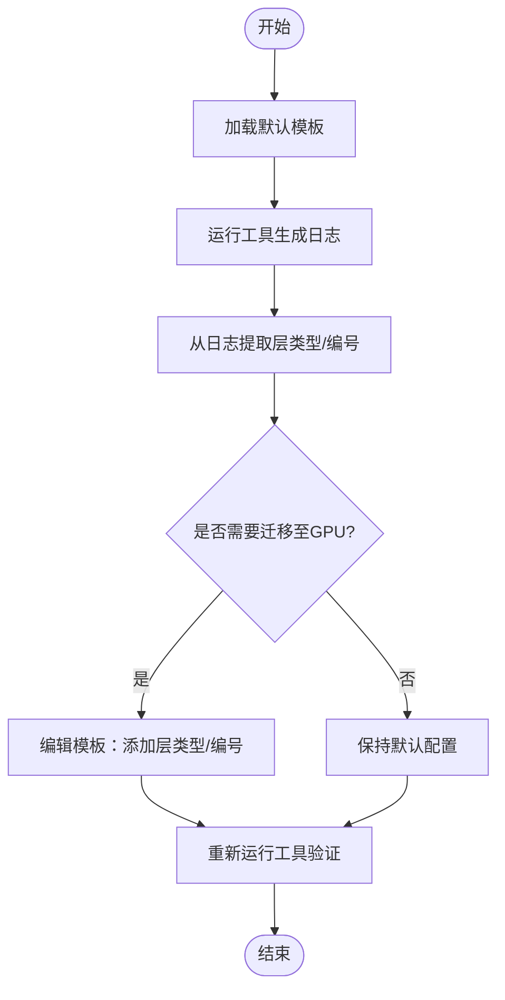
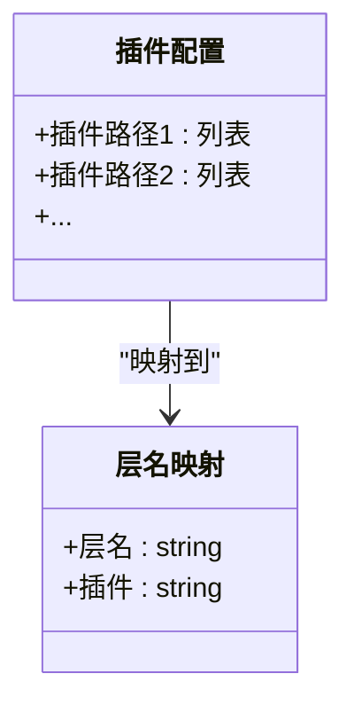
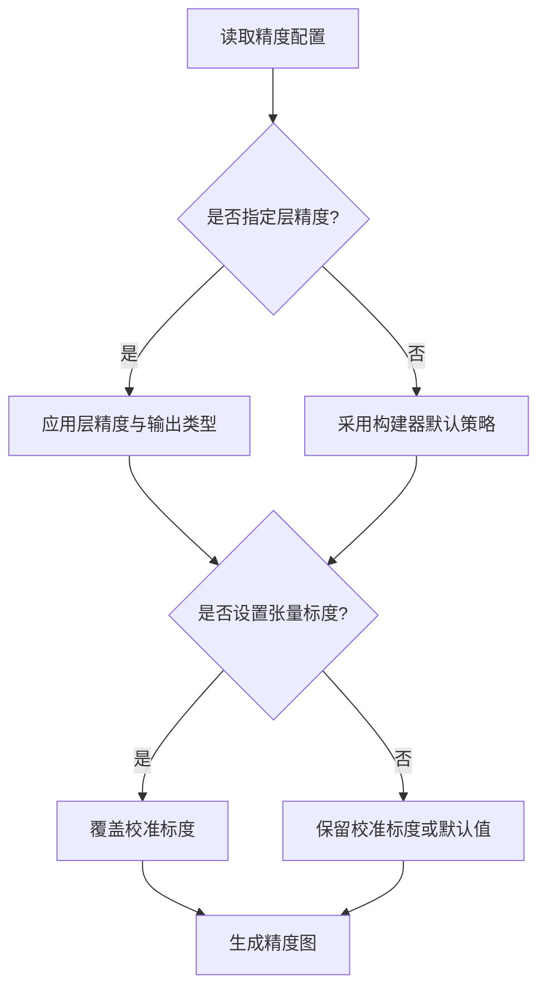
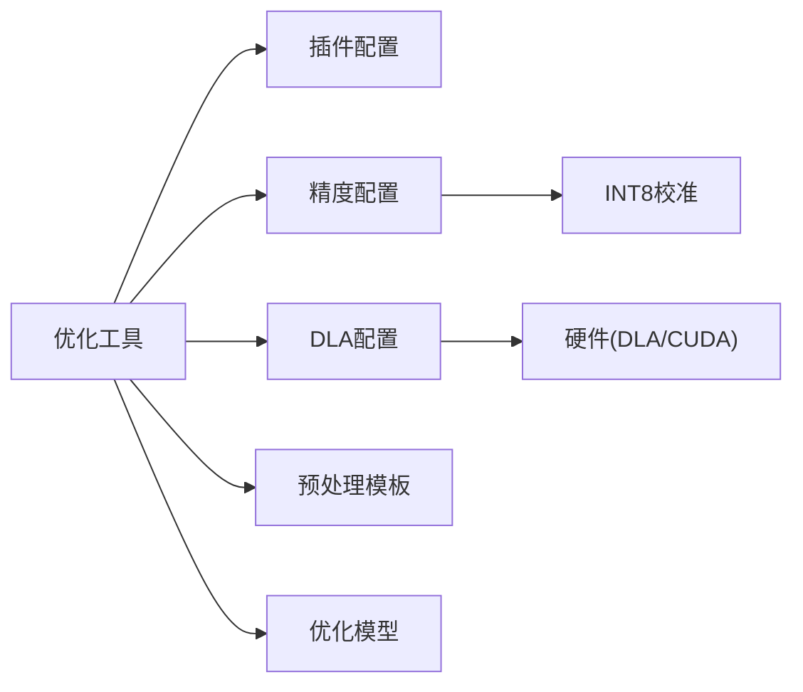

# DNN优化工具

<cite>
**本文引用的文件**
- [README-tensorRT_optimization.md](file://driverorks-5.10/tools/dnn/README-tensorRT_optimization.md)
- [template_dlaconfig.json](file://driverorks-5.10/tools/dnn/template_dlaconfig.json)
- [template_plugin.json](file://driverorks-5.10/tools/dnn/template_plugin.json)
- [template_precision.json](file://driverorks-5.10/tools/dnn/template_precision.json)
- [template_tensorrt.json](file://driverorks-5.10/tools/dnn/template_tensorrt.json)
- [README-tensorRT_optimization.md（5.8版）](file://driveworks-5.8/tools/dnn/README-tensorRT_optimization.md)
- [template_dlaconfig.json（5.8版）](file://driveworks-5.8/tools/dnn/template_dlaconfig.json)
- [template_plugin.json（5.8版）](file://driveworks-5.8/tools/dnn/template_plugin.json)
- [template_precision.json（5.8版）](file://driveworks-5.8/tools/dnn/template_precision.json)
- [template_tensorrt.json（5.8版）](file://driveworks-5.8/tools/dnn/template_tensorrt.json)
</cite>

## 目录
1. [简介](#简介)
2. [项目结构](#项目结构)
3. [核心组件](#核心组件)
4. [架构总览](#架构总览)
5. [详细组件分析](#详细组件分析)
6. [依赖关系分析](#依赖关系分析)
7. [性能考量](#性能考量)
8. [故障排查指南](#故障排查指南)
9. [结论](#结论)
10. [附录](#附录)

## 简介
本指南围绕DriveWorks提供的DNN优化工具链展开，重点覆盖以下方面：
- 使用TensorRT进行模型转换、精度校准与性能优化配置
- DLA配置模板的使用：硬件加速器配置与性能调优
- 精度配置工具：混合精度训练与量化参数设置
- 插件配置工具：自定义算子插件与推理引擎配置
- 完整的DNN模型优化流程示例：从模型导入到优化与部署
- 性能基准测试与GPU利用率分析方法
- 常见优化问题的解决方案与调试技巧

该工具链在不同版本中保持一致的命令行接口与配置模板风格，便于跨版本迁移与复用。

## 项目结构
DNN优化工具位于各版本的tools/dnn目录下，包含：
- 工具使用说明文档
- 配置模板：DLA、插件、精度、预处理参数等

图表来源
- [README-tensorRT_optimization.md:1-219](file://driverorks-5.10/tools/dnn/README-tensorRT_optimization.md#L1-L219)
- [template_dlaconfig.json:1-6](file://driverorks-5.10/tools/dnn/template_dlaconfig.json#L1-L6)
- [template_plugin.json:1-7](file://driverorks-5.10/tools/dnn/template_plugin.json#L1-L7)
- [template_precision.json:1-34](file://driverorks-5.10/tools/dnn/template_precision.json#L1-L34)
- [template_tensorrt.json:1-13](file://driverorks-5.10/tools/dnn/template_tensorrt.json#L1-L13)

章节来源
- [README-tensorRT_optimization.md:1-219](file://driverorks-5.10/tools/dnn/README-tensorRT_optimization.md#L1-L219)
- [README-tensorRT_optimization.md（5.8版）:1-219](file://driveworks-5.8/tools/dnn/README-tensorRT_optimization.md#L1-L219)

## 核心组件
- TensorRT优化工具：支持UFF/CAFFE/ONNX模型输入，生成优化后的推理引擎二进制文件；支持INT8校准、混合精度、DLA执行、CUDA Graph等特性。
- DLA配置模板：用于指定哪些层必须在GPU上运行或强制在DLA上运行，以及安全模式下的精度与格式要求。
- 插件配置模板：声明自定义算子插件路径及对应层名映射。
- 精度配置模板：为特定层或匹配正则表达式的层设置精度与输出张量类型，并可覆盖标度因子。
- 预处理模板：提供数据归一化、通道拆分、像素缩放等图像预处理参数。

章节来源
- [README-tensorRT_optimization.md:27-58](file://driverorks-5.10/tools/dnn/README-tensorRT_optimization.md#L27-L58)
- [README-tensorRT_optimization.md（5.8版）:27-58](file://driveworks-5.8/tools/dnn/README-tensorRT_optimization.md#L27-L58)

## 架构总览
下图展示了从模型输入到优化完成的关键步骤与配置文件交互关系：

图表来源
- [README-tensorRT_optimization.md:27-58](file://driverorks-5.10/tools/dnn/README-tensorRT_optimization.md#L27-L58)
- [README-tensorRT_optimization.md（5.8版）:27-58](file://driveworks-5.8/tools/dnn/README-tensorRT_optimization.md#L27-L58)

## 详细组件分析

### TensorRT优化工具
- 功能概述
  - 支持UFF/CAFFE/ONNX三种模型格式；其中UFF与CAFFE已标记为弃用。
  - 可配置输入/输出节点、输入维度、批大小、迭代次数、半精度/混合精度、INT8校准、DLA执行、插件与精度配置、CUDA Graph、工作区内存上限、显式batch等。
- 关键参数说明
  - 模型类型与输入：根据模型类型选择相应参数组合。
  - 输入/输出：ONNX模型自动识别输入/输出，其他类型需显式指定。
  - INT8与校准：启用INT8时需提供校准缓存文件名。
  - DLA相关：支持普通DLA与安全DLA模式，安全模式对输入/输出精度与格式有严格要求。
  - 插件与精度：通过JSON配置文件指定插件路径与层精度策略。
  - 测试文件：可用于验证模型输入/输出一致性。
  - CUDA Graph：用于验证与加速推理。
  - 工作区与显式batch：影响内存占用与实现选择。
- 典型用法
  - UFF/CAFFE：需提供输入/输出节点与维度。
  - ONNX：自动识别输入/输出，简化配置。
- 版本差异
  - 5.8与5.10版本的参数列表与说明基本一致，可互换使用。

图表来源
- [README-tensorRT_optimization.md:27-58](file://driverorks-5.10/tools/dnn/README-tensorRT_optimization.md#L27-L58)
- [README-tensorRT_optimization.md（5.8版）:27-58](file://driveworks-5.8/tools/dnn/README-tensorRT_optimization.md#L27-L58)

章节来源
- [README-tensorRT_optimization.md:27-193](file://driverorks-5.10/tools/dnn/README-tensorRT_optimization.md#L27-L193)
- [README-tensorRT_optimization.md（5.8版）:27-193](file://driveworks-5.8/tools/dnn/README-tensorRT_optimization.md#L27-L193)

### DLA配置模板
- 用途
  - 指定某些层类型或具体层号在GPU上运行，或在DLA上运行（安全模式）。
  - 在安全模式下，输入/输出精度与格式需满足要求，建议使用NvMediaTensor以获得最佳性能。
- 结构要点
  - 层类型列表：按类型强制在GPU运行。
  - 层编号列表：按索引强制在GPU运行。
  - 日志辅助：可通过默认模板运行后从日志获取层类型与编号，再调整配置。
- 使用建议
  - 初次尝试使用默认模板，观察日志定位需要迁移至GPU的层。
  - 逐步微调，平衡DLA与GPU负载，避免频繁主机端拷贝。

图表来源
- [README-tensorRT_optimization.md:143-158](file://driverorks-5.10/tools/dnn/README-tensorRT_optimization.md#L143-L158)
- [template_dlaconfig.json:1-6](file://driverorks-5.10/tools/dnn/template_dlaconfig.json#L1-L6)

章节来源
- [README-tensorRT_optimization.md:143-158](file://driverorks-5.10/tools/dnn/README-tensorRT_optimization.md#L143-L158)
- [template_dlaconfig.json:1-6](file://driverorks-5.10/tools/dnn/template_dlaconfig.json#L1-L6)
- [README-tensorRT_optimization.md（5.8版）:143-158](file://driveworks-5.8/tools/dnn/README-tensorRT_optimization.md#L143-L158)
- [template_dlaconfig.json（5.8版）:1-6](file://driveworks-5.8/tools/dnn/template_dlaconfig.json#L1-L6)

### 插件配置模板
- 用途
  - 声明自定义算子插件路径，并将插件映射到目标层。
  - 对于UFF/ONNX模型，层名可为空字符串。
- 结构要点
  - 键为插件绝对或相对路径。
  - 值为对应层名数组；空数组表示该插件适用于所有层。
- 使用建议
  - 将插件路径放置在工具可访问位置，确保运行时可解析。
  - 为每个插件维护清晰的层名映射，便于后续维护与升级。

图表来源
- [template_plugin.json:1-7](file://driverorks-5.10/tools/dnn/template_plugin.json#L1-L7)

章节来源
- [template_plugin.json:1-7](file://driverorks-5.10/tools/dnn/template_plugin.json#L1-L7)
- [template_plugin.json（5.8版）:1-7](file://driveworks-5.8/tools/dnn/template_plugin.json#L1-L7)

### 精度配置模板
- 用途
  - 为特定层或匹配正则表达式的层设置精度（如INT8/FP16/FP32），并可指定输出张量的数据类型。
  - 可设置张量标度因子，覆盖校准文件中的标度值。
- 结构要点
  - 层级精度：为单个层或正则表达式匹配的层设置精度与输出类型。
  - 张量标度：为输入/中间张量设置标度，用于INT8量化。
- 使用建议
  - 优先对关键层（如卷积、全连接）进行精度控制。
  - 对INT8层，务必提供准确的标度因子以保证推理精度。
  - 未在配置中指定的层由构建器模式决定精度，必要时可显式覆盖。

图表来源
- [README-tensorRT_optimization.md:160-169](file://driverorks-5.10/tools/dnn/README-tensorRT_optimization.md#L160-L169)
- [template_precision.json:1-34](file://driverorks-5.10/tools/dnn/template_precision.json#L1-L34)

章节来源
- [template_precision.json:1-34](file://driverorks-5.10/tools/dnn/template_precision.json#L1-L34)
- [README-tensorRT_optimization.md:160-169](file://driverorks-5.10/tools/dnn/README-tensorRT_optimization.md#L160-L169)
- [template_precision.json（5.8版）:1-34](file://driveworks-5.8/tools/dnn/template_precision.json#L1-L34)
- [README-tensorRT_optimization.md（5.8版）:160-169](file://driveworks-5.8/tools/dnn/README-tensorRT_optimization.md#L160-L169)

### 预处理模板（数据条件化）
- 用途
  - 控制图像预处理参数，如均值、标准差、通道拆分、像素缩放系数、纵横比忽略策略、逐通道均值归一化等。
- 使用建议
  - 与模型训练阶段的预处理保持一致，避免推理偏差。
  - 合理设置通道拆分与逐通道归一化，提升量化稳定性。

章节来源
- [template_tensorrt.json:1-13](file://driverorks-5.10/tools/dnn/template_tensorrt.json#L1-L13)
- [template_tensorrt.json（5.8版）:1-13](file://driveworks-5.8/tools/dnn/template_tensorrt.json#L1-L13)

## 依赖关系分析
- 组件耦合
  - 优化工具对配置文件存在强依赖：插件配置决定自定义算子可用性，精度配置决定量化与混合精度策略，DLA配置决定执行设备分布。
  - 预处理模板影响输入数据格式，进而影响量化与性能。
- 外部依赖
  - TensorRT运行时环境与CUDA/DLA硬件能力。
  - 插件需与TensorRT插件系统兼容。
- 潜在风险
  - DLA安全模式对输入/输出精度与格式要求严格，不满足可能导致性能退化或运行失败。
  - INT8量化需准确标度因子，否则会显著影响精度。

图表来源
- [README-tensorRT_optimization.md:143-169](file://driverorks-5.10/tools/dnn/README-tensorRT_optimization.md#L143-L169)
- [template_plugin.json:1-7](file://driverorks-5.10/tools/dnn/template_plugin.json#L1-L7)
- [template_precision.json:1-34](file://driverorks-5.10/tools/dnn/template_precision.json#L1-L34)
- [template_dlaconfig.json:1-6](file://driverorks-5.10/tools/dnn/template_dlaconfig.json#L1-L6)
- [template_tensorrt.json:1-13](file://driverorks-5.10/tools/dnn/template_tensorrt.json#L1-L13)

## 性能考量
- 批大小与迭代次数
  - 增大批大小可提升吞吐，但需考虑显存限制；迭代次数越多统计越稳定，但耗时增加。
- 半精度与混合精度
  - 在支持原生FP16的平台上启用半精度可提升性能；对关键层使用更高精度以维持精度。
- INT8量化
  - 需要高质量校准集与准确标度因子；对敏感层谨慎降精度。
- DLA与GPU协同
  - 使用DLA配置模板将热点层迁移到GPU，减少主机端拷贝；安全模式下注意精度与格式约束。
- CUDA Graph
  - 启用后有助于降低启动开销，验证推理路径的稳定性。
- 工作区与显式batch
  - 合理设置工作区上限避免实现选择受限；ONNX模型在高版本TensorRT中可能自动启用显式batch。

章节来源
- [README-tensorRT_optimization.md:99-192](file://driverorks-5.10/tools/dnn/README-tensorRT_optimization.md#L99-L192)
- [README-tensorRT_optimization.md（5.8版）:99-192](file://driveworks-5.8/tools/dnn/README-tensorRT_optimization.md#L99-L192)

## 故障排查指南
- 常见问题
  - DLA执行失败：检查是否满足安全模式的精度与格式要求；核对DLA配置模板中的层类型/编号。
  - INT8精度异常：确认校准缓存有效且标度因子正确；对关键层回退到更高精度。
  - 自定义算子缺失：确认插件路径正确且与模型层名映射一致。
  - 内存不足：减小批大小或工作区上限，或迁移部分层到GPU。
  - ONNX模型输入/输出识别异常：确认模型结构与导出参数。
- 调试技巧
  - 启用详细日志与DLA配置模板，从日志中提取层类型与编号，逐步微调。
  - 使用测试文件验证输入/输出一致性，快速定位数据流问题。
  - 通过CUDA Graph验证推理路径稳定性，排除异步问题。

章节来源
- [README-tensorRT_optimization.md:138-177](file://driverorks-5.10/tools/dnn/README-tensorRT_optimization.md#L138-L177)
- [README-tensorRT_optimization.md（5.8版）:138-177](file://driveworks-5.8/tools/dnn/README-tensorRT_optimization.md#L138-L177)

## 结论
本指南系统梳理了DriveWorks DNN优化工具链的使用方法与配置策略，涵盖模型转换、精度校准、DLA配置、插件与精度模板、以及性能优化与调试实践。遵循本文流程与建议，可在保证精度的前提下最大化推理性能，并在不同版本间平滑迁移。

## 附录

### 完整优化流程示例（步骤概览）
- 准备阶段
  - 准备模型文件（UFF/CAFFE/ONNX）与输入/输出节点信息（ONNX可省略）。
  - 准备插件配置、精度配置、DLA配置与预处理模板。
- 执行优化
  - 运行优化工具，生成优化模型与校准缓存（如启用INT8）。
  - 使用测试文件验证输入/输出一致性。
- 部署与验证
  - 在目标平台加载优化模型，结合CUDA Graph与DLA配置进行推理。
  - 记录性能指标与GPU利用率，持续迭代优化。

章节来源
- [README-tensorRT_optimization.md:194-219](file://driverorks-5.10/tools/dnn/README-tensorRT_optimization.md#L194-L219)
- [README-tensorRT_optimization.md（5.8版）:194-219](file://driveworks-5.8/tools/dnn/README-tensorRT_optimization.md#L194-L219)