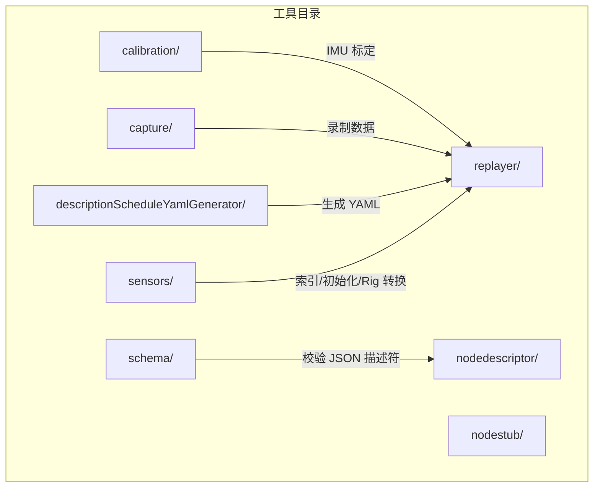
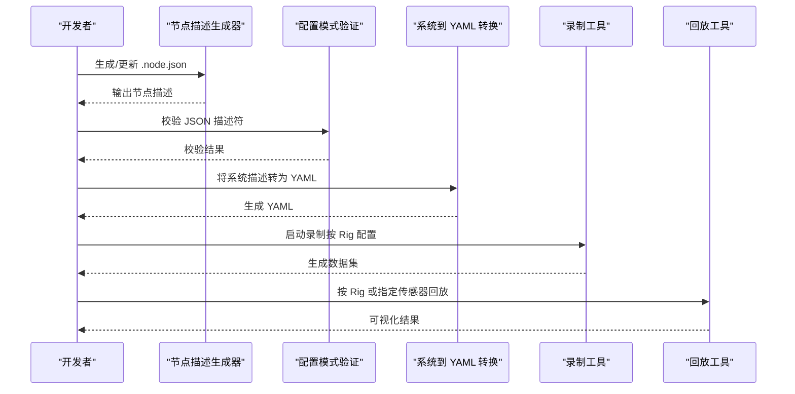
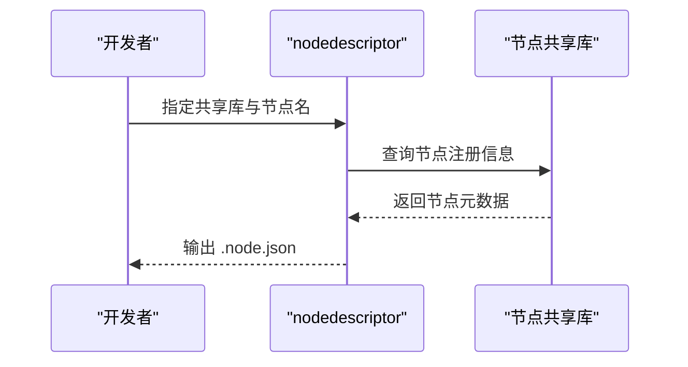
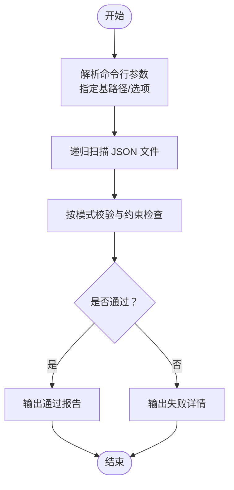
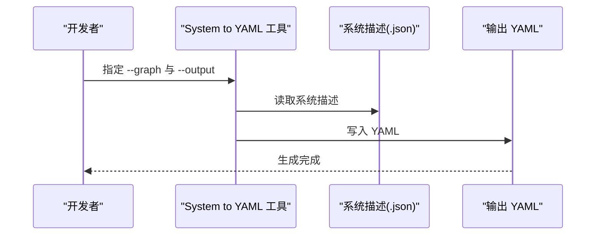
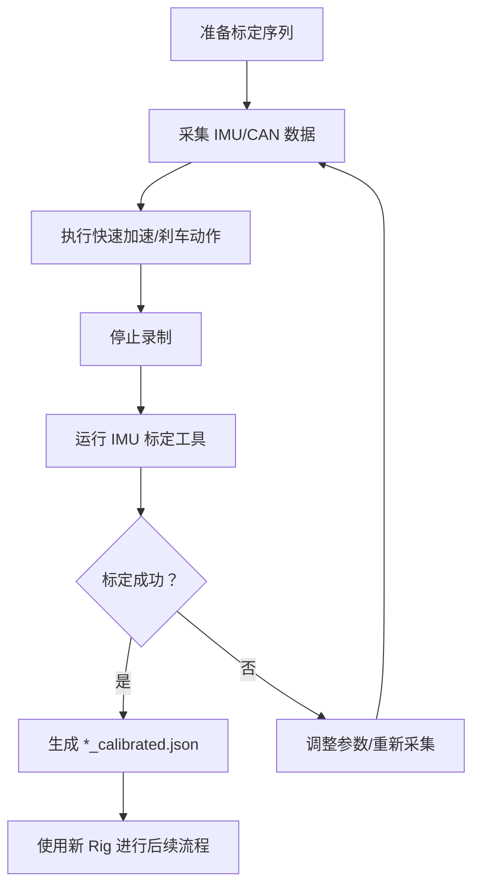
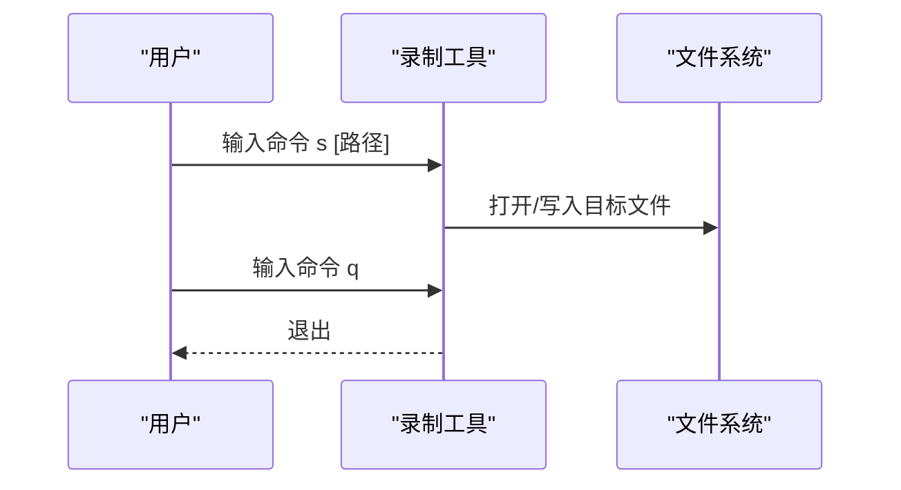
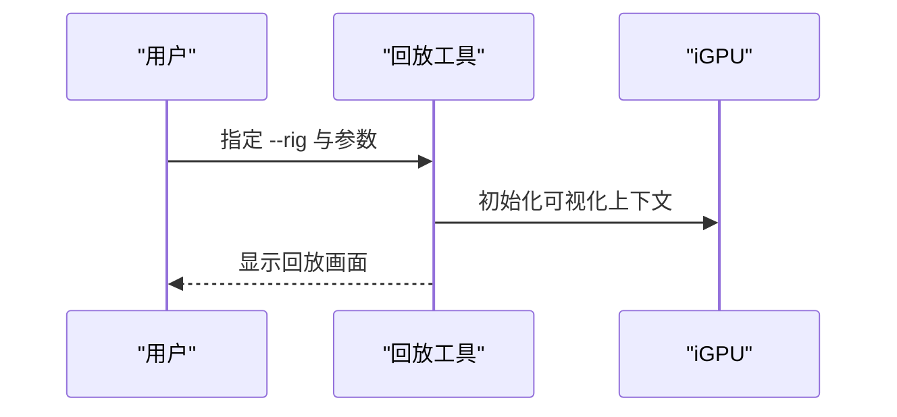
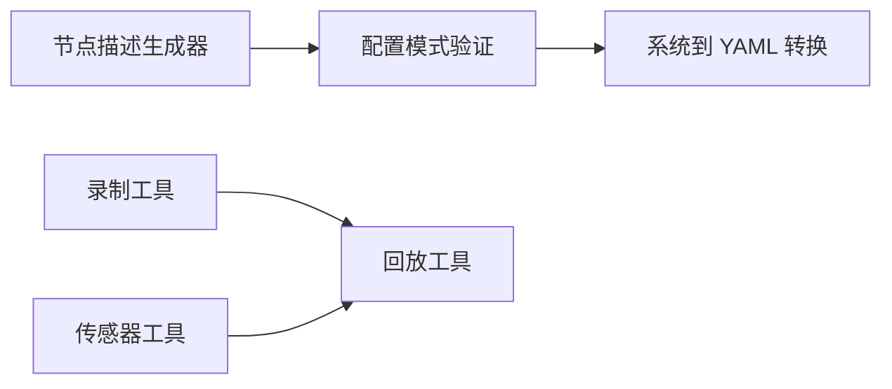

# 工具和实用程序

<cite>
**本文引用的文件**
- [README.md](file://README.md)
- [README-calibration-imu.md](file://driverorks-5.10/tools/calibration/README-calibration-imu.md)
- [README-recorder.md](file://driverorks-5.10/tools/capture/README-recorder.md)
- [README-replayer.md](file://driverorks-5.10/tools/replayer/README-replayer.md)
- [README-descriptionScheduleYamlGenerator.md](file://driverorks-5.10/tools/descriptionScheduleYamlGenerator/README-descriptionScheduleYamlGenerator.md)
- [README-validate_cgfdescriptors.md](file://driverorks-5.10/tools/schema/README-validate_cgfdescriptors.md)
- [README-nodedescriptor.md](file://driverorks-5.10/tools/nodedescriptor/README-nodedescriptor.md)
- [README-nodestub.md](file://driverorks-5.10/tools/nodestub/README-nodestub.md)
- [README-rig_json2json.md](file://driverorks-5.10/tools/sensors/README-rig_json2json.md)
- [README-sensor_indexer.md](file://driverorks-5.10/tools/sensors/README-sensor_indexer.md)
- [README-sensor_initializer.md](file://driverorks-5.10/tools/sensors/README-sensor_initializer.md)
</cite>

## 目录
1. [简介](#简介)
2. [项目结构](#项目结构)
3. [核心组件](#核心组件)
4. [架构总览](#架构总览)
5. [详细组件分析](#详细组件分析)
6. [依赖分析](#依赖分析)
7. [性能考虑](#性能考虑)
8. [故障排查指南](#故障排查指南)
9. [结论](#结论)
10. [附录](#附录)

## 简介
本指南面向使用 Driveworks 工具链进行系统配置、传感器标定、数据采集与回放的工程师与研究者。内容覆盖以下方面：
- 配置工具：节点描述生成器、配置模式验证、YAML 转换工具
- 校准工具：IMU 单传感器标定、多传感器标定与标定数据管理流程
- 数据采集与回放：传感器数据采集、数据集回放、实时数据流处理
- 使用示例与最佳实践：命令行参数、配置文件格式与输出结果解读
- 常见问题与调试技巧

## 项目结构
仓库包含多个版本（5.8/5.10/5.14）与工具目录，本指南聚焦 driverorks-5.10/tools 下的常用工具，涵盖：
- calibration：传感器标定相关工具与说明
- capture：基础录制工具与脚本
- replayer：回放工具
- descriptionScheduleYamlGenerator：系统到 YAML 转换
- schema：JSON 模式与描述符校验
- nodedescriptor：节点描述生成
- nodestub：从 JSON 描述生成 C++ 桩代码
- sensors：传感器相关工具（Rig 序列化、索引、初始化）

章节来源
- [README.md:1-115](file://README.md#L1-L115)

## 核心组件
- 配置工具
  - 节点描述生成器：从已编译节点库提取 JSON 描述，便于同步源码变更与描述文件
  - 配置模式验证：对 JSON 描述符进行模式校验与交叉引用检查
  - YAML 转换工具：将系统描述转换为 STM 编译可用的 YAML
- 校准工具
  - IMU 标定：基于加速度触发与 CAN 车身运动估计的 IMU 方向标定
- 数据采集与回放
  - 录制工具：基础录制后端，支持命令控制与路径配置
  - 回放工具：按 Rig 配置回放并可视化多传感器数据
  - 传感器工具：Rig 重序列化、索引构建、传感器初始化

章节来源
- [README-nodedescriptor.md:1-23](file://driverorks-5.10/tools/nodedescriptor/README-nodedescriptor.md#L1-L23)
- [README-validate_cgfdescriptors.md:1-17](file://driverorks-5.10/tools/schema/README-validate_cgfdescriptors.md#L1-L17)
- [README-descriptionScheduleYamlGenerator.md:1-11](file://driverorks-5.10/tools/descriptionScheduleYamlGenerator/README-descriptionScheduleYamlGenerator.md#L1-L11)
- [README-calibration-imu.md:1-88](file://driverorks-5.10/tools/calibration/README-calibration-imu.md#L1-L88)
- [README-recorder.md:1-40](file://driverorks-5.10/tools/capture/README-recorder.md#L1-L40)
- [README-replayer.md:1-50](file://driverorks-5.10/tools/replayer/README-replayer.md#L1-L50)
- [README-rig_json2json.md:1-47](file://driverorks-5.10/tools/sensors/README-rig_json2json.md#L1-L47)
- [README-sensor_indexer.md:1-48](file://driverorks-5.10/tools/sensors/README-sensor_indexer.md#L1-L48)
- [README-sensor_initializer.md:1-22](file://driverorks-5.10/tools/sensors/README-sensor_initializer.md#L1-L22)

## 架构总览
下图展示典型工作流：从配置描述与模式校验，到系统描述转 YAML，再到录制与回放。

图表来源
- [README-nodedescriptor.md:6-23](file://driverorks-5.10/tools/nodedescriptor/README-nodedescriptor.md#L6-L23)
- [README-validate_cgfdescriptors.md:6-17](file://driverorks-5.10/tools/schema/README-validate_cgfdescriptors.md#L6-L17)
- [README-descriptionScheduleYamlGenerator.md:6-11](file://driverorks-5.10/tools/descriptionScheduleYamlGenerator/README-descriptionScheduleYamlGenerator.md#L6-L11)
- [README-recorder.md:14-40](file://driverorks-5.10/tools/capture/README-recorder.md#L14-L40)
- [README-replayer.md:7-50](file://driverorks-5.10/tools/replayer/README-replayer.md#L7-L50)

## 详细组件分析

### 配置工具：节点描述生成器
- 功能概述
  - 从已编译节点库中提取节点名称与描述，生成 .node.json
  - 支持列出全部节点或输出单个节点的描述
  - 可集成到构建流程以保持描述与实现同步
- 典型用法
  - 列出库中所有节点
  - 输出特定节点的描述
  - 输出全部节点（以记录分隔符分隔）
- 最佳实践
  - 在 CI 中运行，确保每次节点实现变更后描述同步
  - 将输出纳入版本控制，便于追踪变更

图表来源
- [README-nodedescriptor.md:6-23](file://driverorks-5.10/tools/nodedescriptor/README-nodedescriptor.md#L6-L23)

章节来源
- [README-nodedescriptor.md:1-23](file://driverorks-5.10/tools/nodedescriptor/README-nodedescriptor.md#L1-L23)

### 配置工具：配置模式验证
- 功能概述
  - 对 JSON 描述符执行模式校验与额外约束检查（如跨引用）
  - 支持目录递归扫描与文件递归引用检查
- 典型用法
  - 指定一个或多个基路径，自动遍历匹配的 JSON 文件
  - 忽略顺序/缩进差异（可选）
- 最佳实践
  - 在提交前运行，保证描述符一致性
  - 结合 CI 自动化

图表来源
- [README-validate_cgfdescriptors.md:6-17](file://driverorks-5.10/tools/schema/README-validate_cgfdescriptors.md#L6-L17)

章节来源
- [README-validate_cgfdescriptors.md:1-17](file://driverorks-5.10/tools/schema/README-validate_cgfdescriptors.md#L1-L17)

### 配置工具：系统到 YAML 转换
- 功能概述
  - 将系统描述文件转换为 STM 编译可用的 YAML
  - 运行前需安装 PyYAML
- 典型用法
  - 指定输入的系统描述与输出 YAML 路径
- 最佳实践
  - 在构建流程中调用，确保编译前的描述一致性

图表来源
- [README-descriptionScheduleYamlGenerator.md:6-11](file://driverorks-5.10/tools/descriptionScheduleYamlGenerator/README-descriptionScheduleYamlGenerator.md#L6-L11)

章节来源
- [README-descriptionScheduleYamlGenerator.md:1-11](file://driverorks-5.10/tools/descriptionScheduleYamlGenerator/README-descriptionScheduleYamlGenerator.md#L1-L11)

### 校准工具：IMU 标定
- 功能概述
  - 基于车辆加速度触发与 CAN 信号估计 IMU 相对于车身坐标系的方向
  - 成功后生成新的校准 Rig 文件（原文件同目录，带后缀）
- 使用步骤
  - 准备 IMU 与 CAN 数据（需满足特定标定序列）
  - 按要求在平坦地面上进行多次快速加速/刹车
  - 运行工具并指定 Rig、IMU 与 CAN 名称
- 关键参数
  - 触发阈值（forward acceleration trigger，单位 m/s^2）
  - 角度标准差阈值（degrees）
- 输出
  - 新的校准 Rig 文件（命名规则见工具说明）

图表来源
- [README-calibration-imu.md:75-88](file://driverorks-5.10/tools/calibration/README-calibration-imu.md#L75-L88)
- [README-calibration-imu.md:28-64](file://driverorks-5.10/tools/calibration/README-calibration-imu.md#L28-L64)

章节来源
- [README-calibration-imu.md:1-88](file://driverorks-5.10/tools/calibration/README-calibration-imu.md#L1-L88)

### 数据采集与回放：录制工具
- 功能概述
  - 作为高级录制应用的后端，支持命令控制与路径配置
  - 建议优先使用图形/文本界面录制工具
- 命令与操作
  - s [record_path]：开始录制
  - s /dev/null：停止录制
  - q：退出
- 配置
  - 通过 Rig 文件指定传感器集合与录制路径
- 最佳实践
  - 录制前进行预检与存储空间检查
  - 使用 GUI/TUI 录制工具提升交互体验

图表来源
- [README-recorder.md:14-40](file://driverorks-5.10/tools/capture/README-recorder.md#L14-L40)

章节来源
- [README-recorder.md:1-40](file://driverorks-5.10/tools/capture/README-recorder.md#L1-L40)

### 数据采集与回放：回放工具
- 功能概述
  - 按 Rig 配置回放并可视化多传感器数据
  - 支持仅播放 Rig 中列出的传感器，或单独指定传感器数据
- 平台要求
  - 需在 iGPU 上运行（通过 CUDA_VISIBLE_DEVICES=1 指定）
- 典型用法
  - 按 Rig 回放：指定 rig 与可选过滤器与运动补偿
  - 单独传感器回放：分别指定各传感器数据路径与 DBC 文件
- 输出
  - 可视化窗口显示回放结果

图表来源
- [README-replayer.md:18-50](file://driverorks-5.10/tools/replayer/README-replayer.md#L18-L50)

章节来源
- [README-replayer.md:1-50](file://driverorks-5.10/tools/replayer/README-replayer.md#L1-L50)

### 传感器工具：Rig 重序列化
- 功能概述
  - 反序列化并序列化输入 Rig 文件，同时升级至最新版本
- 参数
  - 输入文件：必填
  - 输出文件：可选，默认为 input-rig-new.json
- 最佳实践
  - 在升级工具链或版本时统一重序列化所有 Rig 文件

章节来源
- [README-rig_json2json.md:1-47](file://driverorks-5.10/tools/sensors/README-rig_json2json.md#L1-L47)

### 传感器工具：索引构建
- 功能概述
  - 为支持索引随机访问的虚拟传感器生成 seek 索引表
- 参数
  - --sensor：虚拟传感器名称
  - --input：传感器数据文件
  - --timestamp：h264 流的时间戳文件（可选）
  - --output：输出索引文件路径（可选，默认与输入同名）
- 输出
  - 生成 .seek 文件，便于随机访问

章节来源
- [README-sensor_indexer.md:1-48](file://driverorks-5.10/tools/sensors/README-sensor_indexer.md#L1-L48)

### 传感器工具：传感器初始化
- 功能概述
  - 依据 Rig 配置初始化并启动传感器，消费数据流
- 参数
  - --rig：Rig 文件路径（必填）
- 最佳实践
  - 在正式录制/回放前先运行初始化，确保传感器状态正常

章节来源
- [README-sensor_initializer.md:1-22](file://driverorks-5.10/tools/sensors/README-sensor_initializer.md#L1-L22)

## 依赖分析
- 组件内聚与耦合
  - 配置工具链（节点描述生成 → 模式校验 → YAML 转换）形成强内聚的上游流程
  - 数据采集与回放工具链（录制 → 回放）与传感器工具链（索引/初始化/Rig 转换）相互独立但可组合
- 外部依赖
  - Python 包：PyYAML（YAML 转换）、jsonschema（描述符校验）、Jinja2（模板生成）
- 潜在循环依赖
  - 工具间无直接循环依赖；建议通过构建脚本串联工具链

图表来源
- [README-nodedescriptor.md:6-23](file://driverorks-5.10/tools/nodedescriptor/README-nodedescriptor.md#L6-L23)
- [README-validate_cgfdescriptors.md:6-17](file://driverorks-5.10/tools/schema/README-validate_cgfdescriptors.md#L6-L17)
- [README-descriptionScheduleYamlGenerator.md:6-11](file://driverorks-5.10/tools/descriptionScheduleYamlGenerator/README-descriptionScheduleYamlGenerator.md#L6-L11)
- [README-recorder.md:14-40](file://driverorks-5.10/tools/capture/README-recorder.md#L14-L40)
- [README-replayer.md:18-50](file://driverorks-5.10/tools/replayer/README-replayer.md#L18-L50)
- [README-rig_json2json.md:20-47](file://driverorks-5.10/tools/sensors/README-rig_json2json.md#L20-L47)
- [README-sensor_indexer.md:21-48](file://driverorks-5.10/tools/sensors/README-sensor_indexer.md#L21-L48)
- [README-sensor_initializer.md:9-22](file://driverorks-5.10/tools/sensors/README-sensor_initializer.md#L9-L22)

## 性能考虑
- 回放性能
  - 使用 iGPU 运行回放工具，避免 CPU 占用过高
  - 合理设置运动补偿参数，平衡精度与性能
- 录制与存储
  - 录制前进行存储空间检查，避免中断
  - 选择合适的编码与分辨率，平衡质量与容量
- 工具链效率
  - 在 CI 中自动化运行描述符校验与 YAML 转换，减少人工干预
  - 使用索引文件加速数据随机访问

## 故障排查指南
- YAML 转换失败
  - 确认已安装 PyYAML；检查输入系统描述路径与输出路径权限
- 描述符校验失败
  - 检查 JSON 文件是否符合模式；确认跨引用正确；必要时忽略顺序/缩进（可选）
- 回放黑屏或无画面
  - 确认 CUDA_VISIBLE_DEVICES=1 指定 iGPU；检查 Rig 配置与数据路径
- 录制无法启动
  - 确认具备写权限与正确的命令输入；检查传感器初始化是否成功
- IMU 标定未收敛
  - 提高角度标准差阈值或调整触发阈值；确保标定序列充分

章节来源
- [README-descriptionScheduleYamlGenerator.md:7-11](file://driverorks-5.10/tools/descriptionScheduleYamlGenerator/README-descriptionScheduleYamlGenerator.md#L7-L11)
- [README-validate_cgfdescriptors.md:7-17](file://driverorks-5.10/tools/schema/README-validate_cgfdescriptors.md#L7-L17)
- [README-replayer.md:11-17](file://driverorks-5.10/tools/replayer/README-replayer.md#L11-L17)
- [README-recorder.md:14-40](file://driverorks-5.10/tools/capture/README-recorder.md#L14-L40)
- [README-calibration-imu.md:52-64](file://driverorks-5.10/tools/calibration/README-calibration-imu.md#L52-L64)

## 结论
本指南梳理了 Driveworks 工具链的关键工具与使用流程，覆盖从配置描述到系统编译、从数据采集到回放可视化的完整闭环。建议在实际工程中：
- 将工具链纳入 CI，确保描述符一致性与构建稳定性
- 在采集与回放阶段采用索引与初始化工具，提升效率与可靠性
- 严格遵循标定流程与参数设置，保障传感器标定质量

## 附录
- 命令行参数速查
  - nodedescriptor：共享库路径与节点名
  - validate_cgfdescriptors：基路径列表与可选忽略选项
  - descriptionScheduleYamlGenerator：--graph 与 --output
  - calibration_imu：--rig、--imu-sensor、--can-sensor、--trigger、--angleStdDev
  - recorder：命令控制（s/start、s /dev/null/stop、q/quit）
  - replayer：--rig、--rig-sensor-filter、--motion-compensation 或各传感器路径
  - rig_json2json：输入与输出路径
  - sensor_indexer：--sensor、--input、--timestamp、--output
  - sensor_initializer：--rig
- 配置文件格式与输出结果解读
  - .node.json：节点描述，包含接口与参数定义
  - YAML：系统描述的编译输入
  - *_calibrated.json：IMU 校准后的 Rig 文件
  - .seek：索引文件，支持随机访问
  - 回放输出：可视化窗口显示各传感器数据