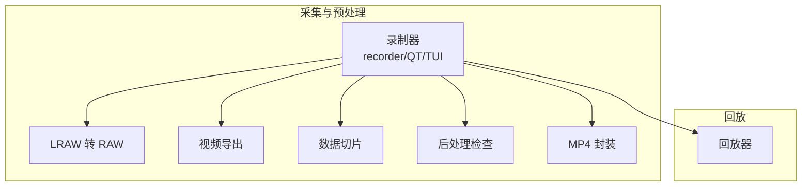
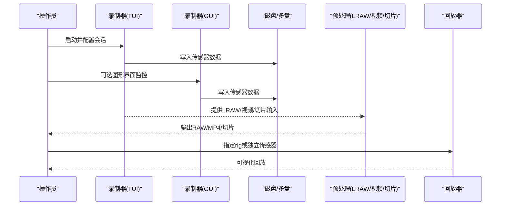
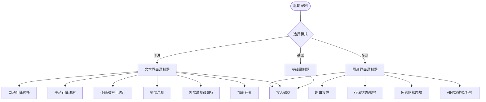
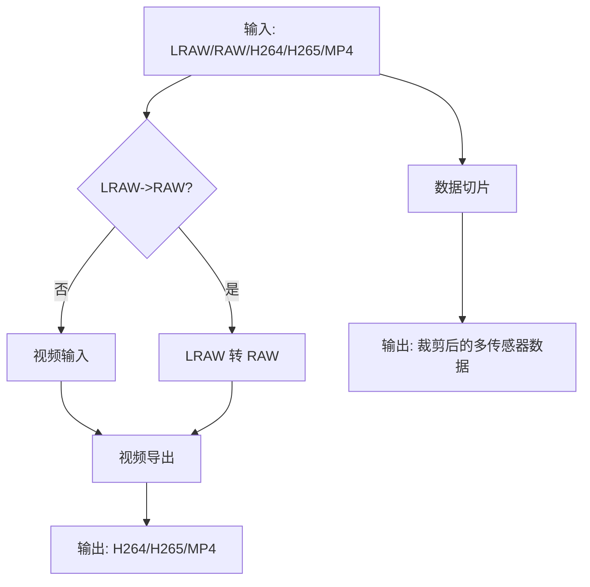
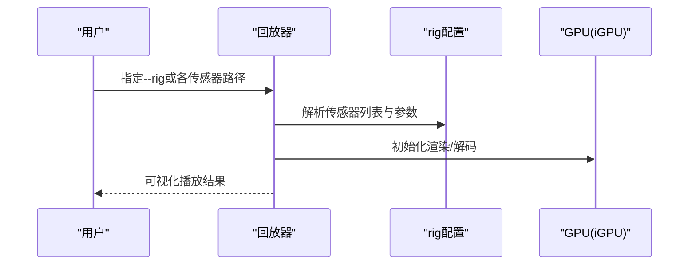
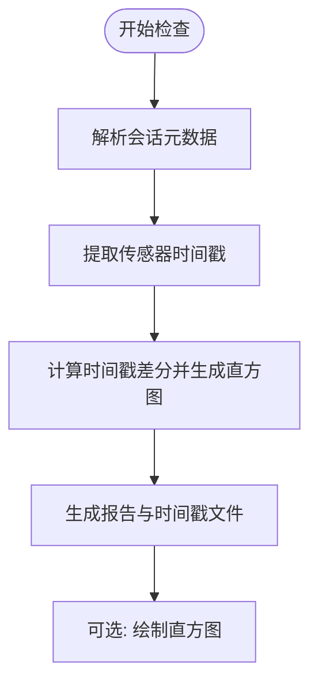
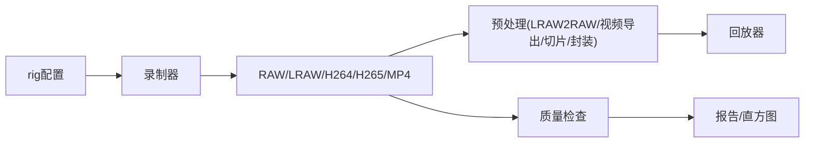

# 数据采集工具

<cite>
**本文引用的文件**
- [README.md](file://README.md)
- [driverorks-5.10/tools/capture/README-recorder.md](file://driverorks-5.10/tools/capture/README-recorder.md)
- [driverorks-5.10/tools/capture/README-recorder-qtgui.md](file://driverorks-5.10/tools/capture/README-recorder-qtgui.md)
- [driverorks-5.10/tools/capture/README-recorder-tui.md](file://driverorks-5.10/tools/capture/README-recorder-tui.md)
- [driverorks-5.10/tools/replayer/README-replayer.md](file://driverorks-5.10/tools/replayer/README-replayer.md)
- [driverorks-5.10/tools/capture/README-lraw2raw.md](file://driverorks-5.10/tools/capture/README-lraw2raw.md)
- [driverorks-5.10/tools/capture/README-video_exporter.md](file://driverorks-5.10/tools/capture/README-video_exporter.md)
- [driverorks-5.10/tools/capture/README-chop.md](file://driverorks-5.10/tools/capture/README-chop.md)
- [driverorks-5.10/tools/capture/README-postrecord-checker.md](file://driverorks-5.10/tools/capture/README-postrecord-checker.md)
- [driverorks-5.10/tools/capture/README-muxer_mp4.md](file://driverorks-5.10/tools/capture/README-muxer_mp4.md)
- [driverorks-5.10/tools/capture/scripts/batch_run.py](file://driverorks-5.10/tools/capture/scripts/batch_run.py)
- [driverorks-5.10/tools/capture/scripts/plot_data.py](file://driverorks-5.10/tools/capture/scripts/plot_data.py)
- [driverorks-5.10/tools/capture/scripts/StorageCheck.py](file://driverorks-5.10/tools/capture/scripts/StorageCheck.py)
- [driverorks-5.10/tools/capture/scripts/PreChecks.py](file://driverorks-5.10/tools/capture/scripts/PreChecks.py)
- [driverorks-5.10/tools/capture/scripts/recorder_utils.py](file://driverorks-5.10/tools/capture/scripts/recorder_utils.py)
- [driverorks-5.10/tools/capture/scripts/DataCollection-utility.py](file://driverorks-5.10/tools/capture/scripts/DataCollection-utility.py)
- [driverorks-5.10/tools/capture/scripts/BBR.py](file://driverorks-5.10/tools/capture/scripts/BBR.py)
</cite>

## 目录
1. [简介](#简介)
2. [项目结构](#项目结构)
3. [核心组件](#核心组件)
4. [架构总览](#架构总览)
5. [详细组件分析](#详细组件分析)
6. [依赖分析](#依赖分析)
7. [性能考虑](#性能考虑)
8. [故障排查指南](#故障排查指南)
9. [结论](#结论)
10. [附录](#附录)

## 简介
本指南面向使用 NVIDIA Driveworks 5.x 工具链进行数据采集与回放的工程师与研究者。内容覆盖：
- 实时数据捕获：从传感器原始数据到多模态录制
- 批量数据收集与存储管理：自动/手动存储路径选择、多盘录制、黑盒录制（BBR）
- 录制器 GUI/TUI 使用：参数配置、采集监控、状态指示
- 数据预处理：LRAW 到 RAW 转换、视频导出、数据切片
- 数据回放：离线播放、时间同步、可视化控制
- 数据质量检查：完整性校验、异常检测、统计报告
- 流程示例与最佳实践：从准备到产出的完整工作流
- 存储空间管理、数据压缩与性能优化建议

## 项目结构
本仓库包含 Driveworks 5.8/5.10/5.14 的官方工具与文档，重点工具位于 tools 目录下：
- capture：采集与预处理工具集（录制器、LRAW 转 RAW、视频导出、数据切片、后处理检查等）
- replayer：离线回放工具
- schema：CGF 配置模式定义（用于校验）
- calibration、sensors、nodestub、dnn 等：辅助工具与模板

图示来源
- [driverorks-5.10/tools/capture/README-recorder.md:1-40](file://driverorks-5.10/tools/capture/README-recorder.md#L1-L40)
- [driverorks-5.10/tools/capture/README-recorder-qtgui.md:1-141](file://driverorks-5.10/tools/capture/README-recorder-qtgui.md#L1-L141)
- [driverorks-5.10/tools/capture/README-recorder-tui.md:1-180](file://driverorks-5.10/tools/capture/README-recorder-tui.md#L1-L180)
- [driverorks-5.10/tools/capture/README-lraw2raw.md:1-45](file://driverorks-5.10/tools/capture/README-lraw2raw.md#L1-L45)
- [driverorks-5.10/tools/capture/README-video_exporter.md:1-34](file://driverorks-5.10/tools/capture/README-video_exporter.md#L1-L34)
- [driverorks-5.10/tools/capture/README-chop.md:1-160](file://driverorks-5.10/tools/capture/README-chop.md#L1-L160)
- [driverorks-5.10/tools/replayer/README-replayer.md:1-50](file://driverorks-5.10/tools/replayer/README-replayer.md#L1-L50)
- [driverorks-5.10/tools/capture/README-muxer_mp4.md:1-39](file://driverorks-5.10/tools/capture/README-muxer_mp4.md#L1-L39)

章节来源
- [README.md:1-115](file://README.md#L1-L115)

## 核心组件
- 录制器（基础/文本/TUI/GUI）：提供实时采集、多盘切换、黑盒录制、加密开关、元数据输入等能力
- 回放器：支持按 rig 配置回放或独立传感器回放，具备运动补偿选项
- 预处理工具：LRAW 转 RAW、视频导出、MP4 封装、数据切片
- 质量检查：后处理检查器，生成时间戳直方图与报告
- 辅助脚本：存储检查、前置检查、录制工具函数、批处理与绘图

章节来源
- [driverorks-5.10/tools/capture/README-recorder.md:1-40](file://driverorks-5.10/tools/capture/README-recorder.md#L1-L40)
- [driverorks-5.10/tools/capture/README-recorder-qtgui.md:1-141](file://driverorks-5.10/tools/capture/README-recorder-qtgui.md#L1-L141)
- [driverorks-5.10/tools/capture/README-recorder-tui.md:1-180](file://driverorks-5.10/tools/capture/README-recorder-tui.md#L1-L180)
- [driverorks-5.10/tools/replayer/README-replayer.md:1-50](file://driverorks-5.10/tools/replayer/README-replayer.md#L1-L50)
- [driverorks-5.10/tools/capture/README-lraw2raw.md:1-45](file://driverorks-5.10/tools/capture/README-lraw2raw.md#L1-L45)
- [driverorks-5.10/tools/capture/README-video_exporter.md:1-34](file://driverorks-5.10/tools/capture/README-video_exporter.md#L1-L34)
- [driverorks-5.10/tools/capture/README-chop.md:1-160](file://driverorks-5.10/tools/capture/README-chop.md#L1-L160)
- [driverorks-5.10/tools/capture/README-postrecord-checker.md:1-58](file://driverorks-5.10/tools/capture/README-postrecord-checker.md#L1-L58)
- [driverorks-5.10/tools/capture/README-muxer_mp4.md:1-39](file://driverorks-5.10/tools/capture/README-muxer_mp4.md#L1-L39)

## 架构总览
下图展示从采集到回放的关键流程与工具交互：

图示来源
- [driverorks-5.10/tools/capture/README-recorder-tui.md:20-43](file://driverorks-5.10/tools/capture/README-recorder-tui.md#L20-L43)
- [driverorks-5.10/tools/capture/README-recorder-qtgui.md:14-28](file://driverorks-5.10/tools/capture/README-recorder-qtgui.md#L14-L28)
- [driverorks-5.10/tools/capture/README-lraw2raw.md:9-22](file://driverorks-5.10/tools/capture/README-lraw2raw.md#L9-L22)
- [driverorks-5.10/tools/capture/README-video_exporter.md:8-16](file://driverorks-5.10/tools/capture/README-video_exporter.md#L8-L16)
- [driverorks-5.10/tools/replayer/README-replayer.md:18-41](file://driverorks-5.10/tools/replayer/README-replayer.md#L18-L41)

## 详细组件分析

### 录制器（基础/文本/TUI/GUI）
- 基础录制器：作为后台进程，支持启动/停止录制与退出命令；默认工作目录为当前路径
- 文本界面（TUI）：增强功能包括自动/手动存储选择、传感器统计、多盘录制、分布式录制、黑盒录制（BBR）、加密开关、元数据输入
- 图形界面（GUI）：提供路由设置、存储状态、传感器状态可视化、VIN/驾驶员选择、存储擦除等

图示来源
- [driverorks-5.10/tools/capture/README-recorder.md:14-31](file://driverorks-5.10/tools/capture/README-recorder.md#L14-L31)
- [driverorks-5.10/tools/capture/README-recorder-tui.md:20-43](file://driverorks-5.10/tools/capture/README-recorder-tui.md#L20-L43)
- [driverorks-5.10/tools/capture/README-recorder-tui.md:53-96](file://driverorks-5.10/tools/capture/README-recorder-tui.md#L53-L96)
- [driverorks-5.10/tools/capture/README-recorder-tui.md:105-127](file://driverorks-5.10/tools/capture/README-recorder-tui.md#L105-L127)
- [driverorks-5.10/tools/capture/README-recorder-tui.md:118-151](file://driverorks-5.10/tools/capture/README-recorder-tui.md#L118-L151)
- [driverorks-5.10/tools/capture/README-recorder-qtgui.md:21-97](file://driverorks-5.10/tools/capture/README-recorder-qtgui.md#L21-L97)

章节来源
- [driverorks-5.10/tools/capture/README-recorder.md:1-40](file://driverorks-5.10/tools/capture/README-recorder.md#L1-L40)
- [driverorks-5.10/tools/capture/README-recorder-tui.md:1-180](file://driverorks-5.10/tools/capture/README-recorder-tui.md#L1-L180)
- [driverorks-5.10/tools/capture/README-recorder-qtgui.md:1-141](file://driverorks-5.10/tools/capture/README-recorder-qtgui.md#L1-L141)

### 数据预处理工具
- LRAW 到 RAW 转换：解码 LRAW（V1/V2）为原始 RCCB 文件，支持 pinned memory 加速
- 视频导出：从 RAW/H264/H265/MP4 导出 H.264/H.265/MP4，支持软 ISP/TegraISP、降噪、去马赛克、起止帧、质量因子、相机名覆盖等
- 数据切片：按时间戳或事件范围裁剪多传感器数据，支持正则强制 seek、CUDA 可禁用、输出验证可关闭
- MP4 封装：对 H.264 流进行 MP4 容器封装，支持 GOP、质量、时间戳

图示来源
- [driverorks-5.10/tools/capture/README-lraw2raw.md:9-44](file://driverorks-5.10/tools/capture/README-lraw2raw.md#L9-L44)
- [driverorks-5.10/tools/capture/README-video_exporter.md:12-33](file://driverorks-5.10/tools/capture/README-video_exporter.md#L12-L33)
- [driverorks-5.10/tools/capture/README-chop.md:11-76](file://driverorks-5.10/tools/capture/README-chop.md#L11-L76)
- [driverorks-5.10/tools/capture/README-muxer_mp4.md:10-38](file://driverorks-5.10/tools/capture/README-muxer_mp4.md#L10-L38)

章节来源
- [driverorks-5.10/tools/capture/README-lraw2raw.md:1-45](file://driverorks-5.10/tools/capture/README-lraw2raw.md#L1-L45)
- [driverorks-5.10/tools/capture/README-video_exporter.md:1-34](file://driverorks-5.10/tools/capture/README-video_exporter.md#L1-L34)
- [driverorks-5.10/tools/capture/README-chop.md:1-160](file://driverorks-5.10/tools/capture/README-chop.md#L1-L160)
- [driverorks-5.10/tools/capture/README-muxer_mp4.md:1-39](file://driverorks-5.10/tools/capture/README-muxer_mp4.md#L1-L39)

### 数据回放工具
- 按 rig 配置回放：指定 rig 文件，可过滤传感器类型，支持运动补偿
- 独立传感器回放：分别指定 camera、timestamp、CAN、DBC、IMU、GPS、Lidar、Radar 数据路径
- 平台要求：x86 主机与 DRIVE OS Linux；DRIVE 平台仅支持 iGPU，需设置 CUDA_VISIBLE_DEVICES=1

图示来源
- [driverorks-5.10/tools/replayer/README-replayer.md:18-41](file://driverorks-5.10/tools/replayer/README-replayer.md#L18-L41)

章节来源
- [driverorks-5.10/tools/replayer/README-replayer.md:1-50](file://driverorks-5.10/tools/replayer/README-replayer.md#L1-L50)

### 数据质量检查工具
- 功能：验证会话元数据、分析传感器时间戳、生成时间戳差分直方图
- 参数：传感器子集、平滑、是否解码提取时间戳、输出报告位置
- 批处理：提供批处理脚本与绘图脚本，支持单/多会话分析与平均直方图

图示来源
- [driverorks-5.10/tools/capture/README-postrecord-checker.md:20-57](file://driverorks-5.10/tools/capture/README-postrecord-checker.md#L20-L57)

章节来源
- [driverorks-5.10/tools/capture/README-postrecord-checker.md:1-58](file://driverorks-5.10/tools/capture/README-postrecord-checker.md#L1-L58)
- [driverorks-5.10/tools/capture/scripts/batch_run.py](file://driverorks-5.10/tools/capture/scripts/batch_run.py)
- [driverorks-5.10/tools/capture/scripts/plot_data.py](file://driverorks-5.10/tools/capture/scripts/plot_data.py)

## 依赖分析
- 录制器依赖：rig 配置文件、存储路径、传感器初始化状态、系统磁盘可用性
- 预处理工具依赖：输入格式（RAW/LRAW/H264/H265/MP4）、CUDA/软 ISP、时间戳文件
- 回放器依赖：rig 配置、GPU（iGPU）、传感器数据路径
- 质量检查依赖：会话内文件完整性、时间戳一致性

图示来源
- [driverorks-5.10/tools/capture/README-recorder-tui.md:70-96](file://driverorks-5.10/tools/capture/README-recorder-tui.md#L70-L96)
- [driverorks-5.10/tools/capture/README-lraw2raw.md:32-44](file://driverorks-5.10/tools/capture/README-lraw2raw.md#L32-L44)
- [driverorks-5.10/tools/capture/README-video_exporter.md:16-33](file://driverorks-5.10/tools/capture/README-video_exporter.md#L16-L33)
- [driverorks-5.10/tools/replayer/README-replayer.md:24-41](file://driverorks-5.10/tools/replayer/README-replayer.md#L24-L41)
- [driverorks-5.10/tools/capture/README-postrecord-checker.md:14-57](file://driverorks-5.10/tools/capture/README-postrecord-checker.md#L14-L57)

## 性能考虑
- 存储策略
  - 自动存储选择：自动发现 ext4、空闲>5GB 的挂载点，满载后自动切换下一个
  - 手动存储映射：通过 rig 配置将传感器映射到不同存储路径，实现多盘并行
  - 多盘录制：通过多个 rig 文件分别指向不同存储路径，提升写入带宽
- 加速与解码
  - LRAW 转 RAW：启用 pinned memory 可加速 CUDA 内存拷贝
  - 视频导出：优先使用 TegraISP，必要时可使用软 ISP 并调整降噪/去马赛克策略
- 回放性能
  - 使用 iGPU 运行回放器，合理设置传感器过滤，减少渲染负载
- 数据切片与封装
  - 切片时注意 H264/H265 的 IDR 帧边界，避免破坏编码结构
  - 封装 MP4 时根据需求设置 GOP、质量与时间戳

章节来源
- [driverorks-5.10/tools/capture/README-recorder-tui.md:53-127](file://driverorks-5.10/tools/capture/README-recorder-tui.md#L53-L127)
- [driverorks-5.10/tools/capture/README-lraw2raw.md:36-44](file://driverorks-5.10/tools/capture/README-lraw2raw.md#L36-L44)
- [driverorks-5.10/tools/capture/README-video_exporter.md:18-33](file://driverorks-5.10/tools/capture/README-video_exporter.md#L18-L33)
- [driverorks-5.10/tools/replayer/README-replayer.md:15-16](file://driverorks-5.10/tools/replayer/README-replayer.md#L15-L16)
- [driverorks-5.10/tools/capture/README-chop.md:155-159](file://driverorks-5.10/tools/capture/README-chop.md#L155-L159)
- [driverorks-5.10/tools/capture/README-muxer_mp4.md:16-38](file://driverorks-5.10/tools/capture/README-muxer_mp4.md#L16-L38)

## 故障排查指南
- 存储相关
  - 自动/手动存储选择失败：确认 ext4 格式、空闲空间>5GB、挂载点无特殊字符
  - 磁盘满/无盘：界面会提示“磁盘已满/无磁盘”，需清理或更换存储
- 传感器初始化
  - “失败”提示：传感器初始化失败，查看控制台日志定位问题
- 质量检查
  - 缺失时间戳：可忽略缺失时间戳或启用 CUDA 环境
  - 报告与直方图：使用批处理脚本与绘图脚本生成与汇总结果
- 黑盒录制（BBR）
  - 依赖 CAN 速度消息触发；若未触发，检查 CAN 数据与配置

章节来源
- [driverorks-5.10/tools/capture/README-recorder-qtgui.md:68-97](file://driverorks-5.10/tools/capture/README-recorder-qtgui.md#L68-L97)
- [driverorks-5.10/tools/capture/README-postrecord-checker.md:10-57](file://driverorks-5.10/tools/capture/README-postrecord-checker.md#L10-L57)
- [driverorks-5.10/tools/capture/scripts/batch_run.py](file://driverorks-5.10/tools/capture/scripts/batch_run.py)
- [driverorks-5.10/tools/capture/scripts/plot_data.py](file://driverorks-5.10/tools/capture/scripts/plot_data.py)
- [driverorks-5.10/tools/capture/README-recorder-tui.md:127-129](file://driverorks-5.10/tools/capture/README-recorder-tui.md#L127-L129)

## 结论
本指南系统梳理了 Driveworks 5.x 的采集与回放工具链，涵盖从实时采集、存储管理、预处理到回放与质量检查的全流程。结合自动/手动存储策略、多盘并行、黑盒录制与质量检查，可构建稳定高效的自动驾驶数据采集流水线。

## 附录

### 典型使用流程示例
- 实时采集
  - 使用 TUI/GUI 启动录制，设置路由、VIN/驾驶员、存储路径，监控传感器状态与剩余时间
  - 多盘录制：通过多个 rig 文件分别映射不同存储路径
- 预处理
  - LRAW 转 RAW：解码并生成原始 RCCB 文件
  - 视频导出：将 RAW/H264/H265/MP4 导出为目标容器与编码
  - 数据切片：按时间戳/事件范围裁剪多传感器数据
- 回放
  - 指定 rig 或独立传感器路径，启用运动补偿，进行离线可视化
- 质量检查
  - 对会话执行完整性与时间戳分析，生成报告与直方图，必要时进行批处理与汇总

章节来源
- [driverorks-5.10/tools/capture/README-recorder-tui.md:20-43](file://driverorks-5.10/tools/capture/README-recorder-tui.md#L20-L43)
- [driverorks-5.10/tools/capture/README-recorder-qtgui.md:14-28](file://driverorks-5.10/tools/capture/README-recorder-qtgui.md#L14-L28)
- [driverorks-5.10/tools/capture/README-lraw2raw.md:41-44](file://driverorks-5.10/tools/capture/README-lraw2raw.md#L41-L44)
- [driverorks-5.10/tools/capture/README-video_exporter.md:14-33](file://driverorks-5.10/tools/capture/README-video_exporter.md#L14-L33)
- [driverorks-5.10/tools/capture/README-chop.md:11-76](file://driverorks-5.10/tools/capture/README-chop.md#L11-L76)
- [driverorks-5.10/tools/replayer/README-replayer.md:18-41](file://driverorks-5.10/tools/replayer/README-replayer.md#L18-L41)
- [driverorks-5.10/tools/capture/README-postrecord-checker.md:14-57](file://driverorks-5.10/tools/capture/README-postrecord-checker.md#L14-L57)

### 最佳实践
- 存储空间管理
  - 采用自动存储选择并预留冗余空间；多盘录制时均衡分配传感器
  - 使用 rig 配置中的存储映射实现细粒度控制
- 数据压缩与格式
  - 优先使用 H264/H265 编码以降低存储占用；导出时根据场景选择质量因子
  - LRAW 适合长期归档，RAW 适合后续处理
- 性能优化
  - 启用 pinned memory 加速 RAW 解码
  - 回放时使用 iGPU 并按需过滤传感器
  - 切片与封装前确保时间戳完整性与编码边界正确

章节来源
- [driverorks-5.10/tools/capture/README-recorder-tui.md:53-127](file://driverorks-5.10/tools/capture/README-recorder-tui.md#L53-L127)
- [driverorks-5.10/tools/capture/README-lraw2raw.md:36-44](file://driverorks-5.10/tools/capture/README-lraw2raw.md#L36-L44)
- [driverorks-5.10/tools/capture/README-video_exporter.md:18-33](file://driverorks-5.10/tools/capture/README-video_exporter.md#L18-L33)
- [driverorks-5.10/tools/replayer/README-replayer.md:15-16](file://driverorks-5.10/tools/replayer/README-replayer.md#L15-L16)
- [driverorks-5.10/tools/capture/README-chop.md:155-159](file://driverorks-5.10/tools/capture/README-chop.md#L155-L159)