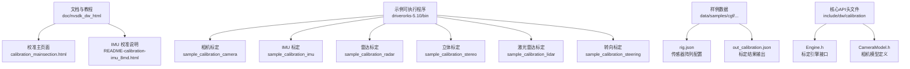
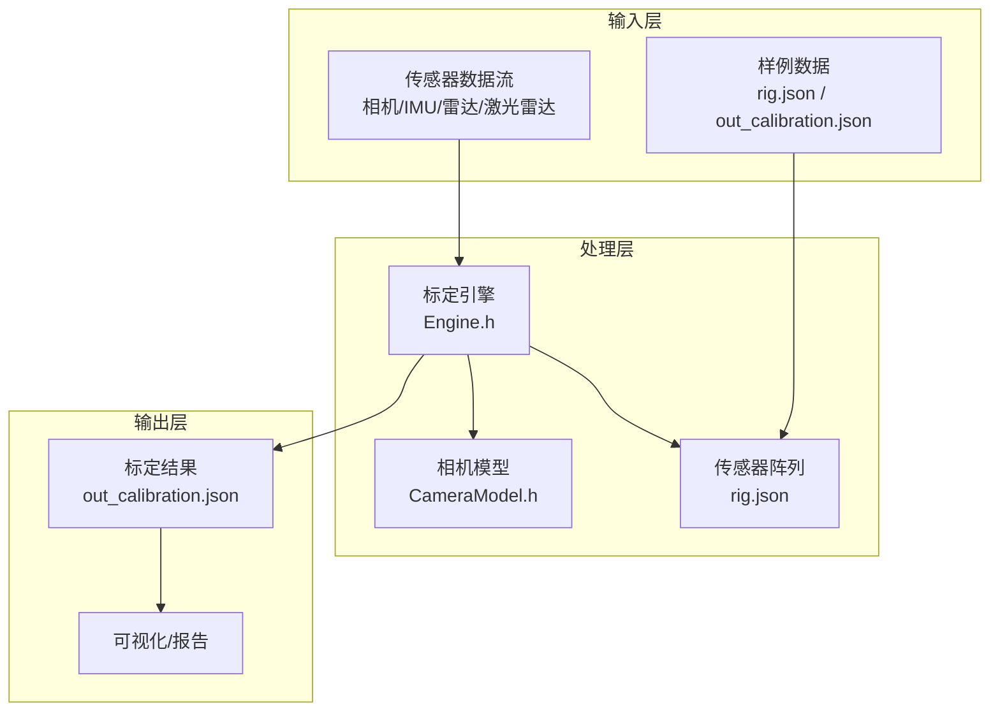
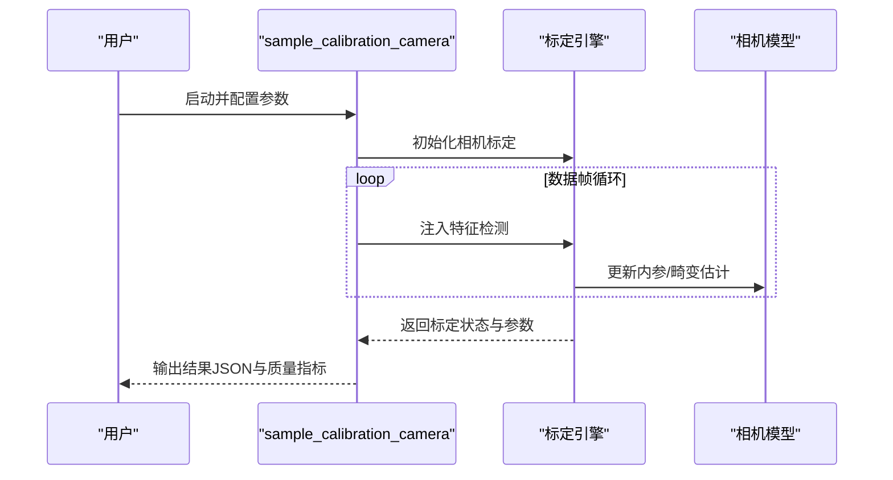
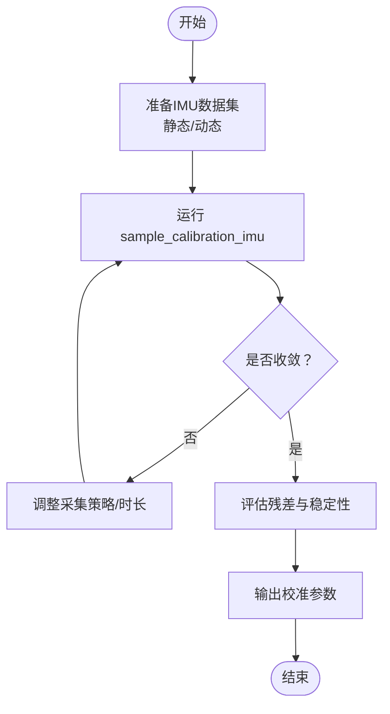
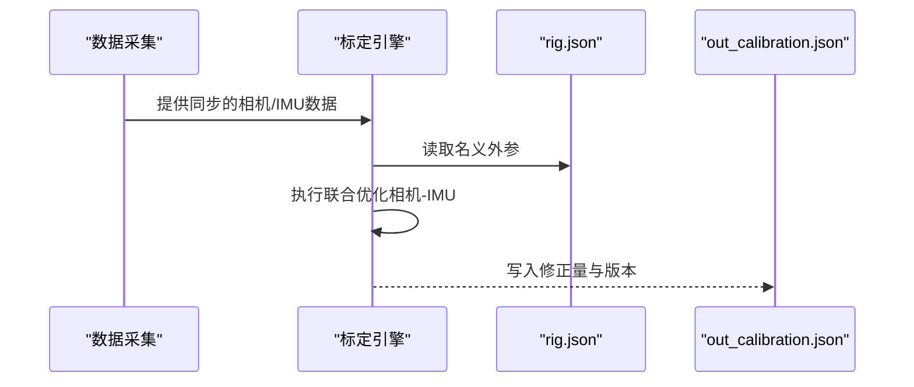
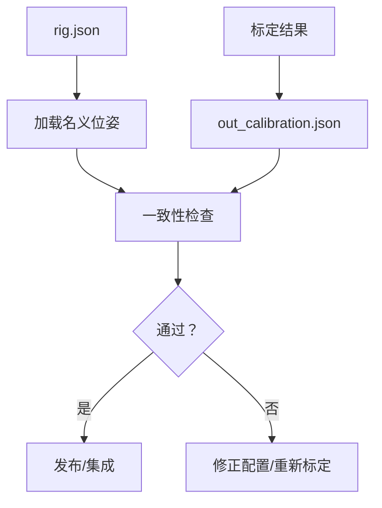
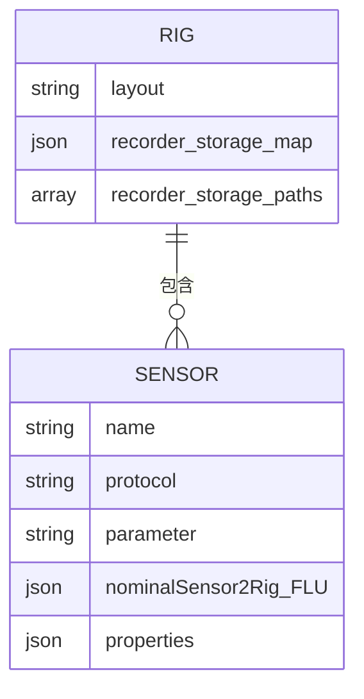
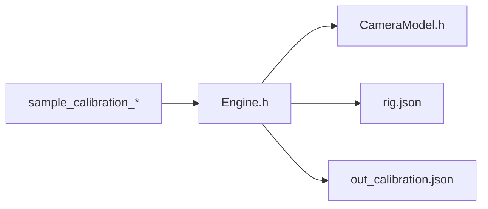

# 校准工具

<cite>
**本文引用的文件**
- [calibration_mainsection.html](file://driverorks-5.10/doc/nvsdk_dw_html/calibration_mainsection.html)
- [README-calibration-imu_8md.html](file://driverorks-5.10/doc/nvsdk_dw_html/README-calibration-imu_8md.html)
- [rig.json](file://driverorks-5.10/data/samples/cgf/trafficlightturning-hyperion8/rig.json)
- [out_calibration.json](file://driverorks-5.10/data/samples/cgf/trafficlightturning-hyperion8/out_calibration.json)
- [sample_calibration_camera](file://driverorks-5.10/bin/sample_calibration_camera)
- [sample_calibration_imu](file://driverorks-5.10/bin/sample_calibration_imu)
- [sample_calibration_radar](file://driverorks-5.10/bin/sample_calibration_radar)
- [sample_calibration_stereo](file://driverorks-5.10/bin/sample_calibration_stereo)
- [sample_calibration_lidar](file://driverorks-5.10/bin/sample_calibration_lidar)
- [sample_calibration_steering](file://driverorks-5.10/bin/sample_calibration_steering)
- [CameraModel.h](file://driverorks-5.10/include/dw/calibration/cameramodel/CameraModel.h)
- [Engine.h](file://driverorks-5.10/include/dw/calibration/engine/Engine.h)
</cite>

## 目录
1. [简介](#简介)
2. [项目结构](#项目结构)
3. [核心组件](#核心组件)
4. [架构总览](#架构总览)
5. [详细组件分析](#详细组件分析)
6. [依赖关系分析](#依赖关系分析)
7. [性能考虑](#性能考虑)
8. [故障排除指南](#故障排除指南)
9. [结论](#结论)
10. [附录](#附录)

## 简介
本指南面向使用 DriveWorks SDK 的工程师与测试人员，系统性介绍校准工具链的使用方法与最佳实践，覆盖以下主题：
- 相机内参标定、畸变校正与质量评估
- IMU 偏置与运动学参数的自标定
- 多传感器标定（相机-IMU 联合标定、传感器阵列标定）
- 标定数据管理（结果存储、版本管理、可视化查看）
- 传感器阵列工具（rig.json 生成与配置管理）
- 完整标定流程示例与质量控制方法
- 标定精度评估与常见问题排查

DriveWorks 提供统一的标定引擎接口，支持特征点法相机标定、IMU 自标定、雷达/激光雷达/立体视觉等多传感器标定，并通过自标定服务持续优化外参姿态。

## 项目结构
与校准相关的资源主要分布在如下位置：
- 文档与教程：doc/nvsdk_dw_html 下的校准相关页面
- 示例可执行程序：driverorks-5.10/bin 下的 sample_calibration_* 可执行文件
- 样例数据：driverorks-5.10/data/samples/cgf/trafficlightturning-hyperion8 下的 rig.json 与 out_calibration.json
- 核心 API 头文件：driverorks-5.10/include/dw/calibration 下的引擎与模型头文件

**图表来源**
- [calibration_mainsection.html:120-144](file://driverorks-5.10/doc/nvsdk_dw_html/calibration_mainsection.html#L120-L144)
- [sample_calibration_camera](file://driverorks-5.10/bin/sample_calibration_camera)
- [sample_calibration_imu](file://driverorks-5.10/bin/sample_calibration_imu)
- [rig.json:1-60](file://driverorks-5.10/data/samples/cgf/trafficlightturning-hyperion8/rig.json#L1-L60)
- [out_calibration.json:1-58](file://driverorks-5.10/data/samples/cgf/trafficlightturning-hyperion8/out_calibration.json#L1-L58)
- [Engine.h](file://driverorks-5.10/include/dw/calibration/engine/Engine.h)
- [CameraModel.h](file://driverorks-5.10/include/dw/calibration/cameramodel/CameraModel.h)

**章节来源**
- [calibration_mainsection.html:120-144](file://driverorks-5.10/doc/nvsdk_dw_html/calibration_mainsection.html#L120-L144)

## 核心组件
- 标定引擎（Calibration Engine）：提供统一接口进行各类传感器的标定初始化、数据注入与状态查询。
- 相机模型（Camera Model）：封装相机内参与畸变模型，支撑特征点法标定与重投影误差评估。
- 传感器阵列（Rig）：描述各传感器在车体坐标系下的位姿与参数，是多传感器联合标定的基础。
- 样例可执行程序：提供端到端的标定流程演示，便于快速上手与验证。

关键能力与用途：
- 特征点法相机标定：通过检测与跟踪图像特征，估计相机内参与畸变系数，评估重投影误差。
- IMU 自标定：估计偏置与尺度因子、轴交角等参数，提升惯导数据质量。
- 多传感器联合标定：以相机-IMU 为例，估计外参变换；扩展至雷达/激光雷达等。
- 结果管理：输出标准化 JSON，记录版本与修正量，便于回放与对比。

**章节来源**
- [calibration_mainsection.html:120-144](file://driverorks-5.10/doc/nvsdk_dw_html/calibration_mainsection.html#L120-L144)
- [Engine.h](file://driverorks-5.10/include/dw/calibration/engine/Engine.h)
- [CameraModel.h](file://driverorks-5.10/include/dw/calibration/cameramodel/CameraModel.h)

## 架构总览
下图展示了从数据采集到标定结果输出的整体流程，以及关键模块之间的交互关系。

**图表来源**
- [Engine.h](file://driverorks-5.10/include/dw/calibration/engine/Engine.h)
- [CameraModel.h](file://driverorks-5.10/include/dw/calibration/cameramodel/CameraModel.h)
- [rig.json:1-60](file://driverorks-5.10/data/samples/cgf/trafficlightturning-hyperion8/rig.json#L1-L60)
- [out_calibration.json:1-58](file://driverorks-5.10/data/samples/cgf/trafficlightturning-hyperion8/out_calibration.json#L1-L58)

## 详细组件分析

### 相机标定工具
- 功能要点
  - 内参估计：焦距、主点、像素尺度等
  - 畸变校正：径向与切向畸变参数
  - 质量评估：重投影误差直方图、统计指标
- 使用流程
  - 准备标定板或自然场景序列
  - 运行 sample_calibration_camera，采集足够样本
  - 查看输出 JSON，评估重投影误差分布
- 关键接口参考
  - 初始化相机标定：[dwCalibrationEngine_initializeCamera](file://driverorks-5.10/doc/nvsdk_dw_html/calibration_mainsection.html#L135)
  - 注入特征检测：[dwCalibrationEngine_addFeatureDetections](file://driverorks-5.10/doc/nvsdk_dw_html/calibration_mainsection.html#L135)
  - 查询状态与参数：[dwCalibrationEngine_getCalibrationStatus](file://driverorks-5.10/doc/nvsdk_dw_html/calibration_mainsection.html#L135), [dwCalibrationEngine_getSensorToRigTransformation](file://driverorks-5.10/doc/nvsdk_dw_html/calibration_mainsection.html#L135)

**图表来源**
- [sample_calibration_camera](file://driverorks-5.10/bin/sample_calibration_camera)
- [Engine.h](file://driverorks-5.10/include/dw/calibration/engine/Engine.h)
- [CameraModel.h](file://driverorks-5.10/include/dw/calibration/cameramodel/CameraModel.h)
- [calibration_mainsection.html](file://driverorks-5.10/doc/nvsdk_dw_html/calibration_mainsection.html#L135)

**章节来源**
- [calibration_mainsection.html](file://driverorks-5.10/doc/nvsdk_dw_html/calibration_mainsection.html#L135)
- [sample_calibration_camera](file://driverorks-5.10/bin/sample_calibration_camera)

### IMU 标定工具
- 功能要点
  - 偏置估计：三轴陀螺仪与加速度计零偏
  - 尺度因子与轴交角：IMU 静态/动态条件下的运动学参数
- 使用流程
  - 静态放置与低速/匀速运动数据采集
  - 运行 sample_calibration_imu
  - 检查收敛性与残差分布
- 参考文档
  - IMU 校准说明页面：[README-calibration-imu_8md.html](file://driverorks-5.10/doc/nvsdk_dw_html/README-calibration-imu_8md.html)

**图表来源**
- [README-calibration-imu_8md.html](file://driverorks-5.10/doc/nvsdk_dw_html/README-calibration-imu_8md.html)
- [sample_calibration_imu](file://driverorks-5.10/bin/sample_calibration_imu)

**章节来源**
- [README-calibration-imu_8md.html:1-134](file://driverorks-5.10/doc/nvsdk_dw_html/README-calibration-imu_8md.html#L1-L134)
- [sample_calibration_imu](file://driverorks-5.10/bin/sample_calibration_imu)

### 多传感器标定工具
- 相机-IMU 联合标定
  - 输入：同步的相机图像与 IMU 采样
  - 目标：估计相机与 IMU 的相对外参（旋转与平移）
  - 流程：先单目相机标定，再注入 IMU 观测，联合优化
- 传感器阵列标定
  - 输入：rig.json 中各传感器的名义位姿与数据映射
  - 目标：对齐实际安装位姿，输出修正量
  - 输出：out_calibration.json 记录每个传感器的修正量与版本号

**图表来源**
- [rig.json:1-60](file://driverorks-5.10/data/samples/cgf/trafficlightturning-hyperion8/rig.json#L1-L60)
- [out_calibration.json:1-58](file://driverorks-5.10/data/samples/cgf/trafficlightturning-hyperion8/out_calibration.json#L1-L58)
- [Engine.h](file://driverorks-5.10/include/dw/calibration/engine/Engine.h)

**章节来源**
- [rig.json:1-60](file://driverorks-5.10/data/samples/cgf/trafficlightturning-hyperion8/rig.json#L1-L60)
- [out_calibration.json:1-58](file://driverorks-5.10/data/samples/cgf/trafficlightturning-hyperion8/out_calibration.json#L1-L58)

### 标定数据管理工具
- 结果存储与版本管理
  - out_calibration.json 包含校验和、传感器列表与修正量，版本字段用于区分不同批次
- 可视化查看
  - 可结合样例页面与工具链输出，对重投影误差、残差分布进行可视化
- 数据一致性
  - rig.json 与 out_calibration.json 应保持传感器名称一致，避免映射错误

**图表来源**
- [rig.json:1-60](file://driverorks-5.10/data/samples/cgf/trafficlightturning-hyperion8/rig.json#L1-L60)
- [out_calibration.json:1-58](file://driverorks-5.10/data/samples/cgf/trafficlightturning-hyperion8/out_calibration.json#L1-L58)

**章节来源**
- [out_calibration.json:1-58](file://driverorks-5.10/data/samples/cgf/trafficlightturning-hyperion8/out_calibration.json#L1-L58)

### 传感器阵列工具（rig.json 生成与管理）
- 生成步骤
  - 在 rig.json 中定义传感器名称、协议、参数与名义位姿
  - 为每个传感器设置 recorder_storage_map 与 recorder_storage_paths，便于数据落盘
- 管理建议
  - 统一命名规范，确保与数据采集脚本一致
  - 定期备份 rig.json，配合版本号管理

**图表来源**
- [rig.json:1-60](file://driverorks-5.10/data/samples/cgf/trafficlightturning-hyperion8/rig.json#L1-L60)

**章节来源**
- [rig.json:1-60](file://driverorks-5.10/data/samples/cgf/trafficlightturning-hyperion8/rig.json#L1-L60)

## 依赖关系分析
- 标定引擎依赖相机模型与传感器阵列配置
- 样例可执行程序作为入口，调用标定引擎完成端到端流程
- 结果输出依赖 rig.json 的正确性与完整性

**图表来源**
- [sample_calibration_camera](file://driverorks-5.10/bin/sample_calibration_camera)
- [sample_calibration_imu](file://driverorks-5.10/bin/sample_calibration_imu)
- [Engine.h](file://driverorks-5.10/include/dw/calibration/engine/Engine.h)
- [CameraModel.h](file://driverorks-5.10/include/dw/calibration/cameramodel/CameraModel.h)
- [rig.json:1-60](file://driverorks-5.10/data/samples/cgf/trafficlightturning-hyperion8/rig.json#L1-L60)
- [out_calibration.json:1-58](file://driverorks-5.10/data/samples/cgf/trafficlightturning-hyperion8/out_calibration.json#L1-L58)

**章节来源**
- [Engine.h](file://driverorks-5.10/include/dw/calibration/engine/Engine.h)
- [CameraModel.h](file://driverorks-5.10/include/dw/calibration/cameramodel/CameraModel.h)

## 性能考虑
- 数据采集
  - 保证充足的样本数量与多样化的运动模式，避免局部最优
  - 控制采集环境光照变化与相机抖动
- 并行与缓存
  - 利用多线程/多核处理特征提取与匹配
  - 对中间结果进行缓存，减少重复计算
- 收敛与稳定性
  - 设置合理的迭代上限与收敛阈值
  - 对异常样本进行剔除，提高鲁棒性

## 故障排除指南
- 标定不收敛
  - 检查数据质量与样本多样性
  - 调整初始值与权重
- 结果异常大
  - 核对 rig.json 中的名义位姿是否合理
  - 检查时间戳同步与数据映射
- 输出为空或缺失
  - 确认输出路径权限与磁盘空间
  - 检查样例程序参数与日志

**章节来源**
- [README-calibration-imu_8md.html:1-134](file://driverorks-5.10/doc/nvsdk_dw_html/README-calibration-imu_8md.html#L1-L134)
- [out_calibration.json:1-58](file://driverorks-5.10/data/samples/cgf/trafficlightturning-hyperion8/out_calibration.json#L1-L58)

## 结论
通过统一的标定引擎与样例工具链，DriveWorks 能够高效完成相机、IMU 与多传感器的标定任务。结合 rig.json 与 out_calibration.json 的标准化输出，可实现结果的版本化管理与可视化评估，满足工程落地的精度与可靠性要求。

## 附录

### 完整标定流程示例（相机-IMU 联合标定）
- 准备阶段
  - 准备标定板与同步数据源（相机+IMU）
  - 配置 rig.json，确保相机与 IMU 名称一致
- 执行阶段
  - 运行 sample_calibration_camera 获取相机内参与畸变
  - 运行 sample_calibration_imu 获取 IMU 参数
  - 运行联合标定（如存在对应样例），或在应用中调用引擎接口进行联合优化
- 评估与发布
  - 检查 out_calibration.json 中的修正量与版本
  - 可视化重投影误差与残差分布
  - 回归测试，确认精度达标

**章节来源**
- [sample_calibration_camera](file://driverorks-5.10/bin/sample_calibration_camera)
- [sample_calibration_imu](file://driverorks-5.10/bin/sample_calibration_imu)
- [rig.json:1-60](file://driverorks-5.10/data/samples/cgf/trafficlightturning-hyperion8/rig.json#L1-L60)
- [out_calibration.json:1-58](file://driverorks-5.10/data/samples/cgf/trafficlightturning-hyperion8/out_calibration.json#L1-L58)