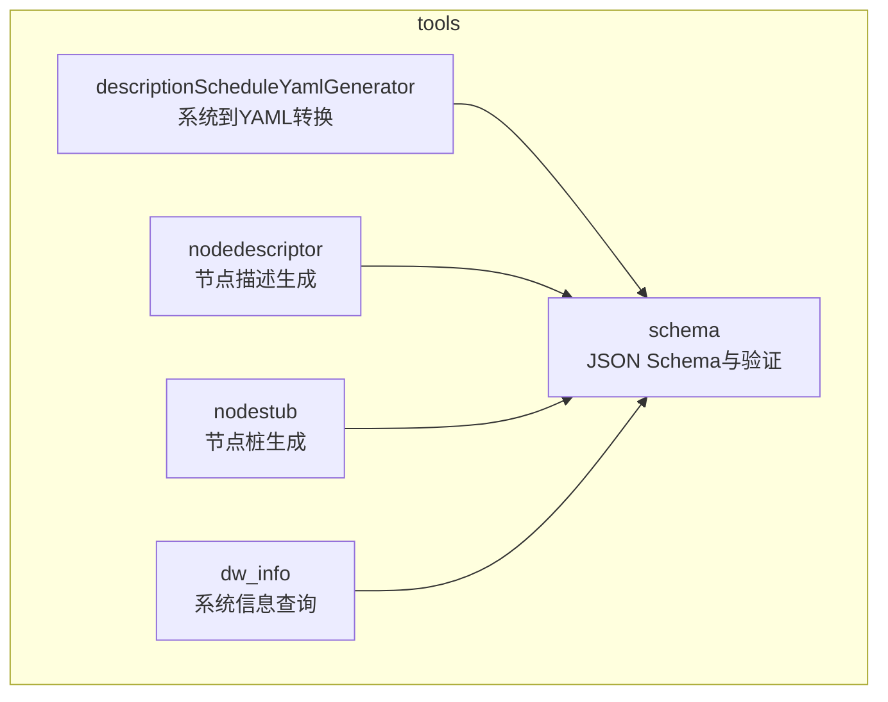
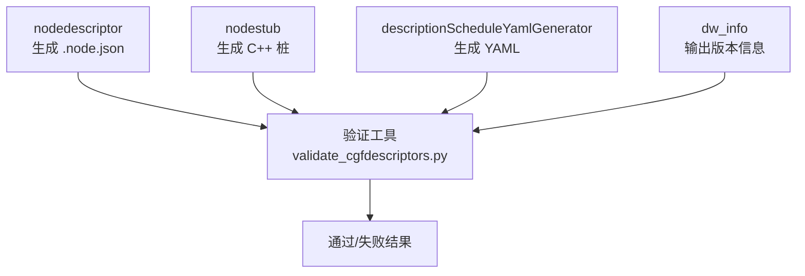
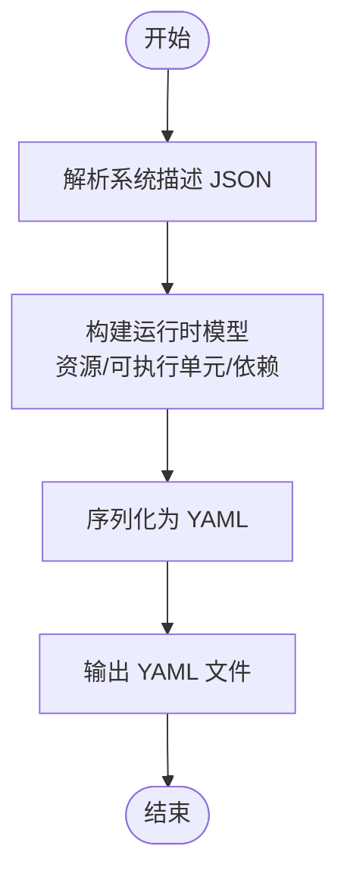
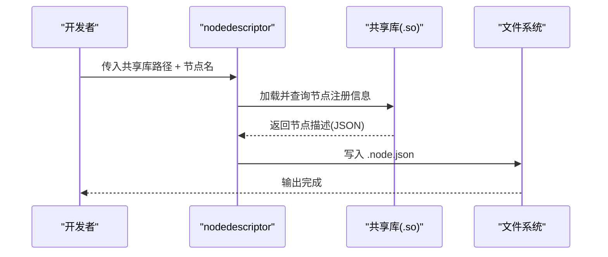
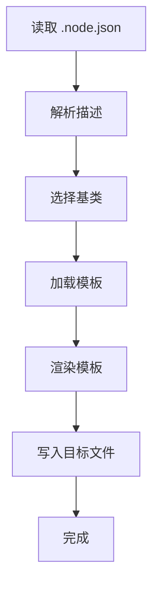
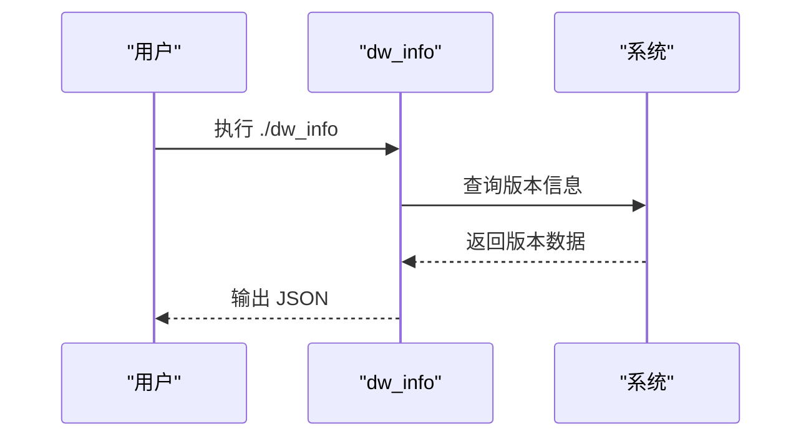
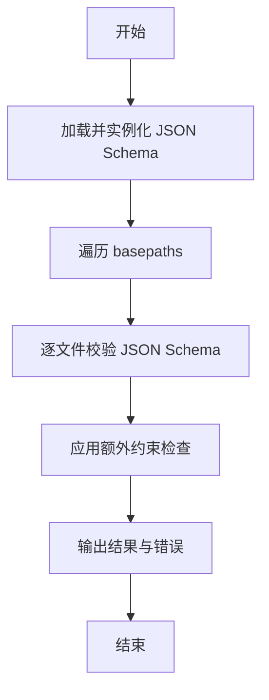
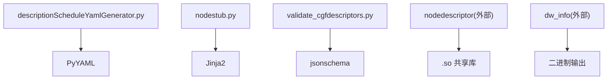

# 配置工具

<cite>
**本文引用的文件**
- [driverorks-5.10/tools/descriptionScheduleYamlGenerator/README-descriptionScheduleYamlGenerator.md](file://driverorks-5.10/tools/descriptionScheduleYamlGenerator/README-descriptionScheduleYamlGenerator.md)
- [driverorks-5.10/tools/descriptionScheduleYamlGenerator/descriptionScheduleYamlGenerator.py](file://driverorks-5.10/tools/descriptionScheduleYamlGenerator/descriptionScheduleYamlGenerator.py)
- [driverorks-5.10/tools/nodedescriptor/README-nodedescriptor.md](file://driverorks-5.10/tools/nodedescriptor/README-nodedescriptor.md)
- [driverorks-5.10/tools/nodestub/README-nodestub.md](file://driverorks-5.10/tools/nodestub/README-nodestub.md)
- [driverorks-5.10/tools/nodestub/nodestub.py](file://driverorks-5.10/tools/nodestub/nodestub.py)
- [driverorks-5.10/tools/dw_info/README-dw_info.md](file://driverorks-5.10/tools/dw_info/README-dw_info.md)
- [driverorks-5.10/tools/schema/README-validate_cgfdescriptors.md](file://driverorks-5.10/tools/schema/README-validate_cgfdescriptors.md)
- [driverorks-5.10/tools/schema/validate_cgfdescriptors.py](file://driverorks-5.10/tools/schema/validate_cgfdescriptors.py)
- [driverorks-5.10/tools/schema/app-config.schema.json](file://driverorks-5.10/tools/schema/app-config.schema.json)
- [driverorks-5.10/tools/schema/app.schema.json](file://driverorks-5.10/tools/schema/app.schema.json)
- [driverorks-5.10/tools/schema/graphlet.schema.json](file://driverorks-5.10/tools/schema/graphlet.schema.json)
- [driverorks-5.10/tools/schema/node-params.schema.json](file://driverorks-5.10/tools/schema/node-params.schema.json)
- [driverorks-5.10/tools/schema/node-wcets.schema.json](file://driverorks-5.10/tools/schema/node-wcets.schema.json)
- [driverorks-5.10/tools/schema/node.schema.json](file://driverorks-5.10/tools/schema/node.schema.json)
- [driverorks-5.10/tools/schema/required-sensors.schema.json](file://driverorks-5.10/tools/schema/required-sensors.schema.json)
- [driverorks-5.10/tools/schema/sensor-mappings.schema.json](file://driverorks-5.10/tools/schema/sensor-mappings.schema.json)
- [driverorks-5.10/tools/schema/trans.schema.json](file://driverorks-5.10/tools/schema/trans.schema.json)
</cite>

## 目录
1. [简介](#简介)
2. [项目结构](#项目结构)
3. [核心组件](#核心组件)
4. [架构总览](#架构总览)
5. [详细组件分析](#详细组件分析)
6. [依赖分析](#依赖分析)
7. [性能考虑](#性能考虑)
8. [故障排查指南](#故障排查指南)
9. [结论](#结论)
10. [附录](#附录)

## 简介
本指南面向使用 DriveWorks 配置工具链的开发者与测试工程师，系统讲解以下工具的用途、用法与最佳实践：
- 节点描述生成器：从节点描述文件生成 YAML 配置，用于 STM 编译。
- 节点描述器工具：从已编译共享库提取节点 JSON 描述，支持单个/全部节点输出。
- 节点桩工具：根据节点 JSON 描述生成 C++ 模板源码骨架（头文件与实现）。
- dw_info 工具：以可解析的 JSON 输出当前 DriveWorks 版本等系统信息。
- 配置模式验证工具：基于 JSON Schema 对配置文件进行格式与约束校验。

同时提供命令行使用示例、参数说明、配置文件格式规范与最佳实践建议，帮助团队在 CI/CD 中自动化校验与生成流程。

## 项目结构
本仓库中与配置工具相关的核心目录位于 driverorks-5.10/tools 下，按功能划分为多个子工具目录，每个目录包含对应的 README 使用说明与实现脚本或二进制文件。

图表来源
- [driverorks-5.10/tools/descriptionScheduleYamlGenerator/README-descriptionScheduleYamlGenerator.md](file://driverorks-5.10/tools/descriptionScheduleYamlGenerator/README-descriptionScheduleYamlGenerator.md)
- [driverorks-5.10/tools/nodedescriptor/README-nodedescriptor.md](file://driverorks-5.10/tools/nodedescriptor/README-nodedescriptor.md)
- [driverorks-5.10/tools/nodestub/README-nodestub.md](file://driverorks-5.10/tools/nodestub/README-nodestub.md)
- [driverorks-5.10/tools/dw_info/README-dw_info.md](file://driverorks-5.10/tools/dw_info/README-dw_info.md)
- [driverorks-5.10/tools/schema/README-validate_cgfdescriptors.md](file://driverorks-5.10/tools/schema/README-validate_cgfdescriptors.md)

章节来源
- [driverorks-5.10/tools/descriptionScheduleYamlGenerator/README-descriptionScheduleYamlGenerator.md:1-11](file://driverorks-5.10/tools/descriptionScheduleYamlGenerator/README-descriptionScheduleYamlGenerator.md#L1-L11)
- [driverorks-5.10/tools/nodedescriptor/README-nodedescriptor.md:1-23](file://driverorks-5.10/tools/nodedescriptor/README-nodedescriptor.md#L1-L23)
- [driverorks-5.10/tools/nodestub/README-nodestub.md:1-32](file://driverorks-5.10/tools/nodestub/README-nodestub.md#L1-L32)
- [driverorks-5.10/tools/dw_info/README-dw_info.md:1-29](file://driverorks-5.10/tools/dw_info/README-dw_info.md#L1-L29)
- [driverorks-5.10/tools/schema/README-validate_cgfdescriptors.md:1-17](file://driverorks-5.10/tools/schema/README-validate_cgfdescriptors.md#L1-L17)

## 核心组件
- 节点描述生成器（System to YAML）
  - 功能：将系统描述文件转换为 YAML，供 STM 编译使用。
  - 关键依赖：PyYAML；运行前需安装。
  - 示例命令：见对应 README 的使用示例。
- 节点描述器工具（Node Descriptor Generator）
  - 功能：从已编译共享库中提取节点 JSON 描述，支持列出节点名、输出单个/全部节点描述。
  - 典型用法：集成到构建流程，保持 .node.json 与 C++ 实现同步。
- 节点桩工具（Node JSON to C++ stubs）
  - 功能：基于节点 JSON 描述生成 C++ 源码骨架（头文件与实现），使用模板引擎渲染。
  - 关键依赖：Jinja2；运行前需安装。
- dw_info 工具
  - 功能：以 JSON 输出当前 DriveWorks 版本等系统信息，便于自动化脚本解析。
- 配置模式验证工具（JSON Descriptor Validation）
  - 功能：对 .app/.app-config/.graphlet/.node/.node-params/.node-wcets/.required-sensors/.sensor-mappings/.trans 等 JSON 文件进行 JSON Schema 校验与额外约束检查（如连接类型一致性、循环检测、键顺序与缩进等）。
  - 关键依赖：jsonschema；运行前需安装。

章节来源
- [driverorks-5.10/tools/descriptionScheduleYamlGenerator/README-descriptionScheduleYamlGenerator.md:6-10](file://driverorks-5.10/tools/descriptionScheduleYamlGenerator/README-descriptionScheduleYamlGenerator.md#L6-L10)
- [driverorks-5.10/tools/nodedescriptor/README-nodedescriptor.md:6-23](file://driverorks-5.10/tools/nodedescriptor/README-nodedescriptor.md#L6-L23)
- [driverorks-5.10/tools/nodestub/README-nodestub.md:6-32](file://driverorks-5.10/tools/nodestub/README-nodestub.md#L6-L32)
- [driverorks-5.10/tools/dw_info/README-dw_info.md:6-28](file://driverorks-5.10/tools/dw_info/README-dw_info.md#L6-L28)
- [driverorks-5.10/tools/schema/README-validate_cgfdescriptors.md:6-17](file://driverorks-5.10/tools/schema/README-validate_cgfdescriptors.md#L6-L17)

## 架构总览
下图展示各工具之间的关系与数据流：节点描述器与节点桩工具主要服务于节点开发与描述维护；系统到 YAML 转换器服务于系统级配置生成；dw_info 提供版本信息；验证工具贯穿所有阶段，确保配置文件符合模式与约束。

图表来源
- [driverorks-5.10/tools/nodedescriptor/README-nodedescriptor.md:10-23](file://driverorks-5.10/tools/nodedescriptor/README-nodedescriptor.md#L10-L23)
- [driverorks-5.10/tools/nodestub/README-nodestub.md:10-32](file://driverorks-5.10/tools/nodestub/README-nodestub.md#L10-L32)
- [driverorks-5.10/tools/descriptionScheduleYamlGenerator/README-descriptionScheduleYamlGenerator.md:6-10](file://driverorks-5.10/tools/descriptionScheduleYamlGenerator/README-descriptionScheduleYamlGenerator.md#L6-L10)
- [driverorks-5.10/tools/dw_info/README-dw_info.md:9-28](file://driverorks-5.10/tools/dw_info/README-dw_info.md#L9-L28)
- [driverorks-5.10/tools/schema/README-validate_cgfdescriptors.md:6-17](file://driverorks-5.10/tools/schema/README-validate_cgfdescriptors.md#L6-L17)

## 详细组件分析

### 节点描述生成器（System to YAML）
- 用途
  - 将系统描述文件转换为 YAML，供 STM 编译使用。
- 命令行示例
  - 参考：[示例命令](file://driverorks-5.10/tools/descriptionScheduleYamlGenerator/README-descriptionScheduleYamlGenerator.md#L10)
- 运行前置条件
  - 安装 PyYAML；脚本会自动查找打包的依赖库路径。
- 处理逻辑概览
  - 解析输入的系统描述 JSON，构建运行时资源与可执行单元模型，生成 YAML 输出。
  - 支持 WCET、依赖、资源、优先级等字段的序列化。
- 关键实现要点
  - 时间单位转换、资源类型枚举、可提交者与被提交者关系建模、依赖边与分组策略等。
- 最佳实践
  - 在 CI 中将该步骤作为构建流程的一部分，确保系统描述变更后能及时生成 YAML 并触发 STM 编译。

图表来源
- [driverorks-5.10/tools/descriptionScheduleYamlGenerator/descriptionScheduleYamlGenerator.py:62-90](file://driverorks-5.10/tools/descriptionScheduleYamlGenerator/descriptionScheduleYamlGenerator.py#L62-L90)
- [driverorks-5.10/tools/descriptionScheduleYamlGenerator/descriptionScheduleYamlGenerator.py:607-633](file://driverorks-5.10/tools/descriptionScheduleYamlGenerator/descriptionScheduleYamlGenerator.py#L607-L633)

章节来源
- [driverorks-5.10/tools/descriptionScheduleYamlGenerator/README-descriptionScheduleYamlGenerator.md:6-10](file://driverorks-5.10/tools/descriptionScheduleYamlGenerator/README-descriptionScheduleYamlGenerator.md#L6-L10)
- [driverorks-5.10/tools/descriptionScheduleYamlGenerator/descriptionScheduleYamlGenerator.py:35-54](file://driverorks-5.10/tools/descriptionScheduleYamlGenerator/descriptionScheduleYamlGenerator.py#L35-L54)

### 节点描述器工具（Node Descriptor Generator）
- 用途
  - 从已编译共享库中提取节点 JSON 描述，支持列出节点名、输出单个/全部节点描述。
- 命令行示例
  - 参考：[示例命令:20-23](file://driverorks-5.10/tools/nodedescriptor/README-nodedescriptor.md#L20-L23)
- 参数说明
  - 不带参数：显示帮助。
  - 单共享库参数：列出该库中注册的所有节点名。
  - 共享库 + 节点名：输出该节点的 JSON 描述。
  - 共享库 + “*”：输出所有节点描述（以记录分隔符分隔）。
- 最佳实践
  - 在构建流程中调用“输出单个节点描述”，确保 .node.json 与实现保持同步。

图表来源
- [driverorks-5.10/tools/nodedescriptor/README-nodedescriptor.md:10-23](file://driverorks-5.10/tools/nodedescriptor/README-nodedescriptor.md#L10-L23)

章节来源
- [driverorks-5.10/tools/nodedescriptor/README-nodedescriptor.md:6-23](file://driverorks-5.10/tools/nodedescriptor/README-nodedescriptor.md#L6-L23)

### 节点桩工具（Node JSON to C++ stubs）
- 用途
  - 基于节点 JSON 描述生成 C++ 源码骨架（头文件与实现），使用模板引擎渲染。
- 命令行示例
  - 参考：[示例命令:16-18](file://driverorks-5.10/tools/nodestub/README-nodestub.md#L16-L18)
- 参数说明
  - NODE_JSON_FILE：节点 JSON 描述文件路径。
  - BASE_CLASS：期望的基类（例如异常安全处理节点或传感器节点）。
  - --output-path：输出目录（默认临时目录）。
  - --overwrite-existing-files：覆盖已存在文件。
- 依赖与注意事项
  - 依赖 Jinja2；当模板中引用的数据类型未在内置头文件映射中时，会提示需要手动添加头文件包含。
- 生成文件
  - 头文件、实现文件、实现头文件、实现实现文件，共四个文件。

图表来源
- [driverorks-5.10/tools/nodestub/nodestub.py:77-120](file://driverorks-5.10/tools/nodestub/nodestub.py#L77-L120)
- [driverorks-5.10/tools/nodestub/nodestub.py:128-160](file://driverorks-5.10/tools/nodestub/nodestub.py#L128-L160)

章节来源
- [driverorks-5.10/tools/nodestub/README-nodestub.md:6-32](file://driverorks-5.10/tools/nodestub/README-nodestub.md#L6-L32)
- [driverorks-5.10/tools/nodestub/nodestub.py:35-75](file://driverorks-5.10/tools/nodestub/nodestub.py#L35-L75)

### dw_info 工具
- 用途
  - 输出当前 DriveWorks 版本等系统信息，以 JSON 格式便于脚本解析。
- 命令行示例
  - 参考：[示例命令:13-13](file://driverorks-5.10/tools/dw_info/README-dw_info.md#L13-L13)
- 输出示例
  - 参考：[示例输出:17-28](file://driverorks-5.10/tools/dw_info/README-dw_info.md#L17-L28)

图表来源
- [driverorks-5.10/tools/dw_info/README-dw_info.md:9-28](file://driverorks-5.10/tools/dw_info/README-dw_info.md#L9-L28)

章节来源
- [driverorks-5.10/tools/dw_info/README-dw_info.md:6-28](file://driverorks-5.10/tools/dw_info/README-dw_info.md#L6-L28)

### 配置模式验证工具（JSON Descriptor Validation）
- 用途
  - 对多种 JSON 配置文件进行 JSON Schema 校验与额外约束检查（如跨引用、连接类型一致性、循环检测、键顺序与缩进等）。
- 支持的文件类型
  - .app.json、.app-config.json、.graphlet.json、.node.json、.node-params.json、.node-wcets.json、.required-sensors.json、.sensor-mappings.json、.trans.json。
- 命令行示例
  - 参考：[示例命令:12-16](file://driverorks-5.10/tools/schema/README-validate_cgfdescriptors.md#L12-L16)
- 参数说明
  - basepaths：一个或多个基础路径（文件或目录）。目录将递归搜索匹配扩展名的 JSON 文件。
  - --ignore-order：忽略键顺序严格性。
  - --ignore-indentation：忽略缩进严格性。
- 校验流程
  - 读取并缓存各类型 JSON Schema，实例化验证器。
  - 递归扫描 basepaths，对匹配文件逐一校验。
  - 应用额外约束：参数默认值类型校验、子组件参数匹配、连接端口类型一致性、无环检测、状态与调度关联等。
  - 输出校验结果统计与错误明细。

图表来源
- [driverorks-5.10/tools/schema/validate_cgfdescriptors.py:30-97](file://driverorks-5.10/tools/schema/validate_cgfdescriptors.py#L30-L97)
- [driverorks-5.10/tools/schema/validate_cgfdescriptors.py:179-315](file://driverorks-5.10/tools/schema/validate_cgfdescriptors.py#L179-L315)

章节来源
- [driverorks-5.10/tools/schema/README-validate_cgfdescriptors.md:6-17](file://driverorks-5.10/tools/schema/README-validate_cgfdescriptors.md#L6-L17)
- [driverorks-5.10/tools/schema/validate_cgfdescriptors.py:16-26](file://driverorks-5.10/tools/schema/validate_cgfdescriptors.py#L16-L26)
- [driverorks-5.10/tools/schema/validate_cgfdescriptors.py:30-97](file://driverorks-5.10/tools/schema/validate_cgfdescriptors.py#L30-L97)

## 依赖分析
- Python 依赖
  - descriptionScheduleYamlGenerator：PyYAML（用于 YAML 序列化）。
  - nodestub：Jinja2（用于模板渲染）。
  - schema/validate_cgfdescriptors：jsonschema（用于 JSON Schema 校验）。
- 外部工具
  - nodedescriptor：需要已编译的共享库（.so）以提取节点描述。
  - dw_info：二进制工具，直接执行输出 JSON。

图表来源
- [driverorks-5.10/tools/descriptionScheduleYamlGenerator/descriptionScheduleYamlGenerator.py:49-54](file://driverorks-5.10/tools/descriptionScheduleYamlGenerator/descriptionScheduleYamlGenerator.py#L49-L54)
- [driverorks-5.10/tools/nodestub/nodestub.py:46-46](file://driverorks-5.10/tools/nodestub/nodestub.py#L46-L46)
- [driverorks-5.10/tools/schema/validate_cgfdescriptors.py:10-13](file://driverorks-5.10/tools/schema/validate_cgfdescriptors.py#L10-L13)

章节来源
- [driverorks-5.10/tools/descriptionScheduleYamlGenerator/descriptionScheduleYamlGenerator.py:49-54](file://driverorks-5.10/tools/descriptionScheduleYamlGenerator/descriptionScheduleYamlGenerator.py#L49-L54)
- [driverorks-5.10/tools/nodestub/nodestub.py:46-46](file://driverorks-5.10/tools/nodestub/nodestub.py#L46-L46)
- [driverorks-5.10/tools/schema/validate_cgfdescriptors.py:10-13](file://driverorks-5.10/tools/schema/validate_cgfdescriptors.py#L10-L13)

## 性能考虑
- 节点描述生成器
  - 大规模系统描述可能涉及大量可执行单元与依赖关系，建议在 CI 中缓存中间产物，避免重复计算。
  - 合理设置 WCET 与优先级，有助于 STM 调度优化。
- 节点桩工具
  - 模板渲染开销较小，批量生成时注意磁盘 IO；可并行化生成不同节点的桩文件。
- 验证工具
  - 对大型工程的多层级子组件与连接图，建议分批校验或并行执行，减少总耗时。
  - 使用 --ignore-order 与 --ignore-indentation 可降低格式性检查成本，但不建议在生产流水线中关闭严格性。

## 故障排查指南
- 安装依赖失败
  - descriptionScheduleYamlGenerator：确认 PyYAML 可用。
  - nodestub：确认 Jinja2 可用。
  - schema/validate_cgfdescriptors：确认 jsonschema 可用。
- 节点描述器找不到节点
  - 确认共享库路径正确且已加载；检查节点是否在该库中注册。
- 节点桩生成缺少头文件
  - 当模板引用的数据类型未在内置映射中时，工具会提示需要手动添加头文件包含；请更新模板中的头文件映射。
- 验证工具报错
  - JSON 读取/解析失败：检查文件编码与格式。
  - Schema 校验失败：对照相应 schema 修正字段类型与必填项。
  - 额外约束失败：关注连接类型不一致、循环依赖、键顺序与缩进等问题。

章节来源
- [driverorks-5.10/tools/nodestub/nodestub.py:184-191](file://driverorks-5.10/tools/nodestub/nodestub.py#L184-L191)
- [driverorks-5.10/tools/schema/validate_cgfdescriptors.py:134-152](file://driverorks-5.10/tools/schema/validate_cgfdescriptors.py#L134-L152)
- [driverorks-5.10/tools/schema/validate_cgfdescriptors.py:309-315](file://driverorks-5.10/tools/schema/validate_cgfdescriptors.py#L309-L315)

## 结论
本指南系统梳理了 DriveWorks 配置工具链的五大工具：节点描述生成器、节点描述器、节点桩、dw_info 与配置模式验证工具。通过合理使用这些工具并结合 JSON Schema 与额外约束检查，可以在开发早期发现配置问题，提升系统稳定性与可维护性。建议在 CI/CD 中自动化执行验证与生成流程，确保配置文件始终符合规范。

## 附录

### 命令行使用示例与参数说明
- 节点描述生成器
  - 示例：[示例命令](file://driverorks-5.10/tools/descriptionScheduleYamlGenerator/README-descriptionScheduleYamlGenerator.md#L10)
- 节点描述器
  - 示例：[示例命令:20-23](file://driverorks-5.10/tools/nodedescriptor/README-nodedescriptor.md#L20-L23)
  - 参数：共享库路径、节点名或“*”。
- 节点桩
  - 示例：[示例命令:16-18](file://driverorks-5.10/tools/nodestub/README-nodestub.md#L16-L18)
  - 参数：NODE_JSON_FILE、BASE_CLASS、--output-path、--overwrite-existing-files。
- dw_info
  - 示例：[示例命令](file://driverorks-5.10/tools/dw_info/README-dw_info.md#L13)
- 配置模式验证
  - 示例：[示例命令:12-16](file://driverorks-5.10/tools/schema/README-validate_cgfdescriptors.md#L12-L16)
  - 参数：basepaths、--ignore-order、--ignore-indentation。

章节来源
- [driverorks-5.10/tools/descriptionScheduleYamlGenerator/README-descriptionScheduleYamlGenerator.md:8-10](file://driverorks-5.10/tools/descriptionScheduleYamlGenerator/README-descriptionScheduleYamlGenerator.md#L8-L10)
- [driverorks-5.10/tools/nodedescriptor/README-nodedescriptor.md:10-23](file://driverorks-5.10/tools/nodedescriptor/README-nodedescriptor.md#L10-L23)
- [driverorks-5.10/tools/nodestub/README-nodestub.md:10-19](file://driverorks-5.10/tools/nodestub/README-nodestub.md#L10-L19)
- [driverorks-5.10/tools/dw_info/README-dw_info.md:11-13](file://driverorks-5.10/tools/dw_info/README-dw_info.md#L11-L13)
- [driverorks-5.10/tools/schema/README-validate_cgfdescriptors.md:10-16](file://driverorks-5.10/tools/schema/README-validate_cgfdescriptors.md#L10-L16)

### 配置文件格式规范与最佳实践
- 支持的配置文件类型
  - .app.json、.app-config.json、.graphlet.json、.node.json、.node-params.json、.node-wcets.json、.required-sensors.json、.sensor-mappings.json、.trans.json。
- 校验范围
  - JSON Schema 校验：字段类型、必填项、枚举值等。
  - 额外约束：参数默认值类型匹配、子组件参数传递一致性、连接端口类型一致性、无环检测、状态与调度关联、键顺序与缩进（可选）。
- 最佳实践
  - 在本地与 CI 中统一执行验证，尽早发现配置错误。
  - 保持 .node.json 与实现同步，必要时在构建流程中自动生成。
  - 使用节点桩工具快速生成骨架，减少手写样板代码。
  - 使用 dw_info 获取版本信息，便于定位环境差异。

章节来源
- [driverorks-5.10/tools/schema/README-validate_cgfdescriptors.md:6-17](file://driverorks-5.10/tools/schema/README-validate_cgfdescriptors.md#L6-L17)
- [driverorks-5.10/tools/schema/app.schema.json](file://driverorks-5.10/tools/schema/app.schema.json)
- [driverorks-5.10/tools/schema/app-config.schema.json](file://driverorks-5.10/tools/schema/app-config.schema.json)
- [driverorks-5.10/tools/schema/graphlet.schema.json](file://driverorks-5.10/tools/schema/graphlet.schema.json)
- [driverorks-5.10/tools/schema/node.schema.json](file://driverorks-5.10/tools/schema/node.schema.json)
- [driverorks-5.10/tools/schema/node-params.schema.json](file://driverorks-5.10/tools/schema/node-params.schema.json)
- [driverorks-5.10/tools/schema/node-wcets.schema.json](file://driverorks-5.10/tools/schema/node-wcets.schema.json)
- [driverorks-5.10/tools/schema/required-sensors.schema.json](file://driverorks-5.10/tools/schema/required-sensors.schema.json)
- [driverorks-5.10/tools/schema/sensor-mappings.schema.json](file://driverorks-5.10/tools/schema/sensor-mappings.schema.json)
- [driverorks-5.10/tools/schema/trans.schema.json](file://driverorks-5.10/tools/schema/trans.schema.json)