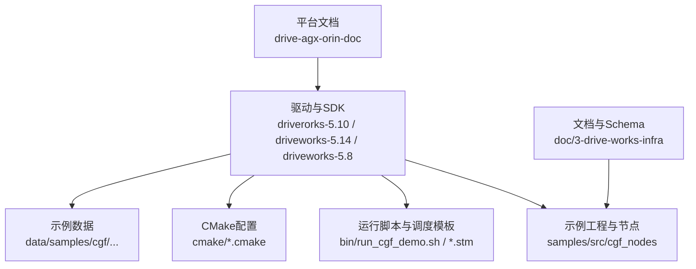
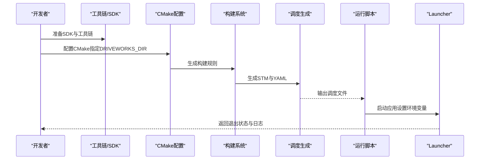
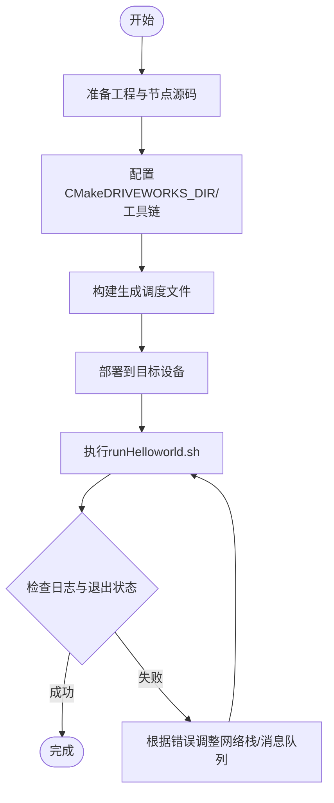
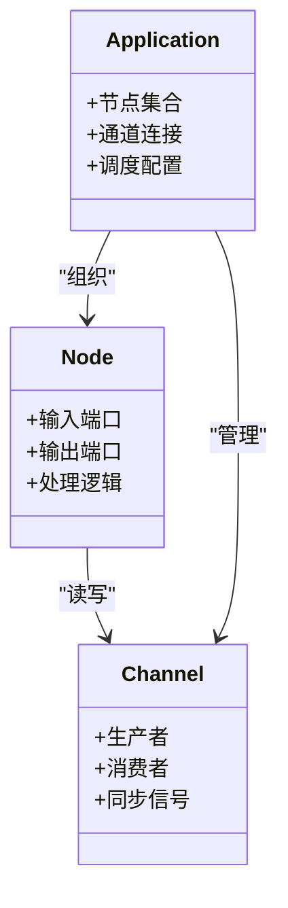
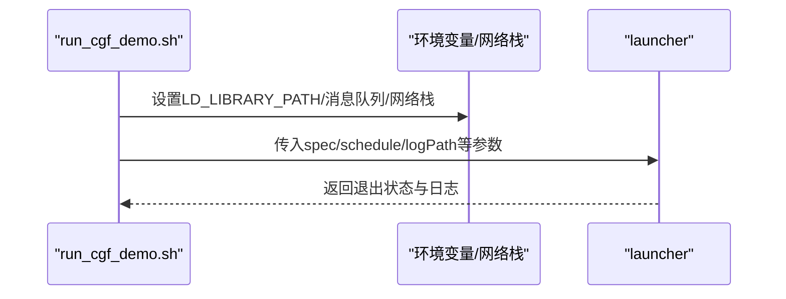
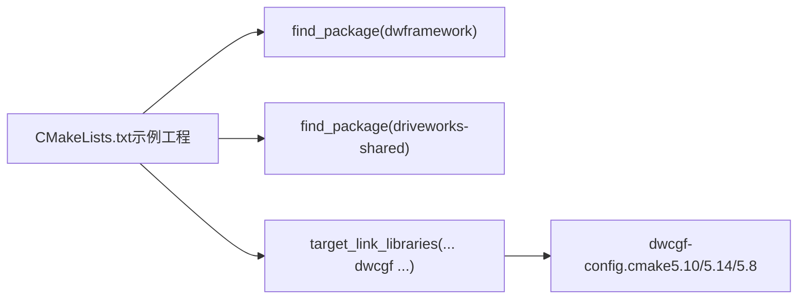

# 快速开始

<cite>
**本文引用的文件**
- [README_en.md](file://README_en.md)
- [README.md](file://README.md)
- [run_cgf_demo.sh](file://driveworks-5.14/bin/run_cgf_demo.sh)
- [cpu_simple.stm](file://driveworks-5.8/bin/cpu_simple.stm)
- [dwcgf-config.cmake（5.10）](file://driverorks-5.10/cmake/dwcgf-config.cmake)
- [dwcgf-config.cmake（5.14）](file://driveworks-5.14/cmake/dwcgf-config.cmake)
- [dwcgf-config.cmake（5.8）](file://driveworks-5.8/cmake/dwcgf-config.cmake)
- [CMakeLists.txt（5.10 示例工程）](file://driverorks-5.10/samples/src/cgf_nodes/CMakeLists.txt)
- [rig.json（5.10 示例数据）](file://driverorks-5.10/data/samples/cgf/trafficlightturning-hyperion8/rig.json)
- [run_cgf.sh（5.10 示例脚本）](file://driverorks-5.10/bin/config/run_cgf.sh)
- [run_cgf.sh（5.8 示例脚本）](file://driveworks-5.8/bin/config/run_cgf.sh)
</cite>

## 目录
1. [简介](#简介)
2. [项目结构](#项目结构)
3. [核心组件](#核心组件)
4. [架构总览](#架构总览)
5. [详细组件分析](#详细组件分析)
6. [依赖分析](#依赖分析)
7. [性能考虑](#性能考虑)
8. [故障排除指南](#故障排除指南)
9. [结论](#结论)
10. [附录](#附录)

## 简介
本指南面向首次接触 NV Driveworks 的开发者，目标是在最短时间内完成环境搭建、构建并运行第一个 CGF Hello World 示例，同时建立对 CGF 架构、节点系统与通道机制的基本认知。文档内容基于仓库中的官方 SDK、示例与脚本进行整理，确保步骤可执行、问题可定位。

## 项目结构
仓库包含多个版本的 Driveworks SDK（5.8、5.10、5.14），以及配套的示例、工具链与运行脚本。关键目录与用途概览如下：
- driverorks-5.10：包含 CGF 示例工程、CMake 配置与样例数据，适合构建与运行自定义节点。
- driveworks-5.14：包含 CGF Demo 应用与运行脚本，适合直接运行官方示例。
- driveworks-5.8：包含基础调度模板（STM）与运行脚本，适合理解调度与网络栈调优。
- doc/3-drive-works-infra：包含 CGF 设计与 JSON Schema 文档，便于理解 CGF 描述语言与配置规范。
- drive-agx-orin-doc：包含平台与中间件说明文档，有助于理解 CGF 与 STM 的定位与关系。

**图表来源**
- [run_cgf_demo.sh:150-157](file://driveworks-5.14/bin/run_cgf_demo.sh#L150-L157)
- [CMakeLists.txt（5.10 示例工程）:33-69](file://driverorks-5.10/samples/src/cgf_nodes/CMakeLists.txt#L33-L69)
- [dwcgf-config.cmake（5.10）:33-102](file://driverorks-5.10/cmake/dwcgf-config.cmake#L33-L102)

**章节来源**
- [README.md:1-115](file://README.md#L1-L115)
- [README_en.md:1-92](file://README_en.md#L1-L92)

## 核心组件
- CGF（Compute Graph Framework）：用于声明式地组织节点、端口与连接关系，支持可视化与自动调度生成。
- STM（Scheduling Middleware）：提供高性能实时调度与资源管理，支持多核、多客户端与同步原语。
- 节点系统：以“节点”为最小执行单元，通过输入输出端口（Port）与通道（Channel）进行数据交换。
- 通道机制：抽象数据传输与同步，支持共享内存、NvSci 等后端，保障跨进程/跨节点的低延迟通信。
- 应用配置：通过 JSON 描述应用拓扑、节点参数与传感器映射，配合 WCET/YAML/STM 文件实现可验证的调度。

**章节来源**
- [README.md:22-38](file://README.md#L22-L38)
- [dwcgf-config.cmake（5.10）:33-102](file://driverorks-5.10/cmake/dwcgf-config.cmake#L33-L102)
- [dwcgf-config.cmake（5.14）:33-102](file://driveworks-5.14/cmake/dwcgf-config.cmake#L33-L102)
- [dwcgf-config.cmake（5.8）:33-88](file://driveworks-5.8/cmake/dwcgf-config.cmake#L33-L88)

## 架构总览
下图展示了从“构建 CGF 节点”到“运行 CGF 应用”的关键流程，涵盖工具链、CMake 配置、调度生成与运行时启动器。

**图表来源**
- [README_en.md:9-18](file://README_en.md#L9-L18)
- [README_en.md:20-27](file://README_en.md#L20-L27)
- [README_en.md:47-62](file://README_en.md#L47-L62)
- [run_cgf_demo.sh:454-460](file://driveworks-5.14/bin/run_cgf_demo.sh#L454-L460)

## 详细组件分析

### 环境搭建与工具链
- 操作系统与硬件
  - 推荐使用与 Driveworks 版本匹配的 Linux 发行版；确保内核与驱动满足实时性与 IPC 要求。
  - 在 x86_64 上运行示例时，需满足网络栈与消息队列参数要求（详见“故障排除”）。
- 依赖与编译器
  - 使用 CMake 工具链文件（Toolchain-V5L.cmake）统一编译选项与链接路径。
  - 通过 CMake 配置脚本（dwcgf-config.cmake）自动查找头文件与库路径。
- SDK 安装与路径
  - 将 SDK 安装至 /usr/local/driveworks 或自定义目录，并在 CMake 中通过 DRIVEWORKS_DIR 指定根路径。
  - 示例工程位于 samples/src/cgf_nodes，包含自定义节点源码与构建脚本。

**章节来源**
- [README_en.md:9-18](file://README_en.md#L9-L18)
- [dwcgf-config.cmake（5.10）:33-102](file://driverorks-5.10/cmake/dwcgf-config.cmake#L33-L102)
- [dwcgf-config.cmake（5.14）:33-102](file://driveworks-5.14/cmake/dwcgf-config.cmake#L33-L102)
- [CMakeLists.txt（5.10 示例工程）:33-69](file://driverorks-5.10/samples/src/cgf_nodes/CMakeLists.txt#L33-L69)

### 第一个 Hello World 示例：从创建节点到运行调试
- 步骤一：准备工程
  - 在 samples/src/cgf_nodes 下添加自定义节点源文件（例如 HelloWorldNode.hpp/Impl.cpp 等）。
  - 在 CMakeLists.txt 中声明源文件并链接 dwframework、driveworks-shared 与 dwcgf。
- 步骤二：配置与构建
  - 设置 CMake 变量 DRIVEWORKS_DIR 指向 SDK 根目录。
  - 使用工具链文件 Toolchain-V5L.cmake 进行配置与构建。
- 步骤三：生成调度
  - 构建完成后，自动生成 DWCGFHelloworld__standardSchedule.stm 与 YAML 文件，位于 target/.../schedule/cgf_custom_nodes。
- 步骤四：部署与运行
  - 将安装产物复制到目标设备（建议使用 rsync）。
  - 在目标设备上执行 runHelloworld.sh，查看 LogFolder 日志并确认退出状态为 0。
- 调试要点
  - 若提示网络栈或消息队列不足，参考“故障排除”章节进行调整。
  - 如需 GDB 调试，可在运行脚本中传入 --gdb 参数。

**图表来源**
- [README_en.md:9-18](file://README_en.md#L9-L18)
- [README_en.md:20-27](file://README_en.md#L20-L27)
- [README_en.md:29-45](file://README_en.md#L29-L45)
- [README_en.md:47-62](file://README_en.md#L47-L62)

**章节来源**
- [README_en.md:1-92](file://README_en.md#L1-L92)
- [CMakeLists.txt（5.10 示例工程）:33-69](file://driverorks-5.10/samples/src/cgf_nodes/CMakeLists.txt#L33-L69)

### CGF 基本概念：架构、节点与通道
- CGF 架构
  - 通过 JSON 描述应用拓扑、节点参数与传感器映射，结合 WCET/YAML/STM 实现可验证的调度与执行。
  - 文档与 Schema 位于 doc/3-drive-works-infra，包含不同版本的 schema 文件，指导正确编写配置。
- 节点系统
  - 节点是计算单元，通过输入输出端口与通道进行数据交换；示例工程展示了如何定义与实现节点。
- 通道机制
  - 通道抽象数据传输与同步，支持共享内存、NvSci 等后端；运行脚本会检查 NvSci 配置文件与消息队列大小。

**图表来源**
- [dwcgf-config.cmake（5.10）:33-102](file://driverorks-5.10/cmake/dwcgf-config.cmake#L33-L102)
- [dwcgf-config.cmake（5.14）:33-102](file://driveworks-5.14/cmake/dwcgf-config.cmake#L33-L102)
- [dwcgf-config.cmake（5.8）:33-88](file://driveworks-5.8/cmake/dwcgf-config.cmake#L33-L88)

**章节来源**
- [README.md:22-38](file://README.md#L22-L38)
- [CMakeLists.txt（5.10 示例工程）:33-69](file://driverorks-5.10/samples/src/cgf_nodes/CMakeLists.txt#L33-L69)

### 调度与运行时：STM 与 Launcher
- STM 调度
  - 示例中包含 cpu_simple.stm，展示超周期、同步与 Fence 的基本用法；实际应用中由 CGF 工具链生成标准调度文件。
- 运行时启动器
  - run_cgf_demo.sh 负责设置环境变量、调优网络栈与消息队列、选择系统文件与调度文件，并启动 launcher。
  - 启动器会根据参数加载 spec、schedule、日志路径等，最终输出退出状态供判断。

**图表来源**
- [run_cgf_demo.sh:291-313](file://driveworks-5.14/bin/run_cgf_demo.sh#L291-L313)
- [run_cgf_demo.sh:454-490](file://driveworks-5.14/bin/run_cgf_demo.sh#L454-L490)

**章节来源**
- [run_cgf_demo.sh:1-509](file://driveworks-5.14/bin/run_cgf_demo.sh#L1-L509)
- [cpu_simple.stm:1-152](file://driveworks-5.8/bin/cpu_simple.stm#L1-L152)

## 依赖分析
- CMake 配置脚本会自动查找 dwcgf 与相关第三方头文件路径，并导入共享库。
- 示例工程依赖 dwframework、driveworks-shared 与 dwcgf；通过 find_package 与 target_link_libraries 完成链接。
- 运行时依赖 LD_LIBRARY_PATH 指向 SDK 的 lib 与 bin 目录，以及 NvSci 配置文件与消息队列参数。

**图表来源**
- [CMakeLists.txt（5.10 示例工程）:49-62](file://driverorks-5.10/samples/src/cgf_nodes/CMakeLists.txt#L49-L62)
- [dwcgf-config.cmake（5.10）:33-102](file://driverorks-5.10/cmake/dwcgf-config.cmake#L33-L102)
- [dwcgf-config.cmake（5.14）:33-102](file://driveworks-5.14/cmake/dwcgf-config.cmake#L33-L102)
- [dwcgf-config.cmake（5.8）:33-88](file://driveworks-5.8/cmake/dwcgf-config.cmake#L33-L88)

**章节来源**
- [CMakeLists.txt（5.10 示例工程）:33-69](file://driverorks-5.10/samples/src/cgf_nodes/CMakeLists.txt#L33-L69)
- [dwcgf-config.cmake（5.10）:33-102](file://driverorks-5.10/cmake/dwcgf-config.cmake#L33-L102)
- [dwcgf-config.cmake（5.14）:33-102](file://driveworks-5.14/cmake/dwcgf-config.cmake#L33-L102)
- [dwcgf-config.cmake（5.8）:33-88](file://driveworks-5.8/cmake/dwcgf-config.cmake#L33-L88)

## 性能考虑
- 网络栈与消息队列
  - 在 Linux 上，若默认网络缓冲区过小，会导致高延迟；运行脚本会检测并提示增大 net.core.wmem_max、net.core.rmem_max 等参数。
  - 消息队列 fs.mqueue.msg_max 需要达到至少 4096，否则 STM 无法正常工作。
- 显示与图形
  - 运行脚本会根据显示环境设置 DISPLAY，避免在无头环境下出现图形相关问题。
- 资源与同步
  - STM 的超周期、同步与 Fence 会影响任务时序与吞吐；建议在生成的调度文件基础上进行微调。

**章节来源**
- [run_cgf_demo.sh:181-235](file://driveworks-5.14/bin/run_cgf_demo.sh#L181-L235)
- [run_cgf_demo.sh:237-272](file://driveworks-5.14/bin/run_cgf_demo.sh#L237-L272)
- [run_cgf_demo.sh:315-341](file://driveworks-5.14/bin/run_cgf_demo.sh#L315-L341)

## 故障排除指南
- 网络栈参数不足
  - 症状：高延迟或通信异常。
  - 处理：按脚本提示修改 /etc/sysctl.conf 并执行 sysctl -p。
- 消息队列参数不足
  - 症状：STM 报错或远程执行失败。
  - 处理：在容器中通过 --sysctl fs.mqueue.msg_max=4096 或在宿主机上修改 /etc/sysctl.conf 并执行 sysctl -p。
- 缺少 NvSci 配置
  - 症状：提示缺少 /etc/nvsciipc.cfg 或未包含 STM 配置。
  - 处理：确保配置文件存在并包含 STM 所需条目。
- 运行脚本找不到 launcher
  - 症状：提示找不到 ${RR_TOP_PATH}/launcher 或 ${DW_TOP_PATH}/bin/launcher。
  - 处理：确认 SDK 安装路径与 bin 目录存在，或手动设置 RR_TOP_PATH/DW_TOP_PATH。
- 日志与退出状态
  - 症状：应用崩溃或异常退出。
  - 处理：检查 LogFolder 下的日志文件，确认 launcher 退出状态为 0。

**章节来源**
- [run_cgf_demo.sh:181-235](file://driveworks-5.14/bin/run_cgf_demo.sh#L181-L235)
- [run_cgf_demo.sh:237-290](file://driveworks-5.14/bin/run_cgf_demo.sh#L237-L290)
- [run_cgf_demo.sh:454-490](file://driveworks-5.14/bin/run_cgf_demo.sh#L454-L490)
- [README_en.md:47-62](file://README_en.md#L47-L62)

## 结论
通过本指南，您已掌握 NV Driveworks 的环境搭建、工具链配置与第一个 CGF Hello World 示例的完整流程。建议在完成基础示例后，深入阅读 doc/3-drive-works-infra 中的文档与 Schema，逐步扩展到更复杂的节点与调度场景。

## 附录
- 示例数据与传感器配置
  - 示例工程包含 rig.json 等传感器配置文件，可用于虚拟车或实车场景的数据准备。
- 运行脚本参考
  - run_cgf_demo.sh 提供了完整的运行流程与参数说明，适合作为自定义脚本的模板。

**章节来源**
- [rig.json（5.10 示例数据）:1-800](file://driverorks-5.10/data/samples/cgf/trafficlightturning-hyperion8/rig.json#L1-L800)
- [run_cgf_demo.sh:1-509](file://driveworks-5.14/bin/run_cgf_demo.sh#L1-L509)
- [run_cgf.sh（5.10 示例脚本）](file://driverorks-5.10/bin/config/run_cgf.sh)
- [run_cgf.sh（5.8 示例脚本）](file://driveworks-5.8/bin/config/run_cgf.sh)