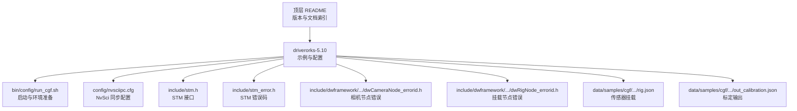
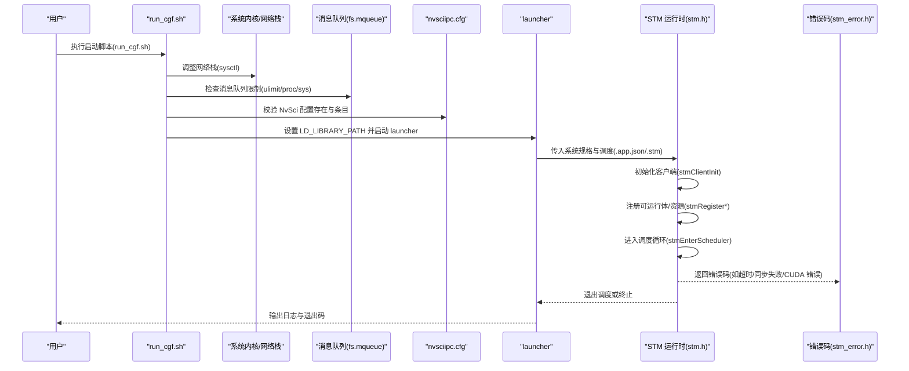
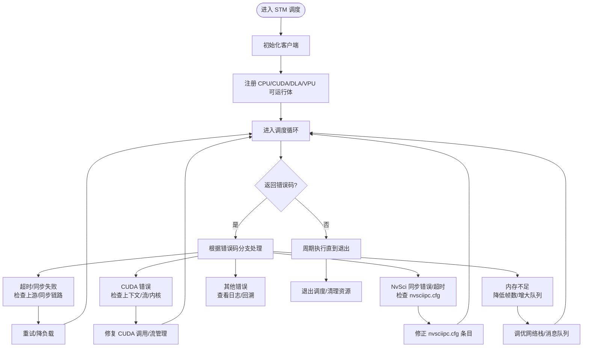
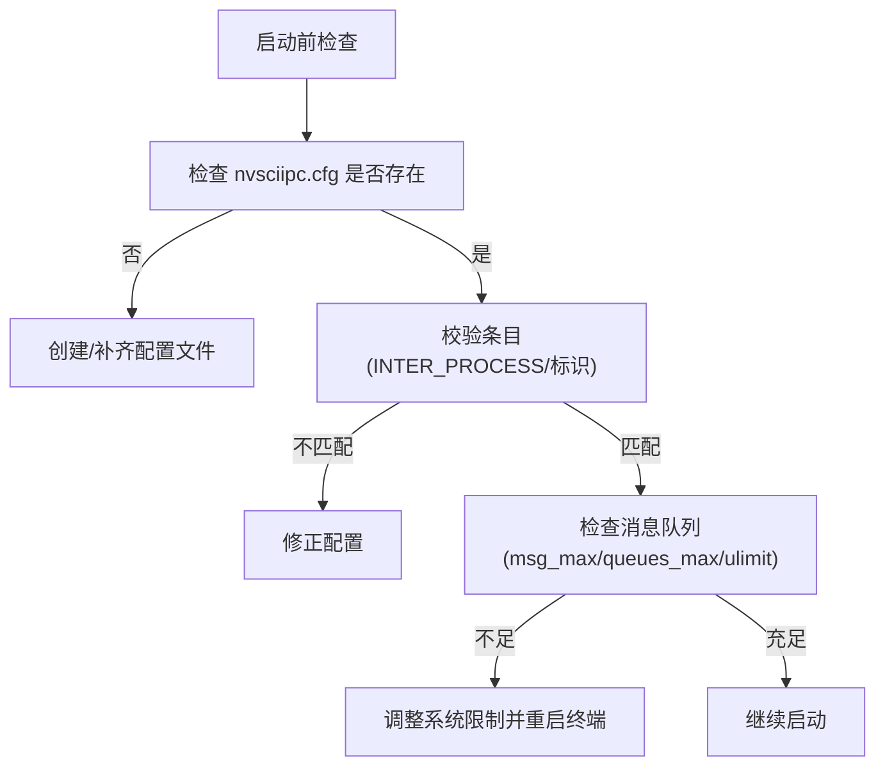
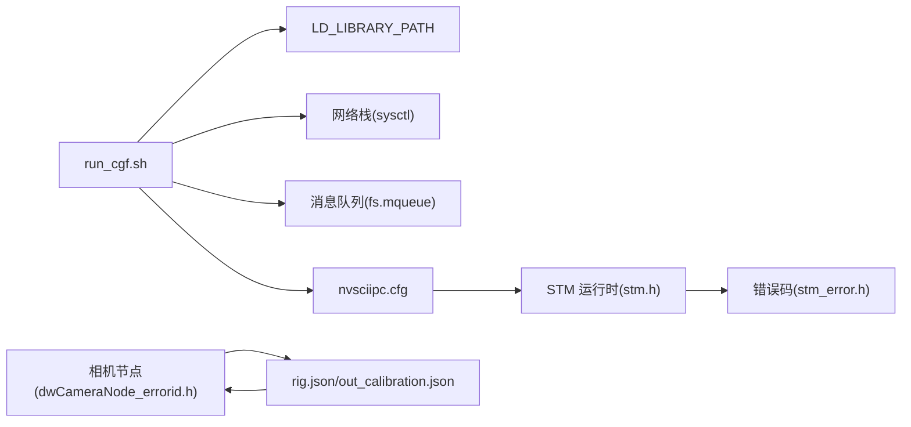

# 常见问题诊断

<cite>
**本文引用的文件**
- [README.md](file://README.md)
- [run_cgf.sh](file://driverorks-5.10/bin/config/run_cgf.sh)
- [nvsciipc.cfg](file://driverorks-5.10/config/nvsciipc.cfg)
- [stm_error.h](file://driverorks-5.10/include/stm_error.h)
- [stm.h](file://driverorks-5.10/include/stm.h)
- [dwCameraNode_errorid.h](file://driverorks-5.10/include/dwframework/dwnodes/sensors/dwcameranode/dwCameraNode_errorid.h)
- [dwRigNode_errorid.h](file://driverorks-5.10/include/dwframework/dwnodes/dwrignode/dwRigNode_errorid.h)
- [rig.json](file://driverorks-5.10/data/samples/cgf/trafficlightturning-hyperion8/rig.json)
- [out_calibration.json](file://driverorks-5.10/data/samples/cgf/trafficlightturning-hyperion8/out_calibration.json)
</cite>

## 目录
1. [简介](#简介)
2. [项目结构](#项目结构)
3. [核心组件](#核心组件)
4. [架构总览](#架构总览)
5. [详细组件分析](#详细组件分析)
6. [依赖关系分析](#依赖关系分析)
7. [性能问题排查](#性能问题排查)
8. [故障排查指南](#故障排查指南)
9. [结论](#结论)
10. [附录](#附录)

## 简介
本指南面向使用 Driveworks 5.x（dwCGF + STM）进行自动驾驶应用开发的工程师，聚焦“编译错误”“运行时错误”“性能问题”“配置问题”的系统化诊断方法。内容基于仓库中的官方头文件、配置样例与启动脚本，提供从错误码解读到环境准备、从节点错误到同步机制的全链路诊断路径。

## 项目结构
- 顶层 README 提供版本背景、中间件定位与文档索引，便于快速定位 CGF/STM 文档与示例。
- driverorks-5.10 包含 dwCGF 示例、STM 配置与运行脚本；driveworks-5.8/5.14/520 提供历史版本与差异参考。
- 关键诊断资源分布：
  - 启动与环境准备：run_cgf.sh
  - NvSci 同步配置：nvsciipc.cfg
  - 错误码定义：stm_error.h、dwCameraNode_errorid.h、dwRigNode_errorid.h
  - 运行时接口：stm.h
  - 传感器标定与挂载：rig.json、out_calibration.json

**图示来源**
- [README.md:1-115](file://README.md#L1-L115)
- [run_cgf.sh:1-412](file://driverorks-5.10/bin/config/run_cgf.sh#L1-L412)
- [nvsciipc.cfg:1-96](file://driverorks-5.10/config/nvsciipc.cfg#L1-L96)
- [stm.h:1-337](file://driverorks-5.10/include/stm.h#L1-L337)
- [stm_error.h:1-117](file://driverorks-5.10/include/stm_error.h#L1-L117)
- [dwCameraNode_errorid.h:1-77](file://driverorks-5.10/include/dwframework/dwnodes/sensors/dwcameranode/dwCameraNode_errorid.h#L1-L77)
- [dwRigNode_errorid.h:1-124](file://driverorks-5.10/include/dwframework/dwnodes/dwrignode/dwRigNode_errorid.h#L1-L124)
- [rig.json](file://driverorks-5.10/data/samples/cgf/trafficlightturning-hyperion8/rig.json)
- [out_calibration.json](file://driverorks-5.10/data/samples/cgf/trafficlightturning-hyperion8/out_calibration.json)

**章节来源**
- [README.md:1-115](file://README.md#L1-L115)

## 核心组件
- STM（调度中间件）
  - 负责在 Tegra SoC 上执行离线生成的调度计划，强制数据与控制依赖顺序，实现协作式非抢占静态调度。
  - 关键接口：客户端初始化、注册 CPU/CUDA/DLA/VPU 可运行体、进入调度循环、查询运行时信息、退出调度。
  - 错误码覆盖：初始化状态、参数校验、超时、查找失败、无效状态、通用错误、NvSci 同步、CUDA、内存不足、DLA/PVA、消息队列满、连接/时钟/时间戳、状态转换、调度 ID 等。
- dwCGF（通信中间件）
  - 通过 JSON 描述系统、节点、通道、端口与调度，配合 STM 执行。
  - 示例与配置位于 driverorks-5.10 的 data/samples/cgf 与 bin/config/run_cgf.sh。
- 传感器与标定
  - 挂载文件 rig.json 与标定输出 out_calibration.json 为传感器配置与校准结果的关键依据。
- NvSci 同步
  - 通过 nvsciipc.cfg 配置跨进程/跨 VM 的 IPC 端点与帧缓冲参数，影响 STM 同步与通道收发性能。

**章节来源**
- [stm.h:36-48](file://driverorks-5.10/include/stm.h#L36-L48)
- [stm.h:103-140](file://driverorks-5.10/include/stm.h#L103-L140)
- [stm.h:286-330](file://driverorks-5.10/include/stm.h#L286-L330)
- [stm_error.h:47-96](file://driverorks-5.10/include/stm_error.h#L47-L96)
- [run_cgf.sh:141-277](file://driverorks-5.10/bin/config/run_cgf.sh#L141-L277)
- [nvsciipc.cfg:28-46](file://driverorks-5.10/config/nvsciipc.cfg#L28-L46)
- [rig.json](file://driverorks-5.10/data/samples/cgf/trafficlightturning-hyperion8/rig.json)
- [out_calibration.json](file://driverorks-5.10/data/samples/cgf/trafficlightturning-hyperion8/out_calibration.json)

## 架构总览
下图展示典型 CGF+STM 启动与运行路径：启动脚本准备网络栈、消息队列与 NvSci 配置，随后调用 launcher 加载系统规格与调度文件，进入 STM 调度循环。

**图示来源**
- [run_cgf.sh:141-277](file://driverorks-5.10/bin/config/run_cgf.sh#L141-L277)
- [nvsciipc.cfg:46-96](file://driverorks-5.10/config/nvsciipc.cfg#L46-L96)
- [stm.h:103-140](file://driverorks-5.10/include/stm.h#L103-L140)
- [stm.h:286-330](file://driverorks-5.10/include/stm.h#L286-L330)
- [stm_error.h:47-96](file://driverorks-5.10/include/stm_error.h#L47-L96)

## 详细组件分析

### 编译错误诊断
- 典型症状
  - 找不到头文件或库：include 路径未设置，或缺少驱动/SDK 对应版本头文件。
  - 链接阶段报错：未链接 STM 或 dwCGF 相关库；CUDA/DLA/PVA 相关符号未解析。
  - 版本不匹配：不同版本头文件/库混用导致符号冲突或 ABI 不兼容。
- 诊断步骤
  - 确认 include/lib 路径是否包含 driverorks-5.x 的 include 与 lib 目录。
  - 检查构建系统是否显式链接 stm.h 所需的库与 CUDA/DLA/PVA 组件。
  - 使用 run_cgf.sh 的环境准备逻辑作为参考，确保网络栈、消息队列与 NvSci 配置满足要求。
- 参考路径
  - 启动脚本中的库路径设置与网络/消息队列调整逻辑。

**章节来源**
- [run_cgf.sh:141-277](file://driverorks-5.10/bin/config/run_cgf.sh#L141-L277)

### 运行时错误识别与处理

#### STM 错误码含义与处理
- 常见错误码
  - 未初始化/参数错误/不支持/超时/未找到/无效状态/通用错误/坏值
  - NvSci 同步错误/超时、CUDA 错误、内存不足、DLA/PVA 错误
  - 消息队列满、连接/时钟/时间戳错误、未知状态/状态转换非法、调度 ID 无效
- 处理建议
  - 初始化阶段：确保所有 STM 客户端在主控启动前完成启动；检查 stmClientInit 成功后再注册可运行体与资源。
  - 同步与资源：严格按接口规范注册 CUDA/DLA/VPU 流；避免使用默认流；确保 NvSci 配置文件存在且条目正确。
  - 超时与状态：对可能阻塞的操作设置合理超时；遇到 STM_ERROR_TIMEOUT 或 STM_ERROR_SYNC，优先检查上游节点与同步链路。
  - CUDA 错误：确认 CUDA 上下文与流创建成功；避免在可运行体内执行阻塞操作。
- 参考路径
  - 错误码枚举与字符串转换函数
  - STM 接口声明与行为约束

**图示来源**
- [stm_error.h:47-96](file://driverorks-5.10/include/stm_error.h#L47-L96)
- [stm.h:103-140](file://driverorks-5.10/include/stm.h#L103-L140)
- [stm.h:286-330](file://driverorks-5.10/include/stm.h#L286-L330)

**章节来源**
- [stm_error.h:47-96](file://driverorks-5.10/include/stm_error.h#L47-L96)
- [stm.h:103-140](file://driverorks-5.10/include/stm.h#L103-L140)
- [stm.h:286-330](file://driverorks-5.10/include/stm.h#L286-L330)

#### CUDA 错误诊断
- 症状
  - 内核启动失败、内存分配失败、流同步超时、上下文不可用。
- 诊断要点
  - 确保在 submitter 中仅使用显式创建的 CUDA 流；避免默认流引发隐式同步。
  - 检查 CUDA 设备可见性与上下文绑定；确认驱动与 CUDA 版本兼容。
  - 结合 STM 错误码 STM_ERROR_CUDA 快速定位是否为 CUDA 子系统问题。
- 参考路径
  - STM 接口对 CUDA 提交的约束与错误码映射

**章节来源**
- [stm.h:94-101](file://driverorks-5.10/include/stm.h#L94-L101)
- [stm_error.h:72-73](file://driverorks-5.10/include/stm_error.h#L72-L73)

#### NvSci 同步错误处理
- 症状
  - 启动时报 NvSci 配置缺失或条目不匹配；同步等待超时；跨进程/跨 VM 通信失败。
- 诊断要点
  - 确认 /etc/nvsciipc.cfg 存在且包含 INTER_PROCESS 条目；x86_64 平台需包含特定标识。
  - 检查消息队列限制（msg_max、queues_max、ulimit -q）是否满足 STM 要求。
  - 根据 run_cgf.sh 的 __tuneMqueue/__checkNvSCI 逻辑逐项核对。
- 参考路径
  - NvSci 配置格式与条目说明
  - 启动脚本中的 NvSci 与消息队列检查

**图示来源**
- [nvsciipc.cfg:28-46](file://driverorks-5.10/config/nvsciipc.cfg#L28-L46)
- [run_cgf.sh:197-253](file://driverorks-5.10/bin/config/run_cgf.sh#L197-L253)

**章节来源**
- [nvsciipc.cfg:28-46](file://driverorks-5.10/config/nvsciipc.cfg#L28-L46)
- [run_cgf.sh:197-253](file://driverorks-5.10/bin/config/run_cgf.sh#L197-L253)

#### 传感器配置异常与标定问题
- 症状
  - 相机内参缺失或与 EEPROM/挂载文件不一致；挂载节点提示“名义变换为单位阵”或“外参校正缺失”。
- 诊断要点
  - 校验 rig.json 中传感器挂载与标定文件 out_calibration.json 的一致性。
  - 相机节点错误码：内参缺失、EEPROM 读取失败、内参与 rig 不匹配。
  - 挂载节点错误码：各传感器（相机/RADAR/LiDAR/IMU）的名义变换或外参校正缺失。
- 参考路径
  - 相机/挂载节点错误码定义
  - 示例标定与挂载文件

**章节来源**
- [dwCameraNode_errorid.h:56-70](file://driverorks-5.10/include/dwframework/dwnodes/sensors/dwcameranode/dwCameraNode_errorid.h#L56-L70)
- [dwRigNode_errorid.h:44-118](file://driverorks-5.10/include/dwframework/dwnodes/dwrignode/dwRigNode_errorid.h#L44-L118)
- [rig.json](file://driverorks-5.10/data/samples/cgf/trafficlightturning-hyperion8/rig.json)
- [out_calibration.json](file://driverorks-5.10/data/samples/cgf/trafficlightturning-hyperion8/out_calibration.json)

## 依赖关系分析
- 组件耦合
  - run_cgf.sh 依赖系统内核参数（网络栈）、消息队列与 NvSci 配置；依赖 LD_LIBRARY_PATH 正确指向 dwCGF/STM 库。
  - STM 运行时依赖 CUDA/DLA/PVA（视平台版本）与 NvSci；错误码集中定义于 stm_error.h。
  - 传感器节点依赖 rig.json/out_calibration.json；错误码独立于 STM。
- 外部依赖
  - Linux 内核 sysctl 参数、POSIX 消息队列、NVIDIA 驱动与 CUDA 运行时。

**图示来源**
- [run_cgf.sh:141-277](file://driverorks-5.10/bin/config/run_cgf.sh#L141-L277)
- [nvsciipc.cfg:28-46](file://driverorks-5.10/config/nvsciipc.cfg#L28-L46)
- [stm.h:57-60](file://driverorks-5.10/include/stm.h#L57-L60)
- [stm_error.h:47-96](file://driverorks-5.10/include/stm_error.h#L47-L96)
- [dwCameraNode_errorid.h:38-55](file://driverorks-5.10/include/dwframework/dwnodes/sensors/dwcameranode/dwCameraNode_errorid.h#L38-L55)
- [rig.json](file://driverorks-5.10/data/samples/cgf/trafficlightturning-hyperion8/rig.json)
- [out_calibration.json](file://driverorks-5.10/data/samples/cgf/trafficlightturning-hyperion8/out_calibration.json)

**章节来源**
- [run_cgf.sh:141-277](file://driverorks-5.10/bin/config/run_cgf.sh#L141-L277)
- [stm.h:57-60](file://driverorks-5.10/include/stm.h#L57-L60)
- [stm_error.h:47-96](file://driverorks-5.10/include/stm_error.h#L47-L96)
- [dwCameraNode_errorid.h:38-55](file://driverorks-5.10/include/dwframework/dwnodes/sensors/dwcameranode/dwCameraNode_errorid.h#L38-L55)

## 性能问题排查
- CPU 使用率异常
  - 检查是否存在阻塞调用或线程内部创建；STM 可运行体不应调用阻塞 API。
  - 降低 epoch 工作量或拆分任务；核对网络栈与消息队列是否成为瓶颈。
- GPU 利用率低
  - 确认 CUDA 流注册与使用符合 STM 接口约束；避免默认流引发同步。
  - 检查内核执行时间与内存带宽；结合日志定位热点。
- 内存泄漏
  - 使用工具检测动态分配与释放配对；避免在可运行体内进行长生命周期对象管理。
  - 关注 STM_ERROR_INSUFFICIENT_MEMORY 与系统内存压力信号。
- 网络与同步
  - 参照 run_cgf.sh 的网络栈调优建议；必要时临时提高缓冲区以排除干扰。
  - 若出现 STM_ERROR_MQ_FULL，适当增大消息队列上限或减少日志频率。

**章节来源**
- [stm.h:88-101](file://driverorks-5.10/include/stm.h#L88-L101)
- [run_cgf.sh:141-277](file://driverorks-5.10/bin/config/run_cgf.sh#L141-L277)
- [stm_error.h:74-83](file://driverorks-5.10/include/stm_error.h#L74-L83)

## 故障排查指南
- 编译期
  - 缺少头文件：确认 include 路径包含 driverorks-5.x 的 include。
  - 依赖库缺失：确认链接 STM/dwCGF/CUDA/DLA/PVA 对应库；版本需匹配。
- 运行期
  - 启动即停/找不到调度：检查 .app.json 与 .stm 文件路径与存在性。
  - NvSci 配置问题：参照 nvsciipc.cfg 格式补齐条目；x86_64 需包含特定标识。
  - 消息队列不足：按 run_cgf.sh 的 tuneMqueue 逻辑调整系统限制。
  - STM 同步/超时：优先检查上游节点与同步链路；必要时降低负载。
  - CUDA 错误：核对流创建与上下文；避免阻塞调用。
  - 传感器异常：比对 rig.json 与 out_calibration.json；修正内参与外参。
- 日志与退出码
  - 启动脚本会记录 launcher 日志与退出码，结合错误码与日志定位根因。

**章节来源**
- [run_cgf.sh:329-394](file://driverorks-5.10/bin/config/run_cgf.sh#L329-L394)
- [nvsciipc.cfg:28-46](file://driverorks-5.10/config/nvsciipc.cfg#L28-L46)
- [stm_error.h:47-96](file://driverorks-5.10/include/stm_error.h#L47-L96)
- [dwCameraNode_errorid.h:56-70](file://driverorks-5.10/include/dwframework/dwnodes/sensors/dwcameranode/dwCameraNode_errorid.h#L56-L70)
- [dwRigNode_errorid.h:44-118](file://driverorks-5.10/include/dwframework/dwnodes/dwrignode/dwRigNode_errorid.h#L44-L118)

## 结论
- 以 run_cgf.sh 为环境准备基线，确保网络栈、消息队列与 NvSci 配置满足 STM 要求。
- 以 stm_error.h 为统一错误码入口，结合 STM 接口约束快速定位问题域。
- 以 rig.json/out_calibration.json 为传感器配置与标定依据，避免内参与外参不一致。
- 将 CUDA/同步/网络/消息队列作为性能瓶颈排查的优先序列，逐步收敛问题范围。

## 附录
- 版本与迁移
  - README 指出 5.x 移除了 CGF（仅保留 STM），7.x 进一步调整组件；开发时需以当前版本 API 为准。
- 文档与示例
  - README 提供 CGF/STM 文档索引与示例工程链接，便于查阅与对比。

**章节来源**
- [README.md:22-62](file://README.md#L22-L62)