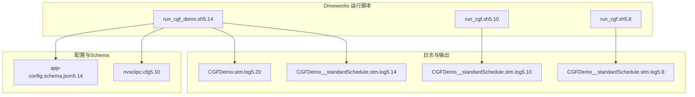
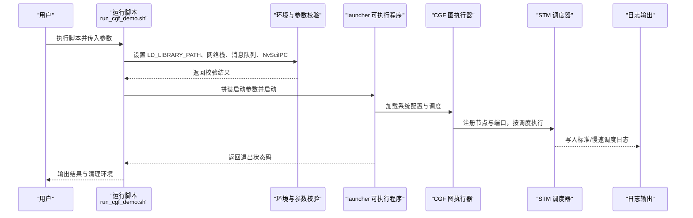
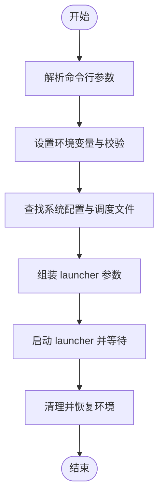
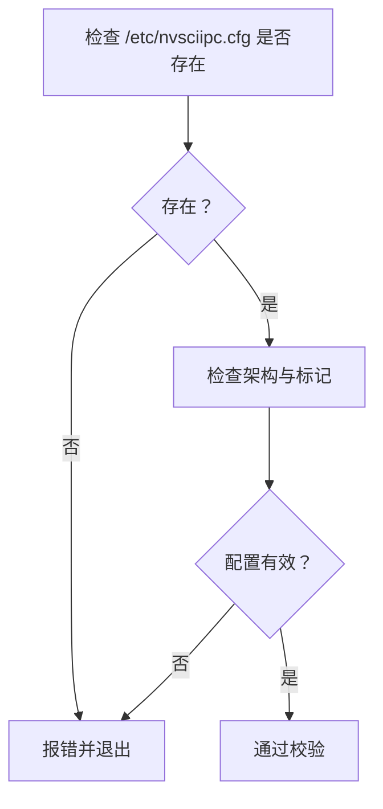
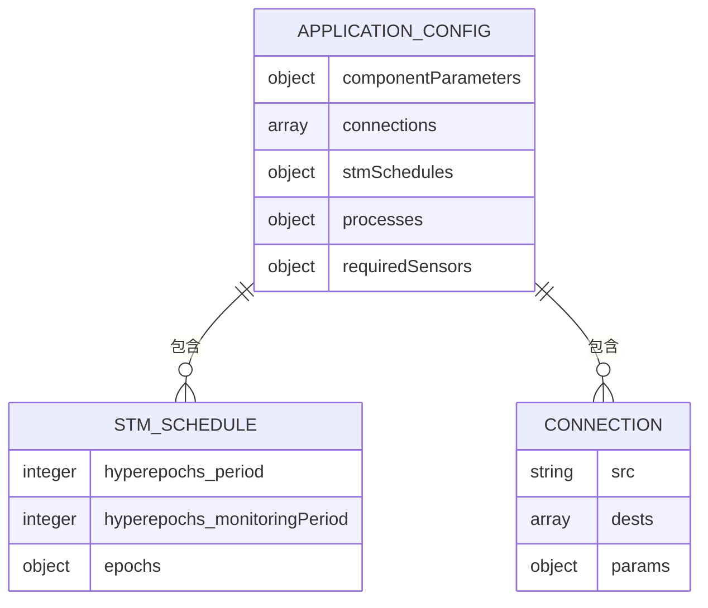
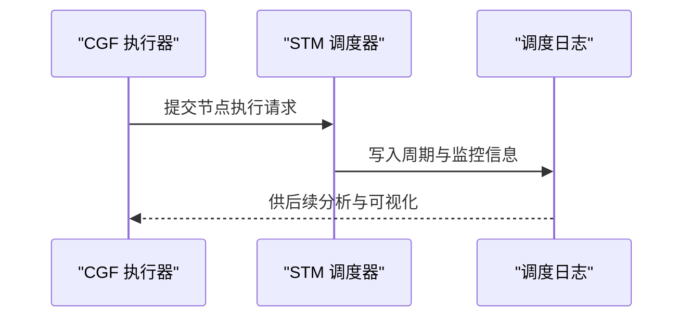
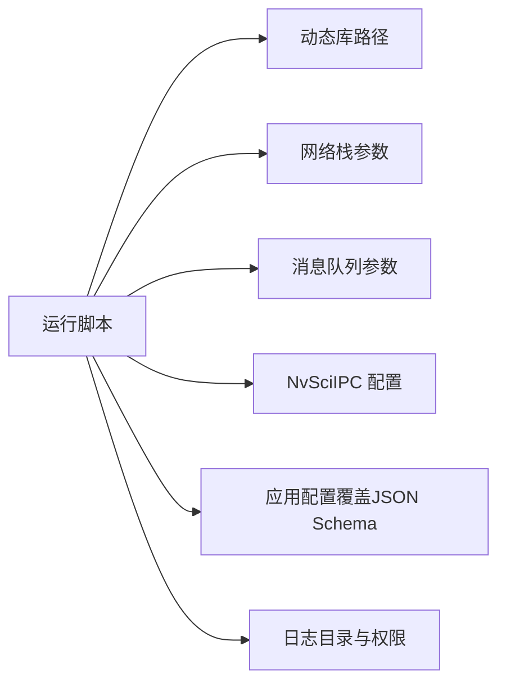

# 故障排除和调试

<cite>
**本文引用的文件**   
- [README.md](file://README.md)
- [run_cgf_demo.sh](file://driveworks-5.14/bin/run_cgf_demo.sh)
- [run_cgf.sh（5.10）](file://driverorks-5.10/bin/config/run_cgf.sh)
- [run_cgf.sh（5.8）](file://driveworks-5.8/bin/config/run_cgf.sh)
- [nvsciipc.cfg（5.10）](file://driverorks-5.10/config/nvsciipc.cfg)
- [app-config.schema.json（5.14）](file://doc/3-drive-works-infra/7-基于json的cgf设计/5.14/app-config.schema.json)
- [CGFDemo 标准调度日志（5.14）](file://driveworks-5.14/apps/cgf_demo/CGFDemo__standardSchedule.stm.log)
- [CGFDemo 标准调度日志（5.10）](file://driverorks-5.10/src/cgf/graphs/CGFDemo__standardSchedule.stm.log)
- [CGFDemo 标准调度日志（5.8）](file://driveworks-5.8/src/cgf/graphs/CGFDemo__standardSchedule.stm.log)
- [CGFDemo 日志（5.20）](file://driveworks-520/apps/cgf_demo/CGFDemo.stm.log)
</cite>

## 目录
1. [简介](#简介)
2. [项目结构](#项目结构)
3. [核心组件](#核心组件)
4. [架构总览](#架构总览)
5. [详细组件分析](#详细组件分析)
6. [依赖分析](#依赖分析)
7. [性能考虑](#性能考虑)
8. [故障排除指南](#故障排除指南)
9. [结论](#结论)
10. [附录](#附录)

## 简介
本指南面向使用 Driveworks 5.x 中间件（通信中间件 CGF 与调度中间件 STM）进行自动驾驶应用开发的工程师，聚焦于系统化的问题诊断与调试方法。内容涵盖编译错误诊断、运行时错误处理、性能问题排查、内存泄漏检测、日志系统配置与使用、性能分析工具与可视化调试工具操作、监控与诊断工具配置，以及社区支持与问题报告流程。

## 项目结构
本仓库包含多个版本的 Driveworks 发行包与示例，重点涉及：
- CGF 应用运行脚本：用于启动 launcher 并传入系统配置、调度文件、日志路径等参数
- STM 配置文件：NvSciIPC 配置，定义跨进程/跨芯片通信端点
- JSON Schema：应用配置覆盖（如跳过节点、连接、STM 调度周期等）
- 调度日志：标准/慢速调度的 STM 日志，用于性能与健康信号分析
- 文档与示例：CGF/STM 用户指南、演示样例与工具链

**图表来源**
- [run_cgf_demo.sh](file://driveworks-5.14/bin/run_cgf_demo.sh)
- [run_cgf.sh（5.10）](file://driverorks-5.10/bin/config/run_cgf.sh)
- [run_cgf.sh（5.8）](file://driveworks-5.8/bin/config/run_cgf.sh)
- [nvsciipc.cfg（5.10）](file://driverorks-5.10/config/nvsciipc.cfg)
- [app-config.schema.json（5.14）](file://doc/3-drive-works-infra/7-基于json的cgf设计/5.14/app-config.schema.json)
- [CGFDemo 标准调度日志（5.14）](file://driveworks-5.14/apps/cgf_demo/CGFDemo__standardSchedule.stm.log)
- [CGFDemo 标准调度日志（5.10）](file://driverorks-5.10/src/cgf/graphs/CGFDemo__standardSchedule.stm.log)
- [CGFDemo 标准调度日志（5.8）](file://driveworks-5.8/src/cgf/graphs/CGFDemo__standardSchedule.stm.log)
- [CGFDemo 日志（5.20）](file://driveworks-520/apps/cgf_demo/CGFDemo.stm.log)

**章节来源**
- [README.md:1-115](file://README.md#L1-L115)

## 核心组件
- CGF 应用运行脚本：统一设置环境变量、网络栈与消息队列参数，解析命令行参数，拼装 launcher 启动参数，生成日志目录并启动 launcher，捕获退出状态。
- STM 配置：NvSciIPC 配置文件定义跨进程通信端点对及帧缓冲参数，确保多进程/多芯片场景下的 IPC 正常。
- 应用配置 Schema：JSON Schema 描述应用配置覆盖项，包括组件参数覆盖、跳过节点、连接、STM 调度周期修改、进程 argv 覆盖、所需传感器等。
- 调度日志：标准/慢速调度的 STM 日志，记录执行周期、监控阈值、epoch/hyperepoch 周期等，用于性能与健康信号分析。

**章节来源**
- [run_cgf_demo.sh:1-509](file://driveworks-5.14/bin/run_cgf_demo.sh#L1-L509)
- [run_cgf.sh（5.10）:1-412](file://driverorks-5.10/bin/config/run_cgf.sh#L1-L412)
- [run_cgf.sh（5.8）:1-386](file://driveworks-5.8/bin/config/run_cgf.sh#L1-L386)
- [nvsciipc.cfg（5.10）:1-96](file://driverorks-5.10/config/nvsciipc.cfg#L1-L96)
- [app-config.schema.json（5.14）:1-265](file://doc/3-drive-works-infra/7-基于json的cgf设计/5.14/app-config.schema.json#L1-L265)

## 架构总览
下图展示从运行脚本到 launcher、再到 CGF/STM 执行的整体流程，以及日志与配置的关键交互点。

**图表来源**
- [run_cgf_demo.sh:350-509](file://driveworks-5.14/bin/run_cgf_demo.sh#L350-L509)
- [run_cgf.sh（5.10）:320-412](file://driverorks-5.10/bin/config/run_cgf.sh#L320-L412)
- [run_cgf.sh（5.8）:295-386](file://driveworks-5.8/bin/config/run_cgf.sh#L295-L386)

## 详细组件分析

### 组件A：CGF 应用运行脚本（5.14）
- 功能要点
  - 参数解析：支持产品名、车辆配置、调度文件、GDB 调试开关、应用参数、日志级别等
  - 环境准备：根据是否使用 dazel 判定路径，设置 LD_LIBRARY_PATH；在 Linux 下进行消息队列与 NvSciIPC 校验；统一网络栈参数
  - 启动流程：确定系统文件与调度文件，组装 launcher 参数，启动后台进程并等待退出
  - 清理与恢复：退出前恢复 LD_LIBRARY_PATH，打印退出状态
- 关键日志
  - launcher.log：记录启动与运行过程中的错误与警告
  - 调度日志：CGFDemo__standardSchedule.stm.log 等，记录执行周期与监控阈值

**图表来源**
- [run_cgf_demo.sh:86-126](file://driveworks-5.14/bin/run_cgf_demo.sh#L86-L126)
- [run_cgf_demo.sh:291-313](file://driveworks-5.14/bin/run_cgf_demo.sh#L291-L313)
- [run_cgf_demo.sh:371-401](file://driveworks-5.14/bin/run_cgf_demo.sh#L371-L401)

**章节来源**
- [run_cgf_demo.sh:1-509](file://driveworks-5.14/bin/run_cgf_demo.sh#L1-L509)

### 组件B：STM 配置（NvSciIPC）
- 功能要点
  - 定义跨进程通信端点对，指定帧数量与帧大小
  - 在 x86_64 上要求配置文件包含特定标记以启用 STM
- 常见问题
  - 缺少配置文件或缺少标记导致启动失败
  - 消息队列参数不足导致多进程模式异常

**图表来源**
- [run_cgf.sh（5.10）:238-253](file://driverorks-5.10/bin/config/run_cgf.sh#L238-L253)
- [run_cgf.sh（5.8）:214-229](file://driveworks-5.8/bin/config/run_cgf.sh#L214-L229)
- [nvsciipc.cfg（5.10）:46-96](file://driverorks-5.10/config/nvsciipc.cfg#L46-L96)

**章节来源**
- [nvsciipc.cfg（5.10）:1-96](file://driverorks-5.10/config/nvsciipc.cfg#L1-L96)
- [run_cgf.sh（5.10）:197-277](file://driverorks-5.10/bin/config/run_cgf.sh#L197-L277)
- [run_cgf.sh（5.8）:198-249](file://driveworks-5.8/bin/config/run_cgf.sh#L198-L249)

### 组件C：应用配置 Schema（5.14）
- 功能要点
  - 支持组件参数覆盖、跳过节点、连接、STM 调度周期修改、进程 argv 覆盖、所需传感器等
  - 通过 JSON Schema 校验配置合法性，避免运行时错误
- 使用建议
  - 在覆盖 STM 调度周期时，仅修改 hyperepoch/epoch 的 period 与 monitoringPeriod
  - 修改连接时注意 src/dests 的命名规范与数组索引

**图表来源**
- [app-config.schema.json（5.14）:8-124](file://doc/3-drive-works-infra/7-基于json的cgf设计/5.14/app-config.schema.json#L8-L124)
- [app-config.schema.json（5.14）:216-262](file://doc/3-drive-works-infra/7-基于json的cgf设计/5.14/app-config.schema.json#L216-L262)

**章节来源**
- [app-config.schema.json（5.14）:1-265](file://doc/3-drive-works-infra/7-基于json的cgf设计/5.14/app-config.schema.json#L1-L265)

### 组件D：调度日志分析（5.8/5.10/5.14/5.20）
- 功能要点
  - 记录标准/慢速调度的执行周期、监控阈值、epoch/hyperepoch 周期
  - 用于性能瓶颈定位与健康信号观测
- 分析方法
  - 对比不同调度的日志，识别周期异常或超阈值事件
  - 结合应用配置覆盖调整周期与监控阈值

**图表来源**
- [CGFDemo 标准调度日志（5.14）](file://driveworks-5.14/apps/cgf_demo/CGFDemo__standardSchedule.stm.log)
- [CGFDemo 标准调度日志（5.10）](file://driverorks-5.10/src/cgf/graphs/CGFDemo__standardSchedule.stm.log)
- [CGFDemo 标准调度日志（5.8）](file://driveworks-5.8/src/cgf/graphs/CGFDemo__standardSchedule.stm.log)
- [CGFDemo 日志（5.20）](file://driveworks-520/apps/cgf_demo/CGFDemo.stm.log)

**章节来源**
- [CGFDemo 标准调度日志（5.14）](file://driveworks-5.14/apps/cgf_demo/CGFDemo__standardSchedule.stm.log)
- [CGFDemo 标准调度日志（5.10）](file://driverorks-5.10/src/cgf/graphs/CGFDemo__standardSchedule.stm.log)
- [CGFDemo 标准调度日志（5.8）](file://driveworks-5.8/src/cgf/graphs/CGFDemo__standardSchedule.stm.log)
- [CGFDemo 日志（5.20）](file://driveworks-520/apps/cgf_demo/CGFDemo.stm.log)

## 依赖分析
- 运行脚本依赖
  - 系统库路径：LD_LIBRARY_PATH 必须包含 launcher 所需动态库
  - 网络栈：Linux/QNX 下需满足 rmem/wmem 与缓冲区上限
  - 消息队列：fs.mqueue.msg_max 与 queues_max 需达到最低阈值
  - NvSciIPC：配置文件存在且包含 STM 标记
- 配置依赖
  - 应用配置覆盖必须符合 JSON Schema，否则 launcher 将拒绝加载
- 日志依赖
  - 日志目录可写，且 launcher 具备写权限

**图表来源**
- [run_cgf_demo.sh:291-313](file://driveworks-5.14/bin/run_cgf_demo.sh#L291-L313)
- [run_cgf.sh（5.10）:141-196](file://driverorks-5.10/bin/config/run_cgf.sh#L141-L196)
- [run_cgf.sh（5.10）:197-253](file://driverorks-5.10/bin/config/run_cgf.sh#L197-L253)
- [run_cgf.sh（5.8）:142-196](file://driveworks-5.8/bin/config/run_cgf.sh#L142-L196)
- [run_cgf.sh（5.8）:198-229](file://driveworks-5.8/bin/config/run_cgf.sh#L198-L229)
- [app-config.schema.json（5.14）:1-265](file://doc/3-drive-works-infra/7-基于json的cgf设计/5.14/app-config.schema.json#L1-L265)

**章节来源**
- [run_cgf_demo.sh:181-313](file://driveworks-5.14/bin/run_cgf_demo.sh#L181-L313)
- [run_cgf.sh（5.10）:141-253](file://driverorks-5.10/bin/config/run_cgf.sh#L141-L253)
- [run_cgf.sh（5.8）:142-229](file://driveworks-5.8/bin/config/run_cgf.sh#L142-L229)
- [app-config.schema.json（5.14）:1-265](file://doc/3-drive-works-infra/7-基于json的cgf设计/5.14/app-config.schema.json#L1-L265)

## 性能考虑
- 网络栈调优
  - Linux：net.core.wmem_max、rmem_max、rmem_default 与 net.ipv4.tcp_wmem/rmem 需提升至足够水平，避免高延迟
  - QNX：kern.sbmax、recvspace/sendspace、recvbuf_max/sendbuf_max 需提升
- 消息队列调优
  - fs.mqueue.msg_max 与 queues_max 需达到最低阈值，必要时通过 limits.conf 与 sysctl.conf 调整
- 调度周期优化
  - 通过应用配置覆盖修改 hyperepoch/epoch 的 period 与 monitoringPeriod，结合调度日志观察效果
- 显示与图形环境
  - SSH 或 X11 环境下需正确设置 DISPLAY 与 XAUTHORITY，避免图形初始化失败

**章节来源**
- [run_cgf_demo.sh:181-235](file://driveworks-5.14/bin/run_cgf_demo.sh#L181-L235)
- [run_cgf.sh（5.10）:141-196](file://driverorks-5.10/bin/config/run_cgf.sh#L141-L196)
- [run_cgf.sh（5.8）:142-196](file://driveworks-5.8/bin/config/run_cgf.sh#L142-L196)
- [app-config.schema.json（5.14）:59-124](file://doc/3-drive-works-infra/7-基于json的cgf设计/5.14/app-config.schema.json#L59-L124)

## 故障排除指南

### 一、编译错误诊断
- 症状
  - 链接失败、找不到符号、头文件缺失
- 诊断步骤
  - 确认 LD_LIBRARY_PATH 包含 launcher 与 CGF/STM 所需库
  - 确认构建产物与目标架构匹配（x86_64/aarch64）
  - 检查第三方依赖（GLFW/GLEW/LodePNG）是否就绪
- 解决方案
  - 在运行脚本中追加库路径，或在系统级设置
  - 使用 dazel/构建系统重新生成并安装

**章节来源**
- [run_cgf_demo.sh:291-313](file://driveworks-5.14/bin/run_cgf_demo.sh#L291-L313)
- [run_cgf.sh（5.10）:255-277](file://driverorks-5.10/bin/config/run_cgf.sh#L255-L277)
- [run_cgf.sh（5.8）:231-253](file://driveworks-5.8/bin/config/run_cgf.sh#L231-L253)

### 二、运行时错误处理
- 症状
  - 启动后立即退出、无窗口显示、日志中出现 IPC 错误
- 诊断步骤
  - 检查 /etc/nvsciipc.cfg 是否存在且包含 STM 标记
  - 检查消息队列参数 fs.mqueue.msg_max 与 queues_max 是否达标
  - 检查网络栈参数是否已按脚本建议调整
- 解决方案
  - 补充或修正 nvsciipc.cfg
  - 调整 sysctl.conf/limits.conf 并重启终端
  - 重新执行网络栈调优脚本

**章节来源**
- [run_cgf.sh（5.10）:238-277](file://driverorks-5.10/bin/config/run_cgf.sh#L238-L277)
- [run_cgf.sh（5.8）:214-249](file://driveworks-5.8/bin/config/run_cgf.sh#L214-L249)
- [nvsciipc.cfg（5.10）:46-96](file://driverorks-5.10/config/nvsciipc.cfg#L46-L96)

### 三、性能问题排查
- 症状
  - 周期超时、监控阈值频繁触发、帧率抖动
- 诊断步骤
  - 查看调度日志中的 hyperepoch/epoch 周期与 monitoringPeriod
  - 对比标准/慢速调度日志，识别异常峰值
  - 检查网络栈与消息队列参数是否满足要求
- 解决方案
  - 通过应用配置覆盖调整周期与监控阈值
  - 提升网络栈与消息队列参数
  - 优化节点计算负载或拆分节点

**章节来源**
- [app-config.schema.json（5.14）:59-124](file://doc/3-drive-works-infra/7-基于json的cgf设计/5.14/app-config.schema.json#L59-L124)
- [run_cgf_demo.sh:181-235](file://driveworks-5.14/bin/run_cgf_demo.sh#L181-L235)

### 四、内存泄漏检测
- 方法
  - 使用静态分析工具（clang-tidy/scan-build）扫描源码
  - 使用动态分析工具（valgrind/memcheck）运行 launcher 与节点
  - 结合调度日志观察长时间运行后的资源占用趋势
- 注意事项
  - 在 GDB 调试模式下运行，便于断点与回溯
  - 仅在受控环境中开启高 verbose 日志级别，避免影响性能

**章节来源**
- [run_cgf_demo.sh:102-116](file://driveworks-5.14/bin/run_cgf_demo.sh#L102-L116)

### 五、日志系统配置与使用
- 配置
  - 运行脚本自动创建日志目录并传给 launcher
  - 支持设置日志级别（如 DW_LOG_ERROR/DW_LOG_VERBOSE）
- 使用
  - 查看 launcher.log 获取启动与运行错误
  - 查看 CGFDemo__*.stm.log 获取调度性能与健康信号
- 建议
  - 在问题复现时临时提升日志级别，问题解决后恢复默认

**章节来源**
- [run_cgf_demo.sh:462-476](file://driveworks-5.14/bin/run_cgf_demo.sh#L462-L476)
- [run_cgf.sh（5.10）:376-394](file://driverorks-5.10/bin/config/run_cgf.sh#L376-L394)
- [run_cgf.sh（5.8）:352-368](file://driveworks-5.8/bin/config/run_cgf.sh#L352-L368)

### 六、性能分析工具与可视化调试
- 工具
  - perf/ftrace：采集 CPU/内核事件
  - valgrind：检测内存问题
  - GDB：断点与堆栈回溯
- 可视化
  - 调度日志可用于生成可视化图表，观察周期与监控阈值
- 流程
  - 在运行脚本中启用 --gdb 或设置高日志级别
  - 采集日志与系统指标，定位热点函数与瓶颈

**章节来源**
- [run_cgf_demo.sh:102-116](file://driveworks-5.14/bin/run_cgf_demo.sh#L102-L116)

### 七、监控与诊断工具配置
- 性能指标监控
  - 通过调度日志中的周期与监控阈值进行基线对比
- 资源使用监控
  - 结合系统工具（top/htop/iostat/sar）与日志交叉验证
- 错误统计分析
  - 统计 launcher.log 中的错误类型与频率，制定修复优先级

**章节来源**
- [CGFDemo 标准调度日志（5.14）](file://driveworks-5.14/apps/cgf_demo/CGFDemo__standardSchedule.stm.log)
- [CGFDemo 标准调度日志（5.10）](file://driverorks-5.10/src/cgf/graphs/CGFDemo__standardSchedule.stm.log)
- [CGFDemo 标准调度日志（5.8）](file://driveworks-5.8/src/cgf/graphs/CGFDemo__standardSchedule.stm.log)

### 八、社区支持与问题报告流程
- 社区渠道
  - NVIDIA 官方论坛，标签：driveworks-cgf
- 报告内容
  - 版本信息（驱动/SDK/OS）
  - 复现步骤与期望/实际结果
  - 关键日志（launcher.log、调度日志、系统日志）
  - 配置文件与应用配置覆盖
- 响应预期
  - 官方维护者会根据问题严重程度与复现情况安排处理

**章节来源**
- [README.md:45-49](file://README.md#L45-L49)

## 结论
通过统一的运行脚本、严格的配置校验与完善的日志体系，Driveworks 5.x 在 CGF/STM 场景下提供了清晰的排障路径。建议在日常开发中：
- 始终遵循网络栈与消息队列调优
- 使用 JSON Schema 管理应用配置覆盖
- 借助调度日志进行性能与健康信号分析
- 在社区渠道及时反馈问题并沉淀最佳实践

## 附录
- 常用命令
  - 网络栈调优：参考运行脚本中的 sysctl 建议
  - 消息队列调优：参考 limits.conf 与 sysctl.conf
  - 启动调试：使用 --gdb 与高日志级别
- 参考文件
  - 运行脚本与日志：见“核心组件”与“调度日志分析”
  - 配置与 Schema：见“应用配置 Schema（5.14）”