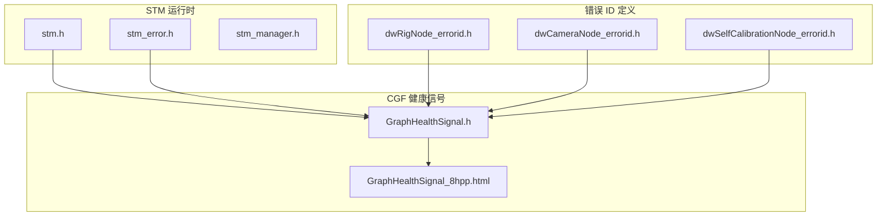
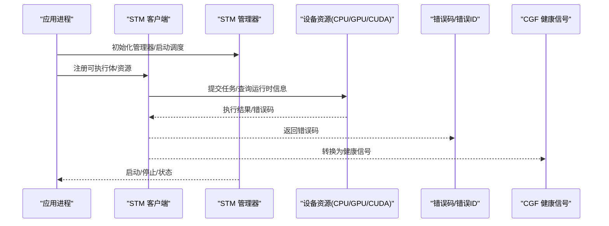
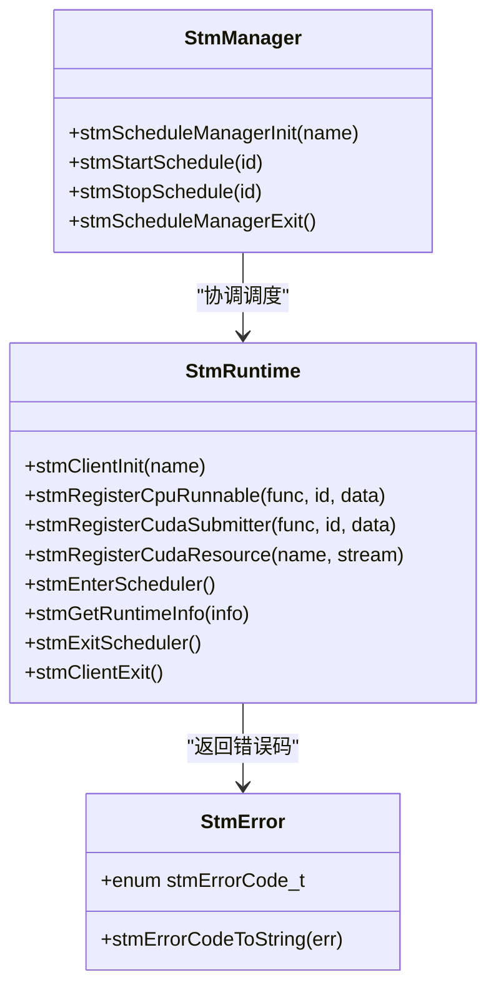
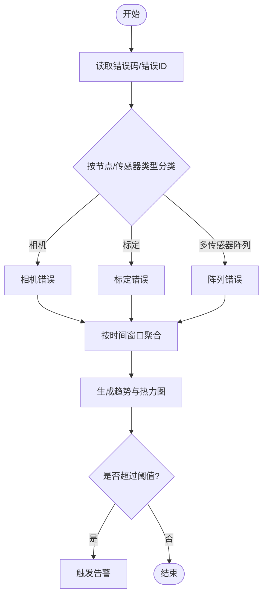
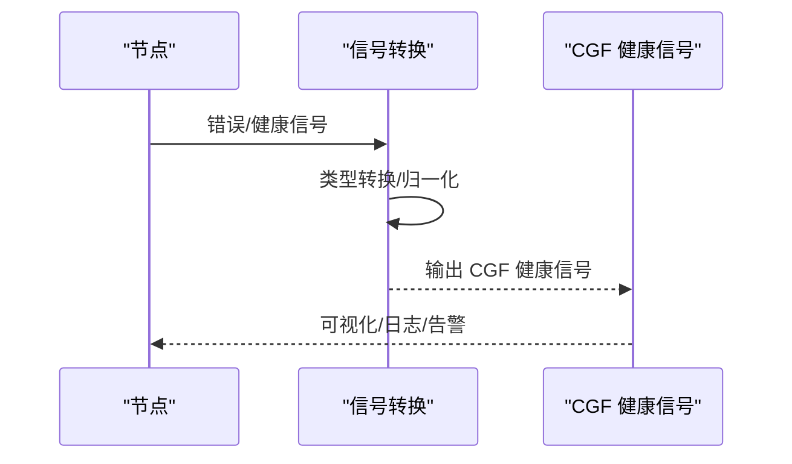
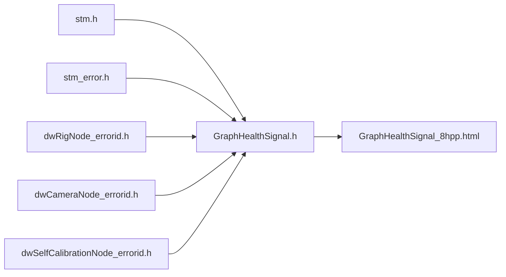

# 监控和诊断

<cite>
**本文引用的文件**
- [driverorks-5.10/include/stm.h](file://driverorks-5.10/include/stm.h)
- [driverorks-5.10/include/stm_error.h](file://driverorks-5.10/include/stm_error.h)
- [driverorks-5.10/include/stm_manager.h](file://driverorks-5.10/include/stm_manager.h)
- [driverorks-5.10/include/dwframework/dwnodes/dwrignode/dwRigNode_errorid.h](file://driverorks-5.10/include/dwframework/dwnodes/dwrignode/dwRigNode_errorid.h)
- [driverorks-5.10/include/dwframework/dwnodes/sensors/dwcameranode/dwCameraNode_errorid.h](file://driverorks-5.10/include/dwframework/dwnodes/sensors/dwcameranode/dwCameraNode_errorid.h)
- [driverorks-5.10/include/dwframework/dwnodes/selfcalibration/dwselfcalibrationnode/dwSelfCalibrationNode_errorid.h](file://driverorks-5.10/include/dwframework/dwnodes/selfcalibration/dwselfcalibrationnode/dwSelfCalibrationNode_errorid.h)
- [driverorks-5.10/doc/nvcgf_html/GraphHealthSignal_8hpp.html](file://driverorks-5.10/doc/nvcgf_html/GraphHealthSignal_8hpp.html)
- [driverorks-5.10/include/dwcgf/computegraph/GraphHealthSignal.h](file://driverorks-5.10/include/dwcgf/computegraph/GraphHealthSignal.h)
</cite>

## 目录
1. [简介](#简介)
2. [项目结构](#项目结构)
3. [核心组件](#核心组件)
4. [架构总览](#架构总览)
5. [详细组件分析](#详细组件分析)
6. [依赖分析](#依赖分析)
7. [性能考虑](#性能考虑)
8. [故障排查指南](#故障排查指南)
9. [结论](#结论)
10. [附录](#附录)

## 简介
本文件面向在 DriveWorks 平台上开发与运维的工程师，系统化梳理监控与诊断能力，覆盖以下主题：
- 性能指标监控：CPU 负载、GPU 利用率、内存使用、网络带宽
- 资源使用监控：实时统计、历史数据分析、瓶颈识别
- 错误统计分析：错误类型分类、频率统计、趋势分析
- 健康检查：服务状态、依赖关系、告警机制
- 数据采集、存储与分析：构建完整监控体系

说明：
- 本仓库包含 STM（静态时序调度）运行时接口与错误码定义，以及 CGF（计算图框架）健康信号转换工具，为系统级监控与诊断提供基础能力。
- 针对“CPU/GPU/内存/网络”等指标的具体采集与上报，需结合平台工具链与应用侧埋点实现；本文给出可落地的实践路径与接口映射。

## 项目结构
围绕监控与诊断的关键文件分布如下：
- STM 运行时与管理接口：用于任务调度、资源注册与错误码查询
- 错误 ID 定义：为节点级错误进行分类与统计
- 健康信号转换：将底层健康/错误信号转换为 CGF 可用的健康信号

图表来源
- [driverorks-5.10/include/stm.h:1-337](file://driverorks-5.10/include/stm.h#L1-L337)
- [driverorks-5.10/include/stm_error.h:1-117](file://driverorks-5.10/include/stm_error.h#L1-L117)
- [driverorks-5.10/include/stm_manager.h:1-113](file://driverorks-5.10/include/stm_manager.h#L1-L113)
- [driverorks-5.10/include/dwframework/dwnodes/dwrignode/dwRigNode_errorid.h:1-124](file://driverorks-5.10/include/dwframework/dwnodes/dwrignode/dwRigNode_errorid.h#L1-L124)
- [driverorks-5.10/include/dwframework/dwnodes/sensors/dwcameranode/dwCameraNode_errorid.h:1-77](file://driverorks-5.10/include/dwframework/dwnodes/sensors/dwcameranode/dwCameraNode_errorid.h#L1-L77)
- [driverorks-5.10/include/dwframework/dwnodes/selfcalibration/dwselfcalibrationnode/dwSelfCalibrationNode_errorid.h:1-112](file://driverorks-5.10/include/dwframework/dwnodes/selfcalibration/dwselfcalibrationnode/dwSelfCalibrationNode_errorid.h#L1-L112)
- [driverorks-5.10/include/dwcgf/computegraph/GraphHealthSignal.h](file://driverorks-5.10/include/dwcgf/computegraph/GraphHealthSignal.h)
- [driverorks-5.10/doc/nvcgf_html/GraphHealthSignal_8hpp.html:1-135](file://driverorks-5.10/doc/nvcgf_html/GraphHealthSignal_8hpp.html#L1-L135)

章节来源
- [driverorks-5.10/include/stm.h:1-337](file://driverorks-5.10/include/stm.h#L1-L337)
- [driverorks-5.10/include/stm_error.h:1-117](file://driverorks-5.10/include/stm_error.h#L1-L117)
- [driverorks-5.10/include/stm_manager.h:1-113](file://driverorks-5.10/include/stm_manager.h#L1-L113)
- [driverorks-5.10/include/dwframework/dwnodes/dwrignode/dwRigNode_errorid.h:1-124](file://driverorks-5.10/include/dwframework/dwnodes/dwrignode/dwRigNode_errorid.h#L1-L124)
- [driverorks-5.10/include/dwframework/dwnodes/sensors/dwcameranode/dwCameraNode_errorid.h:1-77](file://driverorks-5.10/include/dwframework/dwnodes/sensors/dwcameranode/dwCameraNode_errorid.h#L1-L77)
- [driverorks-5.10/include/dwframework/dwnodes/selfcalibration/dwselfcalibrationnode/dwSelfCalibrationNode_errorid.h:1-112](file://driverorks-5.10/include/dwframework/dwnodes/selfcalibration/dwselfcalibrationnode/dwSelfCalibrationNode_errorid.h#L1-L112)
- [driverorks-5.10/include/dwcgf/computegraph/GraphHealthSignal.h](file://driverorks-5.10/include/dwcgf/computegraph/GraphHealthSignal.h)
- [driverorks-5.10/doc/nvcgf_html/GraphHealthSignal_8hpp.html:1-135](file://driverorks-5.10/doc/nvcgf_html/GraphHealthSignal_8hpp.html#L1-L135)

## 核心组件
- STM 运行时与管理
  - 提供 CPU/GPU/CUDA/DLA/VPU 等资源注册、调度入口、运行时信息查询与错误码枚举
  - 适用于实时性要求高的场景，便于在任务粒度上进行资源占用与延迟观测
- 错误 ID 定义
  - 按节点类型划分错误域，支持按传感器类型（相机/雷达/激光雷达/IMU）、标定状态等维度进行分类统计
- 健康信号转换
  - 将底层错误/健康信号转换为 CGF 可消费的健康信号，支撑图级健康监测与可视化

章节来源
- [driverorks-5.10/include/stm.h:76-330](file://driverorks-5.10/include/stm.h#L76-L330)
- [driverorks-5.10/include/stm_error.h:47-97](file://driverorks-5.10/include/stm_error.h#L47-L97)
- [driverorks-5.10/include/stm_manager.h:45-106](file://driverorks-5.10/include/stm_manager.h#L45-L106)
- [driverorks-5.10/include/dwframework/dwnodes/dwrignode/dwRigNode_errorid.h:44-118](file://driverorks-5.10/include/dwframework/dwnodes/dwrignode/dwRigNode_errorid.h#L44-L118)
- [driverorks-5.10/include/dwframework/dwnodes/sensors/dwcameranode/dwCameraNode_errorid.h:56-70](file://driverorks-5.10/include/dwframework/dwnodes/sensors/dwcameranode/dwCameraNode_errorid.h#L56-L70)
- [driverorks-5.10/include/dwframework/dwnodes/selfcalibration/dwselfcalibrationnode/dwSelfCalibrationNode_errorid.h:43-106](file://driverorks-5.10/include/dwframework/dwnodes/selfcalibration/dwselfcalibrationnode/dwSelfCalibrationNode_errorid.h#L43-L106)
- [driverorks-5.10/include/dwcgf/computegraph/GraphHealthSignal.h](file://driverorks-5.10/include/dwcgf/computegraph/GraphHealthSignal.h)
- [driverorks-5.10/doc/nvcgf_html/GraphHealthSignal_8hpp.html:119-122](file://driverorks-5.10/doc/nvcgf_html/GraphHealthSignal_8hpp.html#L119-L122)

## 架构总览
下图展示从任务执行到健康信号输出的整体流程，体现监控与诊断的关键触点。

图表来源
- [driverorks-5.10/include/stm.h:103-330](file://driverorks-5.10/include/stm.h#L103-L330)
- [driverorks-5.10/include/stm_manager.h:45-106](file://driverorks-5.10/include/stm_manager.h#L45-L106)
- [driverorks-5.10/include/stm_error.h:47-97](file://driverorks-5.10/include/stm_error.h#L47-L97)
- [driverorks-5.10/include/dwcgf/computegraph/GraphHealthSignal.h](file://driverorks-5.10/include/dwcgf/computegraph/GraphHealthSignal.h)
- [driverorks-5.10/doc/nvcgf_html/GraphHealthSignal_8hpp.html:119-122](file://driverorks-5.10/doc/nvcgf_html/GraphHealthSignal_8hpp.html#L119-L122)

## 详细组件分析

### 组件一：STM 运行时与管理（性能与资源监控）
- 能力要点
  - 任务注册：CPU 可执行体、CUDA 提交器、DLA/VPU 提交器等
  - 资源注册：CUDA 流、DLA/VPU 句柄等
  - 调度控制：进入/退出调度、获取运行时信息（周期、调度 ID）
  - 错误码：统一错误枚举，便于定位问题来源
- 实践建议
  - 在 CPU/GPU 提交器中埋点，记录提交时间、完成时间、队列长度等，形成 CPU/GPU 使用率与延迟序列
  - 结合运行时信息中的 epoch/scheduleId，进行跨周期对比与趋势分析
  - 对 CUDA/DLA/VPU 的错误码进行聚合，识别热点引擎与失败模式

图表来源
- [driverorks-5.10/include/stm.h:103-330](file://driverorks-5.10/include/stm.h#L103-L330)
- [driverorks-5.10/include/stm_manager.h:45-106](file://driverorks-5.10/include/stm_manager.h#L45-L106)
- [driverorks-5.10/include/stm_error.h:47-110](file://driverorks-5.10/include/stm_error.h#L47-L110)

章节来源
- [driverorks-5.10/include/stm.h:76-330](file://driverorks-5.10/include/stm.h#L76-L330)
- [driverorks-5.10/include/stm_error.h:47-97](file://driverorks-5.10/include/stm_error.h#L47-L97)
- [driverorks-5.10/include/stm_manager.h:45-106](file://driverorks-5.10/include/stm_manager.h#L45-L106)

### 组件二：错误 ID 分类与统计（错误统计分析）
- 能力要点
  - 按节点类型划分错误域，如相机、标定、多相机阵列等
  - 错误 ID 覆盖标定缺失、EEPROM 读取失败、传感器死调整等关键场景
- 实践建议
  - 将错误 ID 映射到业务语义（如“相机内参缺失”、“标定不一致”），建立错误类型字典
  - 按时间窗口统计各类型错误发生频次，生成错误热力图与时序曲线
  - 结合 CGF 健康信号，定位错误传播路径与影响范围

图表来源
- [driverorks-5.10/include/dwframework/dwnodes/sensors/dwcameranode/dwCameraNode_errorid.h:56-70](file://driverorks-5.10/include/dwframework/dwnodes/sensors/dwcameranode/dwCameraNode_errorid.h#L56-L70)
- [driverorks-5.10/include/dwframework/dwnodes/selfcalibration/dwselfcalibrationnode/dwSelfCalibrationNode_errorid.h:43-106](file://driverorks-5.10/include/dwframework/dwnodes/selfcalibration/dwselfcalibrationnode/dwSelfCalibrationNode_errorid.h#L43-L106)
- [driverorks-5.10/include/dwframework/dwnodes/dwrignode/dwRigNode_errorid.h:44-118](file://driverorks-5.10/include/dwframework/dwnodes/dwrignode/dwRigNode_errorid.h#L44-L118)

章节来源
- [driverorks-5.10/include/dwframework/dwnodes/sensors/dwcameranode/dwCameraNode_errorid.h:56-70](file://driverorks-5.10/include/dwframework/dwnodes/sensors/dwcameranode/dwCameraNode_errorid.h#L56-L70)
- [driverorks-5.10/include/dwframework/dwnodes/selfcalibration/dwselfcalibrationnode/dwSelfCalibrationNode_errorid.h:43-106](file://driverorks-5.10/include/dwframework/dwnodes/selfcalibration/dwselfcalibrationnode/dwSelfCalibrationNode_errorid.h#L43-L106)
- [driverorks-5.10/include/dwframework/dwnodes/dwrignode/dwRigNode_errorid.h:44-118](file://driverorks-5.10/include/dwframework/dwnodes/dwrignode/dwRigNode_errorid.h#L44-L118)

### 组件三：CGF 健康信号（系统健康检查）
- 能力要点
  - 提供错误/健康信号到 CGF 健康信号的转换函数
  - 支持在图级别进行健康状态聚合与可视化
- 实践建议
  - 将节点错误通过转换函数映射到 CGF 健康信号，形成全图健康视图
  - 结合 STM 的运行时信息，标注健康事件的时间戳与调度上下文
  - 与告警系统联动，按健康信号严重程度分级处理

图表来源
- [driverorks-5.10/doc/nvcgf_html/GraphHealthSignal_8hpp.html:119-122](file://driverorks-5.10/doc/nvcgf_html/GraphHealthSignal_8hpp.html#L119-L122)
- [driverorks-5.10/include/dwcgf/computegraph/GraphHealthSignal.h](file://driverorks-5.10/include/dwcgf/computegraph/GraphHealthSignal.h)

章节来源
- [driverorks-5.10/doc/nvcgf_html/GraphHealthSignal_8hpp.html:119-122](file://driverorks-5.10/doc/nvcgf_html/GraphHealthSignal_8hpp.html#L119-L122)
- [driverorks-5.10/include/dwcgf/computegraph/GraphHealthSignal.h](file://driverorks-5.10/include/dwcgf/computegraph/GraphHealthSignal.h)

## 依赖分析
- 组件耦合
  - STM 运行时与管理器：管理器负责调度启停，客户端负责资源注册与执行
  - 错误 ID 与健康信号：错误 ID 为底层信号，经转换后进入 CGF 健康信号通道
- 外部依赖
  - CUDA/DLA/VPU 等硬件栈的可用性与驱动版本
  - CGF 图框架的健康信号消费方（可视化/日志/告警）

图表来源
- [driverorks-5.10/include/stm.h:1-337](file://driverorks-5.10/include/stm.h#L1-L337)
- [driverorks-5.10/include/stm_error.h:1-117](file://driverorks-5.10/include/stm_error.h#L1-L117)
- [driverorks-5.10/include/dwframework/dwnodes/dwrignode/dwRigNode_errorid.h:1-124](file://driverorks-5.10/include/dwframework/dwnodes/dwrignode/dwRigNode_errorid.h#L1-L124)
- [driverorks-5.10/include/dwframework/dwnodes/sensors/dwcameranode/dwCameraNode_errorid.h:1-77](file://driverorks-5.10/include/dwframework/dwnodes/sensors/dwcameranode/dwCameraNode_errorid.h#L1-L77)
- [driverorks-5.10/include/dwframework/dwnodes/selfcalibration/dwselfcalibrationnode/dwSelfCalibrationNode_errorid.h:1-112](file://driverorks-5.10/include/dwframework/dwnodes/selfcalibration/dwselfcalibrationnode/dwSelfCalibrationNode_errorid.h#L1-L112)
- [driverorks-5.10/include/dwcgf/computegraph/GraphHealthSignal.h](file://driverorks-5.10/include/dwcgf/computegraph/GraphHealthSignal.h)
- [driverorks-5.10/doc/nvcgf_html/GraphHealthSignal_8hpp.html:1-135](file://driverorks-5.10/doc/nvcgf_html/GraphHealthSignal_8hpp.html#L1-L135)

章节来源
- [driverorks-5.10/include/stm.h:1-337](file://driverorks-5.10/include/stm.h#L1-L337)
- [driverorks-5.10/include/stm_error.h:1-117](file://driverorks-5.10/include/stm_error.h#L1-L117)
- [driverorks-5.10/include/stm_manager.h:1-113](file://driverorks-5.10/include/stm_manager.h#L1-L113)
- [driverorks-5.10/include/dwframework/dwnodes/dwrignode/dwRigNode_errorid.h:1-124](file://driverorks-5.10/include/dwframework/dwnodes/dwrignode/dwRigNode_errorid.h#L1-L124)
- [driverorks-5.10/include/dwframework/dwnodes/sensors/dwcameranode/dwCameraNode_errorid.h:1-77](file://driverorks-5.10/include/dwframework/dwnodes/sensors/dwcameranode/dwCameraNode_errorid.h#L1-L77)
- [driverorks-5.10/include/dwframework/dwnodes/selfcalibration/dwselfcalibrationnode/dwSelfCalibrationNode_errorid.h:1-112](file://driverorks-5.10/include/dwframework/dwnodes/selfcalibration/dwselfcalibrationnode/dwSelfCalibrationNode_errorid.h#L1-L112)
- [driverorks-5.10/include/dwcgf/computegraph/GraphHealthSignal.h](file://driverorks-5.10/include/dwcgf/computegraph/GraphHealthSignal.h)
- [driverorks-5.10/doc/nvcgf_html/GraphHealthSignal_8hpp.html:1-135](file://driverorks-5.10/doc/nvcgf_html/GraphHealthSignal_8hpp.html#L1-L135)

## 性能考虑
- 实时性与开销
  - 在 CPU/GPU 提交器中尽量减少同步调用，避免阻塞调度
  - 使用非阻塞/异步接口，降低上下文切换与锁竞争
- 指标采集粒度
  - 以 epoch/schedule 为单位进行采样，避免高频轮询造成额外负载
- 资源隔离
  - 为不同引擎（CUDA/DLA/VPU）分配独立流或句柄，便于瓶颈定位与容量规划

## 故障排查指南
- 常见错误码定位
  - 使用统一错误码枚举，快速区分系统层、CUDA 层、同步层等问题
- 节点级错误溯源
  - 依据错误 ID 的命名规则与取值范围，定位具体传感器或标定模块
- 健康信号联动
  - 将错误事件映射到 CGF 健康信号，结合时间戳与调度上下文进行回溯

章节来源
- [driverorks-5.10/include/stm_error.h:47-97](file://driverorks-5.10/include/stm_error.h#L47-L97)
- [driverorks-5.10/include/dwframework/dwnodes/sensors/dwcameranode/dwCameraNode_errorid.h:56-70](file://driverorks-5.10/include/dwframework/dwnodes/sensors/dwcameranode/dwCameraNode_errorid.h#L56-L70)
- [driverorks-5.10/include/dwframework/dwnodes/selfcalibration/dwselfcalibrationnode/dwSelfCalibrationNode_errorid.h:43-106](file://driverorks-5.10/include/dwframework/dwnodes/selfcalibration/dwselfcalibrationnode/dwSelfCalibrationNode_errorid.h#L43-L106)
- [driverorks-5.10/include/dwframework/dwnodes/dwrignode/dwRigNode_errorid.h:44-118](file://driverorks-5.10/include/dwframework/dwnodes/dwrignode/dwRigNode_errorid.h#L44-L118)
- [driverorks-5.10/doc/nvcgf_html/GraphHealthSignal_8hpp.html:119-122](file://driverorks-5.10/doc/nvcgf_html/GraphHealthSignal_8hpp.html#L119-L122)

## 结论
- 本仓库提供了构建监控与诊断体系的基础设施：STM 运行时与管理接口、统一错误码、节点错误 ID 与 CGF 健康信号转换
- 建议在应用侧补充指标采集埋点与历史数据分析能力，并将错误统计与健康信号接入统一告警平台，形成闭环

## 附录
- 相关文件索引
  - [driverorks-5.10/include/stm.h:1-337](file://driverorks-5.10/include/stm.h#L1-L337)
  - [driverorks-5.10/include/stm_error.h:1-117](file://driverorks-5.10/include/stm_error.h#L1-L117)
  - [driverorks-5.10/include/stm_manager.h:1-113](file://driverorks-5.10/include/stm_manager.h#L1-L113)
  - [driverorks-5.10/include/dwframework/dwnodes/dwrignode/dwRigNode_errorid.h:1-124](file://driverorks-5.10/include/dwframework/dwnodes/dwrignode/dwRigNode_errorid.h#L1-L124)
  - [driverorks-5.10/include/dwframework/dwnodes/sensors/dwcameranode/dwCameraNode_errorid.h:1-77](file://driverorks-5.10/include/dwframework/dwnodes/sensors/dwcameranode/dwCameraNode_errorid.h#L1-L77)
  - [driverorks-5.10/include/dwframework/dwnodes/selfcalibration/dwselfcalibrationnode/dwSelfCalibrationNode_errorid.h:1-112](file://driverorks-5.10/include/dwframework/dwnodes/selfcalibration/dwselfcalibrationnode/dwSelfCalibrationNode_errorid.h#L1-L112)
  - [driverorks-5.10/include/dwcgf/computegraph/GraphHealthSignal.h](file://driverorks-5.10/include/dwcgf/computegraph/GraphHealthSignal.h)
  - [driverorks-5.10/doc/nvcgf_html/GraphHealthSignal_8hpp.html:1-135](file://driverorks-5.10/doc/nvcgf_html/GraphHealthSignal_8hpp.html#L1-L135)