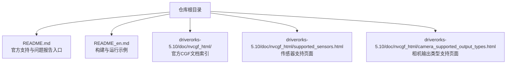
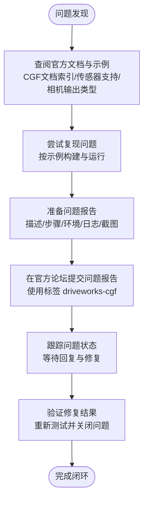
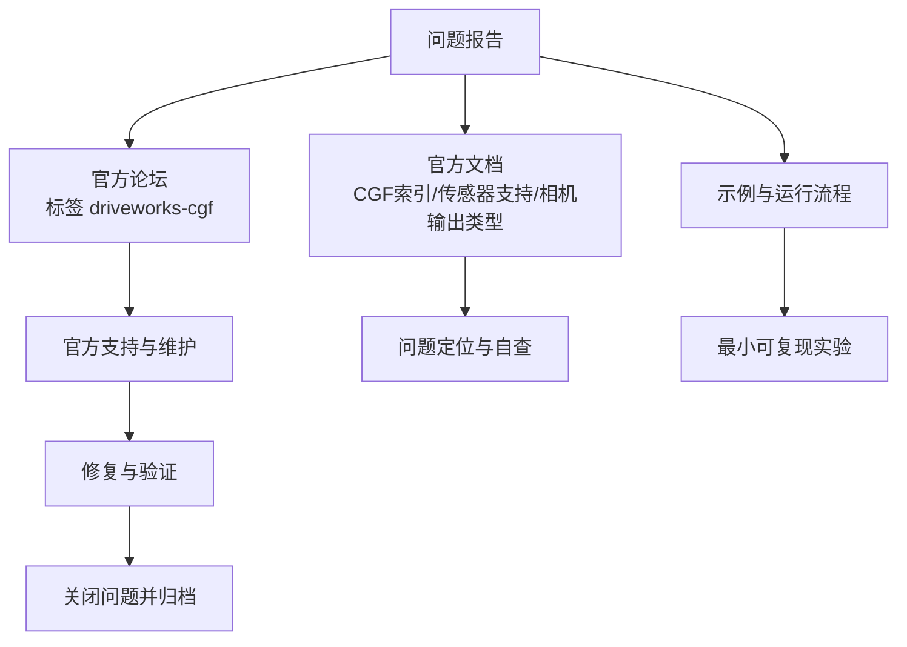

# 社区支持

<cite>
**本文引用的文件**
- [README.md](file://README.md)
- [README_en.md](file://README_en.md)
- [index_nvcgf.html](file://driverorks-5.10/doc/nvcgf_html/index_nvcgf.html)
- [supported_sensors.html](file://driverorks-5.10/doc/nvcgf_html/supported_sensors.html)
- [camera_supported_output_types.html](file://driverorks-5.10/doc/nvcgf_html/camera_supported_output_types.html)
</cite>

## 目录
1. [简介](#简介)
2. [项目结构](#项目结构)
3. [核心组件](#核心组件)
4. [架构总览](#架构总览)
5. [详细组件分析](#详细组件分析)
6. [依赖分析](#依赖分析)
7. [性能考虑](#性能考虑)
8. [故障排查指南](#故障排查指南)
9. [结论](#结论)
10. [附录](#附录)

## 简介
本指南面向使用 Driveworks（特别是 5.x 版本中的 CGF 通信中间件）的开发者与用户，提供社区支持与问题报告的系统化方法。内容涵盖官方支持渠道使用、问题报告标准格式、问题分类与标签、社区资源获取、问题跟踪与反馈机制等，帮助您高效定位与解决问题。

## 项目结构
本仓库包含 Driveworks 不同版本的 SDK、示例、文档与工具，以及与社区支持相关的关键链接与说明。核心支撑信息主要集中在根目录的说明文档中，同时官方文档站点与传感器支持页面为问题排查与最佳实践提供参考。

图表来源
- [README.md:1-115](file://README.md#L1-L115)
- [README_en.md:1-92](file://README_en.md#L1-L92)
- [index_nvcgf.html](file://driverorks-5.10/doc/nvcgf_html/index_nvcgf.html)
- [supported_sensors.html](file://driverorks-5.10/doc/nvcgf_html/supported_sensors.html)
- [camera_supported_output_types.html](file://driverorks-5.10/doc/nvcgf_html/camera_supported_output_types.html)

章节来源
- [README.md:1-115](file://README.md#L1-L115)
- [README_en.md:1-92](file://README_en.md#L1-L92)

## 核心组件
- 官方论坛与问题报告
  - 针对 Driveworks CGF 的官方问题报告入口与标签：driveworks-cgf
  - 参考路径：[README.md:44-49](file://README.md#L44-L49)
- 官方文档与示例
  - CGF 文档索引页与传感器支持页面，便于查阅 API、配置与平台支持
  - 参考路径：[index_nvcgf.html](file://driverorks-5.10/doc/nvcgf_html/index_nvcgf.html)，[supported_sensors.html](file://driverorks-5.10/doc/nvcgf_html/supported_sensors.html)，[camera_supported_output_types.html](file://driverorks-5.10/doc/nvcgf_html/camera_supported_output_types.html)
- 构建与运行示例
  - 提供 CGF 应用的构建、生成调度、发布到 Orin 设备与运行流程
  - 参考路径：[README_en.md:13-62](file://README_en.md#L13-L62)

章节来源
- [README.md:44-49](file://README.md#L44-L49)
- [README_en.md:13-62](file://README_en.md#L13-L62)
- [index_nvcgf.html](file://driverorks-5.10/doc/nvcgf_html/index_nvcgf.html)
- [supported_sensors.html](file://driverorks-5.10/doc/nvcgf_html/supported_sensors.html)
- [camera_supported_output_types.html](file://driverorks-5.10/doc/nvcgf_html/camera_supported_output_types.html)

## 架构总览
下图展示从“问题发现”到“问题解决”的典型闭环流程，包括官方论坛、文档与示例、问题报告与跟踪等环节。

## 详细组件分析

### 官方支持渠道与使用方法
- 官方论坛注册与登录
  - 使用 NVIDIA 开发者账号访问论坛，注册后即可提问与参与讨论
  - 参考路径：[README.md:44-49](file://README.md#L44-L49)
- 技术支持申请流程
  - 通过官方论坛提交问题报告，使用指定标签以便归类与追踪
  - 参考路径：[README.md:44-49](file://README.md#L44-L49)
- 社区问答参与方式
  - 在论坛中浏览与 CGF 相关的问题与回答，学习他人经验
  - 参考路径：[README.md:44-49](file://README.md#L44-L49)

章节来源
- [README.md:44-49](file://README.md#L44-L49)

### 问题报告标准格式与内容要求
建议采用如下结构组织问题报告，确保信息完整、便于定位与复现：

- 问题标题
  - 简洁明确地概括问题类型与现象
- 问题描述
  - 清晰描述遇到的问题与期望行为
- 复现步骤
  - 列出最小可复现实验步骤，包含构建命令、运行脚本、输入数据与参数
  - 参考路径：[README_en.md:13-62](file://README_en.md#L13-L62)
- 环境信息
  - SDK 版本、平台（如 DriveAGX Orin）、驱动与内核版本、硬件配置
  - 参考路径：[README_en.md:50-62](file://README_en.md#L50-L62)
- 日志收集
  - 按示例清理并重跑应用，收集日志目录内容
  - 参考路径：[README_en.md:50-62](file://README_en.md#L50-L62)
- 错误截图
  - 截取终端输出、日志关键片段或可视化界面异常画面
- 附加信息
  - 已尝试的解决方法、相关配置文件片段、是否可复现于其他平台

章节来源
- [README_en.md:13-62](file://README_en.md#L13-L62)

### 问题分类与标签使用指导
- 分类建议
  - 构建与编译：涉及 CMake、工具链、安装失败等问题
  - 运行与执行：涉及应用启动、调度、IPC、通道通信等问题
  - 配置与参数：涉及 CGF 图、节点参数、传感器映射等问题
  - 平台与硬件：涉及特定平台支持、传感器兼容性等问题
- 标签使用
  - 统一使用官方标签 driveworks-cgf，便于社区与支持团队识别与分流
  - 参考路径：[README.md:44-49](file://README.md#L44-L49)

章节来源
- [README.md:44-49](file://README.md#L44-L49)

### 社区资源获取方法
- 官方文档
  - CGF 文档索引页：[index_nvcgf.html](file://driverorks-5.10/doc/nvcgf_html/index_nvcgf.html)
  - 传感器支持页面：[supported_sensors.html](file://driverorks-5.10/doc/nvcgf_html/supported_sensors.html)
  - 相机输出类型支持页面：[camera_supported_output_types.html](file://driverorks-5.10/doc/nvcgf_html/camera_supported_output_types.html)
- 示例与最佳实践
  - 按示例构建 CGF 应用、生成调度、发布与运行
  - 参考路径：[README_en.md:13-62](file://README_en.md#L13-L62)
- 常见问题解答
  - 结合官方文档与论坛历史贴，查找同类问题的已知解决方案
  - 参考路径：[README.md:44-49](file://README.md#L44-L49)

章节来源
- [README.md:44-49](file://README.md#L44-L49)
- [README_en.md:13-62](file://README_en.md#L13-L62)
- [index_nvcgf.html](file://driverorks-5.10/doc/nvcgf_html/index_nvcgf.html)
- [supported_sensors.html](file://driverorks-5.10/doc/nvcgf_html/supported_sensors.html)
- [camera_supported_output_types.html](file://driverorks-5.10/doc/nvcgf_html/camera_supported_output_types.html)

### 问题跟踪与反馈机制使用指南
- 问题状态查询
  - 在官方论坛中查看问题标签 driveworks-cgf 下的回复与进展
  - 参考路径：[README.md:44-49](file://README.md#L44-L49)
- 更新通知
  - 关注问题回复，留意官方对问题的确认、复现与修复进度
  - 参考路径：[README.md:44-49](file://README.md#L44-L49)
- 解决方案验证
  - 根据官方建议进行验证，提供补充日志或复现信息以加速闭环
  - 参考路径：[README_en.md:50-62](file://README_en.md#L50-L62)

章节来源
- [README.md:44-49](file://README.md#L44-L49)
- [README_en.md:50-62](file://README_en.md#L50-L62)

## 依赖分析
下图展示问题报告流程与社区资源之间的依赖关系，强调官方文档与论坛在问题解决中的关键作用。

图表来源
- [README.md:44-49](file://README.md#L44-L49)
- [README_en.md:13-62](file://README_en.md#L13-L62)
- [index_nvcgf.html](file://driverorks-5.10/doc/nvcgf_html/index_nvcgf.html)
- [supported_sensors.html](file://driverorks-5.10/doc/nvcgf_html/supported_sensors.html)
- [camera_supported_output_types.html](file://driverorks-5.10/doc/nvcgf_html/camera_supported_output_types.html)

章节来源
- [README.md:44-49](file://README.md#L44-L49)
- [README_en.md:13-62](file://README_en.md#L13-L62)
- [index_nvcgf.html](file://driverorks-5.10/doc/nvcgf_html/index_nvcgf.html)
- [supported_sensors.html](file://driverorks-5.10/doc/nvcgf_html/supported_sensors.html)
- [camera_supported_output_types.html](file://driverorks-5.10/doc/nvcgf_html/camera_supported_output_types.html)

## 性能考虑
- 优先使用官方文档与示例进行验证，减少环境差异导致的误判
- 在问题报告中提供完整的环境信息与日志，有助于快速定位性能瓶颈或配置问题
- 对于平台相关问题，结合传感器支持页面确认硬件与驱动兼容性

## 故障排查指南
- 构建与运行
  - 按示例构建 CGF 应用，检查工具链与安装路径设置
  - 参考路径：[README_en.md:13-18](file://README_en.md#L13-L18)
- 应用运行与日志
  - 按示例运行应用并清理日志目录，收集关键日志
  - 参考路径：[README_en.md:50-62](file://README_en.md#L50-L62)
- 通道与 IPC 问题
  - 若涉及 NVSCI 或 Socket 通信，参考已知问题记录与官方建议
  - 参考路径：[README_en.md:64-92](file://README_en.md#L64-L92)
- 平台与硬件
  - 确认平台与驱动版本，检查传感器支持与输出类型
  - 参考路径：[supported_sensors.html](file://driverorks-5.10/doc/nvcgf_html/supported_sensors.html)，[camera_supported_output_types.html](file://driverorks-5.10/doc/nvcgf_html/camera_supported_output_types.html)

章节来源
- [README_en.md:13-18](file://README_en.md#L13-L18)
- [README_en.md:50-62](file://README_en.md#L50-L62)
- [README_en.md:64-92](file://README_en.md#L64-L92)
- [supported_sensors.html](file://driverorks-5.10/doc/nvcgf_html/supported_sensors.html)
- [camera_supported_output_types.html](file://driverorks-5.10/doc/nvcgf_html/camera_supported_output_types.html)

## 结论
通过规范化的社区支持与问题报告流程，结合官方文档与示例，能够显著提升问题定位与解决效率。请在官方论坛使用统一标签 driveworks-cgf 提交问题，并按标准格式提供完整信息，配合日志与截图，以便社区与官方支持团队快速响应与验证修复。

## 附录
- 快速链接
  - 官方论坛问题报告入口与标签：[README.md:44-49](file://README.md#L44-L49)
  - CGF 文档索引页：[index_nvcgf.html](file://driverorks-5.10/doc/nvcgf_html/index_nvcgf.html)
  - 传感器支持页面：[supported_sensors.html](file://driverorks-5.10/doc/nvcgf_html/supported_sensors.html)
  - 相机输出类型支持页面：[camera_supported_output_types.html](file://driverorks-5.10/doc/nvcgf_html/camera_supported_output_types.html)
  - 构建与运行示例：[README_en.md:13-62](file://README_en.md#L13-L62)