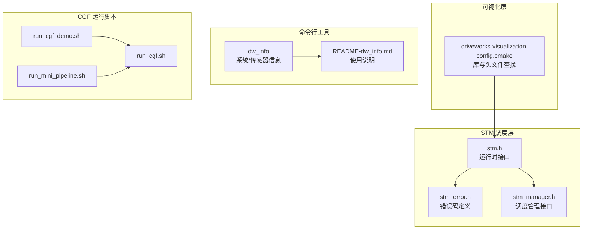
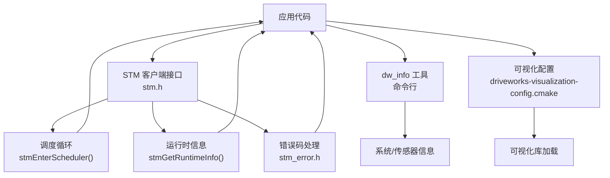
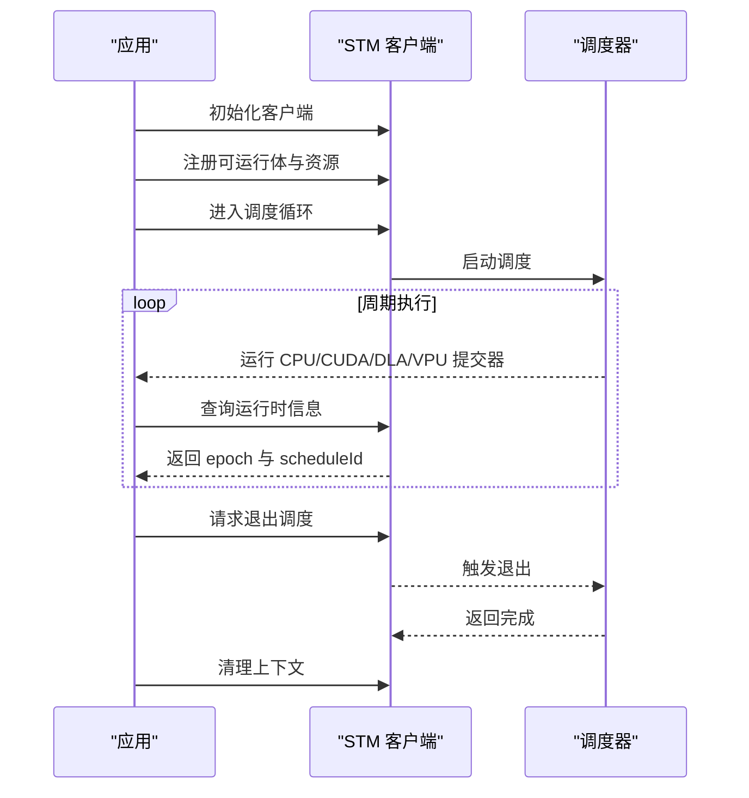
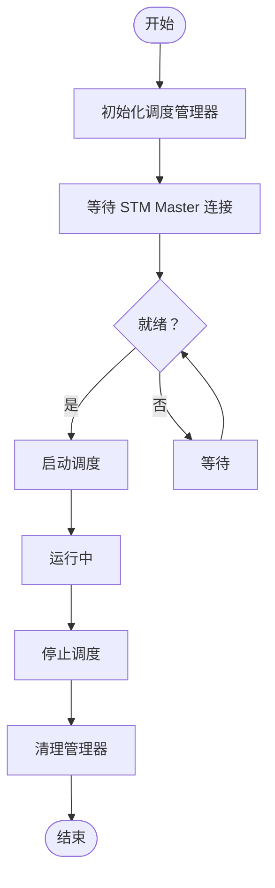
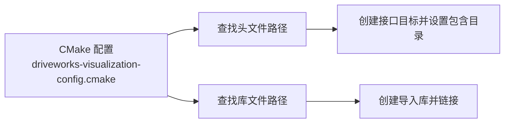
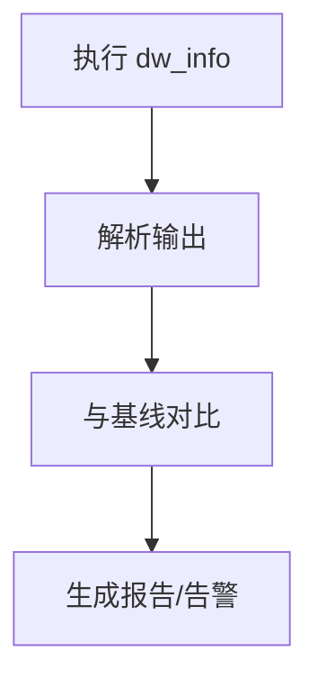
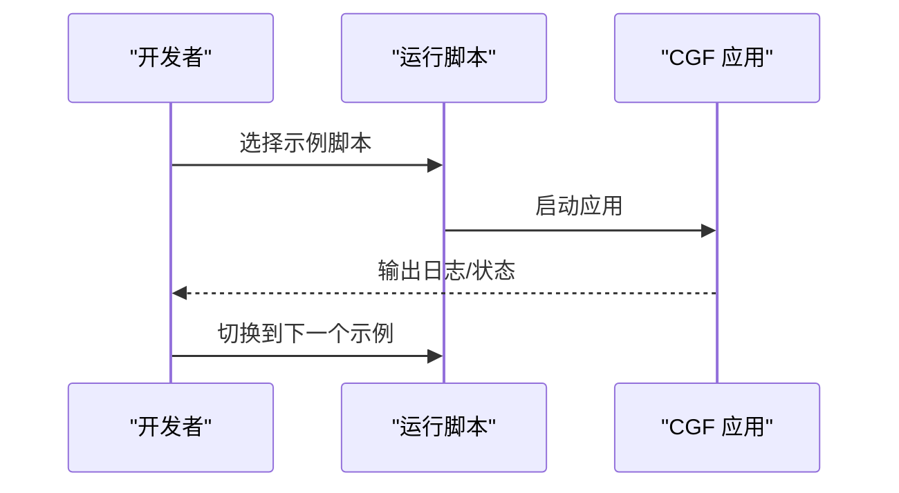
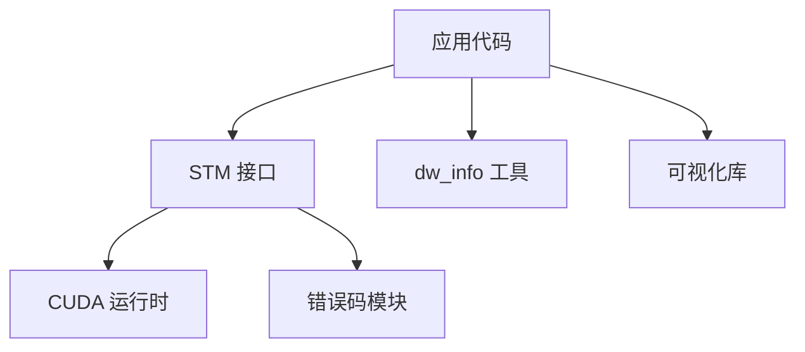

# 调试工具使用

<cite>
**本文引用的文件**
- [driverorks-5.10/include/stm.h](file://driverorks-5.10/include/stm.h)
- [driverorks-5.10/include/stm_error.h](file://driverorks-5.10/include/stm_error.h)
- [driverorks-5.10/include/stm_manager.h](file://driverorks-5.10/include/stm_manager.h)
- [driverorks-5.10/cmake/driveworks-visualization-config.cmake](file://driverorks-5.10/cmake/driveworks-visualization-config.cmake)
- [driverorks-5.10/tools/dw_info/dw_info](file://driverorks-5.10/tools/dw_info/dw_info)
- [driverorks-5.10/tools/dw_info/README-dw_info.md](file://driverorks-5.10/tools/dw_info/README-dw_info.md)
- [driverorks-5.10/bin/run_cgf_demo.sh](file://driverorks-5.10/bin/run_cgf_demo.sh)
- [driverorks-5.10/bin/run_mini_pipeline.sh](file://driverorks-5.10/bin/run_mini_pipeline.sh)
- [driverorks-5.10/bin/config/run_cgf.sh](file://driverorks-5.10/bin/config/run_cgf.sh)
- [driverorks-5.10/data/apps/cgf/onofframp/...](file://driverorks-5.10/data/apps/cgf/onofframp/)
- [driveworks-5.14/include/stm.h](file://driveworks-5.14/include/stm.h)
- [driveworks-5.8/include/stm.h](file://driveworks-5.8/include/stm.h)
- [driveworks-520/include/stm.h](file://driveworks-520/include/stm.h)
- [driveworks-5.14/cmake/driveworks-visualization-config.cmake](file://driveworks-5.14/cmake/driveworks-visualization-config.cmake)
- [driveworks-5.8/cmake/driveworks-visualization-config.cmake](file://driveworks-5.8/cmake/driveworks-visualization-config.cmake)
- [driveworks-520/cmake/driveworks-visualization-config.cmake](file://driveworks-520/cmake/driveworks-visualization-config.cmake)
</cite>

## 目录
1. [简介](#简介)
2. [项目结构](#项目结构)
3. [核心组件](#核心组件)
4. [架构总览](#架构总览)
5. [详细组件分析](#详细组件分析)
6. [依赖关系分析](#依赖关系分析)
7. [性能考虑](#性能考虑)
8. [故障排查指南](#故障排查指南)
9. [结论](#结论)
10. [附录](#附录)

## 简介
本指南面向使用 DriveWorks 的开发者，聚焦于调试与可视化工具的使用方法，涵盖以下主题：
- 日志系统与错误码：理解 STM 错误码体系与运行时信息查询接口，辅助定位执行问题。
- 性能分析：STM 调度监控、CUDA 异步提交注意事项、内存使用建议。
- 可视化调试：dw_visualization 库的集成方式与可视化能力概览。
- 命令行工具：dw_info 工具用于系统/传感器信息采集与验证；CGF 运行脚本与配置验证。
- 断点与远程调试：结合 STM 接口与常见开发环境实践给出建议。

## 项目结构
围绕调试与可视化，本仓库中与之直接相关的模块主要分布在：
- STM 调度与错误码：位于 driverorks-5.10/include 下的 stm.h、stm_error.h、stm_manager.h。
- 可视化库：cmake 配置文件 driveworks-visualization-config.cmake 指明了可视化库的查找与链接方式。
- 命令行工具：tools/dw_info 子目录下的 dw_info 可执行程序与说明文档。
- CGF 运行脚本：bin 下的 run_cgf_demo.sh、run_mini_pipeline.sh 以及 config/run_cgf.sh，用于启动示例与验证配置。

**图表来源**
- [driverorks-5.10/include/stm.h:31-337](file://driverorks-5.10/include/stm.h#L31-L337)
- [driverorks-5.10/include/stm_error.h:38-117](file://driverorks-5.10/include/stm_error.h#L38-L117)
- [driverorks-5.10/include/stm_manager.h:45-112](file://driverorks-5.10/include/stm_manager.h#L45-L112)
- [driverorks-5.10/cmake/driveworks-visualization-config.cmake:33-95](file://driverorks-5.10/cmake/driveworks-visualization-config.cmake#L33-L95)
- [driverorks-5.10/tools/dw_info/dw_info](file://driverorks-5.10/tools/dw_info/dw_info)
- [driverorks-5.10/tools/dw_info/README-dw_info.md](file://driverorks-5.10/tools/dw_info/README-dw_info.md)
- [driverorks-5.10/bin/run_cgf_demo.sh](file://driverorks-5.10/bin/run_cgf_demo.sh)
- [driverorks-5.10/bin/run_mini_pipeline.sh](file://driverorks-5.10/bin/run_mini_pipeline.sh)
- [driverorks-5.10/bin/config/run_cgf.sh](file://driverorks-5.10/bin/config/run_cgf.sh)

**章节来源**
- [driverorks-5.10/include/stm.h:31-337](file://driverorks-5.10/include/stm.h#L31-L337)
- [driverorks-5.10/include/stm_error.h:38-117](file://driverorks-5.10/include/stm_error.h#L38-L117)
- [driverorks-5.10/include/stm_manager.h:45-112](file://driverorks-5.10/include/stm_manager.h#L45-L112)
- [driverorks-5.10/cmake/driveworks-visualization-config.cmake:33-95](file://driverorks-5.10/cmake/driveworks-visualization-config.cmake#L33-L95)
- [driverorks-5.10/tools/dw_info/dw_info](file://driverorks-5.10/tools/dw_info/dw_info)
- [driverorks-5.10/tools/dw_info/README-dw_info.md](file://driverorks-5.10/tools/dw_info/README-dw_info.md)
- [driverorks-5.10/bin/run_cgf_demo.sh](file://driverorks-5.10/bin/run_cgf_demo.sh)
- [driverorks-5.10/bin/run_mini_pipeline.sh](file://driverorks-5.10/bin/run_mini_pipeline.sh)
- [driverorks-5.10/bin/config/run_cgf.sh](file://driverorks-5.10/bin/config/run_cgf.sh)

## 核心组件
- STM 运行时接口：提供客户端初始化、CPU/CUDA/DLA/VPU 提交器注册、资源注册、进入调度循环、获取运行时信息、退出调度等能力。
- STM 错误码体系：统一的错误码枚举与字符串转换函数，便于日志与诊断。
- STM 调度管理接口：管理进程对调度的启动/停止控制。
- 可视化库：通过 CMake 配置文件自动定位头文件与动态库，支持在应用中集成可视化能力。
- 命令行工具 dw_info：用于采集系统/传感器信息，辅助验证硬件与驱动状态。
- CGF 运行脚本：提供示例应用的启动入口，便于快速验证配置与运行链路。

**章节来源**
- [driverorks-5.10/include/stm.h:103-330](file://driverorks-5.10/include/stm.h#L103-L330)
- [driverorks-5.10/include/stm_error.h:47-110](file://driverorks-5.10/include/stm_error.h#L47-L110)
- [driverorks-5.10/include/stm_manager.h:45-106](file://driverorks-5.10/include/stm_manager.h#L45-L106)
- [driverorks-5.10/cmake/driveworks-visualization-config.cmake:33-95](file://driverorks-5.10/cmake/driveworks-visualization-config.cmake#L33-L95)
- [driverorks-5.10/tools/dw_info/dw_info](file://driverorks-5.10/tools/dw_info/dw_info)
- [driverorks-5.10/tools/dw_info/README-dw_info.md](file://driverorks-5.10/tools/dw_info/README-dw_info.md)
- [driverorks-5.10/bin/run_cgf_demo.sh](file://driverorks-5.10/bin/run_cgf_demo.sh)
- [driverorks-5.10/bin/run_mini_pipeline.sh](file://driverorks-5.10/bin/run_mini_pipeline.sh)
- [driverorks-5.10/bin/config/run_cgf.sh](file://driverorks-5.10/bin/config/run_cgf.sh)

## 架构总览
下图展示了调试与可视化相关的关键交互路径：应用通过 STM 接口注册可运行体与资源，进入调度循环；同时可通过 dw_info 获取系统/传感器信息；可视化能力由 CMake 配置文件引导加载。

**图表来源**
- [driverorks-5.10/include/stm.h:103-330](file://driverorks-5.10/include/stm.h#L103-L330)
- [driverorks-5.10/include/stm_error.h:47-110](file://driverorks-5.10/include/stm_error.h#L47-L110)
- [driverorks-5.10/cmake/driveworks-visualization-config.cmake:33-95](file://driverorks-5.10/cmake/driveworks-visualization-config.cmake#L33-L95)
- [driverorks-5.10/tools/dw_info/dw_info](file://driverorks-5.10/tools/dw_info/dw_info)

## 详细组件分析

### STM 调度与错误码
- 关键接口
  - 客户端初始化：stmClientInit / stmClientInitWithDiscriminator
  - 注册 CPU/CUDA/DLA/VPU 提交器：stmRegisterCpuRunnable / stmRegisterCudaSubmitter / stmRegisterDlaSubmitter / stmRegisterVpuSubmitter
  - 资源注册：stmRegisterCudaResource / stmRegisterDlaResource / stmRegisterVpuResource
  - 进入调度循环：stmEnterScheduler（阻塞直到调度结束或显式退出）
  - 获取运行时信息：stmGetRuntimeInfo（查询当前 epoch 与 scheduleId）
  - 退出调度：stmExitScheduler（在下一周期边界触发所有客户端返回）
  - 清理：stmClientExit
- 错误码体系
  - 统一枚举包含初始化失败、参数错误、超时、CUDA/DLA/PVA 错误、内存不足、同步错误、MQ 队列满等多种场景
  - 提供错误码到字符串的转换函数，便于日志输出
- 使用建议
  - 在进入调度前确保所有可运行体与资源均已注册
  - 在 CPU 提交器中避免阻塞调用；CUDA 提交器必须使用非默认流
  - 使用 stmGetRuntimeInfo 辅助定位卡顿或异常发生在哪个周期与调度

**图表来源**
- [driverorks-5.10/include/stm.h:103-330](file://driverorks-5.10/include/stm.h#L103-L330)
- [driverorks-5.10/include/stm_error.h:47-110](file://driverorks-5.10/include/stm_error.h#L47-L110)

**章节来源**
- [driverorks-5.10/include/stm.h:76-330](file://driverorks-5.10/include/stm.h#L76-L330)
- [driverorks-5.10/include/stm_error.h:47-110](file://driverorks-5.10/include/stm_error.h#L47-L110)

### STM 调度管理接口
- 关键接口
  - 初始化管理器：stmScheduleManagerInit / stmScheduleManagerInitWithDiscriminator
  - 启动/停止调度：stmStartSchedule / stmStopSchedule
  - 清理：stmScheduleManagerExit
- 使用建议
  - 管理器需在客户端连接之前与 STM Master 建立连接
  - 启动/停止需在正确的生命周期内调用，注意状态转换错误码

**图表来源**
- [driverorks-5.10/include/stm_manager.h:45-106](file://driverorks-5.10/include/stm_manager.h#L45-L106)

**章节来源**
- [driverorks-5.10/include/stm_manager.h:45-106](file://driverorks-5.10/include/stm_manager.h#L45-L106)

### 可视化库集成
- 集成方式
  - 通过 CMake 配置文件自动查找头文件与动态库，目标为接口库，内部导入实际共享库
  - 支持在 CMake 中以接口目标的方式链接可视化库
- 使用建议
  - 在构建系统中引入该配置文件后，按需包含可视化头文件并链接对应库
  - 结合应用运行时数据进行可视化展示与监控

**图表来源**
- [driverorks-5.10/cmake/driveworks-visualization-config.cmake:33-95](file://driverorks-5.10/cmake/driveworks-visualization-config.cmake#L33-L95)

**章节来源**
- [driverorks-5.10/cmake/driveworks-visualization-config.cmake:33-95](file://driverorks-5.10/cmake/driveworks-visualization-config.cmake#L33-L95)

### 命令行调试工具：dw_info
- 功能概述
  - 用于采集系统与传感器相关信息，辅助验证硬件与驱动状态
- 使用方式
  - 执行可执行程序查看帮助与选项
  - 参考说明文档了解输出字段与典型用法
- 建议流程
  - 在运行 CGF 或示例应用前后分别运行，对比差异
  - 将输出纳入 CI/本地日志，便于回归分析

**图表来源**
- [driverorks-5.10/tools/dw_info/dw_info](file://driverorks-5.10/tools/dw_info/dw_info)
- [driverorks-5.10/tools/dw_info/README-dw_info.md](file://driverorks-5.10/tools/dw_info/README-dw_info.md)

**章节来源**
- [driverorks-5.10/tools/dw_info/dw_info](file://driverorks-5.10/tools/dw_info/dw_info)
- [driverorks-5.10/tools/dw_info/README-dw_info.md](file://driverorks-5.10/tools/dw_info/README-dw_info.md)

### CGF 运行脚本与配置验证
- 示例脚本
  - run_cgf_demo.sh：启动 CGF 示例演示
  - run_mini_pipeline.sh：启动最小化流水线示例
  - config/run_cgf.sh：通用 CGF 运行脚本入口
- 建议流程
  - 先运行最小化流水线验证基础链路
  - 再运行完整示例，逐步增加复杂度
  - 将每次运行的日志与 dw_info 输出归档，便于对比

**图表来源**
- [driverorks-5.10/bin/run_cgf_demo.sh](file://driverorks-5.10/bin/run_cgf_demo.sh)
- [driverorks-5.10/bin/run_mini_pipeline.sh](file://driverorks-5.10/bin/run_mini_pipeline.sh)
- [driverorks-5.10/bin/config/run_cgf.sh](file://driverorks-5.10/bin/config/run_cgf.sh)

**章节来源**
- [driverorks-5.10/bin/run_cgf_demo.sh](file://driverorks-5.10/bin/run_cgf_demo.sh)
- [driverorks-5.10/bin/run_mini_pipeline.sh](file://driverorks-5.10/bin/run_mini_pipeline.sh)
- [driverorks-5.10/bin/config/run_cgf.sh](file://driverorks-5.10/bin/config/run_cgf.sh)

## 依赖关系分析
- 组件耦合
  - 应用代码依赖 STM 接口进行任务注册与调度控制
  - 错误码模块为所有 STM 接口提供统一的错误语义
  - 可视化配置文件为上层应用提供库与头文件的自动化定位
  - 命令行工具与运行脚本独立存在，但可与应用配合进行端到端验证
- 外部依赖
  - CUDA 运行时（用于 CUDA 提交器）
  - 可选的 DLA/VPU/CUDLA 支持（取决于平台与版本）

**图表来源**
- [driverorks-5.10/include/stm.h:58-101](file://driverorks-5.10/include/stm.h#L58-L101)
- [driverorks-5.10/include/stm_error.h:47-97](file://driverorks-5.10/include/stm_error.h#L47-L97)
- [driverorks-5.10/cmake/driveworks-visualization-config.cmake:33-95](file://driverorks-5.10/cmake/driveworks-visualization-config.cmake#L33-L95)
- [driverorks-5.10/tools/dw_info/dw_info](file://driverorks-5.10/tools/dw_info/dw_info)

**章节来源**
- [driverorks-5.10/include/stm.h:58-101](file://driverorks-5.10/include/stm.h#L58-L101)
- [driverorks-5.10/include/stm_error.h:47-97](file://driverorks-5.10/include/stm_error.h#L47-L97)
- [driverorks-5.10/cmake/driveworks-visualization-config.cmake:33-95](file://driverorks-5.10/cmake/driveworks-visualization-config.cmake#L33-L95)
- [driverorks-5.10/tools/dw_info/dw_info](file://driverorks-5.10/tools/dw_info/dw_info)

## 性能考虑
- CUDA 异步提交
  - CUDA 提交器必须使用非默认流，避免隐式同步导致的性能退化
  - 提交器内不应包含阻塞调用（如内存拷贝/释放），以减少调度停顿
- 调度周期与资源
  - 通过 stmGetRuntimeInfo 获取 epoch 与 scheduleId，有助于定位卡顿发生在哪个周期
  - 合理划分 CPU/CUDA/DLA/VPU 提交器，避免资源争用
- 内存使用
  - 在注册 CUDA 资源时避免重复注册同一流，防止资源泄漏
  - 对于大规模数据处理，优先采用零拷贝或统一内存策略（根据平台支持）
- 可视化开销
  - 可视化渲染应按需开启，避免在高负载场景下引入额外开销

[本节为通用指导，不直接分析具体文件]

## 故障排查指南
- 常见错误码与处理
  - 未初始化：确认已调用客户端初始化接口
  - 参数错误：检查可运行体名称长度、资源名长度与数量限制
  - 超时：检查同步/队列状态，适当提高日志频率
  - CUDA/DLA/PVA 错误：核对设备驱动与算子支持
  - 内存不足：减少缓冲区大小或优化内存复用
- 日志与诊断
  - 使用错误码字符串转换函数输出可读错误信息
  - 在 CPU 提交器中打印运行时信息，辅助定位异常周期
- 工具配合
  - 使用 dw_info 在运行前后采集系统/传感器状态
  - 通过最小化流水线脚本逐步缩小问题范围

**章节来源**
- [driverorks-5.10/include/stm_error.h:47-110](file://driverorks-5.10/include/stm_error.h#L47-L110)
- [driverorks-5.10/include/stm.h:301-313](file://driverorks-5.10/include/stm.h#L301-L313)
- [driverorks-5.10/tools/dw_info/README-dw_info.md](file://driverorks-5.10/tools/dw_info/README-dw_info.md)

## 结论
- STM 接口提供了从任务注册到调度执行的完整闭环，配合错误码与运行时信息查询，能够有效支撑实时系统的调试与性能分析。
- 可视化库通过 CMake 配置文件实现自动化集成，便于在应用中添加可视化能力。
- 命令行工具与运行脚本构成“验证—诊断—回归”的闭环，建议在日常开发中形成固定流程。
- 建议将日志输出、错误码处理与可视化监控相结合，形成系统化的调试策略。

[本节为总结性内容，不直接分析具体文件]

## 附录
- 版本兼容性提示
  - 不同版本（5.8/5.10/5.14/520）的 STM 头文件与可视化配置文件均存在，使用时请确保与目标版本一致
- 相关文件索引
  - STM 头文件：[driverorks-5.10/include/stm.h](file://driverorks-5.10/include/stm.h)，[driveworks-5.14/include/stm.h](file://driveworks-5.14/include/stm.h)，[driveworks-5.8/include/stm.h](file://driveworks-5.8/include/stm.h)，[driveworks-520/include/stm.h](file://driveworks-520/include/stm.h)
  - 错误码：[driverorks-5.10/include/stm_error.h](file://driverorks-5.10/include/stm_error.h)
  - 调度管理：[driverorks-5.10/include/stm_manager.h](file://driverorks-5.10/include/stm_manager.h)
  - 可视化配置：[driverorks-5.10/cmake/driveworks-visualization-config.cmake](file://driverorks-5.10/cmake/driveworks-visualization-config.cmake)，[driveworks-5.14/cmake/driveworks-visualization-config.cmake](file://driveworks-5.14/cmake/driveworks-visualization-config.cmake)，[driveworks-5.8/cmake/driveworks-visualization-config.cmake](file://driveworks-5.8/cmake/driveworks-visualization-config.cmake)，[driveworks-520/cmake/driveworks-visualization-config.cmake](file://driveworks-520/cmake/driveworks-visualization-config.cmake)
  - dw_info 工具：[driverorks-5.10/tools/dw_info/dw_info](file://driverorks-5.10/tools/dw_info/dw_info)，[driverorks-5.10/tools/dw_info/README-dw_info.md](file://driverorks-5.10/tools/dw_info/README-dw_info.md)
  - CGF 运行脚本：[driverorks-5.10/bin/run_cgf_demo.sh](file://driverorks-5.10/bin/run_cgf_demo.sh)，[driverorks-5.10/bin/run_mini_pipeline.sh](file://driverorks-5.10/bin/run_mini_pipeline.sh)，[driverorks-5.10/bin/config/run_cgf.sh](file://driverorks-5.10/bin/config/run_cgf.sh)