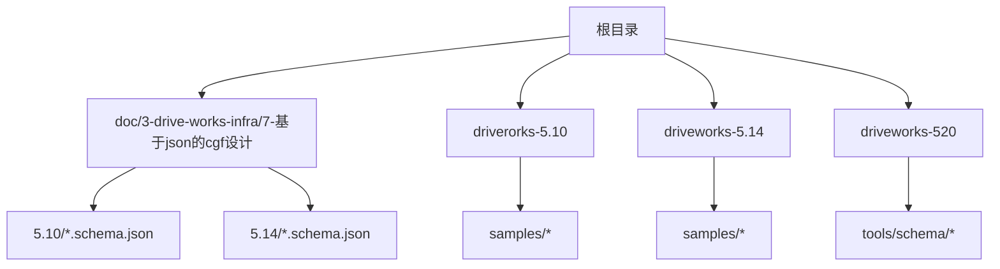
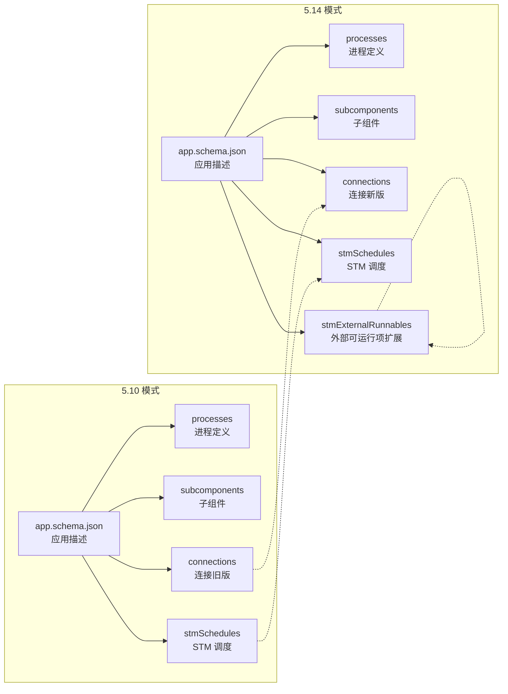
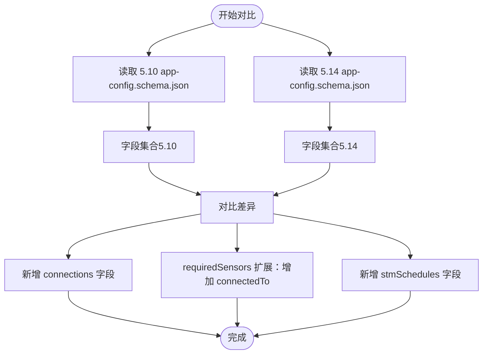
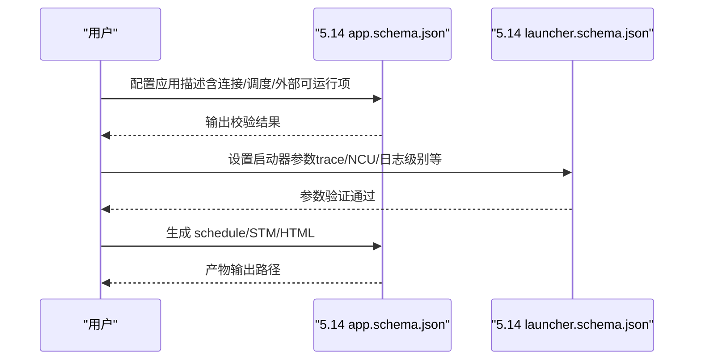
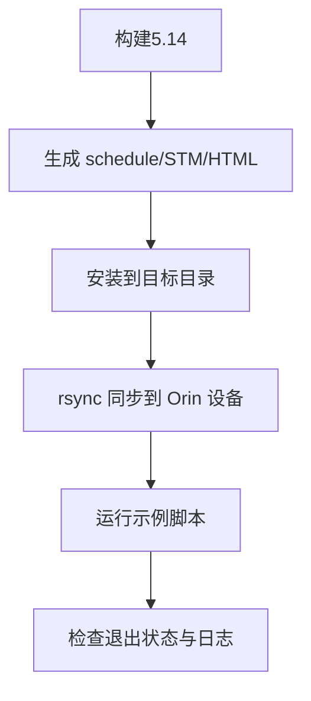
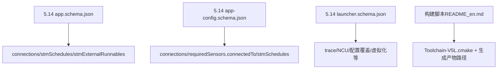

# 5.10到5.14版本变更

<cite>
**本文档引用的文件**
- [README_en.md](file://README_en.md)
- [app-config.schema.json（5.10）](file://doc/3-drive-works-infra/7-基于json的cgf设计/5.10/app-config.schema.json)
- [app-config.schema.json（5.14）](file://doc/3-drive-works-infra/7-基于json的cgf设计/5.14/app-config.schema.json)
- [app.schema.json（5.10）](file://doc/3-drive-works-infra/7-基于json的cgf设计/5.10/app.schema.json)
- [app.schema.json（5.14）](file://doc/3-drive-works-infra/7-基于json的cgf设计/5.14/app.schema.json)
- [launcher.schema.json（5.14）](file://doc/3-drive-works-infra/7-基于json的cgf设计/5.14/launcher.schema.json)
</cite>

## 目录
1. [简介](#简介)
2. [项目结构](#项目结构)
3. [核心组件](#核心组件)
4. [架构总览](#架构总览)
5. [详细组件分析](#详细组件分析)
6. [依赖关系分析](#依赖关系分析)
7. [性能考量](#性能考量)
8. [故障排查指南](#故障排查指南)
9. [结论](#结论)
10. [附录](#附录)

## 简介
本文件系统性对比 Driveworks 从 5.10 到 5.14 版本的关键变更，聚焦以下方面：
- API 与配置模式的演进：新增连接与调度相关字段、扩展外部可运行项类型
- 工具链与开发环境：构建脚本、样例生成流程、部署与运行方式
- 示例应用与文档：新增样例、工具与文档结构的变化
- 迁移指南：配置文件更新、API 变更影响与代码修改建议

## 项目结构
仓库包含多个版本目录与文档资源，其中与本次对比直接相关的为 5.10、5.14 以及 520（包含部分 5.14 的工具与配置）。

图示来源
- [README_en.md:1-92](file://README_en.md#L1-L92)
- [app.schema.json（5.10）:1-520](file://doc/3-drive-works-infra/7-基于json的cgf设计/5.10/app.schema.json#L1-L520)
- [app.schema.json（5.14）:1-560](file://doc/3-drive-works-infra/7-基于json的cgf设计/5.14/app.schema.json#L1-L560)

章节来源
- [README_en.md:1-92](file://README_en.md#L1-L92)

## 核心组件
- 应用描述与配置模式：5.14 引入了连接（connections）与调度（stmSchedules）等字段，扩展了外部可运行项（stmExternalRunnables）对处理器类型的覆盖范围，增强了对 GPU/CUDA 的显式支持。
- 启动器参数模式：5.14 新增了若干启动器参数，如 trace 系列、NCU 性能分析开关、配置覆盖文件等，便于调试与性能分析。
- 构建与运行：5.14 提供了自动化的 schedule、STM 与 HTML 生成路径，简化了开发与部署流程。

章节来源
- [app.schema.json（5.14）:142-325](file://doc/3-drive-works-infra/7-基于json的cgf设计/5.14/app.schema.json#L142-L325)
- [launcher.schema.json（5.14）:17-336](file://doc/3-drive-works-infra/7-基于json的cgf设计/5.14/launcher.schema.json#L17-L336)
- [README_en.md:13-62](file://README_en.md#L13-L62)

## 架构总览
下图展示了 5.10 与 5.14 在应用描述与配置模式上的关键差异，重点体现于连接、调度与外部可运行项的增强。

图示来源
- [app.schema.json（5.10）:80-383](file://doc/3-drive-works-infra/7-基于json的cgf设计/5.10/app.schema.json#L80-L383)
- [app.schema.json（5.14）:80-401](file://doc/3-drive-works-infra/7-基于json的cgf设计/5.14/app.schema.json#L80-L401)

## 详细组件分析

### 应用配置模式对比（app-config.schema.json）
- 5.10 版本：支持 comment、componentParameters、skipNodes、processes、requiredSensors 等字段；requiredSensors 支持 typeIndex 属性。
- 5.14 版本：新增 connections 字段用于连接管理；requiredSensors 增加 connectedTo 属性以声明传感器连接目标；新增 stmSchedules 字段用于修改 hyperepoch/epoch 周期与监控阈值；保留 processes、extraInfo、Recorder、RoadCastService 等字段。

图示来源
- [app-config.schema.json（5.10）:8-135](file://doc/3-drive-works-infra/7-基于json的cgf设计/5.10/app-config.schema.json#L8-L135)
- [app-config.schema.json（5.14）:52-202](file://doc/3-drive-works-infra/7-基于json的cgf设计/5.14/app-config.schema.json#L52-L202)

章节来源
- [app-config.schema.json（5.10）:8-135](file://doc/3-drive-works-infra/7-基于json的cgf设计/5.10/app-config.schema.json#L8-L135)
- [app-config.schema.json（5.14）:52-202](file://doc/3-drive-works-infra/7-基于json的cgf设计/5.14/app-config.schema.json#L52-L202)

### 应用描述模式对比（app.schema.json）
- 5.10 版本：connections 使用旧版格式，processes 中 services 字段仍可用但已标注弃用；stmSchedules 支持 hyperepochs/epochs/passes 等字段。
- 5.14 版本：connections 支持 EXTERNAL: 前缀标识外部连接；processes 增强对 runOn/logSpec/subcomponents 的支持；新增 stmExternalRunnables 字段，支持 CPU/GPU/CUDA_MUTEX_LOCK/CUDA_STREAM 多种处理器类型；services 字段标记为弃用。

图示来源
- [app.schema.json（5.14）:80-401](file://doc/3-drive-works-infra/7-基于json的cgf设计/5.14/app.schema.json#L80-L401)
- [launcher.schema.json（5.14）:17-336](file://doc/3-drive-works-infra/7-基于json的cgf设计/5.14/launcher.schema.json#L17-L336)

章节来源
- [app.schema.json（5.10）:80-383](file://doc/3-drive-works-infra/7-基于json的cgf设计/5.10/app.schema.json#L80-L383)
- [app.schema.json（5.14）:80-401](file://doc/3-drive-works-infra/7-基于json的cgf设计/5.14/app.schema.json#L80-L401)

### 启动器参数模式（launcher.schema.json）
- 5.14 版本新增 trace 系列参数（traceLevel、traceChannelMask、memTraceEnabled、nvtxBackendEnabled、fileBackendEnabled、networkBackendEnabled、ftraceBackendEnabled、stmControlTracing）、NCU 性能分析开关（ncuProfileFrames）、配置覆盖（configOverlayFile/configOverlayName）、标定覆盖（calibrationOverlayFile）、虚拟化与时间倍速（virtual/virtual_time/time_multiplier）、DS2 控制（ds2_control）、锁步模式（lockstep）、SSM 降级（enable-ssm-degradation）等。

章节来源
- [launcher.schema.json（5.14）:17-336](file://doc/3-drive-works-infra/7-基于json的cgf设计/5.14/launcher.schema.json#L17-L336)

### 构建与运行流程
- 5.14 提供了自动化构建与运行流程：通过 Toolchain-V5L.cmake 指定工具链，生成 schedule/STM/HTML，安装到指定目录后分发至目标设备并通过 rsync 同步，最后在目标机上运行示例脚本。

图示来源
- [README_en.md:13-62](file://README_en.md#L13-L62)

章节来源
- [README_en.md:13-62](file://README_en.md#L13-L62)

## 依赖关系分析
- 配置模式依赖：5.14 的 app.schema.json 与 app-config.schema.json 对应的字段扩展，直接影响应用描述与配置覆盖能力。
- 启动器依赖：launcher.schema.json 的参数直接影响运行时行为与调试能力，尤其是 trace 与 NCU 相关参数。
- 工具链依赖：构建脚本依赖 Toolchain-V5L.cmake 与 samples 目录结构，生成产物路径由 CMakeLists.txt 定义。

图示来源
- [app.schema.json（5.14）:80-401](file://doc/3-drive-works-infra/7-基于json的cgf设计/5.14/app.schema.json#L80-L401)
- [app-config.schema.json（5.14）:52-202](file://doc/3-drive-works-infra/7-基于json的cgf设计/5.14/app-config.schema.json#L52-L202)
- [launcher.schema.json（5.14）:17-336](file://doc/3-drive-works-infra/7-基于json的cgf设计/5.14/launcher.schema.json#L17-L336)
- [README_en.md:13-62](file://README_en.md#L13-L62)

## 性能考量
- 调试与追踪：5.14 新增 trace 系列参数，支持多后端（文件、网络、NVTX、Ftrace），便于定位性能瓶颈与内存问题。
- CUDA 性能分析：ncuProfileFrames 允许仅在指定帧区间开启 CUDA Profiler，降低开销。
- 外部可运行项：stmExternalRunnables 支持 CUDA_MUTEX_LOCK/CUDA_STREAM，有助于更精细地控制 GPU/CPU 并行与同步。
- 日志与可视化：logSpec/loglevel 与 offscreen/fullscreen 等参数可配合可视化工具进行离线分析。

章节来源
- [launcher.schema.json（5.14）:176-225](file://doc/3-drive-works-infra/7-基于json的cgf设计/5.14/launcher.schema.json#L176-L225)
- [app.schema.json（5.14）:280-325](file://doc/3-drive-works-infra/7-基于json的cgf设计/5.14/app.schema.json#L280-L325)

## 故障排查指南
- NVSCISocket 大数据传输问题：5.14 文档记录了 NVSCISocket 大数据传输的已知问题与修复方案，建议在连接配置中关注大数据场景下的参数设置。
- 启动器退出状态：运行示例后检查启动器退出状态是否为 0，若失败查看日志目录中的日志文件。
- trace 与 NCU：启用 traceLevel 与相应后端，结合 ncuProfileFrames 进行 CUDA 性能分析，定位热点函数与内存分配。

章节来源
- [README_en.md:64-92](file://README_en.md#L64-L92)
- [launcher.schema.json（5.14）:176-225](file://doc/3-drive-works-infra/7-基于json的cgf设计/5.14/launcher.schema.json#L176-L225)

## 结论
- 5.14 版本在配置模式、运行时调试与性能分析方面进行了系统性增强，特别是连接与调度的扩展、外部可运行项的处理器类型扩展、trace/NCU 能力完善，显著提升了开发与运维效率。
- 迁移建议：优先更新应用描述与配置文件，确保连接、调度与外部可运行项字段符合 5.14 规范；同时利用新增的 trace/NCU 参数进行性能优化与问题定位。

## 附录

### 迁移指南（概要）
- 配置文件更新
  - 将 app.json 中的 connections 更新为 5.14 格式，支持 EXTERNAL: 前缀标识外部连接。
  - 在 app-config.json 中新增 connections 字段，或在 requiredSensors 中使用 connectedTo 指定连接目标。
  - 如需动态调整调度周期与监控阈值，使用 stmSchedules 字段进行配置。
- 启动器参数更新
  - 根据需要启用 traceLevel、traceChannelMask、memTraceEnabled、nvtxBackendEnabled、fileBackendEnabled、networkBackendEnabled、ftraceBackendEnabled、stmControlTracing。
  - 使用 ncuProfileFrames 指定 CUDA Profiler 的启用帧区间。
  - 配置 configOverlayFile/configOverlayName 与 calibrationOverlayFile 以支持不同平台变体与标定覆盖。
- 代码修改建议
  - 若使用外部可运行项，确保处理器类型选择正确（CPU/GPU/CUDA_MUTEX_LOCK/CUDA_STREAM）。
  - 在连接配置中避免大数据传输导致的 NVSCISocket 问题，必要时拆分连接或调整参数。
  - 使用新的日志与可视化参数（offscreen/fullscreen/loglevel）进行离线分析与展示。

章节来源
- [app.schema.json（5.14）:80-401](file://doc/3-drive-works-infra/7-基于json的cgf设计/5.14/app.schema.json#L80-L401)
- [app-config.schema.json（5.14）:52-202](file://doc/3-drive-works-infra/7-基于json的cgf设计/5.14/app-config.schema.json#L52-L202)
- [launcher.schema.json（5.14）:17-336](file://doc/3-drive-works-infra/7-基于json的cgf设计/5.14/launcher.schema.json#L17-L336)
- [README_en.md:13-62](file://README_en.md#L13-L62)