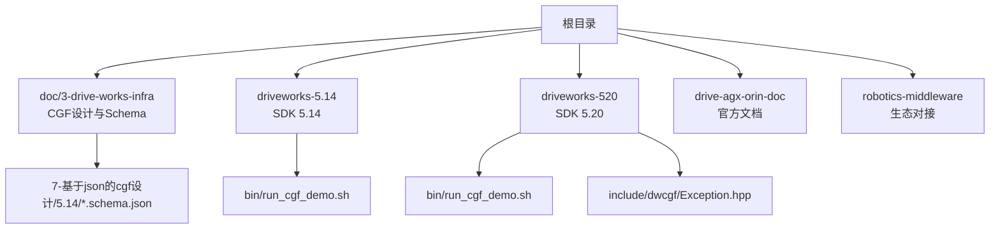
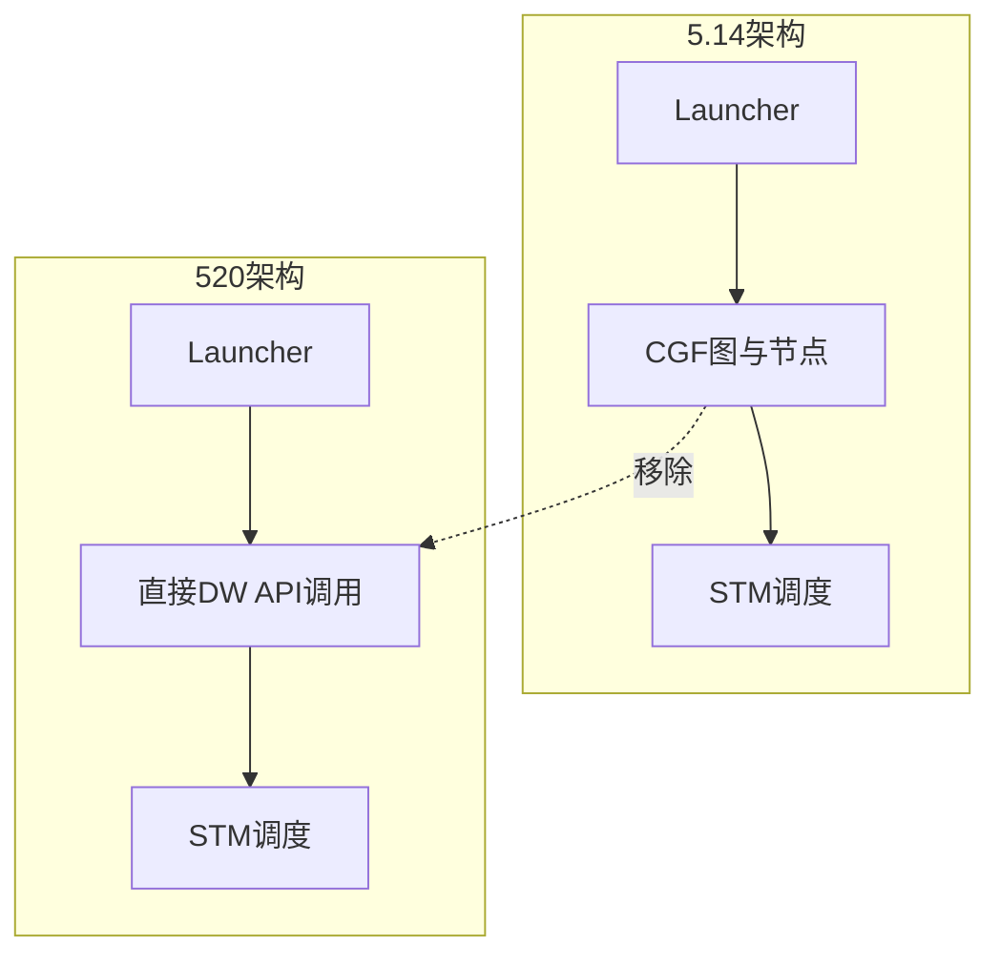
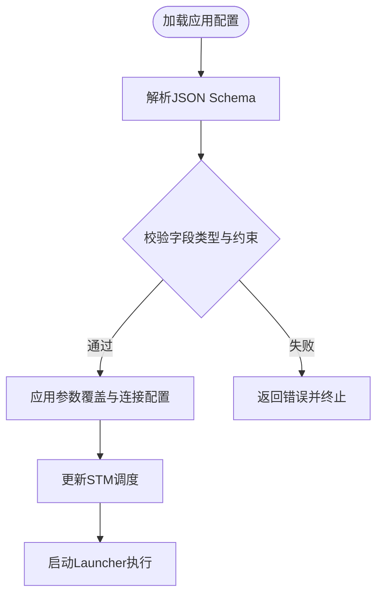
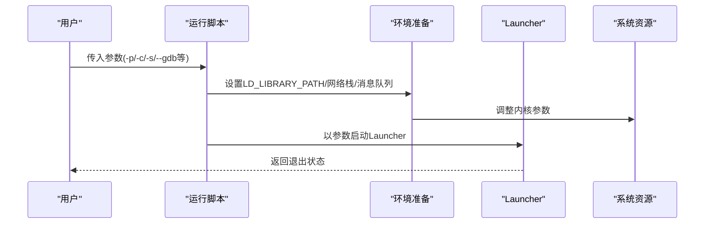
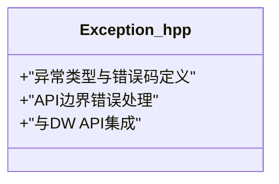
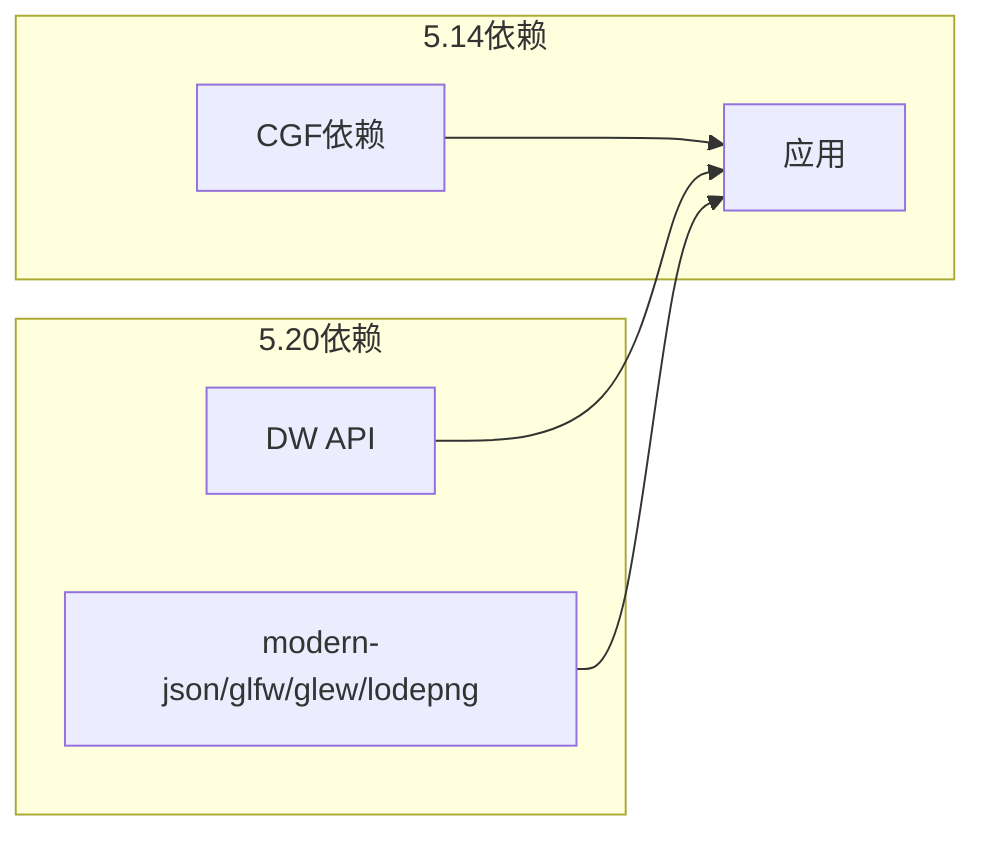

# 5.14到520版本变更

<cite>
**本文引用的文件**
- [README.md](file://README.md)
- [app-config.schema.json](file://doc/3-drive-works-infra/7-基于json的cgf设计/5.14/app-config.schema.json)
- [launcher.schema.json](file://doc/3-drive-works-infra/7-基于json的cgf设计/5.14/launcher.schema.json)
- [run_cgf_demo.sh（5.14）](file://driveworks-5.14/bin/run_cgf_demo.sh)
- [run_cgf_demo.sh（5.20）](file://driveworks-520/bin/run_cgf_demo.sh)
- [dwcgf/Exception.hpp（5.20）](file://driveworks-520/include/dwcgf/Exception.hpp)
</cite>

## 目录
1. [引言](#引言)
2. [项目结构](#项目结构)
3. [核心组件](#核心组件)
4. [架构总览](#架构总览)
5. [详细组件分析](#详细组件分析)
6. [依赖分析](#依赖分析)
7. [性能考量](#性能考量)
8. [故障排查指南](#故障排查指南)
9. [结论](#结论)
10. [附录](#附录)

## 引言
本文件面向从Driveworks 5.14迁移到520版本的团队，提供一次系统性的对比分析与迁移指南。重点覆盖以下方面：
- 架构层面：CGF在DriveOS SDK 7.x中的移除、直接DW API使用的推广、新硬件平台支持
- 功能层面：新的开发工具、改进的构建系统、增强的调试功能、优化的部署流程
- 设计哲学：API设计哲学、开发模式、工具链现代化、生态系统整合的根本性变化
- 迁移路径：架构变更影响评估、API替换策略、配置文件重构、最佳实践建议

## 项目结构
仓库按版本与功能域组织，主要目录如下：
- doc/3-drive-works-infra：CGF设计与JSON Schema文档，包含5.8/5.10/5.14等多版本Schema
- driveworks-5.x：各版本SDK源码与示例，5.14与520为本次对比重点
- drive-agx-orin-doc：官方文档与发布说明
- robotics-middleware：与ROS/ISAAC等生态的对接文档

**图表来源**
- [README.md:1-115](file://README.md#L1-L115)
- [app-config.schema.json:1-265](file://doc/3-drive-works-infra/7-基于json的cgf设计/5.14/app-config.schema.json#L1-L265)
- [run_cgf_demo.sh（5.14）:1-509](file://driveworks-5.14/bin/run_cgf_demo.sh#L1-L509)
- [run_cgf_demo.sh（5.20）:1-509](file://driveworks-520/bin/run_cgf_demo.sh#L1-L509)

**章节来源**
- [README.md:1-115](file://README.md#L1-L115)

## 核心组件
- CGF（Compute Graph Framework）：5.14版本仍提供，520版本在DriveOS SDK 7.x中被移除，需直接使用DW API
- STM（Scheduling Middleware）：5.x保留，520版本继续保留，但与业务组件集成方式发生变化
- Launcher与运行脚本：统一的启动器参数与运行时环境准备逻辑
- JSON Schema：应用配置、节点参数、连接关系等的结构化定义

**章节来源**
- [README.md:51-62](file://README.md#L51-L62)
- [launcher.schema.json:1-337](file://doc/3-drive-works-infra/7-基于json的cgf设计/5.14/launcher.schema.json#L1-L337)

## 架构总览
从5.14到520，核心变化体现在“去框架化”与“直接API化”的趋势：
- 移除CGF：不再通过CGF图进行编排，转为直接调用DW API
- 保留STM：调度中间件继续存在，但需要开发者自行实现与业务组件的集成
- 新硬件平台：520版本开始支持新的SoC平台（如Thor），并引入新的依赖与头文件

**图表来源**
- [README.md:51-62](file://README.md#L51-L62)
- [run_cgf_demo.sh（5.14）:454-460](file://driveworks-5.14/bin/run_cgf_demo.sh#L454-L460)
- [run_cgf_demo.sh（5.20）:454-460](file://driveworks-520/bin/run_cgf_demo.sh#L454-L460)

## 详细组件分析

### CGF配置与Schema（5.14）
- 应用配置Schema：定义应用参数覆盖、跳过节点、连接关系、STM调度修改、进程参数、所需传感器等
- 启动器参数Schema：定义Launcher命令行参数，涵盖日志、追踪、内存检测、网络后端、时间倍速等

**图表来源**
- [app-config.schema.json:1-265](file://doc/3-drive-works-infra/7-基于json的cgf设计/5.14/app-config.schema.json#L1-L265)
- [launcher.schema.json:1-337](file://doc/3-drive-works-infra/7-基于json的cgf设计/5.14/launcher.schema.json#L1-L337)

**章节来源**
- [app-config.schema.json:1-265](file://doc/3-drive-works-infra/7-基于json的cgf设计/5.14/app-config.schema.json#L1-L265)
- [launcher.schema.json:1-337](file://doc/3-drive-works-infra/7-基于json的cgf设计/5.14/launcher.schema.json#L1-L337)

### Launcher与运行脚本（5.14 vs 5.20）
- 两版本脚本在参数传递、环境准备、显示与网络栈调优等方面保持高度一致
- 5.20版本仍沿用相同Launcher二进制与参数体系，体现运行时行为的延续性

**图表来源**
- [run_cgf_demo.sh（5.14）:128-153](file://driveworks-5.14/bin/run_cgf_demo.sh#L128-L153)
- [run_cgf_demo.sh（5.20）:128-153](file://driveworks-520/bin/run_cgf_demo.sh#L128-L153)
- [run_cgf_demo.sh（5.14）:454-460](file://driveworks-5.14/bin/run_cgf_demo.sh#L454-L460)
- [run_cgf_demo.sh（5.20）:454-460](file://driveworks-520/bin/run_cgf_demo.sh#L454-L460)

**章节来源**
- [run_cgf_demo.sh（5.14）:1-509](file://driveworks-5.14/bin/run_cgf_demo.sh#L1-L509)
- [run_cgf_demo.sh（5.20）:1-509](file://driveworks-520/bin/run_cgf_demo.sh#L1-L509)

### 异常处理与API边界（5.20新增）
- 5.20版本新增dwcgf/Exception.hpp，表明在520中对异常模型与API边界进行了细化
- 这与“去CGF化”相呼应：当不再依赖CGF图进行编排时，异常传播与错误处理需要更直接的API级控制

**图表来源**
- [dwcgf/Exception.hpp（5.20）](file://driveworks-520/include/dwcgf/Exception.hpp)

**章节来源**
- [dwcgf/Exception.hpp（5.20）](file://driveworks-520/include/dwcgf/Exception.hpp)

## 依赖分析
- CGF相关依赖在520中被移除，需要改用直接DW API
- 520版本引入新的第三方依赖配置（如modern-json、glfw、glew、lodepng等），反映工具链现代化
- 520版本的include目录下出现新的头文件（如NvSIPLClient.hpp等），指向新硬件平台或新接口族

**图表来源**
- [README.md:51-62](file://README.md#L51-L62)
- [run_cgf_demo.sh（5.20）:291-313](file://driveworks-520/bin/run_cgf_demo.sh#L291-L313)

**章节来源**
- [README.md:51-62](file://README.md#L51-L62)
- [run_cgf_demo.sh（5.20）:291-313](file://driveworks-520/bin/run_cgf_demo.sh#L291-L313)

## 性能考量
- 网络栈与消息队列参数在两版脚本中均被严格检查与调优，确保低延迟与高吞吐
- Launcher参数中包含日志级别、追踪级别、内存追踪、NVTX后端、文件后端等，便于在不同场景下权衡性能与可观测性

**章节来源**
- [run_cgf_demo.sh（5.14）:181-235](file://driveworks-5.14/bin/run_cgf_demo.sh#L181-L235)
- [run_cgf_demo.sh（5.20）:181-235](file://driveworks-520/bin/run_cgf_demo.sh#L181-L235)
- [launcher.schema.json:171-225](file://doc/3-drive-works-infra/7-基于json的cgf设计/5.14/launcher.schema.json#L171-L225)

## 故障排查指南
- 环境准备失败：若网络栈或消息队列参数不足，脚本会提示并要求调整内核参数
- 缺少配置文件：如NvSCI IPC配置缺失或未包含STM条目，将导致启动失败
- 显示与Docker：在Docker环境中需特别设置消息队列大小，否则远程执行可能失败
- 日志与追踪：通过Launcher参数选择日志级别与追踪后端，有助于快速定位问题

**章节来源**
- [run_cgf_demo.sh（5.14）:237-290](file://driveworks-5.14/bin/run_cgf_demo.sh#L237-L290)
- [run_cgf_demo.sh（5.20）:237-290](file://driveworks-520/bin/run_cgf_demo.sh#L237-L290)

## 结论
- 520版本标志着从“CGF编排”到“直接DW API”的范式转移，简化了中间层，提升了灵活性
- 保留的STM仍承担调度职责，但需要开发者自行完成与业务组件的集成
- 工具链与依赖现代化，为新硬件平台与新接口族奠定基础
- 迁移的关键在于：去除对CGF图的依赖、采用直接API、重构配置与部署流程、利用增强的调试与追踪能力

## 附录

### 迁移清单与最佳实践
- 架构变更影响评估
  - 统计并识别所有依赖CGF图的模块与节点，评估其直接API替代方案
  - 对涉及跨进程/跨机通信的模块，评估NvSci或自定义IPC方案
- API替换策略
  - 将CGF节点替换为直接DW API调用，确保参数与数据流保持一致
  - 使用新的异常处理模型（如5.20的dwcgf/Exception.hpp）提升健壮性
- 配置文件重构
  - 删除CGF相关Schema与配置，转向直接API参数与运行时配置
  - 利用Launcher参数进行日志、追踪、内存检测等调试选项的集中管理
- 部署流程优化
  - 保持运行脚本的环境准备逻辑，确保网络栈与消息队列参数正确
  - 在Docker环境中显式设置消息队列大小，避免远程执行失败
- 生态系统整合
  - 评估与ROS/ISAAC等生态的对接点，必要时通过适配层桥接
  - 利用现代化依赖（如modern-json、glfw、glew、lodepng）提升开发效率