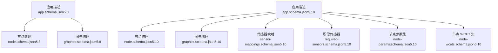
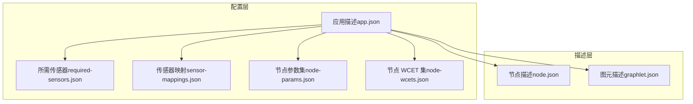
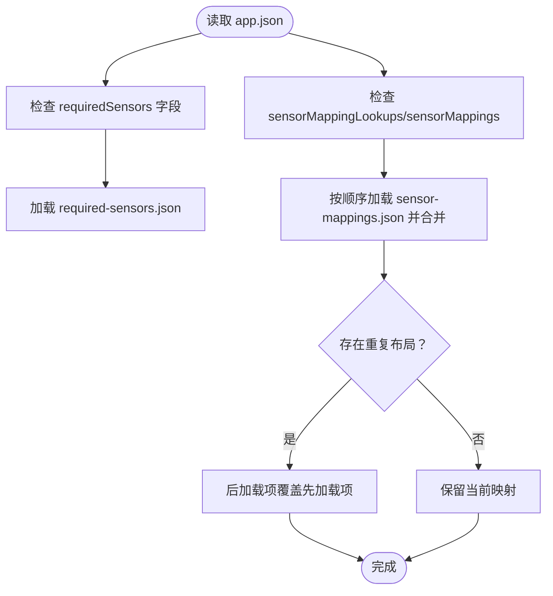
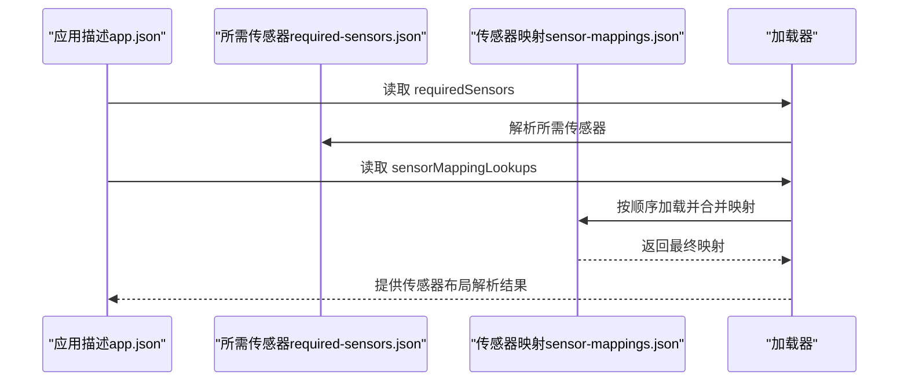
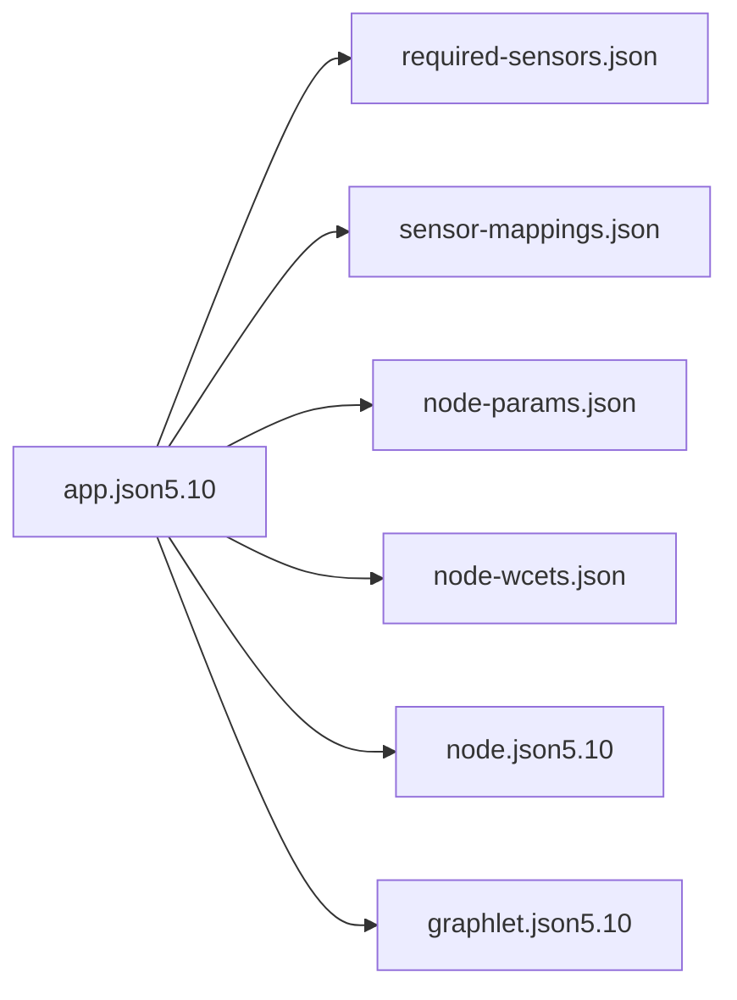

# 5.8到5.10版本变更

<cite>
**本文引用的文件**
- [app.schema.json（5.8）](file://doc/3-drive-works-infra/7-基于json的cgf设计/5.8/app.schema.json)
- [node.schema.json（5.8）](file://doc/3-drive-works-infra/7-基于json的cgf设计/5.8/node.schema.json)
- [graphlet.schema.json（5.8）](file://doc/3-drive-works-infra/7-基于json的cgf设计/5.8/graphlet.schema.json)
- [app.schema.json（5.10）](file://doc/3-drive-works-infra/7-基于json的cgf设计/5.10/app.schema.json)
- [node.schema.json（5.10）](file://doc/3-drive-works-infra/7-基于json的cgf设计/5.10/node.schema.json)
- [graphlet.schema.json（5.10）](file://doc/3-drive-works-infra/7-基于json的cgf设计/5.10/graphlet.schema.json)
- [sensor-mappings.schema.json（5.10）](file://doc/3-drive-works-infra/7-基于json的cgf设计/5.10/sensor-mappings.schema.json)
- [required-sensors.schema.json（5.10）](file://doc/3-drive-works-infra/7-基于json的cgf设计/5.10/required-sensors.schema.json)
- [node-params.schema.json（5.10）](file://doc/3-drive-works-infra/7-基于json的cgf设计/5.10/node-params.schema.json)
- [node-wcets.schema.json（5.10）](file://doc/3-drive-works-infra/7-基于json的cgf设计/5.10/node-wcets.schema.json)
- [5-8__to__5-10_8md.html](file://driverorks-5.10/doc/nvcgf_html/5-8__to__5-10_8md.html)
</cite>

## 目录
1. [引言](#引言)
2. [项目结构](#项目结构)
3. [核心组件](#核心组件)
4. [架构总览](#架构总览)
5. [详细组件分析](#详细组件分析)
6. [依赖关系分析](#依赖关系分析)
7. [性能考量](#性能考量)
8. [故障排查指南](#故障排查指南)
9. [结论](#结论)
10. [附录](#附录)

## 引言
本文件面向从 Driveworks 5.8 升级到 5.10 的开发者，系统梳理 CGF 架构在 5.10 版本中的重大演进与变更点，重点覆盖以下方面：
- 新的节点系统设计：节点与图元描述的扩展与规范化
- 通道管理机制改进：传感器映射与所需传感器的独立化与可查找化
- 参数提供器重构：参数集与 WCET 集的独立化与命名化
- API 接口调整：JSON Schema 字段与工具链行为变化
- 新增功能特性：改进的传感器支持、增强的 DNN 推理能力、新的可视化工具与调试功能
- 构建系统、配置文件格式、示例代码结构与工具链差异
- 具体的 API 变更清单、配置文件迁移指南与代码兼容性说明

## 项目结构
围绕 CGF 的 JSON Schema 设计，5.10 在 5.8 基础上引入了“传感器映射”和“所需传感器”的独立 schema，并对应用描述、节点与图元描述进行了字段与约束的细化与扩展。

图表来源
- [app.schema.json（5.8）:1-475](file://doc/3-drive-works-infra/7-基于json的cgf设计/5.8/app.schema.json#L1-L475)
- [node.schema.json（5.8）:1-178](file://doc/3-drive-works-infra/7-基于json的cgf设计/5.8/node.schema.json#L1-L178)
- [graphlet.schema.json（5.8）:1-241](file://doc/3-drive-works-infra/7-基于json的cgf设计/5.8/graphlet.schema.json#L1-L241)
- [app.schema.json（5.10）:1-520](file://doc/3-drive-works-infra/7-基于json的cgf设计/5.10/app.schema.json#L1-L520)
- [node.schema.json（5.10）:1-179](file://doc/3-drive-works-infra/7-基于json的cgf设计/5.10/node.schema.json#L1-L179)
- [graphlet.schema.json（5.10）:1-242](file://doc/3-drive-works-infra/7-基于json的cgf设计/5.10/graphlet.schema.json#L1-L242)
- [sensor-mappings.schema.json（5.10）:1-22](file://doc/3-drive-works-infra/7-基于json的cgf设计/5.10/sensor-mappings.schema.json#L1-L22)
- [required-sensors.schema.json（5.10）:1-23](file://doc/3-drive-works-infra/7-基于json的cgf设计/5.10/required-sensors.schema.json#L1-L23)
- [node-params.schema.json（5.10）:1-34](file://doc/3-drive-works-infra/7-基于json的cgf设计/5.10/node-params.schema.json#L1-L34)
- [node-wcets.schema.json（5.10）:1-23](file://doc/3-drive-works-infra/7-基于json的cgf设计/5.10/node-wcets.schema.json#L1-L23)

章节来源
- [app.schema.json（5.8）:1-475](file://doc/3-drive-works-infra/7-基于json的cgf设计/5.8/app.schema.json#L1-L475)
- [app.schema.json（5.10）:1-520](file://doc/3-drive-works-infra/7-基于json的cgf设计/5.10/app.schema.json#L1-L520)

## 核心组件
- 应用描述（App Descriptor）
  - 5.10 新增字段：requiredSensors、sensorMappingLookups、sensorMappings
  - 5.10 对子组件引用的组件类型路径正则进行统一（去除了 gdl- 前缀兼容）
- 节点描述（Node Descriptor）
  - 保持与 5.8 相同的核心结构，未发现破坏性变更
- 图元描述（Graphlet Descriptor）
  - 5.10 统一了子组件 componentType 的路径正则，移除 gdl- 兼容
- 传感器相关 Schema
  - sensor-mappings.schema.json：定义传感器布局映射集合
  - required-sensors.schema.json：定义应用所需的传感器及其属性
- 参数与 WCET 独立化
  - node-params.schema.json：节点参数值集
  - node-wcets.schema.json：节点 WCET 值集

章节来源
- [app.schema.json（5.10）:39-68](file://doc/3-drive-works-infra/7-基于json的cgf设计/5.10/app.schema.json#L39-L68)
- [graphlet.schema.json（5.10）:152-155](file://doc/3-drive-works-infra/7-基于json的cgf设计/5.10/graphlet.schema.json#L152-L155)
- [sensor-mappings.schema.json（5.10）:1-22](file://doc/3-drive-works-infra/7-基于json的cgf设计/5.10/sensor-mappings.schema.json#L1-L22)
- [required-sensors.schema.json（5.10）:1-23](file://doc/3-drive-works-infra/7-基于json的cgf设计/5.10/required-sensors.schema.json#L1-L23)
- [node-params.schema.json（5.10）:1-34](file://doc/3-drive-works-infra/7-基于json的cgf设计/5.10/node-params.schema.json#L1-L34)
- [node-wcets.schema.json（5.10）:1-23](file://doc/3-drive-works-infra/7-基于json的cgf设计/5.10/node-wcets.schema.json#L1-L23)

## 架构总览
5.10 版本在 CGF 架构上的演进主要体现在“配置与运行时解耦”的方向：
- 传感器配置从应用层剥离为独立的“所需传感器”和“传感器映射”，并通过“查找表”机制实现复用与覆盖
- 参数与 WCET 以“命名集”的形式独立管理，便于跨节点复用与版本化
- 节点与图元描述保持稳定，确保现有节点实现无需修改即可适配新版本

图表来源
- [app.schema.json（5.10）:39-68](file://doc/3-drive-works-infra/7-基于json的cgf设计/5.10/app.schema.json#L39-L68)
- [sensor-mappings.schema.json（5.10）:1-22](file://doc/3-drive-works-infra/7-基于json的cgf设计/5.10/sensor-mappings.schema.json#L1-L22)
- [required-sensors.schema.json（5.10）:1-23](file://doc/3-drive-works-infra/7-基于json的cgf设计/5.10/required-sensors.schema.json#L1-L23)
- [node-params.schema.json（5.10）:1-34](file://doc/3-drive-works-infra/7-基于json的cgf设计/5.10/node-params.schema.json#L1-L34)
- [node-wcets.schema.json（5.10）:1-23](file://doc/3-drive-works-infra/7-基于json的cgf设计/5.10/node-wcets.schema.json#L1-L23)
- [node.schema.json（5.10）:1-179](file://doc/3-drive-works-infra/7-基于json的cgf设计/5.10/node.schema.json#L1-L179)
- [graphlet.schema.json（5.10）:1-242](file://doc/3-drive-works-infra/7-基于json的cgf设计/5.10/graphlet.schema.json#L1-L242)

## 详细组件分析

### 应用描述（App Descriptor）对比
- 5.10 新增字段
  - requiredSensors：指向 .required-sensors.json 文件
  - sensorMappingLookups：可选的传感器映射查找路径数组，支持目录内按字母序查找与后加载覆盖
  - sensorMappings：直接在 app.json 中声明的传感器映射集合（通常由 sensorMappingLookups 加载替代）
- 5.10 对子组件 componentType 的路径正则统一为 .node.json / .graphlet.json，移除 gdl- 兼容
- 5.8 的字段 extraInfo、sensorLayouts 在 5.10 中被替换为更明确的“所需传感器 + 映射”体系

图表来源
- [app.schema.json（5.10）:39-68](file://doc/3-drive-works-infra/7-基于json的cgf设计/5.10/app.schema.json#L39-L68)
- [sensor-mappings.schema.json（5.10）:1-22](file://doc/3-drive-works-infra/7-基于json的cgf设计/5.10/sensor-mappings.schema.json#L1-L22)
- [required-sensors.schema.json（5.10）:1-23](file://doc/3-drive-works-infra/7-基于json的cgf设计/5.10/required-sensors.schema.json#L1-L23)

章节来源
- [app.schema.json（5.8）:36-40](file://doc/3-drive-works-infra/7-基于json的cgf设计/5.8/app.schema.json#L36-L40)
- [app.schema.json（5.10）:39-68](file://doc/3-drive-works-infra/7-基于json的cgf设计/5.10/app.schema.json#L39-L68)

### 节点与图元描述（Node & Graphlet）
- 节点描述：5.10 与 5.8 结构一致，未发现破坏性变更
- 图元描述：5.10 统一了 componentType 正则，不再兼容 gdl- 前缀

章节来源
- [node.schema.json（5.8）:1-178](file://doc/3-drive-works-infra/7-基于json的cgf设计/5.8/node.schema.json#L1-L178)
- [node.schema.json（5.10）:1-179](file://doc/3-drive-works-infra/7-基于json的cgf设计/5.10/node.schema.json#L1-L179)
- [graphlet.schema.json（5.8）:1-241](file://doc/3-drive-works-infra/7-基于json的cgf设计/5.8/graphlet.schema.json#L1-L241)
- [graphlet.schema.json（5.10）:1-242](file://doc/3-drive-works-infra/7-基于json的cgf设计/5.10/graphlet.schema.json#L1-L242)

### 传感器支持与映射
- required-sensors.json：定义应用所需的传感器名称与属性（如 typeIndex）
- sensor-mappings.json：定义布局名到具体传感器名的映射，支持多布局复用
- 查找机制：sensorMappingLookups 支持目录扫描与后加载覆盖，便于团队共享与覆盖

图表来源
- [app.schema.json（5.10）:39-68](file://doc/3-drive-works-infra/7-基于json的cgf设计/5.10/app.schema.json#L39-L68)
- [required-sensors.schema.json（5.10）:1-23](file://doc/3-drive-works-infra/7-基于json的cgf设计/5.10/required-sensors.schema.json#L1-L23)
- [sensor-mappings.schema.json（5.10）:1-22](file://doc/3-drive-works-infra/7-基于json的cgf设计/5.10/sensor-mappings.schema.json#L1-L22)

章节来源
- [required-sensors.schema.json（5.10）:1-23](file://doc/3-drive-works-infra/7-基于json的cgf设计/5.10/required-sensors.schema.json#L1-L23)
- [sensor-mappings.schema.json（5.10）:1-22](file://doc/3-drive-works-infra/7-基于json的cgf设计/5.10/sensor-mappings.schema.json#L1-L22)

### 参数提供器与 WCET 管理
- node-params.schema.json：定义节点参数值集，支持通配符与层级参数名
- node-wcets.schema.json：定义节点各 pass 的 WCET 值集，便于调度与资源规划

章节来源
- [node-params.schema.json（5.10）:1-34](file://doc/3-drive-works-infra/7-基于json的cgf设计/5.10/node-params.schema.json#L1-L34)
- [node-wcets.schema.json（5.10）:1-23](file://doc/3-drive-works-infra/7-基于json的cgf设计/5.10/node-wcets.schema.json#L1-L23)

### API 变更清单（摘要）
- 应用描述
  - 新增 requiredSensors、sensorMappingLookups、sensorMappings 字段
  - 子组件 componentType 正则统一为 .node.json / .graphlet.json
- 节点与图元描述
  - 无破坏性变更；图元描述 componentType 正则更新
- 传感器相关
  - 新增 sensor-mappings.schema.json 与 required-sensors.schema.json
- 参数与 WCET
  - 新增 node-params.schema.json 与 node-wcets.schema.json

章节来源
- [app.schema.json（5.10）:39-68](file://doc/3-drive-works-infra/7-基于json的cgf设计/5.10/app.schema.json#L39-L68)
- [graphlet.schema.json（5.10）:152-155](file://doc/3-drive-works-infra/7-基于json的cgf设计/5.10/graphlet.schema.json#L152-L155)
- [sensor-mappings.schema.json（5.10）:1-22](file://doc/3-drive-works-infra/7-基于json的cgf设计/5.10/sensor-mappings.schema.json#L1-L22)
- [required-sensors.schema.json（5.10）:1-23](file://doc/3-drive-works-infra/7-基于json的cgf设计/5.10/required-sensors.schema.json#L1-L23)
- [node-params.schema.json（5.10）:1-34](file://doc/3-drive-works-infra/7-基于json的cgf设计/5.10/node-params.schema.json#L1-L34)
- [node-wcets.schema.json（5.10）:1-23](file://doc/3-drive-works-infra/7-基于json的cgf设计/5.10/node-wcets.schema.json#L1-L23)

## 依赖关系分析
- 5.10 将“传感器配置”从应用描述中解耦，形成独立的 required-sensors 与 sensor-mappings，降低耦合度并提升复用性
- 参数与 WCET 以独立 schema 管理，便于跨模块共享与版本化控制
- 节点与图元描述保持稳定，确保现有节点实现的兼容性

图表来源
- [app.schema.json（5.10）:39-68](file://doc/3-drive-works-infra/7-基于json的cgf设计/5.10/app.schema.json#L39-L68)
- [required-sensors.schema.json（5.10）:1-23](file://doc/3-drive-works-infra/7-基于json的cgf设计/5.10/required-sensors.schema.json#L1-L23)
- [sensor-mappings.schema.json（5.10）:1-22](file://doc/3-drive-works-infra/7-基于json的cgf设计/5.10/sensor-mappings.schema.json#L1-L22)
- [node-params.schema.json（5.10）:1-34](file://doc/3-drive-works-infra/7-基于json的cgf设计/5.10/node-params.schema.json#L1-L34)
- [node-wcets.schema.json（5.10）:1-23](file://doc/3-drive-works-infra/7-基于json的cgf设计/5.10/node-wcets.schema.json#L1-L23)
- [node.schema.json（5.10）:1-179](file://doc/3-drive-works-infra/7-基于json的cgf设计/5.10/node.schema.json#L1-L179)
- [graphlet.schema.json（5.10）:1-242](file://doc/3-drive-works-infra/7-基于json的cgf设计/5.10/graphlet.schema.json#L1-L242)

## 性能考量
- 传感器映射与所需传感器的分离有助于减少重复配置与提升加载效率
- 参数与 WCET 的命名集管理有利于跨模块共享与缓存命中率提升
- 统一的 componentType 正则减少了路径解析歧义，提升加载稳定性

## 故障排查指南
- 传感器相关
  - requiredSensors 中的传感器名必须与 sensor-mappings 或 rig 中的传感器名一致
  - sensorMappingLookups 的目录顺序决定覆盖规则，后加载项会覆盖先前项
- 参数与 WCET
  - node-params 与 node-wcets 的键名需与节点描述中的参数或 pass 名称严格匹配
- 兼容性
  - 若使用旧版 app.json，请将 sensorLayouts 迁移到 requiredSensors 与 sensor-mappings
  - 子组件 componentType 路径请移除 gdl- 前缀

章节来源
- [required-sensors.schema.json（5.10）:1-23](file://doc/3-drive-works-infra/7-基于json的cgf设计/5.10/required-sensors.schema.json#L1-L23)
- [sensor-mappings.schema.json（5.10）:1-22](file://doc/3-drive-works-infra/7-基于json的cgf设计/5.10/sensor-mappings.schema.json#L1-L22)
- [node-params.schema.json（5.10）:1-34](file://doc/3-drive-works-infra/7-基于json的cgf设计/5.10/node-params.schema.json#L1-L34)
- [node-wcets.schema.json（5.10）:1-23](file://doc/3-drive-works-infra/7-基于json的cgf设计/5.10/node-wcets.schema.json#L1-L23)

## 结论
5.10 版本在不破坏既有节点实现的前提下，显著提升了 CGF 的可维护性与可扩展性：
- 通过 required-sensors 与 sensor-mappings 的解耦，简化了传感器配置与复用
- 通过 node-params 与 node-wcets 的独立化，增强了参数与调度管理能力
- 通过统一的 componentType 正则，提升了描述文件的一致性与可移植性
建议在升级过程中优先完成配置文件迁移与工具链适配，以获得更稳定的开发体验与更高的执行效率。

## 附录

### 配置文件迁移指南（5.8 → 5.10）
- 应用描述
  - 将 5.8 的 sensorLayouts 字段迁移到 requiredSensors 与 sensor-mappings
  - 使用 sensorMappingLookups 实现映射文件的查找与覆盖
- 节点与图元
  - 更新子组件 componentType 路径，移除 gdl- 前缀
- 参数与 WCET
  - 将参数与 WCET 定义拆分为 node-params 与 node-wcets，并通过命名集管理

章节来源
- [app.schema.json（5.10）:39-68](file://doc/3-drive-works-infra/7-基于json的cgf设计/5.10/app.schema.json#L39-L68)
- [graphlet.schema.json（5.10）:152-155](file://doc/3-drive-works-infra/7-基于json的cgf设计/5.10/graphlet.schema.json#L152-L155)

### 工具链与示例代码结构差异
- 5.10 引入了更严格的 schema 校验与更清晰的配置分层，建议在 CI 中增加 schema 校验步骤
- 示例工程与工具链应优先适配新的传感器映射与所需传感器机制

章节来源
- [5-8__to__5-10_8md.html:1-115](file://driverorks-5.10/doc/nvcgf_html/5-8__to__5-10_8md.html#L1-L115)