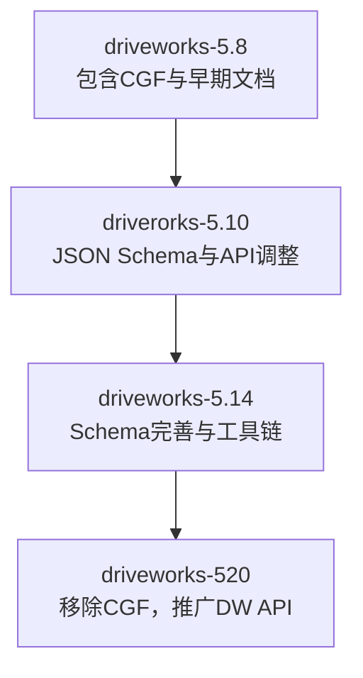
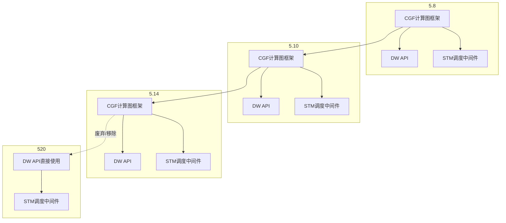
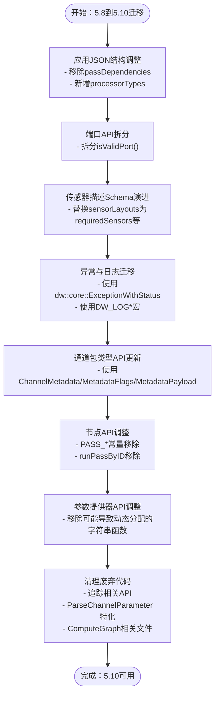
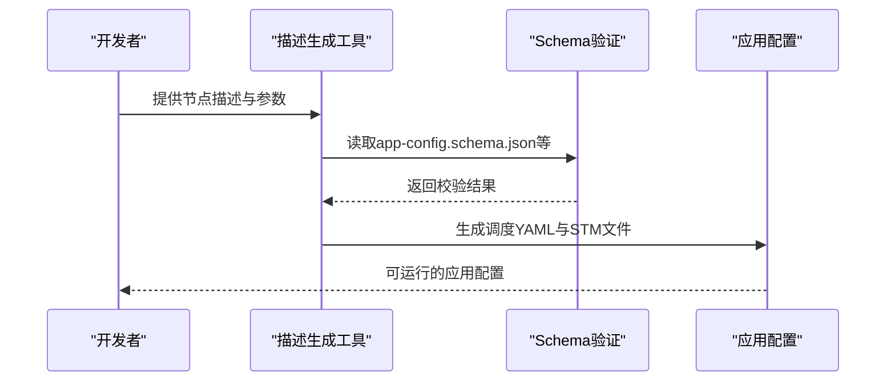
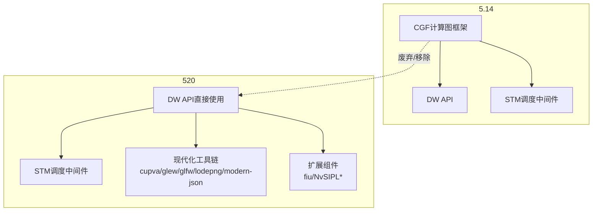
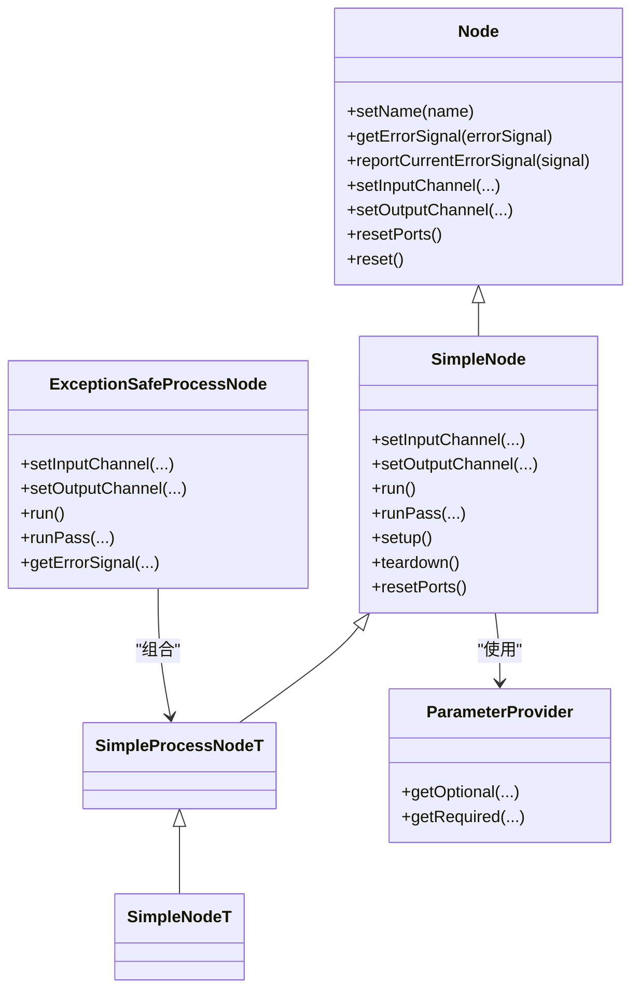
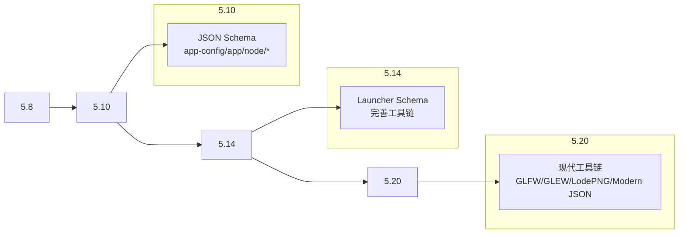

# 版本差异对比

<cite>
**本文引用的文件**
- [README.md](file://README.md)
- [README_en.md](file://README_en.md)
- [cgf-helloworld-class.pu](file://doc/3-drive-works-infra/6-cgf实例/cgf-helloworld-class.pu)
- [cgf-dwframework-class.pu](file://doc/3-drive-works-infra/8-CGFDemo/cgf-dwframework-class.pu)
- [cgf_porting_guide_5_8.html](file://driverorks-5.10/doc/nvcgf_html/cgf_porting_guide_5_8.html)
- [cgf_porting_guide_5_10.html](file://driverorks-5.10/doc/nvcgf_html/cgf_porting_guide_5_10.html)
- [cgf_porting_guide_5_4.html](file://driveworks-5.8/doc/nvcgf_html/cgf_porting_guide_5_4.html)
- [app-config.schema.json（5.8）](file://doc/3-drive-works-infra/7-基于json的cgf设计/5.8/app-config.schema.json)
- [app.schema.json（5.8）](file://doc/3-drive-works-infra/7-基于json的cgf设计/5.8/app.schema.json)
- [node.schema.json（5.8）](file://doc/3-drive-works-infra/7-基于json的cgf设计/5.8/node.schema.json)
- [node-params.schema.json（5.8）](file://doc/3-drive-works-infra/7-基于json的cgf设计/5.8/node-params.schema.json)
- [node-wcets.schema.json（5.8）](file://doc/3-drive-works-infra/7-基于json的cgf设计/5.8/node-wcets.schema.json)
- [sensors.schema.json（5.8）](file://doc/3-drive-works-infra/7-基于json的cgf设计/5.8/sensors.schema.json)
- [app-config.schema.json（5.10）](file://doc/3-drive-works-infra/7-基于json的cgf设计/5.10/app-config.schema.json)
- [app.schema.json（5.10）](file://doc/3-drive-works-infra/7-基于json的cgf设计/5.10/app.schema.json)
- [node.schema.json（5.10）](file://doc/3-drive-works-infra/7-基于json的cgf设计/5.10/node.schema.json)
- [node-params.schema.json（5.10）](file://doc/3-drive-works-infra/7-基于json的cgf设计/5.10/node-params.schema.json)
- [node-wcets.schema.json（5.10）](file://doc/3-drive-works-infra/7-基于json的cgf设计/5.10/node-wcets.schema.json)
- [required-sensors.schema.json（5.10）](file://doc/3-drive-works-infra/7-基于json的cgf设计/5.10/required-sensors.schema.json)
- [sensor-mappings.schema.json（5.10）](file://doc/3-drive-works-infra/7-基于json的cgf设计/5.10/sensor-mappings.schema.json)
- [trans.schema.json（5.10）](file://doc/3-drive-works-infra/7-基于json的cgf设计/5.10/trans.schema.json)
- [app-config.schema.json（5.14）](file://doc/3-drive-works-infra/7-基于json的cgf设计/5.14/app-config.schema.json)
- [app.schema.json（5.14）](file://doc/3-drive-works-infra/7-基于json的cgf设计/5.14/app.schema.json)
- [node.schema.json（5.14）](file://doc/3-drive-works-infra/7-基于json的cgf设计/5.14/node.schema.json)
- [node-params.schema.json（5.14）](file://doc/3-drive-works-infra/7-基于json的cgf设计/5.14/node-params.schema.json)
- [node-wcets.schema.json（5.14）](file://doc/3-drive-works-infra/7-基于json的cgf设计/5.14/node-wcets.schema.json)
- [launcher.schema.json（5.14）](file://doc/3-drive-works-infra/7-基于json的cgf设计/5.14/launcher.schema.json)
- [sensor-mappings.schema.json（5.14）](file://doc/3-drive-works-infra/7-基于json的cgf设计/5.14/sensor-mappings.schema.json)
- [trans.schema.json（5.14）](file://doc/3-drive-works-infra/7-基于json的cgf设计/5.14/trans.schema.json)
- [driveworks-5.8 目录结构](file://driveworks-5.8)
- [driveworks-5.10 目录结构](file://driverorks-5.10)
- [driveworks-5.14 目录结构](file://driveworks-5.14)
- [driveworks-520 目录结构](file://driveworks-520)
</cite>

## 目录
1. [简介](#简介)
2. [项目结构](#项目结构)
3. [核心组件](#核心组件)
4. [架构总览](#架构总览)
5. [详细组件分析](#详细组件分析)
6. [依赖分析](#依赖分析)
7. [性能考量](#性能考量)
8. [故障排查指南](#故障排查指南)
9. [结论](#结论)
10. [附录](#附录)

## 简介
本文件聚焦于NVIDIA Driveworks在不同版本之间的差异对比，覆盖从5.8到5.10、5.10到5.14、以及5.14到520三个阶段的关键演进，重点围绕：
- CGF（计算图框架）架构的演进与废弃路径
- API接口调整与弃用项
- 新增功能与工具链升级
- 配置模式变化（JSON Schema）
- 迁移影响评估与建议

根据仓库文档，DriveOS SDK 7.x开始移除CGF，转而推广直接使用DW API；同时保留调度中间件STM。这为后续版本（5.14/520）的架构调整与工具链现代化奠定了基础。

**章节来源**
- [README.md: 51-62:51-62](file://README.md#L51-L62)

## 项目结构
仓库按版本划分SDK目录，包含头文件、示例、工具、文档与Schema定义。关键目录如下：
- driveworks-5.8：早期版本，包含CGF与相关文档
- driverorks-5.10：引入JSON Schema与部分API调整
- driveworks-5.14：进一步完善Schema与工具链
- driveworks-520：移除CGF，强调直接DW API使用，工具链现代化

**图表来源**
- [driveworks-5.8 目录结构](file://driveworks-5.8)
- [driverorks-5.10 目录结构](file://driverorks-5.10)
- [driveworks-5.14 目录结构](file://driveworks-5.14)
- [driveworks-520 目录结构](file://driveworks-520)

**章节来源**
- [README.md: 71-115:71-115](file://README.md#L71-L115)

## 核心组件
- CGF（Compute Graph Framework）：早期版本提供节点模型、通道与参数描述，支持可视化与编排；在5.14后逐步被官方文档标记为废弃，520完全移除。
- DW API：Driveworks核心API，5.14起成为推荐直接使用方式；520进一步强化其地位。
- STM（Scheduling Middleware）：调度中间件在多个版本中持续存在，作为任务调度与同步的基础。
- 工具链：从5.14开始，Schema生成、节点描述、YAML调度等工具链逐步完善。

**章节来源**
- [README.md: 22-38:22-38](file://README.md#L22-L38)
- [README.md: 51-62:51-62](file://README.md#L51-L62)

## 架构总览
下图展示CGF在不同版本中的位置与演进：

**图表来源**
- [README.md: 22-38:22-38](file://README.md#L22-L38)
- [README.md: 51-62:51-62](file://README.md#L51-L62)

## 详细组件分析

### 5.8 → 5.10：CGF架构与API调整
- 应用JSON结构变化
  - 移除顶层键“passDependencies”，改在“stmSchedules”与“stmExternalRunnables”中指定。
  - “stmExternalRunnables”新增必需键“processorTypes”，值为“CPU”或“GPU”。
- 端口描述API拆分
  - 将“isValidPort()”拆分为“isValidPortIndex(std::size_t)”与“isValidPortIdentifier(StringView)”。
- 传感器描述Schema演进
  - 旧版“sensorLayouts”在5.10中被“requiredSensors”“sensorMappingLookups”“sensorMappings”替代，并新增“.requires-sensors.json”“sensor-mappings.json”等扩展Schema。
- 异常与日志
  - CGF异常类“dw::framework::Exception”在5.10中移除，统一使用“dw::core::ExceptionWithStatus”。
  - 日志宏从“dwcgf/logger/Logger.hpp”移除，改用“dw/core/logger/Logger.hpp”的“DW_LOG*”宏。
- 通道包类型API
  - 同步包载荷概念替换为“ChannelMetadata”“MetadataFlags”“MetadataPayload”三类。
- 节点API
  - 移除常量“PASS_SETUP”“PASS_TEARDOWN”，改用模板函数“passIndex”获取索引；移除“runPassByID()”，改用接受索引的“runPass()”。
- 参数提供器
  - 移除可能引发动态分配的字符串操作函数，改用“FixedString/StringView/const char*”等类型。
- 废弃代码块
  - 移除所有与追踪相关的文件与API。
  - 移除特定“ParseChannelParameter”特化返回类型。
  - 移除未使用的“ComputeGraph”相关文件。

**图表来源**
- [cgf_porting_guide_5_10.html: 120-200:120-200](file://driverorks-5.10/doc/nvcgf_html/cgf_porting_guide_5_10.html#L120-L200)

**章节来源**
- [cgf_porting_guide_5_10.html: 110-200:110-200](file://driverorks-5.10/doc/nvcgf_html/cgf_porting_guide_5_10.html#L110-L200)

### 5.10 → 5.14：Schema完善与工具链增强
- Schema扩展
  - 新增“launcher.schema.json”，用于启动器配置。
  - 传感器映射Schema保持稳定，继续支持“sensorMappings”“sensor-mappings.json”。
- 工具链与工作流
  - 5.14继续提供“descriptionScheduleYamlGenerator”“schema”等工具，支撑节点描述与调度生成。
- API与组件
  - 继续沿用5.10的API调整结果，保持向后兼容性。

**图表来源**
- [launcher.schema.json（5.14）](file://doc/3-drive-works-infra/7-基于json的cgf设计/5.14/launcher.schema.json)
- [app-config.schema.json（5.14）](file://doc/3-drive-works-infra/7-基于json的cgf设计/5.14/app-config.schema.json)

**章节来源**
- [README_en.md: 13-27:13-27](file://README_en.md#L13-L27)

### 5.14 → 520：重大更新与架构转型
- CGF移除与API推广
  - DriveOS SDK 7.x移除CGF，官方建议直接使用DW API。
  - 520目录中不再包含CGF相关模块，强调直接调用DW API。
- 工具链现代化
  - 新增“cupva-config.cmake”“glew-config.cmake”“glfw-config.cmake”“lodepng-config.cmake”“modern-json-config.cmake”等配置，提升构建与依赖管理能力。
- 组件与接口
  - 新增“fiu/”“NvSIPLCDICommon.h”“NvSIPLClient.hpp”等模块，面向新硬件平台与传感器栈。
- 目录与文件结构变化
  - 520目录结构中，CGF相关路径减少，更多聚焦DW API与可视化、共享组件。

**图表来源**
- [README.md: 51-62:51-62](file://README.md#L51-L62)
- [driveworks-520 目录结构](file://driveworks-520)

**章节来源**
- [README.md: 51-62:51-62](file://README.md#L51-L62)

### CGF类模型与节点体系（面向5.8/5.10）
- 类层次与关系
  - Node为抽象基类，提供名称设置、错误信号、通道设置、重置等接口。
  - SimpleNodeT/SimpleNode/SimpleProcessNodeT构成节点实现层次，支持输入输出端口、运行与传递管理。
  - ExceptionSafeProcessNode包装具体实现，提供安全执行与错误处理。
  - ParameterProvider用于参数解析与提供，结合各类描述符（端口、参数、传递）完成节点装配。

**图表来源**
- [cgf-helloworld-class.pu: 40-120:40-120](file://doc/3-drive-works-infra/6-cgf实例/cgf-helloworld-class.pu#L40-L120)

**章节来源**
- [cgf-helloworld-class.pu: 1-123:1-123](file://doc/3-drive-works-infra/6-cgf实例/cgf-helloworld-class.pu#L1-L123)

### DW框架节点族谱（面向5.8/5.10）
- 节点分类
  - 处理类节点：如LidarPointCloudAccumulatorNode、LidarPointCloudStitcherNode、FeatureDetectorNode、PyramidNode、IcpNode等。
  - 传感器节点：CameraNode、GPSNode/GPSChannelNode、IMUNode/IMUChannelNode、LidarNode/LidarBatchNode、RadarNode/RadarChannelNode、UltrasonicNode/UltrasonicChannelNode、VehicleStateNode/VehicleStateChannelNode等。
  - 具备特殊接口：如IAsyncResetable、IContainsPreShutdownAction、ISensorNode等。

```mermaid
classDiagram
class Node
class ExceptionSafeProcessNode
class ExceptionSafeSensorNode
class ISensorNode
class dwLidarPointCloudAccumulatorNode
class dwLidarPointCloudStitcherNode
class dwRadarDopplerMotionNode
class dwRigNode
class dwSelfCalibrationNode
class dwSoftISPNode
class dwTraceCollectorNode
class dwTraceNode
class dwGlobalEgomotionNode
class dwRelativeEgomotionIMUNode
class dwFeatureDetectorNode
class dwFeatureTrackerNode
class dwPyramidNode
class dwIcpNode
class dwCameraNode
class dwGPSNode
class dwIMUNode
class dwLidarNode
class dwRadarNode
class dwUltrasonicNode
class dwVehicleStateNode
Node <|-- ExceptionSafeProcessNode
Node <|-- ExceptionSafeSensorNode
ExceptionSafeSensorNode ..|> ISensorNode
ExceptionSafeProcessNode <|-- dwLidarPointCloudAccumulatorNode
ExceptionSafeProcessNode <|-- dwLidarPointCloudStitcherNode
ExceptionSafeProcessNode <|-- dwRadarDopplerMotionNode
ExceptionSafeProcessNode <|-- dwRigNode
ExceptionSafeProcessNode <|-- dwSelfCalibrationNode
ExceptionSafeProcessNode <|-- dwSoftISPNode
ExceptionSafeProcessNode <|-- dwTraceCollectorNode
ExceptionSafeProcessNode <|-- dwTraceNode
ExceptionSafeProcessNode <|-- dwGlobalEgomotionNode
ExceptionSafeProcessNode <|-- dwRelativeEgomotionIMUNode
ExceptionSafeProcessNode <|-- dwFeatureDetectorNode
ExceptionSafeProcessNode <|-- dwFeatureTrackerNode
ExceptionSafeProcessNode <|-- dwPyramidNode
ExceptionSafeProcessNode <|-- dwIcpNode
ExceptionSafeSensorNode <|-- dwCameraNode
ExceptionSafeSensorNode <|-- dwGPSNode
ExceptionSafeSensorNode <|-- dwIMUNode
ExceptionSafeSensorNode <|-- dwLidarNode
ExceptionSafeSensorNode <|-- dwRadarNode
ExceptionSafeSensorNode <|-- dwUltrasonicNode
ExceptionSafeSensorNode <|-- dwVehicleStateNode
```

**图表来源**
- [cgf-dwframework-class.pu: 9-95:9-95](file://doc/3-drive-works-infra/8-CGFDemo/cgf-dwframework-class.pu#L9-L95)

**章节来源**
- [cgf-dwframework-class.pu: 1-95:1-95](file://doc/3-drive-works-infra/8-CGFDemo/cgf-dwframework-class.pu#L1-L95)

## 依赖分析
- 版本间依赖关系
  - 5.8 → 5.10：JSON Schema与API调整，逐步剥离CGF对应用配置的影响。
  - 5.10 → 5.14：Schema完善与工具链成熟，为后续架构转型做准备。
  - 5.14 → 520：CGF被官方标记为废弃并移除，直接DW API成为主流。
- 外部依赖与集成
  - 520引入现代CMake配置与第三方库（如GLFW、GLEW、LodePNG、Modern JSON），提升跨平台与开发体验。

**图表来源**
- [app-config.schema.json（5.10）](file://doc/3-drive-works-infra/7-基于json的cgf设计/5.10/app-config.schema.json)
- [launcher.schema.json（5.14）](file://doc/3-drive-works-infra/7-基于json的cgf设计/5.14/launcher.schema.json)
- [driveworks-520 目录结构](file://driveworks-520)

**章节来源**
- [README_en.md: 13-27:13-27](file://README_en.md#L13-L27)

## 性能考量
- CGF到直接DW API的迁移
  - 减少中间层开销，降低调度与编排复杂度，有利于系统级性能优化。
- 工具链现代化
  - 现代CMake配置与第三方库有助于提升构建效率与资源管理能力。
- 传感器与硬件栈
  - 新增NvSIPL相关组件与FIU模块，面向新硬件平台，需关注平台适配与驱动支持。

[本节为通用指导，无需具体文件分析]

## 故障排查指南
- 常见问题与修复
  - NVSCi相关问题：参考5.10文档中对NVSCi事件/错误API的迁移与修复建议。
  - Socket大数据传输问题：参考5.10文档中对socket大数据传输的说明与规避策略。
- 日志与诊断
  - 使用“DW_LOG*”宏替代旧日志宏，便于统一日志采集与分析。
  - 利用工具链生成的调度与描述文件进行定位与验证。

**章节来源**
- [README_en.md: 64-92:64-92](file://README_en.md#L64-L92)

## 结论
- 5.8到5.10：CGF在应用JSON结构、端口API、异常与日志、通道包类型、节点与参数提供器等方面进行了重要调整，为后续版本奠定基础。
- 5.10到5.14：Schema进一步完善，工具链成熟，为架构转型提供支撑。
- 5.14到520：CGF被官方标记为废弃并移除，直接DW API成为主流，工具链现代化显著，面向新硬件平台与传感器栈。

[本节为总结，无需具体文件分析]

## 附录

### 5.8 → 5.10：关键变更清单与影响评估
- 应用JSON结构
  - 影响：应用配置文件需更新，移除顶层“passDependencies”，在“stmSchedules”“stmExternalRunnables”中重新声明；为外部可运行体添加“processorTypes”。
  - 迁移建议：逐项对照Schema，补充缺失字段；确保“processorTypes”取值为“CPU”或“GPU”。
- 端口API
  - 影响：原有单函数“isValidPort()”拆分为两类，需根据参数类型选择对应函数。
  - 迁移建议：统一使用“isValidPortIndex”或“isValidPortIdentifier”，避免混用。
- 传感器描述Schema
  - 影响：从“sensorLayouts”迁移到“requiredSensors”“sensorMappingLookups”“sensorMappings”，并新增对应Schema文件。
  - 迁移建议：按新Schema生成与校验配置文件，确保映射关系正确。
- 异常与日志
  - 影响：异常类与日志宏迁移，需统一使用“dw::core::ExceptionWithStatus”与“DW_LOG*”。
  - 迁移建议：全局替换头文件与宏，确保异常处理与日志输出一致。
- 通道包类型API
  - 影响：同步包载荷概念替换为三类新类型，需更新相关数据结构与序列化逻辑。
  - 迁移建议：对照新类型重构数据封装与传输流程。
- 节点API
  - 影响：移除“PASS_*”常量与“runPassByID()”，改用“passIndex()”与“runPass()”。
  - 迁移建议：重构节点生命周期与传递管理，确保索引获取与传递执行正确。
- 参数提供器
  - 影响：移除可能导致动态分配的字符串函数，改用更高效的数据类型。
  - 迁移建议：统一使用“FixedString/StringView/const char*”，减少内存分配。
- 废弃代码
  - 影响：追踪、特定解析特化、ComputeGraph相关文件被移除。
  - 迁移建议：删除或替换相关引用，避免遗留代码干扰。

**章节来源**
- [cgf_porting_guide_5_10.html: 110-200:110-200](file://driverorks-5.10/doc/nvcgf_html/cgf_porting_guide_5_10.html#L110-L200)

### 5.10 → 5.14：关键变更清单与影响评估
- Schema扩展
  - 新增“launcher.schema.json”，用于启动器配置；传感器映射Schema保持稳定。
  - 影响：应用配置需包含启动器相关字段；确保映射文件与Schema一致。
- 工具链
  - 影响：继续使用“descriptionScheduleYamlGenerator”“schema”等工具，完善工作流。
  - 迁移建议：保持工具链版本一致，定期更新以获得最新Schema支持。

**章节来源**
- [launcher.schema.json（5.14）](file://doc/3-drive-works-infra/7-基于json的cgf设计/5.14/launcher.schema.json)
- [README_en.md: 13-27:13-27](file://README_en.md#L13-L27)

### 5.14 → 520：关键变更清单与影响评估
- CGF移除
  - 影响：不再提供CGF模块，官方建议直接使用DW API。
  - 迁移建议：重构应用架构，去除CGF编排，直接调用DW API完成节点与通道管理。
- 工具链现代化
  - 影响：新增多种CMake配置与第三方库，提升构建与依赖管理能力。
  - 迁移建议：更新CMakeLists.txt，引入现代配置，确保跨平台构建稳定。
- 组件与接口
  - 影响：新增“fiu/”“NvSIPL*”等模块，面向新硬件平台。
  - 迁移建议：评估新模块与现有代码的兼容性，按需集成与适配。

**章节来源**
- [README.md: 51-62:51-62](file://README.md#L51-L62)
- [driveworks-520 目录结构](file://driveworks-520)

### JSON Schema对比（示例）
- 5.8
  - app-config.schema.json、app.schema.json、node.schema.json、node-params.schema.json、node-wcets.schema.json、sensors.schema.json
- 5.10
  - app-config.schema.json、app.schema.json、node.schema.json、node-params.schema.json、node-wcets.schema.json、required-sensors.schema.json、sensor-mappings.schema.json、trans.schema.json
- 5.14
  - app-config.schema.json、app.schema.json、node.schema.json、node-params.schema.json、node-wcets.schema.json、launcher.schema.json、sensor-mappings.schema.json、trans.schema.json

**章节来源**
- [app-config.schema.json（5.8）](file://doc/3-drive-works-infra/7-基于json的cgf设计/5.8/app-config.schema.json)
- [app.schema.json（5.8）](file://doc/3-drive-works-infra/7-基于json的cgf设计/5.8/app.schema.json)
- [node.schema.json（5.8）](file://doc/3-drive-works-infra/7-基于json的cgf设计/5.8/node.schema.json)
- [node-params.schema.json（5.8）](file://doc/3-drive-works-infra/7-基于json的cgf设计/5.8/node-params.schema.json)
- [node-wcets.schema.json（5.8）](file://doc/3-drive-works-infra/7-基于json的cgf设计/5.8/node-wcets.schema.json)
- [sensors.schema.json（5.8）](file://doc/3-drive-works-infra/7-基于json的cgf设计/5.8/sensors.schema.json)
- [app-config.schema.json（5.10）](file://doc/3-drive-works-infra/7-基于json的cgf设计/5.10/app-config.schema.json)
- [app.schema.json（5.10）](file://doc/3-drive-works-infra/7-基于json的cgf设计/5.10/app.schema.json)
- [node.schema.json（5.10）](file://doc/3-drive-works-infra/7-基于json的cgf设计/5.10/node.schema.json)
- [node-params.schema.json（5.10）](file://doc/3-drive-works-infra/7-基于json的cgf设计/5.10/node-params.schema.json)
- [node-wcets.schema.json（5.10）](file://doc/3-drive-works-infra/7-基于json的cgf设计/5.10/node-wcets.schema.json)
- [required-sensors.schema.json（5.10）](file://doc/3-drive-works-infra/7-基于json的cgf设计/5.10/required-sensors.schema.json)
- [sensor-mappings.schema.json（5.10）](file://doc/3-drive-works-infra/7-基于json的cgf设计/5.10/sensor-mappings.schema.json)
- [trans.schema.json（5.10）](file://doc/3-drive-works-infra/7-基于json的cgf设计/5.10/trans.schema.json)
- [app-config.schema.json（5.14）](file://doc/3-drive-works-infra/7-基于json的cgf设计/5.14/app-config.schema.json)
- [app.schema.json（5.14）](file://doc/3-drive-works-infra/7-基于json的cgf设计/5.14/app.schema.json)
- [node.schema.json（5.14）](file://doc/3-drive-works-infra/7-基于json的cgf设计/5.14/node.schema.json)
- [node-params.schema.json（5.14）](file://doc/3-drive-works-infra/7-基于json的cgf设计/5.14/node-params.schema.json)
- [node-wcets.schema.json（5.14）](file://doc/3-drive-works-infra/7-基于json的cgf设计/5.14/node-wcets.schema.json)
- [launcher.schema.json（5.14）](file://doc/3-drive-works-infra/7-基于json的cgf设计/5.14/launcher.schema.json)
- [sensor-mappings.schema.json（5.14）](file://doc/3-drive-works-infra/7-基于json的cgf设计/5.14/sensor-mappings.schema.json)
- [trans.schema.json（5.14）](file://doc/3-drive-works-infra/7-基于json的cgf设计/5.14/trans.schema.json)