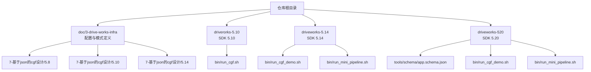
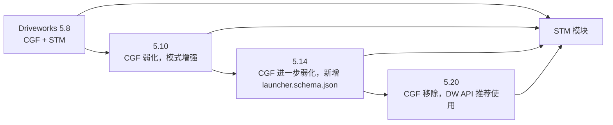
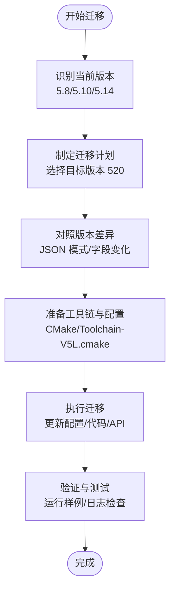
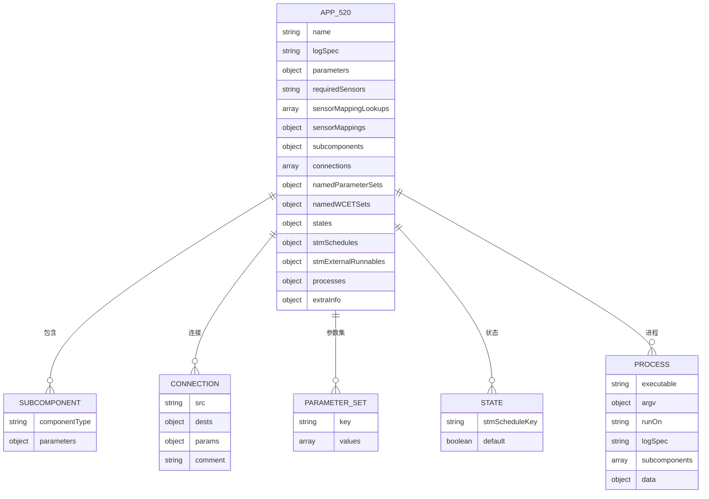
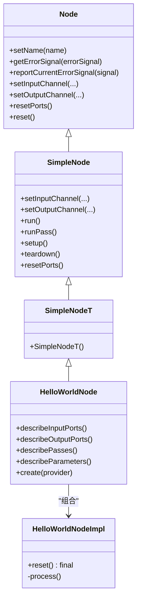
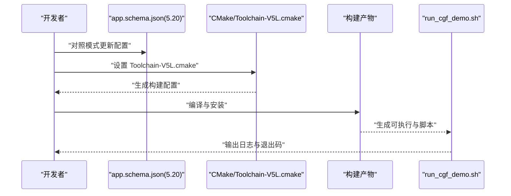
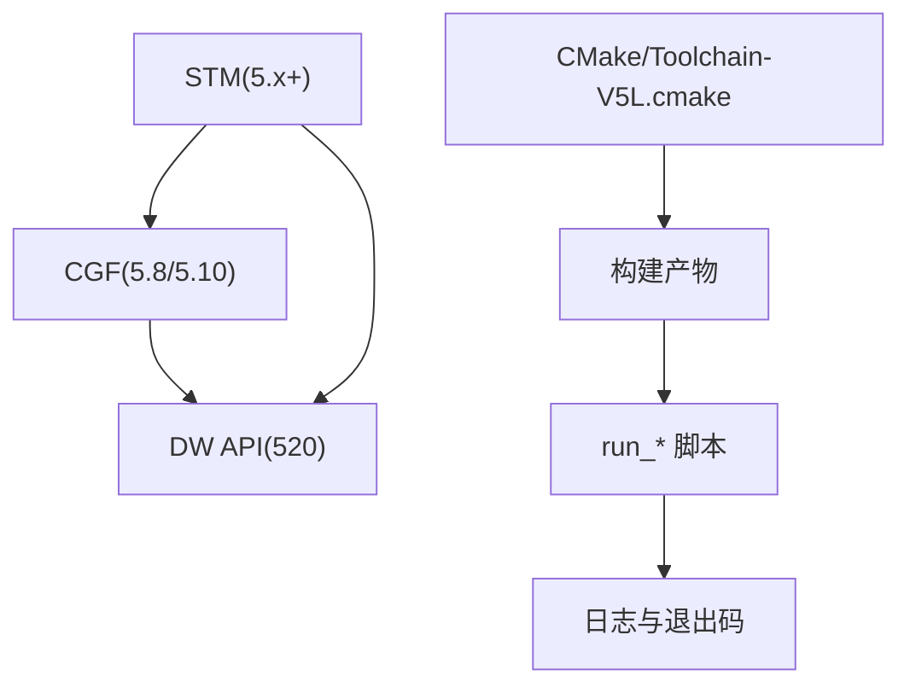

# 版本迁移和升级

<cite>
**本文引用的文件**
- [README.md](file://README.md)
- [README_en.md](file://README_en.md)
- [app.schema.json（5.10）](file://doc/3-drive-works-infra/7-基于json的cgf设计/5.10/app.schema.json)
- [app.schema.json（5.14）](file://doc/3-drive-works-infra/7-基于json的cgf设计/5.14/app.schema.json)
- [app.schema.json（5.8）](file://doc/3-drive-works-infra/7-基于json的cgf设计/5.8/app.schema.json)
- [app.schema.json（520）](file://driveworks-520/tools/schema/app.schema.json)
- [cgf-helloworld-class.pu](file://doc/3-drive-works-infra/6-cgf实例/cgf-helloworld-class.pu)
- [5-8__to__5-10_8md.html](file://driverorks-5.10/doc/nvcgf_html/5-8__to__5-10_8md.html)
- [5-10__to__5-14_8md.html](file://driveworks-5.14/doc/nvcgf_html/5-10__to__5-14_8md.html)
- [run_cgf.sh（5.10）](file://driverorks-5.10/bin/run_cgf.sh)
- [run_cgf_demo.sh（5.14）](file://driveworks-5.14/bin/run_cgf_demo.sh)
- [run_mini_pipeline.sh（5.14）](file://driveworks-5.14/bin/run_mini_pipeline.sh)
- [run_cgf_demo.sh（5.20）](file://driveworks-520/bin/run_cgf_demo.sh)
- [run_mini_pipeline.sh（5.20）](file://driveworks-520/bin/run_mini_pipeline.sh)
- [Toolchain-V5L.cmake](file://driverorks-5.10/samples/cmake/Toolchain-V5L.cmake)
- [Toolchain-V5L.cmake（5.14）](file://driveworks-5.14/samples/cmake/Toolchain-V5L.cmake)
- [Toolchain-V5L.cmake（5.20）](file://driveworks-520/samples/cmake/Toolchain-V5L.cmake)
- [driveworks-config.cmake（5.10）](file://driverorks-5.10/cmake/driveworks-config.cmake)
- [driveworks-config.cmake（5.14）](file://driveworks-5.14/cmake/driveworks-config.cmake)
- [driveworks-config.cmake（5.20）](file://driveworks-520/cmake/driveworks-config.cmake)
- [dwcgf-config.cmake（5.10）](file://driverorks-5.10/cmake/dwcgf-config.cmake)
- [dwcgf-config.cmake（5.14）](file://driveworks-5.14/cmake/dwcgf-config.cmake)
- [dwcgf-config.cmake（5.20）](file://driveworks-520/cmake/dwcgf-config.cmake)
- [dwframework-config.cmake（5.10）](file://driverorks-5.10/cmake/dwframework-config.cmake)
- [dwframework-config.cmake（5.14）](file://driveworks-5.14/cmake/dwframework-config.cmake)
- [dwframework-config.cmake（5.20）](file://driveworks-520/cmake/dwframework-config.cmake)
- [dwdynamicmemory-config.cmake（5.10）](file://driverorks-5.10/cmake/dwdynamicmemory-config.cmake)
- [dwdynamicmemory-config.cmake（5.14）](file://driveworks-5.14/cmake/dwdynamicmemory-config.cmake)
- [dwdynamicmemory-config.cmake（5.20）](file://driveworks-520/cmake/dwdynamicmemory-config.cmake)
- [driveworks-visualization-config.cmake（5.10）](file://driverorks-5.10/cmake/driveworks-visualization-config.cmake)
- [driveworks-visualization-config.cmake（5.14）](file://driveworks-5.14/cmake/driveworks-visualization-config.cmake)
- [driveworks-visualization-config.cmake（5.20）](file://driveworks-520/cmake/driveworks-visualization-config.cmake)
- [driveworks-5.10 样例 README](file://driverorks-5.10/samples/src/cgf_nodes/README.md)
- [driveworks-5.14 样例 README](file://driveworks-5.14/samples/src/cgf_nodes/README.md)
- [driveworks-5.20 样例 README](file://driveworks-520/samples/src/cgf_nodes/README.md)
</cite>

## 目录
1. [简介](#简介)
2. [项目结构](#项目结构)
3. [核心组件](#核心组件)
4. [架构总览](#架构总览)
5. [详细组件分析](#详细组件分析)
6. [依赖分析](#依赖分析)
7. [性能考虑](#性能考虑)
8. [故障排查指南](#故障排查指南)
9. [结论](#结论)
10. [附录](#附录)

## 简介
本指南面向从 Driveworks 旧版本（尤其是 5.8/5.10/5.14）迁移到 520 的用户，系统梳理版本差异、迁移路径、API 变更、配置文件更新、代码修改建议、兼容性注意事项，并提供从 CGF 到直接使用 DW API 的迁移策略与自动化工具使用方法。同时给出迁移后验证与测试建议，帮助读者在 DriveOS SDK 7.x 移除 CGF 的背景下完成平滑过渡。

## 项目结构
仓库包含多个版本的 Driveworks SDK、示例、文档与工具，便于进行版本对比与迁移实践：
- 配置文件与模式定义：doc/3-drive-works-infra/7-基于json的cgf设计 下的 5.8/5.10/5.14
- 应用与节点描述模式：driveworks-520/tools/schema 下的 app.schema.json
- 运行脚本与样例：各版本 bin 与 samples
- CMake 配置与工具链：各版本 cmake 与 Toolchain-V5L.cmake
- 文档与迁移说明：driverorks-5.10/doc/nvcgf_html 与 README 中的迁移链接

**图表来源**
- [README.md:1-115](file://README.md#L1-L115)
- [app.schema.json（5.10）](file://doc/3-drive-works-infra/7-基于json的cgf设计/5.10/app.schema.json)
- [app.schema.json（5.14）](file://doc/3-drive-works-infra/7-基于json的cgf设计/5.14/app.schema.json)
- [app.schema.json（5.8）](file://doc/3-drive-works-infra/7-基于json的cgf设计/5.8/app.schema.json)
- [app.schema.json（5.20）](file://driveworks-520/tools/schema/app.schema.json)

**章节来源**
- [README.md:1-115](file://README.md#L1-L115)

## 核心组件
- CGF（Compute Graph Framework）：5.8/5.10 提供，5.14 开始逐步弱化，520 移除；其核心是基于 JSON 的图设计与运行时执行框架。
- STM（Scheduling Middleware）：自 5.x 起保留，贯穿 5.10/5.14/520，负责任务调度与资源管理。
- DW API：520 及以后推荐直接使用，替代 CGF 的高层封装。
- 工具链与配置：CMake 配置文件与 Toolchain-V5L.cmake 用于跨平台编译与安装。

**章节来源**
- [README.md:51-62](file://README.md#L51-L62)
- [README_en.md:1-92](file://README_en.md#L1-L92)

## 架构总览
下图展示从 5.8 到 520 的演进路径与关键变化点（CGF 的引入与移除、模式文件演进、运行方式变化）：

**图表来源**
- [README.md:51-62](file://README.md#L51-L62)
- [app.schema.json（5.10）](file://doc/3-drive-works-infra/7-基于json的cgf设计/5.10/app.schema.json)
- [app.schema.json（5.14）](file://doc/3-drive-works-infra/7-基于json的cgf设计/5.14/app.schema.json)
- [app.schema.json（5.20）](file://driveworks-520/tools/schema/app.schema.json)

## 详细组件分析

### 版本差异对比（5.8 → 5.10 → 5.14 → 520）
- 5.8 → 5.10
  - CGF 文档与迁移说明：参阅 driverorks-5.10/doc/nvcgf_html/5-8__to__5-10_8md.html
  - 主要变化：JSON 模式字段调整、节点/图描述规范化、运行时行为优化
- 5.10 → 5.14
  - 新增 launcher.schema.json，强调进程级启动与服务化倾向
  - CGF 逐步弱化，更多依赖 DW API 与 STM
  - 参阅 driveworks-5.14/doc/nvcgf_html/5-10__to__5-14_8md.html
- 5.14 → 520
  - CGF 被移除，官方建议直接使用 DW API
  - app.schema.json 字段进一步演进，支持更细粒度的参数集、连接与状态机映射
  - 参阅 README.md 第 51-62 行与 5.20 的 tools/schema/app.schema.json

**图表来源**
- [README.md:51-62](file://README.md#L51-L62)
- [5-8__to__5-10_8md.html](file://driverorks-5.10/doc/nvcgf_html/5-8__to__5-10_8md.html)
- [5-10__to__5-14_8md.html](file://driveworks-5.14/doc/nvcgf_html/5-10__to__5-14_8md.html)
- [app.schema.json（5.10）](file://doc/3-drive-works-infra/7-基于json的cgf设计/5.10/app.schema.json)
- [app.schema.json（5.14）](file://doc/3-drive-works-infra/7-基于json的cgf设计/5.14/app.schema.json)
- [app.schema.json（5.20）](file://driveworks-520/tools/schema/app.schema.json)

**章节来源**
- [README.md:51-62](file://README.md#L51-L62)
- [5-8__to__5-10_8md.html](file://driverorks-5.10/doc/nvcgf_html/5-8__to__5-10_8md.html)
- [5-10__to__5-14_8md.html](file://driveworks-5.14/doc/nvcgf_html/5-10__to__5-14_8md.html)

### 配置文件更新与模式演进
- 5.8 模式要点
  - app.schema.json、node.schema.json、graphlet.schema.json、sensors.schema.json 等
  - 参数与节点描述相对简单，适合入门
- 5.10 模式要点
  - 新增 node-params.schema.json、node-wcets.schema.json、trans.schema.json 等
  - 更严格的参数校验与运行时约束
- 5.14 模式要点
  - 新增 launcher.schema.json，强调进程与服务化
  - app.schema.json 扩展 namedParameterSets、namedWCETSets、states 等
- 520 模式要点
  - app.schema.json 进一步细化参数传递、连接与状态机映射
  - 支持 sensorMappingLookups、sensorMappings、connections 等高级特性

**图表来源**
- [app.schema.json（5.20）](file://driveworks-520/tools/schema/app.schema.json)

**章节来源**
- [app.schema.json（5.8）](file://doc/3-drive-works-infra/7-基于json的cgf设计/5.8/app.schema.json)
- [app.schema.json（5.10）](file://doc/3-drive-works-infra/7-基于json的cgf设计/5.10/app.schema.json)
- [app.schema.json（5.14）](file://doc/3-drive-works-infra/7-基于json的cgf设计/5.14/app.schema.json)
- [app.schema.json（5.20）](file://driveworks-520/tools/schema/app.schema.json)

### 代码修改建议与兼容性注意事项
- CGF 节点到 DW API 的映射
  - 5.8/5.10 中的 Node/NodeT/NodeFactory 等概念在 520 中被 DW API 替代
  - 建议以类图理解节点层次与职责边界，再映射到 DW API 的组件与管线
- 参数与连接
  - 5.14/520 中的 namedParameterSets 与 connections 字段需按新 schema 对齐
  - 注意参数占位符语法与作用域（如 $paramName）
- 进程与服务
  - 5.14 引入 launcher.schema.json，520 继续强化 processes 与 services 的分离

**图表来源**
- [cgf-helloworld-class.pu](file://doc/3-drive-works-infra/6-cgf实例/cgf-helloworld-class.pu)

**章节来源**
- [cgf-helloworld-class.pu](file://doc/3-drive-works-infra/6-cgf实例/cgf-helloworld-class.pu)

### 从 CGF 到直接使用 DW API 的迁移策略
- 迁移原则
  - 将 CGF 的“图”与“节点”概念映射为 DW API 的“组件”与“管线”
  - 使用 app.schema.json 的 processes 与 connections 替代 CGF 的图连接
  - 使用 STM 的 schedules 与 states 管理执行时序
- 适配步骤
  - 以 5.14/520 的 app.schema.json 为蓝图，重构节点描述与参数传递
  - 使用 Toolchain-V5L.cmake 与 CMake 配置文件进行编译与安装
  - 通过 run_cgf_demo.sh/run_mini_pipeline.sh 启动验证

**图表来源**
- [README_en.md:13-62](file://README_en.md#L13-L62)
- [Toolchain-V5L.cmake（5.20）](file://driveworks-520/samples/cmake/Toolchain-V5L.cmake)
- [run_cgf_demo.sh（5.20）](file://driveworks-520/bin/run_cgf_demo.sh)

**章节来源**
- [README.md:51-62](file://README.md#L51-L62)
- [README_en.md:13-62](file://README_en.md#L13-L62)

### 自动化迁移工具与脚本使用
- 工具链与脚本
  - Toolchain-V5L.cmake：统一跨平台编译配置
  - run_cgf.sh/run_cgf_demo.sh/run_mini_pipeline.sh：一键运行样例
  - CMake 配置文件：driveworks-config.cmake、dwcgf-config.cmake、dwframework-config.cmake 等
- 使用建议
  - 先在本地容器或开发机上使用 README_en.md 中的构建流程验证
  - 使用 rsync 将安装产物同步至目标设备进行端到端测试

**章节来源**
- [README_en.md:13-62](file://README_en.md#L13-L62)
- [run_cgf.sh（5.10）](file://driverorks-5.10/bin/run_cgf.sh)
- [run_cgf_demo.sh（5.14）](file://driveworks-5.14/bin/run_cgf_demo.sh)
- [run_mini_pipeline.sh（5.14）](file://driveworks-5.14/bin/run_mini_pipeline.sh)
- [run_cgf_demo.sh（5.20）](file://driveworks-520/bin/run_cgf_demo.sh)
- [run_mini_pipeline.sh（5.20）](file://driveworks-520/bin/run_mini_pipeline.sh)

## 依赖分析
- 组件耦合
  - CGF 与 DW API 的关系：5.8/5.10 通过 CGF 封装 DW API；520 直接调用 DW API
  - STM 作为调度中枢，贯穿所有版本
- 外部依赖
  - CMake 配置文件与 Toolchain-V5L.cmake 提供统一构建入口
  - 样例 README 提供节点开发与编译指南

**图表来源**
- [README.md:51-62](file://README.md#L51-L62)
- [Toolchain-V5L.cmake（5.20）](file://driveworks-520/samples/cmake/Toolchain-V5L.cmake)
- [driveworks-config.cmake（5.20）](file://driveworks-520/cmake/driveworks-config.cmake)

**章节来源**
- [README.md:51-62](file://README.md#L51-L62)
- [driveworks-config.cmake（5.10）](file://driverorks-5.10/cmake/driveworks-config.cmake)
- [driveworks-config.cmake（5.14）](file://driveworks-5.14/cmake/driveworks-config.cmake)
- [driveworks-config.cmake（5.20）](file://driveworks-520/cmake/driveworks-config.cmake)

## 性能考虑
- 使用 app.schema.json 的 states 与 stmSchedules 精准控制执行周期与监控阈值
- 通过 namedWCETSets 与 monitoredPasses 对关键路径进行性能观测
- 利用 launcher.schema.json 与 processes 将 CPU/GPU/CUDA 资源合理分配

**章节来源**
- [app.schema.json（5.14）](file://doc/3-drive-works-infra/7-基于json的cgf设计/5.14/app.schema.json)
- [app.schema.json（5.20）](file://driveworks-520/tools/schema/app.schema.json)

## 故障排查指南
- 常见问题
  - NVSCI 相关通道限制与复用：参考 README_en.md 中的 nvsci 配置片段
  - Socket 大数据传输异常：参考 README_en.md 中的 socket 大数据问题说明
- 排查步骤
  - 清理日志目录后重新运行，观察 launcher 退出码
  - 对照 app.schema.json 的 required 字段与连接关系，确保参数与连接正确
  - 使用 Toolchain-V5L.cmake 重新构建，确保工具链一致

**章节来源**
- [README_en.md:64-92](file://README_en.md#L64-L92)

## 结论
- 520 及以后版本建议直接使用 DW API，避免对已移除的 CGF 的依赖
- 以 app.schema.json 为蓝图，结合 CMake/Toolchain-V5L.cmake 与 run_* 脚本，完成迁移与验证
- 关注参数集、连接与状态机映射等 5.14/520 新特性，提升系统可观测性与可控性

## 附录
- 版本迁移参考文档
  - 5.8 → 5.10：driverorks-5.10/doc/nvcgf_html/5-8__to__5-10_8md.html
  - 5.10 → 5.14：driveworks-5.14/doc/nvcgf_html/5-10__to__5-14_8md.html
- 模式文件参考
  - 5.8/5.10/5.14/520 的 app.schema.json 与相关 schema 文件
- 样例与脚本
  - 各版本 bin 与 samples 的 README 与 run_* 脚本

**章节来源**
- [README.md:51-62](file://README.md#L51-L62)
- [README_en.md:13-62](file://README_en.md#L13-L62)
- [driveworks-5.10 样例 README](file://driverorks-5.10/samples/src/cgf_nodes/README.md)
- [driveworks-5.14 样例 README](file://driveworks-5.14/samples/src/cgf_nodes/README.md)
- [driveworks-5.20 样例 README](file://driveworks-520/samples/src/cgf_nodes/README.md)