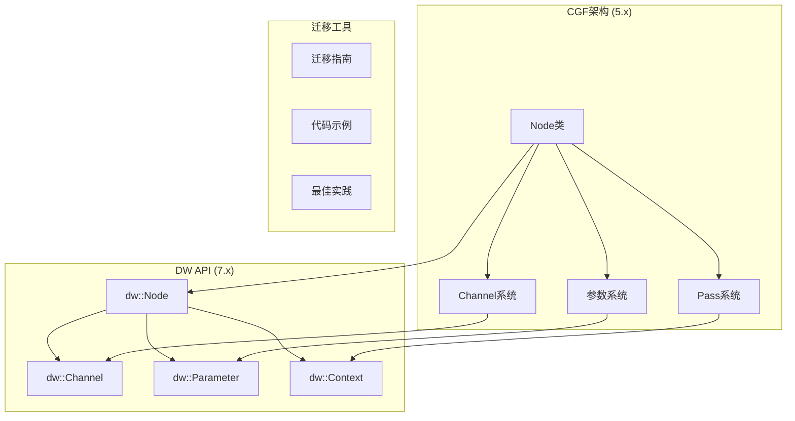
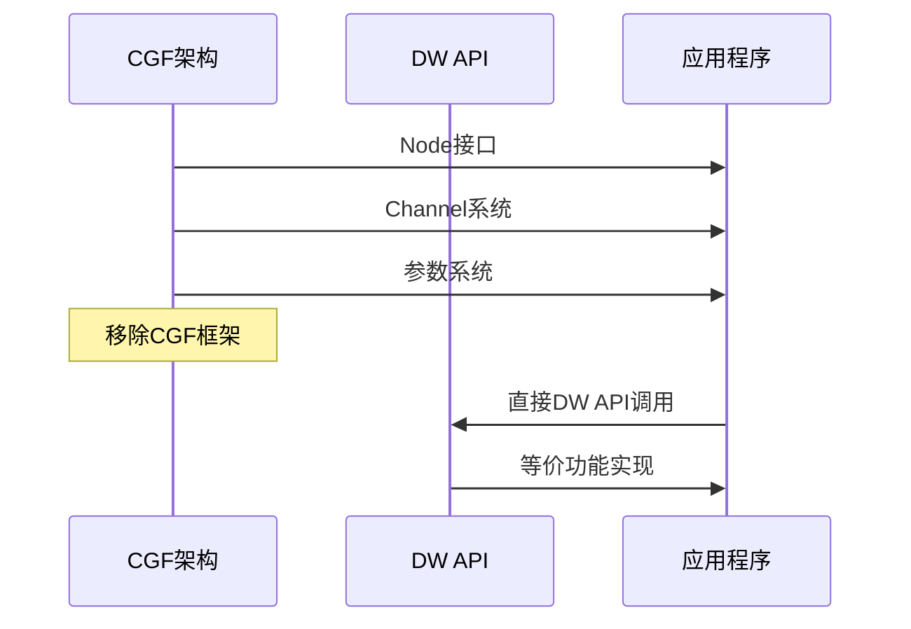
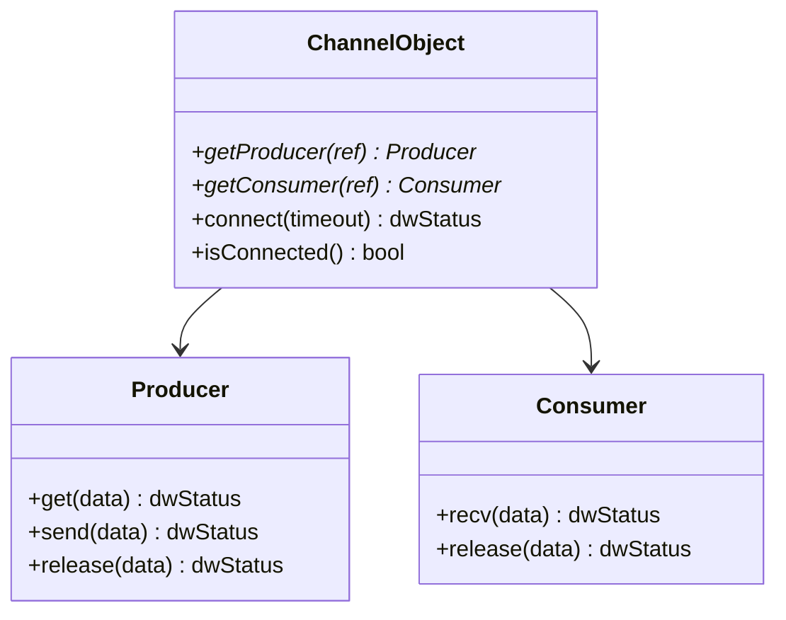
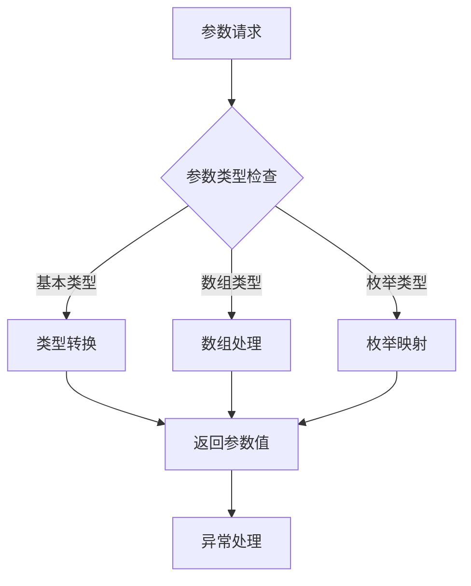
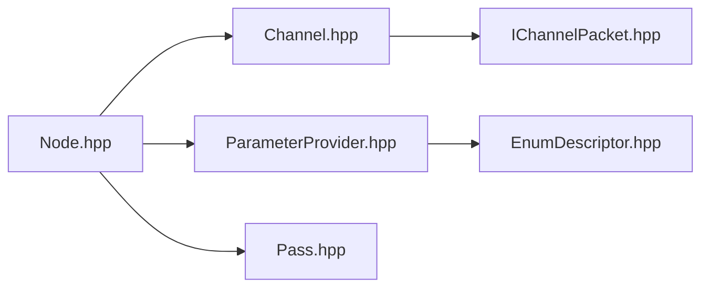
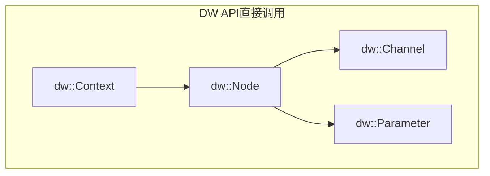

# API迁移指南

<cite>
**本文档引用的文件**
- [README.md](file://README.md)
- [Node.hpp](file://driverorks-5.10/doc/nvcgf_html/Node_8hpp_source.html)
- [Channel.hpp](file://driverorks-5.10/doc/nvcgf_html/Channel_8hpp_source.html)
- [ParameterProvider.hpp](file://driverorks-5.10/doc/nvcgf_html/ParameterProvider_8hpp_source.html)
- [5-8__to__5-10_8md.html](file://driverorks-5.10/doc/nvcgf_html/5-8__to__5-10_8md.html)
</cite>

## 目录
1. [引言](#引言)
2. [项目结构](#项目结构)
3. [核心组件](#核心组件)
4. [架构概览](#架构概览)
5. [详细组件分析](#详细组件分析)
6. [依赖关系分析](#依赖关系分析)
7. [性能考虑](#性能考虑)
8. [故障排除指南](#故障排除指南)
9. [结论](#结论)

## 引言

本指南详细阐述了从NVIDIA DriveWorks SDK 5.x的Compute Graph Framework (CGF)架构迁移到DriveOS 7.x中直接使用DW API的过程。根据官方文档，DriveOS 7.x移除了CGF框架，仅保留调度中间件STM，开发者需要直接使用DW API进行开发。

迁移的核心挑战在于：
- CGF的Node抽象被移除，需要直接使用DW API
- 通道系统需要重新设计
- 参数系统需要重构
- 数据流设计需要调整

## 项目结构

基于仓库内容，主要涉及以下关键组件：



**图表来源**
- [README.md:51-63](file://README.md#L51-L63)
- [Node.hpp:166-230](file://driverorks-5.10/doc/nvcgf_html/Node_8hpp_source.html#L166-L230)

**章节来源**
- [README.md:51-63](file://README.md#L51-L63)

## 核心组件

### CGF架构组件

CGF架构提供了完整的计算图框架，包含以下核心组件：

#### Node类体系
- 基础Node接口定义
- 传感器节点扩展
- 重置机制支持
- 健康状态监控

#### 通道系统
- ChannelObject基础类
- 生产者/消费者模式
- 同步机制
- 数据包管理

#### 参数系统
- ParameterProvider接口
- 类型安全的参数访问
- 枚举类型支持
- 数组参数处理

**章节来源**
- [Node.hpp:166-230](file://driverorks-5.10/doc/nvcgf_html/Node_8hpp_source.html#L166-L230)
- [Channel.hpp:154-222](file://driverorks-5.10/doc/nvcgf_html/Channel_8hpp_source.html#L154-L222)
- [ParameterProvider.hpp:152-538](file://driverorks-5.10/doc/nvcgf_html/ParameterProvider_8hpp_source.html#L152-L538)

## 架构概览

从CGF到DW API的迁移架构如下：



**图表来源**
- [README.md:57-62](file://README.md#L57-L62)

## 详细组件分析

### Node类到dw::Node的映射

#### CGF Node接口
```cpp
// CGF Node接口示例
class Node {
    virtual dwStatus setInputChannel(ChannelObject* channel, uint8_t portID) = 0;
    virtual dwStatus setOutputChannel(ChannelObject* channel, uint8_t portID) = 0;
    virtual dwStatus run() = 0;
    virtual dwStatus validate() = 0;
};
```

#### DW API对应实现
在DriveOS 7.x中，需要直接使用DW API的相应功能，包括：
- 直接的节点创建和管理
- 通道的直接配置和使用
- 参数的直接访问和设置

**章节来源**
- [Node.hpp:166-230](file://driverorks-5.10/doc/nvcgf_html/Node_8hpp_source.html#L166-L230)

### 通道系统转换

#### CGF通道架构


**图表来源**
- [Channel.hpp:154-222](file://driverorks-5.10/doc/nvcgf_html/Channel_8hpp_source.html#L154-L222)

#### DW API通道实现
在新的架构中，通道系统需要重新设计：
- 使用DW API的直接通道创建
- 简化的生产者/消费者模式
- 集成的同步机制

**章节来源**
- [Channel.hpp:154-222](file://driverorks-5.10/doc/nvcgf_html/Channel_8hpp_source.html#L154-L222)

### 参数系统迁移

#### CGF参数访问模式


**图表来源**
- [ParameterProvider.hpp:164-301](file://driverorks-5.10/doc/nvcgf_html/ParameterProvider_8hpp_source.html#L164-L301)

#### DW API参数接口
迁移时需要注意的关键点：
- 类型安全的参数访问
- 固定字符串的特殊处理
- 枚举类型的自动映射
- 数组参数的边界检查

**章节来源**
- [ParameterProvider.hpp:164-301](file://driverorks-5.10/doc/nvcgf_html/ParameterProvider_8hpp_source.html#L164-L301)

## 依赖关系分析

### 迁移前的依赖关系



**图表来源**
- [Node.hpp:136-148](file://driverorks-5.10/doc/nvcgf_html/Node_8hpp_source.html#L136-L148)
- [Channel.hpp:136-141](file://driverorks-5.10/doc/nvcgf_html/Channel_8hpp_source.html#L136-L141)
- [ParameterProvider.hpp:136-144](file://driverorks-5.10/doc/nvcgf_html/ParameterProvider_8hpp_source.html#L136-L144)

### 迁移后的简化架构



**图表来源**
- [README.md:57-62](file://README.md#L57-L62)

**章节来源**
- [Node.hpp:136-148](file://driverorks-5.10/doc/nvcgf_html/Node_8hpp_source.html#L136-L148)
- [Channel.hpp:136-141](file://driverorks-5.10/doc/nvcgf_html/Channel_8hpp_source.html#L136-L141)
- [ParameterProvider.hpp:136-144](file://driverorks-5.10/doc/nvcgf_html/ParameterProvider_8hpp_source.html#L136-L144)

## 性能考虑

### 迁移性能影响

1. **减少抽象层次**
   - 直接API调用减少了中间层开销
   - 提高了执行效率

2. **内存管理优化**
   - 简化了对象生命周期管理
   - 减少了不必要的资源分配

3. **并发处理改进**
   - 更好的多线程支持
   - 优化的同步机制

### 最佳实践建议

1. **数据流设计**
   - 使用直接的DW API调用
   - 优化数据传输路径
   - 实现高效的缓冲区管理

2. **错误处理**
   - 实现完善的异常处理机制
   - 添加适当的超时控制
   - 实现优雅的降级策略

3. **性能监控**
   - 集成性能计数器
   - 实现实时监控
   - 添加性能分析工具

## 故障排除指南

### 常见迁移问题

#### 1. 接口兼容性问题
- **问题**: CGF特有的接口在DW API中不存在
- **解决方案**: 查找对应的DW API替代方案
- **参考**: [README.md:57-58](file://README.md#L57-L58)

#### 2. 参数访问差异
- **问题**: 参数系统的类型安全要求更高
- **解决方案**: 使用模板特化和类型检查
- **参考**: [ParameterProvider.hpp:164-301](file://driverorks-5.10/doc/nvcgf_html/ParameterProvider_8hpp_source.html#L164-L301)

#### 3. 通道配置复杂度
- **问题**: 通道系统的配置更加直接但也更复杂
- **解决方案**: 使用工厂模式简化配置
- **参考**: [Channel.hpp:154-222](file://driverorks-5.10/doc/nvcgf_html/Channel_8hpp_source.html#L154-L222)

### 调试技巧

1. **分阶段测试**
   - 先测试单个组件
   - 逐步集成其他组件
   - 验证每个阶段的正确性

2. **性能基准测试**
   - 建立性能基线
   - 比较迁移前后的性能
   - 识别性能瓶颈

3. **日志记录**
   - 实现详细的日志系统
   - 记录关键操作和状态变化
   - 便于问题诊断

**章节来源**
- [README.md:57-58](file://README.md#L57-L58)
- [ParameterProvider.hpp:164-301](file://driverorks-5.10/doc/nvcgf_html/ParameterProvider_8hpp_source.html#L164-L301)
- [Channel.hpp:154-222](file://driverorks-5.10/doc/nvcgf_html/Channel_8hpp_source.html#L154-L222)

## 结论

从CGF架构迁移到DriveOS 7.x的DW API是一个重要的技术升级过程。虽然移除了CGF框架简化了架构，但也要求开发者直接使用底层API，这带来了更高的灵活性但也增加了复杂性。

### 关键要点总结

1. **架构简化**: 移除了中间层，提高了执行效率
2. **接口直接化**: 开发者可以直接控制底层资源
3. **类型安全**: 新的参数系统提供了更好的类型安全保障
4. **性能提升**: 减少了抽象层开销，提高了整体性能

### 迁移建议

1. **渐进式迁移**: 分阶段进行，确保每一步都经过充分测试
2. **文档学习**: 仔细阅读官方文档和API参考
3. **工具利用**: 使用官方提供的迁移工具和示例代码
4. **性能验证**: 迁移后进行全面的性能测试和验证

通过遵循本指南的建议和最佳实践，开发者可以顺利完成从CGF到DW API的迁移，充分利用DriveOS 7.x的新特性和性能优势。