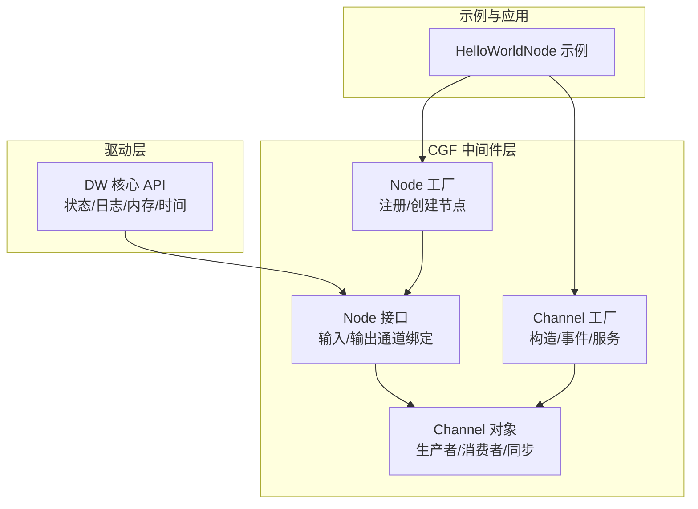
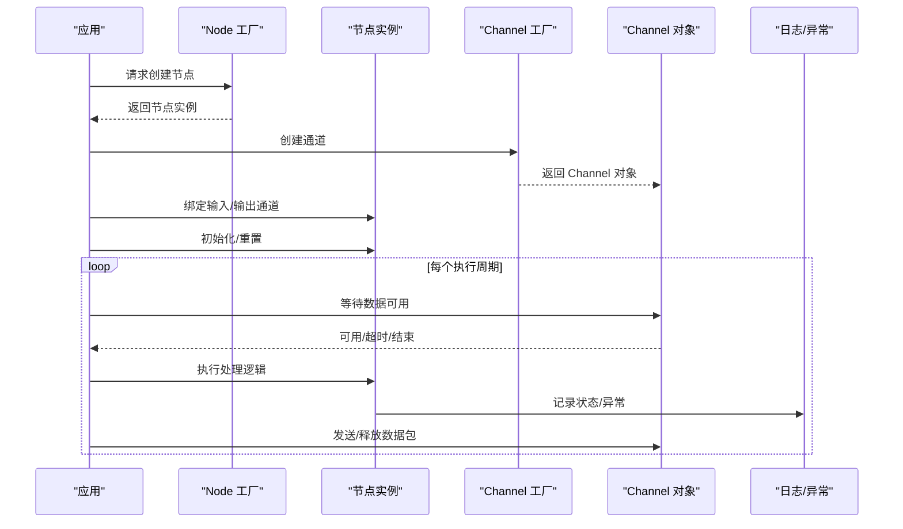
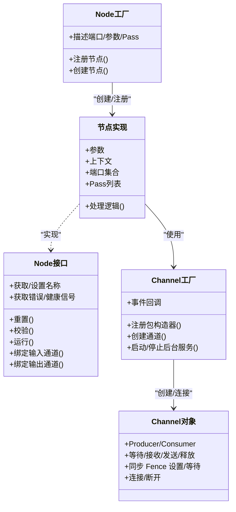
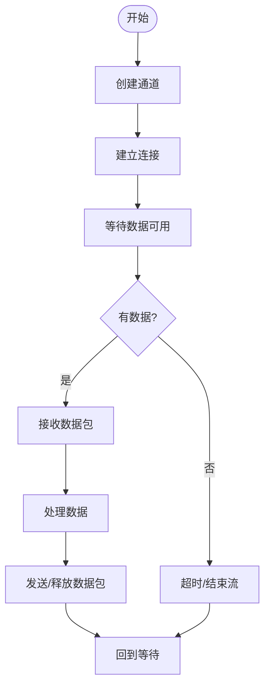
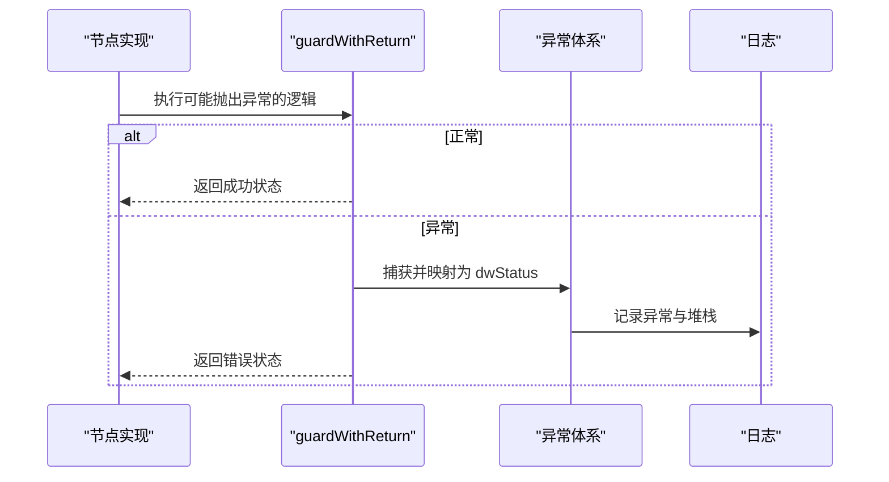
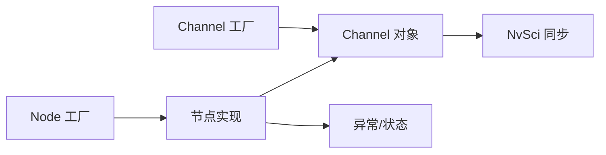

# 代码重构指南

<cite>
**本文档引用的文件**
- [README.md](file://README.md)
- [Node.hpp](file://driverorks-5.10/include/dwcgf/node/Node.hpp)
- [NodeFactory.hpp](file://driverorks-5.10/include/dwcgf/node/NodeFactory.hpp)
- [NodeConcept.hpp](file://driverorks-5.10/include/dwcgf/node/NodeConcept.hpp)
- [Channel.hpp](file://driverorks-5.10/include/dwcgf/channel/Channel.hpp)
- [ChannelFactory.hpp](file://driverorks-5.10/include/dwcgf/channel/ChannelFactory.hpp)
- [HelloWorldNode.cpp](file://driverorks-5.10/samples/src/cgf_nodes/HelloWorldNode.cpp)
- [HelloWorldNodeImpl.cpp](file://driverorks-5.10/samples/src/cgf_nodes/HelloWorldNodeImpl.cpp)
- [Exception.hpp](file://driverorks-5.10/include/dw/core/base/Exception.hpp)
</cite>

## 目录
1. [简介](#简介)
2. [项目结构](#项目结构)
3. [核心组件](#核心组件)
4. [架构总览](#架构总览)
5. [详细组件分析](#详细组件分析)
6. [依赖分析](#依赖分析)
7. [性能考虑](#性能考虑)
8. [故障排查指南](#故障排查指南)
9. [结论](#结论)
10. [附录](#附录)

## 简介
本指南面向从旧版 Driveworks（5.x）CGF 中间件迁移到直接使用 Driveworks DW API 的场景，聚焦于“节点类重构”的方法论与实操步骤。根据官方文档信息，DriveOS SDK 7.x 已移除 CGF，建议直接使用 DW API。本指南提供从 CGF Node 基类继承到直接使用 DW API 的转换路径，涵盖数据流重构、错误处理机制更新、性能优化策略与内存管理改进，并给出检查清单、自动化工具使用方法与测试验证流程，以及常见陷阱与解决方案。

## 项目结构
本仓库包含多个 Driveworks 版本（5.8/5.10/5.14/520），以及相关文档与示例。本次重构主要参考 5.10 版本中的 CGF 节点与通道框架，以及异常与工厂模式的设计，作为从 CGF 迁移到 DW API 的对照与迁移依据。

**图表来源**
- [Node.hpp:64-275](file://driverorks-5.10/include/dwcgf/node/Node.hpp#L64-L275)
- [NodeFactory.hpp:54-161](file://driverorks-5.10/include/dwcgf/node/NodeFactory.hpp#L54-L161)
- [Channel.hpp:56-274](file://driverorks-5.10/include/dwcgf/channel/Channel.hpp#L56-L274)
- [ChannelFactory.hpp:69-154](file://driverorks-5.10/include/dwcgf/channel/ChannelFactory.hpp#L69-L154)
- [HelloWorldNode.cpp:41-57](file://driverorks-5.10/samples/src/cgf_nodes/HelloWorldNode.cpp#L41-L57)

**章节来源**
- [README.md:1-115](file://README.md#L1-L115)

## 核心组件
- 节点接口与生命周期
  - 节点需实现重置、校验、运行、通道绑定、健康信号上报等接口，支持多 Pass 执行与参数化配置。
- 节点工厂与元描述
  - 通过工厂注册节点类，提供输入/输出端口、参数、Pass 的静态描述，便于动态创建与配置。
- 通道系统
  - ChannelObject 提供 Producer/Consumer 接口，支持等待/接收/发送/释放数据包，以及 NvSci 同步 Fence 的设置与等待。
- 异常与状态
  - 统一的异常体系与 guard 模式，将底层异常映射为 dwStatus，便于统一处理与日志记录。

**章节来源**
- [Node.hpp:64-275](file://driverorks-5.10/include/dwcgf/node/Node.hpp#L64-L275)
- [NodeFactory.hpp:54-161](file://driverorks-5.10/include/dwcgf/node/NodeFactory.hpp#L54-L161)
- [Channel.hpp:56-274](file://driverorks-5.10/include/dwcgf/channel/Channel.hpp#L56-L274)
- [Exception.hpp:52-335](file://driverorks-5.10/include/dw/core/base/Exception.hpp#L52-L335)

## 架构总览
下图展示从 CGF Node 到 DW API 的重构路径：节点类不再继承 CGF Node 基类，而是直接使用 DW API 的上下文、通道与工厂能力；通道对象通过 ChannelFactory 创建并连接；异常与状态通过统一的异常体系进行处理。

**图表来源**
- [NodeFactory.hpp:130-161](file://driverorks-5.10/include/dwcgf/node/NodeFactory.hpp#L130-L161)
- [ChannelFactory.hpp:99-135](file://driverorks-5.10/include/dwcgf/channel/ChannelFactory.hpp#L99-L135)
- [Channel.hpp:116-207](file://driverorks-5.10/include/dwcgf/channel/Channel.hpp#L116-L207)
- [Exception.hpp:198-289](file://driverorks-5.10/include/dw/core/base/Exception.hpp#L198-L289)

## 详细组件分析

### 节点类重构：从 CGF Node 基类到 DW API
- 迁移目标
  - 移除对 dw::framework::Node 的继承，改为直接使用 DW API 的上下文、通道与日志能力。
  - 使用 Node 工厂的静态描述能力（输入/输出端口、参数、Pass）进行注册与创建，但节点内部逻辑直接调用 DW API。
- 关键步骤
  - 抽象节点职责：将原 Node 的 run/validate/setInputChannel/setOutputChannel 等接口替换为直接调用 DW API 的实现。
  - 参数与端口描述：保留 describeInputPorts/describeOutputPorts/describeParameters/describePasses 的静态描述，以便工厂正确创建与配置。
  - 通道绑定：通过 ChannelFactory 创建 Channel 对象，再在节点初始化阶段完成 Producer/Consumer 接口获取与连接。
  - 异常处理：使用 guardWithReturn/guard 将底层异常映射为 dwStatus，确保统一的日志与返回码。
- 示例参考
  - HelloWorldNode 通过 create 静态函数与 DW_REGISTER_NODE 注册，节点内部通过 NODE_INIT_* 与 NODE_REGISTER_PASS 宏组织端口与 Pass。

**图表来源**
- [Node.hpp:64-275](file://driverorks-5.10/include/dwcgf/node/Node.hpp#L64-L275)
- [NodeFactory.hpp:54-161](file://driverorks-5.10/include/dwcgf/node/NodeFactory.hpp#L54-L161)
- [ChannelFactory.hpp:69-154](file://driverorks-5.10/include/dwcgf/channel/ChannelFactory.hpp#L69-L154)
- [Channel.hpp:56-274](file://driverorks-5.10/include/dwcgf/channel/Channel.hpp#L56-L274)

**章节来源**
- [Node.hpp:64-275](file://driverorks-5.10/include/dwcgf/node/Node.hpp#L64-L275)
- [NodeFactory.hpp:54-161](file://driverorks-5.10/include/dwcgf/node/NodeFactory.hpp#L54-L161)
- [NodeConcept.hpp:45-93](file://driverorks-5.10/include/dwcgf/node/NodeConcept.hpp#L45-L93)
- [HelloWorldNode.cpp:41-57](file://driverorks-5.10/samples/src/cgf_nodes/HelloWorldNode.cpp#L41-L57)
- [HelloWorldNodeImpl.cpp:41-87](file://driverorks-5.10/samples/src/cgf_nodes/HelloWorldNodeImpl.cpp#L41-L87)

### 数据流重构
- 通道生命周期
  - 在节点初始化阶段通过 ChannelFactory 创建 Channel，随后调用 connect 建立上下游连接。
  - 生产者侧通过 Producer::get 获取可写数据包，填充后 send；消费者侧通过 Consumer::recv 获取只读数据包，处理后 release。
- 等待与回调
  - 使用 PacketPool::wait 等待数据可用，或设置 OnDataReady 回调以异步通知。
  - 对于 NvSci 同步，通过 SyncClient/SyncWaiter/SyncSignaler 获取/设置 Fence，保证跨进程/跨设备的数据一致性。
- 错误传播
  - 通道操作返回 dwStatus，结合异常体系统一处理；健康信号与错误信号通过节点接口上报。

**图表来源**
- [ChannelFactory.hpp:99-135](file://driverorks-5.10/include/dwcgf/channel/ChannelFactory.hpp#L99-L135)
- [Channel.hpp:116-207](file://driverorks-5.10/include/dwcgf/channel/Channel.hpp#L116-L207)

**章节来源**
- [Channel.hpp:116-207](file://driverorks-5.10/include/dwcgf/channel/Channel.hpp#L116-L207)
- [ChannelFactory.hpp:99-135](file://driverorks-5.10/include/dwcgf/channel/ChannelFactory.hpp#L99-L135)

### 错误处理机制更新
- 统一异常模型
  - 使用 ExceptionWithStatus/Exception 捕获底层异常并映射为 dwStatus；guardWithReturn/guard 提供模板化的 try/catch 包装。
  - 支持 CUDA 错误、缓冲区满/空、越界、无效参数等常见异常类型映射。
- 日志与追踪
  - 异常包含状态名与消息，支持堆栈追踪；getLastException 可获取最近一次被捕获的异常信息。
- 节点级健康与错误信号
  - 节点实现 reportCurrentErrorSignal/reportCurrentHealthSignal 上报当前模块状态，供框架聚合。

**图表来源**
- [Exception.hpp:198-289](file://driverorks-5.10/include/dw/core/base/Exception.hpp#L198-L289)

**章节来源**
- [Exception.hpp:52-335](file://driverorks-5.10/include/dw/core/base/Exception.hpp#L52-L335)

### 性能优化策略与内存管理改进
- 通道池与零拷贝
  - 使用 ChannelFactory 管理通道包构造器，减少重复分配；合理设置通道参数以降低内存占用与拷贝次数。
- 异步通知与批量处理
  - 通过 OnDataReady 回调减少轮询开销；在处理逻辑中尽量批量发送/释放数据包。
- 内存与上下文
  - 使用 DW 上下文进行资源管理，避免跨线程共享未受控的裸指针；在节点析构时确保通道断开与资源回收。
- 同步与 Fence
  - 正确设置/等待 NvSci Fence，避免不必要的阻塞；在多设备/多进程场景中最小化同步粒度。

**章节来源**
- [ChannelFactory.hpp:99-135](file://driverorks-5.10/include/dwcgf/channel/ChannelFactory.hpp#L99-L135)
- [Channel.hpp:64-111](file://driverorks-5.10/include/dwcgf/channel/Channel.hpp#L64-L111)

## 依赖分析
- 组件耦合
  - 节点与通道：节点依赖通道对象进行数据交换；通道依赖工厂与上下文。
  - 工厂与节点：工厂提供静态描述与实例创建；节点实现具体业务逻辑。
- 外部依赖
  - NvSci 同步模块用于跨进程/跨设备同步；日志与状态系统贯穿异常与健康信号。
- 循环依赖规避
  - 通过抽象接口与工厂注册避免编译期循环依赖；运行时通过指针传递避免运行期循环。

**图表来源**
- [NodeFactory.hpp:54-161](file://driverorks-5.10/include/dwcgf/node/NodeFactory.hpp#L54-L161)
- [ChannelFactory.hpp:69-154](file://driverorks-5.10/include/dwcgf/channel/ChannelFactory.hpp#L69-L154)
- [Channel.hpp:56-111](file://driverorks-5.10/include/dwcgf/channel/Channel.hpp#L56-L111)

**章节来源**
- [NodeFactory.hpp:54-161](file://driverorks-5.10/include/dwcgf/node/NodeFactory.hpp#L54-L161)
- [ChannelFactory.hpp:69-154](file://driverorks-5.10/include/dwcgf/channel/ChannelFactory.hpp#L69-L154)

## 性能考虑
- 减少上下文切换：将通道连接与参数配置集中在初始化阶段，避免运行时频繁创建/销毁。
- 合理设置超时：wait/connect 的超时应与系统调度周期匹配，避免过长导致延迟，过短导致忙等。
- 批量与流水线：在处理逻辑中采用批量发送/接收，配合多 Pass 实现流水线化。
- 缓冲区管理：监控缓冲区满/空状态，及时调整生产速率或增加缓冲容量。

## 故障排查指南
- 常见问题
  - 通道未连接：检查 connect 是否成功，确认上下游端点一致。
  - 数据不可用/超时：确认 Producer/Consumer 生命周期与 wait/send/release 的配对。
  - 异常状态不一致：通过 getLastException 获取最近异常，结合日志定位根因。
- 调试建议
  - 开启详细日志，记录每个 Pass 的输入/输出与状态码。
  - 使用健康信号与错误信号接口，定期上报节点状态，便于集中诊断。

**章节来源**
- [Exception.hpp:295-335](file://driverorks-5.10/include/dw/core/base/Exception.hpp#L295-L335)
- [Channel.hpp:238-274](file://driverorks-5.10/include/dwcgf/channel/Channel.hpp#L238-L274)

## 结论
从 CGF Node 基类到直接使用 DW API 的重构，本质是将“中间件封装”下沉为“API 直连”，同时保留工厂与描述能力以维持可配置性与可扩展性。通过统一的异常与状态体系、严格的通道生命周期管理与合理的性能优化策略，可以在保持功能完整性的同时提升系统的稳定性与可维护性。

## 附录

### 代码重构检查清单
- 节点层
  - 是否移除对 dw::framework::Node 的继承？
  - 是否保留 describeInputPorts/describeOutputPorts/describeParameters/describePasses 的静态描述？
  - 是否通过 Node 工厂注册节点并支持动态创建？
- 通道层
  - 是否使用 ChannelFactory 创建/连接通道？
  - Producer/Consumer 接口是否正确获取与使用？
  - 等待/接收/发送/释放流程是否成对出现？
- 异常与日志
  - 是否使用 guardWithReturn/guard 包裹关键逻辑？
  - 是否记录并上报健康/错误信号？
- 性能与内存
  - 是否减少不必要的上下文切换与拷贝？
  - 是否合理设置超时与批量大小？
  - 是否在析构时断开通道并释放资源？

### 自动化重构工具使用方法
- 描述生成
  - 使用官方工具生成节点描述与桩代码，减少手写样板代码的工作量。
- 单元测试与集成测试
  - 为每个节点编写单元测试，覆盖正常路径与异常路径；使用最小化样例验证通道连接与数据流。
- 静态分析与覆盖率
  - 引入静态分析工具检查异常处理与资源释放；统计测试覆盖率，确保关键分支被覆盖。

### 重构后的测试验证流程
- 单元测试
  - 验证节点的参数解析、端口初始化与 Pass 执行。
- 集成测试
  - 搭建最小数据流，验证通道连接、数据收发与同步 Fence 的正确性。
- 回归测试
  - 对比重构前后的行为与性能指标，确保功能与性能不退化。