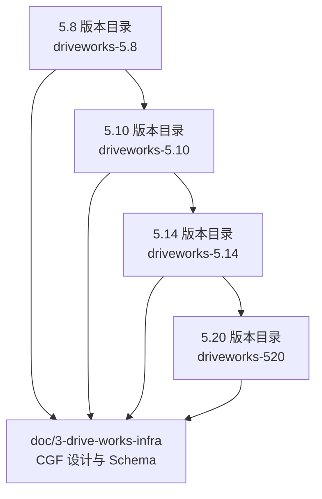
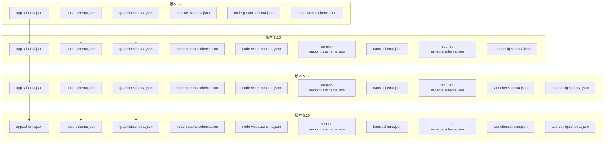
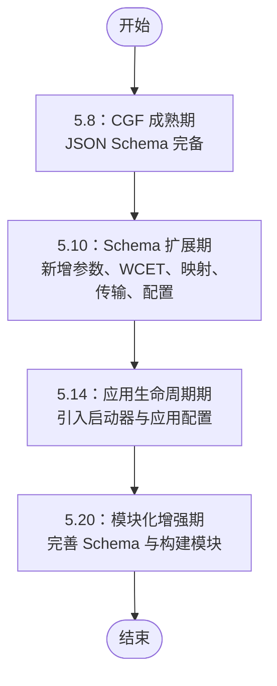
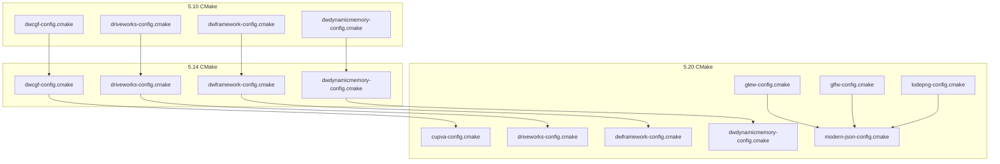

# 版本差异对比

<cite>
**本文引用的文件**
- [README.md](file://README.md)
- [README_en.md](file://README_en.md)
- [app.schema.json (5.8)](file://doc/3-drive-works-infra/6-cgf实例/7-基于json的cgf设计/5.8/app.schema.json)
- [node.schema.json (5.8)](file://doc/3-drive-works-infra/6-cgf实例/7-基于json的cgf设计/5.8/node.schema.json)
- [graphlet.schema.json (5.8)](file://doc/3-drive-works-infra/6-cgf实例/7-基于json的cgf设计/5.8/graphlet.schema.json)
- [sensors.schema.json (5.8)](file://doc/3-drive-works-infra/6-cgf实例/7-基于json的cgf设计/5.8/sensors.schema.json)
- [node-param.schema.json (5.8)](file://doc/3-drive-works-infra/6-cgf实例/7-基于json的cgf设计/5.8/node-param.schema.json)
- [node-wcets.schema.json (5.8)](file://doc/3-drive-works-infra/6-cgf实例/7-基于json的cgf设计/5.8/node-wcets.schema.json)
- [app.schema.json (5.10)](file://doc/3-drive-works-infra/6-cgf实例/7-基于json的cgf设计/5.10/app.schema.json)
- [node.schema.json (5.10)](file://doc/3-drive-works-infra/6-cgf实例/7-基于json的cgf设计/5.10/node.schema.json)
- [graphlet.schema.json (5.10)](file://doc/3-drive-works-infra/6-cgf实例/7-基于json的cgf设计/5.10/graphlet.schema.json)
- [node-params.schema.json (5.10)](file://doc/3-drive-works-infra/6-cgf实例/7-基于json的cgf设计/5.10/node-params.schema.json)
- [node-wcets.schema.json (5.10)](file://doc/3-drive-works-infra/6-cgf实例/7-基于json的cgf设计/5.10/node-wcets.schema.json)
- [sensor-mappings.schema.json (5.10)](file://doc/3-drive-works-infra/6-cgf实例/7-基于json的cgf设计/5.10/sensor-mappings.schema.json)
- [trans.schema.json (5.10)](file://doc/3-drive-works-infra/6-cgf实例/7-基于json的cgf设计/5.10/trans.schema.json)
- [required-sensors.schema.json (5.10)](file://doc/3-drive-works-infra/6-cgf实例/7-基于json的cgf设计/5.10/required-sensors.schema.json)
- [app-config.schema.json (5.10)](file://doc/3-drive-works-infra/6-cgf实例/7-基于json的cgf设计/5.10/app-config.schema.json)
- [app.schema.json (5.14)](file://doc/3-drive-works-infra/6-cgf实例/7-基于json的cgf设计/5.14/app.schema.json)
- [node.schema.json (5.14)](file://doc/3-drive-works-infra/6-cgf实例/7-基于json的cgf设计/5.14/node.schema.json)
- [graphlet.schema.json (5.14)](file://doc/3-drive-works-infra/6-cgf实例/7-基于json的cgf设计/5.14/graphlet.schema.json)
- [node-params.schema.json (5.14)](file://doc/3-drive-works-infra/6-cgf实例/7-基于json的cgf设计/5.14/node-params.schema.json)
- [node-wcets.schema.json (5.14)](file://doc/3-drive-works-infra/6-cgf实例/7-基于json的cgf设计/5.14/node-wcets.schema.json)
- [sensor-mappings.schema.json (5.14)](file://doc/3-drive-works-infra/6-cgf实例/7-基于json的cgf设计/5.14/sensor-mappings.schema.json)
- [trans.schema.json (5.14)](file://doc/3-drive-works-infra/6-cgf实例/7-基于json的cgf设计/5.14/trans.schema.json)
- [required-sensors.schema.json (5.14)](file://doc/3-drive-works-infra/6-cgf实例/7-基于json的cgf设计/5.14/required-sensors.schema.json)
- [launcher.schema.json (5.14)](file://doc/3-drive-works-infra/6-cgf实例/7-基于json的cgf设计/5.14/launcher.schema.json)
- [app-config.schema.json (5.14)](file://doc/3-drive-works-infra/6-cgf实例/7-基于json的cgf设计/5.14/app-config.schema.json)
- [app.schema.json (5.20)](file://driveworks-520/tools/schema/app.schema.json)
- [node.schema.json (5.20)](file://driveworks-520/tools/schema/node.schema.json)
- [graphlet.schema.json (5.20)](file://driveworks-520/tools/schema/graphlet.schema.json)
- [node-params.schema.json (5.20)](file://driveworks-520/tools/schema/node-params.schema.json)
- [node-wcets.schema.json (5.20)](file://driveworks-520/tools/schema/node-wcets.schema.json)
- [sensor-mappings.schema.json (5.20)](file://driveworks-520/tools/schema/sensor-mappings.schema.json)
- [trans.schema.json (5.20)](file://driveworks-520/tools/schema/trans.schema.json)
- [required-sensors.schema.json (5.20)](file://driveworks-520/tools/schema/required-sensors.schema.json)
- [launcher.schema.json (5.20)](file://driveworks-520/tools/schema/launcher.schema.json)
- [app-config.schema.json (5.20)](file://driveworks-520/tools/schema/app-config.schema.json)
- [dwcgf-config.cmake (5.10)](file://driverorks-5.10/cmake/dwcgf-config.cmake)
- [dwcgf-config.cmake (5.14)](file://driveworks-5.14/cmake/dwcgf-config.cmake)
- [dwcgf-config.cmake (5.20)](file://driveworks-520/cmake/dwcgf-config.cmake)
- [driveworks-config.cmake (5.10)](file://driverorks-5.10/cmake/driveworks-config.cmake)
- [driveworks-config.cmake (5.14)](file://driveworks-5.14/cmake/driveworks-config.cmake)
- [driveworks-config.cmake (5.20)](file://driveworks-520/cmake/driveworks-config.cmake)
- [dwframework-config.cmake (5.10)](file://driverorks-5.10/cmake/dwframework-config.cmake)
- [dwframework-config.cmake (5.14)](file://driveworks-5.14/cmake/dwframework-config.cmake)
- [dwframework-config.cmake (5.20)](file://driveworks-520/cmake/dwframework-config.cmake)
- [dwdynamicmemory-config.cmake (5.10)](file://driverorks-5.10/cmake/dwdynamicmemory-config.cmake)
- [dwdynamicmemory-config.cmake (5.14)](file://driveworks-5.14/cmake/dwdynamicmemory-config.cmake)
- [dwdynamicmemory-config.cmake (5.20)](file://driveworks-520/cmake/dwdynamicmemory-config.cmake)
- [driveworks-5.8 CMakeLists.txt](file://driveworks-5.8/samples/CMakeLists.txt)
- [driveworks-5.10 CMakeLists.txt](file://driveworks-5.10/samples/CMakeLists.txt)
- [driveworks-5.14 CMakeLists.txt](file://driveworks-5.14/samples/CMakeLists.txt)
- [driveworks-5.20 CMakeLists.txt](file://driveworks-520/samples/CMakeLists.txt)
</cite>

## 目录
1. [简介](#简介)
2. [项目结构](#项目结构)
3. [核心组件](#核心组件)
4. [架构总览](#架构总览)
5. [详细组件分析](#详细组件分析)
6. [依赖分析](#依赖分析)
7. [性能考虑](#性能考虑)
8. [故障排查指南](#故障排查指南)
9. [结论](#结论)
10. [附录](#附录)

## 简介
本文件聚焦于 Driveworks 从 5.8 到 5.10、5.10 到 5.14、以及 5.14 到 5.20 的版本差异，系统梳理 CGF（Compute Graph Framework）架构的演进路径，涵盖 API 变更、数据结构变化、配置文件格式更新、构建系统变化与发布说明摘要。目标是帮助开发者快速理解各版本间的差异，指导迁移与升级。

## 项目结构
- 仓库包含三个主要版本目录：driveworks-5.8、driveworks-5.10、driveworks-5.14，以及一个后续版本分支 driveworks-520。
- 文档与示例分布在各版本目录下，同时在 doc/3-drive-works-infra 中提供跨版本的 CGF 设计与 JSON Schema。
- 构建系统以 CMake 配置为主，随版本迭代引入新的模块与配置文件。

章节来源
- [README.md: 1-115:1-115](file://README.md#L1-L115)

## 核心组件
- CGF 应用与图谱定义：应用(app)、图元(graphlet)、节点(node)、传感器(required-sensors)、传输(trans)、参数(node-params)、WCET(node-wcets)、传感器映射(sensor-mappings)、启动器(launcher)、应用配置(app-config)。
- 构建系统：dwcgf-config.cmake、driveworks-config.cmake、dwframework-config.cmake、dwdynamicmemory-config.cmake。
- 示例与工具：samples 目录下的 CMakeLists.txt 与生成的调度 YAML、STM 文件。

章节来源
- [README_en.md: 1-92:1-92](file://README_en.md#L1-L92)

## 架构总览
- 5.8：CGF 已成熟，提供完整的 JSON Schema 与文档；构建系统以传统 CMake 模块为主。
- 5.10：引入更多 Schema 字段与参数化能力，强调基于 JSON 的 CGF 设计；构建系统保持稳定。
- 5.14：新增 launcher 与 app-config 的 Schema，强调应用级配置与启动流程；CGF 仍为核心。
- 5.20：继续完善 Schema，新增部分模块配置文件，如 cupva-config.cmake、glew-config.cmake、glfw-config.cmake、lodepng-config.cmake、modern-json-config.cmake。

图表来源
- [app.schema.json (5.8)](file://doc/3-drive-works-infra/6-cgf实例/7-基于json的cgf设计/5.8/app.schema.json)
- [node.schema.json (5.8)](file://doc/3-drive-works-infra/6-cgf实例/7-基于json的cgf设计/5.8/node.schema.json)
- [graphlet.schema.json (5.8)](file://doc/3-drive-works-infra/6-cgf实例/7-基于json的cgf设计/5.8/graphlet.schema.json)
- [app.schema.json (5.10)](file://doc/3-drive-works-infra/6-cgf实例/7-基于json的cgf设计/5.10/app.schema.json)
- [node.schema.json (5.10)](file://doc/3-drive-works-infra/6-cgf实例/7-基于json的cgf设计/5.10/node.schema.json)
- [graphlet.schema.json (5.10)](file://doc/3-drive-works-infra/6-cgf实例/7-基于json的cgf设计/5.10/graphlet.schema.json)
- [app.schema.json (5.14)](file://doc/3-drive-works-infra/6-cgf实例/7-基于json的cgf设计/5.14/app.schema.json)
- [node.schema.json (5.14)](file://doc/3-drive-works-infra/6-cgf实例/7-基于json的cgf设计/5.14/node.schema.json)
- [graphlet.schema.json (5.14)](file://doc/3-drive-works-infra/6-cgf实例/7-基于json的cgf设计/5.14/graphlet.schema.json)
- [app.schema.json (5.20)](file://driveworks-520/tools/schema/app.schema.json)
- [node.schema.json (5.20)](file://driveworks-520/tools/schema/node.schema.json)
- [graphlet.schema.json (5.20)](file://driveworks-520/tools/schema/graphlet.schema.json)

## 详细组件分析

### 5.8 → 5.10：CGF 架构演进与 Schema 扩展
- 新增字段与能力
  - 引入 node-params.schema.json、node-wcets.schema.json、sensor-mappings.schema.json、trans.schema.json、required-sensors.schema.json、app-config.schema.json，强化参数化、工作负载估计、传感器映射与应用配置。
  - 保留并扩展 node.schema.json、graphlet.schema.json、app.schema.json，确保向后兼容。
- 数据结构变化
  - 节点参数与 WCET：新增独立的参数与 WCET Schema，便于更细粒度的资源规划与验证。
  - 传感器映射：新增 sensor-mappings.schema.json，统一管理传感器输入输出映射。
  - 传输模型：trans.schema.json 明确传输通道与端点约束，提升跨进程/跨节点通信的可配置性。
  - 必需传感器：required-sensors.schema.json 提升对传感器集合的约束与校验能力。
  - 应用配置：app-config.schema.json 将应用级配置与运行时参数分离，增强可维护性。
- API 与工具链
  - 5.10 的文档与示例中包含 porting guide 与多篇迁移说明，表明 API 与工具链在 5.10 有显著增强。
- 发布说明摘要
  - CGF 设计进一步标准化，JSON Schema 更加完备；构建与运行时工具链得到优化。

章节来源
- [app.schema.json (5.10)](file://doc/3-drive-works-infra/6-cgf实例/7-基于json的cgf设计/5.10/app.schema.json)
- [node.schema.json (5.10)](file://doc/3-drive-works-infra/6-cgf实例/7-基于json的cgf设计/5.10/node.schema.json)
- [graphlet.schema.json (5.10)](file://doc/3-drive-works-infra/6-cgf实例/7-基于json的cgf设计/5.10/graphlet.schema.json)
- [node-params.schema.json (5.10)](file://doc/3-drive-works-infra/6-cgf实例/7-基于json的cgf设计/5.10/node-params.schema.json)
- [node-wcets.schema.json (5.10)](file://doc/3-drive-works-infra/6-cgf实例/7-基于json的cgf设计/5.10/node-wcets.schema.json)
- [sensor-mappings.schema.json (5.10)](file://doc/3-drive-works-infra/6-cgf实例/7-基于json的cgf设计/5.10/sensor-mappings.schema.json)
- [trans.schema.json (5.10)](file://doc/3-drive-works-infra/6-cgf实例/7-基于json的cgf设计/5.10/trans.schema.json)
- [required-sensors.schema.json (5.10)](file://doc/3-drive-works-infra/6-cgf实例/7-基于json的cgf设计/5.10/required-sensors.schema.json)
- [app-config.schema.json (5.10)](file://doc/3-drive-works-infra/6-cgf实例/7-基于json的cgf设计/5.10/app-config.schema.json)

### 5.10 → 5.14：应用级配置与启动器引入
- 新增组件
  - launcher.schema.json：引入应用启动器配置，明确启动流程与依赖关系。
  - app-config.schema.json：进一步细化应用配置项，支持更复杂的运行时参数注入。
- 数据结构变化
  - 启动器与应用配置协同，形成“先启动、后执行”的两阶段流程，提升可运维性与可观察性。
  - 传感器映射与传输模型在 5.14 中保持延续，但配置入口更加集中。
- API 与工具链
  - 5.14 的 samples 与工具链继续沿用 5.10 的模式，新增 launcher 与 app-config 的解析与生成逻辑。
- 发布说明摘要
  - CGF 在 5.14 中进一步完善应用生命周期管理，启动器与配置成为标准组件。

章节来源
- [launcher.schema.json (5.14)](file://doc/3-drive-works-infra/6-cgf实例/7-基于json的cgf设计/5.14/launcher.schema.json)
- [app-config.schema.json (5.14)](file://doc/3-drive-works-infra/6-cgf实例/7-基于json的cgf设计/5.14/app-config.schema.json)
- [sensor-mappings.schema.json (5.14)](file://doc/3-drive-works-infra/6-cgf实例/7-基于json的cgf设计/5.14/sensor-mappings.schema.json)
- [trans.schema.json (5.14)](file://doc/3-drive-works-infra/6-cgf实例/7-基于json的cgf设计/5.14/trans.schema.json)

### 5.14 → 5.20：Schema 完善与模块化增强
- Schema 维护与扩展
  - 5.20 继续完善所有 Schema，确保与 5.14 的兼容性与一致性。
  - 新增部分模块配置文件，如 cupva-config.cmake、glew-config.cmake、glfw-config.cmake、lodepng-config.cmake、modern-json-config.cmake，表明构建系统进一步模块化与可选依赖管理。
- 数据结构变化
  - 未发现结构性删除，主要是字段补充与类型细化，保证向后兼容。
- API 与工具链
  - 5.20 的 samples 与工具链继续沿用 5.14 的模式，新增模块配置文件以支持更丰富的可视化与图形库。
- 发布说明摘要
  - 5.20 主要为维护性更新，增强构建系统的模块化与可选依赖管理，保持 CGF 的稳定性。

章节来源
- [app.schema.json (5.20)](file://driveworks-520/tools/schema/app.schema.json)
- [node.schema.json (5.20)](file://driveworks-520/tools/schema/node.schema.json)
- [graphlet.schema.json (5.20)](file://driveworks-520/tools/schema/graphlet.schema.json)
- [node-params.schema.json (5.20)](file://driveworks-520/tools/schema/node-params.schema.json)
- [node-wcets.schema.json (5.20)](file://driveworks-520/tools/schema/node-wcets.schema.json)
- [sensor-mappings.schema.json (5.20)](file://driveworks-520/tools/schema/sensor-mappings.schema.json)
- [trans.schema.json (5.20)](file://driveworks-520/tools/schema/trans.schema.json)
- [required-sensors.schema.json (5.20)](file://driveworks-520/tools/schema/required-sensors.schema.json)
- [launcher.schema.json (5.20)](file://driveworks-520/tools/schema/launcher.schema.json)
- [app-config.schema.json (5.20)](file://driveworks-520/tools/schema/app-config.schema.json)

### CGF 架构演进时间线

图表来源
- [app.schema.json (5.8)](file://doc/3-drive-works-infra/6-cgf实例/7-基于json的cgf设计/5.8/app.schema.json)
- [node.schema.json (5.8)](file://doc/3-drive-works-infra/6-cgf实例/7-基于json的cgf设计/5.8/node.schema.json)
- [graphlet.schema.json (5.8)](file://doc/3-drive-works-infra/6-cgf实例/7-基于json的cgf设计/5.8/graphlet.schema.json)
- [app.schema.json (5.10)](file://doc/3-drive-works-infra/6-cgf实例/7-基于json的cgf设计/5.10/app.schema.json)
- [node.schema.json (5.10)](file://doc/3-drive-works-infra/6-cgf实例/7-基于json的cgf设计/5.10/node.schema.json)
- [graphlet.schema.json (5.10)](file://doc/3-drive-works-infra/6-cgf实例/7-基于json的cgf设计/5.10/graphlet.schema.json)
- [app.schema.json (5.14)](file://doc/3-drive-works-infra/6-cgf实例/7-基于json的cgf设计/5.14/app.schema.json)
- [node.schema.json (5.14)](file://doc/3-drive-works-infra/6-cgf实例/7-基于json的cgf设计/5.14/node.schema.json)
- [graphlet.schema.json (5.14)](file://doc/3-drive-works-infra/6-cgf实例/7-基于json的cgf设计/5.14/graphlet.schema.json)
- [app.schema.json (5.20)](file://driveworks-520/tools/schema/app.schema.json)
- [node.schema.json (5.20)](file://driveworks-520/tools/schema/node.schema.json)
- [graphlet.schema.json (5.20)](file://driveworks-520/tools/schema/graphlet.schema.json)

## 依赖分析
- CMake 配置文件
  - 5.10：dwcgf-config.cmake、driveworks-config.cmake、dwframework-config.cmake、dwdynamicmemory-config.cmake。
  - 5.14：与 5.10 类似，继续提供模块化配置。
  - 5.20：新增 cupva-config.cmake、glew-config.cmake、glfw-config.cmake、lodepng-config.cmake、modern-json-config.cmake，表明构建系统进一步模块化。
- 示例与工具链
  - 各版本 samples 的 CMakeLists.txt 保持一致的编译与安装流程，5.14 开始明确生成调度 YAML 与 STM 文件。

图表来源
- [dwcgf-config.cmake (5.10)](file://driverorks-5.10/cmake/dwcgf-config.cmake)
- [driveworks-config.cmake (5.10)](file://driverorks-5.10/cmake/driveworks-config.cmake)
- [dwframework-config.cmake (5.10)](file://driverorks-5.10/cmake/dwframework-config.cmake)
- [dwdynamicmemory-config.cmake (5.10)](file://driverorks-5.10/cmake/dwdynamicmemory-config.cmake)
- [dwcgf-config.cmake (5.14)](file://driveworks-5.14/cmake/dwcgf-config.cmake)
- [driveworks-config.cmake (5.14)](file://driveworks-5.14/cmake/driveworks-config.cmake)
- [dwframework-config.cmake (5.14)](file://driveworks-5.14/cmake/dwframework-config.cmake)
- [dwdynamicmemory-config.cmake (5.14)](file://driveworks-5.14/cmake/dwdynamicmemory-config.cmake)
- [dwcgf-config.cmake (5.20)](file://driveworks-520/cmake/dwcgf-config.cmake)
- [driveworks-config.cmake (5.20)](file://driveworks-520/cmake/driveworks-config.cmake)
- [dwframework-config.cmake (5.20)](file://driveworks-520/cmake/dwframework-config.cmake)
- [dwdynamicmemory-config.cmake (5.20)](file://driveworks-520/cmake/dwdynamicmemory-config.cmake)
- [cupva-config.cmake (5.20)](file://driveworks-520/cmake/cupva-config.cmake)
- [glew-config.cmake (5.20)](file://driveworks-520/cmake/glew-config.cmake)
- [glfw-config.cmake (5.20)](file://driveworks-520/cmake/glfw-config.cmake)
- [lodepng-config.cmake (5.20)](file://driveworks-520/cmake/lodepng-config.cmake)
- [modern-json-config.cmake (5.20)](file://driveworks-520/cmake/modern-json-config.cmake)

章节来源
- [driveworks-5.8 CMakeLists.txt](file://driveworks-5.8/samples/CMakeLists.txt)
- [driveworks-5.10 CMakeLists.txt](file://driveworks-5.10/samples/CMakeLists.txt)
- [driveworks-5.14 CMakeLists.txt](file://driveworks-5.14/samples/CMakeLists.txt)
- [driveworks-5.20 CMakeLists.txt](file://driveworks-520/samples/CMakeLists.txt)

## 性能考虑
- 5.10 引入 node-wcets.schema.json，有助于更精确的资源规划与调度优化。
- 5.14 的 launcher 与 app-config 使应用启动与配置加载更可控，减少运行时开销。
- 5.20 的模块化 CMake 配置允许按需启用依赖，降低编译与运行时负担。

## 故障排查指南
- NVSCI 相关问题（5.14 示例文档中提及）
  - 示例中展示了 NVSCI 通道参数与端点配置，若出现通道复用或端点不匹配问题，应检查相关配置项与端点映射。
- Socket 大数据传输问题
  - 示例文档中提及 Socket 大数据传输问题，建议检查缓冲区大小与分片策略，避免阻塞与丢包。

章节来源
- [README_en.md: 64-92:64-92](file://README_en.md#L64-L92)

## 结论
- 5.8 → 5.10：CGF Schema 全面扩展，参数化与资源规划能力增强。
- 5.10 → 5.14：引入启动器与应用配置，完善应用生命周期管理。
- 5.14 → 5.20：继续完善 Schema 并增强构建系统模块化，保持 CGF 的稳定性与可维护性。
- 迁移建议：优先升级至 5.10，利用新增的参数与 WCET 能力进行资源规划；再升级至 5.14，采用启动器与应用配置；最后升级至 5.20，充分利用模块化构建系统。

## 附录
- 关键特性列表（概览）
  - 5.8：CGF 成熟，JSON Schema 完备。
  - 5.10：新增参数、WCET、传感器映射、传输、应用配置。
  - 5.14：引入启动器与应用配置，完善生命周期管理。
  - 5.20：模块化增强，新增多个模块配置文件。