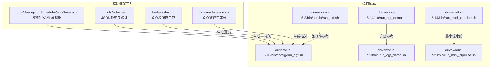
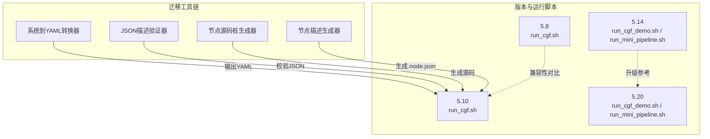
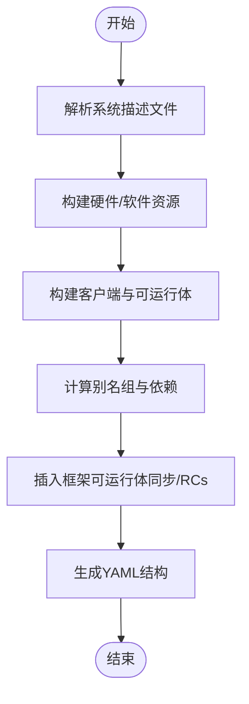
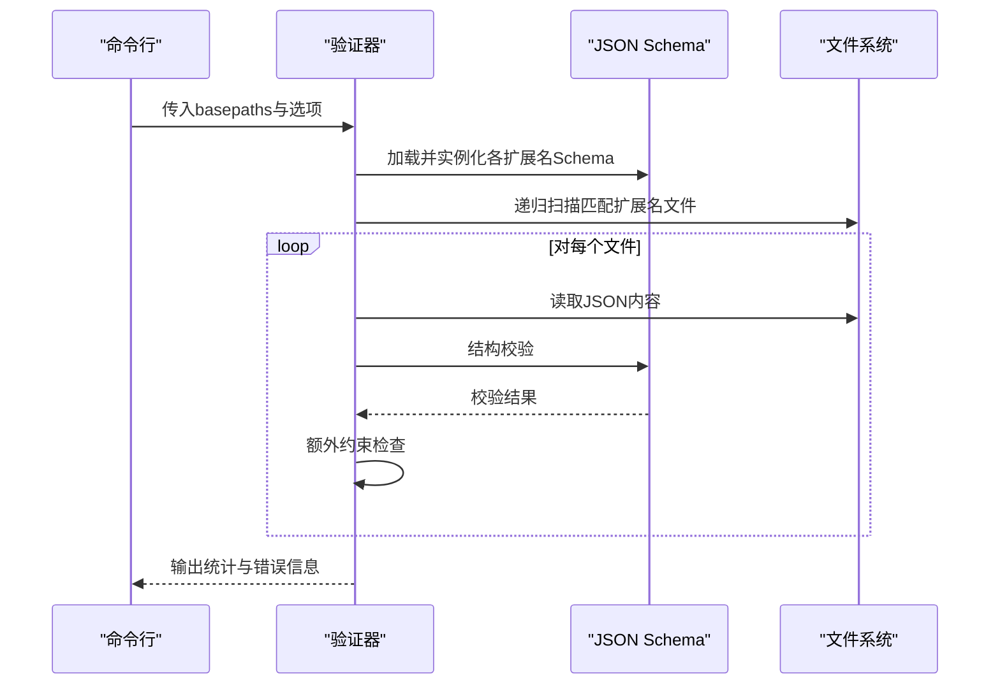
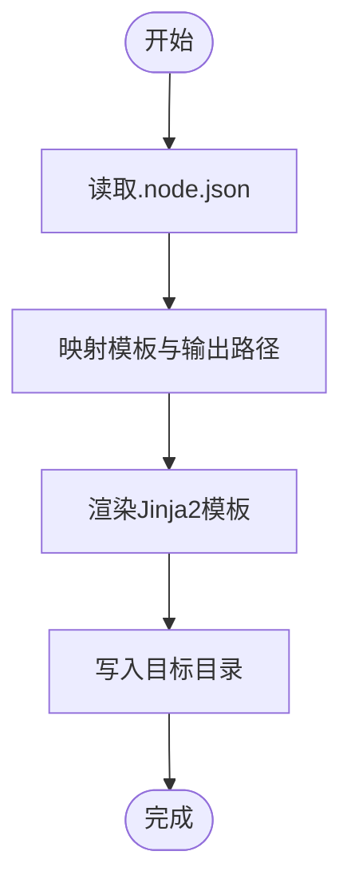
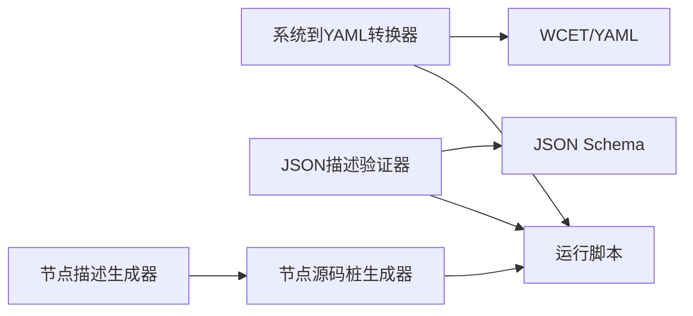

# 迁移工具和脚本

<cite>
**本文引用的文件**
- [driverorks-5.10/tools/descriptionScheduleYamlGenerator/descriptionScheduleYamlGenerator.py](file://driverorks-5.10/tools/descriptionScheduleYamlGenerator/descriptionScheduleYamlGenerator.py)
- [driverorks-5.10/tools/schema/validate_cgfdescriptors.py](file://driverorks-5.10/tools/schema/validate_cgfdescriptors.py)
- [driverorks-5.10/tools/nodestub/nodestub.py](file://driverorks-5.10/tools/nodestub/nodestub.py)
- [driverorks-5.10/tools/nodedescriptor/README-nodedescriptor.md](file://driverorks-5.10/tools/nodedescriptor/README-nodedescriptor.md)
- [driverorks-5.10/tools/descriptionScheduleYamlGenerator/README-descriptionScheduleYamlGenerator.md](file://driverorks-5.10/tools/descriptionScheduleYamlGenerator/README-descriptionScheduleYamlGenerator.md)
- [driverorks-5.10/tools/schema/README-validate_cgfdescriptors.md](file://driverorks-5.10/tools/schema/README-validate_cgfdescriptors.md)
- [driverorks-5.10/tools/schema/app.schema.json](file://driverorks-5.10/tools/schema/app.schema.json)
- [driverorks-5.10/tools/schema/node.schema.json](file://driverorks-5.10/tools/schema/node.schema.json)
- [driverorks-5.10/bin/config/run_cgf.sh](file://driverorks-5.10/bin/config/run_cgf.sh)
- [driveworks-5.14/bin/run_cgf_demo.sh](file://driveworks-5.14/bin/run_cgf_demo.sh)
- [driveworks-5.14/bin/run_mini_pipeline.sh](file://driveworks-5.14/bin/run_mini_pipeline.sh)
- [driveworks-5.8/bin/config/run_cgf.sh](file://driveworks-5.8/bin/config/run_cgf.sh)
- [driveworks-520/bin/run_cgf_demo.sh](file://driveworks-520/bin/run_cgf_demo.sh)
- [driveworks-520/bin/run_mini_pipeline.sh](file://driveworks-520/bin/run_mini_pipeline.sh)
</cite>

## 目录
1. [简介](#简介)
2. [项目结构](#项目结构)
3. [核心组件](#核心组件)
4. [架构总览](#架构总览)
5. [详细组件分析](#详细组件分析)
6. [依赖关系分析](#依赖关系分析)
7. [性能考虑](#性能考虑)
8. [故障排除指南](#故障排除指南)
9. [结论](#结论)
10. [附录](#附录)

## 简介
本指南聚焦于官方提供的迁移工具与脚本，涵盖以下三类能力：
- 配置文件转换器：将系统描述（如 .system.json）转换为 STM 编译所需的 YAML 格式。
- 代码重构辅助工具：从节点描述生成 C++ 源桩，辅助节点实现与接口对齐。
- 验证脚本：对 JSON 描述进行模式校验与额外约束检查，确保跨引用、端口类型、连接无环等。

文档将说明工具的命令行参数、配置选项、输出格式，并提供自定义迁移脚本的编写方法、最佳实践（批量处理、错误处理、进度跟踪），以及使用示例、故障排除与性能优化建议。

## 项目结构
驱动框架在不同版本中提供了统一的工具目录与脚本入口，便于在迁移过程中复用与自动化。

图示来源
- [driverorks-5.10/bin/config/run_cgf.sh:1-200](file://driverorks-5.10/bin/config/run_cgf.sh#L1-L200)
- [driveworks-5.14/bin/run_cgf_demo.sh:1-200](file://driveworks-5.14/bin/run_cgf_demo.sh#L1-L200)
- [driveworks-5.14/bin/run_mini_pipeline.sh:1-200](file://driveworks-5.14/bin/run_mini_pipeline.sh#L1-L200)
- [driveworks-5.8/bin/config/run_cgf.sh:1-200](file://driveworks-5.8/bin/config/run_cgf.sh#L1-L200)
- [driveworks-520/bin/run_cgf_demo.sh:1-200](file://driveworks-520/bin/run_cgf_demo.sh#L1-L200)
- [driveworks-520/bin/run_mini_pipeline.sh:1-200](file://driveworks-520/bin/run_mini_pipeline.sh#L1-L200)

章节来源
- [driverorks-5.10/bin/config/run_cgf.sh:1-200](file://driverorks-5.10/bin/config/run_cgf.sh#L1-L200)
- [driveworks-5.14/bin/run_cgf_demo.sh:1-200](file://driveworks-5.14/bin/run_cgf_demo.sh#L1-L200)
- [driveworks-5.14/bin/run_mini_pipeline.sh:1-200](file://driveworks-5.14/bin/run_mini_pipeline.sh#L1-L200)
- [driveworks-5.8/bin/config/run_cgf.sh:1-200](file://driveworks-5.8/bin/config/run_cgf.sh#L1-L200)
- [driveworks-520/bin/run_cgf_demo.sh:1-200](file://driveworks-520/bin/run_cgf_demo.sh#L1-L200)
- [driveworks-520/bin/run_mini_pipeline.sh:1-200](file://driveworks-520/bin/run_mini_pipeline.sh#L1-L200)

## 核心组件
- 系统到 YAML 转换器：将系统描述（含应用、图元、节点、调度）转换为 STM 可编译的 YAML，支持资源分组、周期帧数、别名组、WCET 注入等。
- JSON 描述验证器：基于 JSON Schema 对 .app/.node/.graphlet 等进行结构校验，并执行额外约束（子组件参数匹配、连接无环、端口类型一致性、键顺序与缩进等）。
- 节点源码桩生成器：根据 .node.json 描述生成 C++ 源文件模板，自动推导头文件包含与命名风格。
- 节点描述生成器：从已编译共享库中提取节点注册信息并输出 .node.json 描述，便于与实现保持同步。

章节来源
- [driverorks-5.10/tools/descriptionScheduleYamlGenerator/descriptionScheduleYamlGenerator.py:1-200](file://driverorks-5.10/tools/descriptionScheduleYamlGenerator/descriptionScheduleYamlGenerator.py#L1-L200)
- [driverorks-5.10/tools/schema/validate_cgfdescriptors.py:1-120](file://driverorks-5.10/tools/schema/validate_cgfdescriptors.py#L1-L120)
- [driverorks-5.10/tools/nodestub/nodestub.py:1-120](file://driverorks-5.10/tools/nodestub/nodestub.py#L1-L120)
- [driverorks-5.10/tools/nodedescriptor/README-nodedescriptor.md:1-23](file://driverorks-5.10/tools/nodedescriptor/README-nodedescriptor.md#L1-L23)

## 架构总览
下图展示迁移工具链在版本间的一致性与演进路径，以及与运行脚本的集成关系。

图示来源
- [driverorks-5.10/bin/config/run_cgf.sh:1-200](file://driverorks-5.10/bin/config/run_cgf.sh#L1-L200)
- [driveworks-5.14/bin/run_cgf_demo.sh:1-200](file://driveworks-5.14/bin/run_cgf_demo.sh#L1-L200)
- [driveworks-5.14/bin/run_mini_pipeline.sh:1-200](file://driveworks-5.14/bin/run_mini_pipeline.sh#L1-L200)
- [driveworks-5.8/bin/config/run_cgf.sh:1-200](file://driveworks-5.8/bin/config/run_cgf.sh#L1-L200)
- [driveworks-520/bin/run_cgf_demo.sh:1-200](file://driveworks-520/bin/run_cgf_demo.sh#L1-L200)
- [driveworks-520/bin/run_mini_pipeline.sh:1-200](file://driveworks-520/bin/run_mini_pipeline.sh#L1-L200)

## 详细组件分析

### 组件A：系统到 YAML 转换器
- 功能概述
  - 将系统描述（应用、图元、节点、调度）转换为 STM 编译所需的 YAML。
  - 支持资源类型（CPU/GPU/DLA/VPI/MUTEX）、序列化器（CUDA_STREAM/CUDLA_STREAM/DLA_HANDLE/VPI_HANDLE）、WCET 注入、别名组、周期帧数、外部可运行体等。
  - 提供文件校验与路径偏移处理，保证跨版本迁移时的容错性。
- 关键流程（简化）
  - 解析输入系统描述，构建硬件/软件资源、客户端、超周期、周期与可运行体。
  - 计算别名组与依赖，插入框架可运行体（如同步/RCs），生成 YAML 结构。
  - 输出包含版本号、SOC 分配、资源树、超周期、客户端与可运行体列表的 YAML。
- 命令行参数
  - --graph：输入系统描述文件（.system.json）。
  - --output：输出 YAML 文件路径。
  - 其他内部开关用于控制推断边、可选校验等（通过全局参数对象传递）。
- 输出格式
  - 包含版本、标识符、SOC 资源分配、超周期、客户端与可运行体等字段；外部模式下仅输出可运行体依赖规范化后的形式。
- 使用示例
  - 在 5.10 版本中，先生成 YAML 再交由 STM 编译器处理，随后在运行脚本中加载该 YAML。
- 最佳实践
  - 在 CI 中批量转换多个系统描述，统一输出目录与命名规则。
  - 对 WCET 文件进行严格校验，避免空文件或路径错误导致调度异常。
  - 合理设置别名组与周期帧数，平衡吞吐与延迟。

图示来源
- [driverorks-5.10/tools/descriptionScheduleYamlGenerator/descriptionScheduleYamlGenerator.py:1263-1283](file://driverorks-5.10/tools/descriptionScheduleYamlGenerator/descriptionScheduleYamlGenerator.py#L1263-L1283)

章节来源
- [driverorks-5.10/tools/descriptionScheduleYamlGenerator/descriptionScheduleYamlGenerator.py:1-200](file://driverorks-5.10/tools/descriptionScheduleYamlGenerator/descriptionScheduleYamlGenerator.py#L1-L200)
- [driverorks-5.10/tools/descriptionScheduleYamlGenerator/README-descriptionScheduleYamlGenerator.md:1-11](file://driverorks-5.10/tools/descriptionScheduleYamlGenerator/README-descriptionScheduleYamlGenerator.md#L1-L11)

### 组件B：JSON 描述验证器
- 功能概述
  - 基于 JSON Schema 对 .app/.node/.graphlet/.node-params/.node-wcets/.required-sensors/.sensor-mappings/.trans 等进行结构校验。
  - 执行额外约束：子组件参数类型匹配、$ 引用合法性、连接无环、端口存在性与类型一致性、键顺序与缩进等。
  - 支持递归扫描目录与跨文件引用校验。
- 关键流程（简化）
  - 加载并实例化各扩展名对应的 Schema。
  - 遍历目标路径，按扩展名匹配并逐个校验 JSON 文件。
  - 对通过 Schema 的文件执行额外约束检查（参数默认值类型、子组件参数、连接拓扑、状态与调度映射等）。
  - 支持忽略键顺序与缩进的严格模式开关。
- 命令行参数
  - basepaths：一个或多个目录或文件路径（递归搜索）。
  - --ignore-order：忽略键顺序严格性。
  - --ignore-indentation：忽略缩进严格性。
- 输出格式
  - 成功：打印“✓”与文件路径。
  - 失败：打印“!”与具体错误位置与消息。
  - 总结统计：成功校验的文件数量。
- 使用示例
  - 在 5.10 版本中，对整个应用目录执行一次性校验，确保所有 .json 描述符合规范。
- 最佳实践
  - 在提交前执行全量校验，CI 中开启严格模式。
  - 对子组件参数与连接进行集中管理，减少跨文件引用错误。
  - 定期更新 Schema 以适配新版本特性。

图示来源
- [driverorks-5.10/tools/schema/validate_cgfdescriptors.py:30-96](file://driverorks-5.10/tools/schema/validate_cgfdescriptors.py#L30-L96)

章节来源
- [driverorks-5.10/tools/schema/validate_cgfdescriptors.py:1-200](file://driverorks-5.10/tools/schema/validate_cgfdescriptors.py#L1-L200)
- [driverorks-5.10/tools/schema/README-validate_cgfdescriptors.md:1-17](file://driverorks-5.10/tools/schema/README-validate_cgfdescriptors.md#L1-L17)
- [driverorks-5.10/tools/schema/app.schema.json:1-120](file://driverorks-5.10/tools/schema/app.schema.json#L1-L120)
- [driverorks-5.10/tools/schema/node.schema.json:1-120](file://driverorks-5.10/tools/schema/node.schema.json#L1-L120)

### 组件C：节点源码桩生成器
- 功能概述
  - 从 .node.json 描述生成 C++ 源码桩（头文件与实现），自动推导所需头文件包含与命名风格。
  - 支持选择基类（进程节点/传感器节点模板），并可指定输出目录与覆盖策略。
- 关键流程（简化）
  - 解析 .node.json，准备模板映射与输出路径。
  - 生成四个模板文件（Node.thpp、Node.tcpp、NodeImpl.thpp、NodeImpl.tcpp）。
  - 渲染模板并写入目标目录。
- 命令行参数
  - NODE_JSON_FILE：输入 .node.json 路径。
  - BASE_CLASS：基类选择（进程节点或传感器节点模板）。
  - --output-path：输出目录（默认临时目录）。
  - --overwrite-existing-files：是否覆盖已存在文件。
- 输出格式
  - 四个标准化命名的 C++ 源文件，包含必要的头文件与命名空间。
- 使用示例
  - 在 5.10 版本中，先生成源码桩，再根据模板完善业务逻辑与端口绑定。
- 最佳实践
  - 与节点描述生成器配合，确保 .node.json 与实现一致。
  - 在 CI 中对生成的源码进行静态检查，避免遗漏头文件与命名问题。

图示来源
- [driverorks-5.10/tools/nodestub/nodestub.py:128-160](file://driverorks-5.10/tools/nodestub/nodestub.py#L128-L160)

章节来源
- [driverorks-5.10/tools/nodestub/nodestub.py:1-200](file://driverorks-5.10/tools/nodestub/nodestub.py#L1-L200)

### 组件D：节点描述生成器
- 功能概述
  - 从已编译共享库中提取节点注册信息并输出 .node.json 描述，便于与实现保持同步。
- 使用方式
  - 不带参数：显示帮助。
  - 传入共享库：列出其中注册的节点名称。
  - 传入共享库与节点名：输出该节点的 JSON 描述。
  - 传入共享库与通配符：输出所有节点的描述（以记录分隔符分隔）。
- 使用示例
  - 在构建流程中集成该工具，确保 .node.json 与实现同步。
- 最佳实践
  - 在 PR 或发布前执行一次全量节点描述生成，比对差异。
  - 将生成步骤纳入 CI，避免描述滞后导致的编译/链接问题。

章节来源
- [driverorks-5.10/tools/nodedescriptor/README-nodedescriptor.md:1-23](file://driverorks-5.10/tools/nodedescriptor/README-nodedescriptor.md#L1-L23)

## 依赖关系分析
- 工具间耦合
  - 系统到 YAML 转换器依赖 JSON Schema 与 WCET/YAML 文件，输出供运行脚本使用。
  - JSON 描述验证器独立于转换器，但两者共同保障描述质量。
  - 节点源码桩生成器与节点描述生成器互补：前者从描述生成实现，后者从实现生成描述。
- 外部依赖
  - Python 包：PyYAML（系统到 YAML）、jsonschema（描述验证）、Jinja2（源码桩）。
- 版本演进
  - 5.8/5.10 提供基础工具链；5.14/5.20 增加最小流水线运行脚本与升级参考。

图示来源
- [driverorks-5.10/tools/descriptionScheduleYamlGenerator/descriptionScheduleYamlGenerator.py:1263-1283](file://driverorks-5.10/tools/descriptionScheduleYamlGenerator/descriptionScheduleYamlGenerator.py#L1263-L1283)
- [driverorks-5.10/tools/schema/validate_cgfdescriptors.py:1-120](file://driverorks-5.10/tools/schema/validate_cgfdescriptors.py#L1-L120)
- [driverorks-5.10/tools/nodestub/nodestub.py:1-120](file://driverorks-5.10/tools/nodestub/nodestub.py#L1-L120)
- [driverorks-5.10/tools/nodedescriptor/README-nodedescriptor.md:1-23](file://driverorks-5.10/tools/nodedescriptor/README-nodedescriptor.md#L1-L23)

章节来源
- [driverorks-5.10/tools/schema/app.schema.json:1-120](file://driverorks-5.10/tools/schema/app.schema.json#L1-L120)
- [driverorks-5.10/tools/schema/node.schema.json:1-120](file://driverorks-5.10/tools/schema/node.schema.json#L1-L120)

## 性能考虑
- 批量处理
  - 使用验证器的多路径输入能力，一次性扫描多个目录，减少重复启动开销。
  - 在 CI 中并行执行多个转换任务（不同系统描述），充分利用多核资源。
- 错误处理
  - 对缺失文件、路径偏移、空 WCET 文件等进行早失败，避免无效工作流继续执行。
  - 对连接无环与端口类型一致性进行快速失败，尽早暴露设计缺陷。
- 进度跟踪
  - 在 CI 日志中输出每个文件的校验结果，结合统计信息评估整体进度。
  - 对大型工程，将转换与验证拆分为独立阶段，便于定位瓶颈。

## 故障排除指南
- 系统到 YAML 转换器
  - 文件不存在或路径偏移错误：检查输入路径与相对路径偏移配置，确保文件存在。
  - WCET 文件扩展名不正确或找不到：确认 YAML 扩展名与路径，必要时移除路径偏移后重试。
  - 别名组或依赖计算异常：检查输入描述中的周期、帧数与别名组配置。
- JSON 描述验证器
  - Schema 无法加载：检查 JSON Schema 文件完整性与版本兼容性。
  - 子组件参数类型不匹配：核对父组件与子组件参数声明与默认值类型。
  - 连接存在环路：删除循环连接或调整依赖顺序。
  - 键顺序与缩进不符合要求：启用相应开关或修正文件格式。
- 节点源码桩生成器
  - 输出目录冲突：使用覆盖选项或更换输出路径。
  - 未知数据类型：手动添加头文件包含或更新映射表。
- 节点描述生成器
  - 共享库未找到或节点未注册：确认库路径与节点名称拼写。

章节来源
- [driverorks-5.10/tools/descriptionScheduleYamlGenerator/descriptionScheduleYamlGenerator.py:1298-1341](file://driverorks-5.10/tools/descriptionScheduleYamlGenerator/descriptionScheduleYamlGenerator.py#L1298-L1341)
- [driverorks-5.10/tools/schema/validate_cgfdescriptors.py:184-314](file://driverorks-5.10/tools/schema/validate_cgfdescriptors.py#L184-L314)
- [driverorks-5.10/tools/nodestub/nodestub.py:145-149](file://driverorks-5.10/tools/nodestub/nodestub.py#L145-L149)
- [driverorks-5.10/tools/nodedescriptor/README-nodedescriptor.md:1-23](file://driverorks-5.10/tools/nodedescriptor/README-nodedescriptor.md#L1-L23)

## 结论
通过系统到 YAML 转换器、JSON 描述验证器、节点源码桩与节点描述生成器的协同，可在不同版本间高效完成配置迁移与代码重构。建议在 CI 中自动化执行校验与转换，结合严格的键顺序与缩进策略，确保描述一致性与可维护性。对于大规模工程，建议采用分阶段、分模块的迁移策略，并在每个阶段完成后进行端到端验证。

## 附录
- 自定义迁移脚本编写要点
  - 输入参数：支持多路径输入、递归扫描、过滤扩展名。
  - 错误处理：捕获并分类错误，提供可读的错误信息与修复建议。
  - 进度跟踪：输出每个文件的处理状态，汇总统计与耗时。
  - 并发与批处理：利用多进程或多线程加速大目录扫描与转换。
  - 集成 CI：将脚本作为预检步骤，失败即阻断合并。
- 使用示例
  - 验证器示例：对应用目录执行一次性校验，输出统计与错误明细。
  - 转换器示例：将系统描述转换为 YAML，供后续编译与运行。
  - 源码桩示例：根据 .node.json 生成 C++ 源码桩，指导实现开发。
- 版本对照
  - 5.8/5.10：基础工具链与运行脚本。
  - 5.14/5.20：新增最小流水线运行脚本，便于快速验证与演示。

章节来源
- [driverorks-5.10/tools/schema/README-validate_cgfdescriptors.md:1-17](file://driverorks-5.10/tools/schema/README-validate_cgfdescriptors.md#L1-L17)
- [driverorks-5.10/tools/descriptionScheduleYamlGenerator/README-descriptionScheduleYamlGenerator.md:1-11](file://driverorks-5.10/tools/descriptionScheduleYamlGenerator/README-descriptionScheduleYamlGenerator.md#L1-L11)
- [driverorks-5.10/tools/nodedescriptor/README-nodedescriptor.md:1-23](file://driverorks-5.10/tools/nodedescriptor/README-nodedescriptor.md#L1-L23)
- [driverorks-5.10/bin/config/run_cgf.sh:1-200](file://driverorks-5.10/bin/config/run_cgf.sh#L1-L200)
- [driveworks-5.14/bin/run_cgf_demo.sh:1-200](file://driveworks-5.14/bin/run_cgf_demo.sh#L1-L200)
- [driveworks-5.14/bin/run_mini_pipeline.sh:1-200](file://driveworks-5.14/bin/run_mini_pipeline.sh#L1-L200)
- [driveworks-5.8/bin/config/run_cgf.sh:1-200](file://driveworks-5.8/bin/config/run_cgf.sh#L1-L200)
- [driveworks-520/bin/run_cgf_demo.sh:1-200](file://driveworks-520/bin/run_cgf_demo.sh#L1-L200)
- [driveworks-520/bin/run_mini_pipeline.sh:1-200](file://driveworks-520/bin/run_mini_pipeline.sh#L1-L200)