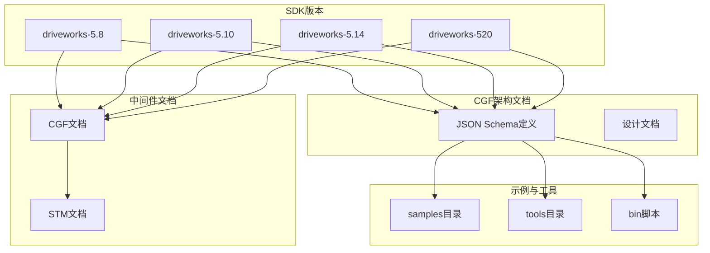
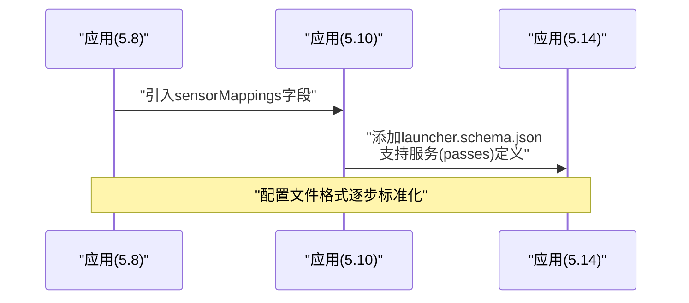
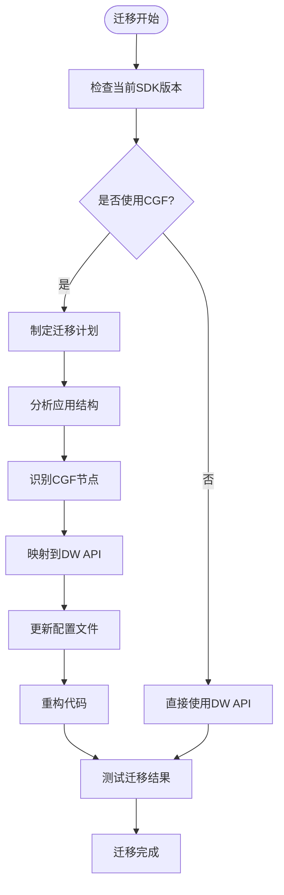
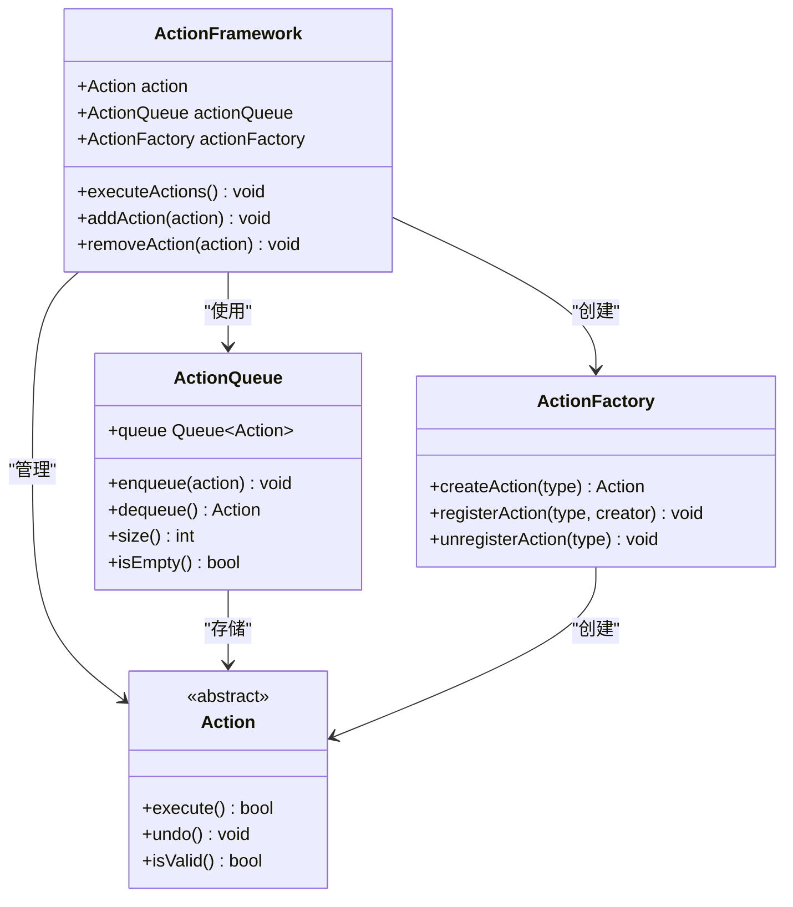
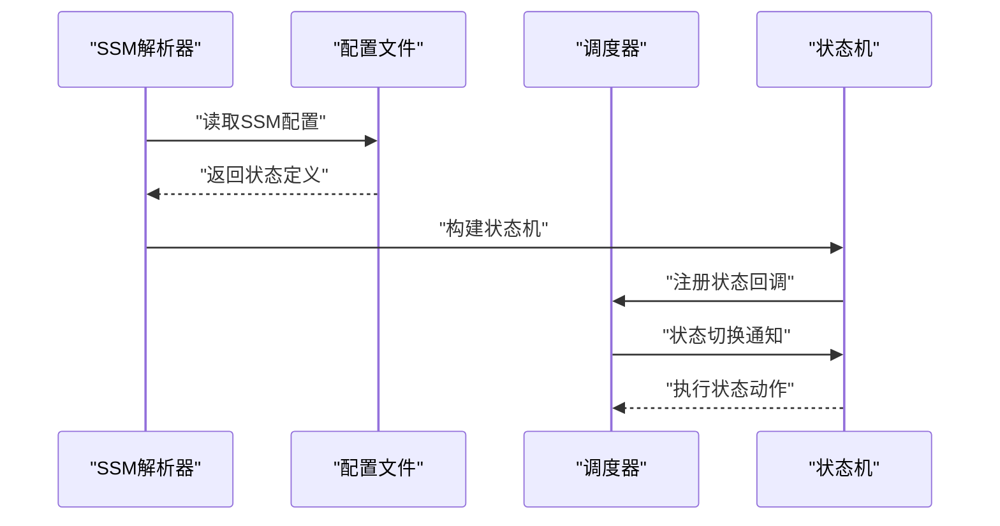
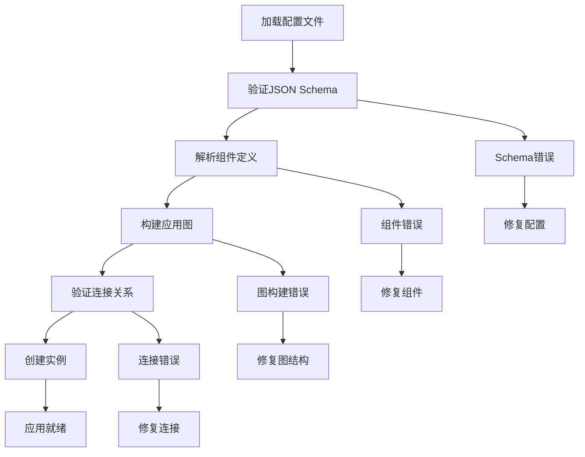
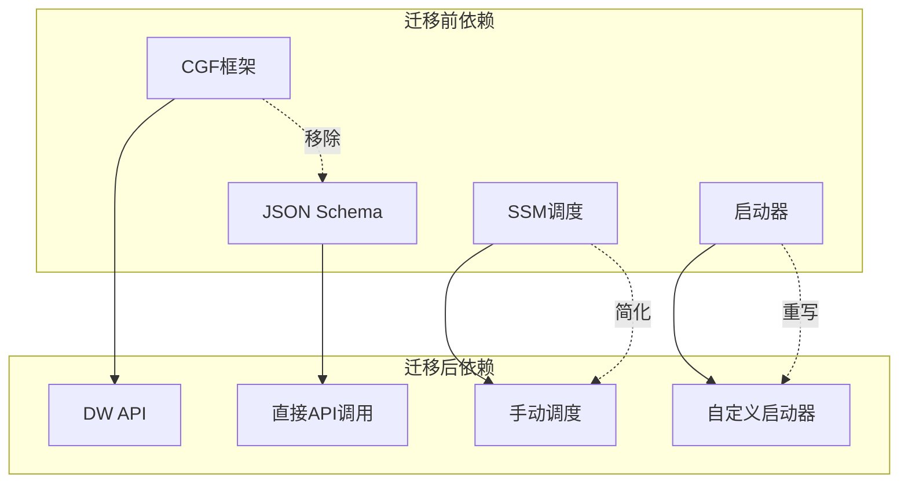

# 迁移指南

<cite>
**本文引用的文件**
- [README.md](file://README.md)
- [README_en.md](file://README_en.md)
- [app.schema.json（5.8）](file://doc/3-drive-works-infra/7-基于json的cgf设计/5.8/app.schema.json)
- [app.schema.json（5.10）](file://doc/3-drive-works-infra/7-基于json的cgf设计/5.10/app.schema.json)
- [app.schema.json（5.14）](file://doc/3-drive-works-infra/7-基于json的cgf设计/5.14/app.schema.json)
- [run_cgf.sh（5.8）](file://driveworks-5.8/bin/config/run_cgf.sh)
- [run_cgf.sh（5.10）](file://driveworks-5.10/bin/config/run_cgf.sh)
- [run_cgf_demo.sh（5.14）](file://driveworks-5.14/bin/run_cgf_demo.sh)
- [parser.py（SSM解析器）](file://driverorks-5.10/samples/src/ssm/util/parser.py)
- [action.py（CGF动作框架）](file://driverorks-5.10/src/dwcgf/dwcgf/action/action.py)
- [actions_schedule.py（CGF调度动作）](file://driverorks-5.10/src/dwcgf/dwcgf/actions/actions_schedule.py)
- [application_descriptor.py（应用描述符）](file://driverorks-5.10/src/dwcgf/dwcgf/descriptor/application_descriptor.py)
- [app-config.schema.json（5.14）](file://doc/3-drive-works-infra/7-基于json的cgf设计/5.14/app-config.schema.json)
- [launcher.schema.json（5.14）](file://doc/3-drive-works-infra/7-基于json的cgf设计/5.14/launcher.schema.json)
</cite>

## 目录
1. [简介](#简介)
2. [项目结构](#项目结构)
3. [核心组件](#核心组件)
4. [架构概览](#架构概览)
5. [详细组件分析](#详细组件分析)
6. [依赖分析](#依赖分析)
7. [性能考虑](#性能考虑)
8. [故障排除指南](#故障排除指南)
9. [结论](#结论)
10. [附录](#附录)

## 简介
本指南面向从Driveworks 5.x版本迁移到DriveOS SDK 7.x的开发者，重点解决Compute Graph Framework（CGF）移除后的适配问题。根据官方文档，DriveOS SDK 7.x移除了CGF，仅保留调度中间件STM，开发者需要直接使用Driveworks（DW）API进行开发。本指南提供完整的迁移步骤、API变更说明、配置文件格式更新方法、代码修改建议、兼容性注意事项，以及迁移后的验证和测试方法。

## 项目结构
仓库包含多个Driveworks版本的SDK文档、示例和工具，主要分为以下几类：
- 版本化SDK目录：driveworks-5.8、driveworks-5.10、driveworks-5.14、driveworks-520
- CGF架构文档：doc/3-drive-works-infra/7-基于json的cgf设计
- 示例和工具：samples、tools、bin脚本
- 中间件文档：drive-agx-orin-doc/3-drive-works/

**图表来源**
- [README.md:1-115](file://README.md#L1-L115)
- [README_en.md:1-92](file://README_en.md#L1-L92)

**章节来源**
- [README.md:1-115](file://README.md#L1-L115)
- [README_en.md:1-92](file://README_en.md#L1-L92)

## 核心组件
迁移涉及的核心组件包括：
- 应用描述符（Application Descriptor）：定义应用程序的结构和配置
- CGF动作框架：处理节点创建、连接和调度
- SSM解析器：状态机调度管理
- 配置文件：app.json、app-config.json等

### 应用描述符演进
从5.8到5.14版本，应用描述符经历了显著变化：

**图表来源**
- [app.schema.json（5.8）:1-475](file://doc/3-drive-works-infra/7-基于json的cgf设计/5.8/app.schema.json#L1-L475)
- [app.schema.json（5.10）:1-520](file://doc/3-drive-works-infra/7-基于json的cgf设计/5.10/app.schema.json#L1-L520)
- [app.schema.json（5.14）:1-560](file://doc/3-drive-works-infra/7-基于json的cgf设计/5.14/app.schema.json#L1-L560)

**章节来源**
- [app.schema.json（5.8）:1-475](file://doc/3-drive-works-infra/7-基于json的cgf设计/5.8/app.schema.json#L1-L475)
- [app.schema.json（5.10）:1-520](file://doc/3-drive-works-infra/7-基于json的cgf设计/5.10/app.schema.json#L1-L520)
- [app.schema.json（5.14）:1-560](file://doc/3-drive-works-infra/7-基于json的cgf设计/5.14/app.schema.json#L1-L560)

## 架构概览
从CGF架构到直接DW API使用的迁移路径：

**图表来源**
- [README.md:51-63](file://README.md#L51-L63)
- [README_en.md:13-18](file://README_en.md#L13-L18)

## 详细组件分析

### CGF动作框架分析
CGF动作框架是处理节点生命周期的核心组件：

**图表来源**
- [action.py（CGF动作框架）:1-200](file://driverorks-5.10/src/dwcgf/dwcgf/action/action.py#L1-L200)

**章节来源**
- [action.py（CGF动作框架）:1-200](file://driverorks-5.10/src/dwcgf/dwcgf/action/action.py#L1-L200)

### SSM调度解析器
SSM（State Schedule Machine）解析器负责状态机调度管理：

**图表来源**
- [parser.py（SSM解析器）:1-150](file://driverorks-5.10/samples/src/ssm/util/parser.py#L1-L150)

**章节来源**
- [parser.py（SSM解析器）:1-150](file://driverorks-5.10/samples/src/ssm/util/parser.py#L1-L150)

### 应用描述符加载器
应用描述符加载器负责解析和验证配置文件：

**图表来源**
- [application_descriptor.py（应用描述符）:1-300](file://driverorks-5.10/src/dwcgf/dwcgf/descriptor/application_descriptor.py#L1-L300)

**章节来源**
- [application_descriptor.py（应用描述符）:1-300](file://driverorks-5.10/src/dwcgf/dwcgf/descriptor/application_descriptor.py#L1-L300)

## 依赖分析
迁移过程中的关键依赖关系：

**图表来源**
- [README.md:51-63](file://README.md#L51-L63)
- [app.schema.json（5.14）:142-279](file://doc/3-drive-works-infra/7-基于json的cgf设计/5.14/app.schema.json#L142-L279)

**章节来源**
- [README.md:51-63](file://README.md#L51-L63)
- [app.schema.json（5.14）:142-279](file://doc/3-drive-works-infra/7-基于json的cgf设计/5.14/app.schema.json#L142-L279)

## 性能考虑
迁移后的性能优化要点：
- 减少中间层开销：直接调用DW API避免CGF封装
- 手动资源管理：替代CGF的自动资源分配
- 优化调度策略：利用STM进行精确的时间控制
- 内存管理：避免重复的数据拷贝和转换

## 故障排除指南

### 常见迁移问题及解决方案

#### 1. CGF相关错误
**问题症状**：编译时找不到CGF头文件或链接错误
**解决方案**：
- 移除所有CGF相关的include语句
- 替换为对应的DW API头文件
- 更新CMakeLists.txt中的依赖项

#### 2. 配置文件格式错误
**问题症状**：运行时提示JSON Schema验证失败
**解决方案**：
- 对照最新版本的schema文件修正配置
- 检查必需字段是否完整
- 验证数据类型和范围

#### 3. 调度问题
**问题症状**：应用无法正常启动或状态机不工作
**解决方案**：
- 检查SSM状态定义的正确性
- 验证调度器的初始化顺序
- 确认状态间的转换条件

**章节来源**
- [README_en.md:64-92](file://README_en.md#L64-L92)

## 结论
从CGF架构迁移到直接DW API使用是DriveOS SDK 7.x的重要变化。迁移过程需要：
1. 全面评估现有应用的CGF使用情况
2. 制定详细的迁移计划和时间表
3. 逐步替换CGF组件为DW API调用
4. 更新配置文件以符合新的schema要求
5. 充分测试迁移后的功能和性能

虽然迁移过程复杂，但直接使用DW API能够提供更好的性能和更灵活的控制能力。

## 附录

### 迁移检查清单
- [ ] 评估现有CGF使用范围
- [ ] 制定详细的迁移时间表
- [ ] 更新开发环境和工具链
- [ ] 修改配置文件格式
- [ ] 重构核心代码逻辑
- [ ] 更新CMakeLists.txt配置
- [ ] 编写自动化迁移脚本
- [ ] 进行全面的功能测试
- [ ] 性能基准测试
- [ ] 文档更新和培训

### 推荐工具和资源
- **官方文档**：参考README.md中的链接
- **示例代码**：查看samples目录中的实现
- **Schema定义**：使用最新的JSON Schema文件
- **调试工具**：利用日志系统进行问题诊断
- **社区支持**：参考官方论坛的bug报告