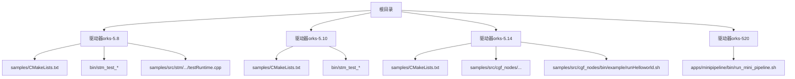
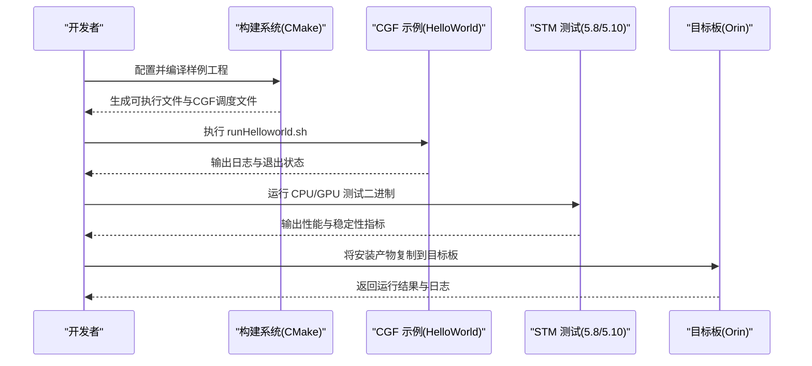
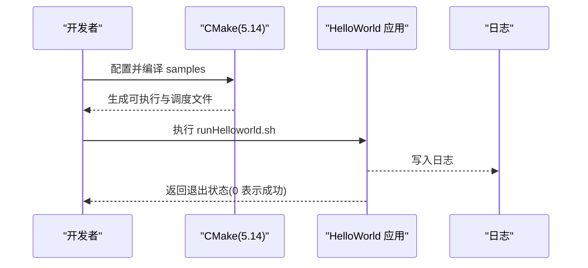
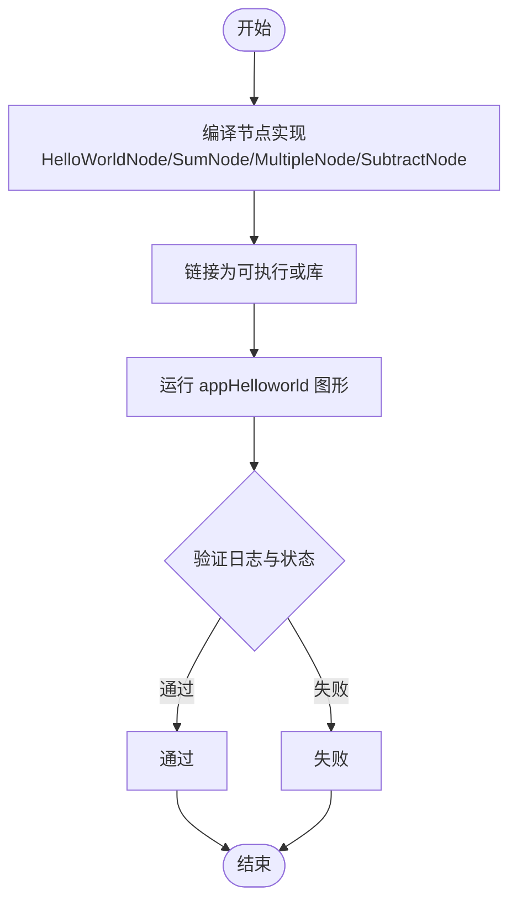
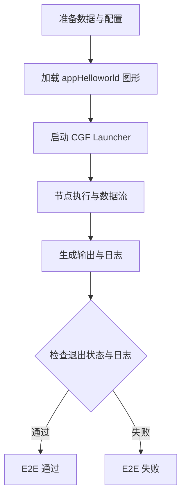
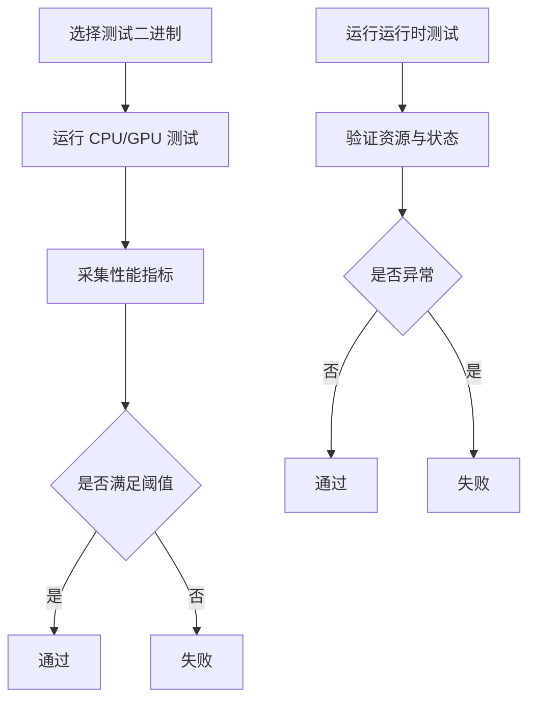
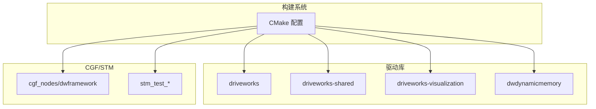

# 迁移验证和测试

<cite>
**本文引用的文件**
- [README_en.md](file://README_en.md)
- [README.md](file://README.md)
- [驱动器orks-5.14 样例 CMakeLists.txt](file://driveworks-5.14/samples/CMakeLists.txt)
- [驱动器orks-5.10 样例 CMakeLists.txt](file://driverorks-5.10/samples/CMakeLists.txt)
- [驱动器orks-5.8 样例 CMakeLists.txt](file://driveworks-5.8/samples/CMakeLists.txt)
- [CGF Hello World 运行脚本（5.14）](file://driveworks-5.14/samples/src/cgf_nodes/bin/example/runHelloworld.sh)
- [CGF Hello World 示例源码（HelloWorldNode.cpp）](file://driveworks-5.14/samples/src/cgf_nodes/HelloWorldNode.cpp)
- [CGF Hello World 示例源码（HelloWorldNodeImpl.cpp）](file://driveworks-5.14/samples/src/cgf_nodes/HelloWorldNodeImpl.cpp)
- [CGF Hello World 示例源码（SumNode.cpp）](file://driveworks-5.14/samples/src/cgf_nodes/SumNode.cpp)
- [CGF Hello World 示例源码（SumNodeImpl.cpp）](file://driveworks-5.14/samples/src/cgf_nodes/SumNodeImpl.cpp)
- [CGF Hello World 示例源码（MultipleNode.cpp）](file://driveworks-5.14/samples/src/cgf_nodes/src/nodes/example/multiple/MultipleNode.cpp)
- [CGF Hello World 示例源码（MultipleNodeImpl.cpp）](file://driveworks-5.14/samples/src/cgf_nodes/src/nodes/example/multiple/MultipleNodeImpl.cpp)
- [CGF Hello World 示例源码（SubtractNode.cpp）](file://driveworks-5.14/samples/src/cgf_nodes/src/nodes/example/subtract/SubtractNode.cpp)
- [CGF Hello World 示例源码（SubtractNodeImpl.cpp）](file://driveworks-5.14/samples/src/cgf_nodes/src/nodes/example/subtract/SubtractNodeImpl.cpp)
- [CGF Hello World 图形定义（appHelloworld 应用）](file://driveworks-5.14/samples/src/cgf_nodes/graphs/apps/example/appHelloworld/DWCGFHelloworld.app.json)
- [CGF Hello World 图形定义（节点定义）](file://driveworks-5.14/samples/src/cgf_nodes/graphs/apps/example/appHelloworld/DWCGFHelloworld.graphlet.json)
- [CGF Hello World 图形定义（WCET 描述）](file://driveworks-5.14/samples/src/cgf_nodes/graphs/apps/example/appHelloworld/DWCGFHelloworld_wcet.yaml)
- [CGF Hello World 图形定义（节点：HelloWorldNode.node.json）](file://driveworks-5.14/samples/src/cgf_nodes/graphs/nodes/example/helloworld/HelloWorldNode.node.json)
- [CGF Hello World 图形定义（节点：SumNode.node.json）](file://driveworks-5.14/samples/src/cgf_nodes/graphs/nodes/example/helloworld/SumNode.node.json)
- [CGF Hello World 图形定义（传感器映射）](file://driveworks-5.14/samples/src/cgf_nodes/graphs/extra/sensor_mappings/pilot.sensor-mappings.json)
- [CGF Hello World 图形定义（通用附加信息）](file://driveworks-5.14/samples/src/cgf_nodes/graphs/extra/appCommon/DWCGFImagePipeExtraInfo.json)
- [CGF Hello World 图形定义（通用实例ID）](file://driveworks-5.14/samples/src/cgf_nodes/graphs/extra/appCommon/DWCGFImagePipeInstanceIDs.json)
- [CGF Hello World 图形定义（CGF 调度 YAML）](file://driveworks-5.14/samples/src/cgf_nodes/graphs/apps/example/appHelloworld/DWCGFHelloworld.app.json)
- [CGF Hello World 图形定义（CGF 调度 YAML）](file://driveworks-5.14/samples/src/cgf_nodes/graphs/apps/example/appHelloworld/DWCGFHelloworld.graphlet.json)
- [CGF Hello World 图形定义（CGF 调度 YAML）](file://driveworks-5.14/samples/src/cgf_nodes/graphs/apps/example/appHelloworld/DWCGFHelloworld_wcet.yaml)
- [CGF Hello World 工具：TCP_NODELAY 预加载测试](file://driveworks-5.14/samples/src/cgf_nodes/tools/tcp_nodelay_preload_test.cpp)
- [STM 测试二进制（5.8）](file://driveworks-5.8/bin/stm_test_cpu_simple)
- [STM 测试二进制（5.10）](file://driverorks-5.10/bin/stm_test_cpu_simple)
- [STM 测试运行时（5.8）](file://driveworks-5.8/samples/src/stm/src/dla_simple/dla_simple/dla/testRuntime.cpp)
- [目标构建产物（5.14）](file://target/dw514/install/usr/local/driveworks/samples/bin/cgf_custom_nodes/example/runHelloworld.sh)
</cite>

## 目录
1. [简介](#简介)
2. [项目结构](#项目结构)
3. [核心组件](#核心组件)
4. [架构总览](#架构总览)
5. [详细组件分析](#详细组件分析)
6. [依赖分析](#依赖分析)
7. [性能考虑](#性能考虑)
8. [故障排查指南](#故障排查指南)
9. [结论](#结论)
10. [附录](#附录)

## 简介
本指南面向在 DriveWorks 5.x 系列（5.8/5.10/5.14/520）之间进行迁移后的验证与测试工作，覆盖功能测试、性能测试与兼容性测试的完整流程。文档以官方样例与工具为依据，提供可操作的验证步骤、测试套件执行方式、回归策略与常见问题诊断路径，帮助确保迁移后系统的稳定性与性能。

## 项目结构
本仓库包含多个 DriveWorks 版本的 SDK 与样例，以及针对 CGF（计算图框架）与 STM（调度中间件）的验证工具与示例。迁移验证应围绕以下关键目录展开：
- 样例工程与构建：各版本 samples 目录下的 CMakeLists.txt 与子模块组织
- CGF 示例与图形定义：5.14 中的 cgf_nodes 示例及其 JSON/YAML 图形描述
- STM 测试与运行时：5.8/5.10 中的 STM 测试二进制与运行时测试代码
- 目标产物与运行脚本：5.14 目标构建产物中的示例运行脚本

图表来源
- [驱动器orks-5.8 样例 CMakeLists.txt:134-160](file://driveworks-5.8/samples/CMakeLists.txt#L134-L160)
- [驱动器orks-5.10 样例 CMakeLists.txt:140-168](file://driverorks-5.10/samples/CMakeLists.txt#L140-L168)
- [驱动器orks-5.14 样例 CMakeLists.txt:157-189](file://driveworks-5.14/samples/CMakeLists.txt#L157-L189)
- [CGF Hello World 运行脚本（5.14）](file://driveworks-5.14/samples/src/cgf_nodes/bin/example/runHelloworld.sh)
- [STM 测试二进制（5.8）](file://driveworks-5.8/bin/stm_test_cpu_simple)
- [STM 测试二进制（5.10）](file://driverorks-5.10/bin/stm_test_cpu_simple)
- [STM 测试运行时（5.8）:1-293](file://driveworks-5.8/samples/src/stm/src/dla_simple/dla_simple/dla/testRuntime.cpp#L1-L293)

章节来源
- [驱动器orks-5.8 样例 CMakeLists.txt:134-160](file://driveworks-5.8/samples/CMakeLists.txt#L134-L160)
- [驱动器orks-5.10 样例 CMakeLists.txt:140-168](file://driverorks-5.10/samples/CMakeLists.txt#L140-L168)
- [驱动器orks-5.14 样例 CMakeLists.txt:157-189](file://driveworks-5.14/samples/CMakeLists.txt#L157-L189)

## 核心组件
- CGF（计算图框架）示例与图形定义：5.14 提供了完整的 cgf_nodes 示例，包含节点实现、图形描述与运行脚本，适合进行功能与集成测试。
- STM（调度中间件）测试：5.8/5.10 提供了 CPU/GPU 测试二进制与运行时测试代码，适合进行性能与稳定性测试。
- 目标构建产物：5.14 的目标安装产物包含示例运行脚本，便于在目标板上直接验证迁移结果。

章节来源
- [CGF Hello World 运行脚本（5.14）](file://driveworks-5.14/samples/src/cgf_nodes/bin/example/runHelloworld.sh)
- [STM 测试二进制（5.8）](file://driveworks-5.8/bin/stm_test_cpu_simple)
- [STM 测试二进制（5.10）](file://driverorks-5.10/bin/stm_test_cpu_simple)
- [STM 测试运行时（5.8）:1-293](file://driveworks-5.8/samples/src/stm/src/dla_simple/dla_simple/dla/testRuntime.cpp#L1-L293)

## 架构总览
下图展示了迁移验证的关键流程：从样例构建、CGF 图形执行到 STM 性能测试，再到目标板运行与日志检查。

图表来源
- [驱动器orks-5.14 样例 CMakeLists.txt:157-189](file://driveworks-5.14/samples/CMakeLists.txt#L157-L189)
- [CGF Hello World 运行脚本（5.14）](file://driveworks-5.14/samples/src/cgf_nodes/bin/example/runHelloworld.sh)
- [STM 测试二进制（5.8）](file://driveworks-5.8/bin/stm_test_cpu_simple)
- [STM 测试二进制（5.10）](file://driverorks-5.10/bin/stm_test_cpu_simple)

## 详细组件分析

### CGF 功能测试（HelloWorld 示例）
- 构建与安装：通过 5.14 样例工程的 CMake 配置，启用 CGF 示例模块并安装到目标路径。
- 图形定义：应用与图元的 JSON/YAML 描述定义了节点连接、参数与 WCET。
- 运行验证：执行示例运行脚本，检查日志与退出状态，确认 CGF 启动与节点执行正常。

图表来源
- [驱动器orks-5.14 样例 CMakeLists.txt:157-189](file://driveworks-5.14/samples/CMakeLists.txt#L157-L189)
- [CGF Hello World 运行脚本（5.14）](file://driveworks-5.14/samples/src/cgf_nodes/bin/example/runHelloworld.sh)
- [CGF Hello World 图形定义（appHelloworld 应用）](file://driveworks-5.14/samples/src/cgf_nodes/graphs/apps/example/appHelloworld/DWCGFHelloworld.app.json)
- [CGF Hello World 图形定义（节点定义）](file://driveworks-5.14/samples/src/cgf_nodes/graphs/apps/example/appHelloworld/DWCGFHelloworld.graphlet.json)
- [CGF Hello World 图形定义（WCET 描述）](file://driveworks-5.14/samples/src/cgf_nodes/graphs/apps/example/appHelloworld/DWCGFHelloworld_wcet.yaml)

章节来源
- [驱动器orks-5.14 样例 CMakeLists.txt:157-189](file://driveworks-5.14/samples/CMakeLists.txt#L157-L189)
- [CGF Hello World 运行脚本（5.14）](file://driveworks-5.14/samples/src/cgf_nodes/bin/example/runHelloworld.sh)
- [CGF Hello World 图形定义（appHelloworld 应用）](file://driveworks-5.14/samples/src/cgf_nodes/graphs/apps/example/appHelloworld/DWCGFHelloworld.app.json)
- [CGF Hello World 图形定义（节点定义）](file://driveworks-5.14/samples/src/cgf_nodes/graphs/apps/example/appHelloworld/DWCGFHelloworld.graphlet.json)
- [CGF Hello World 图形定义（WCET 描述）](file://driveworks-5.14/samples/src/cgf_nodes/graphs/apps/example/appHelloworld/DWCGFHelloworld_wcet.yaml)

### CGF 单元测试与集成测试
- 单元测试：对单个节点（如 HelloWorldNode、SumNode、MultipleNode、SubtractNode）的实现进行编译与链接验证，确保接口与行为符合预期。
- 集成测试：通过完整的应用图形（appHelloworld）与图元（graphlet），验证节点间的数据流、参数传递与调度执行。

图表来源
- [CGF Hello World 示例源码（HelloWorldNode.cpp）](file://driveworks-5.14/samples/src/cgf_nodes/HelloWorldNode.cpp)
- [CGF Hello World 示例源码（HelloWorldNodeImpl.cpp）](file://driveworks-5.14/samples/src/cgf_nodes/HelloWorldNodeImpl.cpp)
- [CGF Hello World 示例源码（SumNode.cpp）](file://driveworks-5.14/samples/src/cgf_nodes/SumNode.cpp)
- [CGF Hello World 示例源码（SumNodeImpl.cpp）](file://driveworks-5.14/samples/src/cgf_nodes/SumNodeImpl.cpp)
- [CGF Hello World 示例源码（MultipleNode.cpp）](file://driveworks-5.14/samples/src/cgf_nodes/src/nodes/example/multiple/MultipleNode.cpp)
- [CGF Hello World 示例源码（MultipleNodeImpl.cpp）](file://driveworks-5.14/samples/src/cgf_nodes/src/nodes/example/multiple/MultipleNodeImpl.cpp)
- [CGF Hello World 示例源码（SubtractNode.cpp）](file://driveworks-5.14/samples/src/cgf_nodes/src/nodes/example/subtract/SubtractNode.cpp)
- [CGF Hello World 示例源码（SubtractNodeImpl.cpp）](file://driveworks-5.14/samples/src/cgf_nodes/src/nodes/example/subtract/SubtractNodeImpl.cpp)
- [CGF Hello World 图形定义（节点：HelloWorldNode.node.json）](file://driveworks-5.14/samples/src/cgf_nodes/graphs/nodes/example/helloworld/HelloWorldNode.node.json)
- [CGF Hello World 图形定义（节点：SumNode.node.json）](file://driveworks-5.14/samples/src/cgf_nodes/graphs/nodes/example/helloworld/SumNode.node.json)

章节来源
- [CGF Hello World 示例源码（HelloWorldNode.cpp）](file://driveworks-5.14/samples/src/cgf_nodes/HelloWorldNode.cpp)
- [CGF Hello World 示例源码（HelloWorldNodeImpl.cpp）](file://driveworks-5.14/samples/src/cgf_nodes/HelloWorldNodeImpl.cpp)
- [CGF Hello World 示例源码（SumNode.cpp）](file://driveworks-5.14/samples/src/cgf_nodes/SumNode.cpp)
- [CGF Hello World 示例源码（SumNodeImpl.cpp）](file://driveworks-5.14/samples/src/cgf_nodes/SumNodeImpl.cpp)
- [CGF Hello World 示例源码（MultipleNode.cpp）](file://driveworks-5.14/samples/src/cgf_nodes/src/nodes/example/multiple/MultipleNode.cpp)
- [CGF Hello World 示例源码（MultipleNodeImpl.cpp）](file://driveworks-5.14/samples/src/cgf_nodes/src/nodes/example/multiple/MultipleNodeImpl.cpp)
- [CGF Hello World 示例源码（SubtractNode.cpp）](file://driveworks-5.14/samples/src/cgf_nodes/src/nodes/example/subtract/SubtractNode.cpp)
- [CGF Hello World 示例源码（SubtractNodeImpl.cpp）](file://driveworks-5.14/samples/src/cgf_nodes/src/nodes/example/subtract/SubtractNodeImpl.cpp)
- [CGF Hello World 图形定义（节点：HelloWorldNode.node.json）](file://driveworks-5.14/samples/src/cgf_nodes/graphs/nodes/example/helloworld/HelloWorldNode.node.json)
- [CGF Hello World 图形定义（节点：SumNode.node.json）](file://driveworks-5.14/samples/src/cgf_nodes/graphs/nodes/example/helloworld/SumNode.node.json)

### CGF 端到端测试（E2E）
- 端到端验证：通过完整的 appHelloworld 图形，从输入到输出的全链路执行，结合传感器映射与附加信息，验证系统在真实场景下的可用性。
- 回归策略：每次迁移后，重复执行相同图形与配置，记录日志与退出状态，确保功能未退化。

图表来源
- [CGF Hello World 图形定义（appHelloworld 应用）](file://driveworks-5.14/samples/src/cgf_nodes/graphs/apps/example/appHelloworld/DWCGFHelloworld.app.json)
- [CGF Hello World 图形定义（节点定义）](file://driveworks-5.14/samples/src/cgf_nodes/graphs/apps/example/appHelloworld/DWCGFHelloworld.graphlet.json)
- [CGF Hello World 图形定义（WCET 描述）](file://driveworks-5.14/samples/src/cgf_nodes/graphs/apps/example/appHelloworld/DWCGFHelloworld_wcet.yaml)
- [CGF Hello World 图形定义（传感器映射）](file://driveworks-5.14/samples/src/cgf_nodes/graphs/extra/sensor_mappings/pilot.sensor-mappings.json)
- [CGF Hello World 图形定义（通用附加信息）](file://driveworks-5.14/samples/src/cgf_nodes/graphs/extra/appCommon/DWCGFImagePipeExtraInfo.json)
- [CGF Hello World 图形定义（通用实例ID）](file://driveworks-5.14/samples/src/cgf_nodes/graphs/extra/appCommon/DWCGFImagePipeInstanceIDs.json)

章节来源
- [CGF Hello World 图形定义（appHelloworld 应用）](file://driveworks-5.14/samples/src/cgf_nodes/graphs/apps/example/appHelloworld/DWCGFHelloworld.app.json)
- [CGF Hello World 图形定义（节点定义）](file://driveworks-5.14/samples/src/cgf_nodes/graphs/apps/example/appHelloworld/DWCGFHelloworld.graphlet.json)
- [CGF Hello World 图形定义（WCET 描述）](file://driveworks-5.14/samples/src/cgf_nodes/graphs/apps/example/appHelloworld/DWCGFHelloworld_wcet.yaml)
- [CGF Hello World 图形定义（传感器映射）](file://driveworks-5.14/samples/src/cgf_nodes/graphs/extra/sensor_mappings/pilot.sensor-mappings.json)
- [CGF Hello World 图形定义（通用附加信息）](file://driveworks-5.14/samples/src/cgf_nodes/graphs/extra/appCommon/DWCGFImagePipeExtraInfo.json)
- [CGF Hello World 图形定义（通用实例ID）](file://driveworks-5.14/samples/src/cgf_nodes/graphs/extra/appCommon/DWCGFImagePipeInstanceIDs.json)

### STM 性能测试与稳定性测试
- 性能测试：使用 5.8/5.10 的 CPU/GPU 测试二进制，评估不同硬件配置下的吞吐与延迟。
- 稳定性测试：通过运行时测试代码（如 DLA 测试）验证资源分配、任务提交与状态等待的正确性。

图表来源
- [STM 测试二进制（5.8）](file://driveworks-5.8/bin/stm_test_cpu_simple)
- [STM 测试二进制（5.10）](file://driverorks-5.10/bin/stm_test_cpu_simple)
- [STM 测试运行时（5.8）:1-293](file://driveworks-5.8/samples/src/stm/src/dla_simple/dla_simple/dla/testRuntime.cpp#L1-L293)

章节来源
- [STM 测试二进制（5.8）](file://driveworks-5.8/bin/stm_test_cpu_simple)
- [STM 测试二进制（5.10）](file://driverorks-5.10/bin/stm_test_cpu_simple)
- [STM 测试运行时（5.8）:1-293](file://driveworks-5.8/samples/src/stm/src/dla_simple/dla_simple/dla/testRuntime.cpp#L1-L293)

### 兼容性测试（跨版本）
- 版本对比：比较 5.8/5.10/5.14/520 的构建配置、样例启用情况与工具差异，识别迁移后可能的不兼容点。
- 配置迁移：确保 CMake 变量、依赖库与安装路径在新版本中保持一致。

章节来源
- [驱动器orks-5.8 样例 CMakeLists.txt:98-125](file://driveworks-5.8/samples/CMakeLists.txt#L98-L125)
- [驱动器orks-5.10 样例 CMakeLists.txt:96-132](file://driverorks-5.10/samples/CMakeLists.txt#L96-L132)
- [驱动器orks-5.14 样例 CMakeLists.txt:108-148](file://driveworks-5.14/samples/CMakeLists.txt#L108-L148)

## 依赖分析
- 构建系统依赖：各版本样例工程通过 CMake 查找驱动库与可视化/共享组件，确保迁移后依赖项正确解析。
- CGF 依赖：启用 cgf_nodes 模块时，需确保 dwframework/dwcgf 相关组件可用。
- 运行时依赖：CGF 示例依赖 NvSciBuf/NvSciSync 等底层通信组件；STM 测试依赖 CUDA/cuDNN/TensorRT 等加速库。

图表来源
- [驱动器orks-5.14 样例 CMakeLists.txt:110-129](file://driveworks-5.14/samples/CMakeLists.txt#L110-L129)
- [驱动器orks-5.10 样例 CMakeLists.txt:96-116](file://driverorks-5.10/samples/CMakeLists.txt#L96-L116)
- [驱动器orks-5.8 样例 CMakeLists.txt:98-112](file://driveworks-5.8/samples/CMakeLists.txt#L98-L112)

章节来源
- [驱动器orks-5.14 样例 CMakeLists.txt:110-129](file://driveworks-5.14/samples/CMakeLists.txt#L110-L129)
- [驱动器orks-5.10 样例 CMakeLists.txt:96-116](file://driverorks-5.10/samples/CMakeLists.txt#L96-L116)
- [驱动器orks-5.8 样例 CMakeLists.txt:98-112](file://driveworks-5.8/samples/CMakeLists.txt#L98-L112)

## 性能考虑
- 性能基准：使用 5.8/5.10 的 CPU/GPU 测试二进制作为基线，记录吞吐、延迟与资源占用，迁移后对比新旧版本指标。
- 网络优化：通过 TCP_NODELAY 预加载测试工具验证网络栈设置，减少传输延迟。
- 资源管理：在 STM 运行时测试中关注 NvSciBuf/Tensor 的分配与释放，避免泄漏与竞争。

章节来源
- [STM 测试二进制（5.8）](file://driveworks-5.8/bin/stm_test_cpu_simple)
- [STM 测试二进制（5.10）](file://driverorks-5.10/bin/stm_test_cpu_simple)
- [CGF Hello World 工具：TCP_NODELAY 预加载测试:1-41](file://driveworks-5.14/samples/src/cgf_nodes/tools/tcp_nodelay_preload_test.cpp#L1-L41)
- [STM 测试运行时（5.8）:214-291](file://driveworks-5.8/samples/src/stm/src/dla_simple/dla_simple/dla/testRuntime.cpp#L214-L291)

## 故障排查指南
- CGF 启动失败：检查 runHelloworld.sh 的返回状态与日志目录，确认 CGF 启动器是否成功初始化。
- 依赖缺失：若 CMake 报告找不到 driveworks 或相关组件，请确认安装路径与 CMAKE_PREFIX_PATH 设置。
- 网络问题：使用 TCP_NODELAY 预加载测试验证 TCP_NODELAY 是否生效，避免高延迟场景。
- STM 运行时错误：在 DLA 测试中关注资源注册/注销与状态等待，确保无超时或状态异常。

章节来源
- [CGF Hello World 运行脚本（5.14）](file://driveworks-5.14/samples/src/cgf_nodes/bin/example/runHelloworld.sh)
- [驱动器orks-5.14 样例 CMakeLists.txt:110-129](file://driveworks-5.14/samples/CMakeLists.txt#L110-L129)
- [CGF Hello World 工具：TCP_NODELAY 预加载测试:1-41](file://driveworks-5.14/samples/src/cgf_nodes/tools/tcp_nodelay_preload_test.cpp#L1-L41)
- [STM 测试运行时（5.8）:198-212](file://driveworks-5.8/samples/src/stm/src/dla_simple/dla_simple/dla/testRuntime.cpp#L198-L212)

## 结论
通过以上验证流程与测试策略，可在迁移完成后系统性地确认功能正确性、性能稳定性与兼容性。建议将 CGF 功能测试、STM 性能测试与端到端验证纳入持续集成流水线，形成稳定的回归测试体系。

## 附录
- 迁移后验证清单
  - 构建：确认各版本样例工程均可成功配置与编译
  - 功能：执行 CGF HelloWorld 示例，检查日志与退出状态
  - 性能：运行 CPU/GPU 测试二进制，记录指标并与基线对比
  - 兼容：对比 5.8/5.10/5.14/520 的构建与依赖差异
  - 稳定：执行 STM 运行时测试，验证资源与状态管理

章节来源
- [README_en.md:1-92](file://README_en.md#L1-L92)
- [README.md:1-115](file://README.md#L1-L115)