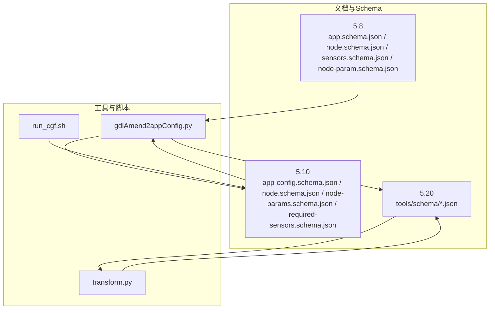
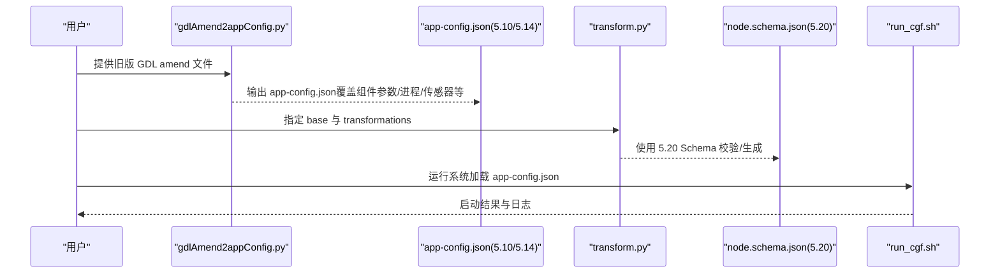
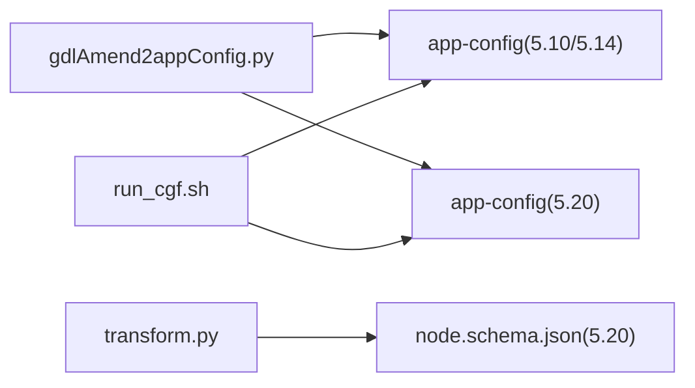
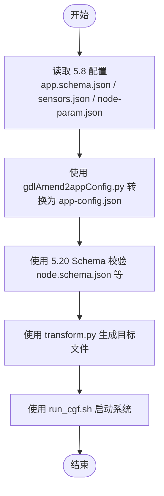

# 配置文件迁移

<cite>
**本文引用的文件**
- [doc/3-drive-works-infra/7-基于json的cgf设计/5.8/app.schema.json](file://doc/3-drive-works-infra/7-基于json的cgf设计/5.8/app.schema.json)
- [doc/3-drive-works-infra/7-基于json的cgf设计/5.8/node.schema.json](file://doc/3-drive-works-infra/7-基于json的cgf设计/5.8/node.schema.json)
- [doc/3-drive-works-infra/7-基于json的cgf设计/5.8/sensors.schema.json](file://doc/3-drive-works-infra/7-基于json的cgf设计/5.8/sensors.schema.json)
- [doc/3-drive-works-infra/7-基于json的cgf设计/5.8/node-param.schema.json](file://doc/3-drive-works-infra/7-基于json的cgf设计/5.8/node-param.schema.json)
- [doc/3-drive-works-infra/7-基于json的cgf设计/5.10/app-config.schema.json](file://doc/3-drive-works-infra/7-基于json的cgf设计/5.10/app-config.schema.json)
- [doc/3-drive-works-infra/7-基于json的cgf设计/5.10/node.schema.json](file://doc/3-drive-works-infra/7-基于json的cgf设计/5.10/node.schema.json)
- [doc/3-drive-works-infra/7-基于json的cgf设计/5.10/node-params.schema.json](file://doc/3-drive-works-infra/7-基于json的cgf设计/5.10/node-params.schema.json)
- [doc/3-drive-works-infra/7-基于json的cgf设计/5.10/required-sensors.schema.json](file://doc/3-drive-works-infra/7-基于json的cgf设计/5.10/required-sensors.schema.json)
- [driveworks-520/tools/schema/app-config.schema.json](file://driveworks-520/tools/schema/app-config.schema.json)
- [driveworks-520/tools/schema/node.schema.json](file://driveworks-520/tools/schema/node.schema.json)
- [driveworks-520/tools/schema/node-params.schema.json](file://driveworks-520/tools/schema/node-params.schema.json)
- [driverorks-5.10/src/dwcgf/dwcgf/cli/gdlAmend2appConfig.py](file://driverorks-5.10/src/dwcgf/dwcgf/cli/gdlAmend2appConfig.py)
- [driverorks-5.10/src/dwcgf/dwcgf/cli/transform.py](file://driverorks-5.10/src/dwcgf/dwcgf/cli/transform.py)
- [driverorks-5.10/bin/config/run_cgf.sh](file://driverorks-5.10/bin/config/run_cgf.sh)
</cite>

## 目录
1. [简介](#简介)
2. [项目结构](#项目结构)
3. [核心组件](#核心组件)
4. [架构总览](#架构总览)
5. [详细组件分析](#详细组件分析)
6. [依赖分析](#依赖分析)
7. [性能考虑](#性能考虑)
8. [故障排查指南](#故障排查指南)
9. [结论](#结论)
10. [附录](#附录)

## 简介
本指南面向从旧版（如 5.8）到新版（如 5.10/5.14/5.20）DriveWorks CGF 配置格式的迁移工作，重点覆盖以下方面：
- 应用配置与描述文件：app.schema.json、app-config.schema.json 的差异与迁移要点
- 节点与图元描述：node.schema.json、graphlet.schema.json 的字段演进
- 传感器布局与映射：sensors.schema.json、sensor-mappings.schema.json 的结构变化
- 参数集合：node-param.schema.json、node-params.schema.json 的迁移
- 迁移工具链：gdlAmend2appConfig、transform 工具的使用与自动化脚本
- 验证与兼容性：JSON Schema 校验、配置项映射与兼容性检查
- 常见错误诊断与修复

## 项目结构
本仓库中与 CGF 配置迁移直接相关的内容主要分布在：
- 文档与示例：doc/3-drive-works-infra/7-基于json的cgf设计/5.x
- 工具与脚本：driverorks-5.10/src/dwcgf/dwcgf/cli/*.py
- 新版 Schema：driveworks-520/tools/schema/*.json
- 运行脚本：driverorks-5.10/bin/config/run_cgf.sh

图表来源
- [doc/3-drive-works-infra/7-基于json的cgf设计/5.8/app.schema.json:1-475](file://doc/3-drive-works-infra/7-基于json的cgf设计/5.8/app.schema.json#L1-L475)
- [doc/3-drive-works-infra/7-基于json的cgf设计/5.10/app-config.schema.json:1-136](file://doc/3-drive-works-infra/7-基于json的cgf设计/5.10/app-config.schema.json#L1-L136)
- [driveworks-520/tools/schema/app-config.schema.json:1-218](file://driveworks-520/tools/schema/app-config.schema.json#L1-L218)
- [driverorks-5.10/src/dwcgf/dwcgf/cli/gdlAmend2appConfig.py:1-259](file://driverorks-5.10/src/dwcgf/dwcgf/cli/gdlAmend2appConfig.py#L1-L259)
- [driverorks-5.10/src/dwcgf/dwcgf/cli/transform.py:1-171](file://driverorks-5.10/src/dwcgf/dwcgf/cli/transform.py#L1-L171)
- [driverorks-5.10/bin/config/run_cgf.sh:1-412](file://driverorks-5.10/bin/config/run_cgf.sh#L1-L412)

章节来源
- [doc/3-drive-works-infra/7-基于json的cgf设计/5.8/app.schema.json:1-475](file://doc/3-drive-works-infra/7-基于json的cgf设计/5.8/app.schema.json#L1-L475)
- [doc/3-drive-works-infra/7-基于json的cgf设计/5.10/app-config.schema.json:1-136](file://doc/3-drive-works-infra/7-基于json的cgf设计/5.10/app-config.schema.json#L1-L136)
- [driveworks-520/tools/schema/app-config.schema.json:1-218](file://driveworks-520/tools/schema/app-config.schema.json#L1-L218)
- [driverorks-5.10/src/dwcgf/dwcgf/cli/gdlAmend2appConfig.py:1-259](file://driverorks-5.10/src/dwcgf/dwcgf/cli/gdlAmend2appConfig.py#L1-L259)
- [driverorks-5.10/src/dwcgf/dwcgf/cli/transform.py:1-171](file://driverorks-5.10/src/dwcgf/dwcgf/cli/transform.py#L1-L171)
- [driverorks-5.10/bin/config/run_cgf.sh:1-412](file://driverorks-5.10/bin/config/run_cgf.sh#L1-L412)

## 核心组件
- 应用描述与配置
  - 5.8：应用描述由 app.schema.json 定义；参数、连接、进程等在该 Schema 中明确
  - 5.10：新增 app-config.schema.json，用于覆盖应用配置（组件参数、跳过节点、进程 argv、所需传感器等）
  - 5.20：进一步扩展 app-config.schema.json，支持 STM 调度修改、进程可执行目录覆盖、数据合并等
- 节点与图元
  - 5.8/5.10：node.schema.json 描述节点输入输出端口、参数、通过（pass）及处理器类型
  - 5.20：节点 Schema 扩展了处理器类型枚举，增强对新硬件/队列的支持
- 传感器与映射
  - 5.8：sensors.schema.json 定义传感器布局；node-param.schema.json 定义节点参数集
  - 5.10：新增 required-sensors.schema.json；保留 sensors.schema.json 与 node-params.schema.json
  - 5.20：沿用 5.10 的结构，保持向后兼容
- 迁移工具
  - gdlAmend2appConfig.py：将旧版 GDL amend 文件转换为 app-config.json
  - transform.py：基于变换文件对应用或图元进行转换并序列化输出

章节来源
- [doc/3-drive-works-infra/7-基于json的cgf设计/5.8/app.schema.json:1-475](file://doc/3-drive-works-infra/7-基于json的cgf设计/5.8/app.schema.json#L1-L475)
- [doc/3-drive-works-infra/7-基于json的cgf设计/5.8/node.schema.json:1-178](file://doc/3-drive-works-infra/7-基于json的cgf设计/5.8/node.schema.json#L1-L178)
- [doc/3-drive-works-infra/7-基于json的cgf设计/5.8/sensors.schema.json:1-19](file://doc/3-drive-works-infra/7-基于json的cgf设计/5.8/sensors.schema.json#L1-L19)
- [doc/3-drive-works-infra/7-基于json的cgf设计/5.8/node-param.schema.json:1-33](file://doc/3-drive-works-infra/7-基于json的cgf设计/5.8/node-param.schema.json#L1-L33)
- [doc/3-drive-works-infra/7-基于json的cgf设计/5.10/app-config.schema.json:1-136](file://doc/3-drive-works-infra/7-基于json的cgf设计/5.10/app-config.schema.json#L1-L136)
- [doc/3-drive-works-infra/7-基于json的cgf设计/5.10/node.schema.json:1-179](file://doc/3-drive-works-infra/7-基于json的cgf设计/5.10/node.schema.json#L1-L179)
- [doc/3-drive-works-infra/7-基于json的cgf设计/5.10/node-params.schema.json:1-34](file://doc/3-drive-works-infra/7-基于json的cgf设计/5.10/node-params.schema.json#L1-L34)
- [doc/3-drive-works-infra/7-基于json的cgf设计/5.10/required-sensors.schema.json:1-23](file://doc/3-drive-works-infra/7-基于json的cgf设计/5.10/required-sensors.schema.json#L1-L23)
- [driveworks-520/tools/schema/app-config.schema.json:1-218](file://driveworks-520/tools/schema/app-config.schema.json#L1-L218)
- [driveworks-520/tools/schema/node.schema.json:1-182](file://driveworks-520/tools/schema/node.schema.json#L1-L182)
- [driveworks-520/tools/schema/node-params.schema.json:1-34](file://driveworks-520/tools/schema/node-params.schema.json#L1-L34)

## 架构总览
下图展示了从旧版到新版的配置迁移路径与工具链交互：

图表来源
- [driverorks-5.10/src/dwcgf/dwcgf/cli/gdlAmend2appConfig.py:120-227](file://driverorks-5.10/src/dwcgf/dwcgf/cli/gdlAmend2appConfig.py#L120-L227)
- [doc/3-drive-works-infra/7-基于json的cgf设计/5.10/app-config.schema.json:1-136](file://doc/3-drive-works-infra/7-基于json的cgf设计/5.10/app-config.schema.json#L1-L136)
- [driveworks-520/tools/schema/app-config.schema.json:1-218](file://driveworks-520/tools/schema/app-config.schema.json#L1-L218)
- [driverorks-5.10/src/dwcgf/dwcgf/cli/transform.py:90-162](file://driverorks-5.10/src/dwcgf/dwcgf/cli/transform.py#L90-L162)
- [driveworks-520/tools/schema/node.schema.json:1-182](file://driveworks-520/tools/schema/node.schema.json#L1-L182)
- [driverorks-5.10/bin/config/run_cgf.sh:376-412](file://driverorks-5.10/bin/config/run_cgf.sh#L376-L412)

## 详细组件分析

### 应用配置迁移（app-config）
- 5.8 到 5.10 变化要点
  - 新增 app-config.schema.json，用于覆盖组件参数、跳过节点、进程 argv、所需传感器等
  - 保留 app.schema.json 作为应用描述文件，app-config.json 作为覆盖层
- 5.10 到 5.20 变化要点
  - app-config.schema.json 扩展：支持修改 STM hyperepoch/epoch 周期、监控阈值、进程可执行目录覆盖、数据合并等
  - 保留“组件参数覆盖”“跳过节点”“进程 argv”“所需传感器”等键位，便于渐进式迁移

迁移步骤建议
- 使用 gdlAmend2appConfig.py 将旧版 GDL amend 文件转换为 app-config.json（5.10/5.14）
- 在 5.20 环境中，逐步启用新的覆盖能力（如 STM 调度修改、进程数据合并）

章节来源
- [doc/3-drive-works-infra/7-基于json的cgf设计/5.10/app-config.schema.json:1-136](file://doc/3-drive-works-infra/7-基于json的cgf设计/5.10/app-config.schema.json#L1-L136)
- [driveworks-520/tools/schema/app-config.schema.json:1-218](file://driveworks-520/tools/schema/app-config.schema.json#L1-L218)
- [driverorks-5.10/src/dwcgf/dwcgf/cli/gdlAmend2appConfig.py:120-227](file://driverorks-5.10/src/dwcgf/dwcgf/cli/gdlAmend2appConfig.py#L120-L227)

### 节点与图元描述迁移（node）
- 5.8 → 5.10
  - 节点 Schema 基本一致，保持输入输出端口、参数、通过（pass）、处理器类型等字段
- 5.10 → 5.20
  - 处理器类型枚举扩展（新增 CUDLA、VULKAN_QUEUE、LDC、NV2D 等），需更新节点描述中的处理器类型
  - 保持端口绑定、数组大小、依赖关系等语义不变

迁移步骤建议
- 对照 5.20 的 node.schema.json 更新节点描述中的处理器类型
- 使用 transform.py 基于 5.20 Schema 校验并生成目标文件

章节来源
- [doc/3-drive-works-infra/7-基于json的cgf设计/5.8/node.schema.json:1-178](file://doc/3-drive-works-infra/7-基于json的cgf设计/5.8/node.schema.json#L1-L178)
- [doc/3-drive-works-infra/7-基于json的cgf设计/5.10/node.schema.json:1-179](file://doc/3-drive-works-infra/7-基于json的cgf设计/5.10/node.schema.json#L1-L179)
- [driveworks-520/tools/schema/node.schema.json:1-182](file://driveworks-520/tools/schema/node.schema.json#L1-L182)
- [driverorks-5.10/src/dwcgf/dwcgf/cli/transform.py:90-162](file://driverorks-5.10/src/dwcgf/dwcgf/cli/transform.py#L90-L162)

### 传感器配置迁移（sensors 与 required-sensors）
- 5.8
  - sensors.schema.json：定义传感器布局名称到传感器索引数组的映射
  - node-param.schema.json：定义节点参数集（按参数名到值的映射）
- 5.10
  - required-sensors.schema.json：定义所需传感器及其属性（如 typeIndex）
  - 保留 sensors.schema.json 与 node-params.schema.json
- 5.20
  - 结构保持与 5.10 一致，继续使用

迁移步骤建议
- 将 5.8 的传感器布局与参数集映射到 5.10/5.20 的对应 Schema
- 必要时在 app-config.json 中通过 requiredSensors 字段调整所需传感器

章节来源
- [doc/3-drive-works-infra/7-基于json的cgf设计/5.8/sensors.schema.json:1-19](file://doc/3-drive-works-infra/7-基于json的cgf设计/5.8/sensors.schema.json#L1-L19)
- [doc/3-drive-works-infra/7-基于json的cgf设计/5.8/node-param.schema.json:1-33](file://doc/3-drive-works-infra/7-基于json的cgf设计/5.8/node-param.schema.json#L1-L33)
- [doc/3-drive-works-infra/7-基于json的cgf设计/5.10/required-sensors.schema.json:1-23](file://doc/3-drive-works-infra/7-基于json的cgf设计/5.10/required-sensors.schema.json#L1-L23)
- [doc/3-drive-works-infra/7-基于json的cgf设计/5.10/node-params.schema.json:1-34](file://doc/3-drive-works-infra/7-基于json的cgf设计/5.10/node-params.schema.json#L1-L34)
- [driveworks-520/tools/schema/node-params.schema.json:1-34](file://driveworks-520/tools/schema/node-params.schema.json#L1-L34)

### 图元与通道设置
- 5.8/5.10/5.20 均提供 graphlet.schema.json（未在本节展开具体字段，但可参照 node.schema.json 的模式理解图元描述）
- 通道设置通常在节点描述中体现（输入/输出端口、数组大小、绑定要求等），迁移时需确保端口命名与类型一致

章节来源
- [doc/3-drive-works-infra/7-基于json的cgf设计/5.8/node.schema.json:34-74](file://doc/3-drive-works-infra/7-基于json的cgf设计/5.8/node.schema.json#L34-L74)
- [doc/3-drive-works-infra/7-基于json的cgf设计/5.10/node.schema.json:34-74](file://doc/3-drive-works-infra/7-基于json的cgf设计/5.10/node.schema.json#L34-L74)
- [driveworks-520/tools/schema/node.schema.json:34-74](file://driveworks-520/tools/schema/node.schema.json#L34-L74)

### 应用程序配置（app）
- 5.8：应用描述包含名称、日志规范、子组件、连接、状态机、进程等
- 5.10/5.20：沿用应用描述 Schema，配合 app-config.json 实现运行时覆盖

章节来源
- [doc/3-drive-works-infra/7-基于json的cgf设计/5.8/app.schema.json:1-475](file://doc/3-drive-works-infra/7-基于json的cgf设计/5.8/app.schema.json#L1-L475)

## 依赖分析
- 工具链依赖
  - gdlAmend2appConfig.py 依赖 5.10/5.14 的 app-config.schema.json 或 5.20 的 app-config.schema.json
  - transform.py 依赖 5.20 的 node.schema.json 与其他 Schema
- 运行时依赖
  - run_cgf.sh 加载 app-config.json 并启动系统

图表来源
- [driverorks-5.10/src/dwcgf/dwcgf/cli/gdlAmend2appConfig.py:120-227](file://driverorks-5.10/src/dwcgf/dwcgf/cli/gdlAmend2appConfig.py#L120-L227)
- [doc/3-drive-works-infra/7-基于json的cgf设计/5.10/app-config.schema.json:1-136](file://doc/3-drive-works-infra/7-基于json的cgf设计/5.10/app-config.schema.json#L1-L136)
- [driveworks-520/tools/schema/app-config.schema.json:1-218](file://driveworks-520/tools/schema/app-config.schema.json#L1-L218)
- [driverorks-5.10/src/dwcgf/dwcgf/cli/transform.py:90-162](file://driverorks-5.10/src/dwcgf/dwcgf/cli/transform.py#L90-L162)
- [driveworks-520/tools/schema/node.schema.json:1-182](file://driveworks-520/tools/schema/node.schema.json#L1-L182)
- [driverorks-5.10/bin/config/run_cgf.sh:376-412](file://driverorks-5.10/bin/config/run_cgf.sh#L376-L412)

## 性能考虑
- 使用 5.20 的 node.schema.json 扩展处理器类型（如 VULKAN_QUEUE、CUDLA）可提升特定算子的执行效率
- 在 app-config.json 中合理设置 STM hyperepoch/epoch 周期与监控阈值，有助于系统调度稳定性
- 通过 transform.py 基于 5.20 Schema 生成目标文件，减少运行时校验开销

## 故障排查指南
- gdlAmend2appConfig.py 常见问题
  - 输入 amend 文件为空：跳过并提示
  - 非 GDL amend 文件：跳过并提示
  - 未识别的字段：打印警告并继续处理
  - 输出文件命名：将 .json 替换为 .app-config.json
- transform.py 常见问题
  - base 必须是应用或图元文件
  - 变换文件必须存在且可加载
  - 自定义动作模块需继承 Action 并具备 action_type 属性
- 运行时问题
  - run_cgf.sh 会检查网络栈、消息队列、NvSCI 配置等，若不满足要求会给出明确提示
  - 日志输出至 LogFolder，可通过查看 launcher.log 排查启动失败原因

章节来源
- [driverorks-5.10/src/dwcgf/dwcgf/cli/gdlAmend2appConfig.py:120-227](file://driverorks-5.10/src/dwcgf/dwcgf/cli/gdlAmend2appConfig.py#L120-L227)
- [driverorks-5.10/src/dwcgf/dwcgf/cli/transform.py:90-162](file://driverorks-5.10/src/dwcgf/dwcgf/cli/transform.py#L90-L162)
- [driverorks-5.10/bin/config/run_cgf.sh:141-276](file://driverorks-5.10/bin/config/run_cgf.sh#L141-L276)

## 结论
- 从 5.8 迁移到 5.10/5.14/5.20 的关键在于引入 app-config.json 作为覆盖层，并在 5.20 中充分利用其增强能力
- 节点描述的处理器类型扩展与 Schema 校验应同步更新
- 使用 gdlAmend2appConfig.py 与 transform.py 构建自动化迁移流水线，结合 run_cgf.sh 验证运行效果

## 附录
- 迁移流程图（概念性）

