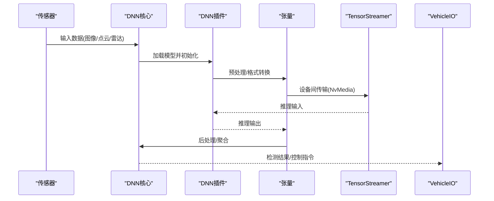
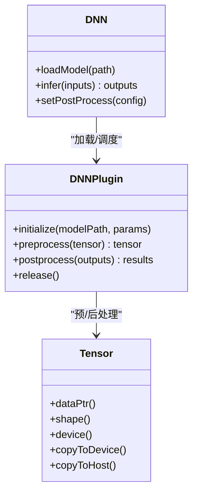
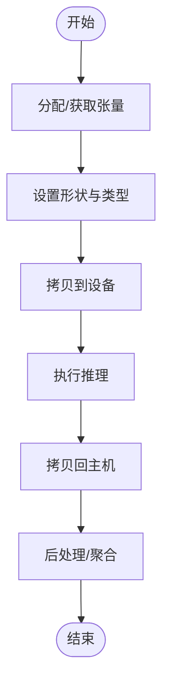
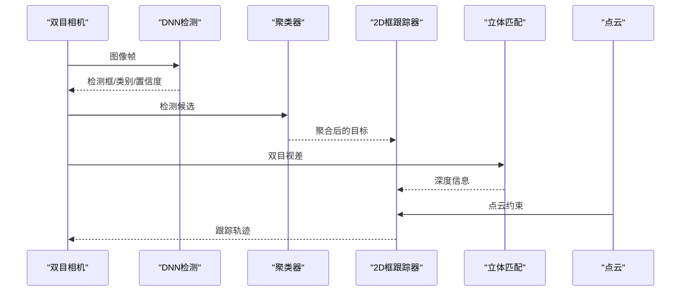
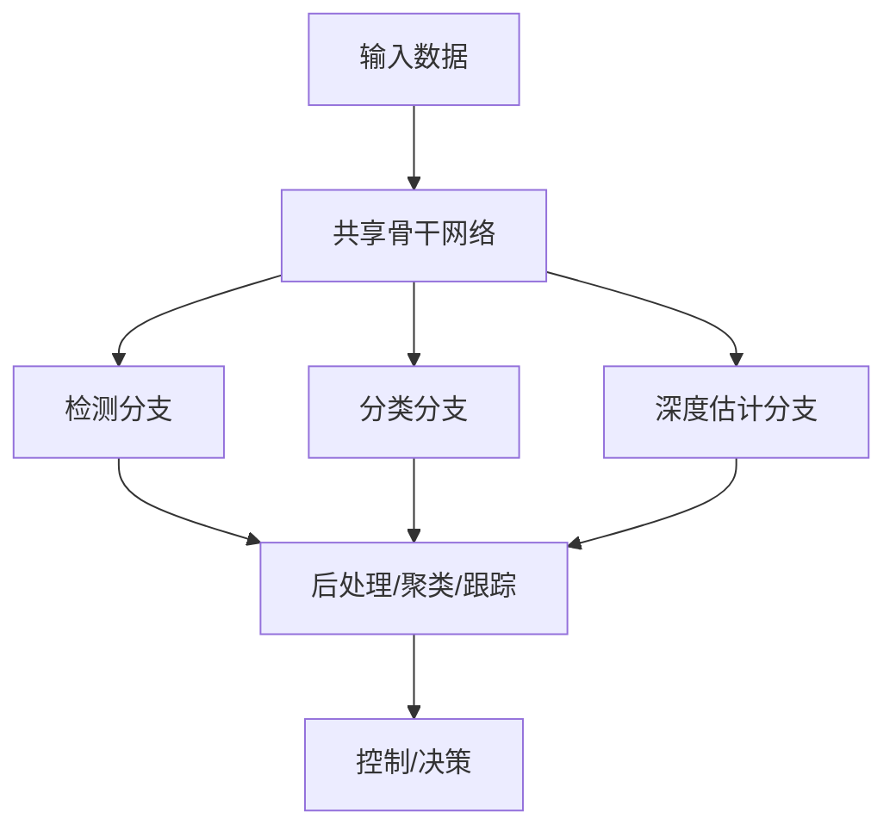
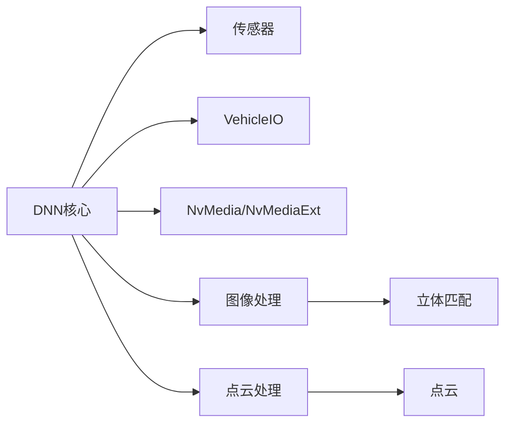

# DNN示例

<cite>
**本文引用的文件**
- [README-tensorRT_optimization.md](file://driverorks-5.10/tools/dnn/README-tensorRT_optimization.md)
- [README-tensorRT_optimization.md](file://driveworks-5.8/tools/dnn/README-tensorRT_optimization.md)
- [DNN.h](file://driverorks-5.10/include/dw/dnn/DNN.h)
- [DNNPlugin.h](file://driverorks-5.10/include/dw/dnn/plugin/DNNPlugin.h)
- [Tensor.h](file://driverorks-5.10/include/dw/dnn/tensor/Tensor.h)
- [DataConditioner.h](file://driverorks-5.10/include/dw/dnn/DataConditioner.h)
- [NvMedia.h](file://driverorks-5.10/include/dw/core/system/NvMedia.h)
- [NvMediaExt.h](file://driverorks-5.10/include/dw/core/system/NvMediaExt.h)
- [TensorStreamer.h](file://driverorks-5.10/include/dw/interop/streamer/TensorStreamer.h)
- [Clusterer.h](file://driverorks-5.10/include/dw/dnn/Clusterer.h)
- [BoxTracker2D.h](file://driverorks-5.10/include/dw/imageprocessing/tracking/BoxTracker2D.h)
- [Stereo.h](file://driverorks-5.10/include/dw/imageprocessing/stereo/Stereo.h)
- [PointCloud.h](file://driverorks-5.10/include/dw/pointcloudprocessing/pointcloud/PointCloud.h)
- [PointCloudAssembler.h](file://driverorks-5.10/include/dw/pointcloudprocessing/assembler/PointCloudAssembler.h)
- [PointCloudAccumulator.h](file://driverorks-5.10/include/dw/pointcloudprocessing/accumulator/PointCloudAccumulator.h)
- [PointCloudStitcher.h](file://driverorks-5.10/include/dw/pointcloudprocessing/stitcher/PointCloudStitcher.h)
- [PointCloudPlaneExtractor.h](file://driverorks-5.10/include/dw/pointcloudprocessing/planeextractor/PointCloudPlaneExtractor.h)
- [PointCloudICP.h](file://driverorks-5.10/include/dw/pointcloudprocessing/icp/PointCloudICP.h)
- [PointCloudRangeImageCreator.h](file://driverorks-5.10/include/dw/pointcloudprocessing/rangeimagecreator/PointCloudRangeImageCreator.h)
- [Camera.h](file://driverorks-5.10/include/dw/sensors/camera/Camera.h)
- [Lidar.h](file://driverorks-5.10/include/dw/sensors/lidar/Lidar.h)
- [IMU.h](file://driverorks-5.10/include/dw/sensors/imu/IMU.h)
- [GPS.h](file://driverorks-5.10/include/dw/sensors/gps/GPS.h)
- [Radar.h](file://driverorks-5.10/include/dw/sensors/radar/Radar.h)
- [VehicleIO.h](file://driverorks-5.10/include/dw/control/vehicleio/VehicleIO.h)
- [VehicleIODriver.h](file://driverorks-5.10/include/dw/control/vehicleio/plugins/VehicleIODriver.h)
- [Image.h](file://driverorks-5.10/include/dw/image/Image.h)
- [ImageProcessingCommon.h](file://driverorks-5.10/include/dw/imageprocessing/common/ImageProcessingCommon.h)
- [Pyramid.h](file://driverorks-5.10/include/dw/imageprocessing/filtering/Pyramid.h)
- [Threshold.h](file://driverorks-5.10/include/dw/imageprocessing/filtering/Threshold.h)
- [ConnectedComponents.h](file://driverorks-5.10/include/dw/imageprocessing/ccl/ConnectedComponents.h)
- [FeatureDetector.h](file://driverorks-5.10/include/dw/imageprocessing/featuredetector/FeatureDetector.h)
- [FeatureList.h](file://driverorks-5.10/include/dw/imageprocessing/features/FeatureList.h)
- [SFM.h](file://driverorks-5.10/include/dw/imageprocessing/sfm/SFM.h)
- [Egomotion.h](file://driverorks-5.10/include/dw/egomotion/Egomotion.h)
- [GlobalEgomotion.h](file://driverorks-5.10/include/dw/egomotion/global/GlobalEgomotion.h)
- [DopplerMotionEstimator.h](file://driverorks-5.10/include/dw/egomotion/radar/DopplerMotionEstimator.h)
- [Driveworks.h](file://driverorks-5.10/include/dw/Driveworks.h)
</cite>

## 目录
1. [简介](#简介)
2. [项目结构](#项目结构)
3. [核心组件](#核心组件)
4. [架构总览](#架构总览)
5. [详细组件分析](#详细组件分析)
6. [依赖关系分析](#依赖关系分析)
7. [性能考量](#性能考量)
8. [故障排查指南](#故障排查指南)
9. [结论](#结论)
10. [附录](#附录)

## 简介
本文件围绕DriveWorks中的DNN（深度神经网络）示例与工具链，系统性阐述在自动驾驶场景中如何使用DNN进行目标检测、跟踪与多模态感知。内容涵盖：
- DNN插件系统的开发：模型加载、推理接口与结果后处理的完整流程
- 张量操作与管理：数据格式转换、内存管理与GPU加速优化
- 目标检测与跟踪：YOLO、SSD等主流检测算法的集成与优化思路
- 训练与部署最佳实践：量化、剪枝与加速技术
- 多任务学习与实时推理：模型融合与延迟优化
- 完整的代码示例路径与性能基准测试建议

## 项目结构
本仓库包含多个版本的DriveWorks源码与工具，其中与DNN相关的核心头文件集中在include/dw/dnn及其子目录，同时提供TensorRT优化工具与模板配置文件。下图展示了与DNN示例相关的顶层结构与关键模块。

```mermaid
graph TB
subgraph "DNN核心"
DNN["DNN.h"]
DNNPlugin["DNNPlugin.h"]
Tensor["Tensor.h"]
DataCond["DataConditioner.h"]
Clusterer["Clusterer.h"]
end
subgraph "系统与硬件抽象"
NvMedia["NvMedia.h"]
NvMediaExt["NvMediaExt.h"]
TensorStreamer["TensorStreamer.h"]
end
subgraph "传感器与感知"
Camera["Camera.h"]
Lidar["Lidar.h"]
IMU["IMU.h"]
GPS["GPS.h"]
Radar["Radar.h"]
Stereo["Stereo.h"]
end
subgraph "点云处理"
PC["PointCloud.h"]
Assemble["PointCloudAssembler.h"]
Acc["PointCloudAccumulator.h"]
Stitch["PointCloudStitcher.h"]
Plane["PointCloudPlaneExtractor.h"]
ICP["PointCloudICP.h"]
RangeImg["PointCloudRangeImageCreator.h"]
end
subgraph "图像处理"
Img["Image.h"]
ImgCommon["ImageProcessingCommon.h"]
Pyramid["Pyramid.h"]
Threshold["Threshold.h"]
CC["ConnectedComponents.h"]
FD["FeatureDetector.h"]
FL["FeatureList.h"]
SFM["SFM.h"]
end
subgraph "控制与车辆"
VIO["VehicleIO.h"]
VIDrv["VehicleIODriver.h"]
end
DNN --> Tensor
DNNPlugin --> DNN
DataCond --> DNN
Clusterer --> DNN
TensorStreamer --> Tensor
NvMedia --> DNN
NvMediaExt --> DNN
Camera --> DNN
Lidar --> DNN
Radar --> DNN
Stereo --> DNN
PC --> DNN
Assemble --> PC
Acc --> PC
Stitch --> PC
Plane --> PC
ICP --> PC
RangeImg --> PC
Img --> DNN
ImgCommon --> Img
FD --> Img
FL --> Img
SFM --> Img
VIO --> DNN
VIDrv --> VIO
```

**图表来源**
- [DNN.h](file://driverorks-5.10/include/dw/dnn/DNN.h)
- [DNNPlugin.h](file://driverorks-5.10/include/dw/dnn/plugin/DNNPlugin.h)
- [Tensor.h](file://driverorks-5.10/include/dw/dnn/tensor/Tensor.h)
- [DataConditioner.h](file://driverorks-5.10/include/dw/dnn/DataConditioner.h)
- [Clusterer.h](file://driverorks-5.10/include/dw/dnn/Clusterer.h)
- [NvMedia.h](file://driverorks-5.10/include/dw/core/system/NvMedia.h)
- [NvMediaExt.h](file://driverorks-5.10/include/dw/core/system/NvMediaExt.h)
- [TensorStreamer.h](file://driverorks-5.10/include/dw/interop/streamer/TensorStreamer.h)
- [Camera.h](file://driverorks-5.10/include/dw/sensors/camera/Camera.h)
- [Lidar.h](file://driverorks-5.10/include/dw/sensors/lidar/Lidar.h)
- [IMU.h](file://driverorks-5.10/include/dw/sensors/imu/IMU.h)
- [GPS.h](file://driverorks-5.10/include/dw/sensors/gps/GPS.h)
- [Radar.h](file://driverorks-5.10/include/dw/sensors/radar/Radar.h)
- [Stereo.h](file://driverorks-5.10/include/dw/imageprocessing/stereo/Stereo.h)
- [PointCloud.h](file://driverorks-5.10/include/dw/pointcloudprocessing/pointcloud/PointCloud.h)
- [PointCloudAssembler.h](file://driverorks-5.10/include/dw/pointcloudprocessing/assembler/PointCloudAssembler.h)
- [PointCloudAccumulator.h](file://driverorks-5.10/include/dw/pointcloudprocessing/accumulator/PointCloudAccumulator.h)
- [PointCloudStitcher.h](file://driverorks-5.10/include/dw/pointcloudprocessing/stitcher/PointCloudStitcher.h)
- [PointCloudPlaneExtractor.h](file://driverorks-5.10/include/dw/pointcloudprocessing/planeextractor/PointCloudPlaneExtractor.h)
- [PointCloudICP.h](file://driverorks-5.10/include/dw/pointcloudprocessing/icp/PointCloudICP.h)
- [PointCloudRangeImageCreator.h](file://driverorks-5.10/include/dw/pointcloudprocessing/rangeimagecreator/PointCloudRangeImageCreator.h)
- [Image.h](file://driverorks-5.10/include/dw/image/Image.h)
- [ImageProcessingCommon.h](file://driverorks-5.10/include/dw/imageprocessing/common/ImageProcessingCommon.h)
- [Pyramid.h](file://driverorks-5.10/include/dw/imageprocessing/filtering/Pyramid.h)
- [Threshold.h](file://driverorks-5.10/include/dw/imageprocessing/filtering/Threshold.h)
- [ConnectedComponents.h](file://driverorks-5.10/include/dw/imageprocessing/ccl/ConnectedComponents.h)
- [FeatureDetector.h](file://driverorks-5.10/include/dw/imageprocessing/featuredetector/FeatureDetector.h)
- [FeatureList.h](file://driverorks-5.10/include/dw/imageprocessing/features/FeatureList.h)
- [SFM.h](file://driverorks-5.10/include/dw/imageprocessing/sfm/SFM.h)
- [VehicleIO.h](file://driverorks-5.10/include/dw/control/vehicleio/VehicleIO.h)
- [VehicleIODriver.h](file://driverorks-5.10/include/dw/control/vehicleio/plugins/VehicleIODriver.h)

**章节来源**
- [DNN.h](file://driverorks-5.10/include/dw/dnn/DNN.h)
- [DNNPlugin.h](file://driverorks-5.10/include/dw/dnn/plugin/DNNPlugin.h)
- [Tensor.h](file://driverorks-5.10/include/dw/dnn/tensor/Tensor.h)
- [DataConditioner.h](file://driverorks-5.10/include/dw/dnn/DataConditioner.h)
- [Clusterer.h](file://driverorks-5.10/include/dw/dnn/Clusterer.h)
- [NvMedia.h](file://driverorks-5.10/include/dw/core/system/NvMedia.h)
- [NvMediaExt.h](file://driverorks-5.10/include/dw/core/system/NvMediaExt.h)
- [TensorStreamer.h](file://driverorks-5.10/include/dw/interop/streamer/TensorStreamer.h)

## 核心组件
本节聚焦DNN示例的关键组件与职责：
- DNN核心接口：负责模型加载、推理调度与结果输出
- 插件机制：扩展自定义推理节点，支持不同模型格式与后处理
- 张量抽象：统一数据格式、内存布局与设备间传输
- 数据预处理与后处理：输入条件化与检测结果聚合
- 车辆控制与传感器：为DNN提供输入数据与执行反馈

**章节来源**
- [DNN.h](file://driverorks-5.10/include/dw/dnn/DNN.h)
- [DNNPlugin.h](file://driverorks-5.10/include/dw/dnn/plugin/DNNPlugin.h)
- [Tensor.h](file://driverorks-5.10/include/dw/dnn/tensor/Tensor.h)
- [DataConditioner.h](file://driverorks-5.10/include/dw/dnn/DataConditioner.h)
- [VehicleIO.h](file://driverorks-5.10/include/dw/control/vehicleio/VehicleIO.h)

## 架构总览
下图展示了从传感器输入到DNN推理再到后处理与控制输出的整体流程，以及与NVIDIA媒体栈（NvMedia/NvMediaExt）的协同关系。

**图表来源**
- [DNN.h](file://driverorks-5.10/include/dw/dnn/DNN.h)
- [DNNPlugin.h](file://driverorks-5.10/include/dw/dnn/plugin/DNNPlugin.h)
- [Tensor.h](file://driverorks-5.10/include/dw/dnn/tensor/Tensor.h)
- [TensorStreamer.h](file://driverorks-5.10/include/dw/interop/streamer/TensorStreamer.h)
- [NvMedia.h](file://driverorks-5.10/include/dw/core/system/NvMedia.h)
- [NvMediaExt.h](file://driverorks-5.10/include/dw/core/system/NvMediaExt.h)
- [VehicleIO.h](file://driverorks-5.10/include/dw/control/vehicleio/VehicleIO.h)

## 详细组件分析

### DNN插件系统
DNN插件通过统一接口接入DNN核心，支持不同模型格式与后处理逻辑。其典型流程如下：

- 模型加载：根据模型类型（ONNX/UFF/CAFFE）与参数完成初始化
- 推理接口：接收张量输入，返回张量输出
- 结果后处理：将张量输出映射为检测框、类别与置信度等结构化结果

**图表来源**
- [DNN.h](file://driverorks-5.10/include/dw/dnn/DNN.h)
- [DNNPlugin.h](file://driverorks-5.10/include/dw/dnn/plugin/DNNPlugin.h)
- [Tensor.h](file://driverorks-5.10/include/dw/dnn/tensor/Tensor.h)

**章节来源**
- [DNN.h](file://driverorks-5.10/include/dw/dnn/DNN.h)
- [DNNPlugin.h](file://driverorks-5.10/include/dw/dnn/plugin/DNNPlugin.h)

### 张量操作与管理
张量是DNN数据的统一表示，负责跨设备（CPU/GPU/NVENC/NVDEC/NvMedia）的数据搬运与格式转换。关键能力包括：
- 数据指针访问与形状查询
- 设备间拷贝（主机/设备）
- 批次与通道维度管理（CHW等）
- 与NvMedia/NvSci的互操作以提升带宽与降低拷贝开销

**图表来源**
- [Tensor.h](file://driverorks-5.10/include/dw/dnn/tensor/Tensor.h)
- [NvMedia.h](file://driverorks-5.10/include/dw/core/system/NvMedia.h)
- [NvMediaExt.h](file://driverorks-5.10/include/dw/core/system/NvMediaExt.h)

**章节来源**
- [Tensor.h](file://driverorks-5.10/include/dw/dnn/tensor/Tensor.h)
- [NvMedia.h](file://driverorks-5.10/include/dw/core/system/NvMedia.h)
- [NvMediaExt.h](file://driverorks-5.10/include/dw/core/system/NvMediaExt.h)

### 目标检测与跟踪（YOLO/SSD等）
在DriveWorks中，目标检测通常由DNN插件完成，随后通过聚类器与跟踪器进行结果聚合与轨迹维护：
- 聚类器：对检测框进行聚类，合并相似目标
- 2D框跟踪器：基于IoU/特征的多目标跟踪
- 立体匹配：利用双目相机进行深度估计与空间关联
- 点云辅助：激光雷达提供高精度三维信息，与图像检测融合

**图表来源**
- [Clusterer.h](file://driverorks-5.10/include/dw/dnn/Clusterer.h)
- [BoxTracker2D.h](file://driverorks-5.10/include/dw/imageprocessing/tracking/BoxTracker2D.h)
- [Stereo.h](file://driverorks-5.10/include/dw/imageprocessing/stereo/Stereo.h)
- [PointCloud.h](file://driverorks-5.10/include/dw/pointcloudprocessing/pointcloud/PointCloud.h)

**章节来源**
- [Clusterer.h](file://driverorks-5.10/include/dw/dnn/Clusterer.h)
- [BoxTracker2D.h](file://driverorks-5.10/include/dw/imageprocessing/tracking/BoxTracker2D.h)
- [Stereo.h](file://driverorks-5.10/include/dw/imageprocessing/stereo/Stereo.h)
- [PointCloud.h](file://driverorks-5.10/include/dw/pointcloudprocessing/pointcloud/PointCloud.h)

### 多任务学习与实时推理
多任务学习可通过共享骨干网络实现，例如同时输出检测框、类别与深度信息；实时推理则依赖于：
- TensorRT优化与量化（INT8/FP16）
- DLA（深度学习加速器）执行与安全模式
- CUDA Graph与流式传输（TensorStreamer/NvMedia）

**图表来源**
- [README-tensorRT_optimization.md](file://driverorks-5.10/tools/dnn/README-tensorRT_optimization.md)
- [TensorStreamer.h](file://driverorks-5.10/include/dw/interop/streamer/TensorStreamer.h)
- [NvMedia.h](file://driverorks-5.10/include/dw/core/system/NvMedia.h)

**章节来源**
- [README-tensorRT_optimization.md](file://driverorks-5.10/tools/dnn/README-tensorRT_optimization.md)
- [TensorStreamer.h](file://driverorks-5.10/include/dw/interop/streamer/TensorStreamer.h)

### 训练与部署最佳实践
- 模型格式：优先采用ONNX以获得更好的兼容性与自动批处理支持
- 量化：INT8校准缓存与精度配置文件结合，确保关键层的缩放因子正确
- 精度混合：对非关键层采用半精度，减少带宽与功耗
- DLA：在支持DLA的平台上启用安全模式，保证输入/输出张量格式与精度一致
- CUDA Graph：对稳定拓扑的网络启用图执行以降低启动开销

**章节来源**
- [README-tensorRT_optimization.md](file://driverorks-5.10/tools/dnn/README-tensorRT_optimization.md)
- [README-tensorRT_optimization.md](file://driveworks-5.8/tools/dnn/README-tensorRT_optimization.md)

## 依赖关系分析
DNN模块与系统其他模块存在紧密耦合：
- 传感器模块提供输入数据（图像/点云/雷达）
- NvMedia/NvMediaExt负责设备间高效传输
- 控制模块消费DNN输出并驱动车辆行为
- 图像与点云处理模块为DNN提供预处理与后处理支撑

**图表来源**
- [DNN.h](file://driverorks-5.10/include/dw/dnn/DNN.h)
- [VehicleIO.h](file://driverorks-5.10/include/dw/control/vehicleio/VehicleIO.h)
- [NvMedia.h](file://driverorks-5.10/include/dw/core/system/NvMedia.h)
- [NvMediaExt.h](file://driverorks-5.10/include/dw/core/system/NvMediaExt.h)
- [Image.h](file://driverorks-5.10/include/dw/image/Image.h)
- [PointCloud.h](file://driverorks-5.10/include/dw/pointcloudprocessing/pointcloud/PointCloud.h)

**章节来源**
- [DNN.h](file://driverorks-5.10/include/dw/dnn/DNN.h)
- [VehicleIO.h](file://driverorks-5.10/include/dw/control/vehicleio/VehicleIO.h)
- [NvMedia.h](file://driverorks-5.10/include/dw/core/system/NvMedia.h)
- [NvMediaExt.h](file://driverorks-5.10/include/dw/core/system/NvMediaExt.h)
- [Image.h](file://driverorks-5.10/include/dw/image/Image.h)
- [PointCloud.h](file://driverorks-5.10/include/dw/pointcloudprocessing/pointcloud/PointCloud.h)

## 性能考量
- 内存管理：优先使用设备侧张量，减少主机/设备往返；合理设置工作区内存上限
- 并行与流水线：利用多流或多批次提升吞吐；结合CUDA Graph降低启动时延
- 精度选择：在保证精度的前提下尽可能采用半精度或INT8量化
- DLA：在支持DLA的平台启用安全模式，确保NvMedia张量格式与精度一致
- 传感器同步：确保时间戳与触发信号对齐，避免推理等待

## 故障排查指南
- 模型加载失败：检查模型类型与参数是否匹配，确认输入/输出blob名称与维度
- 推理异常：验证输入张量形状与精度，核对校准缓存与精度配置
- 设备间传输错误：检查NvMedia句柄有效性与内存对齐，确认拷贝方向
- 实时性不足：启用CUDA Graph与DLA，减少主机端拷贝与锁竞争

**章节来源**
- [README-tensorRT_optimization.md](file://driverorks-5.10/tools/dnn/README-tensorRT_optimization.md)
- [Tensor.h](file://driverorks-5.10/include/dw/dnn/tensor/Tensor.h)
- [NvMedia.h](file://driverorks-5.10/include/dw/core/system/NvMedia.h)

## 结论
本文件基于DriveWorks的DNN与工具链，给出了从模型加载、推理接口到结果后处理与实时优化的完整实现路径。通过插件化架构与张量抽象，可灵活集成YOLO/SSD等主流检测算法，并结合多传感器与DLA/CUDA Graph实现高性能、低延迟的自动驾驶感知系统。

## 附录
- 代码示例路径参考
  - 模型优化与量化：[README-tensorRT_optimization.md](file://driverorks-5.10/tools/dnn/README-tensorRT_optimization.md)
  - DNN核心接口：[DNN.h](file://driverorks-5.10/include/dw/dnn/DNN.h)
  - 插件接口：[DNNPlugin.h](file://driverorks-5.10/include/dw/dnn/plugin/DNNPlugin.h)
  - 张量抽象：[Tensor.h](file://driverorks-5.10/include/dw/dnn/tensor/Tensor.h)
  - 数据条件化：[DataConditioner.h](file://driverorks-5.10/include/dw/dnn/DataConditioner.h)
  - 聚类器：[Clusterer.h](file://driverorks-5.10/include/dw/dnn/Clusterer.h)
  - 2D框跟踪器：[BoxTracker2D.h](file://driverorks-5.10/include/dw/imageprocessing/tracking/BoxTracker2D.h)
  - 立体匹配：[Stereo.h](file://driverorks-5.10/include/dw/imageprocessing/stereo/Stereo.h)
  - 点云处理：[PointCloud.h](file://driverorks-5.10/include/dw/pointcloudprocessing/pointcloud/PointCloud.h)
  - 传感器与控制：[Camera.h](file://driverorks-5.10/include/dw/sensors/camera/Camera.h), [Lidar.h](file://driverorks-5.10/include/dw/sensors/lidar/Lidar.h), [IMU.h](file://driverorks-5.10/include/dw/sensors/imu/IMU.h), [GPS.h](file://driverorks-5.10/include/dw/sensors/gps/GPS.h), [Radar.h](file://driverorks-5.10/include/dw/sensors/radar/Radar.h), [VehicleIO.h](file://driverorks-5.10/include/dw/control/vehicleio/VehicleIO.h)