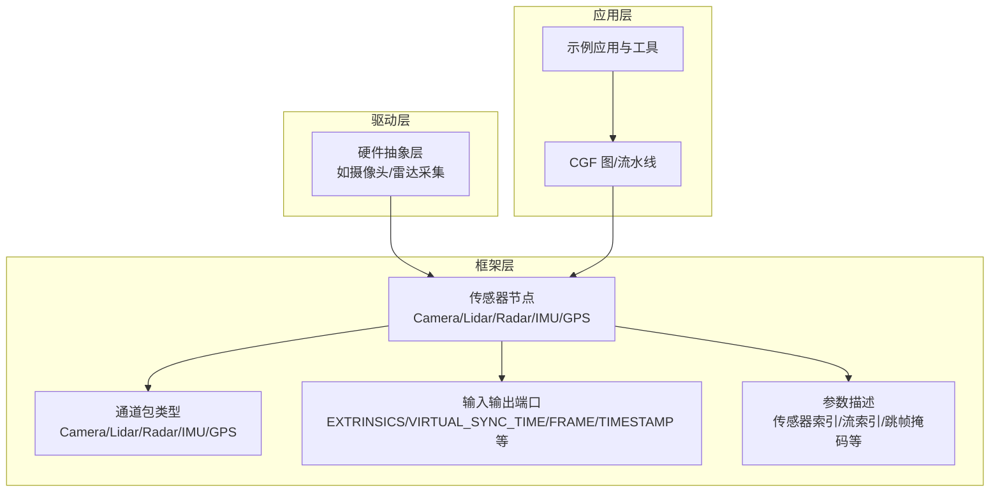
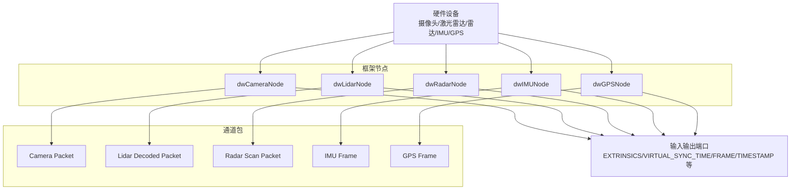
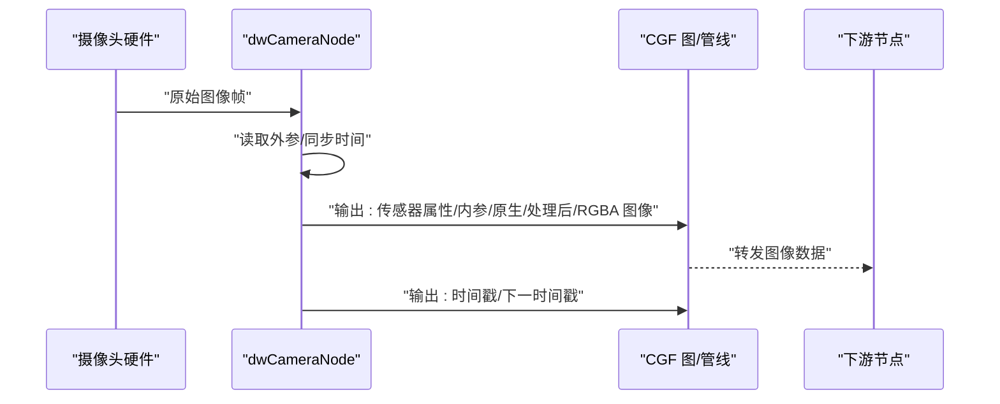
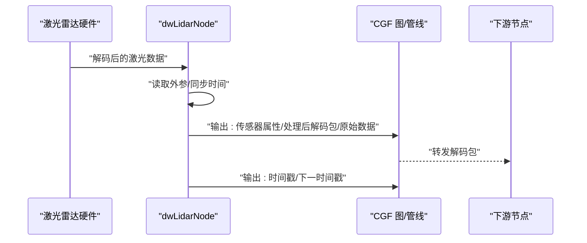
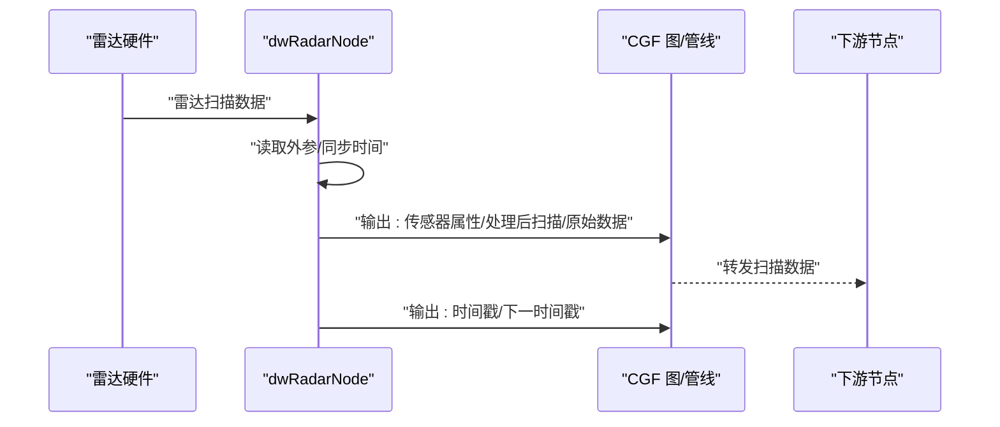
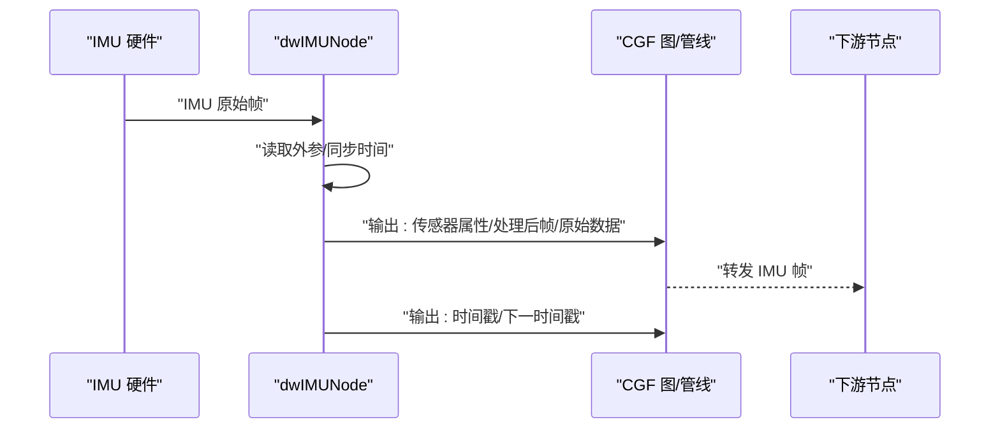
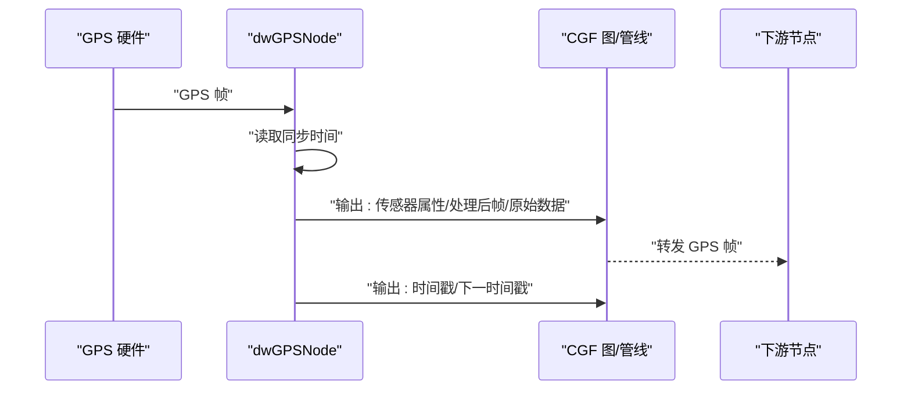
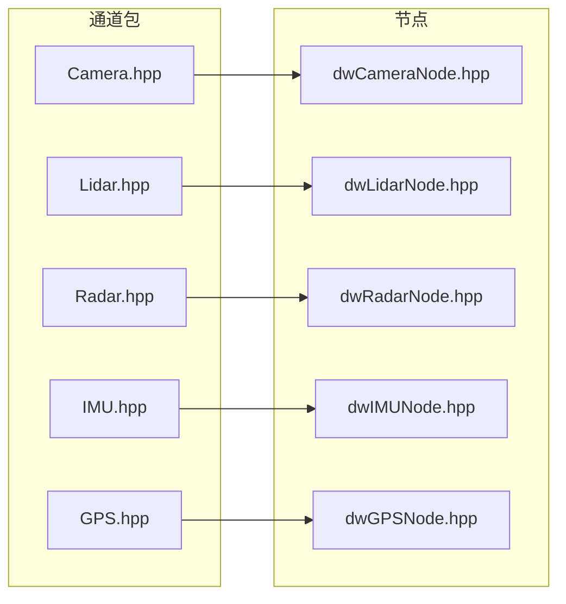

# 传感器示例

<cite>
**本文引用的文件**
- [driverorks-5.10/include/dwframework/dwnodes/common/channelpackets/Camera.hpp](file://driverorks-5.10/include/dwframework/dwnodes/common/channelpackets/Camera.hpp)
- [driverorks-5.10/include/dwframework/dwnodes/common/channelpackets/Lidar.hpp](file://driverorks-5.10/include/dwframework/dwnodes/common/channelpackets/Lidar.hpp)
- [driverorks-5.10/include/dwframework/dwnodes/common/channelpackets/Radar.hpp](file://driverorks-5.10/include/dwframework/dwnodes/common/channelpackets/Radar.hpp)
- [driverorks-5.10/include/dwframework/dwnodes/common/channelpackets/IMU.hpp](file://driverorks-5.10/include/dwframework/dwnodes/common/channelpackets/IMU.hpp)
- [driverorks-5.10/include/dwframework/dwnodes/common/channelpackets/GPS.hpp](file://driverorks-5.10/include/dwframework/dwnodes/common/channelpackets/GPS.hpp)
- [driverorks-5.10/include/dwframework/dwnodes/sensors/dwcameranode/dwCameraNode.hpp](file://driverorks-5.10/include/dwframework/dwnodes/sensors/dwcameranode/dwCameraNode.hpp)
- [driverorks-5.10/include/dwframework/dwnodes/sensors/dwlidarnode/dwLidarNode.hpp](file://driverorks-5.10/include/dwframework/dwnodes/sensors/dwlidarnode/dwLidarNode.hpp)
- [driverorks-5.10/include/dwframework/dwnodes/sensors/dwradarnode/dwRadarNode.hpp](file://driverorks-5.10/include/dwframework/dwnodes/sensors/dwradarnode/dwRadarNode.hpp)
- [driverorks-5.10/include/dwframework/dwnodes/sensors/dwimunode/dwIMUNode.hpp](file://driverorks-5.10/include/dwframework/dwnodes/sensors/dwimunode/dwIMUNode.hpp)
- [driverorks-5.10/include/dwframework/dwnodes/sensors/dwgpsnode/dwGPSNode.hpp](file://driverorks-5.10/include/dwframework/dwnodes/sensors/dwgpsnode/dwGPSNode.hpp)
- [driveworks-5.14/include/dwframework/dwnodes/common/channelpackets/Camera.hpp](file://driveworks-5.14/include/dwframework/dwnodes/common/channelpackets/Camera.hpp)
- [driveworks-5.14/include/dwframework/dwnodes/common/channelpackets/Lidar.hpp](file://driveworks-5.14/include/dwframework/dwnodes/common/channelpackets/Lidar.hpp)
- [driveworks-5.14/include/dwframework/dwnodes/common/channelpackets/Radar.hpp](file://driveworks-5.14/include/dwframework/dwnodes/common/channelpackets/Radar.hpp)
- [driveworks-5.14/include/dwframework/dwnodes/common/channelpackets/IMU.hpp](file://driveworks-5.14/include/dwframework/dwnodes/common/channelpackets/IMU.hpp)
- [driveworks-5.14/include/dwframework/dwnodes/common/channelpackets/GPS.hpp](file://driveworks-5.14/include/dwframework/dwnodes/common/channelpackets/GPS.hpp)
- [driveworks-5.14/include/dwframework/dwnodes/sensors/dwcameranode/dwCameraNode.hpp](file://driveworks-5.14/include/dwframework/dwnodes/sensors/dwcameranode/dwCameraNode.hpp)
- [driveworks-5.14/include/dwframework/dwnodes/sensors/dwlidarnode/dwLidarNode.hpp](file://driveworks-5.14/include/dwframework/dwnodes/sensors/dwlidarnode/dwLidarNode.hpp)
- [driveworks-5.14/include/dwframework/dwnodes/sensors/dwradarnode/dwRadarNode.hpp](file://driveworks-5.14/include/dwframework/dwnodes/sensors/dwradarnode/dwRadarNode.hpp)
- [driveworks-5.14/include/dwframework/dwnodes/sensors/dwimunode/dwIMUNode.hpp](file://driveworks-5.14/include/dwframework/dwnodes/sensors/dwimunode/dwIMUNode.hpp)
- [driveworks-5.14/include/dwframework/dwnodes/sensors/dwgpsnode/dwGPSNode.hpp](file://driveworks-5.14/include/dwframework/dwnodes/sensors/dwgpsnode/dwGPSNode.hpp)
- [driveworks-5.8/include/dwframework/dwnodes/sensors/dwcameranode/dwCameraNode.hpp](file://driveworks-5.8/include/dwframework/dwnodes/sensors/dwcameranode/dwCameraNode.hpp)
- [driveworks-5.8/include/dwframework/dwnodes/sensors/dwlidarnode/dwLidarNode.hpp](file://driveworks-5.8/include/dwframework/dwnodes/sensors/dwlidarnode/dwLidarNode.hpp)
- [driveworks-5.8/include/dwframework/dwnodes/sensors/dwradarnode/dwRadarNode.hpp](file://driveworks-5.8/include/dwframework/dwnodes/sensors/dwradarnode/dwRadarNode.hpp)
- [driveworks-5.8/include/dwframework/dwnodes/sensors/dwimunode/dwIMUNode.hpp](file://driveworks-5.8/include/dwframework/dwnodes/sensors/dwimunode/dwIMUNode.hpp)
- [driveworks-5.8/include/dwframework/dwnodes/sensors/dwgpsnode/dwGPSNode.hpp](file://driveworks-5.8/include/dwframework/dwnodes/sensors/dwgpsnode/dwGPSNode.hpp)
- [driveworks-520/include/dwframework/dwnodes/common/channelpackets/Camera.hpp](file://driveworks-520/include/dwframework/dwnodes/common/channelpackets/Camera.hpp)
- [driveworks-520/include/dwframework/dwnodes/common/channelpackets/Lidar.hpp](file://driveworks-520/include/dwframework/dwnodes/common/channelpackets/Lidar.hpp)
- [driveworks-520/include/dwframework/dwnodes/common/channelpackets/Radar.hpp](file://driveworks-520/include/dwframework/dwnodes/common/channelpackets/Radar.hpp)
- [driveworks-520/include/dwframework/dwnodes/common/channelpackets/IMU.hpp](file://driveworks-520/include/dwframework/dwnodes/common/channelpackets/IMU.hpp)
- [driveworks-520/include/dwframework/dwnodes/common/channelpackets/GPS.hpp](file://driveworks-520/include/dwframework/dwnodes/common/channelpackets/GPS.hpp)
- [driveworks-520/include/dwframework/dwnodes/sensors/dwcameranode/dwCameraNode.hpp](file://driveworks-520/include/dwframework/dwnodes/sensors/dwcameranode/dwCameraNode.hpp)
- [driveworks-520/include/dwframework/dwnodes/sensors/dwlidarnode/dwLidarNode.hpp](file://driveworks-520/include/dwframework/dwnodes/sensors/dwlidarnode/dwLidarNode.hpp)
- [driveworks-520/include/dwframework/dwnodes/sensors/dwradarnode/dwRadarNode.hpp](file://driveworks-520/include/dwframework/dwnodes/sensors/dwradarnode/dwRadarNode.hpp)
- [driveworks-520/include/dwframework/dwnodes/sensors/dwimunode/dwIMUNode.hpp](file://driveworks-520/include/dwframework/dwnodes/sensors/dwimunode/dwIMUNode.hpp)
- [driveworks-520/include/dwframework/dwnodes/sensors/dwgpsnode/dwGPSNode.hpp](file://driveworks-520/include/dwframework/dwnodes/sensors/dwgpsnode/dwGPSNode.hpp)
</cite>

## 目录
1. [引言](#引言)
2. [项目结构](#项目结构)
3. [核心组件](#核心组件)
4. [架构总览](#架构总览)
5. [详细组件分析](#详细组件分析)
6. [依赖关系分析](#依赖关系分析)
7. [性能考量](#性能考量)
8. [故障排查指南](#故障排查指南)
9. [结论](#结论)
10. [附录](#附录)

## 引言
本文件面向使用 DriveWorks 框架进行多传感器集成与数据处理的开发者，系统性梳理摄像头、激光雷达、毫米波雷达、惯性测量单元（IMU）、全球定位系统（GPS）等传感器在框架中的节点化封装、通道包（Channel Packet）定义、输入输出端口描述、参数化构造以及典型数据流处理模式。文档同时给出多传感器融合场景下的时间对齐、坐标变换与数据关联的实践建议，并提供扩展新传感器类型的参考路径。

## 项目结构
本仓库包含多个版本的 DriveWorks 源码与示例，其中与传感器示例直接相关的核心位置如下：
- 传感器通道包与通用类型：位于各版本 include/dwframework/dwnodes/common/channelpackets 下，定义了各类传感器帧的通道包类型与序列化接口。
- 传感器节点：位于各版本 include/dwframework/dwnodes/sensors/<sensor>node 下，提供具体传感器的节点类、参数描述、输入输出端口与处理阶段（Pass）描述。
- 示例与工具：samples 与 tools 目录下包含构建脚本、示例工程与校准工具，便于快速上手与验证。

为帮助理解，下面给出一个概念性的项目结构示意（非特定源码映射）：

## 核心组件
本节聚焦于五类传感器节点与其对应的通道包类型，说明其职责、输入输出与典型用法。

- 摄像头节点（Camera）
  - 节点职责：从摄像头采集原始图像，提供原生与处理后的图像输出，同时输出内参、传感器属性与时间戳。
  - 关键通道包：相机帧句柄类型声明，用于通道传输。
  - 典型端口：传感器外参、虚拟同步时间；输出传感器属性、内参、原生/处理后图像、RGBA 处理后图像、时间戳与下一个时间戳。
  - 参数：传感器索引、CUDA 流、是否使用 EEPROM 内参、Rig 句柄、SAL 句柄、帧跳过掩码。

- 激光雷达节点（Lidar）
  - 节点职责：接收解码后的激光点云包，提供原始与处理后的数据输出。
  - 关键通道包：与激光解码包类型建立关系，作为通道传输载体。
  - 典型端口：传感器外参、虚拟同步时间；输出传感器属性、处理后数据（解码包）、原始数据、时间戳与下一个时间戳。
  - 参数：传感器名称、Rig 句柄、SAL 句柄、上下文、帧跳过掩码。

- 雷达节点（Radar）
  - 节点职责：处理雷达扫描数据，支持原始与处理后输出，提供检测信息与质量指标。
  - 关键通道包：雷达扫描包类型与序列化/反序列化实现，支持 NVSCIBuf 互操作。
  - 典型端口：传感器外参、虚拟同步时间；输出传感器属性、处理后扫描、原始数据、时间戳与下一个时间戳。
  - 参数：传感器名称、Rig 句柄、SAL 句柄、上下文、帧跳过掩码。

- IMU 节点（IMU）
  - 节点职责：接收 IMU 原始帧，输出处理后帧与时间戳，可选外参接入。
  - 关键通道包：IMU 帧类型声明。
  - 典型端口：传感器外参（可选）、虚拟同步时间（必选）、输入帧（必选）；输出传感器属性、处理后帧、原始数据、时间戳与下一个时间戳。
  - 参数：输入模式标志、帧跳过掩码、传感器名称、Rig 句柄、SAL 句柄、上下文。

- GPS 节点（GPS）
  - 节点职责：接收 GPS 帧，输出处理后定位数据与时间戳。
  - 关键通道包：GPS 帧类型声明。
  - 典型端口：虚拟同步时间（必选）、输入帧（必选）；输出传感器属性、处理后帧、原始数据、时间戳与下一个时间戳。
  - 参数：输入模式标志、帧跳过掩码、传感器名称、Rig 句柄、SAL 句柄、上下文。

章节来源
- [driverorks-5.10/include/dwframework/dwnodes/sensors/dwcameranode/dwCameraNode.hpp:72-164](file://driverorks-5.10/include/dwframework/dwnodes/sensors/dwcameranode/dwCameraNode.hpp#L72-L164)
- [driverorks-5.10/include/dwframework/dwnodes/sensors/dwlidarnode/dwLidarNode.hpp:54-118](file://driverorks-5.10/include/dwframework/dwnodes/sensors/dwlidarnode/dwLidarNode.hpp#L54-L118)
- [driverorks-5.10/include/dwframework/dwnodes/sensors/dwradarnode/dwRadarNode.hpp:58-146](file://driverorks-5.10/include/dwframework/dwnodes/sensors/dwradarnode/dwRadarNode.hpp#L58-L146)
- [driverorks-5.10/include/dwframework/dwnodes/sensors/dwimunode/dwIMUNode.hpp:64-136](file://driverorks-5.10/include/dwframework/dwnodes/sensors/dwimunode/dwIMUNode.hpp#L64-L136)
- [driverorks-5.10/include/dwframework/dwnodes/sensors/dwgpsnode/dwGPSNode.hpp:63-134](file://driverorks-5.10/include/dwframework/dwnodes/sensors/dwgpsnode/dwGPSNode.hpp#L63-L134)

## 架构总览
下图展示了传感器节点在框架中的角色与交互关系，以及通道包在节点与 CGF 图之间的传递方式。

图表来源
- [driverorks-5.10/include/dwframework/dwnodes/sensors/dwcameranode/dwCameraNode.hpp:72-164](file://driverorks-5.10/include/dwframework/dwnodes/sensors/dwcameranode/dwCameraNode.hpp#L72-L164)
- [driverorks-5.10/include/dwframework/dwnodes/sensors/dwlidarnode/dwLidarNode.hpp:54-118](file://driverorks-5.10/include/dwframework/dwnodes/sensors/dwlidarnode/dwLidarNode.hpp#L54-L118)
- [driverorks-5.10/include/dwframework/dwnodes/sensors/dwradarnode/dwRadarNode.hpp:58-146](file://driverorks-5.10/include/dwframework/dwnodes/sensors/dwradarnode/dwRadarNode.hpp#L58-L146)
- [driverorks-5.10/include/dwframework/dwnodes/sensors/dwimunode/dwIMUNode.hpp:64-136](file://driverorks-5.10/include/dwframework/dwnodes/sensors/dwimunode/dwIMUNode.hpp#L64-L136)
- [driverorks-5.10/include/dwframework/dwnodes/sensors/dwgpsnode/dwGPSNode.hpp:63-134](file://driverorks-5.10/include/dwframework/dwnodes/sensors/dwgpsnode/dwGPSNode.hpp#L63-L134)

## 详细组件分析

### 摄像头传感器
- 数据流要点
  - 输入：传感器外参、虚拟同步时间。
  - 输出：传感器属性、内参、原生图像、处理后图像、RGBA 图像、时间戳与下一个时间戳。
  - 参数：传感器索引、CUDA 流、是否使用 EEPROM 内参、Rig 句柄、SAL 句柄、帧跳过掩码。
- 实现要点
  - 通道包类型通过宏声明，确保在 CGF 通道中可识别与序列化。
  - 节点描述了多阶段处理（如 SETUP/RAW_OUTPUT/PROCESSED_OUTPUT/PROCESSED_RGBA_OUTPUT/TEARDOWN），便于 GPU/CPU 并行或分阶段处理。
- 使用建议
  - 在需要多相机时，结合 Rig 与外参进行几何对齐。
  - 利用帧跳过掩码控制处理频率，平衡性能与实时性。

图表来源
- [driverorks-5.10/include/dwframework/dwnodes/sensors/dwcameranode/dwCameraNode.hpp:72-164](file://driverorks-5.10/include/dwframework/dwnodes/sensors/dwcameranode/dwCameraNode.hpp#L72-L164)

章节来源
- [driverorks-5.10/include/dwframework/dwnodes/common/channelpackets/Camera.hpp:31-39](file://driverorks-5.10/include/dwframework/dwnodes/common/channelpackets/Camera.hpp#L31-L39)
- [driverorks-5.10/include/dwframework/dwnodes/sensors/dwcameranode/dwCameraNode.hpp:72-164](file://driverorks-5.10/include/dwframework/dwnodes/sensors/dwcameranode/dwCameraNode.hpp#L72-L164)

### 激光雷达传感器
- 数据流要点
  - 输入：传感器外参、虚拟同步时间。
  - 输出：传感器属性、处理后解码包、原始数据、时间戳与下一个时间戳。
  - 参数：传感器名称、Rig 句柄、SAL 句柄、上下文、帧跳过掩码。
- 实现要点
  - 通道包与解码包类型建立关系，保证在通道中正确传输与解析。
  - 节点描述了 CPU 上的 SETUP/RAW_OUTPUT/PROCESSED_OUTPUT/TEARDOWN 阶段，适合离线或低频处理。
- 使用建议
  - 结合点云拼接与累加节点进行多帧融合，提升覆盖度与稳定性。
  - 在需要可视化时，优先使用处理后的解码包以减少下游转换开销。

图表来源
- [driverorks-5.10/include/dwframework/dwnodes/sensors/dwlidarnode/dwLidarNode.hpp:54-118](file://driverorks-5.10/include/dwframework/dwnodes/sensors/dwlidarnode/dwLidarNode.hpp#L54-L118)

章节来源
- [driverorks-5.10/include/dwframework/dwnodes/common/channelpackets/Lidar.hpp:31-40](file://driverorks-5.10/include/dwframework/dwnodes/common/channelpackets/Lidar.hpp#L31-L40)
- [driverorks-5.10/include/dwframework/dwnodes/sensors/dwlidarnode/dwLidarNode.hpp:54-118](file://driverorks-5.10/include/dwframework/dwnodes/sensors/dwlidarnode/dwLidarNode.hpp#L54-L118)

### 雷达传感器
- 数据流要点
  - 输入：传感器外参、虚拟同步时间。
  - 输出：传感器属性、处理后扫描、原始数据、时间戳与下一个时间戳。
  - 参数：传感器名称、Rig 句柄、SAL 句柄、上下文、帧跳过掩码。
- 实现要点
  - 提供雷达扫描包的序列化/反序列化实现，支持 NVSCIBuf 互操作，便于跨进程/跨模块高效传输。
  - 支持检测杂波、标准差、质量、概率与 FFT Patch 等扩展字段的打包与拆包。
- 使用建议
  - 在目标检测与运动估计场景中，结合多普勒运动节点进行速度估计。
  - 利用可选外参进行多传感器几何对齐与坐标变换。

图表来源
- [driverorks-5.10/include/dwframework/dwnodes/sensors/dwradarnode/dwRadarNode.hpp:58-146](file://driverorks-5.10/include/dwframework/dwnodes/sensors/dwradarnode/dwRadarNode.hpp#L58-L146)

章节来源
- [driverorks-5.10/include/dwframework/dwnodes/common/channelpackets/Radar.hpp:31-112](file://driverorks-5.10/include/dwframework/dwnodes/common/channelpackets/Radar.hpp#L31-L112)
- [driverorks-5.10/include/dwframework/dwnodes/sensors/dwradarnode/dwRadarNode.hpp:58-146](file://driverorks-5.10/include/dwframework/dwnodes/sensors/dwradarnode/dwRadarNode.hpp#L58-L146)

### IMU 传感器
- 数据流要点
  - 输入：传感器外参（可选）、虚拟同步时间（必选）、输入帧（必选）。
  - 输出：传感器属性、处理后帧、原始数据、时间戳与下一个时间戳。
  - 参数：输入模式标志、帧跳过掩码、传感器名称、Rig 句柄、SAL 句柄、上下文。
- 实现要点
  - 通道包类型声明为 POD，便于在通道中零拷贝传输。
  - 节点描述了 CPU 上的 SETUP/RAW_OUTPUT/PROCESSED_OUTPUT/TEARDOWN 阶段。
- 使用建议
  - 在需要姿态解算与导航应用时，结合相对位姿/自标定节点进行外参与尺度估计。
  - 与 GPS/视觉进行紧耦合，提升定位鲁棒性与长期稳定性。

图表来源
- [driverorks-5.10/include/dwframework/dwnodes/sensors/dwimunode/dwIMUNode.hpp:64-136](file://driverorks-5.10/include/dwframework/dwnodes/sensors/dwimunode/dwIMUNode.hpp#L64-L136)

章节来源
- [driverorks-5.10/include/dwframework/dwnodes/common/channelpackets/IMU.hpp:31-39](file://driverorks-5.10/include/dwframework/dwnodes/common/channelpackets/IMU.hpp#L31-L39)
- [driverorks-5.10/include/dwframework/dwnodes/sensors/dwimunode/dwIMUNode.hpp:64-136](file://driverorks-5.10/include/dwframework/dwnodes/sensors/dwimunode/dwIMUNode.hpp#L64-L136)

### GPS 传感器
- 数据流要点
  - 输入：虚拟同步时间（必选）、输入帧（必选）。
  - 输出：传感器属性、处理后帧、原始数据、时间戳与下一个时间戳。
  - 参数：输入模式标志、帧跳过掩码、传感器名称、Rig 句柄、SAL 句柄、上下文。
- 实现要点
  - 通道包类型声明为 POD，便于在通道中高效传输。
  - 节点描述了 CPU 上的 SETUP/RAW_OUTPUT/PROCESSED_OUTPUT/TEARDOWN 阶段。
- 使用建议
  - 在 GNSS 较弱区域，结合 IMU 进行航姿推算，缓解定位漂移。
  - 将 GPS 时间与系统时间对齐，确保多传感器时间戳一致性。

图表来源
- [driverorks-5.10/include/dwframework/dwnodes/sensors/dwgpsnode/dwGPSNode.hpp:63-134](file://driverorks-5.10/include/dwframework/dwnodes/sensors/dwgpsnode/dwGPSNode.hpp#L63-L134)

章节来源
- [driverorks-5.10/include/dwframework/dwnodes/common/channelpackets/GPS.hpp:31-39](file://driverorks-5.10/include/dwframework/dwnodes/common/channelpackets/GPS.hpp#L31-L39)
- [driverorks-5.10/include/dwframework/dwnodes/sensors/dwgpsnode/dwGPSNode.hpp:63-134](file://driverorks-5.10/include/dwframework/dwnodes/sensors/dwgpsnode/dwGPSNode.hpp#L63-L134)

## 依赖关系分析
- 版本演进
  - 5.8/5.10/5.14/520 各版本在通道包与节点类的命名与接口上保持一致的语义，但部分内部实现细节与新增能力（如 L2+ 类型、自标定节点）存在差异。
- 耦合与内聚
  - 传感器节点与通道包之间通过类型声明与关系宏强耦合，保证在 CGF 通道中可被正确识别与序列化。
  - 节点内部通过参数描述与端口描述实现高内聚的配置与数据接口。
- 外部依赖
  - 雷达节点使用 NVSCIBuf 进行高性能数据传输；IMU/GPS 节点采用 POD 类型简化传输成本。

图表来源
- [driverorks-5.10/include/dwframework/dwnodes/common/channelpackets/Camera.hpp:31-39](file://driverorks-5.10/include/dwframework/dwnodes/common/channelpackets/Camera.hpp#L31-L39)
- [driverorks-5.10/include/dwframework/dwnodes/common/channelpackets/Lidar.hpp:31-40](file://driverorks-5.10/include/dwframework/dwnodes/common/channelpackets/Lidar.hpp#L31-L40)
- [driverorks-5.10/include/dwframework/dwnodes/common/channelpackets/Radar.hpp:31-112](file://driverorks-5.10/include/dwframework/dwnodes/common/channelpackets/Radar.hpp#L31-L112)
- [driverorks-5.10/include/dwframework/dwnodes/common/channelpackets/IMU.hpp:31-39](file://driverorks-5.10/include/dwframework/dwnodes/common/channelpackets/IMU.hpp#L31-L39)
- [driverorks-5.10/include/dwframework/dwnodes/common/channelpackets/GPS.hpp:31-39](file://driverorks-5.10/include/dwframework/dwnodes/common/channelpackets/GPS.hpp#L31-L39)

章节来源
- [driverorks-5.10/include/dwframework/dwnodes/sensors/dwcameranode/dwCameraNode.hpp:72-164](file://driverorks-5.10/include/dwframework/dwnodes/sensors/dwcameranode/dwCameraNode.hpp#L72-L164)
- [driverorks-5.10/include/dwframework/dwnodes/sensors/dwlidarnode/dwLidarNode.hpp:54-118](file://driverorks-5.10/include/dwframework/dwnodes/sensors/dwlidarnode/dwLidarNode.hpp#L54-L118)
- [driverorks-5.10/include/dwframework/dwnodes/sensors/dwradarnode/dwRadarNode.hpp:58-146](file://driverorks-5.10/include/dwframework/dwnodes/sensors/dwradarnode/dwRadarNode.hpp#L58-L146)
- [driverorks-5.10/include/dwframework/dwnodes/sensors/dwimunode/dwIMUNode.hpp:64-136](file://driverorks-5.10/include/dwframework/dwnodes/sensors/dwimunode/dwIMUNode.hpp#L64-L136)
- [driverorks-5.10/include/dwframework/dwnodes/sensors/dwgpsnode/dwGPSNode.hpp:63-134](file://driverorks-5.10/include/dwframework/dwnodes/sensors/dwgpsnode/dwGPSNode.hpp#L63-L134)

## 性能考量
- 处理阶段选择
  - 摄像头与雷达节点通常在 GPU/CPU 上分别执行不同阶段，以充分利用异构计算资源。
  - 激光雷达与 IMU/GPS 节点多在 CPU 上执行，避免 GPU/CUDA 上下文切换带来的额外开销。
- 通道传输优化
  - 雷达节点采用 NVSCIBuf 降低序列化/反序列化与内存拷贝成本。
  - IMU/GPS 通道包声明为 POD，减少传输开销。
- 时间与内存
  - 合理设置帧跳过掩码，控制处理频率，避免带宽瓶颈。
  - 对于高分辨率图像与稠密点云，建议在下游节点中按需降采样或分块处理。

## 故障排查指南
- 端口绑定问题
  - 若出现“缺少必需端口”或“端口未连接”，请检查输入端口是否满足 REQUIRED/OPTIONAL 约束（如 IMU/GPS 的 VIRTUAL_SYNC_TIME 与 FRAME 端口）。
- 时间戳不一致
  - 确保所有传感器均接入 VIRTUAL_SYNC_TIME，并在节点内部正确使用该时间戳作为输出时间戳。
- 雷达数据异常
  - 检查雷达扫描包的序列化/反序列化流程，确认 NVSCIBuf 初始化与缓冲区大小设置正确。
- 多版本兼容
  - 不同版本（5.8/5.10/5.14/520）在类型与节点实现上略有差异，请根据所用版本核对头文件与参数描述。

章节来源
- [driverorks-5.10/include/dwframework/dwnodes/sensors/dwimunode/dwIMUNode.hpp:70-84](file://driverorks-5.10/include/dwframework/dwnodes/sensors/dwimunode/dwIMUNode.hpp#L70-L84)
- [driverorks-5.10/include/dwframework/dwnodes/sensors/dwgpsnode/dwGPSNode.hpp:68-82](file://driverorks-5.10/include/dwframework/dwnodes/sensors/dwgpsnode/dwGPSNode.hpp#L68-L82)
- [driverorks-5.10/include/dwframework/dwnodes/common/channelpackets/Radar.hpp:55-107](file://driverorks-5.10/include/dwframework/dwnodes/common/channelpackets/Radar.hpp#L55-L107)

## 结论
通过统一的通道包类型与节点接口，DriveWorks 为多传感器数据处理提供了清晰、可扩展的框架。摄像头侧重图像处理与几何对齐，激光雷达强调点云解码与拼接，雷达在复杂环境下具备良好鲁棒性，IMU/GPS 则为定位与导航提供基础。结合版本演进与性能优化策略，可在实际应用中实现稳定高效的多传感器融合。

## 附录
- 多传感器融合实践建议
  - 时间对齐：以 VIRTUAL_SYNC_TIME 为基准，统一各传感器时间戳。
  - 坐标变换：利用传感器外参（EXTRINSICS）进行刚体变换，确保在同一坐标系下进行数据关联。
  - 数据关联：在雷达/激光节点输出的扫描/点云基础上，结合目标检测与跟踪算法进行目标级关联。
  - 可视化与调试：优先使用处理后的解码包或 RGBA 图像，减少下游转换开销，提高可视化效率。