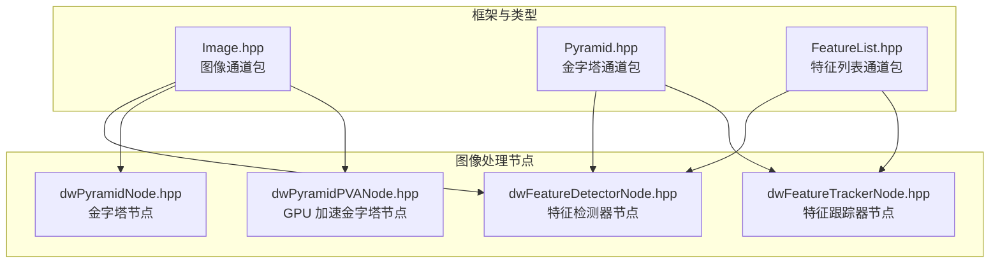
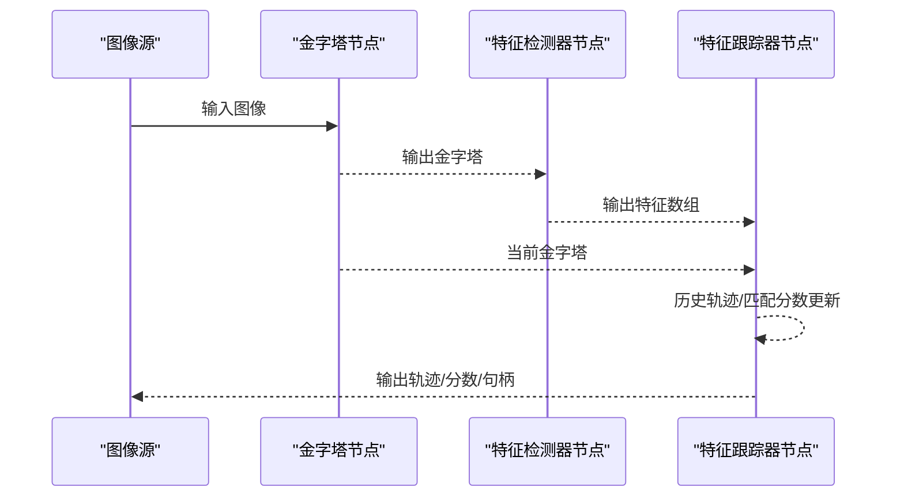
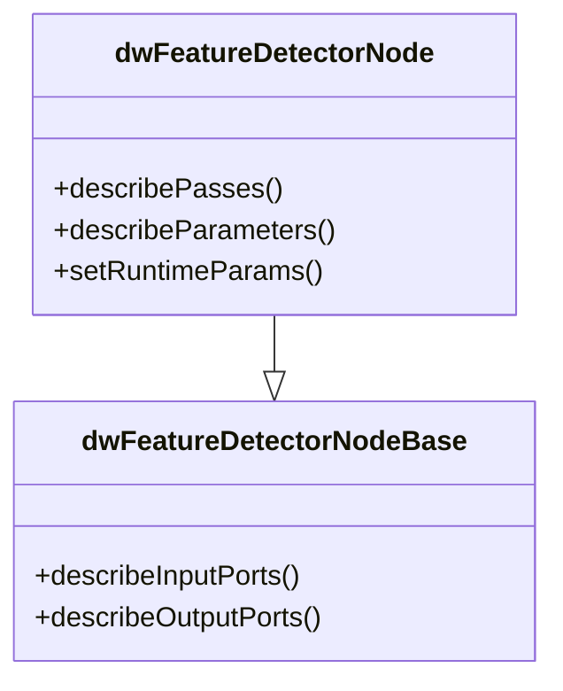
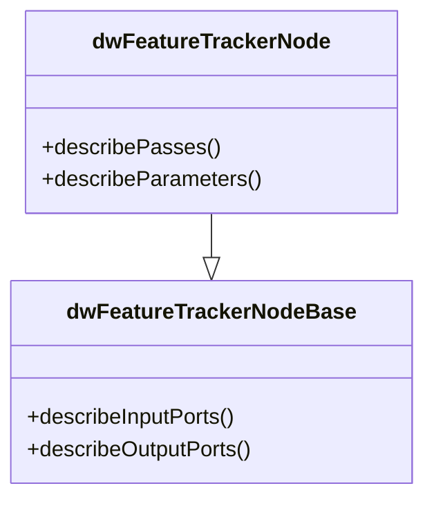
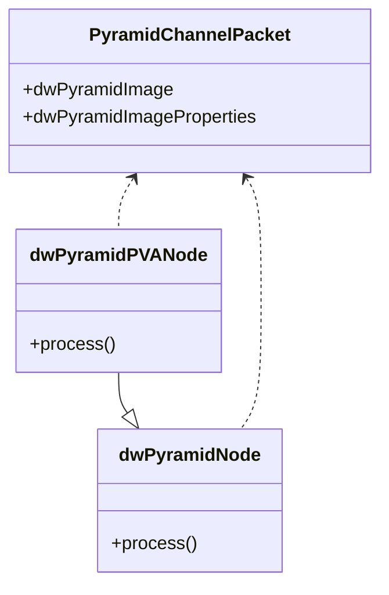
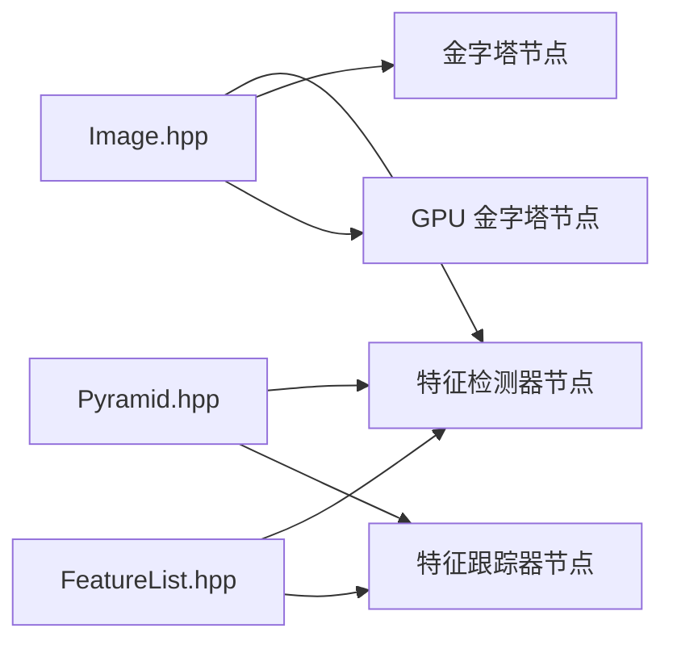

# 图像处理示例

<cite>
**本文引用的文件**
- [Image.hpp](file://driverorks-5.10/include/dwframework/dwnodes/common/channelpackets/Image.hpp)
- [Pyramid.hpp](file://driverorks-5.10/include/dwframework/dwnodes/common/channelpackets/Pyramid.hpp)
- [FeatureList.hpp](file://driverorks-5.10/include/dwframework/dwnodes/common/channelpackets/FeatureList.hpp)
- [dwFeatureDetectorNode.hpp](file://driverorks-5.10/include/dwframework/dwnodes/imageprocessing/dwfeaturedetectornode/dwFeatureDetectorNode.hpp)
- [dwFeatureTrackerNode.hpp](file://driverorks-5.10/include/dwframework/dwnodes/imageprocessing/dwfeaturetrackernode/dwFeatureTrackerNode.hpp)
- [dwPyramidNode.hpp](file://driverorks-5.10/include/dwframework/dwnodes/imageprocessing/dwpyramidnode/dwPyramidNode.hpp)
- [dwPyramidPVANode.hpp](file://driverorks-5.10/include/dwframework/dwnodes/imageprocessing/dwpyramidnode/dwPyramidPVANode.hpp)
- [README_en.md](file://README_en.md)
</cite>

## 目录
1. [简介](#简介)
2. [项目结构](#项目结构)
3. [核心组件](#核心组件)
4. [架构总览](#架构总览)
5. [详细组件分析](#详细组件分析)
6. [依赖关系分析](#依赖关系分析)
7. [性能考虑](#性能考虑)
8. [故障排查指南](#故障排查指南)
9. [结论](#结论)
10. [附录](#附录)

## 简介
本文件面向开发者，系统化介绍 Driveworks 提供的图像处理示例与能力，重点覆盖以下方面：
- 颜色校正与图像增强：白平衡、色彩空间转换与常见增强技术（通过相机模型与图像管线参数配置实现）
- 特征检测与跟踪：FAST9 特征检测器的使用、描述子计算与匹配流程
- 特征跟踪器：光流跟踪、历史轨迹维护与 GPU/CPU 协同
- 图像金字塔：多尺度构建与应用（多分辨率特征检测、缩放处理）
- 立体视觉：双目校正、视差计算与深度估计（基于相机外参与相机模型）
- 参数调优与性能优化建议：通过节点参数、流与管线阶段进行优化

说明：本文以仓库中已提供的头文件与节点接口为依据，结合 Driveworks 框架的通用模式，给出可操作的实现路径与调优建议。

## 项目结构
围绕图像处理示例，仓库中与之直接相关的目录与文件如下：
- dwframework 节点与通道包：包含图像、金字塔、特征列表等通道包定义
- 图像处理节点：特征检测器节点、特征跟踪器节点、金字塔节点
- 文档：README_en.md 提供总体背景与使用说明

**图示来源**
- [Image.hpp:34-39](file://driverorks-5.10/include/dwframework/dwnodes/common/channelpackets/Image.hpp#L34-L39)
- [Pyramid.hpp:34-38](file://driverorks-5.10/include/dwframework/dwnodes/common/channelpackets/Pyramid.hpp#L34-L38)
- [FeatureList.hpp:34-41](file://driverorks-5.10/include/dwframework/dwnodes/common/channelpackets/FeatureList.hpp#L34-L41)
- [dwFeatureDetectorNode.hpp:34-44](file://driverorks-5.10/include/dwframework/dwnodes/imageprocessing/dwfeaturedetectornode/dwFeatureDetectorNode.hpp#L34-L44)
- [dwFeatureTrackerNode.hpp:34-46](file://driverorks-5.10/include/dwframework/dwnodes/imageprocessing/dwfeaturetrackernode/dwFeatureTrackerNode.hpp#L34-L46)
- [dwPyramidNode.hpp](file://driverorks-5.10/include/dwframework/dwnodes/imageprocessing/dwpyramidnode/dwPyramidNode.hpp)
- [dwPyramidPVANode.hpp](file://driverorks-5.10/include/dwframework/dwnodes/imageprocessing/dwpyramidnode/dwPyramidPVANode.hpp)

**章节来源**
- [README_en.md](file://README_en.md)

## 核心组件
- 图像通道包（Image.hpp）：声明图像句柄与属性的通道包映射，用于在 CGF 数据流中传递图像数据
- 金字塔通道包（Pyramid.hpp）：声明金字塔句柄与属性的通道包映射，支持多尺度图像数据传递
- 特征列表通道包（FeatureList.hpp）：声明特征数组与历史特征数组的通道包映射，支撑特征检测与跟踪
- 特征检测器节点（dwFeatureDetectorNode.hpp）：接收金字塔输入与预测特征，输出新检测到的特征集合；支持 CPU/GPU 双阶段处理
- 特征跟踪器节点（dwFeatureTrackerNode.hpp）：接收当前金字塔与检测特征，输出历史轨迹、NCC 匹配分数与模块句柄；包含 SETUP/TRACK/COMPACT/COPY/WAIT/TEARDOWN 多阶段
- 金字塔节点（dwPyramidNode.hpp、dwPyramidPVANode.hpp）：构建图像金字塔，支持 CPU/GPU 或 GPU 加速路径

**章节来源**
- [Image.hpp:34-39](file://driverorks-5.10/include/dwframework/dwnodes/common/channelpackets/Image.hpp#L34-L39)
- [Pyramid.hpp:34-38](file://driverorks-5.10/include/dwframework/dwnodes/common/channelpackets/Pyramid.hpp#L34-L38)
- [FeatureList.hpp:34-41](file://driverorks-5.10/include/dwframework/dwnodes/common/channelpackets/FeatureList.hpp#L34-L41)
- [dwFeatureDetectorNode.hpp:70-87](file://driverorks-5.10/include/dwframework/dwnodes/imageprocessing/dwfeaturedetectornode/dwFeatureDetectorNode.hpp#L70-L87)
- [dwFeatureTrackerNode.hpp:67-87](file://driverorks-5.10/include/dwframework/dwnodes/imageprocessing/dwfeaturetrackernode/dwFeatureTrackerNode.hpp#L67-L87)
- [dwPyramidNode.hpp](file://driverorks-5.10/include/dwframework/dwnodes/imageprocessing/dwpyramidnode/dwPyramidNode.hpp)
- [dwPyramidPVANode.hpp](file://driverorks-5.10/include/dwframework/dwnodes/imageprocessing/dwpyramidnode/dwPyramidPVANode.hpp)

## 架构总览
下图展示了从输入图像到特征检测、跟踪与金字塔构建的整体数据流与节点交互：

**图示来源**
- [dwPyramidNode.hpp](file://driverorks-5.10/include/dwframework/dwnodes/imageprocessing/dwpyramidnode/dwPyramidNode.hpp)
- [dwFeatureDetectorNode.hpp:70-87](file://driverorks-5.10/include/dwframework/dwnodes/imageprocessing/dwfeaturedetectornode/dwFeatureDetectorNode.hpp#L70-L87)
- [dwFeatureTrackerNode.hpp:67-87](file://driverorks-5.10/include/dwframework/dwnodes/imageprocessing/dwfeaturetrackernode/dwFeatureTrackerNode.hpp#L67-L87)

## 详细组件分析

### 特征检测器节点（FAST9 等）
- 输入端口：金字塔输入、预测特征历史、NCC 分数
- 输出端口：GPU 上的特征数组
- 处理阶段：SETUP（CPU）、DETECT_NEW_FEATURE（GPU）、TEARDOWN（CPU）
- 关键参数：
  - 是否按相机初始化
  - 相机内参与外参索引
  - 特征检测器类型（如 FAST9）
  - 图像宽高（来自相机索引）
  - 最大特征数量
  - CUDA 流索引
- 使用建议：
  - 将金字塔作为检测输入，确保多尺度一致性
  - 合理设置最大特征数量，避免 GPU 内存压力
  - 使用相机内参驱动检测器配置，提升鲁棒性

**图示来源**
- [dwFeatureDetectorNode.hpp:70-155](file://driverorks-5.10/include/dwframework/dwnodes/imageprocessing/dwfeaturedetectornode/dwFeatureDetectorNode.hpp#L70-L155)

**章节来源**
- [dwFeatureDetectorNode.hpp:70-155](file://driverorks-5.10/include/dwframework/dwnodes/imageprocessing/dwfeaturedetectornode/dwFeatureDetectorNode.hpp#L70-L155)

### 特征跟踪器节点（光流/轨迹维护）
- 输入端口：当前金字塔、检测特征
- 输出端口：CPU/GPU 历史轨迹、NCC 匹配分数、模块句柄
- 处理阶段：SETUP、TRACK、COMPACT、COPY、WAIT、TEARDOWN
- 关键参数：
  - 初始化是否按相机
  - 相机内参与外参索引
  - 跟踪算法类型（如光流）
  - 检测器类型（与检测器节点一致）
  - 最大特征数量、金字塔层数
  - 图像宽高（来自相机索引）
  - CUDA 流索引
- 使用建议：
  - 保持检测器与跟踪器的检测器类型一致
  - 合理设置金字塔层数，兼顾精度与性能
  - 利用 WAIT 阶段同步 CPU/GPU，保证数据一致性

**图示来源**
- [dwFeatureTrackerNode.hpp:67-160](file://driverorks-5.10/include/dwframework/dwnodes/imageprocessing/dwfeaturetrackernode/dwFeatureTrackerNode.hpp#L67-L160)

**章节来源**
- [dwFeatureTrackerNode.hpp:67-160](file://driverorks-5.10/include/dwframework/dwnodes/imageprocessing/dwfeaturetrackernode/dwFeatureTrackerNode.hpp#L67-L160)

### 图像金字塔节点（多尺度处理）
- 通道包：金字塔句柄与属性映射
- 节点族：CPU/GPU 通用金字塔节点与 GPU 加速版本
- 应用场景：多尺度特征检测、缩放处理、层级匹配
- 使用建议：
  - 在检测前构建金字塔，确保与跟踪器金字塔层数一致
  - 对于实时场景优先考虑 GPU 加速版本

**图示来源**
- [Pyramid.hpp:34-38](file://driverorks-5.10/include/dwframework/dwnodes/common/channelpackets/Pyramid.hpp#L34-L38)
- [dwPyramidNode.hpp](file://driverorks-5.10/include/dwframework/dwnodes/imageprocessing/dwpyramidnode/dwPyramidNode.hpp)
- [dwPyramidPVANode.hpp](file://driverorks-5.10/include/dwframework/dwnodes/imageprocessing/dwpyramidnode/dwPyramidPVANode.hpp)

**章节来源**
- [Pyramid.hpp:34-38](file://driverorks-5.10/include/dwframework/dwnodes/common/channelpackets/Pyramid.hpp#L34-L38)
- [dwPyramidNode.hpp](file://driverorks-5.10/include/dwframework/dwnodes/imageprocessing/dwpyramidnode/dwPyramidNode.hpp)
- [dwPyramidPVANode.hpp](file://driverorks-5.10/include/dwframework/dwnodes/imageprocessing/dwpyramidnode/dwPyramidPVANode.hpp)

### 颜色校正与图像增强（白平衡、色彩空间转换、增强）
- 实现方式：通过相机模型与图像管线参数控制
  - 白平衡：利用相机外参与色彩模型参数进行归一化
  - 色彩空间转换：在图像处理管线中插入转换节点或通过参数指定
  - 图像增强：通过检测/跟踪前的预处理节点调整亮度、对比度、直方图均衡等
- 参数要点：
  - 相机内参与外参索引
  - 图像宽高（影响金字塔与检测区域）
  - CUDA 流索引（影响并发与吞吐）

**章节来源**
- [dwFeatureDetectorNode.hpp:105-148](file://driverorks-5.10/include/dwframework/dwnodes/imageprocessing/dwfeaturedetectornode/dwFeatureDetectorNode.hpp#L105-L148)
- [dwFeatureTrackerNode.hpp:106-156](file://driverorks-5.10/include/dwframework/dwnodes/imageprocessing/dwfeaturetrackernode/dwFeatureTrackerNode.hpp#L106-L156)

### 立体视觉（双目校正、视差、深度）
- 双目校正：通过左右相机外参与内参对齐坐标系
- 视差计算：在金字塔层级上进行半全局匹配或块匹配
- 深度估计：利用基线与视差反投影得到深度图
- 参数要点：
  - 左右相机内参与外参
  - 金字塔层数与匹配窗口大小
  - CUDA 流与内存带宽

**章节来源**
- [Pyramid.hpp:34-38](file://driverorks-5.10/include/dwframework/dwnodes/common/channelpackets/Pyramid.hpp#L34-L38)
- [dwFeatureTrackerNode.hpp:106-156](file://driverorks-5.10/include/dwframework/dwnodes/imageprocessing/dwfeaturetrackernode/dwFeatureTrackerNode.hpp#L106-L156)

## 依赖关系分析
- 通道包依赖：图像、金字塔、特征列表通道包分别依赖底层图像与特征处理库
- 节点依赖：特征检测器与跟踪器依赖金字塔通道包；跟踪器同时依赖特征列表通道包
- 处理阶段：检测器与跟踪器均采用 CPU/GPU 分阶段执行，通过 WAIT 阶段同步

**图示来源**
- [Image.hpp:34-39](file://driverorks-5.10/include/dwframework/dwnodes/common/channelpackets/Image.hpp#L34-L39)
- [Pyramid.hpp:34-38](file://driverorks-5.10/include/dwframework/dwnodes/common/channelpackets/Pyramid.hpp#L34-L38)
- [FeatureList.hpp:34-41](file://driverorks-5.10/include/dwframework/dwnodes/common/channelpackets/FeatureList.hpp#L34-L41)
- [dwFeatureDetectorNode.hpp:34-44](file://driverorks-5.10/include/dwframework/dwnodes/imageprocessing/dwfeaturedetectornode/dwFeatureDetectorNode.hpp#L34-L44)
- [dwFeatureTrackerNode.hpp:34-46](file://driverorks-5.10/include/dwframework/dwnodes/imageprocessing/dwfeaturetrackernode/dwFeatureTrackerNode.hpp#L34-L46)
- [dwPyramidNode.hpp](file://driverorks-5.10/include/dwframework/dwnodes/imageprocessing/dwpyramidnode/dwPyramidNode.hpp)
- [dwPyramidPVANode.hpp](file://driverorks-5.10/include/dwframework/dwnodes/imageprocessing/dwpyramidnode/dwPyramidPVANode.hpp)

**章节来源**
- [dwFeatureDetectorNode.hpp:34-44](file://driverorks-5.10/include/dwframework/dwnodes/imageprocessing/dwfeaturedetectornode/dwFeatureDetectorNode.hpp#L34-L44)
- [dwFeatureTrackerNode.hpp:34-46](file://driverorks-5.10/include/dwframework/dwnodes/imageprocessing/dwfeaturetrackernode/dwFeatureTrackerNode.hpp#L34-L46)
- [dwPyramidNode.hpp](file://driverorks-5.10/include/dwframework/dwnodes/imageprocessing/dwpyramidnode/dwPyramidNode.hpp)
- [dwPyramidPVANode.hpp](file://driverorks-5.10/include/dwframework/dwnodes/imageprocessing/dwpyramidnode/dwPyramidPVANode.hpp)

## 性能考虑
- 并发与流水线
  - 利用不同处理器类型的 PASS（CPU/GPU）并行化处理
  - 通过 CUDA 流索引与 WAIT 阶段协调 CPU/GPU 同步
- 内存与带宽
  - 控制最大特征数量与金字塔层数，避免显存溢出
  - 优先使用 GPU 加速的金字塔节点
- 参数敏感性
  - 图像宽高、金字塔层数、最大特征数量直接影响吞吐与精度
  - 相机内参与外参的准确性决定后续立体与跟踪质量

[本节为通用指导，无需具体文件引用]

## 故障排查指南
- 特征检测失败
  - 检查相机内参与外参索引是否正确
  - 核对图像宽高与金字塔配置是否一致
  - 降低最大特征数量，观察显存占用
- 跟踪漂移或丢失
  - 确保检测器与跟踪器的检测器类型一致
  - 增加金字塔层数或调整匹配窗口
  - 检查 CUDA 流索引与同步阶段（WAIT）
- 金字塔不一致
  - 统一检测与跟踪的金字塔层数
  - 确认输入图像尺寸与相机参数匹配

**章节来源**
- [dwFeatureDetectorNode.hpp:105-148](file://driverorks-5.10/include/dwframework/dwnodes/imageprocessing/dwfeaturedetectornode/dwFeatureDetectorNode.hpp#L105-L148)
- [dwFeatureTrackerNode.hpp:106-156](file://driverorks-5.10/include/dwframework/dwnodes/imageprocessing/dwfeaturetrackernode/dwFeatureTrackerNode.hpp#L106-L156)
- [Pyramid.hpp:34-38](file://driverorks-5.10/include/dwframework/dwnodes/common/channelpackets/Pyramid.hpp#L34-L38)

## 结论
通过 Driveworks 的通道包与节点体系，开发者可以高效地搭建从图像预处理、特征检测与跟踪，到金字塔构建与立体视觉的完整管线。建议在实际工程中：
- 明确相机标定参数与图像尺寸，确保所有节点配置一致
- 根据硬件资源与实时性需求，合理设置金字塔层数与最大特征数量
- 利用 GPU 加速节点与多阶段流水线，提升整体吞吐

[本节为总结性内容，无需具体文件引用]

## 附录
- 快速开始
  - 准备相机内参与外参
  - 构建图像金字塔
  - 运行特征检测器与跟踪器
  - 输出轨迹与匹配分数
- 参考文件
  - [README_en.md](file://README_en.md)
  - [Image.hpp:34-39](file://driverorks-5.10/include/dwframework/dwnodes/common/channelpackets/Image.hpp#L34-L39)
  - [Pyramid.hpp:34-38](file://driverorks-5.10/include/dwframework/dwnodes/common/channelpackets/Pyramid.hpp#L34-L38)
  - [FeatureList.hpp:34-41](file://driverorks-5.10/include/dwframework/dwnodes/common/channelpackets/FeatureList.hpp#L34-L41)
  - [dwFeatureDetectorNode.hpp:70-155](file://driverorks-5.10/include/dwframework/dwnodes/imageprocessing/dwfeaturedetectornode/dwFeatureDetectorNode.hpp#L70-L155)
  - [dwFeatureTrackerNode.hpp:67-160](file://driverorks-5.10/include/dwframework/dwnodes/imageprocessing/dwfeaturetrackernode/dwFeatureTrackerNode.hpp#L67-L160)
  - [dwPyramidNode.hpp](file://driverorks-5.10/include/dwframework/dwnodes/imageprocessing/dwpyramidnode/dwPyramidNode.hpp)
  - [dwPyramidPVANode.hpp](file://driverorks-5.10/include/dwframework/dwnodes/imageprocessing/dwpyramidnode/dwPyramidPVANode.hpp)